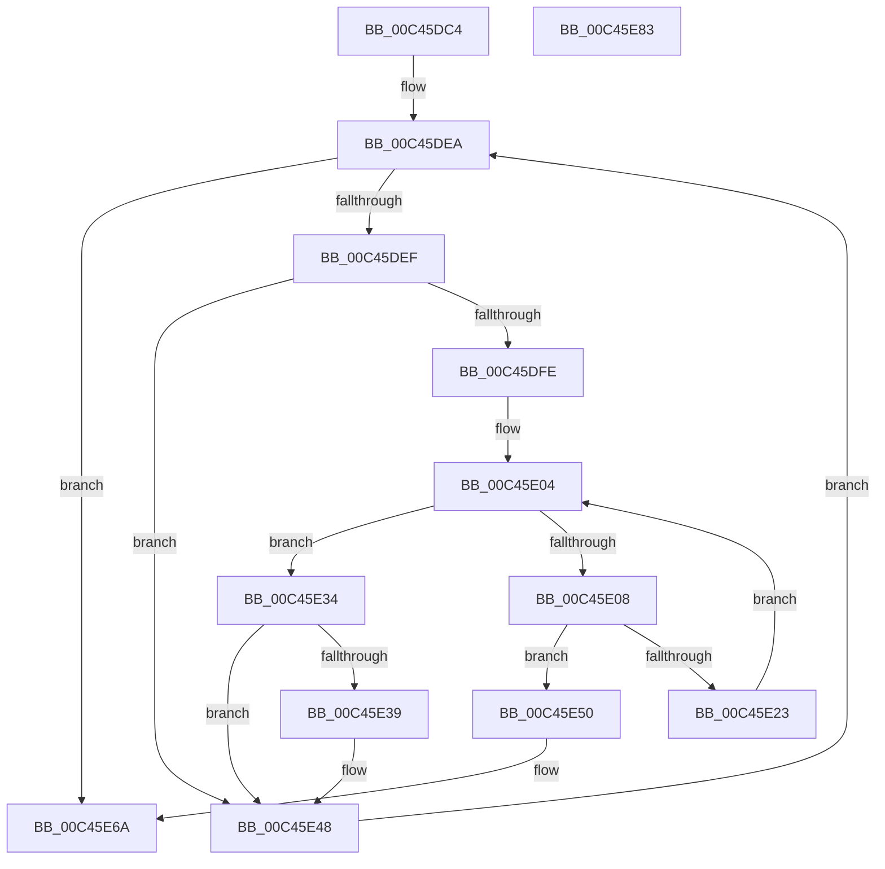

# PspInitializeSystemDlls

- RVA: `0x00C45DC4`–`0x00C45E84` (길이 `192` bytes)
- VA: `0x0000000140C45DC4`
- 실행 섹션: `INIT`
- PDB 이름 있음: `예`; PDB Function 태그: `아니요`
- unwind 정보 RVA: `0x0009F048`
- 디코드: `60`개 명령, `192/192` bytes 표시
- 미해석 바이트: `0` (있으면 어셈블리에 `.byte`로 보존)

> 이 문서는 커널 이미지의 기계어와 PDB 기호를 분석해 생성했습니다. 4번과 5번은 함수 원형과 자료형을 바이너리 사용 방식에서 추정한 C 해석이며 원본 소스 복구 결과는 아닙니다.

## 1. Dependencies

- 직접 호출 지점: **4**; 고유 호출 대상: **4**
- 직접 호출자로 확인된 함수: **1**
- RIP 상대 이미지 참조: **1**

### Outgoing calls
- `0x00C45DF1` → [PsQuerySystemDllInfo](../../page/8D/PsQuerySystemDllInfo_function_008D20F8.md) (function, `0x008D20F8`)
- `0x00C45E1A` → [PspLookupEntryPoint](PspLookupEntryPoint_function_00C45E8C.md) (function, `0x00C45E8C`)
- `0x00C45E3B` → [PspWow64GetSharedInformation](../../page/8C/PspWow64GetSharedInformation_function_008CE480.md) (function, `0x008CE480`)
- `0x00C45E64` → [KeBugCheckEx](../../text/4F/KeBugCheckEx_function_004FD660.md) (function, `0x004FD660`)

### Direct callers
- [PspInitPhase2](PspInitPhase2_function_00C45460.md) at `0x00C455D2`

### Static image references
- `0x00C45DE1` → RVA `0x00C827C8` (`INIT`; read)

## 2. Other-region calls and transfers

- 다른 실행 섹션으로 향하는 call: **3**
  - `0x00C45DF1` → [PsQuerySystemDllInfo](../../page/8D/PsQuerySystemDllInfo_function_008D20F8.md) (`INIT` → `PAGE`)
  - `0x00C45E3B` → [PspWow64GetSharedInformation](../../page/8C/PspWow64GetSharedInformation_function_008CE480.md) (`INIT` → `PAGE`)
  - `0x00C45E64` → [KeBugCheckEx](../../text/4F/KeBugCheckEx_function_004FD660.md) (`INIT` → `.text`)
- 별도 외부 분기/꼬리 이동을 확인하지 못했습니다.

## 3. Assembly (complete function range)

```asm
00C45DC4  48 8B C4                        mov rax, rsp
00C45DC7  48 89 58 10                     mov qword ptr [rax + 0x10], rbx
00C45DCB  48 89 68 18                     mov qword ptr [rax + 0x18], rbp
00C45DCF  48 89 70 20                     mov qword ptr [rax + 0x20], rsi
00C45DD3  57                              push rdi
00C45DD4  41 56                           push r14
00C45DD6  41 57                           push r15
00C45DD8  48 83 EC 30                     sub rsp, 0x30
00C45DDC  48 83 60 08 00                  and qword ptr [rax + 8], 0
00C45DE1  48 8D 3D E0 C9 03 00            lea rdi, [rip + 0x3c9e0]
00C45DE8  33 DB                           xor ebx, ebx
00C45DEA  83 FB 06                        cmp ebx, 6
00C45DED  7D 7B                           jge 0x140c45e6a
00C45DEF  8B CB                           mov ecx, ebx
00C45DF1  E8 02 C3 C8 FF                  call 0x1408d20f8
00C45DF6  48 8B E8                        mov rbp, rax
00C45DF9  48 85 C0                        test rax, rax
00C45DFC  74 4A                           je 0x140c45e48
00C45DFE  4C 8B 7F F8                     mov r15, qword ptr [rdi - 8]
00C45E02  33 F6                           xor esi, esi
00C45E04  3B 37                           cmp esi, dword ptr [rdi]
00C45E06  73 2C                           jae 0x140c45e34
00C45E08  44 8B F6                        mov r14d, esi
00C45E0B  4C 8D 44 24 50                  lea r8, [rsp + 0x50]
00C45E10  4D 03 F6                        add r14, r14
00C45E13  48 8B CD                        mov rcx, rbp
00C45E16  4B 8B 14 F7                     mov rdx, qword ptr [r15 + r14*8]
00C45E1A  E8 6D 00 00 00                  call 0x140c45e8c
00C45E1F  85 C0                           test eax, eax
00C45E21  78 2D                           js 0x140c45e50
00C45E23  4B 8B 4C F7 08                  mov rcx, qword ptr [r15 + r14*8 + 8]
00C45E28  FF C6                           inc esi
00C45E2A  48 8B 44 24 50                  mov rax, qword ptr [rsp + 0x50]
00C45E2F  48 89 01                        mov qword ptr [rcx], rax
00C45E32  EB D0                           jmp 0x140c45e04
00C45E34  83 FB 01                        cmp ebx, 1
00C45E37  75 0F                           jne 0x140c45e48
00C45E39  8B CB                           mov ecx, ebx
00C45E3B  E8 40 86 C8 FF                  call 0x1408ce480
00C45E40  48 8B 4D 18                     mov rcx, qword ptr [rbp + 0x18]
00C45E44  48 89 48 30                     mov qword ptr [rax + 0x30], rcx
00C45E48  FF C3                           inc ebx
00C45E4A  48 83 C7 10                     add rdi, 0x10
00C45E4E  EB 9A                           jmp 0x140c45dea
00C45E50  48 83 64 24 20 00               and qword ptr [rsp + 0x20], 0
00C45E56  45 33 C9                        xor r9d, r9d
00C45E59  48 63 D0                        movsxd rdx, eax
00C45E5C  41 8D 49 6B                     lea ecx, [r9 + 0x6b]
00C45E60  45 8D 41 06                     lea r8d, [r9 + 6]
00C45E64  E8 F7 77 8B FF                  call 0x1404fd660
00C45E69  CC                              int3
00C45E6A  48 8B 5C 24 58                  mov rbx, qword ptr [rsp + 0x58]
00C45E6F  48 8B 6C 24 60                  mov rbp, qword ptr [rsp + 0x60]
00C45E74  48 8B 74 24 68                  mov rsi, qword ptr [rsp + 0x68]
00C45E79  48 83 C4 30                     add rsp, 0x30
00C45E7D  41 5F                           pop r15
00C45E7F  41 5E                           pop r14
00C45E81  5F                              pop rdi
00C45E82  C3                              ret
00C45E83  CC                              int3
```

## 4. C-style interpretation (structured pseudocode)

```c
__int64 __fastcall PspInitializeSystemDlls(__int64 a1, __int64 a2, __int64 a3, int a4)
{
    __int64 result;
    __int64 v_r14;
    __int64 v_rbx;
    __int64 v_rdi;
    __int64 v_rsi;
    __int64 v_rsp;
    unsigned __int64 v_stack_m28;
    unsigned __int64 v_stack_p10;
    unsigned __int64 v_stack_p18;
    unsigned __int64 v_stack_p20;
    unsigned __int64 v_stack_p8;

    *(unsigned __int64 *)(v_rsp + 16) = v_rbx;
    *(unsigned __int64 *)(v_rsp + 24) = v_rbp;
    *(unsigned __int64 *)(v_rsp + 32) = v_rsi;
    v_rsp = (v_rsp) - (48);
    v_rbx = 0;
loc_00C45DEA:
    if (0 >= 6) goto loc_00C45E6A;
    result = PsQuerySystemDllInfo(0, a2, a3, a4);
    if (result == 0) goto loc_00C45E48;
    v_rsi = 0;
loc_00C45E04:
    if (0 >= (*(unsigned int *)(v_rip + 248288))) goto loc_00C45E34;
    v_r14 = (0) + (0);
    result = PspLookupEntryPoint(result, *(unsigned __int64 *)(*(unsigned __int64 *)(v_rip + 248288 - 8) + v_r14 * 8), v_stack_p8, a4);
    if (sign_flag) goto loc_00C45E50;
    v_rsi = (unsigned int)((v_rsi) + 1);
    *(unsigned __int64 *)(*(unsigned __int64 *)(*(unsigned __int64 *)(v_rip + 248288 - 8) + v_r14 * 8 + 8)) = v_stack_p8;
    goto loc_00C45E04;
loc_00C45E34:
    result = v_stack_p8;
    if (0 == 1) {
        a1 = 0;
        result = PspWow64GetSharedInformation(a1, *(unsigned __int64 *)(*(unsigned __int64 *)(v_rip + 248288 - 8) + v_r14 * 8), v_stack_p8, a4);
        a1 = *(unsigned __int64 *)(result + 24);
        *(unsigned __int64 *)(result + 48) = a1;
    }
    v_rbx = (unsigned int)((v_rbx) + 1);
    v_rdi = (v_rip + 248288) + (16);
    goto loc_00C45DEA;
loc_00C45E50:
    a4 = 0;
    result = KeBugCheckEx(a4 + 107, (int)((unsigned int)(result)), a4 + 6, a4);
loc_00C45E6A:
    v_rsp = (v_rsp) + (48);
    return result;
}
```

## 5. (Beta) C Style

```c
int64_t PspInitializeSystemDlls(int64_t Arg1, int64_t Arg2, int64_t Arg3, int32_t Arg4)
{
    int64_t result;
    int64_t local_r14;
    int64_t local_rbx;
    int64_t local_rdi;
    int64_t local_rsi;
    int64_t local_rsp;
    uint64_t v_stack_m28;
    uint64_t v_stack_p10;
    uint64_t v_stack_p18;
    uint64_t v_stack_p20;
    uint64_t v_stack_p8;

    *(uint64_t *)(local_rsp + 0x10) = local_rbx;
    *(uint64_t *)(local_rsp + 0x18) = local_rbp;
    *(uint64_t *)(local_rsp + 0x20) = local_rsi;
    local_rsp = (local_rsp) - (48);
    local_rbx = 0;
loc_00C45DEA:
    if (0 >= 6) goto loc_00C45E6A;
    result = PsQuerySystemDllInfo(0, Arg2, Arg3, Arg4);
    if (result == 0) goto loc_00C45E48;
    local_rsi = 0;
loc_00C45E04:
    if (0 >= (*(uint32_t *)(v_rip + 0x3C9E0))) goto loc_00C45E34;
    local_r14 = (0) + (0);
    result = PspLookupEntryPoint(result, *(uint64_t *)(*(uint64_t *)(v_rip + 0x3C9E0 - 0x8) + local_r14 * 8), v_stack_p8, Arg4);
    if (sign_flag) goto loc_00C45E50;
    local_rsi = (uint32_t)((local_rsi) + 1);
    *(uint64_t *)(*(uint64_t *)(*(uint64_t *)(v_rip + 0x3C9E0 - 0x8) + local_r14 * 8 + 0x8)) = v_stack_p8;
    goto loc_00C45E04;
loc_00C45E34:
    result = v_stack_p8;
    if (0 == 1) {
        Arg1 = 0;
        result = PspWow64GetSharedInformation(Arg1, *(uint64_t *)(*(uint64_t *)(v_rip + 0x3C9E0 - 0x8) + local_r14 * 8), v_stack_p8, Arg4);
        Arg1 = *(uint64_t *)(result + 0x18);
        *(uint64_t *)(result + 0x30) = Arg1;
    }
    local_rbx = (uint32_t)((local_rbx) + 1);
    local_rdi = (v_rip + 248288) + (16);
    goto loc_00C45DEA;
loc_00C45E50:
    Arg4 = 0;
    result = KeBugCheckEx(Arg4 + 107, (int32_t)((uint32_t)(result)), Arg4 + 6, Arg4);
loc_00C45E6A:
    local_rsp = (local_rsp) + (48);
    return result;
}
```

## 6. Execution-region graph

[열기: 2D/3D 그래프와 함수 탐색 컨트롤 패널](../../../control-panel.html?section=init&rva=0x00C45DC4&view=graph)

- 2D 그래프는 위에서 아래로 흐르고, 3D 그래프는 빈 공간을 드래그해 회전합니다. Shift+드래그는 이동, 휠은 확대·축소, 함수 노드 선택은 대상 보고서 이동입니다.

### Static fallback


