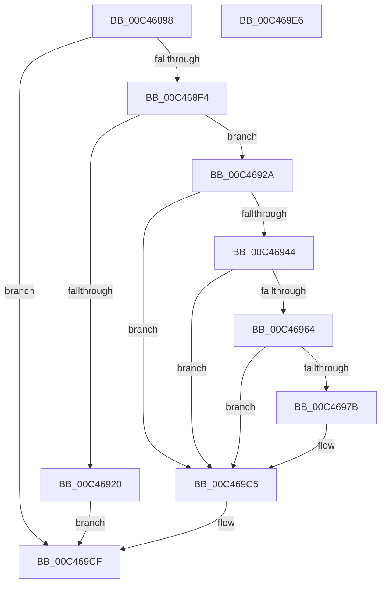

# PspInitializeSystemPartitionPhase0

- RVA: `0x00C46898`–`0x00C469E7` (길이 `335` bytes)
- VA: `0x0000000140C46898`
- 실행 섹션: `INIT`
- PDB 이름 있음: `예`; PDB Function 태그: `아니요`
- unwind 정보 RVA: `0x000BDF14`
- 디코드: `84`개 명령, `335/335` bytes 표시
- 미해석 바이트: `0` (있으면 어셈블리에 `.byte`로 보존)

> 이 문서는 커널 이미지의 기계어와 PDB 기호를 분석해 생성했습니다. 4번과 5번은 함수 원형과 자료형을 바이너리 사용 방식에서 추정한 C 해석이며 원본 소스 복구 결과는 아닙니다.

## 1. Dependencies

- 직접 호출 지점: **7**; 고유 호출 대상: **7**
- 직접 호출자로 확인된 함수: **1**
- RIP 상대 이미지 참조: **2**

### Outgoing calls
- `0x00C468E5` → [RtlCreateSecurityDescriptor](../../page/9F/RtlCreateSecurityDescriptor_function_009F1DF0.md) (function, `0x009F1DF0`)
- `0x00C46913` → [ExAllocatePool2](../../poolcode/B8/ExAllocatePool2_function_00B820F0.md) (function, `0x00B820F0`)
- `0x00C46935` → [RtlCreateAcl](../../page/91/RtlCreateAcl_function_00916F00.md) (function, `0x00916F00`)
- `0x00C46959` → [RtlAddAccessAllowedAce](../../page/92/RtlAddAccessAllowedAce_function_009298C0.md) (function, `0x009298C0`)
- `0x00C46970` → [RtlSetDaclSecurityDescriptor](../../page/9E/RtlSetDaclSecurityDescriptor_function_009EC210.md) (function, `0x009EC210`)
- `0x00C469BE` → [PsCreatePartition](../../page/78/PsCreatePartition_function_00787EB0.md) (function, `0x00787EB0`)
- `0x00C469CA` → [ExFreePoolWithTag](../../poolcode/B8/ExFreePoolWithTag_function_00B82870.md) (function, `0x00B82870`)

### Direct callers
- [PspInitPhase0](../C7/PspInitPhase0_function_00C77E2C.md) at `0x00C7888E`

### Static image references
- `0x00C468D2` → RVA `0x00C7C8B0` (` ?? ::PBOPGDP::`string'`; read)
- `0x00C468F4` → RVA `0x00FD9A68` (`PAGEDATA`; read)

## 2. Other-region calls and transfers

- 다른 실행 섹션으로 향하는 call: **7**
  - `0x00C468E5` → [RtlCreateSecurityDescriptor](../../page/9F/RtlCreateSecurityDescriptor_function_009F1DF0.md) (`INIT` → `PAGE`)
  - `0x00C46913` → [ExAllocatePool2](../../poolcode/B8/ExAllocatePool2_function_00B820F0.md) (`INIT` → `POOLCODE`)
  - `0x00C46935` → [RtlCreateAcl](../../page/91/RtlCreateAcl_function_00916F00.md) (`INIT` → `PAGE`)
  - `0x00C46959` → [RtlAddAccessAllowedAce](../../page/92/RtlAddAccessAllowedAce_function_009298C0.md) (`INIT` → `PAGE`)
  - `0x00C46970` → [RtlSetDaclSecurityDescriptor](../../page/9E/RtlSetDaclSecurityDescriptor_function_009EC210.md) (`INIT` → `PAGE`)
  - `0x00C469BE` → [PsCreatePartition](../../page/78/PsCreatePartition_function_00787EB0.md) (`INIT` → `PAGE`)
  - `0x00C469CA` → [ExFreePoolWithTag](../../poolcode/B8/ExFreePoolWithTag_function_00B82870.md) (`INIT` → `POOLCODE`)
- 별도 외부 분기/꼬리 이동을 확인하지 못했습니다.

## 3. Assembly (complete function range)

```asm
00C46898  48 89 5C 24 08                  mov qword ptr [rsp + 8], rbx
00C4689D  48 89 7C 24 10                  mov qword ptr [rsp + 0x10], rdi
00C468A2  55                              push rbp
00C468A3  48 8D 6C 24 A9                  lea rbp, [rsp - 0x57]
00C468A8  48 81 EC A0 00 00 00            sub rsp, 0xa0
00C468AF  33 C0                           xor eax, eax
00C468B1  48 C7 45 E7 3E 00 40 00         mov qword ptr [rbp - 0x19], 0x40003e
00C468B9  21 45 3B                        and dword ptr [rbp + 0x3b], eax
00C468BC  48 8D 4D F7                     lea rcx, [rbp - 9]
00C468C0  89 45 23                        mov dword ptr [rbp + 0x23], eax
00C468C3  0F 57 C0                        xorps xmm0, xmm0
00C468C6  21 45 23                        and dword ptr [rbp + 0x23], eax
00C468C9  BA 01 00 00 00                  mov edx, 1
00C468CE  48 89 45 17                     mov qword ptr [rbp + 0x17], rax
00C468D2  48 8D 05 D7 5F 03 00            lea rax, [rip + 0x35fd7]
00C468D9  48 89 45 EF                     mov qword ptr [rbp - 0x11], rax
00C468DD  0F 11 45 F7                     movups xmmword ptr [rbp - 9], xmm0
00C468E1  0F 11 45 07                     movups xmmword ptr [rbp + 7], xmm0
00C468E5  E8 06 B5 DA FF                  call 0x1409f1df0
00C468EA  8B D8                           mov ebx, eax
00C468EC  85 C0                           test eax, eax
00C468EE  0F 88 DB 00 00 00               js 0x140c469cf
00C468F4  48 8B 05 6D 31 39 00            mov rax, qword ptr [rip + 0x39316d]
00C468FB  41 B8 44 61 63 6C               mov r8d, 0x6c636144
00C46901  0F B6 48 01                     movzx ecx, byte ptr [rax + 1]
00C46905  8D 1C 8D 1C 00 00 00            lea ebx, [rcx*4 + 0x1c]
00C4690C  B9 00 01 00 00                  mov ecx, 0x100
00C46911  8B D3                           mov edx, ebx
00C46913  E8 D8 B7 F3 FF                  call 0x140b820f0
00C46918  48 8B F8                        mov rdi, rax
00C4691B  48 85 C0                        test rax, rax
00C4691E  75 0A                           jne 0x140c4692a
00C46920  BB 9A 00 00 C0                  mov ebx, 0xc000009a
00C46925  E9 A5 00 00 00                  jmp 0x140c469cf
00C4692A  41 B8 02 00 00 00               mov r8d, 2
00C46930  8B D3                           mov edx, ebx
00C46932  48 8B CF                        mov rcx, rdi
00C46935  E8 C6 05 CD FF                  call 0x140916f00
00C4693A  8B D8                           mov ebx, eax
00C4693C  85 C0                           test eax, eax
00C4693E  0F 88 81 00 00 00               js 0x140c469c5
00C46944  4C 8B 0D 1D 31 39 00            mov r9, qword ptr [rip + 0x39311d]
00C4694B  BA 02 00 00 00                  mov edx, 2
00C46950  41 B8 03 00 1F 00               mov r8d, 0x1f0003
00C46956  48 8B CF                        mov rcx, rdi
00C46959  E8 62 2F CE FF                  call 0x1409298c0
00C4695E  8B D8                           mov ebx, eax
00C46960  85 C0                           test eax, eax
00C46962  78 61                           js 0x140c469c5
00C46964  45 33 C9                        xor r9d, r9d
00C46967  48 8D 4D F7                     lea rcx, [rbp - 9]
00C4696B  4C 8B C7                        mov r8, rdi
00C4696E  B2 01                           mov dl, 1
00C46970  E8 9B 58 DA FF                  call 0x1409ec210
00C46975  8B D8                           mov ebx, eax
00C46977  85 C0                           test eax, eax
00C46979  78 4A                           js 0x140c469c5
00C4697B  48 83 65 27 00                  and qword ptr [rbp + 0x27], 0
00C46980  48 8D 45 E7                     lea rax, [rbp - 0x19]
00C46984  48 83 65 47 00                  and qword ptr [rbp + 0x47], 0
00C46989  4C 8D 4D 1F                     lea r9, [rbp + 0x1f]
00C4698D  48 89 45 2F                     mov qword ptr [rbp + 0x2f], rax
00C46991  33 D2                           xor edx, edx
00C46993  48 8D 45 F7                     lea rax, [rbp - 9]
00C46997  C7 44 24 28 01 00 00 00         mov dword ptr [rsp + 0x28], 1
00C4699F  33 C9                           xor ecx, ecx
00C469A1  48 89 45 3F                     mov qword ptr [rbp + 0x3f], rax
00C469A5  41 B8 03 00 1F 00               mov r8d, 0x1f0003
00C469AB  C7 45 1F 30 00 00 00            mov dword ptr [rbp + 0x1f], 0x30
00C469B2  C7 45 37 00 02 00 00            mov dword ptr [rbp + 0x37], 0x200
00C469B9  C6 44 24 20 00                  mov byte ptr [rsp + 0x20], 0
00C469BE  E8 ED 14 B4 FF                  call 0x140787eb0
00C469C3  8B D8                           mov ebx, eax
00C469C5  33 D2                           xor edx, edx
00C469C7  48 8B CF                        mov rcx, rdi
00C469CA  E8 A1 BE F3 FF                  call 0x140b82870
00C469CF  4C 8D 9C 24 A0 00 00 00         lea r11, [rsp + 0xa0]
00C469D7  8B C3                           mov eax, ebx
00C469D9  49 8B 5B 10                     mov rbx, qword ptr [r11 + 0x10]
00C469DD  49 8B 7B 18                     mov rdi, qword ptr [r11 + 0x18]
00C469E1  49 8B E3                        mov rsp, r11
00C469E4  5D                              pop rbp
00C469E5  C3                              ret
00C469E6  CC                              int3
```

## 4. C-style interpretation (structured pseudocode)

```c
__int64 __fastcall PspInitializeSystemPartitionPhase0(void)
{
    __int64 result;
    __int64 v_rbx;
    __int64 v_rsp;
    unsigned __int64 v_stack_m18;
    unsigned __int64 v_stack_m20;
    unsigned int v_stack_m24;
    unsigned int v_stack_m28;
    unsigned __int64 v_stack_m30;
    unsigned __int64 v_stack_m38;
    unsigned int v_stack_m3C;
    unsigned __int64 v_stack_m40;
    unsigned __int64 v_stack_m48;
    unsigned __int64 v_stack_m58;
    unsigned __int64 v_stack_m5F;
    unsigned __int64 v_stack_m68;
    unsigned __int64 v_stack_m70;
    unsigned __int64 v_stack_m78;
    unsigned __int64 v_stack_m8;
    unsigned int v_stack_m80;
    unsigned __int8 v_stack_m88;
    unsigned __int64 v_stack_p10;
    unsigned __int64 v_stack_p8;

    v_stack_p8 = v_rbx;
    v_stack_p10 = v_rdi;
    v_rsp = (v_rsp) - (160);
    result = 0;
    v_stack_m78 = 0x40003EULL;
    v_stack_m3C = 0;
    v_stack_m48 = 0;
    v_stack_m70 = v_rip + 221143;
    v_stack_m68 = v_xmm0;
    v_stack_m58 = v_xmm0;
    result = RtlCreateSecurityDescriptor(v_stack_m68, 1, a3, a4);
    if (sign_flag) goto loc_00C469CF;
    result = ExAllocatePool2(256, (unsigned int)((unsigned int)(*(unsigned __int8 *)(*(unsigned __int64 *)(v_rip + 3748205) + 1) * 4 + 28)), (unsigned int)(0x6C636144ULL), a4);
    if (result != 0) goto loc_00C4692A;
    goto loc_00C469CF;
loc_00C4692A:
    result = RtlCreateAcl(result, (unsigned int)((unsigned int)((unsigned int)(0xC000009AULL))), 2, a4);
    if (sign_flag) goto loc_00C469C5;
    result = RtlAddAccessAllowedAce(result, 2, (unsigned int)(0x1F0003ULL), *(unsigned __int64 *)(v_rip + 3748125));
    if (sign_flag) goto loc_00C469C5;
    a4 = 0;
    result = RtlSetDaclSecurityDescriptor(v_stack_m68, 1, result, a4);
    v_rbx = (unsigned int)((unsigned int)(result));
    if (!(sign_flag)) {
        result = v_stack_m78;
        a4 = v_stack_m40;
        v_stack_m30 = result;
        a2 = 0;
        result = v_stack_m68;
        v_stack_m80 = 1;
        a1 = 0;
        v_stack_m20 = result;
        a3 = 0x1F0003ULL;
        v_stack_m40 = 48;
        v_stack_m28 = 512;
        v_stack_m88 = 0;
        result = PsCreatePartition(a1, a2, a3, a4);
        v_rbx = (unsigned int)(result);
    }
    a2 = 0;
    result = ExFreePoolWithTag(result, a2, a3, a4);
loc_00C469CF:
    return (unsigned int)((unsigned int)(v_rbx));
}
```

## 5. (Beta) C Style

```c
void PspInitializeSystemPartitionPhase0(void)
{
    int64_t result;
    int64_t local_rbx;
    int64_t local_rsp;
    uint64_t v_stack_m18;
    uint64_t v_stack_m20;
    uint32_t v_stack_m24;
    uint32_t v_stack_m28;
    uint64_t v_stack_m30;
    uint64_t v_stack_m38;
    uint32_t v_stack_m3C;
    uint64_t v_stack_m40;
    uint64_t v_stack_m48;
    uint64_t v_stack_m58;
    uint64_t v_stack_m5F;
    uint64_t v_stack_m68;
    uint64_t v_stack_m70;
    uint64_t v_stack_m78;
    uint64_t v_stack_m8;
    uint32_t v_stack_m80;
    uint8_t v_stack_m88;
    uint64_t v_stack_p10;
    uint64_t v_stack_p8;

    v_stack_p8 = local_rbx;
    v_stack_p10 = local_rdi;
    local_rsp = (local_rsp) - (160);
    result = 0;
    v_stack_m78 = 0x40003EULL;
    v_stack_m3C = 0;
    v_stack_m48 = 0;
    v_stack_m70 = v_rip + 221143;
    v_stack_m68 = v_xmm0;
    v_stack_m58 = v_xmm0;
    result = RtlCreateSecurityDescriptor(v_stack_m68, 1, a3, a4);
    if (sign_flag) goto loc_00C469CF;
    result = ExAllocatePool2(256, (uint32_t)((uint32_t)(*(uint8_t *)(*(uint64_t *)(v_rip + 0x39316D) + 0x1) * 4 + 28)), (uint32_t)(0x6C636144ULL), a4);
    if (result != 0) goto loc_00C4692A;
    goto loc_00C469CF;
loc_00C4692A:
    result = RtlCreateAcl(result, (uint32_t)((uint32_t)((uint32_t)(0xC000009AULL))), 2, a4);
    if (sign_flag) goto loc_00C469C5;
    result = RtlAddAccessAllowedAce(result, 2, (uint32_t)(0x1F0003ULL), *(uint64_t *)(v_rip + 0x39311D));
    if (sign_flag) goto loc_00C469C5;
    a4 = 0;
    result = RtlSetDaclSecurityDescriptor(v_stack_m68, 1, result, a4);
    local_rbx = (uint32_t)((uint32_t)(result));
    if (!(sign_flag)) {
        result = v_stack_m78;
        a4 = v_stack_m40;
        v_stack_m30 = result;
        a2 = 0;
        result = v_stack_m68;
        v_stack_m80 = 1;
        a1 = 0;
        v_stack_m20 = result;
        a3 = 0x1F0003ULL;
        v_stack_m40 = 48;
        v_stack_m28 = 512;
        v_stack_m88 = 0;
        result = PsCreatePartition(a1, a2, a3, a4);
        local_rbx = (uint32_t)(result);
    }
    a2 = 0;
    result = ExFreePoolWithTag(result, a2, a3, a4);
loc_00C469CF:
    return (uint32_t)((uint32_t)(local_rbx));
}
```

## 6. Execution-region graph

[열기: 2D/3D 그래프와 함수 탐색 컨트롤 패널](../../../control-panel.html?section=init&rva=0x00C46898&view=graph)

- 2D 그래프는 위에서 아래로 흐르고, 3D 그래프는 빈 공간을 드래그해 회전합니다. Shift+드래그는 이동, 휠은 확대·축소, 함수 노드 선택은 대상 보고서 이동입니다.

### Static fallback


