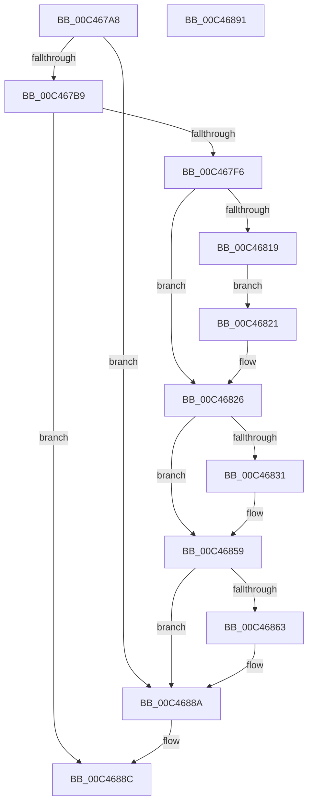

# PspIumInitialize

- RVA: `0x00C467A8`–`0x00C46892` (길이 `234` bytes)
- VA: `0x0000000140C467A8`
- 실행 섹션: `INIT`
- PDB 이름 있음: `예`; PDB Function 태그: `아니요`
- unwind 정보 RVA: `0x000CF430`
- 디코드: `46`개 명령, `234/234` bytes 표시
- 미해석 바이트: `0` (있으면 어셈블리에 `.byte`로 보존)

> 이 문서는 커널 이미지의 기계어와 PDB 기호를 분석해 생성했습니다. 4번과 5번은 함수 원형과 자료형을 바이너리 사용 방식에서 추정한 C 해석이며 원본 소스 복구 결과는 아닙니다.

## 1. Dependencies

- 직접 호출 지점: **5**; 고유 호출 대상: **5**
- 직접 호출자로 확인된 함수: **1**
- RIP 상대 이미지 참조: **14**

### Outgoing calls
- `0x00C467E1` → [MmAllocateMappingAddress](../../page/A7/MmAllocateMappingAddress_function_00A72690.md) (function, `0x00A72690`)
- `0x00C46808` → [MmAllocateIndependentPagesEx](../../page/AA/MmAllocateIndependentPagesEx_function_00AA0CFC.md) (function, `0x00AA0CFC`)
- `0x00C46821` → [VslRegisterLogPages](../../text/4D/VslRegisterLogPages_function_004D32F0.md) (function, `0x004D32F0`)
- `0x00C46828` → [VslGetNestedPageProtectionFlags](../../text/2F/VslGetNestedPageProtectionFlags_function_002F2164.md) (function, `0x002F2164`)
- `0x00C46885` → [KeRegisterBugCheckReasonCallback](../../text/47/KeRegisterBugCheckReasonCallback_function_004720A0.md) (function, `0x004720A0`)

### Direct callers
- [PspInitPhase0](../C7/PspInitPhase0_function_00C77E2C.md) at `0x00C789FD`

### Static image references
- `0x00C467AC` → RVA `0x00FC6A84` (`ALMOSTRO`; read)
- `0x00C467B9` → RVA `0x004C98C0` (`PspIumWorker`; read)
- `0x00C467C0` → RVA `0x00F05DD0` (`.data`; write)
- `0x00C467C7` → RVA `0x00F05DD8` (`.data`; read/write)
- `0x00C467CF` → RVA `0x00F05DC0` (`.data`; read/write)
- `0x00C467E6` → RVA `0x00FC7018` (`ALMOSTRO`; write)
- `0x00C4680D` → RVA `0x00FC6D08` (`ALMOSTRO`; write)
- `0x00C46831` → RVA `0x00FC7108` (`ALMOSTRO`; read)
- `0x00C46852` → RVA `0x00FC7108` (`ALMOSTRO`; write)
- `0x00C46859` → RVA `0x00FC6D08` (`ALMOSTRO`; read)
- `0x00C46863` → RVA `0x00F05DAC` (`.data`; write)
- `0x00C4686A` → RVA `0x0002C428` (`.rdata`; read)
- `0x00C46877` → RVA `0x005E49C0` (`PspVsmLogBugCheckCallback`; read)
- `0x00C4687E` → RVA `0x00F05D80` (`.data`; read)

## 2. Other-region calls and transfers

- 다른 실행 섹션으로 향하는 call: **5**
  - `0x00C467E1` → [MmAllocateMappingAddress](../../page/A7/MmAllocateMappingAddress_function_00A72690.md) (`INIT` → `PAGE`)
  - `0x00C46808` → [MmAllocateIndependentPagesEx](../../page/AA/MmAllocateIndependentPagesEx_function_00AA0CFC.md) (`INIT` → `PAGE`)
  - `0x00C46821` → [VslRegisterLogPages](../../text/4D/VslRegisterLogPages_function_004D32F0.md) (`INIT` → `.text`)
  - `0x00C46828` → [VslGetNestedPageProtectionFlags](../../text/2F/VslGetNestedPageProtectionFlags_function_002F2164.md) (`INIT` → `.text`)
  - `0x00C46885` → [KeRegisterBugCheckReasonCallback](../../text/47/KeRegisterBugCheckReasonCallback_function_004720A0.md) (`INIT` → `.text`)
- 별도 외부 분기/꼬리 이동을 확인하지 못했습니다.

## 3. Assembly (complete function range)

```asm
00C467A8  48 83 EC 28                     sub rsp, 0x28
00C467AC  80 3D D1 02 38 00 00            cmp byte ptr [rip + 0x3802d1], 0
00C467B3  0F 84 D1 00 00 00               je 0x140c4688a
00C467B9  48 8D 05 00 31 88 FF            lea rax, [rip - 0x77cf00]
00C467C0  48 89 05 09 F6 2B 00            mov qword ptr [rip + 0x2bf609], rax
00C467C7  48 83 25 09 F6 2B 00 00         and qword ptr [rip + 0x2bf609], 0
00C467CF  48 83 25 E9 F5 2B 00 00         and qword ptr [rip + 0x2bf5e9], 0
00C467D7  BA 56 73 6D 46                  mov edx, 0x466d7356
00C467DC  B9 00 10 00 00                  mov ecx, 0x1000
00C467E1  E8 AA BE E2 FF                  call 0x140a72690
00C467E6  48 89 05 2B 08 38 00            mov qword ptr [rip + 0x38082b], rax
00C467ED  48 85 C0                        test rax, rax
00C467F0  0F 84 96 00 00 00               je 0x140c4688c
00C467F6  41 B9 01 00 00 00               mov r9d, 1
00C467FC  49 83 C8 FF                     or r8, 0xffffffffffffffff
00C46800  83 CA FF                        or edx, 0xffffffff
00C46803  B9 00 20 00 00                  mov ecx, 0x2000
00C46808  E8 EF A4 E5 FF                  call 0x140aa0cfc
00C4680D  48 89 05 F4 04 38 00            mov qword ptr [rip + 0x3804f4], rax
00C46814  48 85 C0                        test rax, rax
00C46817  74 0D                           je 0x140c46826
00C46819  C7 00 FF FF FF FF               mov dword ptr [rax], 0xffffffff
00C4681F  EB 00                           jmp 0x140c46821
00C46821  E8 CA CA 88 FF                  call 0x1404d32f0
00C46826  33 C9                           xor ecx, ecx
00C46828  E8 37 B9 6A FF                  call 0x1402f2164
00C4682D  A8 40                           test al, 0x40
00C4682F  74 28                           je 0x140c46859
00C46831  48 8B 05 D0 08 38 00            mov rax, qword ptr [rip + 0x3808d0]
00C46838  48 B9 FF FF FF FF 5F FF FF FF   movabs rcx, 0xffffff5fffffffff
00C46842  48 23 C1                        and rax, rcx
00C46845  48 B9 00 00 00 00 50 00 00 00   movabs rcx, 0x5000000000
00C4684F  48 0B C1                        or rax, rcx
00C46852  48 89 05 AF 08 38 00            mov qword ptr [rip + 0x3808af], rax
00C46859  48 83 3D A7 04 38 00 00         cmp qword ptr [rip + 0x3804a7], 0
00C46861  74 27                           je 0x140c4688a
00C46863  C6 05 42 F5 2B 00 00            mov byte ptr [rip + 0x2bf542], 0
00C4686A  4C 8D 0D B7 5B 3E FF            lea r9, [rip - 0xc1a449]
00C46871  41 B8 02 00 00 00               mov r8d, 2
00C46877  48 8D 15 42 E1 99 FF            lea rdx, [rip - 0x661ebe]
00C4687E  48 8D 0D FB F4 2B 00            lea rcx, [rip + 0x2bf4fb]
00C46885  E8 16 B8 82 FF                  call 0x1404720a0
00C4688A  B0 01                           mov al, 1
00C4688C  48 83 C4 28                     add rsp, 0x28
00C46890  C3                              ret
00C46891  CC                              int3
```

## 4. C-style interpretation (structured pseudocode)

```c
__int64 __fastcall PspIumInitialize(__int64 a1, __int64 a2, __int64 a3)
{
    __int64 result;
    __int64 v_rsp;

    v_rsp = (v_rsp) - (40);
    if ((*(unsigned __int8 *)(v_rip + 3670737)) == 0) goto loc_00C4688A;
    *(unsigned __int64 *)(v_rip + 2881033) = v_rip - 7851776;
    result = MmAllocateMappingAddress((unsigned int)(0x1000ULL), (unsigned int)(0x466D7356ULL), a3, a4);
    *(unsigned __int64 *)(v_rip + 3672107) = result;
    if (result == 0) goto loc_00C4688C;
    a3 = (a3) | (-1);
    a2 = (unsigned int)(((unsigned int)(0x466D7356ULL)) | (0xFFFFFFFFULL));
    result = MmAllocateIndependentPagesEx((unsigned int)(0x2000ULL), a2, a3, 1);
    *(unsigned __int64 *)(v_rip + 3671284) = result;
    if (result == 0) goto loc_00C46826;
    *(unsigned int *)(result) = 0xFFFFFFFFULL;
    goto loc_00C46821;
loc_00C46821:
    result = VslRegisterLogPages((unsigned int)(0x2000ULL), a2, a3, 1);
loc_00C46826:
    a1 = 0;
    result = VslGetNestedPageProtectionFlags(a1, a2, a3, 1);
    if ((((unsigned __int8)(result)) & (64)) != 0) {
        result = *(unsigned __int64 *)(v_rip + 3672272);
        result = (result) & (0);
        result = (result) | (0);
        *(unsigned __int64 *)(v_rip + 3672239) = result;
    }
    if ((*(unsigned __int64 *)(v_rip + 3671207)) != 0) {
        *(unsigned __int8 *)(v_rip + 2880834) = 0;
        a4 = v_rip - 12690505;
        a3 = 2;
        a2 = v_rip - 6692542;
        a1 = v_rip + 2880763;
        result = KeRegisterBugCheckReasonCallback(a1, a2, a3, a4);
    }
loc_00C4688C:
    v_rsp = (v_rsp) + (40);
    return 1;
}
```

## 5. (Beta) C Style

```c
int64_t PspIumInitialize(int64_t Arg1, int64_t Arg2, int64_t Arg3)
{
    int64_t result;
    int64_t local_rsp;

    local_rsp = (local_rsp) - (40);
    if ((*(uint8_t *)(v_rip + 0x3802D1)) == 0) goto loc_00C4688A;
    *(uint64_t *)(v_rip + 0x2BF609) = v_rip - 7851776;
    result = MmAllocateMappingAddress((uint32_t)(0x1000ULL), (uint32_t)(0x466D7356ULL), Arg3, a4);
    *(uint64_t *)(v_rip + 0x38082B) = result;
    if (result == 0) goto loc_00C4688C;
    Arg3 = (Arg3) | (-1);
    Arg2 = (uint32_t)(((uint32_t)(0x466D7356ULL)) | (0xFFFFFFFFULL));
    result = MmAllocateIndependentPagesEx((uint32_t)(0x2000ULL), Arg2, Arg3, 1);
    *(uint64_t *)(v_rip + 0x3804F4) = result;
    if (result == 0) goto loc_00C46826;
    *(uint32_t *)(result) = 0xFFFFFFFFULL;
    goto loc_00C46821;
loc_00C46821:
    result = VslRegisterLogPages((uint32_t)(0x2000ULL), Arg2, Arg3, 1);
loc_00C46826:
    Arg1 = 0;
    result = VslGetNestedPageProtectionFlags(Arg1, Arg2, Arg3, 1);
    if ((((uint8_t)(result)) & (64)) != 0) {
        result = *(uint64_t *)(v_rip + 0x3808D0);
        result = (result) & (0);
        result = (result) | (0);
        *(uint64_t *)(v_rip + 0x3808AF) = result;
    }
    if ((*(uint64_t *)(v_rip + 0x3804A7)) != 0) {
        *(uint8_t *)(v_rip + 0x2BF542) = 0;
        a4 = v_rip - 12690505;
        Arg3 = 2;
        Arg2 = v_rip - 6692542;
        Arg1 = v_rip + 2880763;
        result = KeRegisterBugCheckReasonCallback(Arg1, Arg2, Arg3, a4);
    }
loc_00C4688C:
    local_rsp = (local_rsp) + (40);
    return 1;
}
```

## 6. Execution-region graph

[열기: 2D/3D 그래프와 함수 탐색 컨트롤 패널](../../../control-panel.html?section=init&rva=0x00C467A8&view=graph)

- 2D 그래프는 위에서 아래로 흐르고, 3D 그래프는 빈 공간을 드래그해 회전합니다. Shift+드래그는 이동, 휠은 확대·축소, 함수 노드 선택은 대상 보고서 이동입니다.

### Static fallback


