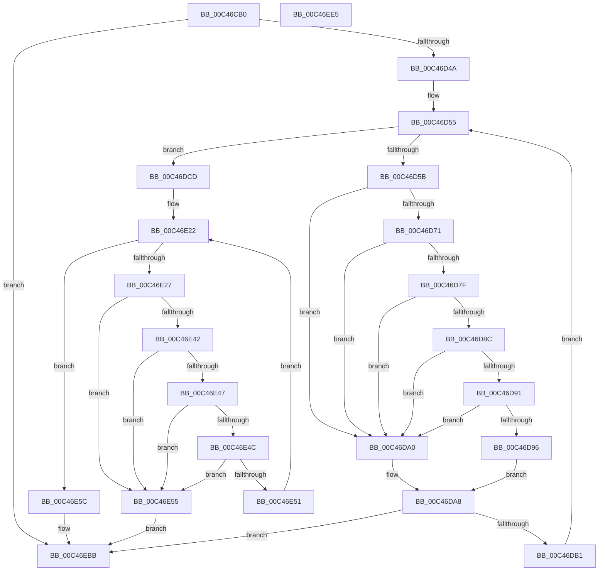

# PspLocateNtdllAddressesForScpCfg

- RVA: `0x00C46CB0`–`0x00C46EE6` (길이 `566` bytes)
- VA: `0x0000000140C46CB0`
- 실행 섹션: `INIT`
- PDB 이름 있음: `예`; PDB Function 태그: `아니요`
- unwind 정보 RVA: `0x000CF6B4`
- 디코드: `144`개 명령, `566/566` bytes 표시
- 미해석 바이트: `0` (있으면 어셈블리에 `.byte`로 보존)

> 이 문서는 커널 이미지의 기계어와 PDB 기호를 분석해 생성했습니다. 4번과 5번은 함수 원형과 자료형을 바이너리 사용 방식에서 추정한 C 해석이며 원본 소스 복구 결과는 아닙니다.

## 1. Dependencies

- 직접 호출 지점: **9**; 고유 호출 대상: **6**
- 직접 호출자로 확인된 함수: **1**
- RIP 상대 이미지 참조: **6**

### Outgoing calls
- `0x00C46CED` → [memset](../../text/6C/memset_function_006C6C40.md) (function, `0x006C6C40`)
- `0x00C46CFB` → [PsQuerySystemDllInfo](../../page/8D/PsQuerySystemDllInfo_function_008D20F8.md) (function, `0x008D20F8`)
- `0x00C46D19` → [RtlImageNtHeaderEx](../../text/41/RtlImageNtHeaderEx_function_0041EAA0.md) (function, `0x0041EAA0`)
- `0x00C46D3D` → [PspCopyNtdllExport](PspCopyNtdllExport_function_00C469F0.md) (function, `0x00C469F0`)
- `0x00C46E64` → [MmGetScpCfgFunctionOffset](../../page/A8/MmGetScpCfgFunctionOffset_function_00A83394.md) (function, `0x00A83394`)
- `0x00C46E7B` → [MmGetScpCfgFunctionOffset](../../page/A8/MmGetScpCfgFunctionOffset_function_00A83394.md) (function, `0x00A83394`)
- `0x00C46E92` → [MmGetScpCfgFunctionOffset](../../page/A8/MmGetScpCfgFunctionOffset_function_00A83394.md) (function, `0x00A83394`)
- `0x00C46EA8` → [MmGetScpCfgFunctionOffset](../../page/A8/MmGetScpCfgFunctionOffset_function_00A83394.md) (function, `0x00A83394`)
- `0x00C46EC6` → [_security_check_cookie](../../text/6A/_security_check_cookie_function_006AC640.md) (function, `0x006AC640`)

### Direct callers
- [PsInitializeScpCfgPages](PsInitializeScpCfgPages_function_00C46EEC.md) at `0x00C46F63`

### Static image references
- `0x00C46CC8` → RVA `0x00E0A740` (`.data`; read)
- `0x00C46D33` → RVA `0x00C7C8F0` (` ?? ::PBOPGDP::`string'`; read)
- `0x00C46E6F` → RVA `0x00FC7600` (`ALMOSTRO`; write)
- `0x00C46E86` → RVA `0x00FC7608` (`ALMOSTRO`; write)
- `0x00C46E9C` → RVA `0x00FC7610` (`ALMOSTRO`; write)
- `0x00C46EB2` → RVA `0x00FC7618` (`ALMOSTRO`; write)

## 2. Other-region calls and transfers

- 다른 실행 섹션으로 향하는 call: **8**
  - `0x00C46CED` → [memset](../../text/6C/memset_function_006C6C40.md) (`INIT` → `.text`)
  - `0x00C46CFB` → [PsQuerySystemDllInfo](../../page/8D/PsQuerySystemDllInfo_function_008D20F8.md) (`INIT` → `PAGE`)
  - `0x00C46D19` → [RtlImageNtHeaderEx](../../text/41/RtlImageNtHeaderEx_function_0041EAA0.md) (`INIT` → `.text`)
  - `0x00C46E64` → [MmGetScpCfgFunctionOffset](../../page/A8/MmGetScpCfgFunctionOffset_function_00A83394.md) (`INIT` → `PAGE`)
  - `0x00C46E7B` → [MmGetScpCfgFunctionOffset](../../page/A8/MmGetScpCfgFunctionOffset_function_00A83394.md) (`INIT` → `PAGE`)
  - `0x00C46E92` → [MmGetScpCfgFunctionOffset](../../page/A8/MmGetScpCfgFunctionOffset_function_00A83394.md) (`INIT` → `PAGE`)
  - `0x00C46EA8` → [MmGetScpCfgFunctionOffset](../../page/A8/MmGetScpCfgFunctionOffset_function_00A83394.md) (`INIT` → `PAGE`)
  - `0x00C46EC6` → [_security_check_cookie](../../text/6A/_security_check_cookie_function_006AC640.md) (`INIT` → `.text`)
- 별도 외부 분기/꼬리 이동을 확인하지 못했습니다.

## 3. Assembly (complete function range)

```asm
00C46CB0  48 89 5C 24 08                  mov qword ptr [rsp + 8], rbx
00C46CB5  48 89 74 24 10                  mov qword ptr [rsp + 0x10], rsi
00C46CBA  48 89 7C 24 18                  mov qword ptr [rsp + 0x18], rdi
00C46CBF  41 56                           push r14
00C46CC1  48 81 EC A0 00 00 00            sub rsp, 0xa0
00C46CC8  48 8B 05 71 3A 1C 00            mov rax, qword ptr [rip + 0x1c3a71]
00C46CCF  48 33 C4                        xor rax, rsp
00C46CD2  48 89 84 24 90 00 00 00         mov qword ptr [rsp + 0x90], rax
00C46CDA  49 8B F9                        mov rdi, r9
00C46CDD  8A DA                           mov bl, dl
00C46CDF  48 8B 8C 24 D0 00 00 00         mov rcx, qword ptr [rsp + 0xd0]
00C46CE7  33 D2                           xor edx, edx
00C46CE9  44 8D 42 40                     lea r8d, [rdx + 0x40]
00C46CED  E8 4E FF A7 FF                  call 0x1406c6c40
00C46CF2  F6 DB                           neg bl
00C46CF4  1B C9                           sbb ecx, ecx
00C46CF6  F7 D1                           not ecx
00C46CF8  83 E1 03                        and ecx, 3
00C46CFB  E8 F8 B3 C8 FF                  call 0x1408d20f8
00C46D00  48 8B F0                        mov rsi, rax
00C46D03  33 DB                           xor ebx, ebx
00C46D05  48 89 5C 24 30                  mov qword ptr [rsp + 0x30], rbx
00C46D0A  4C 8D 4C 24 30                  lea r9, [rsp + 0x30]
00C46D0F  45 33 C0                        xor r8d, r8d
00C46D12  48 8B 50 20                     mov rdx, qword ptr [rax + 0x20]
00C46D16  8D 4B 01                        lea ecx, [rbx + 1]
00C46D19  E8 82 7D 7D FF                  call 0x14041eaa0
00C46D1E  4C 8B 74 24 30                  mov r14, qword ptr [rsp + 0x30]
00C46D23  41 8B 56 50                     mov edx, dword ptr [r14 + 0x50]
00C46D27  48 C7 44 24 20 68 00 00 00      mov qword ptr [rsp + 0x20], 0x68
00C46D30  4C 8B CF                        mov r9, rdi
00C46D33  4C 8D 05 B6 5B 03 00            lea r8, [rip + 0x35bb6]
00C46D3A  48 8B CE                        mov rcx, rsi
00C46D3D  E8 AE FC FF FF                  call 0x140c469f0
00C46D42  85 C0                           test eax, eax
00C46D44  0F 88 71 01 00 00               js 0x140c46ebb
00C46D4A  4C 8B 4E 18                     mov r9, qword ptr [rsi + 0x18]
00C46D4E  45 8B 56 50                     mov r10d, dword ptr [r14 + 0x50]
00C46D52  44 8B DB                        mov r11d, ebx
00C46D55  41 83 FB 04                     cmp r11d, 4
00C46D59  73 72                           jae 0x140c46dcd
00C46D5B  45 8B C3                        mov r8d, r11d
00C46D5E  49 C1 E0 04                     shl r8, 4
00C46D62  4C 03 C7                        add r8, rdi
00C46D65  49 8B 48 08                     mov rcx, qword ptr [r8 + 8]
00C46D69  49 8B 10                        mov rdx, qword ptr [r8]
00C46D6C  48 3B CA                        cmp rcx, rdx
00C46D6F  76 2F                           jbe 0x140c46da0
00C46D71  48 8B C1                        mov rax, rcx
00C46D74  48 2B C2                        sub rax, rdx
00C46D77  48 3D 00 10 00 00               cmp rax, 0x1000
00C46D7D  77 21                           ja 0x140c46da0
00C46D7F  4C 8B 76 18                     mov r14, qword ptr [rsi + 0x18]
00C46D83  4B 8D 04 16                     lea rax, [r14 + r10]
00C46D87  49 3B C6                        cmp rax, r14
00C46D8A  76 14                           jbe 0x140c46da0
00C46D8C  49 3B D6                        cmp rdx, r14
00C46D8F  72 0F                           jb 0x140c46da0
00C46D91  48 3B C8                        cmp rcx, rax
00C46D94  77 0A                           ja 0x140c46da0
00C46D96  8B C3                           mov eax, ebx
00C46D98  41 BE 01 00 00 00               mov r14d, 1
00C46D9E  EB 08                           jmp 0x140c46da8
00C46DA0  B8 0D 00 00 C0                  mov eax, 0xc000000d
00C46DA5  44 8B F3                        mov r14d, ebx
00C46DA8  45 85 F6                        test r14d, r14d
00C46DAB  0F 84 0A 01 00 00               je 0x140c46ebb
00C46DB1  48 2B 56 18                     sub rdx, qword ptr [rsi + 0x18]
00C46DB5  48 03 56 20                     add rdx, qword ptr [rsi + 0x20]
00C46DB9  49 89 10                        mov qword ptr [r8], rdx
00C46DBC  48 2B 4E 18                     sub rcx, qword ptr [rsi + 0x18]
00C46DC0  48 03 4E 20                     add rcx, qword ptr [rsi + 0x20]
00C46DC4  49 89 48 08                     mov qword ptr [r8 + 8], rcx
00C46DC8  41 FF C3                        inc r11d
00C46DCB  EB 88                           jmp 0x140c46d55
00C46DCD  48 8B 47 40                     mov rax, qword ptr [rdi + 0x40]
00C46DD1  48 89 44 24 40                  mov qword ptr [rsp + 0x40], rax
00C46DD6  B9 08 00 00 00                  mov ecx, 8
00C46DDB  48 89 4C 24 48                  mov qword ptr [rsp + 0x48], rcx
00C46DE0  48 8B 47 48                     mov rax, qword ptr [rdi + 0x48]
00C46DE4  48 89 44 24 50                  mov qword ptr [rsp + 0x50], rax
00C46DE9  48 89 4C 24 58                  mov qword ptr [rsp + 0x58], rcx
00C46DEE  48 8B 47 50                     mov rax, qword ptr [rdi + 0x50]
00C46DF2  48 89 44 24 60                  mov qword ptr [rsp + 0x60], rax
00C46DF7  48 89 4C 24 68                  mov qword ptr [rsp + 0x68], rcx
00C46DFC  48 8B 47 58                     mov rax, qword ptr [rdi + 0x58]
00C46E00  48 89 44 24 70                  mov qword ptr [rsp + 0x70], rax
00C46E05  48 89 4C 24 78                  mov qword ptr [rsp + 0x78], rcx
00C46E0A  48 8B 47 60                     mov rax, qword ptr [rdi + 0x60]
00C46E0E  48 89 84 24 80 00 00 00         mov qword ptr [rsp + 0x80], rax
00C46E16  48 C7 84 24 88 00 00 00 01 00 00 00  mov qword ptr [rsp + 0x88], 1
00C46E22  83 FB 05                        cmp ebx, 5
00C46E25  73 35                           jae 0x140c46e5c
00C46E27  8B C3                           mov eax, ebx
00C46E29  48 03 C0                        add rax, rax
00C46E2C  48 8B 54 C4 40                  mov rdx, qword ptr [rsp + rax*8 + 0x40]
00C46E31  4B 8D 0C 11                     lea rcx, [r9 + r10]
00C46E35  4C 8B 44 C4 48                  mov r8, qword ptr [rsp + rax*8 + 0x48]
00C46E3A  4C 03 C2                        add r8, rdx
00C46E3D  49 3B C9                        cmp rcx, r9
00C46E40  76 13                           jbe 0x140c46e55
00C46E42  4C 3B C2                        cmp r8, rdx
00C46E45  76 0E                           jbe 0x140c46e55
00C46E47  49 3B D1                        cmp rdx, r9
00C46E4A  72 09                           jb 0x140c46e55
00C46E4C  4C 3B C1                        cmp r8, rcx
00C46E4F  77 04                           ja 0x140c46e55
00C46E51  FF C3                           inc ebx
00C46E53  EB CD                           jmp 0x140c46e22
00C46E55  B8 0D 00 00 C0                  mov eax, 0xc000000d
00C46E5A  EB 5F                           jmp 0x140c46ebb
00C46E5C  41 8B D2                        mov edx, r10d
00C46E5F  B9 40 01 00 00                  mov ecx, 0x140
00C46E64  E8 2B C5 E3 FF                  call 0x140a83394
00C46E69  44 8B C0                        mov r8d, eax
00C46E6C  4D 03 C1                        add r8, r9
00C46E6F  4C 89 05 8A 07 38 00            mov qword ptr [rip + 0x38078a], r8
00C46E76  B9 C0 01 00 00                  mov ecx, 0x1c0
00C46E7B  E8 14 C5 E3 FF                  call 0x140a83394
00C46E80  44 8B C0                        mov r8d, eax
00C46E83  4D 03 C1                        add r8, r9
00C46E86  4C 89 05 7B 07 38 00            mov qword ptr [rip + 0x38077b], r8
00C46E8D  B9 40 00 00 00                  mov ecx, 0x40
00C46E92  E8 FD C4 E3 FF                  call 0x140a83394
00C46E97  8B C8                           mov ecx, eax
00C46E99  49 03 C9                        add rcx, r9
00C46E9C  48 89 0D 6D 07 38 00            mov qword ptr [rip + 0x38076d], rcx
00C46EA3  B9 C0 00 00 00                  mov ecx, 0xc0
00C46EA8  E8 E7 C4 E3 FF                  call 0x140a83394
00C46EAD  8B C8                           mov ecx, eax
00C46EAF  49 03 C9                        add rcx, r9
00C46EB2  48 89 0D 5F 07 38 00            mov qword ptr [rip + 0x38075f], rcx
00C46EB9  33 C0                           xor eax, eax
00C46EBB  48 8B 8C 24 90 00 00 00         mov rcx, qword ptr [rsp + 0x90]
00C46EC3  48 33 CC                        xor rcx, rsp
00C46EC6  E8 75 57 A6 FF                  call 0x1406ac640
00C46ECB  4C 8D 9C 24 A0 00 00 00         lea r11, [rsp + 0xa0]
00C46ED3  49 8B 5B 10                     mov rbx, qword ptr [r11 + 0x10]
00C46ED7  49 8B 73 18                     mov rsi, qword ptr [r11 + 0x18]
00C46EDB  49 8B 7B 20                     mov rdi, qword ptr [r11 + 0x20]
00C46EDF  49 8B E3                        mov rsp, r11
00C46EE2  41 5E                           pop r14
00C46EE4  C3                              ret
00C46EE5  CC                              int3
```

## 4. C-style interpretation (structured pseudocode)

```c
__int64 __fastcall PspLocateNtdllAddressesForScpCfg(__int64 a1, int a2, __int64 a3, __int64 a4, __int64 a5)
{
    __int64 result;
    __int64 v_r11;
    __int64 v_rbx;
    __int64 v_rsp;
    unsigned __int64 v_stack_m18;
    unsigned __int64 v_stack_m20;
    unsigned __int64 v_stack_m28;
    unsigned __int64 v_stack_m30;
    unsigned __int64 v_stack_m38;
    unsigned __int64 v_stack_m40;
    unsigned __int64 v_stack_m48;
    unsigned __int64 v_stack_m50;
    unsigned __int64 v_stack_m58;
    unsigned __int64 v_stack_m60;
    unsigned __int64 v_stack_m68;
    unsigned __int64 v_stack_m78;
    unsigned __int64 v_stack_m8;
    unsigned __int64 v_stack_m88;
    unsigned __int64 v_stack_p10;
    unsigned __int64 v_stack_p18;
    unsigned __int64 v_stack_p8;

    v_stack_p8 = v_rbx;
    v_stack_p10 = v_rsi;
    v_stack_p18 = v_rdi;
    v_rsp = (v_rsp) - (160);
    result = (*(unsigned __int64 *)(v_rip + 1849969)) ^ (v_rsp);
    v_stack_m18 = result;
    a2 = 0;
    result = memset(a5, a2, a2 + 64, a4);
    v_rbx = (unsigned __int8)(-((unsigned __int8)(a2)));
    a1 = (unsigned int)(~(a5));
    a1 = (unsigned int)((a1) & (3));
    result = PsQuerySystemDllInfo(a1, a2, a2 + 64, a4);
    v_rbx = 0;
    v_stack_m78 = 0;
    a3 = 0;
    result = RtlImageNtHeaderEx(v_rbx + 1, *(unsigned __int64 *)(result + 32), a3, v_stack_m78);
    v_stack_m88 = 104;
    result = PspCopyNtdllExport(result, (unsigned int)(*(unsigned int *)(v_stack_m78 + 80)), v_rip + 220086, a4);
    if (sign_flag) goto loc_00C46EBB;
loc_00C46D55:
    if (0 >= 4) goto loc_00C46DCD;
    a3 = (0) << (4);
    a3 = (a3) + (a4);
    if ((*(unsigned __int64 *)(a3 + 8)) <= (*(unsigned __int64 *)(a3))) goto loc_00C46DA0;
    result = (*(unsigned __int64 *)(a3 + 8)) - (*(unsigned __int64 *)(a3));
    if (result > 0x1000ULL) goto loc_00C46DA0;
    if ((*(unsigned __int64 *)(result + 24) + (unsigned int)(*(unsigned int *)(v_stack_m78 + 80)) * 1) <= (*(unsigned __int64 *)(result + 24))) goto loc_00C46DA0;
    if ((*(unsigned __int64 *)(a3)) < (*(unsigned __int64 *)(result + 24))) goto loc_00C46DA0;
    if ((*(unsigned __int64 *)(a3 + 8)) > (*(unsigned __int64 *)(result + 24) + (unsigned int)(*(unsigned int *)(v_stack_m78 + 80)) * 1)) goto loc_00C46DA0;
    goto loc_00C46DA8;
loc_00C46DA0:
loc_00C46DA8:
    if (0 == 0) goto loc_00C46EBB;
    a2 = (*(unsigned __int64 *)(a3)) - (*(unsigned __int64 *)(result + 24));
    a2 = (a2) + (*(unsigned __int64 *)(result + 32));
    *(unsigned __int64 *)(a3) = a2;
    a1 = (*(unsigned __int64 *)(a3 + 8)) - (*(unsigned __int64 *)(result + 24));
    a1 = (a1) + (*(unsigned __int64 *)(result + 32));
    *(unsigned __int64 *)(a3 + 8) = a1;
    v_r11 = (unsigned int)((0) + 1);
    goto loc_00C46D55;
loc_00C46DCD:
    v_stack_m68 = *(unsigned __int64 *)(a4 + 64);
    v_stack_m60 = 8;
    v_stack_m58 = *(unsigned __int64 *)(a4 + 72);
    v_stack_m50 = 8;
    v_stack_m48 = *(unsigned __int64 *)(a4 + 80);
    v_stack_m40 = 8;
    v_stack_m38 = *(unsigned __int64 *)(a4 + 88);
    v_stack_m30 = 8;
    v_stack_m28 = *(unsigned __int64 *)(a4 + 96);
    v_stack_m20 = 1;
loc_00C46E22:
    if (0 >= 5) goto loc_00C46E5C;
    result = (0) + (0);
    a3 = (*(unsigned __int64 *)(v_rsp + result * 8 + 72)) + (*(unsigned __int64 *)(v_rsp + result * 8 + 64));
    if ((*(unsigned __int64 *)(result + 24) + (unsigned int)(*(unsigned int *)(v_stack_m78 + 80)) * 1) <= (*(unsigned __int64 *)(result + 24))) goto loc_00C46E55;
    if (a3 <= (*(unsigned __int64 *)(v_rsp + result * 8 + 64))) goto loc_00C46E55;
    if ((*(unsigned __int64 *)(v_rsp + result * 8 + 64)) < (*(unsigned __int64 *)(result + 24))) goto loc_00C46E55;
    if (a3 > (*(unsigned __int64 *)(result + 24) + (unsigned int)(*(unsigned int *)(v_stack_m78 + 80)) * 1)) goto loc_00C46E55;
    v_rbx = (unsigned int)((v_rbx) + 1);
    goto loc_00C46E22;
loc_00C46E55:
    goto loc_00C46EBB;
loc_00C46E5C:
    result = MmGetScpCfgFunctionOffset(320, (unsigned int)((unsigned int)((unsigned int)(*(unsigned int *)(v_stack_m78 + 80)))), a3, *(unsigned __int64 *)(result + 24));
    a3 = ((unsigned int)((unsigned int)(result))) + (*(unsigned __int64 *)(result + 24));
    *(unsigned __int64 *)(v_rip + 3671946) = a3;
    result = MmGetScpCfgFunctionOffset(448, (unsigned int)((unsigned int)((unsigned int)(*(unsigned int *)(v_stack_m78 + 80)))), a3, *(unsigned __int64 *)(result + 24));
    a3 = ((unsigned int)((unsigned int)(result))) + (*(unsigned __int64 *)(result + 24));
    *(unsigned __int64 *)(v_rip + 3671931) = a3;
    result = MmGetScpCfgFunctionOffset(64, (unsigned int)((unsigned int)((unsigned int)(*(unsigned int *)(v_stack_m78 + 80)))), a3, *(unsigned __int64 *)(result + 24));
    a1 = ((unsigned int)((unsigned int)(result))) + (*(unsigned __int64 *)(result + 24));
    *(unsigned __int64 *)(v_rip + 3671917) = a1;
    result = MmGetScpCfgFunctionOffset(192, (unsigned int)((unsigned int)((unsigned int)(*(unsigned int *)(v_stack_m78 + 80)))), a3, *(unsigned __int64 *)(result + 24));
    a1 = ((unsigned int)((unsigned int)(result))) + (*(unsigned __int64 *)(result + 24));
    *(unsigned __int64 *)(v_rip + 3671903) = a1;
    result = 0;
loc_00C46EBB:
    a1 = (v_stack_m18) ^ (v_rsp);
    result = _security_check_cookie(a1, (unsigned int)((unsigned int)((unsigned int)(*(unsigned int *)(v_stack_m78 + 80)))), a3, *(unsigned __int64 *)(result + 24));
    return result;
}
```

## 5. (Beta) C Style

```c
int64_t PspLocateNtdllAddressesForScpCfg(int64_t Arg1, int32_t Arg2, int64_t Arg3, void *Arg4, int64_t Arg5)
{
    uint8_t *arg4 = (uint8_t *)Arg4;

    int64_t result;
    int64_t local_r11;
    int64_t local_rbx;
    int64_t local_rsp;
    uint64_t v_stack_m18;
    uint64_t v_stack_m20;
    uint64_t v_stack_m28;
    uint64_t v_stack_m30;
    uint64_t v_stack_m38;
    uint64_t v_stack_m40;
    uint64_t v_stack_m48;
    uint64_t v_stack_m50;
    uint64_t v_stack_m58;
    uint64_t v_stack_m60;
    uint64_t v_stack_m68;
    uint64_t v_stack_m78;
    uint64_t v_stack_m8;
    uint64_t v_stack_m88;
    uint64_t v_stack_p10;
    uint64_t v_stack_p18;
    uint64_t v_stack_p8;

    v_stack_p8 = local_rbx;
    v_stack_p10 = local_rsi;
    v_stack_p18 = local_rdi;
    local_rsp = (local_rsp) - (160);
    result = (*(uint64_t *)(v_rip + 0x1C3A71)) ^ (local_rsp);
    v_stack_m18 = result;
    Arg2 = 0;
    result = memset(Arg5, Arg2, Arg2 + 64, Arg4);
    local_rbx = (uint8_t)(-((uint8_t)(Arg2)));
    Arg1 = (uint32_t)(~(Arg5));
    Arg1 = (uint32_t)((Arg1) & (3));
    result = PsQuerySystemDllInfo(Arg1, Arg2, Arg2 + 64, Arg4);
    local_rbx = 0;
    v_stack_m78 = 0;
    Arg3 = 0;
    result = RtlImageNtHeaderEx(local_rbx + 1, *(uint64_t *)(result + 0x20), Arg3, v_stack_m78);
    v_stack_m88 = 104;
    result = PspCopyNtdllExport(result, (uint32_t)(*(uint32_t *)(v_stack_m78 + 0x50)), v_rip + 220086, Arg4);
    if (sign_flag) goto loc_00C46EBB;
loc_00C46D55:
    if (0 >= 4) goto loc_00C46DCD;
    Arg3 = (0) << (4);
    Arg3 = (Arg3) + (Arg4);
    if ((*(uint64_t *)(Arg3 + 0x8)) <= (*(uint64_t *)(Arg3))) goto loc_00C46DA0;
    result = (*(uint64_t *)(Arg3 + 0x8)) - (*(uint64_t *)(Arg3));
    if (result > 0x1000ULL) goto loc_00C46DA0;
    if ((*(uint64_t *)(result + 0x18) + (uint32_t)(*(uint32_t *)(v_stack_m78 + 0x50)) * 1) <= (*(uint64_t *)(result + 0x18))) goto loc_00C46DA0;
    if ((*(uint64_t *)(Arg3)) < (*(uint64_t *)(result + 0x18))) goto loc_00C46DA0;
    if ((*(uint64_t *)(Arg3 + 0x8)) > (*(uint64_t *)(result + 0x18) + (uint32_t)(*(uint32_t *)(v_stack_m78 + 0x50)) * 1)) goto loc_00C46DA0;
    goto loc_00C46DA8;
loc_00C46DA0:
loc_00C46DA8:
    if (0 == 0) goto loc_00C46EBB;
    Arg2 = (*(uint64_t *)(Arg3)) - (*(uint64_t *)(result + 0x18));
    Arg2 = (Arg2) + (*(uint64_t *)(result + 0x20));
    *(uint64_t *)(Arg3) = Arg2;
    Arg1 = (*(uint64_t *)(Arg3 + 0x8)) - (*(uint64_t *)(result + 0x18));
    Arg1 = (Arg1) + (*(uint64_t *)(result + 0x20));
    *(uint64_t *)(Arg3 + 0x8) = Arg1;
    local_r11 = (uint32_t)((0) + 1);
    goto loc_00C46D55;
loc_00C46DCD:
    v_stack_m68 = *(uint64_t *)(arg4 + 0x40);
    v_stack_m60 = 8;
    v_stack_m58 = *(uint64_t *)(arg4 + 0x48);
    v_stack_m50 = 8;
    v_stack_m48 = *(uint64_t *)(arg4 + 0x50);
    v_stack_m40 = 8;
    v_stack_m38 = *(uint64_t *)(arg4 + 0x58);
    v_stack_m30 = 8;
    v_stack_m28 = *(uint64_t *)(arg4 + 0x60);
    v_stack_m20 = 1;
loc_00C46E22:
    if (0 >= 5) goto loc_00C46E5C;
    result = (0) + (0);
    Arg3 = (*(uint64_t *)(local_rsp + result * 8 + 0x48)) + (*(uint64_t *)(local_rsp + result * 8 + 0x40));
    if ((*(uint64_t *)(result + 0x18) + (uint32_t)(*(uint32_t *)(v_stack_m78 + 0x50)) * 1) <= (*(uint64_t *)(result + 0x18))) goto loc_00C46E55;
    if (Arg3 <= (*(uint64_t *)(local_rsp + result * 8 + 0x40))) goto loc_00C46E55;
    if ((*(uint64_t *)(local_rsp + result * 8 + 0x40)) < (*(uint64_t *)(result + 0x18))) goto loc_00C46E55;
    if (Arg3 > (*(uint64_t *)(result + 0x18) + (uint32_t)(*(uint32_t *)(v_stack_m78 + 0x50)) * 1)) goto loc_00C46E55;
    local_rbx = (uint32_t)((local_rbx) + 1);
    goto loc_00C46E22;
loc_00C46E55:
    goto loc_00C46EBB;
loc_00C46E5C:
    result = MmGetScpCfgFunctionOffset(320, (uint32_t)((uint32_t)((uint32_t)(*(uint32_t *)(v_stack_m78 + 0x50)))), Arg3, *(uint64_t *)(result + 0x18));
    Arg3 = ((uint32_t)((uint32_t)(result))) + (*(uint64_t *)(result + 0x18));
    *(uint64_t *)(v_rip + 0x38078A) = Arg3;
    result = MmGetScpCfgFunctionOffset(448, (uint32_t)((uint32_t)((uint32_t)(*(uint32_t *)(v_stack_m78 + 0x50)))), Arg3, *(uint64_t *)(result + 0x18));
    Arg3 = ((uint32_t)((uint32_t)(result))) + (*(uint64_t *)(result + 0x18));
    *(uint64_t *)(v_rip + 0x38077B) = Arg3;
    result = MmGetScpCfgFunctionOffset(64, (uint32_t)((uint32_t)((uint32_t)(*(uint32_t *)(v_stack_m78 + 0x50)))), Arg3, *(uint64_t *)(result + 0x18));
    Arg1 = ((uint32_t)((uint32_t)(result))) + (*(uint64_t *)(result + 0x18));
    *(uint64_t *)(v_rip + 0x38076D) = Arg1;
    result = MmGetScpCfgFunctionOffset(192, (uint32_t)((uint32_t)((uint32_t)(*(uint32_t *)(v_stack_m78 + 0x50)))), Arg3, *(uint64_t *)(result + 0x18));
    Arg1 = ((uint32_t)((uint32_t)(result))) + (*(uint64_t *)(result + 0x18));
    *(uint64_t *)(v_rip + 0x38075F) = Arg1;
    result = 0;
loc_00C46EBB:
    Arg1 = (v_stack_m18) ^ (local_rsp);
    result = _security_check_cookie(Arg1, (uint32_t)((uint32_t)((uint32_t)(*(uint32_t *)(v_stack_m78 + 0x50)))), Arg3, *(uint64_t *)(result + 0x18));
    return result;
}
```

### 관측된 메모리 오프셋

구조체 형식이 확인되지 않은 접근은 인자 기준의 오프셋으로만 기록했습니다.

| 기준 인자 | 오프셋 표현 | 폭 (bit) | 접근 |
|---|---:|---:|---|
| `Arg4` | `+ 0x40` | `64` | `R` |
| `Arg4` | `+ 0x48` | `64` | `R` |
| `Arg4` | `+ 0x50` | `64` | `R` |
| `Arg4` | `+ 0x58` | `64` | `R` |
| `Arg4` | `+ 0x60` | `64` | `R` |

## 6. Execution-region graph

[열기: 2D/3D 그래프와 함수 탐색 컨트롤 패널](../../../control-panel.html?section=init&rva=0x00C46CB0&view=graph)

- 2D 그래프는 위에서 아래로 흐르고, 3D 그래프는 빈 공간을 드래그해 회전합니다. Shift+드래그는 이동, 휠은 확대·축소, 함수 노드 선택은 대상 보고서 이동입니다.

### Static fallback


