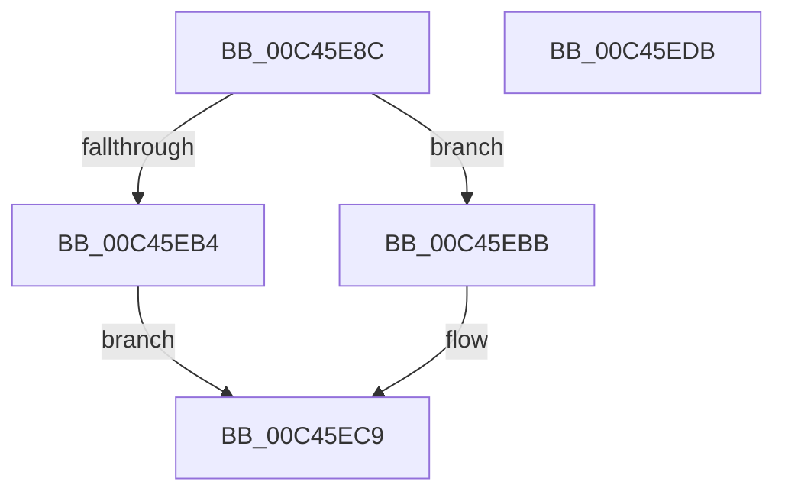

# PspLookupEntryPoint

- RVA: `0x00C45E8C`–`0x00C45EDC` (길이 `80` bytes)
- VA: `0x0000000140C45E8C`
- 실행 섹션: `INIT`
- PDB 이름 있음: `예`; PDB Function 태그: `아니요`
- unwind 정보 RVA: `0x00060BC4`
- 디코드: `25`개 명령, `80/80` bytes 표시
- 미해석 바이트: `0` (있으면 어셈블리에 `.byte`로 보존)

> 이 문서는 커널 이미지의 기계어와 PDB 기호를 분석해 생성했습니다. 4번과 5번은 함수 원형과 자료형을 바이너리 사용 방식에서 추정한 C 해석이며 원본 소스 복구 결과는 아닙니다.

## 1. Dependencies

- 직접 호출 지점: **1**; 고유 호출 대상: **1**
- 직접 호출자로 확인된 함수: **2**
- RIP 상대 이미지 참조: **0**

### Outgoing calls
- `0x00C45EA7` → [RtlFindExportedRoutineByName](../../page/90/RtlFindExportedRoutineByName_function_0090F0A0.md) (function, `0x0090F0A0`)

### Direct callers
- [PspInitializeSystemDlls](PspInitializeSystemDlls_function_00C45DC4.md) at `0x00C45E1A`
- [PspCopyNtdllExport](PspCopyNtdllExport_function_00C469F0.md) at `0x00C46A21`

### Static image references
- 디코드된 RIP-relative 메모리 참조가 없습니다.

## 2. Other-region calls and transfers

- 다른 실행 섹션으로 향하는 call: **1**
  - `0x00C45EA7` → [RtlFindExportedRoutineByName](../../page/90/RtlFindExportedRoutineByName_function_0090F0A0.md) (`INIT` → `PAGE`)
- 별도 외부 분기/꼬리 이동을 확인하지 못했습니다.

## 3. Assembly (complete function range)

```asm
00C45E8C  48 89 5C 24 08                  mov qword ptr [rsp + 8], rbx
00C45E91  48 89 74 24 10                  mov qword ptr [rsp + 0x10], rsi
00C45E96  57                              push rdi
00C45E97  48 83 EC 20                     sub rsp, 0x20
00C45E9B  48 8B F9                        mov rdi, rcx
00C45E9E  49 8B F0                        mov rsi, r8
00C45EA1  48 8B 49 20                     mov rcx, qword ptr [rcx + 0x20]
00C45EA5  33 DB                           xor ebx, ebx
00C45EA7  E8 F4 91 CC FF                  call 0x14090f0a0
00C45EAC  48 89 06                        mov qword ptr [rsi], rax
00C45EAF  48 85 C0                        test rax, rax
00C45EB2  75 07                           jne 0x140c45ebb
00C45EB4  BB 7A 00 00 C0                  mov ebx, 0xc000007a
00C45EB9  EB 0E                           jmp 0x140c45ec9
00C45EBB  48 8B 57 18                     mov rdx, qword ptr [rdi + 0x18]
00C45EBF  48 2B 57 20                     sub rdx, qword ptr [rdi + 0x20]
00C45EC3  48 03 D0                        add rdx, rax
00C45EC6  48 89 16                        mov qword ptr [rsi], rdx
00C45EC9  48 8B 74 24 38                  mov rsi, qword ptr [rsp + 0x38]
00C45ECE  8B C3                           mov eax, ebx
00C45ED0  48 8B 5C 24 30                  mov rbx, qword ptr [rsp + 0x30]
00C45ED5  48 83 C4 20                     add rsp, 0x20
00C45ED9  5F                              pop rdi
00C45EDA  C3                              ret
00C45EDB  CC                              int3
```

## 4. C-style interpretation (structured pseudocode)

```c
__int64 __fastcall PspLookupEntryPoint(__int64 a1, __int64 a2, __int64 a3)
{
    __int64 result;
    __int64 v_rbx;
    __int64 v_rsp;
    unsigned __int64 v_stack_p10;
    unsigned __int64 v_stack_p8;

    v_stack_p8 = v_rbx;
    v_stack_p10 = v_rsi;
    v_rsp = (v_rsp) - (32);
    v_rbx = 0;
    result = RtlFindExportedRoutineByName(*(unsigned __int64 *)(a1 + 32), a2, a3, a4);
    *(unsigned __int64 *)(a3) = result;
    if (result != 0) goto loc_00C45EBB;
    goto loc_00C45EC9;
loc_00C45EBB:
    a2 = (*(unsigned __int64 *)(a1 + 24)) - (*(unsigned __int64 *)(a1 + 32));
    a2 = (a2) + (result);
    *(unsigned __int64 *)(a3) = a2;
loc_00C45EC9:
    v_rsp = (v_rsp) + (32);
    return (unsigned int)((unsigned int)((unsigned int)(0xC000007AULL)));
}
```

## 5. (Beta) C Style

```c
int64_t PspLookupEntryPoint(void *Arg1, int64_t Arg2, void *Arg3)
{
    uint8_t *arg1 = (uint8_t *)Arg1;
    uint8_t *arg3 = (uint8_t *)Arg3;

    int64_t result;
    int64_t local_rbx;
    int64_t local_rsp;
    uint64_t v_stack_p10;
    uint64_t v_stack_p8;

    v_stack_p8 = local_rbx;
    v_stack_p10 = local_rsi;
    local_rsp = (local_rsp) - (32);
    local_rbx = 0;
    result = RtlFindExportedRoutineByName(*(uint64_t *)(arg1 + 0x20), Arg2, Arg3, a4);
    *(uint64_t *)(arg3) = result;
    if (result != 0) goto loc_00C45EBB;
    goto loc_00C45EC9;
loc_00C45EBB:
    Arg2 = (*(uint64_t *)(arg1 + 0x18)) - (*(uint64_t *)(arg1 + 0x20));
    Arg2 = (Arg2) + (result);
    *(uint64_t *)(arg3) = Arg2;
loc_00C45EC9:
    local_rsp = (local_rsp) + (32);
    return (uint32_t)((uint32_t)((uint32_t)(0xC000007AULL)));
}
```

### 관측된 메모리 오프셋

구조체 형식이 확인되지 않은 접근은 인자 기준의 오프셋으로만 기록했습니다.

| 기준 인자 | 오프셋 표현 | 폭 (bit) | 접근 |
|---|---:|---:|---|
| `Arg1` | `+ 0x18` | `64` | `R` |
| `Arg1` | `+ 0x20` | `64` | `R` |
| `Arg3` | `+ 0x0` | `64` | `W` |

## 6. Execution-region graph

[열기: 2D/3D 그래프와 함수 탐색 컨트롤 패널](../../../control-panel.html?section=init&rva=0x00C45E8C&view=graph)

- 2D 그래프는 위에서 아래로 흐르고, 3D 그래프는 빈 공간을 드래그해 회전합니다. Shift+드래그는 이동, 휠은 확대·축소, 함수 노드 선택은 대상 보고서 이동입니다.

### Static fallback


