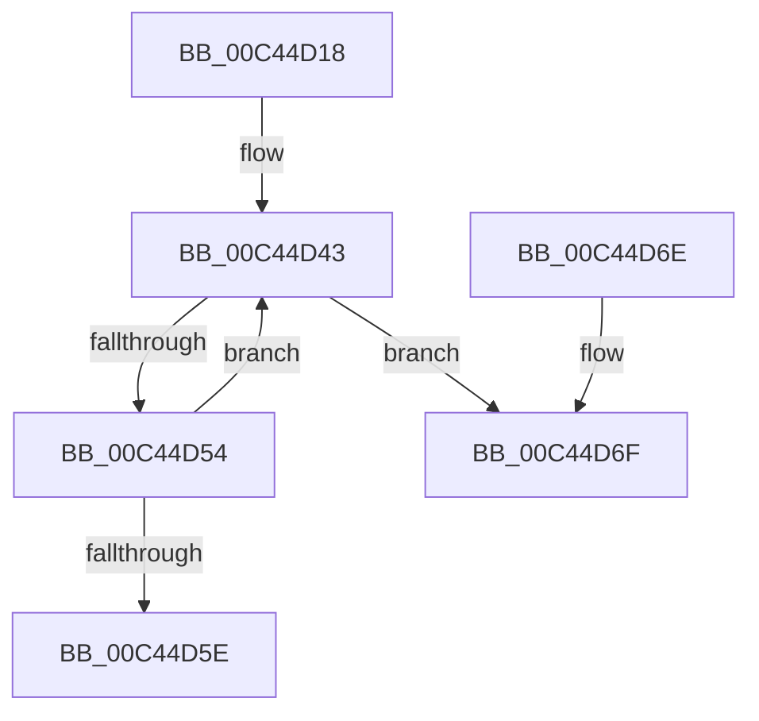

# PspRegisterSyscallProviderServiceTableMetadata

- RVA: `0x00C44D18`–`0x00C44D8B` (길이 `115` bytes)
- VA: `0x0000000140C44D18`
- 실행 섹션: `INIT`
- PDB 이름 있음: `예`; PDB Function 태그: `아니요`
- unwind 정보 RVA: `0x000CDF08`
- 디코드: `33`개 명령, `115/115` bytes 표시
- 미해석 바이트: `0` (있으면 어셈블리에 `.byte`로 보존)

> 이 문서는 커널 이미지의 기계어와 PDB 기호를 분석해 생성했습니다. 4번과 5번은 함수 원형과 자료형을 바이너리 사용 방식에서 추정한 C 해석이며 원본 소스 복구 결과는 아닙니다.

## 1. Dependencies

- 직접 호출 지점: **2**; 고유 호출 대상: **2**
- 직접 호출자로 확인된 함수: **1**
- RIP 상대 이미지 참조: **2**

### Outgoing calls
- `0x00C44D4B` → [VslRegisterSyscallProviderServiceTableMetadata](../../page/71/VslRegisterSyscallProviderServiceTableMetadata_function_00719450.md) (function, `0x00719450`)
- `0x00C44D85` → [KeBugCheckEx](../../text/4F/KeBugCheckEx_function_004FD660.md) (function, `0x004FD660`)

### Direct callers
- [PsInitializeSyscallProviders](PsInitializeSyscallProviders_function_00C44BA4.md) at `0x00C44BC3`

### Static image references
- `0x00C44D27` → RVA `0x00F067D0` (`.data`; read)
- `0x00C44D2F` → RVA `0x00FC7290` (`ALMOSTRO`; read)

## 2. Other-region calls and transfers

- 다른 실행 섹션으로 향하는 call: **2**
  - `0x00C44D4B` → [VslRegisterSyscallProviderServiceTableMetadata](../../page/71/VslRegisterSyscallProviderServiceTableMetadata_function_00719450.md) (`INIT` → `PAGE`)
  - `0x00C44D85` → [KeBugCheckEx](../../text/4F/KeBugCheckEx_function_004FD660.md) (`INIT` → `.text`)
- 별도 외부 분기/꼬리 이동을 확인하지 못했습니다.

## 3. Assembly (complete function range)

```asm
00C44D18  48 89 5C 24 08                  mov qword ptr [rsp + 8], rbx
00C44D1D  48 89 74 24 10                  mov qword ptr [rsp + 0x10], rsi
00C44D22  57                              push rdi
00C44D23  48 83 EC 30                     sub rsp, 0x30
00C44D27  48 83 3D A1 1A 2C 00 00         cmp qword ptr [rip + 0x2c1aa1], 0
00C44D2F  48 8D 3D 5A 25 38 00            lea rdi, [rip + 0x38255a]
00C44D36  BE 01 00 00 00                  mov esi, 1
00C44D3B  8D 46 01                        lea eax, [rsi + 1]
00C44D3E  0F 45 F0                        cmovne esi, eax
00C44D41  33 DB                           xor ebx, ebx
00C44D43  4C 8B 47 08                     mov r8, qword ptr [rdi + 8]
00C44D47  8B CB                           mov ecx, ebx
00C44D49  8B 17                           mov edx, dword ptr [rdi]
00C44D4B  E8 00 47 AD FF                  call 0x140719450
00C44D50  85 C0                           test eax, eax
00C44D52  78 1B                           js 0x140c44d6f
00C44D54  FF C3                           inc ebx
00C44D56  48 83 C7 20                     add rdi, 0x20
00C44D5A  3B DE                           cmp ebx, esi
00C44D5C  72 E5                           jb 0x140c44d43
00C44D5E  48 8B 5C 24 40                  mov rbx, qword ptr [rsp + 0x40]
00C44D63  48 8B 74 24 48                  mov rsi, qword ptr [rsp + 0x48]
00C44D68  48 83 C4 30                     add rsp, 0x30
00C44D6C  5F                              pop rdi
00C44D6D  C3                              ret
00C44D6E  CC                              int3
00C44D6F  48 83 64 24 20 00               and qword ptr [rsp + 0x20], 0
00C44D75  BA 06 00 00 00                  mov edx, 6
00C44D7A  44 8B CB                        mov r9d, ebx
00C44D7D  B9 E0 01 00 00                  mov ecx, 0x1e0
00C44D82  4C 63 C0                        movsxd r8, eax
00C44D85  E8 D6 88 8B FF                  call 0x1404fd660
00C44D8A  CC                              int3
```

## 4. C-style interpretation (structured pseudocode)

```c
__int64 __fastcall PspRegisterSyscallProviderServiceTableMetadata(void)
{
    __int64 result;
    __int64 v_rbx;
    __int64 v_rdi;
    __int64 v_rsi;
    __int64 v_rsp;
    unsigned __int64 v_stack_p10;
    unsigned __int64 v_stack_p20;
    unsigned __int64 v_stack_p8;

    v_stack_p8 = v_rbx;
    v_stack_p10 = v_rsi;
    v_rsp = (v_rsp) - (48);
    v_rsi = 1;
    if ((*(unsigned __int64 *)(v_rip + 2890401)) != 0) { v_rsi = (unsigned int)(1 + 1); }
    v_rbx = 0;
loc_00C44D43:
    result = VslRegisterSyscallProviderServiceTableMetadata(0, (unsigned int)(*(unsigned int *)(v_rip + 3679578)), *(unsigned __int64 *)(v_rip + 3679578 + 8), a4);
    if (sign_flag) goto loc_00C44D6F;
    v_rbx = (unsigned int)((v_rbx) + 1);
    v_rdi = (v_rip + 3679578) + (32);
    if (((unsigned int)(v_rbx)) < ((unsigned int)(v_rsi))) goto loc_00C44D43;
    v_rsp = (v_rsp) + (48);
    return result;
loc_00C44D6F:
    result = KeBugCheckEx(480, 6, (int)((unsigned int)(result)), (unsigned int)((unsigned int)(v_stack_p8)));
    return result;
}
```

## 5. (Beta) C Style

```c
void PspRegisterSyscallProviderServiceTableMetadata(void)
{
    int64_t result;
    int64_t local_rbx;
    int64_t local_rdi;
    int64_t local_rsi;
    int64_t local_rsp;
    uint64_t v_stack_p10;
    uint64_t v_stack_p20;
    uint64_t v_stack_p8;

    v_stack_p8 = local_rbx;
    v_stack_p10 = local_rsi;
    local_rsp = (local_rsp) - (48);
    local_rsi = 1;
    if ((*(uint64_t *)(v_rip + 0x2C1AA1)) != 0) { local_rsi = (uint32_t)(1 + 1); }
    local_rbx = 0;
loc_00C44D43:
    result = VslRegisterSyscallProviderServiceTableMetadata(0, (uint32_t)(*(uint32_t *)(v_rip + 0x38255A)), *(uint64_t *)(v_rip + 0x38255A + 0x8), a4);
    if (sign_flag) goto loc_00C44D6F;
    local_rbx = (uint32_t)((local_rbx) + 1);
    local_rdi = (v_rip + 3679578) + (32);
    if (((uint32_t)(local_rbx)) < ((uint32_t)(local_rsi))) goto loc_00C44D43;
    local_rsp = (local_rsp) + (48);
    return result;
loc_00C44D6F:
    result = KeBugCheckEx(480, 6, (int32_t)((uint32_t)(result)), (uint32_t)((uint32_t)(v_stack_p8)));
    return result;
}
```

## 6. Execution-region graph

[열기: 2D/3D 그래프와 함수 탐색 컨트롤 패널](../../../control-panel.html?section=init&rva=0x00C44D18&view=graph)

- 2D 그래프는 위에서 아래로 흐르고, 3D 그래프는 빈 공간을 드래그해 회전합니다. Shift+드래그는 이동, 휠은 확대·축소, 함수 노드 선택은 대상 보고서 이동입니다.

### Static fallback


