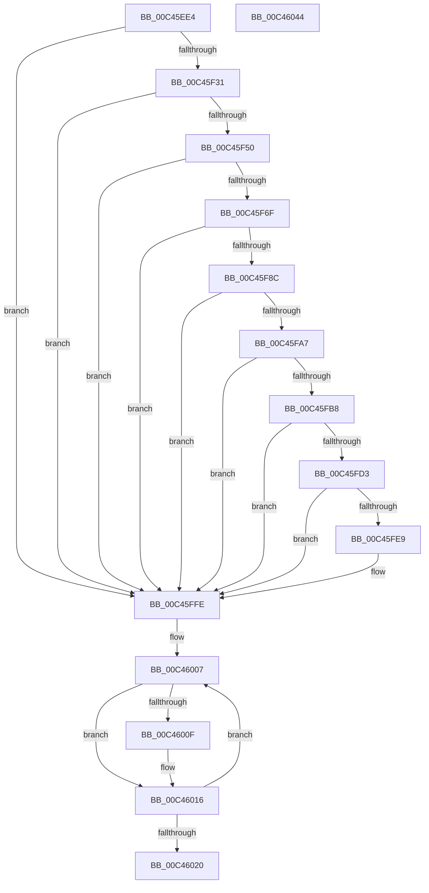

# PspSetProcessObjectTypePolicy

- RVA: `0x00C45EE4`–`0x00C46045` (길이 `353` bytes)
- VA: `0x0000000140C45EE4`
- 실행 섹션: `INIT`
- PDB 이름 있음: `예`; PDB Function 태그: `아니요`
- unwind 정보 RVA: `0x000CE040`
- 디코드: `96`개 명령, `353/353` bytes 표시
- 미해석 바이트: `0` (있으면 어셈블리에 `.byte`로 보존)

> 이 문서는 커널 이미지의 기계어와 PDB 기호를 분석해 생성했습니다. 4번과 5번은 함수 원형과 자료형을 바이너리 사용 방식에서 추정한 C 해석이며 원본 소스 복구 결과는 아닙니다.

## 1. Dependencies

- 직접 호출 지점: **10**; 고유 호출 대상: **6**
- 직접 호출자로 확인된 함수: **1**
- RIP 상대 이미지 참조: **7**

### Outgoing calls
- `0x00C45F22` → [SeInitializeObjectTypeUserAppInstancePolicyEntry](../../text/60/SeInitializeObjectTypeUserAppInstancePolicyEntry_function_00607870.md) (function, `0x00607870`)
- `0x00C45F41` → [SeInitializeObjectTypePolicyEntry](../../text/60/SeInitializeObjectTypePolicyEntry_function_00607800.md) (function, `0x00607800`)
- `0x00C45F60` → [SeInitializeObjectTypePolicyEntry](../../text/60/SeInitializeObjectTypePolicyEntry_function_00607800.md) (function, `0x00607800`)
- `0x00C45F81` → [SeInitializeObjectTypePolicyEntry](../../text/60/SeInitializeObjectTypePolicyEntry_function_00607800.md) (function, `0x00607800`)
- `0x00C45F9C` → [SeInitializeObjectTypePolicyEntry](../../text/60/SeInitializeObjectTypePolicyEntry_function_00607800.md) (function, `0x00607800`)
- `0x00C45FAD` → [SeInitializeObjectTypeEnumPolicyEntry](../../text/60/SeInitializeObjectTypeEnumPolicyEntry_function_00607790.md) (function, `0x00607790`)
- `0x00C45FC8` → [SeInitializeObjectTypePolicyEntry](../../text/60/SeInitializeObjectTypePolicyEntry_function_00607800.md) (function, `0x00607800`)
- `0x00C45FDE` → [SeSetObjectTypePolicy](../../text/60/SeSetObjectTypePolicy_function_006078F0.md) (function, `0x006078F0`)
- `0x00C46011` → [ExFreePoolWithTag](../../poolcode/B8/ExFreePoolWithTag_function_00B82870.md) (function, `0x00B82870`)
- `0x00C46029` → [_security_check_cookie](../../text/6A/_security_check_cookie_function_006AC640.md) (function, `0x006AC640`)

### Direct callers
- [PspInitPhase0](../C7/PspInitPhase0_function_00C77E2C.md) at `0x00C7833B`

### Static image references
- `0x00C45EFB` → RVA `0x00E0A740` (`.data`; read)
- `0x00C45F31` → RVA `0x00F04F50` (`.data`; read)
- `0x00C45F50` → RVA `0x00F04F58` (`.data`; read)
- `0x00C45F6F` → RVA `0x00FD9A68` (`PAGEDATA`; read)
- `0x00C45F8C` → RVA `0x00E67D58` (`.data`; read)
- `0x00C45FB8` → RVA `0x00E67D48` (`.data`; read)
- `0x00C45FD3` → RVA `0x00FC6A98` (`ALMOSTRO`; read)

## 2. Other-region calls and transfers

- 다른 실행 섹션으로 향하는 call: **10**
  - `0x00C45F22` → [SeInitializeObjectTypeUserAppInstancePolicyEntry](../../text/60/SeInitializeObjectTypeUserAppInstancePolicyEntry_function_00607870.md) (`INIT` → `.text`)
  - `0x00C45F41` → [SeInitializeObjectTypePolicyEntry](../../text/60/SeInitializeObjectTypePolicyEntry_function_00607800.md) (`INIT` → `.text`)
  - `0x00C45F60` → [SeInitializeObjectTypePolicyEntry](../../text/60/SeInitializeObjectTypePolicyEntry_function_00607800.md) (`INIT` → `.text`)
  - `0x00C45F81` → [SeInitializeObjectTypePolicyEntry](../../text/60/SeInitializeObjectTypePolicyEntry_function_00607800.md) (`INIT` → `.text`)
  - `0x00C45F9C` → [SeInitializeObjectTypePolicyEntry](../../text/60/SeInitializeObjectTypePolicyEntry_function_00607800.md) (`INIT` → `.text`)
  - `0x00C45FAD` → [SeInitializeObjectTypeEnumPolicyEntry](../../text/60/SeInitializeObjectTypeEnumPolicyEntry_function_00607790.md) (`INIT` → `.text`)
  - `0x00C45FC8` → [SeInitializeObjectTypePolicyEntry](../../text/60/SeInitializeObjectTypePolicyEntry_function_00607800.md) (`INIT` → `.text`)
  - `0x00C45FDE` → [SeSetObjectTypePolicy](../../text/60/SeSetObjectTypePolicy_function_006078F0.md) (`INIT` → `.text`)
  - `0x00C46011` → [ExFreePoolWithTag](../../poolcode/B8/ExFreePoolWithTag_function_00B82870.md) (`INIT` → `POOLCODE`)
  - `0x00C46029` → [_security_check_cookie](../../text/6A/_security_check_cookie_function_006AC640.md) (`INIT` → `.text`)
- 별도 외부 분기/꼬리 이동을 확인하지 못했습니다.

## 3. Assembly (complete function range)

```asm
00C45EE4  48 89 5C 24 08                  mov qword ptr [rsp + 8], rbx
00C45EE9  48 89 74 24 10                  mov qword ptr [rsp + 0x10], rsi
00C45EEE  48 89 7C 24 18                  mov qword ptr [rsp + 0x18], rdi
00C45EF3  55                              push rbp
00C45EF4  48 8B EC                        mov rbp, rsp
00C45EF7  48 83 EC 60                     sub rsp, 0x60
00C45EFB  48 8B 05 3E 48 1C 00            mov rax, qword ptr [rip + 0x1c483e]
00C45F02  48 33 C4                        xor rax, rsp
00C45F05  48 89 45 F8                     mov qword ptr [rbp - 8], rax
00C45F09  0F 57 C0                        xorps xmm0, xmm0
00C45F0C  48 8D 55 C0                     lea rdx, [rbp - 0x40]
00C45F10  33 C0                           xor eax, eax
00C45F12  0F 11 45 C0                     movups xmmword ptr [rbp - 0x40], xmm0
00C45F16  48 89 45 F0                     mov qword ptr [rbp - 0x10], rax
00C45F1A  0F 11 45 D0                     movups xmmword ptr [rbp - 0x30], xmm0
00C45F1E  0F 11 45 E0                     movups xmmword ptr [rbp - 0x20], xmm0
00C45F22  E8 49 19 9C FF                  call 0x140607870
00C45F27  8B D8                           mov ebx, eax
00C45F29  85 C0                           test eax, eax
00C45F2B  0F 88 CD 00 00 00               js 0x140c45ffe
00C45F31  48 8B 0D 18 F0 2B 00            mov rcx, qword ptr [rip + 0x2bf018]
00C45F38  4C 8D 45 C8                     lea r8, [rbp - 0x38]
00C45F3C  BA 11 1C 1C 00                  mov edx, 0x1c1c11
00C45F41  E8 BA 18 9C FF                  call 0x140607800
00C45F46  8B D8                           mov ebx, eax
00C45F48  85 C0                           test eax, eax
00C45F4A  0F 88 AE 00 00 00               js 0x140c45ffe
00C45F50  48 8B 0D 01 F0 2B 00            mov rcx, qword ptr [rip + 0x2bf001]
00C45F57  4C 8D 45 D0                     lea r8, [rbp - 0x30]
00C45F5B  BA 39 3D 10 00                  mov edx, 0x103d39
00C45F60  E8 9B 18 9C FF                  call 0x140607800
00C45F65  8B D8                           mov ebx, eax
00C45F67  85 C0                           test eax, eax
00C45F69  0F 88 8F 00 00 00               js 0x140c45ffe
00C45F6F  48 8B 0D F2 3A 39 00            mov rcx, qword ptr [rip + 0x393af2]
00C45F76  4C 8D 45 D8                     lea r8, [rbp - 0x28]
00C45F7A  BF 01 1C 10 00                  mov edi, 0x101c01
00C45F7F  8B D7                           mov edx, edi
00C45F81  E8 7A 18 9C FF                  call 0x140607800
00C45F86  8B D8                           mov ebx, eax
00C45F88  85 C0                           test eax, eax
00C45F8A  78 72                           js 0x140c45ffe
00C45F8C  48 8B 0D C5 1D 22 00            mov rcx, qword ptr [rip + 0x221dc5]
00C45F93  4C 8D 45 E0                     lea r8, [rbp - 0x20]
00C45F97  BA 51 1D 10 00                  mov edx, 0x101d51
00C45F9C  E8 5F 18 9C FF                  call 0x140607800
00C45FA1  8B D8                           mov ebx, eax
00C45FA3  85 C0                           test eax, eax
00C45FA5  78 57                           js 0x140c45ffe
00C45FA7  4C 8D 45 E8                     lea r8, [rbp - 0x18]
00C45FAB  8B D7                           mov edx, edi
00C45FAD  E8 DE 17 9C FF                  call 0x140607790
00C45FB2  8B D8                           mov ebx, eax
00C45FB4  85 C0                           test eax, eax
00C45FB6  78 46                           js 0x140c45ffe
00C45FB8  48 8B 0D 89 1D 22 00            mov rcx, qword ptr [rip + 0x221d89]
00C45FBF  4C 8D 45 F0                     lea r8, [rbp - 0x10]
00C45FC3  BA 00 10 10 00                  mov edx, 0x101000
00C45FC8  E8 33 18 9C FF                  call 0x140607800
00C45FCD  8B D8                           mov ebx, eax
00C45FCF  85 C0                           test eax, eax
00C45FD1  78 2B                           js 0x140c45ffe
00C45FD3  48 8B 0D BE 0A 38 00            mov rcx, qword ptr [rip + 0x380abe]
00C45FDA  4C 8D 4D C0                     lea r9, [rbp - 0x40]
00C45FDE  E8 0D 19 9C FF                  call 0x1406078f0
00C45FE3  8B D8                           mov ebx, eax
00C45FE5  85 C0                           test eax, eax
00C45FE7  78 15                           js 0x140c45ffe
00C45FE9  0F 57 C0                        xorps xmm0, xmm0
00C45FEC  33 C0                           xor eax, eax
00C45FEE  0F 11 45 C0                     movups xmmword ptr [rbp - 0x40], xmm0
00C45FF2  48 89 45 F0                     mov qword ptr [rbp - 0x10], rax
00C45FF6  0F 11 45 D0                     movups xmmword ptr [rbp - 0x30], xmm0
00C45FFA  0F 11 45 E0                     movups xmmword ptr [rbp - 0x20], xmm0
00C45FFE  48 8D 7D C0                     lea rdi, [rbp - 0x40]
00C46002  BE 07 00 00 00                  mov esi, 7
00C46007  48 8B 0F                        mov rcx, qword ptr [rdi]
00C4600A  48 85 C9                        test rcx, rcx
00C4600D  74 07                           je 0x140c46016
00C4600F  33 D2                           xor edx, edx
00C46011  E8 5A C8 F3 FF                  call 0x140b82870
00C46016  48 83 C7 08                     add rdi, 8
00C4601A  48 83 EE 01                     sub rsi, 1
00C4601E  75 E7                           jne 0x140c46007
00C46020  8B C3                           mov eax, ebx
00C46022  48 8B 4D F8                     mov rcx, qword ptr [rbp - 8]
00C46026  48 33 CC                        xor rcx, rsp
00C46029  E8 12 66 A6 FF                  call 0x1406ac640
00C4602E  4C 8D 5C 24 60                  lea r11, [rsp + 0x60]
00C46033  49 8B 5B 10                     mov rbx, qword ptr [r11 + 0x10]
00C46037  49 8B 73 18                     mov rsi, qword ptr [r11 + 0x18]
00C4603B  49 8B 7B 20                     mov rdi, qword ptr [r11 + 0x20]
00C4603F  49 8B E3                        mov rsp, r11
00C46042  5D                              pop rbp
00C46043  C3                              ret
00C46044  CC                              int3
```

## 4. C-style interpretation (structured pseudocode)

```c
__int64 __fastcall PspSetProcessObjectTypePolicy(void)
{
    __int64 result;
    __int64 v_rdi;
    __int64 v_rsi;
    __int64 v_rsp;
    unsigned __int64 v_stack_m10;
    unsigned __int64 v_stack_m18;
    unsigned __int64 v_stack_m20;
    unsigned __int64 v_stack_m28;
    unsigned __int64 v_stack_m30;
    unsigned __int64 v_stack_m38;
    unsigned __int64 v_stack_m40;
    unsigned __int64 v_stack_m48;
    unsigned __int64 v_stack_m8;
    unsigned __int64 v_stack_p10;
    unsigned __int64 v_stack_p18;
    unsigned __int64 v_stack_p8;

    v_stack_p8 = v_rbx;
    v_stack_p10 = v_rsi;
    v_stack_p18 = v_rdi;
    v_rsp = (v_rsp) - (96);
    result = (*(unsigned __int64 *)(v_rip + 1853502)) ^ (v_rsp);
    v_stack_m10 = result;
    result = 0;
    v_stack_m48 = v_xmm0;
    v_stack_m18 = 0;
    v_stack_m38 = v_xmm0;
    v_stack_m28 = v_xmm0;
    result = SeInitializeObjectTypeUserAppInstancePolicyEntry(a1, v_stack_m48, a3, a4);
    if (sign_flag) goto loc_00C45FFE;
    result = SeInitializeObjectTypePolicyEntry(*(unsigned __int64 *)(v_rip + 2879512), (unsigned int)(0x1C1C11ULL), v_stack_m40, a4);
    if (sign_flag) goto loc_00C45FFE;
    result = SeInitializeObjectTypePolicyEntry(*(unsigned __int64 *)(v_rip + 2879489), (unsigned int)(0x103D39ULL), v_stack_m38, a4);
    if (sign_flag) goto loc_00C45FFE;
    result = SeInitializeObjectTypePolicyEntry(*(unsigned __int64 *)(v_rip + 3750642), (unsigned int)((unsigned int)((unsigned int)(0x101C01ULL))), v_stack_m30, a4);
    if (sign_flag) goto loc_00C45FFE;
    result = SeInitializeObjectTypePolicyEntry(*(unsigned __int64 *)(v_rip + 2235845), (unsigned int)(0x101D51ULL), v_stack_m28, a4);
    if (sign_flag) goto loc_00C45FFE;
    result = SeInitializeObjectTypeEnumPolicyEntry(*(unsigned __int64 *)(v_rip + 2235845), (unsigned int)((unsigned int)((unsigned int)(0x101C01ULL))), v_stack_m20, a4);
    if (sign_flag) goto loc_00C45FFE;
    result = SeInitializeObjectTypePolicyEntry(*(unsigned __int64 *)(v_rip + 2235785), (unsigned int)(0x101000ULL), v_stack_m18, a4);
    if (sign_flag) goto loc_00C45FFE;
    result = SeSetObjectTypePolicy(*(unsigned __int64 *)(v_rip + 3672766), (unsigned int)(0x101000ULL), v_stack_m18, v_stack_m48);
    if (!(sign_flag)) {
        result = 0;
        v_stack_m48 = v_xmm0;
        v_stack_m18 = 0;
        v_stack_m38 = v_xmm0;
        v_stack_m28 = v_xmm0;
    }
loc_00C46007:
    if (*(unsigned __int64 *)(v_stack_m48) != 0) {
        a2 = 0;
        result = ExFreePoolWithTag(*(unsigned __int64 *)(v_stack_m48), a2, v_stack_m18, v_stack_m48);
    }
    v_rdi = (v_stack_m48) + (8);
    v_rsi = (7) - (1);
    if (condition_is_not_equal) goto loc_00C46007;
    a1 = (v_stack_m10) ^ (v_rsp);
    result = _security_check_cookie(a1, a2, v_stack_m18, v_stack_m48);
    return result;
}
```

## 5. (Beta) C Style

```c
void PspSetProcessObjectTypePolicy(void)
{
    int64_t result;
    int64_t local_rdi;
    int64_t local_rsi;
    int64_t local_rsp;
    uint64_t v_stack_m10;
    uint64_t v_stack_m18;
    uint64_t v_stack_m20;
    uint64_t v_stack_m28;
    uint64_t v_stack_m30;
    uint64_t v_stack_m38;
    uint64_t v_stack_m40;
    uint64_t v_stack_m48;
    uint64_t v_stack_m8;
    uint64_t v_stack_p10;
    uint64_t v_stack_p18;
    uint64_t v_stack_p8;

    v_stack_p8 = local_rbx;
    v_stack_p10 = local_rsi;
    v_stack_p18 = local_rdi;
    local_rsp = (local_rsp) - (96);
    result = (*(uint64_t *)(v_rip + 0x1C483E)) ^ (local_rsp);
    v_stack_m10 = result;
    result = 0;
    v_stack_m48 = v_xmm0;
    v_stack_m18 = 0;
    v_stack_m38 = v_xmm0;
    v_stack_m28 = v_xmm0;
    result = SeInitializeObjectTypeUserAppInstancePolicyEntry(a1, v_stack_m48, a3, a4);
    if (sign_flag) goto loc_00C45FFE;
    result = SeInitializeObjectTypePolicyEntry(*(uint64_t *)(v_rip + 0x2BF018), (uint32_t)(0x1C1C11ULL), v_stack_m40, a4);
    if (sign_flag) goto loc_00C45FFE;
    result = SeInitializeObjectTypePolicyEntry(*(uint64_t *)(v_rip + 0x2BF001), (uint32_t)(0x103D39ULL), v_stack_m38, a4);
    if (sign_flag) goto loc_00C45FFE;
    result = SeInitializeObjectTypePolicyEntry(*(uint64_t *)(v_rip + 0x393AF2), (uint32_t)((uint32_t)((uint32_t)(0x101C01ULL))), v_stack_m30, a4);
    if (sign_flag) goto loc_00C45FFE;
    result = SeInitializeObjectTypePolicyEntry(*(uint64_t *)(v_rip + 0x221DC5), (uint32_t)(0x101D51ULL), v_stack_m28, a4);
    if (sign_flag) goto loc_00C45FFE;
    result = SeInitializeObjectTypeEnumPolicyEntry(*(uint64_t *)(v_rip + 0x221DC5), (uint32_t)((uint32_t)((uint32_t)(0x101C01ULL))), v_stack_m20, a4);
    if (sign_flag) goto loc_00C45FFE;
    result = SeInitializeObjectTypePolicyEntry(*(uint64_t *)(v_rip + 0x221D89), (uint32_t)(0x101000ULL), v_stack_m18, a4);
    if (sign_flag) goto loc_00C45FFE;
    result = SeSetObjectTypePolicy(*(uint64_t *)(v_rip + 0x380ABE), (uint32_t)(0x101000ULL), v_stack_m18, v_stack_m48);
    if (!(sign_flag)) {
        result = 0;
        v_stack_m48 = v_xmm0;
        v_stack_m18 = 0;
        v_stack_m38 = v_xmm0;
        v_stack_m28 = v_xmm0;
    }
loc_00C46007:
    if (*(uint64_t *)(v_stack_m48) != 0) {
        a2 = 0;
        result = ExFreePoolWithTag(*(uint64_t *)(v_stack_m48), a2, v_stack_m18, v_stack_m48);
    }
    local_rdi = (v_stack_m48) + (8);
    local_rsi = (7) - (1);
    if (condition_is_not_equal) goto loc_00C46007;
    a1 = (v_stack_m10) ^ (local_rsp);
    result = _security_check_cookie(a1, a2, v_stack_m18, v_stack_m48);
    return result;
}
```

## 6. Execution-region graph

[열기: 2D/3D 그래프와 함수 탐색 컨트롤 패널](../../../control-panel.html?section=init&rva=0x00C45EE4&view=graph)

- 2D 그래프는 위에서 아래로 흐르고, 3D 그래프는 빈 공간을 드래그해 회전합니다. Shift+드래그는 이동, 휠은 확대·축소, 함수 노드 선택은 대상 보고서 이동입니다.

### Static fallback


