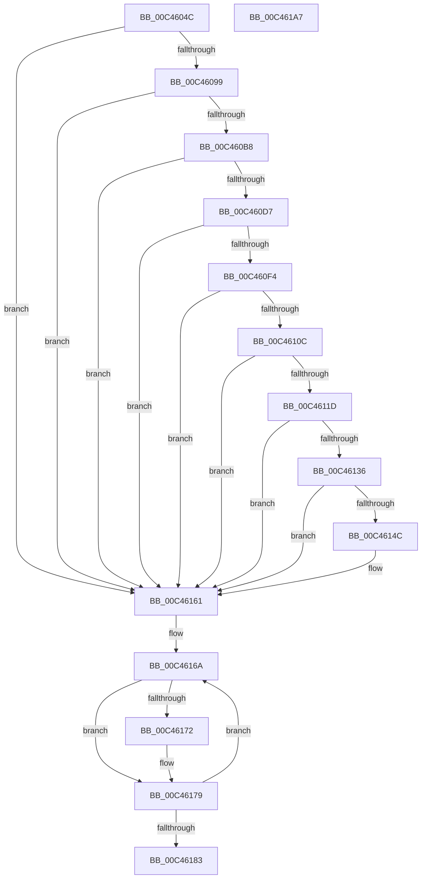

# PspSetThreadObjectTypePolicy

- RVA: `0x00C4604C`–`0x00C461A8` (길이 `348` bytes)
- VA: `0x0000000140C4604C`
- 실행 섹션: `INIT`
- PDB 이름 있음: `예`; PDB Function 태그: `아니요`
- unwind 정보 RVA: `0x000CE040`
- 디코드: `96`개 명령, `348/348` bytes 표시
- 미해석 바이트: `0` (있으면 어셈블리에 `.byte`로 보존)

> 이 문서는 커널 이미지의 기계어와 PDB 기호를 분석해 생성했습니다. 4번과 5번은 함수 원형과 자료형을 바이너리 사용 방식에서 추정한 C 해석이며 원본 소스 복구 결과는 아닙니다.

## 1. Dependencies

- 직접 호출 지점: **10**; 고유 호출 대상: **6**
- 직접 호출자로 확인된 함수: **1**
- RIP 상대 이미지 참조: **7**

### Outgoing calls
- `0x00C4608A` → [SeInitializeObjectTypeUserAppInstancePolicyEntry](../../text/60/SeInitializeObjectTypeUserAppInstancePolicyEntry_function_00607870.md) (function, `0x00607870`)
- `0x00C460A9` → [SeInitializeObjectTypePolicyEntry](../../text/60/SeInitializeObjectTypePolicyEntry_function_00607800.md) (function, `0x00607800`)
- `0x00C460C8` → [SeInitializeObjectTypePolicyEntry](../../text/60/SeInitializeObjectTypePolicyEntry_function_00607800.md) (function, `0x00607800`)
- `0x00C460E9` → [SeInitializeObjectTypePolicyEntry](../../text/60/SeInitializeObjectTypePolicyEntry_function_00607800.md) (function, `0x00607800`)
- `0x00C46101` → [SeInitializeObjectTypePolicyEntry](../../text/60/SeInitializeObjectTypePolicyEntry_function_00607800.md) (function, `0x00607800`)
- `0x00C46112` → [SeInitializeObjectTypeEnumPolicyEntry](../../text/60/SeInitializeObjectTypeEnumPolicyEntry_function_00607790.md) (function, `0x00607790`)
- `0x00C4612B` → [SeInitializeObjectTypePolicyEntry](../../text/60/SeInitializeObjectTypePolicyEntry_function_00607800.md) (function, `0x00607800`)
- `0x00C46141` → [SeSetObjectTypePolicy](../../text/60/SeSetObjectTypePolicy_function_006078F0.md) (function, `0x006078F0`)
- `0x00C46174` → [ExFreePoolWithTag](../../poolcode/B8/ExFreePoolWithTag_function_00B82870.md) (function, `0x00B82870`)
- `0x00C4618C` → [_security_check_cookie](../../text/6A/_security_check_cookie_function_006AC640.md) (function, `0x006AC640`)

### Direct callers
- [PspInitPhase0](../C7/PspInitPhase0_function_00C77E2C.md) at `0x00C783D4`

### Static image references
- `0x00C46063` → RVA `0x00E0A740` (`.data`; read)
- `0x00C46099` → RVA `0x00F04F50` (`.data`; read)
- `0x00C460B8` → RVA `0x00F04F58` (`.data`; read)
- `0x00C460D7` → RVA `0x00FD9A68` (`PAGEDATA`; read)
- `0x00C460F4` → RVA `0x00E67D58` (`.data`; read)
- `0x00C4611D` → RVA `0x00E67D48` (`.data`; read)
- `0x00C46136` → RVA `0x00FC6AC8` (`ALMOSTRO`; read)

## 2. Other-region calls and transfers

- 다른 실행 섹션으로 향하는 call: **10**
  - `0x00C4608A` → [SeInitializeObjectTypeUserAppInstancePolicyEntry](../../text/60/SeInitializeObjectTypeUserAppInstancePolicyEntry_function_00607870.md) (`INIT` → `.text`)
  - `0x00C460A9` → [SeInitializeObjectTypePolicyEntry](../../text/60/SeInitializeObjectTypePolicyEntry_function_00607800.md) (`INIT` → `.text`)
  - `0x00C460C8` → [SeInitializeObjectTypePolicyEntry](../../text/60/SeInitializeObjectTypePolicyEntry_function_00607800.md) (`INIT` → `.text`)
  - `0x00C460E9` → [SeInitializeObjectTypePolicyEntry](../../text/60/SeInitializeObjectTypePolicyEntry_function_00607800.md) (`INIT` → `.text`)
  - `0x00C46101` → [SeInitializeObjectTypePolicyEntry](../../text/60/SeInitializeObjectTypePolicyEntry_function_00607800.md) (`INIT` → `.text`)
  - `0x00C46112` → [SeInitializeObjectTypeEnumPolicyEntry](../../text/60/SeInitializeObjectTypeEnumPolicyEntry_function_00607790.md) (`INIT` → `.text`)
  - `0x00C4612B` → [SeInitializeObjectTypePolicyEntry](../../text/60/SeInitializeObjectTypePolicyEntry_function_00607800.md) (`INIT` → `.text`)
  - `0x00C46141` → [SeSetObjectTypePolicy](../../text/60/SeSetObjectTypePolicy_function_006078F0.md) (`INIT` → `.text`)
  - `0x00C46174` → [ExFreePoolWithTag](../../poolcode/B8/ExFreePoolWithTag_function_00B82870.md) (`INIT` → `POOLCODE`)
  - `0x00C4618C` → [_security_check_cookie](../../text/6A/_security_check_cookie_function_006AC640.md) (`INIT` → `.text`)
- 별도 외부 분기/꼬리 이동을 확인하지 못했습니다.

## 3. Assembly (complete function range)

```asm
00C4604C  48 89 5C 24 08                  mov qword ptr [rsp + 8], rbx
00C46051  48 89 74 24 10                  mov qword ptr [rsp + 0x10], rsi
00C46056  48 89 7C 24 18                  mov qword ptr [rsp + 0x18], rdi
00C4605B  55                              push rbp
00C4605C  48 8B EC                        mov rbp, rsp
00C4605F  48 83 EC 60                     sub rsp, 0x60
00C46063  48 8B 05 D6 46 1C 00            mov rax, qword ptr [rip + 0x1c46d6]
00C4606A  48 33 C4                        xor rax, rsp
00C4606D  48 89 45 F8                     mov qword ptr [rbp - 8], rax
00C46071  0F 57 C0                        xorps xmm0, xmm0
00C46074  48 8D 55 C0                     lea rdx, [rbp - 0x40]
00C46078  33 C0                           xor eax, eax
00C4607A  0F 11 45 C0                     movups xmmword ptr [rbp - 0x40], xmm0
00C4607E  48 89 45 F0                     mov qword ptr [rbp - 0x10], rax
00C46082  0F 11 45 D0                     movups xmmword ptr [rbp - 0x30], xmm0
00C46086  0F 11 45 E0                     movups xmmword ptr [rbp - 0x20], xmm0
00C4608A  E8 E1 17 9C FF                  call 0x140607870
00C4608F  8B D8                           mov ebx, eax
00C46091  85 C0                           test eax, eax
00C46093  0F 88 C8 00 00 00               js 0x140c46161
00C46099  48 8B 0D B0 EE 2B 00            mov rcx, qword ptr [rip + 0x2beeb0]
00C460A0  4C 8D 45 C8                     lea r8, [rbp - 0x38]
00C460A4  BA 43 18 1C 00                  mov edx, 0x1c1843
00C460A9  E8 52 17 9C FF                  call 0x140607800
00C460AE  8B D8                           mov ebx, eax
00C460B0  85 C0                           test eax, eax
00C460B2  0F 88 A9 00 00 00               js 0x140c46161
00C460B8  48 8B 0D 99 EE 2B 00            mov rcx, qword ptr [rip + 0x2bee99]
00C460BF  4C 8D 45 D0                     lea r8, [rbp - 0x30]
00C460C3  BA 43 1E 10 00                  mov edx, 0x101e43
00C460C8  E8 33 17 9C FF                  call 0x140607800
00C460CD  8B D8                           mov ebx, eax
00C460CF  85 C0                           test eax, eax
00C460D1  0F 88 8A 00 00 00               js 0x140c46161
00C460D7  48 8B 0D 8A 39 39 00            mov rcx, qword ptr [rip + 0x39398a]
00C460DE  4C 8D 45 D8                     lea r8, [rbp - 0x28]
00C460E2  BF 43 08 10 00                  mov edi, 0x100843
00C460E7  8B D7                           mov edx, edi
00C460E9  E8 12 17 9C FF                  call 0x140607800
00C460EE  8B D8                           mov ebx, eax
00C460F0  85 C0                           test eax, eax
00C460F2  78 6D                           js 0x140c46161
00C460F4  48 8B 0D 5D 1C 22 00            mov rcx, qword ptr [rip + 0x221c5d]
00C460FB  4C 8D 45 E0                     lea r8, [rbp - 0x20]
00C460FF  8B D7                           mov edx, edi
00C46101  E8 FA 16 9C FF                  call 0x140607800
00C46106  8B D8                           mov ebx, eax
00C46108  85 C0                           test eax, eax
00C4610A  78 55                           js 0x140c46161
00C4610C  4C 8D 45 E8                     lea r8, [rbp - 0x18]
00C46110  8B D7                           mov edx, edi
00C46112  E8 79 16 9C FF                  call 0x140607790
00C46117  8B D8                           mov ebx, eax
00C46119  85 C0                           test eax, eax
00C4611B  78 44                           js 0x140c46161
00C4611D  48 8B 0D 24 1C 22 00            mov rcx, qword ptr [rip + 0x221c24]
00C46124  4C 8D 45 F0                     lea r8, [rbp - 0x10]
00C46128  8D 57 FD                        lea edx, [rdi - 3]
00C4612B  E8 D0 16 9C FF                  call 0x140607800
00C46130  8B D8                           mov ebx, eax
00C46132  85 C0                           test eax, eax
00C46134  78 2B                           js 0x140c46161
00C46136  48 8B 0D 8B 09 38 00            mov rcx, qword ptr [rip + 0x38098b]
00C4613D  4C 8D 4D C0                     lea r9, [rbp - 0x40]
00C46141  E8 AA 17 9C FF                  call 0x1406078f0
00C46146  8B D8                           mov ebx, eax
00C46148  85 C0                           test eax, eax
00C4614A  78 15                           js 0x140c46161
00C4614C  0F 57 C0                        xorps xmm0, xmm0
00C4614F  33 C0                           xor eax, eax
00C46151  0F 11 45 C0                     movups xmmword ptr [rbp - 0x40], xmm0
00C46155  48 89 45 F0                     mov qword ptr [rbp - 0x10], rax
00C46159  0F 11 45 D0                     movups xmmword ptr [rbp - 0x30], xmm0
00C4615D  0F 11 45 E0                     movups xmmword ptr [rbp - 0x20], xmm0
00C46161  48 8D 7D C0                     lea rdi, [rbp - 0x40]
00C46165  BE 07 00 00 00                  mov esi, 7
00C4616A  48 8B 0F                        mov rcx, qword ptr [rdi]
00C4616D  48 85 C9                        test rcx, rcx
00C46170  74 07                           je 0x140c46179
00C46172  33 D2                           xor edx, edx
00C46174  E8 F7 C6 F3 FF                  call 0x140b82870
00C46179  48 83 C7 08                     add rdi, 8
00C4617D  48 83 EE 01                     sub rsi, 1
00C46181  75 E7                           jne 0x140c4616a
00C46183  8B C3                           mov eax, ebx
00C46185  48 8B 4D F8                     mov rcx, qword ptr [rbp - 8]
00C46189  48 33 CC                        xor rcx, rsp
00C4618C  E8 AF 64 A6 FF                  call 0x1406ac640
00C46191  4C 8D 5C 24 60                  lea r11, [rsp + 0x60]
00C46196  49 8B 5B 10                     mov rbx, qword ptr [r11 + 0x10]
00C4619A  49 8B 73 18                     mov rsi, qword ptr [r11 + 0x18]
00C4619E  49 8B 7B 20                     mov rdi, qword ptr [r11 + 0x20]
00C461A2  49 8B E3                        mov rsp, r11
00C461A5  5D                              pop rbp
00C461A6  C3                              ret
00C461A7  CC                              int3
```

## 4. C-style interpretation (structured pseudocode)

```c
__int64 __fastcall PspSetThreadObjectTypePolicy(void)
{
    __int64 result;
    __int64 v_rdi;
    __int64 v_rsi;
    __int64 v_rsp;
    unsigned __int64 v_stack_m10;
    unsigned __int64 v_stack_m18;
    unsigned __int64 v_stack_m20;
    unsigned __int64 v_stack_m28;
    unsigned __int64 v_stack_m30;
    unsigned __int64 v_stack_m38;
    unsigned __int64 v_stack_m40;
    unsigned __int64 v_stack_m48;
    unsigned __int64 v_stack_m8;
    unsigned __int64 v_stack_p10;
    unsigned __int64 v_stack_p18;
    unsigned __int64 v_stack_p8;

    v_stack_p8 = v_rbx;
    v_stack_p10 = v_rsi;
    v_stack_p18 = v_rdi;
    v_rsp = (v_rsp) - (96);
    result = (*(unsigned __int64 *)(v_rip + 1853142)) ^ (v_rsp);
    v_stack_m10 = result;
    result = 0;
    v_stack_m48 = v_xmm0;
    v_stack_m18 = 0;
    v_stack_m38 = v_xmm0;
    v_stack_m28 = v_xmm0;
    result = SeInitializeObjectTypeUserAppInstancePolicyEntry(a1, v_stack_m48, a3, a4);
    if (sign_flag) goto loc_00C46161;
    result = SeInitializeObjectTypePolicyEntry(*(unsigned __int64 *)(v_rip + 2879152), (unsigned int)(0x1C1843ULL), v_stack_m40, a4);
    if (sign_flag) goto loc_00C46161;
    result = SeInitializeObjectTypePolicyEntry(*(unsigned __int64 *)(v_rip + 2879129), (unsigned int)(0x101E43ULL), v_stack_m38, a4);
    if (sign_flag) goto loc_00C46161;
    result = SeInitializeObjectTypePolicyEntry(*(unsigned __int64 *)(v_rip + 3750282), (unsigned int)((unsigned int)((unsigned int)(0x100843ULL))), v_stack_m30, a4);
    if (sign_flag) goto loc_00C46161;
    result = SeInitializeObjectTypePolicyEntry(*(unsigned __int64 *)(v_rip + 2235485), (unsigned int)((unsigned int)((unsigned int)(0x100843ULL))), v_stack_m28, a4);
    if (sign_flag) goto loc_00C46161;
    result = SeInitializeObjectTypeEnumPolicyEntry(*(unsigned __int64 *)(v_rip + 2235485), (unsigned int)((unsigned int)((unsigned int)(0x100843ULL))), v_stack_m20, a4);
    if (sign_flag) goto loc_00C46161;
    result = SeInitializeObjectTypePolicyEntry(*(unsigned __int64 *)(v_rip + 2235428), (unsigned int)(0x100843ULL) - 3, v_stack_m18, a4);
    if (sign_flag) goto loc_00C46161;
    result = SeSetObjectTypePolicy(*(unsigned __int64 *)(v_rip + 3672459), (unsigned int)(0x100843ULL) - 3, v_stack_m18, v_stack_m48);
    if (!(sign_flag)) {
        result = 0;
        v_stack_m48 = v_xmm0;
        v_stack_m18 = 0;
        v_stack_m38 = v_xmm0;
        v_stack_m28 = v_xmm0;
    }
loc_00C4616A:
    if (*(unsigned __int64 *)(v_stack_m48) != 0) {
        a2 = 0;
        result = ExFreePoolWithTag(*(unsigned __int64 *)(v_stack_m48), a2, v_stack_m18, v_stack_m48);
    }
    v_rdi = (v_stack_m48) + (8);
    v_rsi = (7) - (1);
    if (condition_is_not_equal) goto loc_00C4616A;
    a1 = (v_stack_m10) ^ (v_rsp);
    result = _security_check_cookie(a1, a2, v_stack_m18, v_stack_m48);
    return result;
}
```

## 5. (Beta) C Style

```c
void PspSetThreadObjectTypePolicy(void)
{
    int64_t result;
    int64_t local_rdi;
    int64_t local_rsi;
    int64_t local_rsp;
    uint64_t v_stack_m10;
    uint64_t v_stack_m18;
    uint64_t v_stack_m20;
    uint64_t v_stack_m28;
    uint64_t v_stack_m30;
    uint64_t v_stack_m38;
    uint64_t v_stack_m40;
    uint64_t v_stack_m48;
    uint64_t v_stack_m8;
    uint64_t v_stack_p10;
    uint64_t v_stack_p18;
    uint64_t v_stack_p8;

    v_stack_p8 = local_rbx;
    v_stack_p10 = local_rsi;
    v_stack_p18 = local_rdi;
    local_rsp = (local_rsp) - (96);
    result = (*(uint64_t *)(v_rip + 0x1C46D6)) ^ (local_rsp);
    v_stack_m10 = result;
    result = 0;
    v_stack_m48 = v_xmm0;
    v_stack_m18 = 0;
    v_stack_m38 = v_xmm0;
    v_stack_m28 = v_xmm0;
    result = SeInitializeObjectTypeUserAppInstancePolicyEntry(a1, v_stack_m48, a3, a4);
    if (sign_flag) goto loc_00C46161;
    result = SeInitializeObjectTypePolicyEntry(*(uint64_t *)(v_rip + 0x2BEEB0), (uint32_t)(0x1C1843ULL), v_stack_m40, a4);
    if (sign_flag) goto loc_00C46161;
    result = SeInitializeObjectTypePolicyEntry(*(uint64_t *)(v_rip + 0x2BEE99), (uint32_t)(0x101E43ULL), v_stack_m38, a4);
    if (sign_flag) goto loc_00C46161;
    result = SeInitializeObjectTypePolicyEntry(*(uint64_t *)(v_rip + 0x39398A), (uint32_t)((uint32_t)((uint32_t)(0x100843ULL))), v_stack_m30, a4);
    if (sign_flag) goto loc_00C46161;
    result = SeInitializeObjectTypePolicyEntry(*(uint64_t *)(v_rip + 0x221C5D), (uint32_t)((uint32_t)((uint32_t)(0x100843ULL))), v_stack_m28, a4);
    if (sign_flag) goto loc_00C46161;
    result = SeInitializeObjectTypeEnumPolicyEntry(*(uint64_t *)(v_rip + 0x221C5D), (uint32_t)((uint32_t)((uint32_t)(0x100843ULL))), v_stack_m20, a4);
    if (sign_flag) goto loc_00C46161;
    result = SeInitializeObjectTypePolicyEntry(*(uint64_t *)(v_rip + 0x221C24), (uint32_t)(0x100843ULL) - 3, v_stack_m18, a4);
    if (sign_flag) goto loc_00C46161;
    result = SeSetObjectTypePolicy(*(uint64_t *)(v_rip + 0x38098B), (uint32_t)(0x100843ULL) - 3, v_stack_m18, v_stack_m48);
    if (!(sign_flag)) {
        result = 0;
        v_stack_m48 = v_xmm0;
        v_stack_m18 = 0;
        v_stack_m38 = v_xmm0;
        v_stack_m28 = v_xmm0;
    }
loc_00C4616A:
    if (*(uint64_t *)(v_stack_m48) != 0) {
        a2 = 0;
        result = ExFreePoolWithTag(*(uint64_t *)(v_stack_m48), a2, v_stack_m18, v_stack_m48);
    }
    local_rdi = (v_stack_m48) + (8);
    local_rsi = (7) - (1);
    if (condition_is_not_equal) goto loc_00C4616A;
    a1 = (v_stack_m10) ^ (local_rsp);
    result = _security_check_cookie(a1, a2, v_stack_m18, v_stack_m48);
    return result;
}
```

## 6. Execution-region graph

[열기: 2D/3D 그래프와 함수 탐색 컨트롤 패널](../../../control-panel.html?section=init&rva=0x00C4604C&view=graph)

- 2D 그래프는 위에서 아래로 흐르고, 3D 그래프는 빈 공간을 드래그해 회전합니다. Shift+드래그는 이동, 휠은 확대·축소, 함수 노드 선택은 대상 보고서 이동입니다.

### Static fallback


