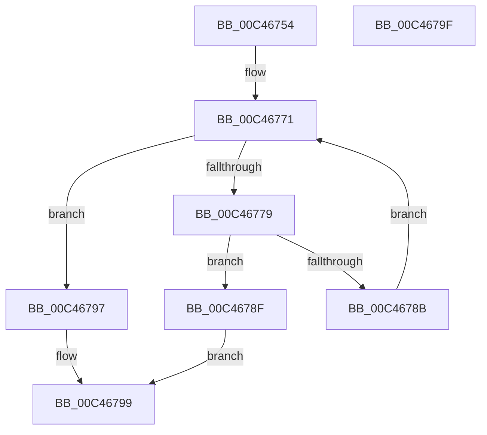

# PspTlsInitialize

- RVA: `0x00C46754`–`0x00C467A0` (길이 `76` bytes)
- VA: `0x0000000140C46754`
- 실행 섹션: `INIT`
- PDB 이름 있음: `예`; PDB Function 태그: `아니요`
- unwind 정보 RVA: `0x0005CF00`
- 디코드: `25`개 명령, `76/76` bytes 표시
- 미해석 바이트: `0` (있으면 어셈블리에 `.byte`로 보존)

> 이 문서는 커널 이미지의 기계어와 PDB 기호를 분석해 생성했습니다. 4번과 5번은 함수 원형과 자료형을 바이너리 사용 방식에서 추정한 C 해석이며 원본 소스 복구 결과는 아닙니다.

## 1. Dependencies

- 직접 호출 지점: **3**; 고유 호출 대상: **3**
- 직접 호출자로 확인된 함수: **1**
- RIP 상대 이미지 참조: **2**

### Outgoing calls
- `0x00C4675A` → [RtlpFlsInitialize](../../page/79/RtlpFlsInitialize_function_0079547C.md) (function, `0x0079547C`)
- `0x00C46761` → [ExGenRandom](../../text/41/ExGenRandom_function_0041B010.md) (function, `0x0041B010`)
- `0x00C46782` → [PsTlsAlloc](../../page/78/PsTlsAlloc_function_00787B40.md) (function, `0x00787B40`)

### Direct callers
- [PspInitPhase0](../C7/PspInitPhase0_function_00C77E2C.md) at `0x00C78868`

### Static image references
- `0x00C46769` → RVA `0x00E281C0` (`.data`; write)
- `0x00C46771` → RVA `0x00E281C0` (`.data`; read)

## 2. Other-region calls and transfers

- 다른 실행 섹션으로 향하는 call: **3**
  - `0x00C4675A` → [RtlpFlsInitialize](../../page/79/RtlpFlsInitialize_function_0079547C.md) (`INIT` → `PAGE`)
  - `0x00C46761` → [ExGenRandom](../../text/41/ExGenRandom_function_0041B010.md) (`INIT` → `.text`)
  - `0x00C46782` → [PsTlsAlloc](../../page/78/PsTlsAlloc_function_00787B40.md) (`INIT` → `PAGE`)
- 별도 외부 분기/꼬리 이동을 확인하지 못했습니다.

## 3. Assembly (complete function range)

```asm
00C46754  40 53                           push rbx
00C46756  48 83 EC 20                     sub rsp, 0x20
00C4675A  E8 1D ED B4 FF                  call 0x14079547c
00C4675F  33 C9                           xor ecx, ecx
00C46761  E8 AA 48 7D FF                  call 0x14041b010
00C46766  83 E0 07                        and eax, 7
00C46769  89 05 51 1A 1E 00               mov dword ptr [rip + 0x1e1a51], eax
00C4676F  33 DB                           xor ebx, ebx
00C46771  3B 1D 49 1A 1E 00               cmp ebx, dword ptr [rip + 0x1e1a49]
00C46777  73 1E                           jae 0x140c46797
00C46779  4C 8D 44 24 30                  lea r8, [rsp + 0x30]
00C4677E  33 D2                           xor edx, edx
00C46780  33 C9                           xor ecx, ecx
00C46782  E8 B9 13 B4 FF                  call 0x140787b40
00C46787  85 C0                           test eax, eax
00C46789  78 04                           js 0x140c4678f
00C4678B  FF C3                           inc ebx
00C4678D  EB E2                           jmp 0x140c46771
00C4678F  89 1D 2B 1A 1E 00               mov dword ptr [rip + 0x1e1a2b], ebx
00C46795  EB 02                           jmp 0x140c46799
00C46797  33 C0                           xor eax, eax
00C46799  48 83 C4 20                     add rsp, 0x20
00C4679D  5B                              pop rbx
00C4679E  C3                              ret
00C4679F  CC                              int3
```

## 4. C-style interpretation (structured pseudocode)

```c
__int64 __fastcall PspTlsInitialize(int a1, int a2)
{
    __int64 result;
    __int64 v_rbx;
    __int64 v_rsp;
    unsigned __int64 v_stack_p8;

    v_rsp = (v_rsp) - (32);
    result = RtlpFlsInitialize(a1, a2, a3, a4);
    a1 = 0;
    result = ExGenRandom(a1, a2, a3, a4);
    result = (unsigned int)((result) & (7));
    *(unsigned int *)(v_rip + 1972817) = (unsigned int)(result);
    v_rbx = 0;
loc_00C46771:
    if (0 >= (*(unsigned int *)(v_rip + 1972809))) goto loc_00C46797;
    a2 = 0;
    a1 = 0;
    result = PsTlsAlloc(a1, a2, v_stack_p8, a4);
    if (sign_flag) goto loc_00C4678F;
    v_rbx = (unsigned int)((v_rbx) + 1);
    goto loc_00C46771;
loc_00C4678F:
    *(unsigned int *)(v_rip + 1972779) = (unsigned int)(v_rbx);
    goto loc_00C46799;
loc_00C46797:
    result = 0;
loc_00C46799:
    v_rsp = (v_rsp) + (32);
    return result;
}
```

## 5. (Beta) C Style

```c
int64_t PspTlsInitialize(int32_t Arg1, int32_t Arg2)
{
    int64_t result;
    int64_t local_rbx;
    int64_t local_rsp;
    uint64_t v_stack_p8;

    local_rsp = (local_rsp) - (32);
    result = RtlpFlsInitialize(Arg1, Arg2, a3, a4);
    Arg1 = 0;
    result = ExGenRandom(Arg1, Arg2, a3, a4);
    result = (uint32_t)((result) & (7));
    *(uint32_t *)(v_rip + 0x1E1A51) = (uint32_t)(result);
    local_rbx = 0;
loc_00C46771:
    if (0 >= (*(uint32_t *)(v_rip + 0x1E1A49))) goto loc_00C46797;
    Arg2 = 0;
    Arg1 = 0;
    result = PsTlsAlloc(Arg1, Arg2, v_stack_p8, a4);
    if (sign_flag) goto loc_00C4678F;
    local_rbx = (uint32_t)((local_rbx) + 1);
    goto loc_00C46771;
loc_00C4678F:
    *(uint32_t *)(v_rip + 0x1E1A2B) = (uint32_t)(local_rbx);
    goto loc_00C46799;
loc_00C46797:
    result = 0;
loc_00C46799:
    local_rsp = (local_rsp) + (32);
    return result;
}
```

## 6. Execution-region graph

[열기: 2D/3D 그래프와 함수 탐색 컨트롤 패널](../../../control-panel.html?section=init&rva=0x00C46754&view=graph)

- 2D 그래프는 위에서 아래로 흐르고, 3D 그래프는 빈 공간을 드래그해 회전합니다. Shift+드래그는 이동, 휠은 확대·축소, 함수 노드 선택은 대상 보고서 이동입니다.

### Static fallback


