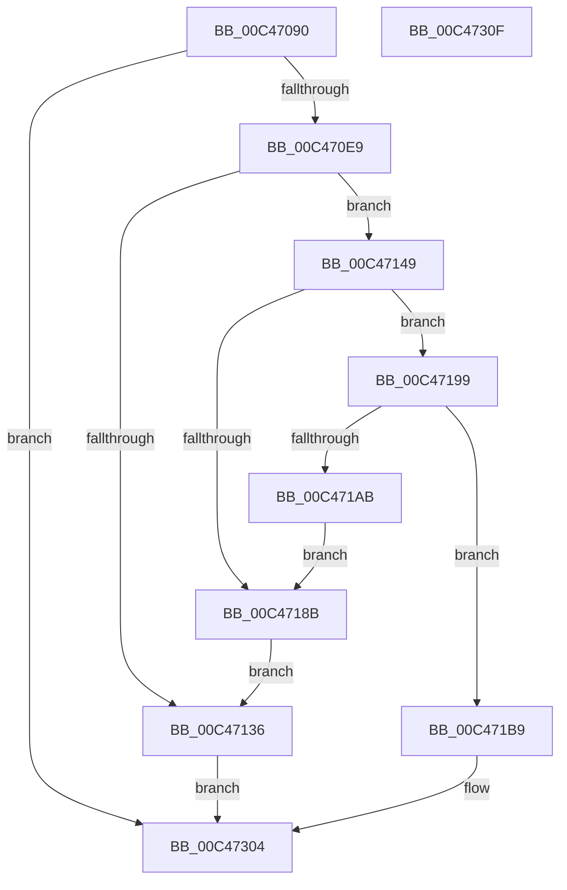

# RawInitialize

- RVA: `0x00C47090`–`0x00C47310` (길이 `640` bytes)
- VA: `0x0000000140C47090`
- 실행 섹션: `INIT`
- PDB 이름 있음: `예`; PDB Function 태그: `아니요`
- unwind 정보 RVA: `0x0008A2AC`
- 디코드: `125`개 명령, `640/640` bytes 표시
- 미해석 바이트: `0` (있으면 어셈블리에 `.byte`로 보존)

> 이 문서는 커널 이미지의 기계어와 PDB 기호를 분석해 생성했습니다. 4번과 5번은 함수 원형과 자료형을 바이너리 사용 방식에서 추정한 C 해석이며 원본 소스 복구 결과는 아닙니다.

## 1. Dependencies

- 직접 호출 지점: **16**; 고유 호출 대상: **6**
- 직접 호출자로 확인된 함수: **0**
- RIP 상대 이미지 참조: **24**

### Outgoing calls
- `0x00C470B1` → [RtlInitUnicodeString](../../text/42/RtlInitUnicodeString_function_0042A780.md) (function, `0x0042A780`)
- `0x00C470DC` → [IoCreateDevice](../../page/9A/IoCreateDevice_function_009A4B00.md) (function, `0x009A4B00`)
- `0x00C47100` → [RtlInitUnicodeString](../../text/42/RtlInitUnicodeString_function_0042A780.md) (function, `0x0042A780`)
- `0x00C4712B` → [IoCreateDevice](../../page/9A/IoCreateDevice_function_009A4B00.md) (function, `0x009A4B00`)
- `0x00C4713D` → [IoDeleteDevice](../../text/26/IoDeleteDevice_function_0026FE90.md) (function, `0x0026FE90`)
- `0x00C47155` → [RtlInitUnicodeString](../../text/42/RtlInitUnicodeString_function_0042A780.md) (function, `0x0042A780`)
- `0x00C47180` → [IoCreateDevice](../../page/9A/IoCreateDevice_function_009A4B00.md) (function, `0x009A4B00`)
- `0x00C47192` → [IoDeleteDevice](../../text/26/IoDeleteDevice_function_0026FE90.md) (function, `0x0026FE90`)
- `0x00C471A0` → [IoRegisterShutdownNotification](../../page/71/IoRegisterShutdownNotification_function_0071DB50.md) (function, `0x0071DB50`)
- `0x00C471B2` → [IoDeleteDevice](../../text/26/IoDeleteDevice_function_0026FE90.md) (function, `0x0026FE90`)
- `0x00C47247` → [IoRegisterFileSystem](../../page/71/IoRegisterFileSystem_function_0071D6C0.md) (function, `0x0071D6C0`)
- `0x00C47253` → [IoRegisterFileSystem](../../page/71/IoRegisterFileSystem_function_0071D6C0.md) (function, `0x0071D6C0`)
- `0x00C4725F` → [IoRegisterFileSystem](../../page/71/IoRegisterFileSystem_function_0071D6C0.md) (function, `0x0071D6C0`)
- `0x00C47272` → [ObfReferenceObjectWithTag](../../text/21/ObfReferenceObjectWithTag_function_00210710.md) (function, `0x00210710`)
- `0x00C47280` → [ObfReferenceObjectWithTag](../../text/21/ObfReferenceObjectWithTag_function_00210710.md) (function, `0x00210710`)
- `0x00C4728E` → [ObfReferenceObjectWithTag](../../text/21/ObfReferenceObjectWithTag_function_00210710.md) (function, `0x00210710`)

### Direct callers
- 이 함수 시작 RVA로 연결되는 직접 call은 확인되지 않았습니다. 간접 호출은 완전히 역산할 수 없습니다.

### Static image references
- `0x00C4709D` → RVA `0x00C7C960` (` ?? ::PBOPGDP::`string'`; read)
- `0x00C470B6` → RVA `0x00F05D18` (`.data`; read)
- `0x00C470E9` → RVA `0x0078A120` (`RawUnload`; read)
- `0x00C470F0` → RVA `0x00C7C930` (` ?? ::PBOPGDP::`string'`; read)
- `0x00C47105` → RVA `0x00F05D10` (`.data`; read)
- `0x00C47149` → RVA `0x00C7C910` (` ?? ::PBOPGDP::`string'`; read)
- `0x00C4715A` → RVA `0x00F05D20` (`.data`; read)
- `0x00C471DA` → RVA `0x009A3920` (`RawDispatch`; read)
- `0x00C47232` → RVA `0x0078A0A0` (`RawShutdown`; read)
- `0x00C47293` → RVA `0x00F05CC8` (`.data`; read/write)
- `0x00C4729B` → RVA `0x00F05D00` (`.data`; read)
- `0x00C472A2` → RVA `0x00F05CD0` (`.data`; read/write)
- `0x00C472A9` → RVA `0x00F05CDC` (`.data`; read/write)
- `0x00C472B0` → RVA `0x00F05D08` (`.data`; write)
- `0x00C472B7` → RVA `0x00F05D00` (`.data`; write)
- `0x00C472BE` → RVA `0x00F05CA0` (`.data`; read)
- `0x00C472C5` → RVA `0x00F05CA8` (`.data`; write)
- `0x00C472CC` → RVA `0x00F05CA0` (`.data`; write)
- `0x00C472D3` → RVA `0x00F05CE0` (`.data`; read)
- `0x00C472DA` → RVA `0x00F05CE8` (`.data`; write)
- `0x00C472E1` → RVA `0x00F05CE0` (`.data`; write)
- `0x00C472EA` → RVA `0x00F05CC0` (`.data`; write)
- `0x00C472F4` → RVA `0x00F05CD8` (`.data`; write)
- `0x00C472FD` → RVA `0x00F05CDA` (`.data`; write)

## 2. Other-region calls and transfers

- 다른 실행 섹션으로 향하는 call: **16**
  - `0x00C470B1` → [RtlInitUnicodeString](../../text/42/RtlInitUnicodeString_function_0042A780.md) (`INIT` → `.text`)
  - `0x00C470DC` → [IoCreateDevice](../../page/9A/IoCreateDevice_function_009A4B00.md) (`INIT` → `PAGE`)
  - `0x00C47100` → [RtlInitUnicodeString](../../text/42/RtlInitUnicodeString_function_0042A780.md) (`INIT` → `.text`)
  - `0x00C4712B` → [IoCreateDevice](../../page/9A/IoCreateDevice_function_009A4B00.md) (`INIT` → `PAGE`)
  - `0x00C4713D` → [IoDeleteDevice](../../text/26/IoDeleteDevice_function_0026FE90.md) (`INIT` → `.text`)
  - `0x00C47155` → [RtlInitUnicodeString](../../text/42/RtlInitUnicodeString_function_0042A780.md) (`INIT` → `.text`)
  - `0x00C47180` → [IoCreateDevice](../../page/9A/IoCreateDevice_function_009A4B00.md) (`INIT` → `PAGE`)
  - `0x00C47192` → [IoDeleteDevice](../../text/26/IoDeleteDevice_function_0026FE90.md) (`INIT` → `.text`)
  - `0x00C471A0` → [IoRegisterShutdownNotification](../../page/71/IoRegisterShutdownNotification_function_0071DB50.md) (`INIT` → `PAGE`)
  - `0x00C471B2` → [IoDeleteDevice](../../text/26/IoDeleteDevice_function_0026FE90.md) (`INIT` → `.text`)
  - `0x00C47247` → [IoRegisterFileSystem](../../page/71/IoRegisterFileSystem_function_0071D6C0.md) (`INIT` → `PAGE`)
  - `0x00C47253` → [IoRegisterFileSystem](../../page/71/IoRegisterFileSystem_function_0071D6C0.md) (`INIT` → `PAGE`)
  - `0x00C4725F` → [IoRegisterFileSystem](../../page/71/IoRegisterFileSystem_function_0071D6C0.md) (`INIT` → `PAGE`)
  - `0x00C47272` → [ObfReferenceObjectWithTag](../../text/21/ObfReferenceObjectWithTag_function_00210710.md) (`INIT` → `.text`)
  - `0x00C47280` → [ObfReferenceObjectWithTag](../../text/21/ObfReferenceObjectWithTag_function_00210710.md) (`INIT` → `.text`)
  - `0x00C4728E` → [ObfReferenceObjectWithTag](../../text/21/ObfReferenceObjectWithTag_function_00210710.md) (`INIT` → `.text`)
- 별도 외부 분기/꼬리 이동을 확인하지 못했습니다.

## 3. Assembly (complete function range)

```asm
00C47090  48 89 5C 24 08                  mov qword ptr [rsp + 8], rbx
00C47095  57                              push rdi
00C47096  48 83 EC 50                     sub rsp, 0x50
00C4709A  48 8B D9                        mov rbx, rcx
00C4709D  48 8D 15 BC 58 03 00            lea rdx, [rip + 0x358bc]
00C470A4  0F 57 C0                        xorps xmm0, xmm0
00C470A7  48 8D 4C 24 40                  lea rcx, [rsp + 0x40]
00C470AC  0F 11 44 24 40                  movups xmmword ptr [rsp + 0x40], xmm0
00C470B1  E8 CA 36 7E FF                  call 0x14042a780
00C470B6  48 8D 05 5B EC 2B 00            lea rax, [rip + 0x2bec5b]
00C470BD  41 B9 08 00 00 00               mov r9d, 8
00C470C3  48 89 44 24 30                  mov qword ptr [rsp + 0x30], rax
00C470C8  4C 8D 44 24 40                  lea r8, [rsp + 0x40]
00C470CD  C6 44 24 28 00                  mov byte ptr [rsp + 0x28], 0
00C470D2  33 D2                           xor edx, edx
00C470D4  83 64 24 20 00                  and dword ptr [rsp + 0x20], 0
00C470D9  48 8B CB                        mov rcx, rbx
00C470DC  E8 1F DA D5 FF                  call 0x1409a4b00
00C470E1  85 C0                           test eax, eax
00C470E3  0F 88 1B 02 00 00               js 0x140c47304
00C470E9  48 8D 05 30 30 B4 FF            lea rax, [rip - 0x4bcfd0]
00C470F0  48 8D 15 39 58 03 00            lea rdx, [rip + 0x35839]
00C470F7  48 89 43 68                     mov qword ptr [rbx + 0x68], rax
00C470FB  48 8D 4C 24 40                  lea rcx, [rsp + 0x40]
00C47100  E8 7B 36 7E FF                  call 0x14042a780
00C47105  48 8D 05 04 EC 2B 00            lea rax, [rip + 0x2bec04]
00C4710C  41 B9 03 00 00 00               mov r9d, 3
00C47112  48 89 44 24 30                  mov qword ptr [rsp + 0x30], rax
00C47117  4C 8D 44 24 40                  lea r8, [rsp + 0x40]
00C4711C  C6 44 24 28 00                  mov byte ptr [rsp + 0x28], 0
00C47121  33 D2                           xor edx, edx
00C47123  83 64 24 20 00                  and dword ptr [rsp + 0x20], 0
00C47128  48 8B CB                        mov rcx, rbx
00C4712B  E8 D0 D9 D5 FF                  call 0x1409a4b00
00C47130  8B F8                           mov edi, eax
00C47132  85 C0                           test eax, eax
00C47134  79 13                           jns 0x140c47149
00C47136  48 8B 0D DB EB 2B 00            mov rcx, qword ptr [rip + 0x2bebdb]
00C4713D  E8 4E 8D 62 FF                  call 0x14026fe90
00C47142  8B C7                           mov eax, edi
00C47144  E9 BB 01 00 00                  jmp 0x140c47304
00C47149  48 8D 15 C0 57 03 00            lea rdx, [rip + 0x357c0]
00C47150  48 8D 4C 24 40                  lea rcx, [rsp + 0x40]
00C47155  E8 26 36 7E FF                  call 0x14042a780
00C4715A  48 8D 05 BF EB 2B 00            lea rax, [rip + 0x2bebbf]
00C47161  41 B9 20 00 00 00               mov r9d, 0x20
00C47167  48 89 44 24 30                  mov qword ptr [rsp + 0x30], rax
00C4716C  4C 8D 44 24 40                  lea r8, [rsp + 0x40]
00C47171  C6 44 24 28 00                  mov byte ptr [rsp + 0x28], 0
00C47176  33 D2                           xor edx, edx
00C47178  83 64 24 20 00                  and dword ptr [rsp + 0x20], 0
00C4717D  48 8B CB                        mov rcx, rbx
00C47180  E8 7B D9 D5 FF                  call 0x1409a4b00
00C47185  8B F8                           mov edi, eax
00C47187  85 C0                           test eax, eax
00C47189  79 0E                           jns 0x140c47199
00C4718B  48 8B 0D 7E EB 2B 00            mov rcx, qword ptr [rip + 0x2beb7e]
00C47192  E8 F9 8C 62 FF                  call 0x14026fe90
00C47197  EB 9D                           jmp 0x140c47136
00C47199  48 8B 0D 80 EB 2B 00            mov rcx, qword ptr [rip + 0x2beb80]
00C471A0  E8 AB 69 AD FF                  call 0x14071db50
00C471A5  8B F8                           mov edi, eax
00C471A7  85 C0                           test eax, eax
00C471A9  79 0E                           jns 0x140c471b9
00C471AB  48 8B 0D 6E EB 2B 00            mov rcx, qword ptr [rip + 0x2beb6e]
00C471B2  E8 D9 8C 62 FF                  call 0x14026fe90
00C471B7  EB D2                           jmp 0x140c4718b
00C471B9  48 8B 05 58 EB 2B 00            mov rax, qword ptr [rip + 0x2beb58]
00C471C0  83 48 30 10                     or dword ptr [rax + 0x30], 0x10
00C471C4  48 8B 05 45 EB 2B 00            mov rax, qword ptr [rip + 0x2beb45]
00C471CB  83 48 30 10                     or dword ptr [rax + 0x30], 0x10
00C471CF  48 8B 05 4A EB 2B 00            mov rax, qword ptr [rip + 0x2beb4a]
00C471D6  83 48 30 10                     or dword ptr [rax + 0x30], 0x10
00C471DA  48 8D 05 3F C7 D5 FF            lea rax, [rip - 0x2a38c1]
00C471E1  48 89 83 B8 00 00 00            mov qword ptr [rbx + 0xb8], rax
00C471E8  48 89 83 48 01 00 00            mov qword ptr [rbx + 0x148], rax
00C471EF  48 89 83 E0 00 00 00            mov qword ptr [rbx + 0xe0], rax
00C471F6  48 89 83 D8 00 00 00            mov qword ptr [rbx + 0xd8], rax
00C471FD  48 89 83 C0 00 00 00            mov qword ptr [rbx + 0xc0], rax
00C47204  48 89 83 A0 00 00 00            mov qword ptr [rbx + 0xa0], rax
00C4720B  48 89 83 98 00 00 00            mov qword ptr [rbx + 0x98], rax
00C47212  48 89 83 90 00 00 00            mov qword ptr [rbx + 0x90], rax
00C47219  48 89 83 88 00 00 00            mov qword ptr [rbx + 0x88], rax
00C47220  48 89 83 80 00 00 00            mov qword ptr [rbx + 0x80], rax
00C47227  48 89 83 00 01 00 00            mov qword ptr [rbx + 0x100], rax
00C4722E  48 89 43 70                     mov qword ptr [rbx + 0x70], rax
00C47232  48 8D 05 67 2E B4 FF            lea rax, [rip - 0x4bd199]
00C47239  48 89 83 F0 00 00 00            mov qword ptr [rbx + 0xf0], rax
00C47240  48 8B 0D D1 EA 2B 00            mov rcx, qword ptr [rip + 0x2bead1]
00C47247  E8 74 64 AD FF                  call 0x14071d6c0
00C4724C  48 8B 0D BD EA 2B 00            mov rcx, qword ptr [rip + 0x2beabd]
00C47253  E8 68 64 AD FF                  call 0x14071d6c0
00C47258  48 8B 0D C1 EA 2B 00            mov rcx, qword ptr [rip + 0x2beac1]
00C4725F  E8 5C 64 AD FF                  call 0x14071d6c0
00C47264  48 8B 0D AD EA 2B 00            mov rcx, qword ptr [rip + 0x2beaad]
00C4726B  BB 44 66 6C 74                  mov ebx, 0x746c6644
00C47270  8B D3                           mov edx, ebx
00C47272  E8 99 94 5C FF                  call 0x140210710
00C47277  48 8B 0D 92 EA 2B 00            mov rcx, qword ptr [rip + 0x2bea92]
00C4727E  8B D3                           mov edx, ebx
00C47280  E8 8B 94 5C FF                  call 0x140210710
00C47285  48 8B 0D 94 EA 2B 00            mov rcx, qword ptr [rip + 0x2bea94]
00C4728C  8B D3                           mov edx, ebx
00C4728E  E8 7D 94 5C FF                  call 0x140210710
00C47293  48 83 25 2D EA 2B 00 00         and qword ptr [rip + 0x2bea2d], 0
00C4729B  48 8D 05 5E EA 2B 00            lea rax, [rip + 0x2bea5e]
00C472A2  83 25 27 EA 2B 00 00            and dword ptr [rip + 0x2bea27], 0
00C472A9  83 25 2C EA 2B 00 00            and dword ptr [rip + 0x2bea2c], 0
00C472B0  48 89 05 51 EA 2B 00            mov qword ptr [rip + 0x2bea51], rax
00C472B7  48 89 05 42 EA 2B 00            mov qword ptr [rip + 0x2bea42], rax
00C472BE  48 8D 05 DB E9 2B 00            lea rax, [rip + 0x2be9db]
00C472C5  48 89 05 DC E9 2B 00            mov qword ptr [rip + 0x2be9dc], rax
00C472CC  48 89 05 CD E9 2B 00            mov qword ptr [rip + 0x2be9cd], rax
00C472D3  48 8D 05 06 EA 2B 00            lea rax, [rip + 0x2bea06]
00C472DA  48 89 05 07 EA 2B 00            mov qword ptr [rip + 0x2bea07], rax
00C472E1  48 89 05 F8 E9 2B 00            mov qword ptr [rip + 0x2be9f8], rax
00C472E8  33 C0                           xor eax, eax
00C472EA  C7 05 CC E9 2B 00 01 00 00 00   mov dword ptr [rip + 0x2be9cc], 1
00C472F4  66 C7 05 DB E9 2B 00 01 00      mov word ptr [rip + 0x2be9db], 1
00C472FD  C6 05 D6 E9 2B 00 06            mov byte ptr [rip + 0x2be9d6], 6
00C47304  48 8B 5C 24 60                  mov rbx, qword ptr [rsp + 0x60]
00C47309  48 83 C4 50                     add rsp, 0x50
00C4730D  5F                              pop rdi
00C4730E  C3                              ret
00C4730F  CC                              int3
```

## 4. C-style interpretation (structured pseudocode)

```c
__int64 __fastcall RawInitialize(__int64 a1)
{
    __int64 result;
    __int64 v_rsp;
    unsigned __int64 v_stack_m18;
    unsigned __int64 v_stack_m28;
    unsigned __int8 v_stack_m30;
    unsigned int v_stack_m38;
    unsigned __int64 v_stack_p8;

    v_stack_p8 = v_rbx;
    v_rsp = (v_rsp) - (80);
    v_stack_m18 = v_xmm0;
    result = RtlInitUnicodeString(v_stack_m18, v_rip + 219324, a3, a4);
    v_stack_m28 = v_rip + 2878555;
    v_stack_m30 = 0;
    a2 = 0;
    result = IoCreateDevice(a1, a2, v_stack_m18, 8);
    if (sign_flag) goto loc_00C47304;
    *(unsigned __int64 *)(a1 + 104) = v_rip - 4968400;
    result = RtlInitUnicodeString(v_stack_m18, v_rip + 219193, v_stack_m18, 8);
    v_stack_m28 = v_rip + 2878468;
    v_stack_m30 = 0;
    a2 = 0;
    result = IoCreateDevice(a1, a2, v_stack_m18, 3);
    if (!sign_flag) goto loc_00C47149;
loc_00C47136:
    result = IoDeleteDevice(*(unsigned __int64 *)(v_rip + 2878427), a2, v_stack_m18, 3);
    goto loc_00C47304;
loc_00C47149:
    result = RtlInitUnicodeString(v_stack_m18, v_rip + 219072, v_stack_m18, 3);
    v_stack_m28 = v_rip + 2878399;
    v_stack_m30 = 0;
    a2 = 0;
    result = IoCreateDevice(a1, a2, v_stack_m18, 32);
    if (!sign_flag) goto loc_00C47199;
loc_00C4718B:
    result = IoDeleteDevice(*(unsigned __int64 *)(v_rip + 2878334), a2, v_stack_m18, 32);
    goto loc_00C47136;
loc_00C47199:
    result = IoRegisterShutdownNotification(*(unsigned __int64 *)(v_rip + 2878336), a2, v_stack_m18, 32);
    if (!sign_flag) goto loc_00C471B9;
    result = IoDeleteDevice(*(unsigned __int64 *)(v_rip + 2878318), a2, v_stack_m18, 32);
    goto loc_00C4718B;
loc_00C471B9:
    *(unsigned __int64 *)(a1 + 184) = v_rip - 2767041;
    *(unsigned __int64 *)(a1 + 328) = v_rip - 2767041;
    *(unsigned __int64 *)(a1 + 224) = v_rip - 2767041;
    *(unsigned __int64 *)(a1 + 216) = v_rip - 2767041;
    *(unsigned __int64 *)(a1 + 192) = v_rip - 2767041;
    *(unsigned __int64 *)(a1 + 160) = v_rip - 2767041;
    *(unsigned __int64 *)(a1 + 152) = v_rip - 2767041;
    *(unsigned __int64 *)(a1 + 144) = v_rip - 2767041;
    *(unsigned __int64 *)(a1 + 136) = v_rip - 2767041;
    *(unsigned __int64 *)(a1 + 128) = v_rip - 2767041;
    *(unsigned __int64 *)(a1 + 256) = v_rip - 2767041;
    *(unsigned __int64 *)(a1 + 112) = v_rip - 2767041;
    *(unsigned __int64 *)(a1 + 240) = v_rip - 4968857;
    result = IoRegisterFileSystem(*(unsigned __int64 *)(v_rip + 2878161), a2, v_stack_m18, 32);
    result = IoRegisterFileSystem(*(unsigned __int64 *)(v_rip + 2878141), a2, v_stack_m18, 32);
    result = IoRegisterFileSystem(*(unsigned __int64 *)(v_rip + 2878145), a2, v_stack_m18, 32);
    result = ObfReferenceObjectWithTag(*(unsigned __int64 *)(v_rip + 2878125), (unsigned int)((unsigned int)((unsigned int)(0x746C6644ULL))), v_stack_m18, 32);
    result = ObfReferenceObjectWithTag(*(unsigned __int64 *)(v_rip + 2878098), (unsigned int)((unsigned int)((unsigned int)(0x746C6644ULL))), v_stack_m18, 32);
    result = ObfReferenceObjectWithTag(*(unsigned __int64 *)(v_rip + 2878100), (unsigned int)((unsigned int)((unsigned int)(0x746C6644ULL))), v_stack_m18, 32);
    *(unsigned __int64 *)(v_rip + 2878033) = v_rip + 2878046;
    *(unsigned __int64 *)(v_rip + 2878018) = v_rip + 2878046;
    *(unsigned __int64 *)(v_rip + 2877916) = v_rip + 2877915;
    *(unsigned __int64 *)(v_rip + 2877901) = v_rip + 2877915;
    *(unsigned __int64 *)(v_rip + 2877959) = v_rip + 2877958;
    *(unsigned __int64 *)(v_rip + 2877944) = v_rip + 2877958;
    result = 0;
    *(unsigned int *)(v_rip + 2877900) = 1;
    *(unsigned __int16 *)(v_rip + 2877915) = 1;
    *(unsigned __int8 *)(v_rip + 2877910) = 6;
loc_00C47304:
    v_rsp = (v_rsp) + (80);
    return result;
}
```

## 5. (Beta) C Style

```c
int64_t RawInitialize(void *Arg1)
{
    uint8_t *arg1 = (uint8_t *)Arg1;

    int64_t result;
    int64_t local_rsp;
    uint64_t v_stack_m18;
    uint64_t v_stack_m28;
    uint8_t v_stack_m30;
    uint32_t v_stack_m38;
    uint64_t v_stack_p8;

    v_stack_p8 = local_rbx;
    local_rsp = (local_rsp) - (80);
    v_stack_m18 = v_xmm0;
    result = RtlInitUnicodeString(v_stack_m18, v_rip + 219324, a3, a4);
    v_stack_m28 = v_rip + 2878555;
    v_stack_m30 = 0;
    a2 = 0;
    result = IoCreateDevice(Arg1, a2, v_stack_m18, 8);
    if (sign_flag) goto loc_00C47304;
    *(uint64_t *)(arg1 + 0x68) = v_rip - 4968400;
    result = RtlInitUnicodeString(v_stack_m18, v_rip + 219193, v_stack_m18, 8);
    v_stack_m28 = v_rip + 2878468;
    v_stack_m30 = 0;
    a2 = 0;
    result = IoCreateDevice(Arg1, a2, v_stack_m18, 3);
    if (!sign_flag) goto loc_00C47149;
loc_00C47136:
    result = IoDeleteDevice(*(uint64_t *)(v_rip + 0x2BEBDB), a2, v_stack_m18, 3);
    goto loc_00C47304;
loc_00C47149:
    result = RtlInitUnicodeString(v_stack_m18, v_rip + 219072, v_stack_m18, 3);
    v_stack_m28 = v_rip + 2878399;
    v_stack_m30 = 0;
    a2 = 0;
    result = IoCreateDevice(Arg1, a2, v_stack_m18, 32);
    if (!sign_flag) goto loc_00C47199;
loc_00C4718B:
    result = IoDeleteDevice(*(uint64_t *)(v_rip + 0x2BEB7E), a2, v_stack_m18, 32);
    goto loc_00C47136;
loc_00C47199:
    result = IoRegisterShutdownNotification(*(uint64_t *)(v_rip + 0x2BEB80), a2, v_stack_m18, 32);
    if (!sign_flag) goto loc_00C471B9;
    result = IoDeleteDevice(*(uint64_t *)(v_rip + 0x2BEB6E), a2, v_stack_m18, 32);
    goto loc_00C4718B;
loc_00C471B9:
    *(uint64_t *)(arg1 + 0xB8) = v_rip - 2767041;
    *(uint64_t *)(arg1 + 0x148) = v_rip - 2767041;
    *(uint64_t *)(arg1 + 0xE0) = v_rip - 2767041;
    *(uint64_t *)(arg1 + 0xD8) = v_rip - 2767041;
    *(uint64_t *)(arg1 + 0xC0) = v_rip - 2767041;
    *(uint64_t *)(arg1 + 0xA0) = v_rip - 2767041;
    *(uint64_t *)(arg1 + 0x98) = v_rip - 2767041;
    *(uint64_t *)(arg1 + 0x90) = v_rip - 2767041;
    *(uint64_t *)(arg1 + 0x88) = v_rip - 2767041;
    *(uint64_t *)(arg1 + 0x80) = v_rip - 2767041;
    *(uint64_t *)(arg1 + 0x100) = v_rip - 2767041;
    *(uint64_t *)(arg1 + 0x70) = v_rip - 2767041;
    *(uint64_t *)(arg1 + 0xF0) = v_rip - 4968857;
    result = IoRegisterFileSystem(*(uint64_t *)(v_rip + 0x2BEAD1), a2, v_stack_m18, 32);
    result = IoRegisterFileSystem(*(uint64_t *)(v_rip + 0x2BEABD), a2, v_stack_m18, 32);
    result = IoRegisterFileSystem(*(uint64_t *)(v_rip + 0x2BEAC1), a2, v_stack_m18, 32);
    result = ObfReferenceObjectWithTag(*(uint64_t *)(v_rip + 0x2BEAAD), (uint32_t)((uint32_t)((uint32_t)(0x746C6644ULL))), v_stack_m18, 32);
    result = ObfReferenceObjectWithTag(*(uint64_t *)(v_rip + 0x2BEA92), (uint32_t)((uint32_t)((uint32_t)(0x746C6644ULL))), v_stack_m18, 32);
    result = ObfReferenceObjectWithTag(*(uint64_t *)(v_rip + 0x2BEA94), (uint32_t)((uint32_t)((uint32_t)(0x746C6644ULL))), v_stack_m18, 32);
    *(uint64_t *)(v_rip + 0x2BEA51) = v_rip + 2878046;
    *(uint64_t *)(v_rip + 0x2BEA42) = v_rip + 2878046;
    *(uint64_t *)(v_rip + 0x2BE9DC) = v_rip + 2877915;
    *(uint64_t *)(v_rip + 0x2BE9CD) = v_rip + 2877915;
    *(uint64_t *)(v_rip + 0x2BEA07) = v_rip + 2877958;
    *(uint64_t *)(v_rip + 0x2BE9F8) = v_rip + 2877958;
    result = 0;
    *(uint32_t *)(v_rip + 0x2BE9CC) = 1;
    *(uint16_t *)(v_rip + 0x2BE9DB) = 1;
    *(uint8_t *)(v_rip + 0x2BE9D6) = 6;
loc_00C47304:
    local_rsp = (local_rsp) + (80);
    return result;
}
```

### 관측된 메모리 오프셋

구조체 형식이 확인되지 않은 접근은 인자 기준의 오프셋으로만 기록했습니다.

| 기준 인자 | 오프셋 표현 | 폭 (bit) | 접근 |
|---|---:|---:|---|
| `Arg1` | `+ 0x68` | `64` | `W` |
| `Arg1` | `+ 0x70` | `64` | `W` |
| `Arg1` | `+ 0x80` | `64` | `W` |
| `Arg1` | `+ 0x88` | `64` | `W` |
| `Arg1` | `+ 0x90` | `64` | `W` |
| `Arg1` | `+ 0x98` | `64` | `W` |
| `Arg1` | `+ 0xA0` | `64` | `W` |
| `Arg1` | `+ 0xB8` | `64` | `W` |
| `Arg1` | `+ 0xC0` | `64` | `W` |
| `Arg1` | `+ 0xD8` | `64` | `W` |
| `Arg1` | `+ 0xE0` | `64` | `W` |
| `Arg1` | `+ 0xF0` | `64` | `W` |
| `Arg1` | `+ 0x100` | `64` | `W` |
| `Arg1` | `+ 0x148` | `64` | `W` |

## 6. Execution-region graph

[열기: 2D/3D 그래프와 함수 탐색 컨트롤 패널](../../../control-panel.html?section=init&rva=0x00C47090&view=graph)

- 2D 그래프는 위에서 아래로 흐르고, 3D 그래프는 빈 공간을 드래그해 회전합니다. Shift+드래그는 이동, 휠은 확대·축소, 함수 노드 선택은 대상 보고서 이동입니다.

### Static fallback


