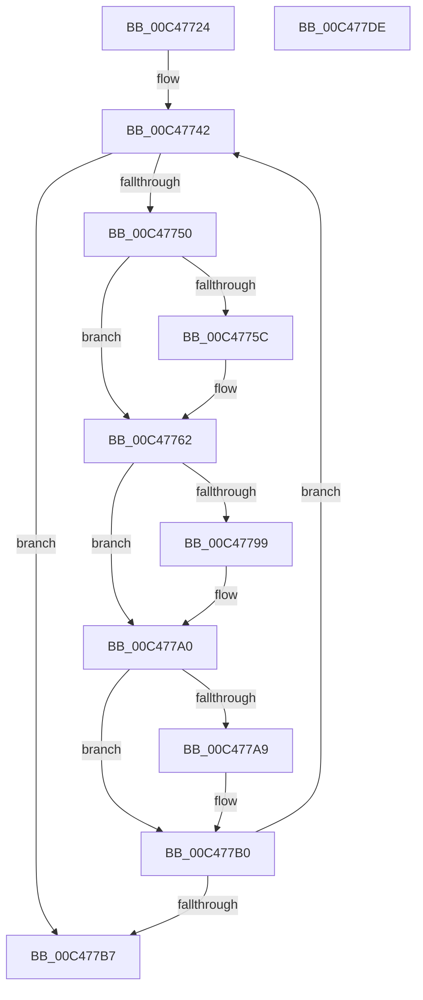

# RtlInitializeHistoryTable

- RVA: `0x00C47724`–`0x00C477DF` (길이 `187` bytes)
- VA: `0x0000000140C47724`
- 실행 섹션: `INIT`
- PDB 이름 있음: `예`; PDB Function 태그: `아니요`
- unwind 정보 RVA: `0x0005FD94`
- 디코드: `47`개 명령, `187/187` bytes 표시
- 미해석 바이트: `0` (있으면 어셈블리에 `.byte`로 보존)

> 이 문서는 커널 이미지의 기계어와 PDB 기호를 분석해 생성했습니다. 4번과 5번은 함수 원형과 자료형을 바이너리 사용 방식에서 추정한 C 해석이며 원본 소스 복구 결과는 아닙니다.

## 1. Dependencies

- 직접 호출 지점: **3**; 고유 호출 대상: **3**
- 직접 호출자로 확인된 함수: **1**
- RIP 상대 이미지 참조: **9**

### Outgoing calls
- `0x00C47746` → [RtlpFunctionAddressTableEntry](RtlpFunctionAddressTableEntry_function_00C47660.md) (function, `0x00C47660`)
- `0x00C4776D` → [RtlLookupFunctionEntry](../../text/2F/RtlLookupFunctionEntry_function_002F2F30.md) (function, `0x002F2F30`)
- `0x00C477C9` → [RtlpInitMachineFrameEntries](RtlpInitMachineFrameEntries_function_00C476D4.md) (function, `0x00C476D4`)

### Direct callers
- [MiInitializeLoadedModuleList](../C6/MiInitializeLoadedModuleList_function_00C6BCDC.md) at `0x00C6C022`

### Static image references
- `0x00C47739` → RVA `0x01201940` (`CFGRO`; read)
- `0x00C47750` → RVA `0x002F6A50` (`RtlRaiseStatus`; read)
- `0x00C4775C` → RVA `0x01201945` (`CFGRO`; write)
- `0x00C47790` → RVA `0x01201948` (`CFGRO`; read)
- `0x00C47799` → RVA `0x01201948` (`CFGRO`; write)
- `0x00C477A0` → RVA `0x01201950` (`CFGRO`; read)
- `0x00C477A9` → RVA `0x01201950` (`CFGRO`; write)
- `0x00C477BC` → RVA `0x01201940` (`CFGRO`; write)
- `0x00C477C2` → RVA `0x00E01EA8` (`.data`; read)

## 2. Other-region calls and transfers

- 다른 실행 섹션으로 향하는 call: **1**
  - `0x00C4776D` → [RtlLookupFunctionEntry](../../text/2F/RtlLookupFunctionEntry_function_002F2F30.md) (`INIT` → `.text`)
- 별도 외부 분기/꼬리 이동을 확인하지 못했습니다.

## 3. Assembly (complete function range)

```asm
00C47724  48 89 5C 24 10                  mov qword ptr [rsp + 0x10], rbx
00C47729  48 89 74 24 18                  mov qword ptr [rsp + 0x18], rsi
00C4772E  57                              push rdi
00C4772F  48 83 EC 20                     sub rsp, 0x20
00C47733  48 83 64 24 30 00               and qword ptr [rsp + 0x30], 0
00C47739  48 8D 35 00 A2 5B 00            lea rsi, [rip + 0x5ba200]
00C47740  33 DB                           xor ebx, ebx
00C47742  8B CB                           mov ecx, ebx
00C47744  8B FB                           mov edi, ebx
00C47746  E8 15 FF FF FF                  call 0x140c47660
00C4774B  48 85 C0                        test rax, rax
00C4774E  74 67                           je 0x140c477b7
00C47750  48 8D 0D F9 F2 6A FF            lea rcx, [rip - 0x950d07]
00C47757  48 3B C1                        cmp rax, rcx
00C4775A  75 06                           jne 0x140c47762
00C4775C  88 1D E3 A1 5B 00               mov byte ptr [rip + 0x5ba1e3], bl
00C47762  45 33 C0                        xor r8d, r8d
00C47765  48 8D 54 24 30                  lea rdx, [rsp + 0x30]
00C4776A  48 8B C8                        mov rcx, rax
00C4776D  E8 BE B7 6A FF                  call 0x1402f2f30
00C47772  48 8B 4C 24 30                  mov rcx, qword ptr [rsp + 0x30]
00C47777  48 03 FF                        add rdi, rdi
00C4777A  44 8B 00                        mov r8d, dword ptr [rax]
00C4777D  8B 50 04                        mov edx, dword ptr [rax + 4]
00C47780  4C 03 C1                        add r8, rcx
00C47783  48 03 D1                        add rdx, rcx
00C47786  48 89 4C FE 18                  mov qword ptr [rsi + rdi*8 + 0x18], rcx
00C4778B  48 89 44 FE 20                  mov qword ptr [rsi + rdi*8 + 0x20], rax
00C47790  4C 3B 05 B1 A1 5B 00            cmp r8, qword ptr [rip + 0x5ba1b1]
00C47797  73 07                           jae 0x140c477a0
00C47799  4C 89 05 A8 A1 5B 00            mov qword ptr [rip + 0x5ba1a8], r8
00C477A0  48 3B 15 A9 A1 5B 00            cmp rdx, qword ptr [rip + 0x5ba1a9]
00C477A7  76 07                           jbe 0x140c477b0
00C477A9  48 89 15 A0 A1 5B 00            mov qword ptr [rip + 0x5ba1a0], rdx
00C477B0  FF C3                           inc ebx
00C477B2  83 FB 0C                        cmp ebx, 0xc
00C477B5  72 8B                           jb 0x140c47742
00C477B7  BA 04 00 00 00                  mov edx, 4
00C477BC  89 1D 7E A1 5B 00               mov dword ptr [rip + 0x5ba17e], ebx
00C477C2  48 8D 0D DF A6 1B 00            lea rcx, [rip + 0x1ba6df]
00C477C9  E8 06 FF FF FF                  call 0x140c476d4
00C477CE  48 8B 5C 24 38                  mov rbx, qword ptr [rsp + 0x38]
00C477D3  48 8B 74 24 40                  mov rsi, qword ptr [rsp + 0x40]
00C477D8  48 83 C4 20                     add rsp, 0x20
00C477DC  5F                              pop rdi
00C477DD  C3                              ret
00C477DE  CC                              int3
```

## 4. C-style interpretation (structured pseudocode)

```c
__int64 __fastcall RtlInitializeHistoryTable(__int64 a1, __int64 a2, int a3)
{
    __int64 result;
    __int64 v_rbx;
    __int64 v_rdi;
    __int64 v_rsp;
    unsigned __int64 v_stack_p10;
    unsigned __int64 v_stack_p18;
    unsigned __int64 v_stack_p8;

    v_stack_p10 = v_rbx;
    v_stack_p18 = v_rsi;
    v_rsp = (v_rsp) - (32);
    v_rbx = 0;
loc_00C47742:
    result = RtlpFunctionAddressTableEntry(0, a2, a3, a4);
    if (result == 0) goto loc_00C477B7;
    if (result == (v_rip - 9768199)) {
        *(unsigned __int8 *)(v_rip + 6005219) = 0;
    }
    a3 = 0;
    result = RtlLookupFunctionEntry(result, v_stack_p8, a3, a4);
    v_rdi = (0) + (0);
    a3 = ((unsigned int)(*(unsigned int *)(result))) + (v_stack_p8);
    a2 = ((unsigned int)(*(unsigned int *)(result + 4))) + (v_stack_p8);
    *(unsigned __int64 *)(v_rip + 6005248 + v_rdi * 8 + 24) = v_stack_p8;
    *(unsigned __int64 *)(v_rip + 6005248 + v_rdi * 8 + 32) = result;
    if (a3 < (*(unsigned __int64 *)(v_rip + 6005169))) {
        *(unsigned __int64 *)(v_rip + 6005160) = a3;
    }
    if (a2 >= = (*(unsigned __int64 *)(v_rip + 6005161))) {
        *(unsigned __int64 *)(v_rip + 6005152) = a2;
    }
    v_rbx = (unsigned int)((v_rbx) + 1);
    if (((unsigned int)(v_rbx)) < 12) goto loc_00C47742;
loc_00C477B7:
    *(unsigned int *)(v_rip + 6005118) = (unsigned int)(v_rbx);
    result = RtlpInitMachineFrameEntries(v_rip + 1812191, 4, a3, a4);
    v_rsp = (v_rsp) + (32);
    return result;
}
```

## 5. (Beta) C Style

```c
int64_t RtlInitializeHistoryTable(int64_t Arg1, int64_t Arg2, int32_t Arg3)
{
    int64_t result;
    int64_t local_rbx;
    int64_t local_rdi;
    int64_t local_rsp;
    uint64_t v_stack_p10;
    uint64_t v_stack_p18;
    uint64_t v_stack_p8;

    v_stack_p10 = local_rbx;
    v_stack_p18 = local_rsi;
    local_rsp = (local_rsp) - (32);
    local_rbx = 0;
loc_00C47742:
    result = RtlpFunctionAddressTableEntry(0, Arg2, Arg3, a4);
    if (result == 0) goto loc_00C477B7;
    if (result == (v_rip - 9768199)) {
        *(uint8_t *)(v_rip + 0x5BA1E3) = 0;
    }
    Arg3 = 0;
    result = RtlLookupFunctionEntry(result, v_stack_p8, Arg3, a4);
    local_rdi = (0) + (0);
    Arg3 = ((uint32_t)(*(uint32_t *)(result))) + (v_stack_p8);
    Arg2 = ((uint32_t)(*(uint32_t *)(result + 0x4))) + (v_stack_p8);
    *(uint64_t *)(v_rip + 0x5BA200 + local_rdi * 8 + 0x18) = v_stack_p8;
    *(uint64_t *)(v_rip + 0x5BA200 + local_rdi * 8 + 0x20) = result;
    if (Arg3 < (*(uint64_t *)(v_rip + 0x5BA1B1))) {
        *(uint64_t *)(v_rip + 0x5BA1A8) = Arg3;
    }
    if (Arg2 >= = (*(uint64_t *)(v_rip + 0x5BA1A9))) {
        *(uint64_t *)(v_rip + 0x5BA1A0) = Arg2;
    }
    local_rbx = (uint32_t)((local_rbx) + 1);
    if (((uint32_t)(local_rbx)) < 12) goto loc_00C47742;
loc_00C477B7:
    *(uint32_t *)(v_rip + 0x5BA17E) = (uint32_t)(local_rbx);
    result = RtlpInitMachineFrameEntries(v_rip + 1812191, 4, Arg3, a4);
    local_rsp = (local_rsp) + (32);
    return result;
}
```

## 6. Execution-region graph

[열기: 2D/3D 그래프와 함수 탐색 컨트롤 패널](../../../control-panel.html?section=init&rva=0x00C47724&view=graph)

- 2D 그래프는 위에서 아래로 흐르고, 3D 그래프는 빈 공간을 드래그해 회전합니다. Shift+드래그는 이동, 휠은 확대·축소, 함수 노드 선택은 대상 보고서 이동입니다.

### Static fallback


