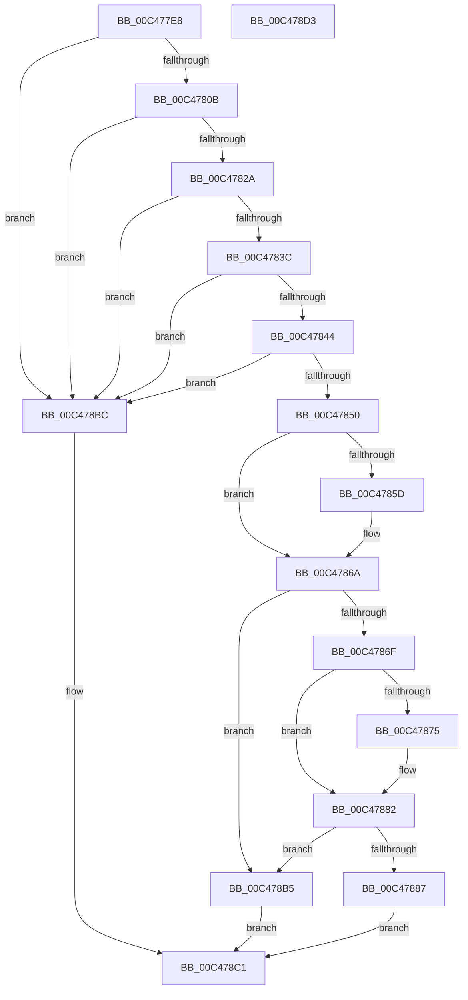

# RtlInitializeKscpCfgFunctions

- RVA: `0x00C477E8`–`0x00C478D4` (길이 `236` bytes)
- VA: `0x0000000140C477E8`
- 실행 섹션: `INIT`
- PDB 이름 있음: `예`; PDB Function 태그: `아니요`
- unwind 정보 RVA: `0x000D01D0`
- 디코드: `65`개 명령, `236/236` bytes 표시
- 미해석 바이트: `0` (있으면 어셈블리에 `.byte`로 보존)

> 이 문서는 커널 이미지의 기계어와 PDB 기호를 분석해 생성했습니다. 4번과 5번은 함수 원형과 자료형을 바이너리 사용 방식에서 추정한 C 해석이며 원본 소스 복구 결과는 아닙니다.

## 1. Dependencies

- 직접 호출 지점: **1**; 고유 호출 대상: **1**
- 직접 호출자로 확인된 함수: **1**
- RIP 상대 이미지 참조: **1**

### Outgoing calls
- `0x00C478C8` → [_security_check_cookie](../../text/6A/_security_check_cookie_function_006AC640.md) (function, `0x006AC640`)

### Direct callers
- [MiApplyDynamicFixupsToKernelAndHal](../C6/MiApplyDynamicFixupsToKernelAndHal_function_00C65EBC.md) at `0x00C66051`

### Static image references
- `0x00C477F1` → RVA `0x00E0A740` (`.data`; read)

## 2. Other-region calls and transfers

- 다른 실행 섹션으로 향하는 call: **1**
  - `0x00C478C8` → [_security_check_cookie](../../text/6A/_security_check_cookie_function_006AC640.md) (`INIT` → `.text`)
- 별도 외부 분기/꼬리 이동을 확인하지 못했습니다.

## 3. Assembly (complete function range)

```asm
00C477E8  40 55                           push rbp
00C477EA  48 8B EC                        mov rbp, rsp
00C477ED  48 83 EC 20                     sub rsp, 0x20
00C477F1  48 8B 05 48 2F 1C 00            mov rax, qword ptr [rip + 0x1c2f48]
00C477F8  48 33 C4                        xor rax, rsp
00C477FB  48 89 45 F0                     mov qword ptr [rbp - 0x10], rax
00C477FF  4C 8B C1                        mov r8, rcx
00C47802  83 FA 5C                        cmp edx, 0x5c
00C47805  0F 82 B1 00 00 00               jb 0x140c478bc
00C4780B  8B 41 54                        mov eax, dword ptr [rcx + 0x54]
00C4780E  C7 45 E0 48 FF E0 CC            mov dword ptr [rbp - 0x20], 0xcce0ff48
00C47815  C7 45 E4 CC CC CC CC            mov dword ptr [rbp - 0x1c], 0xcccccccc
00C4781C  66 C7 45 E8 CC CC               mov word ptr [rbp - 0x18], 0xcccc
00C47822  3B C2                           cmp eax, edx
00C47824  0F 87 92 00 00 00               ja 0x140c478bc
00C4782A  44 8B D0                        mov r10d, eax
00C4782D  8B CA                           mov ecx, edx
00C4782F  48 83 C0 0A                     add rax, 0xa
00C47833  48 3B C1                        cmp rax, rcx
00C47836  0F 87 80 00 00 00               ja 0x140c478bc
00C4783C  41 8B 40 58                     mov eax, dword ptr [r8 + 0x58]
00C47840  3B C2                           cmp eax, edx
00C47842  77 78                           ja 0x140c478bc
00C47844  44 8B C8                        mov r9d, eax
00C47847  48 83 C0 0A                     add rax, 0xa
00C4784B  48 3B C1                        cmp rax, rcx
00C4784E  77 6C                           ja 0x140c478bc
00C47850  48 8B 4D E0                     mov rcx, qword ptr [rbp - 0x20]
00C47854  48 8B D1                        mov rdx, rcx
00C47857  4B 2B 14 02                     sub rdx, qword ptr [r10 + r8]
00C4785B  75 0D                           jne 0x140c4786a
00C4785D  0F B7 55 E8                     movzx edx, word ptr [rbp - 0x18]
00C47861  43 0F B7 44 02 08               movzx eax, word ptr [r10 + r8 + 8]
00C47867  48 2B D0                        sub rdx, rax
00C4786A  48 85 D2                        test rdx, rdx
00C4786D  75 46                           jne 0x140c478b5
00C4786F  4B 2B 0C 01                     sub rcx, qword ptr [r9 + r8]
00C47873  75 0D                           jne 0x140c47882
00C47875  0F B7 4D E8                     movzx ecx, word ptr [rbp - 0x18]
00C47879  43 0F B7 44 01 08               movzx eax, word ptr [r9 + r8 + 8]
00C4787F  48 2B C8                        sub rcx, rax
00C47882  48 85 C9                        test rcx, rcx
00C47885  75 2E                           jne 0x140c478b5
00C47887  43 C6 04 02 E9                  mov byte ptr [r10 + r8], 0xe9
00C4788C  41 8B 48 44                     mov ecx, dword ptr [r8 + 0x44]
00C47890  41 2B 48 54                     sub ecx, dword ptr [r8 + 0x54]
00C47894  83 E9 05                        sub ecx, 5
00C47897  43 89 4C 02 01                  mov dword ptr [r10 + r8 + 1], ecx
00C4789C  43 C6 04 01 E9                  mov byte ptr [r9 + r8], 0xe9
00C478A1  41 8B 48 44                     mov ecx, dword ptr [r8 + 0x44]
00C478A5  41 2B 48 58                     sub ecx, dword ptr [r8 + 0x58]
00C478A9  83 E9 05                        sub ecx, 5
00C478AC  43 89 4C 01 01                  mov dword ptr [r9 + r8 + 1], ecx
00C478B1  33 C0                           xor eax, eax
00C478B3  EB 0C                           jmp 0x140c478c1
00C478B5  B8 7B 00 00 C0                  mov eax, 0xc000007b
00C478BA  EB 05                           jmp 0x140c478c1
00C478BC  B8 0D 00 00 C0                  mov eax, 0xc000000d
00C478C1  48 8B 4D F0                     mov rcx, qword ptr [rbp - 0x10]
00C478C5  48 33 CC                        xor rcx, rsp
00C478C8  E8 73 4D A6 FF                  call 0x1406ac640
00C478CD  48 83 C4 20                     add rsp, 0x20
00C478D1  5D                              pop rbp
00C478D2  C3                              ret
00C478D3  CC                              int3
```

## 4. C-style interpretation (structured pseudocode)

```c
__int64 __fastcall RtlInitializeKscpCfgFunctions(__int64 a1, int a2)
{
    __int64 result;
    __int64 v_rsp;
    unsigned __int64 v_stack_m18;
    unsigned __int16 v_stack_m20;
    unsigned int v_stack_m24;
    unsigned int v_stack_m28;

    v_rsp = (v_rsp) - (32);
    result = (*(unsigned __int64 *)(v_rip + 1847112)) ^ (v_rsp);
    v_stack_m18 = result;
    if (a2 < 92) goto loc_00C478BC;
    v_stack_m28 = 0xCCE0FF48ULL;
    v_stack_m24 = 0xCCCCCCCCULL;
    v_stack_m20 = 0xCCCCULL;
    if (((unsigned int)((unsigned int)(*(unsigned int *)(a1 + 84)))) > a2) goto loc_00C478BC;
    result = ((unsigned int)(*(unsigned int *)(a1 + 84))) + (10);
    if (result > ((unsigned int)(a2))) goto loc_00C478BC;
    if (((unsigned int)((unsigned int)(*(unsigned int *)(a1 + 88)))) > a2) goto loc_00C478BC;
    result = ((unsigned int)(*(unsigned int *)(a1 + 88))) + (10);
    if (result > ((unsigned int)(a2))) goto loc_00C478BC;
    a2 = (v_stack_m28) - (*(unsigned __int64 *)((unsigned int)((unsigned int)((unsigned int)(*(unsigned int *)(a1 + 84)))) + a1 * 1));
    if (!(condition_is_not_equal)) {
        a2 = v_stack_m20;
        result = *(unsigned __int16 *)((unsigned int)((unsigned int)((unsigned int)(*(unsigned int *)(a1 + 84)))) + a1 * 1 + 8);
        a2 = (a2) - (result);
    }
    if (a2 != 0) goto loc_00C478B5;
    a1 = (v_stack_m28) - (*(unsigned __int64 *)((unsigned int)((unsigned int)((unsigned int)(*(unsigned int *)(a1 + 88)))) + a1 * 1));
    if (!(condition_is_not_equal)) {
        a1 = v_stack_m20;
        result = *(unsigned __int16 *)((unsigned int)((unsigned int)((unsigned int)(*(unsigned int *)(a1 + 88)))) + a1 * 1 + 8);
        a1 = (a1) - (result);
    }
    if (a1 != 0) goto loc_00C478B5;
    *(unsigned __int8 *)((unsigned int)((unsigned int)((unsigned int)(*(unsigned int *)(a1 + 84)))) + a1 * 1) = 233;
    a1 = (unsigned int)(((unsigned int)(*(unsigned int *)(a1 + 68))) - (*(unsigned int *)(a1 + 84)));
    a1 = (unsigned int)((a1) - (5));
    *(unsigned int *)((unsigned int)((unsigned int)((unsigned int)(*(unsigned int *)(a1 + 84)))) + a1 * 1 + 1) = (unsigned int)(a1);
    *(unsigned __int8 *)((unsigned int)((unsigned int)((unsigned int)(*(unsigned int *)(a1 + 88)))) + a1 * 1) = 233;
    a1 = (unsigned int)(((unsigned int)(*(unsigned int *)(a1 + 68))) - (*(unsigned int *)(a1 + 88)));
    a1 = (unsigned int)((a1) - (5));
    *(unsigned int *)((unsigned int)((unsigned int)((unsigned int)(*(unsigned int *)(a1 + 88)))) + a1 * 1 + 1) = (unsigned int)(a1);
    result = 0;
    goto loc_00C478C1;
loc_00C478B5:
    goto loc_00C478C1;
loc_00C478BC:
loc_00C478C1:
    a1 = (v_stack_m18) ^ (v_rsp);
    result = _security_check_cookie(a1, a2, a1, (unsigned int)((unsigned int)((unsigned int)(*(unsigned int *)(a1 + 88)))));
    v_rsp = (v_rsp) + (32);
    return result;
}
```

## 5. (Beta) C Style

```c
int64_t RtlInitializeKscpCfgFunctions(void *KscpCfgFunctions, int32_t Arg2)
{
    uint8_t *kscpCfgFunctions = (uint8_t *)KscpCfgFunctions;

    int64_t result;
    int64_t local_rsp;
    uint64_t v_stack_m18;
    uint16_t v_stack_m20;
    uint32_t v_stack_m24;
    uint32_t v_stack_m28;

    local_rsp = (local_rsp) - (32);
    result = (*(uint64_t *)(v_rip + 0x1C2F48)) ^ (local_rsp);
    v_stack_m18 = result;
    if (Arg2 < 92) goto loc_00C478BC;
    v_stack_m28 = 0xCCE0FF48ULL;
    v_stack_m24 = 0xCCCCCCCCULL;
    v_stack_m20 = 0xCCCCULL;
    if (((uint32_t)((uint32_t)(*(uint32_t *)(kscpCfgFunctions + 0x54)))) > Arg2) goto loc_00C478BC;
    result = ((uint32_t)(*(uint32_t *)(kscpCfgFunctions + 0x54))) + (10);
    if (result > ((uint32_t)(Arg2))) goto loc_00C478BC;
    if (((uint32_t)((uint32_t)(*(uint32_t *)(kscpCfgFunctions + 0x58)))) > Arg2) goto loc_00C478BC;
    result = ((uint32_t)(*(uint32_t *)(kscpCfgFunctions + 0x58))) + (10);
    if (result > ((uint32_t)(Arg2))) goto loc_00C478BC;
    Arg2 = (v_stack_m28) - (*(uint64_t *)((uint32_t)((uint32_t)((uint32_t)(*(uint32_t *)(kscpCfgFunctions + 0x54)))) + kscpCfgFunctions * 1));
    if (!(condition_is_not_equal)) {
        Arg2 = v_stack_m20;
        result = *(uint16_t *)((uint32_t)((uint32_t)((uint32_t)(*(uint32_t *)(kscpCfgFunctions + 0x54)))) + kscpCfgFunctions * 1 + 0x8);
        Arg2 = (Arg2) - (result);
    }
    if (Arg2 != 0) goto loc_00C478B5;
    KscpCfgFunctions = (v_stack_m28) - (*(uint64_t *)((uint32_t)((uint32_t)((uint32_t)(*(uint32_t *)(kscpCfgFunctions + 0x58)))) + kscpCfgFunctions * 1));
    if (!(condition_is_not_equal)) {
        KscpCfgFunctions = v_stack_m20;
        result = *(uint16_t *)((uint32_t)((uint32_t)((uint32_t)(*(uint32_t *)(kscpCfgFunctions + 0x58)))) + kscpCfgFunctions * 1 + 0x8);
        KscpCfgFunctions = (KscpCfgFunctions) - (result);
    }
    if (KscpCfgFunctions != NULL) goto loc_00C478B5;
    *(uint8_t *)((uint32_t)((uint32_t)((uint32_t)(*(uint32_t *)(kscpCfgFunctions + 0x54)))) + kscpCfgFunctions * 1) = 233;
    KscpCfgFunctions = (uint32_t)(((uint32_t)(*(uint32_t *)(kscpCfgFunctions + 0x44))) - (*(uint32_t *)(kscpCfgFunctions + 0x54)));
    KscpCfgFunctions = (uint32_t)((KscpCfgFunctions) - (5));
    *(uint32_t *)((uint32_t)((uint32_t)((uint32_t)(*(uint32_t *)(kscpCfgFunctions + 0x54)))) + kscpCfgFunctions * 1 + 0x1) = (uint32_t)(KscpCfgFunctions);
    *(uint8_t *)((uint32_t)((uint32_t)((uint32_t)(*(uint32_t *)(kscpCfgFunctions + 0x58)))) + kscpCfgFunctions * 1) = 233;
    KscpCfgFunctions = (uint32_t)(((uint32_t)(*(uint32_t *)(kscpCfgFunctions + 0x44))) - (*(uint32_t *)(kscpCfgFunctions + 0x58)));
    KscpCfgFunctions = (uint32_t)((KscpCfgFunctions) - (5));
    *(uint32_t *)((uint32_t)((uint32_t)((uint32_t)(*(uint32_t *)(kscpCfgFunctions + 0x58)))) + kscpCfgFunctions * 1 + 0x1) = (uint32_t)(KscpCfgFunctions);
    result = 0;
    goto loc_00C478C1;
loc_00C478B5:
    goto loc_00C478C1;
loc_00C478BC:
loc_00C478C1:
    KscpCfgFunctions = (v_stack_m18) ^ (local_rsp);
    result = _security_check_cookie(KscpCfgFunctions, Arg2, KscpCfgFunctions, (uint32_t)((uint32_t)((uint32_t)(*(uint32_t *)(kscpCfgFunctions + 0x58)))));
    local_rsp = (local_rsp) + (32);
    return result;
}
```

### 관측된 메모리 오프셋

구조체 형식이 확인되지 않은 접근은 인자 기준의 오프셋으로만 기록했습니다.

| 기준 인자 | 오프셋 표현 | 폭 (bit) | 접근 |
|---|---:|---:|---|
| `KscpCfgFunctions` | `+ 0x44` | `32` | `R` |
| `KscpCfgFunctions` | `+ 0x54` | `32` | `R` |
| `KscpCfgFunctions` | `+ 0x58` | `32` | `R` |

## 6. Execution-region graph

[열기: 2D/3D 그래프와 함수 탐색 컨트롤 패널](../../../control-panel.html?section=init&rva=0x00C477E8&view=graph)

- 2D 그래프는 위에서 아래로 흐르고, 3D 그래프는 빈 공간을 드래그해 회전합니다. Shift+드래그는 이동, 휠은 확대·축소, 함수 노드 선택은 대상 보고서 이동입니다.

### Static fallback


