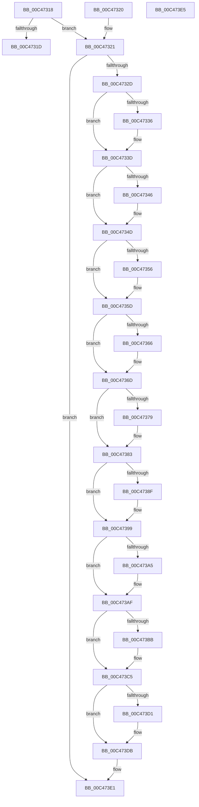

# RtlNormalizeProcessParams

- RVA: `0x00C47318`–`0x00C473E6` (길이 `206` bytes)
- VA: `0x0000000140C47318`
- 실행 섹션: `INIT`
- PDB 이름 있음: `예`; PDB Function 태그: `아니요`
- unwind 정보 RVA: `0x000DB714`
- 디코드: `58`개 명령, `206/206` bytes 표시
- 미해석 바이트: `0` (있으면 어셈블리에 `.byte`로 보존)

> 이 문서는 커널 이미지의 기계어와 PDB 기호를 분석해 생성했습니다. 4번과 5번은 함수 원형과 자료형을 바이너리 사용 방식에서 추정한 C 해석이며 원본 소스 복구 결과는 아닙니다.

## 1. Dependencies

- 직접 호출 지점: **0**; 고유 호출 대상: **0**
- 직접 호출자로 확인된 함수: **1**
- RIP 상대 이미지 참조: **0**

### Outgoing calls
- 직접 디코드된 call 명령이 없습니다.

### Direct callers
- [StartFirstUserProcess](../C7/StartFirstUserProcess_function_00C70848.md) at `0x00C709D8`

### Static image references
- 디코드된 RIP-relative 메모리 참조가 없습니다.

## 2. Other-region calls and transfers

- 다른 실행 섹션으로 향하는 call: **0**
- 별도 외부 분기/꼬리 이동을 확인하지 못했습니다.

## 3. Assembly (complete function range)

```asm
00C47318  48 85 C9                        test rcx, rcx
00C4731B  75 04                           jne 0x140c47321
00C4731D  33 C0                           xor eax, eax
00C4731F  C3                              ret
00C47320  CC                              int3
00C47321  8B 51 08                        mov edx, dword ptr [rcx + 8]
00C47324  F6 C2 01                        test dl, 1
00C47327  0F 85 B4 00 00 00               jne 0x140c473e1
00C4732D  48 8B 41 40                     mov rax, qword ptr [rcx + 0x40]
00C47331  48 85 C0                        test rax, rax
00C47334  74 07                           je 0x140c4733d
00C47336  48 03 C1                        add rax, rcx
00C47339  48 89 41 40                     mov qword ptr [rcx + 0x40], rax
00C4733D  48 8B 41 58                     mov rax, qword ptr [rcx + 0x58]
00C47341  48 85 C0                        test rax, rax
00C47344  74 07                           je 0x140c4734d
00C47346  48 03 C1                        add rax, rcx
00C47349  48 89 41 58                     mov qword ptr [rcx + 0x58], rax
00C4734D  48 8B 41 68                     mov rax, qword ptr [rcx + 0x68]
00C47351  48 85 C0                        test rax, rax
00C47354  74 07                           je 0x140c4735d
00C47356  48 03 C1                        add rax, rcx
00C47359  48 89 41 68                     mov qword ptr [rcx + 0x68], rax
00C4735D  48 8B 41 78                     mov rax, qword ptr [rcx + 0x78]
00C47361  48 85 C0                        test rax, rax
00C47364  74 07                           je 0x140c4736d
00C47366  48 03 C1                        add rax, rcx
00C47369  48 89 41 78                     mov qword ptr [rcx + 0x78], rax
00C4736D  48 8B 81 B8 00 00 00            mov rax, qword ptr [rcx + 0xb8]
00C47374  48 85 C0                        test rax, rax
00C47377  74 0A                           je 0x140c47383
00C47379  48 03 C1                        add rax, rcx
00C4737C  48 89 81 B8 00 00 00            mov qword ptr [rcx + 0xb8], rax
00C47383  48 8B 81 C8 00 00 00            mov rax, qword ptr [rcx + 0xc8]
00C4738A  48 85 C0                        test rax, rax
00C4738D  74 0A                           je 0x140c47399
00C4738F  48 03 C1                        add rax, rcx
00C47392  48 89 81 C8 00 00 00            mov qword ptr [rcx + 0xc8], rax
00C47399  48 8B 81 D8 00 00 00            mov rax, qword ptr [rcx + 0xd8]
00C473A0  48 85 C0                        test rax, rax
00C473A3  74 0A                           je 0x140c473af
00C473A5  48 03 C1                        add rax, rcx
00C473A8  48 89 81 D8 00 00 00            mov qword ptr [rcx + 0xd8], rax
00C473AF  48 8B 81 E8 00 00 00            mov rax, qword ptr [rcx + 0xe8]
00C473B6  48 85 C0                        test rax, rax
00C473B9  74 0A                           je 0x140c473c5
00C473BB  48 03 C1                        add rax, rcx
00C473BE  48 89 81 E8 00 00 00            mov qword ptr [rcx + 0xe8], rax
00C473C5  48 8B 81 18 04 00 00            mov rax, qword ptr [rcx + 0x418]
00C473CC  48 85 C0                        test rax, rax
00C473CF  74 0A                           je 0x140c473db
00C473D1  48 03 C1                        add rax, rcx
00C473D4  48 89 81 18 04 00 00            mov qword ptr [rcx + 0x418], rax
00C473DB  83 CA 01                        or edx, 1
00C473DE  89 51 08                        mov dword ptr [rcx + 8], edx
00C473E1  48 8B C1                        mov rax, rcx
00C473E4  C3                              ret
00C473E5  CC                              int3
```

## 4. C-style interpretation (structured pseudocode)

```c
__int64 __fastcall RtlNormalizeProcessParams(__int64 a1)
{
    __int64 result;

    if (a1 != 0) goto loc_00C47321;
    result = 0;
    return result;
loc_00C47321:
    if ((((unsigned __int8)((unsigned int)(*(unsigned int *)(a1 + 8)))) & (1)) != 0) goto loc_00C473E1;
    result = *(unsigned __int64 *)(a1 + 64);
    if (*(unsigned __int64 *)(a1 + 64) != 0) {
        result = (*(unsigned __int64 *)(a1 + 64)) + (a1);
        *(unsigned __int64 *)(a1 + 64) = result;
    }
    result = *(unsigned __int64 *)(a1 + 88);
    if (*(unsigned __int64 *)(a1 + 88) != 0) {
        result = (*(unsigned __int64 *)(a1 + 88)) + (a1);
        *(unsigned __int64 *)(a1 + 88) = result;
    }
    result = *(unsigned __int64 *)(a1 + 104);
    if (*(unsigned __int64 *)(a1 + 104) != 0) {
        result = (*(unsigned __int64 *)(a1 + 104)) + (a1);
        *(unsigned __int64 *)(a1 + 104) = result;
    }
    result = *(unsigned __int64 *)(a1 + 120);
    if (*(unsigned __int64 *)(a1 + 120) != 0) {
        result = (*(unsigned __int64 *)(a1 + 120)) + (a1);
        *(unsigned __int64 *)(a1 + 120) = result;
    }
    result = *(unsigned __int64 *)(a1 + 184);
    if (*(unsigned __int64 *)(a1 + 184) != 0) {
        result = (*(unsigned __int64 *)(a1 + 184)) + (a1);
        *(unsigned __int64 *)(a1 + 184) = result;
    }
    result = *(unsigned __int64 *)(a1 + 200);
    if (*(unsigned __int64 *)(a1 + 200) != 0) {
        result = (*(unsigned __int64 *)(a1 + 200)) + (a1);
        *(unsigned __int64 *)(a1 + 200) = result;
    }
    result = *(unsigned __int64 *)(a1 + 216);
    if (*(unsigned __int64 *)(a1 + 216) != 0) {
        result = (*(unsigned __int64 *)(a1 + 216)) + (a1);
        *(unsigned __int64 *)(a1 + 216) = result;
    }
    result = *(unsigned __int64 *)(a1 + 232);
    if (*(unsigned __int64 *)(a1 + 232) != 0) {
        result = (*(unsigned __int64 *)(a1 + 232)) + (a1);
        *(unsigned __int64 *)(a1 + 232) = result;
    }
    result = *(unsigned __int64 *)(a1 + 1048);
    if (*(unsigned __int64 *)(a1 + 1048) != 0) {
        result = (*(unsigned __int64 *)(a1 + 1048)) + (a1);
        *(unsigned __int64 *)(a1 + 1048) = result;
    }
    a2 = (unsigned int)(((unsigned int)(*(unsigned int *)(a1 + 8))) | (1));
    *(unsigned int *)(a1 + 8) = (unsigned int)(a2);
loc_00C473E1:
    return a1;
}
```

## 5. (Beta) C Style

```c
int64_t RtlNormalizeProcessParams(int64_t Arg1)
{
    int64_t result;

    if (Arg1 != 0) goto loc_00C47321;
    result = 0;
    return result;
loc_00C47321:
    if ((((uint8_t)((uint32_t)(*(uint32_t *)(Arg1 + 0x8)))) & (1)) != 0) goto loc_00C473E1;
    result = *(uint64_t *)(Arg1 + 0x40);
    if (*(uint64_t *)(Arg1 + 0x40) != 0) {
        result = (*(uint64_t *)(Arg1 + 0x40)) + (Arg1);
        *(uint64_t *)(Arg1 + 0x40) = result;
    }
    result = *(uint64_t *)(Arg1 + 0x58);
    if (*(uint64_t *)(Arg1 + 0x58) != 0) {
        result = (*(uint64_t *)(Arg1 + 0x58)) + (Arg1);
        *(uint64_t *)(Arg1 + 0x58) = result;
    }
    result = *(uint64_t *)(Arg1 + 0x68);
    if (*(uint64_t *)(Arg1 + 0x68) != 0) {
        result = (*(uint64_t *)(Arg1 + 0x68)) + (Arg1);
        *(uint64_t *)(Arg1 + 0x68) = result;
    }
    result = *(uint64_t *)(Arg1 + 0x78);
    if (*(uint64_t *)(Arg1 + 0x78) != 0) {
        result = (*(uint64_t *)(Arg1 + 0x78)) + (Arg1);
        *(uint64_t *)(Arg1 + 0x78) = result;
    }
    result = *(uint64_t *)(Arg1 + 0xB8);
    if (*(uint64_t *)(Arg1 + 0xB8) != 0) {
        result = (*(uint64_t *)(Arg1 + 0xB8)) + (Arg1);
        *(uint64_t *)(Arg1 + 0xB8) = result;
    }
    result = *(uint64_t *)(Arg1 + 0xC8);
    if (*(uint64_t *)(Arg1 + 0xC8) != 0) {
        result = (*(uint64_t *)(Arg1 + 0xC8)) + (Arg1);
        *(uint64_t *)(Arg1 + 0xC8) = result;
    }
    result = *(uint64_t *)(Arg1 + 0xD8);
    if (*(uint64_t *)(Arg1 + 0xD8) != 0) {
        result = (*(uint64_t *)(Arg1 + 0xD8)) + (Arg1);
        *(uint64_t *)(Arg1 + 0xD8) = result;
    }
    result = *(uint64_t *)(Arg1 + 0xE8);
    if (*(uint64_t *)(Arg1 + 0xE8) != 0) {
        result = (*(uint64_t *)(Arg1 + 0xE8)) + (Arg1);
        *(uint64_t *)(Arg1 + 0xE8) = result;
    }
    result = *(uint64_t *)(Arg1 + 0x418);
    if (*(uint64_t *)(Arg1 + 0x418) != 0) {
        result = (*(uint64_t *)(Arg1 + 0x418)) + (Arg1);
        *(uint64_t *)(Arg1 + 0x418) = result;
    }
    a2 = (uint32_t)(((uint32_t)(*(uint32_t *)(Arg1 + 0x8))) | (1));
    *(uint32_t *)(Arg1 + 0x8) = (uint32_t)(a2);
loc_00C473E1:
    return Arg1;
}
```

## 6. Execution-region graph

[열기: 2D/3D 그래프와 함수 탐색 컨트롤 패널](../../../control-panel.html?section=init&rva=0x00C47318&view=graph)

- 2D 그래프는 위에서 아래로 흐르고, 3D 그래프는 빈 공간을 드래그해 회전합니다. Shift+드래그는 이동, 휠은 확대·축소, 함수 노드 선택은 대상 보고서 이동입니다.

### Static fallback


