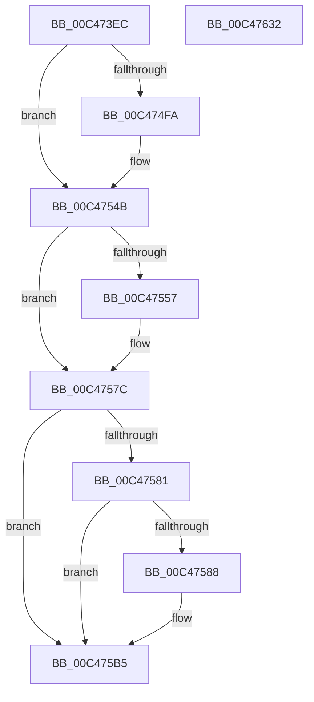

# RtlpCreateUserProcess

- RVA: `0x00C473EC`–`0x00C47633` (길이 `583` bytes)
- VA: `0x0000000140C473EC`
- 실행 섹션: `INIT`
- PDB 이름 있음: `예`; PDB Function 태그: `아니요`
- unwind 정보 RVA: `0x000CF798`
- 디코드: `128`개 명령, `583/583` bytes 표시
- 미해석 바이트: `0` (있으면 어셈블리에 `.byte`로 보존)

> 이 문서는 커널 이미지의 기계어와 PDB 기호를 분석해 생성했습니다. 4번과 5번은 함수 원형과 자료형을 바이너리 사용 방식에서 추정한 C 해석이며 원본 소스 복구 결과는 아닙니다.

## 1. Dependencies

- 직접 호출 지점: **5**; 고유 호출 대상: **3**
- 직접 호출자로 확인된 함수: **1**
- RIP 상대 이미지 참조: **1**

### Outgoing calls
- `0x00C47434` → [memset](../../text/6C/memset_function_006C6C40.md) (function, `0x006C6C40`)
- `0x00C4746C` → [memset](../../text/6C/memset_function_006C6C40.md) (function, `0x006C6C40`)
- `0x00C474A4` → [memset](../../text/6C/memset_function_006C6C40.md) (function, `0x006C6C40`)
- `0x00C47607` → [ZwCreateUserProcess](../../text/6A/ZwCreateUserProcess_function_006AEAF0.md) (function, `0x006AEAF0`)
- `0x00C47616` → [_security_check_cookie](../../text/6A/_security_check_cookie_function_006AC640.md) (function, `0x006AC640`)

### Direct callers
- [StartFirstUserProcess](../C7/StartFirstUserProcess_function_00C70848.md) at `0x00C70A29`

### Static image references
- `0x00C47407` → RVA `0x00E0A740` (`.data`; read)

## 2. Other-region calls and transfers

- 다른 실행 섹션으로 향하는 call: **5**
  - `0x00C47434` → [memset](../../text/6C/memset_function_006C6C40.md) (`INIT` → `.text`)
  - `0x00C4746C` → [memset](../../text/6C/memset_function_006C6C40.md) (`INIT` → `.text`)
  - `0x00C474A4` → [memset](../../text/6C/memset_function_006C6C40.md) (`INIT` → `.text`)
  - `0x00C47607` → [ZwCreateUserProcess](../../text/6A/ZwCreateUserProcess_function_006AEAF0.md) (`INIT` → `.text`)
  - `0x00C47616` → [_security_check_cookie](../../text/6A/_security_check_cookie_function_006AC640.md) (`INIT` → `.text`)
- 별도 외부 분기/꼬리 이동을 확인하지 못했습니다.

## 3. Assembly (complete function range)

```asm
00C473EC  48 89 5C 24 08                  mov qword ptr [rsp + 8], rbx
00C473F1  55                              push rbp
00C473F2  56                              push rsi
00C473F3  57                              push rdi
00C473F4  41 56                           push r14
00C473F6  41 57                           push r15
00C473F8  48 8D AC 24 50 FE FF FF         lea rbp, [rsp - 0x1b0]
00C47400  48 81 EC B0 02 00 00            sub rsp, 0x2b0
00C47407  48 8B 05 32 33 1C 00            mov rax, qword ptr [rip + 0x1c3332]
00C4740E  48 33 C4                        xor rax, rsp
00C47411  48 89 85 A0 01 00 00            mov qword ptr [rbp + 0x1a0], rax
00C47418  48 8B B5 08 02 00 00            mov rsi, qword ptr [rbp + 0x208]
00C4741F  45 8B F0                        mov r14d, r8d
00C47422  48 8B DA                        mov rbx, rdx
00C47425  48 8B F9                        mov rdi, rcx
00C47428  33 D2                           xor edx, edx
00C4742A  48 8D 4D 78                     lea rcx, [rbp + 0x78]
00C4742E  41 B8 20 01 00 00               mov r8d, 0x120
00C47434  E8 07 F8 A7 FF                  call 0x1406c6c40
00C47439  45 33 FF                        xor r15d, r15d
00C4743C  48 C7 45 A0 30 00 00 00         mov qword ptr [rbp - 0x60], 0x30
00C47444  48 8D 4E 04                     lea rcx, [rsi + 4]
00C47448  48 C7 45 B8 00 02 00 00         mov qword ptr [rbp - 0x48], 0x200
00C47450  33 D2                           xor edx, edx
00C47452  4C 89 7C 24 60                  mov qword ptr [rsp + 0x60], r15
00C47457  48 C7 44 24 70 30 00 00 00      mov qword ptr [rsp + 0x70], 0x30
00C47460  45 8D 47 64                     lea r8d, [r15 + 0x64]
00C47464  48 C7 45 88 00 02 00 00         mov qword ptr [rbp - 0x78], 0x200
00C4746C  E8 CF F7 A7 FF                  call 0x1406c6c40
00C47471  0F 57 C0                        xorps xmm0, xmm0
00C47474  C7 06 68 00 00 00               mov dword ptr [rsi], 0x68
00C4747A  33 D2                           xor edx, edx
00C4747C  4C 89 7D A8                     mov qword ptr [rbp - 0x58], r15
00C47480  45 8D 47 50                     lea r8d, [r15 + 0x50]
00C47484  4C 89 7D B0                     mov qword ptr [rbp - 0x50], r15
00C47488  48 8D 4D D8                     lea rcx, [rbp - 0x28]
00C4748C  4C 89 7C 24 78                  mov qword ptr [rsp + 0x78], r15
00C47491  F3 0F 7F 45 C0                  movdqu xmmword ptr [rbp - 0x40], xmm0
00C47496  4C 89 7D 80                     mov qword ptr [rbp - 0x80], r15
00C4749A  F3 0F 7F 45 90                  movdqu xmmword ptr [rbp - 0x70], xmm0
00C4749F  4C 89 7C 24 68                  mov qword ptr [rsp + 0x68], r15
00C474A4  E8 97 F7 A7 FF                  call 0x1406c6c40
00C474A9  80 4D E0 04                     or byte ptr [rbp - 0x20], 4
00C474AD  48 8D 46 18                     lea rax, [rsi + 0x18]
00C474B1  48 89 45 48                     mov qword ptr [rbp + 0x48], rax
00C474B5  48 8D 46 28                     lea rax, [rsi + 0x28]
00C474B9  48 89 45 68                     mov qword ptr [rbp + 0x68], rax
00C474BD  41 8D 4F 02                     lea ecx, [r15 + 2]
00C474C1  48 C7 45 D0 58 00 00 00         mov qword ptr [rbp - 0x30], 0x58
00C474C9  45 8D 4F 08                     lea r9d, [r15 + 8]
00C474CD  48 C7 45 38 03 00 01 00         mov qword ptr [rbp + 0x38], 0x10003
00C474D5  48 C7 45 40 10 00 00 00         mov qword ptr [rbp + 0x40], 0x10
00C474DD  4C 89 7D 50                     mov qword ptr [rbp + 0x50], r15
00C474E1  48 C7 45 58 06 00 00 00         mov qword ptr [rbp + 0x58], 6
00C474E9  48 C7 45 60 40 00 00 00         mov qword ptr [rbp + 0x60], 0x40
00C474F1  4C 89 7D 70                     mov qword ptr [rbp + 0x70], r15
00C474F5  48 85 FF                        test rdi, rdi
00C474F8  74 51                           je 0x140c4754b
00C474FA  0F B7 07                        movzx eax, word ptr [rdi]
00C474FD  48 89 85 80 00 00 00            mov qword ptr [rbp + 0x80], rax
00C47504  48 8B 47 08                     mov rax, qword ptr [rdi + 8]
00C47508  48 89 85 88 00 00 00            mov qword ptr [rbp + 0x88], rax
00C4750F  48 8D 44 24 60                  lea rax, [rsp + 0x60]
00C47514  89 4C 24 60                     mov dword ptr [rsp + 0x60], ecx
00C47518  41 8D 4F 04                     lea ecx, [r15 + 4]
00C4751C  48 89 85 A8 00 00 00            mov qword ptr [rbp + 0xa8], rax
00C47523  48 C7 45 78 05 00 02 00         mov qword ptr [rbp + 0x78], 0x20005
00C4752B  4C 89 BD 90 00 00 00            mov qword ptr [rbp + 0x90], r15
00C47532  48 C7 85 98 00 00 00 0A 00 02 00  mov qword ptr [rbp + 0x98], 0x2000a
00C4753D  4C 89 8D A0 00 00 00            mov qword ptr [rbp + 0xa0], r9
00C47544  4C 89 BD B0 00 00 00            mov qword ptr [rbp + 0xb0], r15
00C4754B  41 B8 01 00 00 00               mov r8d, 1
00C47551  41 F6 C6 40                     test r14b, 0x40
00C47555  74 25                           je 0x140c4757c
00C47557  8B C1                           mov eax, ecx
00C47559  48 C1 E0 05                     shl rax, 5
00C4755D  41 03 C8                        add ecx, r8d
00C47560  48 C7 44 05 38 11 00 06 00      mov qword ptr [rbp + rax + 0x38], 0x60011
00C47569  4C 89 44 05 40                  mov qword ptr [rbp + rax + 0x40], r8
00C4756E  4C 89 7C 05 50                  mov qword ptr [rbp + rax + 0x50], r15
00C47573  48 C7 44 05 48 61 00 00 00      mov qword ptr [rbp + rax + 0x48], 0x61
00C4757C  48 85 DB                        test rbx, rbx
00C4757F  74 34                           je 0x140c475b5
00C47581  8B 43 08                        mov eax, dword ptr [rbx + 8]
00C47584  85 C0                           test eax, eax
00C47586  79 2D                           jns 0x140c475b5
00C47588  0F BA F0 1F                     btr eax, 0x1f
00C4758C  48 8D 54 24 68                  lea rdx, [rsp + 0x68]
00C47591  89 43 08                        mov dword ptr [rbx + 8], eax
00C47594  8B C1                           mov eax, ecx
00C47596  48 C1 E0 05                     shl rax, 5
00C4759A  41 03 C8                        add ecx, r8d
00C4759D  48 C7 44 05 38 12 00 02 00      mov qword ptr [rbp + rax + 0x38], 0x20012
00C475A6  4C 89 4C 05 40                  mov qword ptr [rbp + rax + 0x40], r9
00C475AB  4C 89 7C 05 50                  mov qword ptr [rbp + rax + 0x50], r15
00C475B0  48 89 54 05 48                  mov qword ptr [rbp + rax + 0x48], rdx
00C475B5  8B C1                           mov eax, ecx
00C475B7  48 8D 56 10                     lea rdx, [rsi + 0x10]
00C475BB  48 C1 E0 05                     shl rax, 5
00C475BF  48 8D 4E 08                     lea rcx, [rsi + 8]
00C475C3  49 03 C1                        add rax, r9
00C475C6  48 89 45 30                     mov qword ptr [rbp + 0x30], rax
00C475CA  48 8D 45 30                     lea rax, [rbp + 0x30]
00C475CE  48 89 44 24 50                  mov qword ptr [rsp + 0x50], rax
00C475D3  48 8D 45 D0                     lea rax, [rbp - 0x30]
00C475D7  48 89 44 24 48                  mov qword ptr [rsp + 0x48], rax
00C475DC  48 8D 44 24 70                  lea rax, [rsp + 0x70]
00C475E1  48 89 5C 24 40                  mov qword ptr [rsp + 0x40], rbx
00C475E6  44 89 44 24 38                  mov dword ptr [rsp + 0x38], r8d
00C475EB  41 B8 00 00 00 02               mov r8d, 0x2000000
00C475F1  44 89 74 24 30                  mov dword ptr [rsp + 0x30], r14d
00C475F6  45 8B C8                        mov r9d, r8d
00C475F9  48 89 44 24 28                  mov qword ptr [rsp + 0x28], rax
00C475FE  48 8D 45 A0                     lea rax, [rbp - 0x60]
00C47602  48 89 44 24 20                  mov qword ptr [rsp + 0x20], rax
00C47607  E8 E4 74 A6 FF                  call 0x1406aeaf0
00C4760C  48 8B 8D A0 01 00 00            mov rcx, qword ptr [rbp + 0x1a0]
00C47613  48 33 CC                        xor rcx, rsp
00C47616  E8 25 50 A6 FF                  call 0x1406ac640
00C4761B  48 8B 9C 24 E0 02 00 00         mov rbx, qword ptr [rsp + 0x2e0]
00C47623  48 81 C4 B0 02 00 00            add rsp, 0x2b0
00C4762A  41 5F                           pop r15
00C4762C  41 5E                           pop r14
00C4762E  5F                              pop rdi
00C4762F  5E                              pop rsi
00C47630  5D                              pop rbp
00C47631  C3                              ret
00C47632  CC                              int3
```

## 4. C-style interpretation (structured pseudocode)

```c
__int64 __fastcall RtlpCreateUserProcess(__int64 a1, __int64 a2, int a3, __int64 a4, __int64 a5, __int64 a6)
{
    __int64 result;
    __int64 v_r15;
    __int64 v_rsp;
    unsigned __int64 v_stack_m128;
    unsigned __int64 v_stack_m130;
    unsigned __int64 v_stack_m138;
    unsigned __int64 v_stack_m140;
    unsigned __int64 v_stack_m148;
    unsigned __int64 v_stack_m150;
    unsigned __int64 v_stack_m158;
    unsigned __int64 v_stack_m160;
    unsigned __int64 v_stack_m168;
    unsigned __int64 v_stack_m170;
    unsigned __int64 v_stack_m178;
    unsigned __int64 v_stack_m180;
    unsigned __int64 v_stack_m188;
    unsigned __int64 v_stack_m190;
    unsigned __int64 v_stack_m198;
    unsigned __int64 v_stack_m1A0;
    unsigned __int64 v_stack_m1A8;
    unsigned __int64 v_stack_m1D8;
    unsigned __int8 v_stack_m1F8;
    unsigned __int64 v_stack_m200;
    unsigned __int64 v_stack_m208;
    unsigned __int64 v_stack_m218;
    unsigned __int64 v_stack_m220;
    unsigned __int64 v_stack_m228;
    unsigned __int64 v_stack_m230;
    unsigned __int64 v_stack_m238;
    unsigned __int64 v_stack_m248;
    unsigned __int64 v_stack_m250;
    unsigned __int64 v_stack_m258;
    unsigned __int64 v_stack_m260;
    unsigned __int64 v_stack_m268;
    unsigned __int64 v_stack_m270;
    unsigned __int64 v_stack_m278;
    unsigned __int64 v_stack_m288;
    unsigned __int64 v_stack_m290;
    unsigned __int64 v_stack_m298;
    unsigned int v_stack_m2A0;
    unsigned int v_stack_m2A8;
    unsigned __int64 v_stack_m2B0;
    unsigned __int64 v_stack_m2B8;
    unsigned __int64 v_stack_m38;
    unsigned __int64 v_stack_p8;

    v_stack_p8 = v_rbx;
    v_rsp = (v_rsp) - (688);
    result = (*(unsigned __int64 *)(v_rip + 1848114)) ^ (v_rsp);
    v_stack_m38 = result;
    a2 = 0;
    result = memset(v_stack_m160, a2, 288, a4);
    v_r15 = 0;
    v_stack_m238 = 48;
    v_stack_m220 = 512;
    a2 = 0;
    v_stack_m278 = 0;
    v_stack_m268 = 48;
    v_stack_m250 = 512;
    result = memset(a6 + 4, a2, v_r15 + 100, a4);
    *(unsigned int *)(a6) = 104;
    a2 = 0;
    v_stack_m230 = 0;
    v_stack_m228 = 0;
    v_stack_m260 = 0;
    v_stack_m218 = v_xmm0;
    v_stack_m258 = 0;
    v_stack_m248 = v_xmm0;
    v_stack_m270 = 0;
    result = memset(v_stack_m200, a2, v_r15 + 80, a4);
    v_stack_m190 = a6 + 24;
    v_stack_m170 = a6 + 40;
    v_stack_m208 = 88;
    v_stack_m1A0 = 0x10003ULL;
    v_stack_m198 = 16;
    v_stack_m188 = 0;
    v_stack_m180 = 6;
    v_stack_m178 = 64;
    v_stack_m168 = 0;
    result = a6 + 40;
    if (a1 != 0) {
        result = *(unsigned __int16 *)(a1);
        v_stack_m158 = result;
        result = *(unsigned __int64 *)(a1 + 8);
        v_stack_m150 = result;
        result = v_stack_m278;
        v_stack_m278 = (unsigned int)(v_r15 + 2);
        a1 = v_r15 + 4;
        v_stack_m130 = result;
        v_stack_m160 = 0x20005ULL;
        v_stack_m148 = 0;
        v_stack_m140 = 0x2000AULL;
        v_stack_m138 = v_r15 + 8;
        v_stack_m128 = 0;
    }
    if ((((unsigned __int8)((unsigned int)(a3))) & (64)) != 0) {
        result = (unsigned int)(a1);
        result = (result) << (5);
        a1 = (unsigned int)((a1) + (1));
        *(unsigned __int64 *)(v_stack_m1D8 + result * 1 + 56) = 0x60011ULL;
        *(unsigned __int64 *)(v_stack_m1D8 + result * 1 + 64) = 1;
        *(unsigned __int64 *)(v_stack_m1D8 + result * 1 + 80) = 0;
        *(unsigned __int64 *)(v_stack_m1D8 + result * 1 + 72) = 97;
    }
    if (0 == 0) goto loc_00C475B5;
    result = (unsigned int)(*(unsigned int *)(a2 + 8));
    if (sign_flag) {
        a2 = v_stack_m270;
        *(unsigned int *)(a2 + 8) = (unsigned int)((unsigned int)(*(unsigned int *)(a2 + 8)));
        result = (unsigned int)(a1);
        result = (result) << (5);
        a1 = (unsigned int)((a1) + (1));
        *(unsigned __int64 *)(v_stack_m1D8 + result * 1 + 56) = 0x20012ULL;
        *(unsigned __int64 *)(v_stack_m1D8 + result * 1 + 64) = v_r15 + 8;
        *(unsigned __int64 *)(v_stack_m1D8 + result * 1 + 80) = 0;
        *(unsigned __int64 *)(v_stack_m1D8 + result * 1 + 72) = a2;
    }
    result = ((unsigned int)((unsigned int)(a1))) << (5);
    result = (result) + (v_r15 + 8);
    v_stack_m1A8 = result;
    v_stack_m288 = v_stack_m1A8;
    v_stack_m290 = v_stack_m208;
    v_stack_m298 = a2;
    v_stack_m2A0 = 1;
    v_stack_m2A8 = (unsigned int)((unsigned int)(a3));
    v_stack_m2B0 = v_stack_m268;
    v_stack_m2B8 = v_stack_m238;
    result = ZwCreateUserProcess(a6 + 8, a6 + 16, (unsigned int)(0x2000000ULL), (unsigned int)((unsigned int)((unsigned int)(0x2000000ULL))));
    a1 = (v_stack_m38) ^ (v_rsp);
    result = _security_check_cookie(a1, a6 + 16, (unsigned int)(0x2000000ULL), (unsigned int)((unsigned int)((unsigned int)(0x2000000ULL))));
    v_rsp = (v_rsp) + (688);
    return result;
}
```

## 5. (Beta) C Style

```c
int64_t RtlpCreateUserProcess(int64_t Arg1, int64_t Arg2, int32_t Arg3, int64_t Arg4, uint64_t Arg5, void *Arg6)
{
    uint8_t *arg6 = (uint8_t *)Arg6;

    int64_t result;
    int64_t local_r15;
    int64_t local_rsp;
    uint64_t v_stack_m128;
    uint64_t v_stack_m130;
    uint64_t v_stack_m138;
    uint64_t v_stack_m140;
    uint64_t v_stack_m148;
    uint64_t v_stack_m150;
    uint64_t v_stack_m158;
    uint64_t v_stack_m160;
    uint64_t v_stack_m168;
    uint64_t v_stack_m170;
    uint64_t v_stack_m178;
    uint64_t v_stack_m180;
    uint64_t v_stack_m188;
    uint64_t v_stack_m190;
    uint64_t v_stack_m198;
    uint64_t v_stack_m1A0;
    uint64_t v_stack_m1A8;
    uint64_t v_stack_m1D8;
    uint8_t v_stack_m1F8;
    uint64_t v_stack_m200;
    uint64_t v_stack_m208;
    uint64_t v_stack_m218;
    uint64_t v_stack_m220;
    uint64_t v_stack_m228;
    uint64_t v_stack_m230;
    uint64_t v_stack_m238;
    uint64_t v_stack_m248;
    uint64_t v_stack_m250;
    uint64_t v_stack_m258;
    uint64_t v_stack_m260;
    uint64_t v_stack_m268;
    uint64_t v_stack_m270;
    uint64_t v_stack_m278;
    uint64_t v_stack_m288;
    uint64_t v_stack_m290;
    uint64_t v_stack_m298;
    uint32_t v_stack_m2A0;
    uint32_t v_stack_m2A8;
    uint64_t v_stack_m2B0;
    uint64_t v_stack_m2B8;
    uint64_t v_stack_m38;
    uint64_t v_stack_p8;

    v_stack_p8 = local_rbx;
    local_rsp = (local_rsp) - (688);
    result = (*(uint64_t *)(v_rip + 0x1C3332)) ^ (local_rsp);
    v_stack_m38 = result;
    Arg2 = 0;
    result = memset(v_stack_m160, Arg2, 288, Arg4);
    local_r15 = 0;
    v_stack_m238 = 48;
    v_stack_m220 = 512;
    Arg2 = 0;
    v_stack_m278 = 0;
    v_stack_m268 = 48;
    v_stack_m250 = 512;
    result = memset(Arg6 + 4, Arg2, local_r15 + 100, Arg4);
    *(uint32_t *)(arg6) = 104;
    Arg2 = 0;
    v_stack_m230 = 0;
    v_stack_m228 = 0;
    v_stack_m260 = 0;
    v_stack_m218 = v_xmm0;
    v_stack_m258 = 0;
    v_stack_m248 = v_xmm0;
    v_stack_m270 = 0;
    result = memset(v_stack_m200, Arg2, local_r15 + 80, Arg4);
    v_stack_m190 = Arg6 + 24;
    v_stack_m170 = Arg6 + 40;
    v_stack_m208 = 88;
    v_stack_m1A0 = 0x10003ULL;
    v_stack_m198 = 16;
    v_stack_m188 = 0;
    v_stack_m180 = 6;
    v_stack_m178 = 64;
    v_stack_m168 = 0;
    result = Arg6 + 40;
    if (Arg1 != 0) {
        result = *(uint16_t *)(Arg1);
        v_stack_m158 = result;
        result = *(uint64_t *)(Arg1 + 0x8);
        v_stack_m150 = result;
        result = v_stack_m278;
        v_stack_m278 = (uint32_t)(local_r15 + 2);
        Arg1 = local_r15 + 4;
        v_stack_m130 = result;
        v_stack_m160 = 0x20005ULL;
        v_stack_m148 = 0;
        v_stack_m140 = 0x2000AULL;
        v_stack_m138 = local_r15 + 8;
        v_stack_m128 = 0;
    }
    if ((((uint8_t)((uint32_t)(Arg3))) & (64)) != 0) {
        result = (uint32_t)(Arg1);
        result = (result) << (5);
        Arg1 = (uint32_t)((Arg1) + (1));
        *(uint64_t *)(v_stack_m1D8 + result * 1 + 0x38) = 0x60011ULL;
        *(uint64_t *)(v_stack_m1D8 + result * 1 + 0x40) = 1;
        *(uint64_t *)(v_stack_m1D8 + result * 1 + 0x50) = 0;
        *(uint64_t *)(v_stack_m1D8 + result * 1 + 0x48) = 97;
    }
    if (0 == 0) goto loc_00C475B5;
    result = (uint32_t)(*(uint32_t *)(Arg2 + 0x8));
    if (sign_flag) {
        Arg2 = v_stack_m270;
        *(uint32_t *)(Arg2 + 0x8) = (uint32_t)((uint32_t)(*(uint32_t *)(Arg2 + 0x8)));
        result = (uint32_t)(Arg1);
        result = (result) << (5);
        Arg1 = (uint32_t)((Arg1) + (1));
        *(uint64_t *)(v_stack_m1D8 + result * 1 + 0x38) = 0x20012ULL;
        *(uint64_t *)(v_stack_m1D8 + result * 1 + 0x40) = local_r15 + 8;
        *(uint64_t *)(v_stack_m1D8 + result * 1 + 0x50) = 0;
        *(uint64_t *)(v_stack_m1D8 + result * 1 + 0x48) = Arg2;
    }
    result = ((uint32_t)((uint32_t)(Arg1))) << (5);
    result = (result) + (local_r15 + 8);
    v_stack_m1A8 = result;
    v_stack_m288 = v_stack_m1A8;
    v_stack_m290 = v_stack_m208;
    v_stack_m298 = Arg2;
    v_stack_m2A0 = 1;
    v_stack_m2A8 = (uint32_t)((uint32_t)(Arg3));
    v_stack_m2B0 = v_stack_m268;
    v_stack_m2B8 = v_stack_m238;
    result = ZwCreateUserProcess(Arg6 + 8, Arg6 + 16, (uint32_t)(0x2000000ULL), (uint32_t)((uint32_t)((uint32_t)(0x2000000ULL))));
    Arg1 = (v_stack_m38) ^ (local_rsp);
    result = _security_check_cookie(Arg1, Arg6 + 16, (uint32_t)(0x2000000ULL), (uint32_t)((uint32_t)((uint32_t)(0x2000000ULL))));
    local_rsp = (local_rsp) + (688);
    return result;
}
```

### 관측된 메모리 오프셋

구조체 형식이 확인되지 않은 접근은 인자 기준의 오프셋으로만 기록했습니다.

| 기준 인자 | 오프셋 표현 | 폭 (bit) | 접근 |
|---|---:|---:|---|
| `Arg6` | `+ 0x0` | `32` | `W` |
| `Arg6` | `+ 0x4` | `64` | `R` |
| `Arg6` | `+ 0x8` | `64` | `R` |
| `Arg6` | `+ 0x10` | `64` | `R` |
| `Arg6` | `+ 0x18` | `64` | `R` |
| `Arg6` | `+ 0x28` | `64` | `R` |

## 6. Execution-region graph

[열기: 2D/3D 그래프와 함수 탐색 컨트롤 패널](../../../control-panel.html?section=init&rva=0x00C473EC&view=graph)

- 2D 그래프는 위에서 아래로 흐르고, 3D 그래프는 빈 공간을 드래그해 회전합니다. Shift+드래그는 이동, 휠은 확대·축소, 함수 노드 선택은 대상 보고서 이동입니다.

### Static fallback


