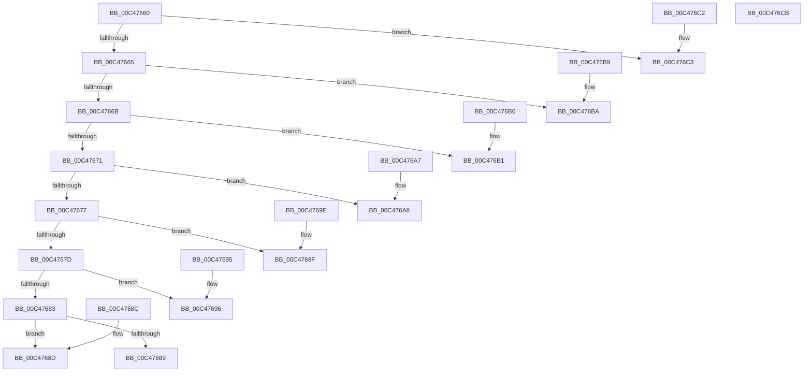

# RtlpFunctionAddressTableEntry

- RVA: `0x00C47660`–`0x00C476CC` (길이 `108` bytes)
- VA: `0x0000000140C47660`
- 실행 섹션: `INIT`
- PDB 이름 있음: `예`; PDB Function 태그: `아니요`
- unwind 정보 RVA: `0x000DB714`
- 디코드: `38`개 명령, `108/108` bytes 표시
- 미해석 바이트: `0` (있으면 어셈블리에 `.byte`로 보존)

> 이 문서는 커널 이미지의 기계어와 PDB 기호를 분석해 생성했습니다. 4번과 5번은 함수 원형과 자료형을 바이너리 사용 방식에서 추정한 C 해석이며 원본 소스 복구 결과는 아닙니다.

## 1. Dependencies

- 직접 호출 지점: **0**; 고유 호출 대상: **0**
- 직접 호출자로 확인된 함수: **1**
- RIP 상대 이미지 참조: **7**

### Outgoing calls
- 직접 디코드된 call 명령이 없습니다.

### Direct callers
- [RtlInitializeHistoryTable](RtlInitializeHistoryTable_function_00C47724.md) at `0x00C47746`

### Static image references
- `0x00C4768D` → RVA `0x006C5900` (`KiExceptionDispatch`; read)
- `0x00C47696` → RVA `0x003D7650` (`KiDispatchException`; read)
- `0x00C4769F` → RVA `0x002F6A50` (`RtlRaiseStatus`; read)
- `0x00C476A8` → RVA `0x002F22A0` (`RtlDispatchException`; read)
- `0x00C476B1` → RVA `0x006BAFA0` (`RtlpExecuteHandlerForException`; read)
- `0x00C476BA` → RVA `0x004FD410` (`_C_specific_handler`; read)
- `0x00C476C3` → RVA `0x002F2830` (`RtlUnwindEx`; read)

## 2. Other-region calls and transfers

- 다른 실행 섹션으로 향하는 call: **0**
- 별도 외부 분기/꼬리 이동을 확인하지 못했습니다.

## 3. Assembly (complete function range)

```asm
00C47660  48 85 C9                        test rcx, rcx
00C47663  74 5E                           je 0x140c476c3
00C47665  48 83 E9 01                     sub rcx, 1
00C47669  74 4F                           je 0x140c476ba
00C4766B  48 83 E9 01                     sub rcx, 1
00C4766F  74 40                           je 0x140c476b1
00C47671  48 83 E9 01                     sub rcx, 1
00C47675  74 31                           je 0x140c476a8
00C47677  48 83 E9 01                     sub rcx, 1
00C4767B  74 22                           je 0x140c4769f
00C4767D  48 83 E9 01                     sub rcx, 1
00C47681  74 13                           je 0x140c47696
00C47683  48 83 F9 01                     cmp rcx, 1
00C47687  74 04                           je 0x140c4768d
00C47689  33 C0                           xor eax, eax
00C4768B  C3                              ret
00C4768C  CC                              int3
00C4768D  48 8D 05 6C E2 A7 FF            lea rax, [rip - 0x581d94]
00C47694  C3                              ret
00C47695  CC                              int3
00C47696  48 8D 05 B3 FF 78 FF            lea rax, [rip - 0x87004d]
00C4769D  C3                              ret
00C4769E  CC                              int3
00C4769F  48 8D 05 AA F3 6A FF            lea rax, [rip - 0x950c56]
00C476A6  C3                              ret
00C476A7  CC                              int3
00C476A8  48 8D 05 F1 AB 6A FF            lea rax, [rip - 0x95540f]
00C476AF  C3                              ret
00C476B0  CC                              int3
00C476B1  48 8D 05 E8 38 A7 FF            lea rax, [rip - 0x58c718]
00C476B8  C3                              ret
00C476B9  CC                              int3
00C476BA  48 8D 05 4F 5D 8B FF            lea rax, [rip - 0x74a2b1]
00C476C1  C3                              ret
00C476C2  CC                              int3
00C476C3  48 8D 05 66 B1 6A FF            lea rax, [rip - 0x954e9a]
00C476CA  C3                              ret
00C476CB  CC                              int3
```

## 4. C-style interpretation (structured pseudocode)

```c
__int64 __fastcall RtlpFunctionAddressTableEntry(__int64 a1)
{
    __int64 result;

    if (a1 == 0) goto loc_00C476C3;
    a1 = (a1) - (1);
    if (condition_is_equal) goto loc_00C476BA;
    a1 = (a1) - (1);
    if (condition_is_equal) goto loc_00C476B1;
    a1 = (a1) - (1);
    if (condition_is_equal) goto loc_00C476A8;
    a1 = (a1) - (1);
    if (condition_is_equal) goto loc_00C4769F;
    a1 = (a1) - (1);
    if (condition_is_equal) goto loc_00C47696;
    if (a1 == 1) goto loc_00C4768D;
    result = 0;
    return result;
loc_00C4768D:
    return v_rip - 5774740;
loc_00C47696:
    return v_rip - 8847437;
loc_00C4769F:
    return v_rip - 9768022;
loc_00C476A8:
    return v_rip - 9786383;
loc_00C476B1:
    return v_rip - 5818136;
loc_00C476BA:
    return v_rip - 7643825;
loc_00C476C3:
    return v_rip - 9784986;
}
```

## 5. (Beta) C Style

```c
int64_t RtlpFunctionAddressTableEntry(int64_t Arg1)
{
    int64_t result;

    if (Arg1 == 0) goto loc_00C476C3;
    Arg1 = (Arg1) - (1);
    if (condition_is_equal) goto loc_00C476BA;
    Arg1 = (Arg1) - (1);
    if (condition_is_equal) goto loc_00C476B1;
    Arg1 = (Arg1) - (1);
    if (condition_is_equal) goto loc_00C476A8;
    Arg1 = (Arg1) - (1);
    if (condition_is_equal) goto loc_00C4769F;
    Arg1 = (Arg1) - (1);
    if (condition_is_equal) goto loc_00C47696;
    if (Arg1 == 1) goto loc_00C4768D;
    result = 0;
    return result;
loc_00C4768D:
    return v_rip - 5774740;
loc_00C47696:
    return v_rip - 8847437;
loc_00C4769F:
    return v_rip - 9768022;
loc_00C476A8:
    return v_rip - 9786383;
loc_00C476B1:
    return v_rip - 5818136;
loc_00C476BA:
    return v_rip - 7643825;
loc_00C476C3:
    return v_rip - 9784986;
}
```

## 6. Execution-region graph

[열기: 2D/3D 그래프와 함수 탐색 컨트롤 패널](../../../control-panel.html?section=init&rva=0x00C47660&view=graph)

- 2D 그래프는 위에서 아래로 흐르고, 3D 그래프는 빈 공간을 드래그해 회전합니다. Shift+드래그는 이동, 휠은 확대·축소, 함수 노드 선택은 대상 보고서 이동입니다.

### Static fallback


