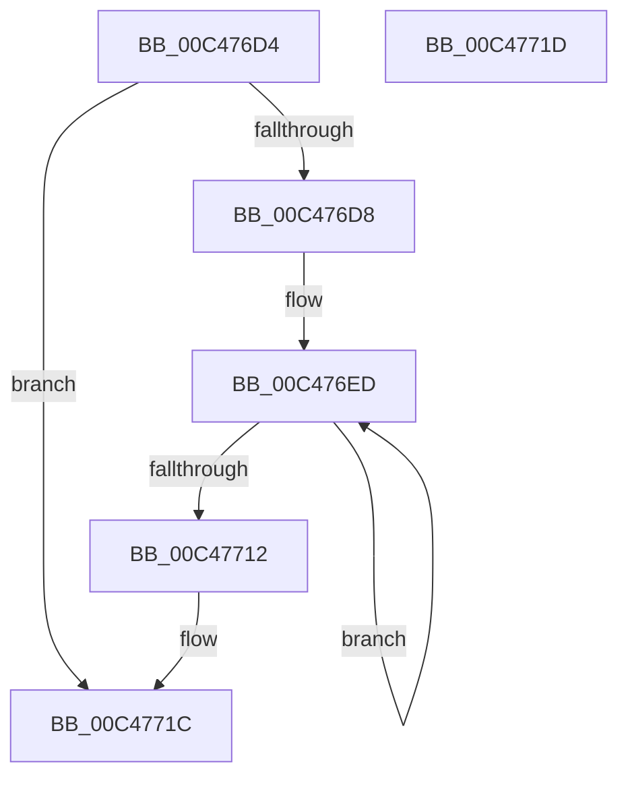

# RtlpInitMachineFrameEntries

- RVA: `0x00C476D4`–`0x00C4771E` (길이 `74` bytes)
- VA: `0x0000000140C476D4`
- 실행 섹션: `INIT`
- PDB 이름 있음: `예`; PDB Function 태그: `아니요`
- unwind 정보 RVA: `0x000A689C`
- 디코드: `23`개 명령, `74/74` bytes 표시
- 미해석 바이트: `0` (있으면 어셈블리에 `.byte`로 보존)

> 이 문서는 커널 이미지의 기계어와 PDB 기호를 분석해 생성했습니다. 4번과 5번은 함수 원형과 자료형을 바이너리 사용 방식에서 추정한 C 해석이며 원본 소스 복구 결과는 아닙니다.

## 1. Dependencies

- 직접 호출 지점: **1**; 고유 호출 대상: **1**
- 직접 호출자로 확인된 함수: **2**
- RIP 상대 이미지 참조: **0**

### Outgoing calls
- `0x00C476F8` → [RtlLookupFunctionEntry](../../text/2F/RtlLookupFunctionEntry_function_002F2F30.md) (function, `0x002F2F30`)

### Direct callers
- [RtlInitKernelModeSpecialMachineFrameEntries](RtlInitKernelModeSpecialMachineFrameEntries_function_00C4763C.md) at `0x00C4764C`
- [RtlInitializeHistoryTable](RtlInitializeHistoryTable_function_00C47724.md) at `0x00C477C9`

### Static image references
- 디코드된 RIP-relative 메모리 참조가 없습니다.

## 2. Other-region calls and transfers

- 다른 실행 섹션으로 향하는 call: **1**
  - `0x00C476F8` → [RtlLookupFunctionEntry](../../text/2F/RtlLookupFunctionEntry_function_002F2F30.md) (`INIT` → `.text`)
- 별도 외부 분기/꼬리 이동을 확인하지 못했습니다.

## 3. Assembly (complete function range)

```asm
00C476D4  85 D2                           test edx, edx
00C476D6  74 44                           je 0x140c4771c
00C476D8  48 89 5C 24 08                  mov qword ptr [rsp + 8], rbx
00C476DD  57                              push rdi
00C476DE  48 83 EC 20                     sub rsp, 0x20
00C476E2  48 83 64 24 40 00               and qword ptr [rsp + 0x40], 0
00C476E8  48 8B D9                        mov rbx, rcx
00C476EB  8B FA                           mov edi, edx
00C476ED  48 8B 0B                        mov rcx, qword ptr [rbx]
00C476F0  48 8D 54 24 40                  lea rdx, [rsp + 0x40]
00C476F5  45 33 C0                        xor r8d, r8d
00C476F8  E8 33 B8 6A FF                  call 0x1402f2f30
00C476FD  8B 48 08                        mov ecx, dword ptr [rax + 8]
00C47700  48 03 4C 24 40                  add rcx, qword ptr [rsp + 0x40]
00C47705  48 89 0B                        mov qword ptr [rbx], rcx
00C47708  48 8D 5B 08                     lea rbx, [rbx + 8]
00C4770C  48 83 EF 01                     sub rdi, 1
00C47710  75 DB                           jne 0x140c476ed
00C47712  48 8B 5C 24 30                  mov rbx, qword ptr [rsp + 0x30]
00C47717  48 83 C4 20                     add rsp, 0x20
00C4771B  5F                              pop rdi
00C4771C  C3                              ret
00C4771D  CC                              int3
```

## 4. C-style interpretation (structured pseudocode)

```c
__int64 __fastcall RtlpInitMachineFrameEntries(__int64 a1, int a2, int a3)
{
    __int64 result;
    __int64 v_rdi;
    __int64 v_rsp;
    unsigned __int64 v_stack_p18;
    unsigned __int64 v_stack_p8;

    if (a2 == 0) goto loc_00C4771C;
    v_stack_p8 = v_rbx;
    v_rsp = (v_rsp) - (32);
loc_00C476ED:
    a3 = 0;
    result = RtlLookupFunctionEntry(*(unsigned __int64 *)(a1), v_stack_p18, a3, a4);
    a1 = ((unsigned int)(*(unsigned int *)(result + 8))) + (v_stack_p18);
    *(unsigned __int64 *)(a1) = a1;
    v_rdi = ((unsigned int)(a2)) - (1);
    if (condition_is_not_equal) goto loc_00C476ED;
    v_rsp = (v_rsp) + (32);
loc_00C4771C:
    return result;
}
```

## 5. (Beta) C Style

```c
int64_t RtlpInitMachineFrameEntries(void *Arg1, int32_t Arg2, int32_t Arg3)
{
    uint8_t *arg1 = (uint8_t *)Arg1;

    int64_t result;
    int64_t local_rdi;
    int64_t local_rsp;
    uint64_t v_stack_p18;
    uint64_t v_stack_p8;

    if (Arg2 == 0) goto loc_00C4771C;
    v_stack_p8 = local_rbx;
    local_rsp = (local_rsp) - (32);
loc_00C476ED:
    Arg3 = 0;
    result = RtlLookupFunctionEntry(*(uint64_t *)(arg1), v_stack_p18, Arg3, a4);
    Arg1 = ((uint32_t)(*(uint32_t *)(result + 0x8))) + (v_stack_p18);
    *(void **)(arg1) = Arg1;
    local_rdi = ((uint32_t)(Arg2)) - (1);
    if (condition_is_not_equal) goto loc_00C476ED;
    local_rsp = (local_rsp) + (32);
loc_00C4771C:
    return result;
}
```

### 관측된 메모리 오프셋

구조체 형식이 확인되지 않은 접근은 인자 기준의 오프셋으로만 기록했습니다.

| 기준 인자 | 오프셋 표현 | 폭 (bit) | 접근 |
|---|---:|---:|---|
| `Arg1` | `+ 0x0` | `64` | `R` |
| `Arg1` | `+ 0x0` | `64` | `W` |
| `Arg1` | `+ 0x8` | `64` | `R` |

## 6. Execution-region graph

[열기: 2D/3D 그래프와 함수 탐색 컨트롤 패널](../../../control-panel.html?section=init&rva=0x00C476D4&view=graph)

- 2D 그래프는 위에서 아래로 흐르고, 3D 그래프는 빈 공간을 드래그해 회전합니다. Shift+드래그는 이동, 휠은 확대·축소, 함수 노드 선택은 대상 보고서 이동입니다.

### Static fallback


