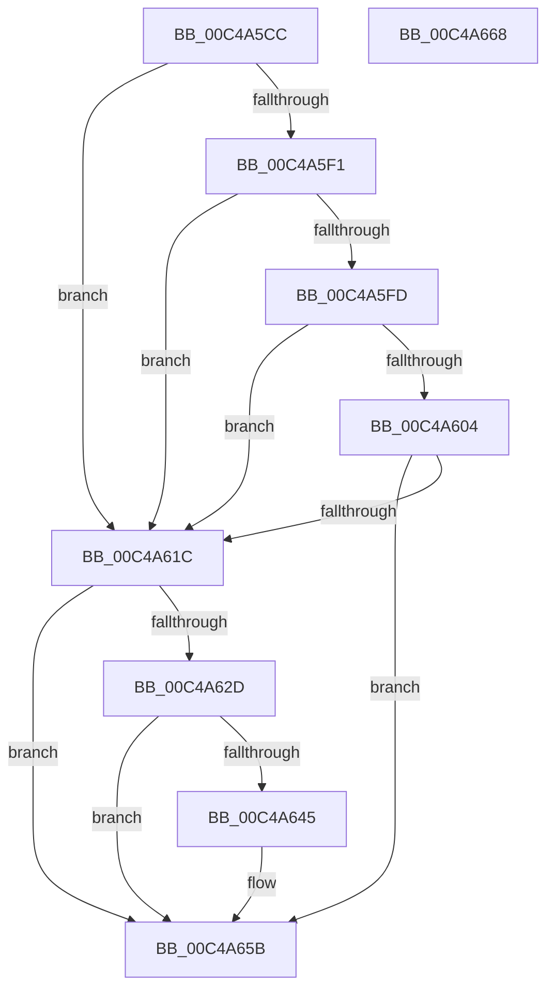

# SeCodeIntegrityInitializePolicy

- RVA: `0x00C4A5CC`–`0x00C4A669` (길이 `157` bytes)
- VA: `0x0000000140C4A5CC`
- 실행 섹션: `INIT`
- PDB 이름 있음: `예`; PDB Function 태그: `아니요`
- unwind 정보 RVA: `0x000C4ED8`
- 디코드: `44`개 명령, `157/157` bytes 표시
- 미해석 바이트: `0` (있으면 어셈블리에 `.byte`로 보존)

> 이 문서는 커널 이미지의 기계어와 PDB 기호를 분석해 생성했습니다. 4번과 5번은 함수 원형과 자료형을 바이너리 사용 방식에서 추정한 C 해석이며 원본 소스 복구 결과는 아닙니다.

## 1. Dependencies

- 직접 호출 지점: **3**; 고유 호출 대상: **3**
- 직접 호출자로 확인된 함수: **1**
- RIP 상대 이미지 참조: **3**

### Outgoing calls
- `0x00C4A611` → [SeSecureBootRegisterPolicy](SeSecureBootRegisterPolicy_function_00C4B3FC.md) (function, `0x00C4B3FC`)
- `0x00C4A61C` → [SepInitializeDebugOptions](SepInitializeDebugOptions_function_00C4A69C.md) (function, `0x00C4A69C`)
- `0x00C4A63A` → [guard_dispatch_icall](../../text/6B/guard_dispatch_icall_function_006BAAD0.md) (function, `0x006BAAD0`)

### Direct callers
- [Phase1InitializationDiscard](../C1/Phase1InitializationDiscard_function_00C1C728.md) at `0x00C1DA25`

### Static image references
- `0x00C4A621` → RVA `0x00F04EA0` (`.data`; read)
- `0x00C4A64A` → RVA `0x01008740` (`INITDATA`; write)
- `0x00C4A655` → RVA `0x01008708` (`INITDATA`; write)

## 2. Other-region calls and transfers

- 다른 실행 섹션으로 향하는 call: **1**
  - `0x00C4A63A` → [guard_dispatch_icall](../../text/6B/guard_dispatch_icall_function_006BAAD0.md) (`INIT` → `.text`)
- 별도 외부 분기/꼬리 이동을 확인하지 못했습니다.

## 3. Assembly (complete function range)

```asm
00C4A5CC  48 89 5C 24 18                  mov qword ptr [rsp + 0x18], rbx
00C4A5D1  57                              push rdi
00C4A5D2  48 83 EC 20                     sub rsp, 0x20
00C4A5D6  48 83 64 24 38 00               and qword ptr [rsp + 0x38], 0
00C4A5DC  33 FF                           xor edi, edi
00C4A5DE  83 64 24 30 00                  and dword ptr [rsp + 0x30], 0
00C4A5E3  33 DB                           xor ebx, ebx
00C4A5E5  48 8B 81 F0 00 00 00            mov rax, qword ptr [rcx + 0xf0]
00C4A5EC  48 85 C0                        test rax, rax
00C4A5EF  74 2B                           je 0x140c4a61c
00C4A5F1  48 8B 98 58 0B 00 00            mov rbx, qword ptr [rax + 0xb58]
00C4A5F8  48 85 DB                        test rbx, rbx
00C4A5FB  74 1F                           je 0x140c4a61c
00C4A5FD  8B 53 40                        mov edx, dword ptr [rbx + 0x40]
00C4A600  85 D2                           test edx, edx
00C4A602  74 18                           je 0x140c4a61c
00C4A604  8B 4B 3C                        mov ecx, dword ptr [rbx + 0x3c]
00C4A607  48 81 C1 88 00 00 00            add rcx, 0x88
00C4A60E  48 03 CB                        add rcx, rbx
00C4A611  E8 E6 0D 00 00                  call 0x140c4b3fc
00C4A616  8B F8                           mov edi, eax
00C4A618  85 C0                           test eax, eax
00C4A61A  78 3F                           js 0x140c4a65b
00C4A61C  E8 7B 00 00 00                  call 0x140c4a69c
00C4A621  48 8B 05 78 A8 2B 00            mov rax, qword ptr [rip + 0x2ba878]
00C4A628  48 85 C0                        test rax, rax
00C4A62B  74 2E                           je 0x140c4a65b
00C4A62D  4C 8D 44 24 30                  lea r8, [rsp + 0x30]
00C4A632  48 8B CB                        mov rcx, rbx
00C4A635  48 8D 54 24 38                  lea rdx, [rsp + 0x38]
00C4A63A  E8 91 04 A7 FF                  call 0x1406baad0
00C4A63F  8B F8                           mov edi, eax
00C4A641  85 C0                           test eax, eax
00C4A643  78 16                           js 0x140c4a65b
00C4A645  48 8B 44 24 38                  mov rax, qword ptr [rsp + 0x38]
00C4A64A  48 89 05 EF E0 3B 00            mov qword ptr [rip + 0x3be0ef], rax
00C4A651  8B 44 24 30                     mov eax, dword ptr [rsp + 0x30]
00C4A655  89 05 AD E0 3B 00               mov dword ptr [rip + 0x3be0ad], eax
00C4A65B  48 8B 5C 24 40                  mov rbx, qword ptr [rsp + 0x40]
00C4A660  8B C7                           mov eax, edi
00C4A662  48 83 C4 20                     add rsp, 0x20
00C4A666  5F                              pop rdi
00C4A667  C3                              ret
00C4A668  CC                              int3
```

## 4. C-style interpretation (structured pseudocode)

```c
__int64 __fastcall SeCodeIntegrityInitializePolicy(__int64 a1)
{
    __int64 result;
    __int64 v_rbx;
    __int64 v_rdi;
    __int64 v_rsp;
    unsigned __int64 v_stack_p10;
    unsigned __int64 v_stack_p18;
    unsigned int v_stack_p8;

    v_stack_p18 = v_rbx;
    v_rsp = (v_rsp) - (32);
    v_rdi = 0;
    v_rbx = 0;
    if (*(unsigned __int64 *)(a1 + 240) == 0) goto loc_00C4A61C;
    if (*(unsigned __int64 *)(*(unsigned __int64 *)(a1 + 240) + 2904) == 0) goto loc_00C4A61C;
    if ((unsigned int)((unsigned int)(*(unsigned int *)(*(unsigned __int64 *)(*(unsigned __int64 *)(a1 + 240) + 2904) + 64))) == 0) goto loc_00C4A61C;
    a1 = ((unsigned int)(*(unsigned int *)(*(unsigned __int64 *)(*(unsigned __int64 *)(a1 + 240) + 2904) + 60))) + (136);
    a1 = (a1) + (*(unsigned __int64 *)(*(unsigned __int64 *)(a1 + 240) + 2904));
    result = SeSecureBootRegisterPolicy(a1, (unsigned int)(*(unsigned int *)(*(unsigned __int64 *)(*(unsigned __int64 *)(a1 + 240) + 2904) + 64)), a3, a4);
    if (sign_flag) goto loc_00C4A65B;
loc_00C4A61C:
    result = SepInitializeDebugOptions(a1, (unsigned int)(*(unsigned int *)(*(unsigned __int64 *)(*(unsigned __int64 *)(a1 + 240) + 2904) + 64)), a3, a4);
    if (*(unsigned __int64 *)(v_rip + 2861176) == 0) goto loc_00C4A65B;
    result = guard_dispatch_icall(*(unsigned __int64 *)(*(unsigned __int64 *)(a1 + 240) + 2904), v_stack_p10, v_stack_p8, a4);
    if (!(sign_flag)) {
        result = v_stack_p10;
        *(unsigned __int64 *)(v_rip + 3924207) = result;
        result = v_stack_p8;
        *(unsigned int *)(v_rip + 3924141) = (unsigned int)(result);
    }
    v_rsp = (v_rsp) + (32);
    return (unsigned int)((unsigned int)((unsigned int)((unsigned int)(result))));
}
```

## 5. (Beta) C Style

```c
int64_t SeCodeIntegrityInitializePolicy(void *Arg1)
{
    uint8_t *arg1 = (uint8_t *)Arg1;

    int64_t result;
    int64_t local_rbx;
    int64_t local_rdi;
    int64_t local_rsp;
    uint64_t v_stack_p10;
    uint64_t v_stack_p18;
    uint32_t v_stack_p8;

    v_stack_p18 = local_rbx;
    local_rsp = (local_rsp) - (32);
    local_rdi = 0;
    local_rbx = 0;
    if (*(uint64_t *)(arg1 + 0xF0) == 0) goto loc_00C4A61C;
    if (*(uint64_t *)(*(uint64_t *)(arg1 + 0xF0) + 0xB58) == 0) goto loc_00C4A61C;
    if ((uint32_t)((uint32_t)(*(uint32_t *)(*(uint64_t *)(*(uint64_t *)(arg1 + 0xF0) + 0xB58) + 0x40))) == 0) goto loc_00C4A61C;
    Arg1 = ((uint32_t)(*(uint32_t *)(*(uint64_t *)(*(uint64_t *)(arg1 + 0xF0) + 0xB58) + 0x3C))) + (136);
    Arg1 = (Arg1) + (*(uint64_t *)(*(uint64_t *)(arg1 + 0xF0) + 0xB58));
    result = SeSecureBootRegisterPolicy(Arg1, (uint32_t)(*(uint32_t *)(*(uint64_t *)(*(uint64_t *)(arg1 + 0xF0) + 0xB58) + 0x40)), a3, a4);
    if (sign_flag) goto loc_00C4A65B;
loc_00C4A61C:
    result = SepInitializeDebugOptions(Arg1, (uint32_t)(*(uint32_t *)(*(uint64_t *)(*(uint64_t *)(arg1 + 0xF0) + 0xB58) + 0x40)), a3, a4);
    if (*(uint64_t *)(v_rip + 0x2BA878) == 0) goto loc_00C4A65B;
    result = guard_dispatch_icall(*(uint64_t *)(*(uint64_t *)(arg1 + 0xF0) + 0xB58), v_stack_p10, v_stack_p8, a4);
    if (!(sign_flag)) {
        result = v_stack_p10;
        *(uint64_t *)(v_rip + 0x3BE0EF) = result;
        result = v_stack_p8;
        *(uint32_t *)(v_rip + 0x3BE0AD) = (uint32_t)(result);
    }
    local_rsp = (local_rsp) + (32);
    return (uint32_t)((uint32_t)((uint32_t)((uint32_t)(result))));
}
```

### 관측된 메모리 오프셋

구조체 형식이 확인되지 않은 접근은 인자 기준의 오프셋으로만 기록했습니다.

| 기준 인자 | 오프셋 표현 | 폭 (bit) | 접근 |
|---|---:|---:|---|
| `Arg1` | `+ 0xF0` | `64` | `R` |

## 6. Execution-region graph

[열기: 2D/3D 그래프와 함수 탐색 컨트롤 패널](../../../control-panel.html?section=init&rva=0x00C4A5CC&view=graph)

- 2D 그래프는 위에서 아래로 흐르고, 3D 그래프는 빈 공간을 드래그해 회전합니다. Shift+드래그는 이동, 휠은 확대·축소, 함수 노드 선택은 대상 보고서 이동입니다.

### Static fallback


