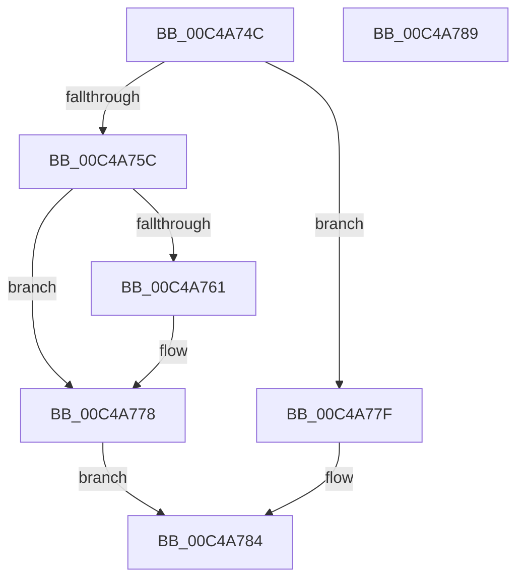

# SeInitSystem

- RVA: `0x00C4A74C`–`0x00C4A78A` (길이 `62` bytes)
- VA: `0x0000000140C4A74C`
- 실행 섹션: `INIT`
- PDB 이름 있음: `예`; PDB Function 태그: `아니요`
- unwind 정보 RVA: `0x0005D2F4`
- 디코드: `20`개 명령, `62/62` bytes 표시
- 미해석 바이트: `0` (있으면 어셈블리에 `.byte`로 보존)

> 이 문서는 커널 이미지의 기계어와 PDB 기호를 분석해 생성했습니다. 4번과 5번은 함수 원형과 자료형을 바이너리 사용 방식에서 추정한 C 해석이며 원본 소스 복구 결과는 아닙니다.

## 1. Dependencies

- 직접 호출 지점: **3**; 고유 호출 대상: **3**
- 직접 호출자로 확인된 함수: **2**
- RIP 상대 이미지 참조: **1**

### Outgoing calls
- `0x00C4A772` → [KeBugCheckEx](../../text/4F/KeBugCheckEx_function_004FD660.md) (function, `0x004FD660`)
- `0x00C4A778` → [SepInitializationPhase1](../../page/79/SepInitializationPhase1_function_0079C580.md) (function, `0x0079C580`)
- `0x00C4A77F` → [SepInitializationPhase0](SepInitializationPhase0_function_00C4A790.md) (function, `0x00C4A790`)

### Direct callers
- [InitBootProcessor](../C1/InitBootProcessor_function_00C1B1C8.md) at `0x00C1BD5C`
- [Phase1InitializationDiscard](../C1/Phase1InitializationDiscard_function_00C1C728.md) at `0x00C1D307`

### Static image references
- `0x00C4A750` → RVA `0x00FC41A0` (`.data`; read)

## 2. Other-region calls and transfers

- 다른 실행 섹션으로 향하는 call: **2**
  - `0x00C4A772` → [KeBugCheckEx](../../text/4F/KeBugCheckEx_function_004FD660.md) (`INIT` → `.text`)
  - `0x00C4A778` → [SepInitializationPhase1](../../page/79/SepInitializationPhase1_function_0079C580.md) (`INIT` → `PAGE`)
- 별도 외부 분기/꼬리 이동을 확인하지 못했습니다.

## 3. Assembly (complete function range)

```asm
00C4A74C  48 83 EC 38                     sub rsp, 0x38
00C4A750  8B 0D 4A 9A 37 00               mov ecx, dword ptr [rip + 0x379a4a]
00C4A756  8B C1                           mov eax, ecx
00C4A758  85 C9                           test ecx, ecx
00C4A75A  74 23                           je 0x140c4a77f
00C4A75C  83 F8 01                        cmp eax, 1
00C4A75F  74 17                           je 0x140c4a778
00C4A761  48 83 64 24 20 00               and qword ptr [rsp + 0x20], 0
00C4A767  33 D2                           xor edx, edx
00C4A769  44 8B C1                        mov r8d, ecx
00C4A76C  45 33 C9                        xor r9d, r9d
00C4A76F  8D 4A 33                        lea ecx, [rdx + 0x33]
00C4A772  E8 E9 2E 8B FF                  call 0x1404fd660
00C4A777  CC                              int3
00C4A778  E8 03 1E B5 FF                  call 0x14079c580
00C4A77D  EB 05                           jmp 0x140c4a784
00C4A77F  E8 0C 00 00 00                  call 0x140c4a790
00C4A784  48 83 C4 38                     add rsp, 0x38
00C4A788  C3                              ret
00C4A789  CC                              int3
```

## 4. C-style interpretation (structured pseudocode)

```c
__int64 __fastcall SeInitSystem(__int64 a1, int a2, __int64 a3, int a4)
{
    __int64 result;
    __int64 v_rsp;
    unsigned __int64 v_stack_m18;

    v_rsp = (v_rsp) - (56);
    if ((unsigned int)((unsigned int)(*(unsigned int *)(v_rip + 3643978))) == 0) goto loc_00C4A77F;
    result = (unsigned int)((unsigned int)((unsigned int)(*(unsigned int *)(v_rip + 3643978))));
    if (((unsigned int)((unsigned int)((unsigned int)((unsigned int)(*(unsigned int *)(v_rip + 3643978)))))) != 1) {
        a2 = 0;
        a3 = (unsigned int)((unsigned int)(*(unsigned int *)(v_rip + 3643978)));
        a4 = 0;
        a1 = a2 + 51;
        result = KeBugCheckEx(a1, a2, a3, a4);
    }
    result = SepInitializationPhase1(a1, a2, a3, a4);
    goto loc_00C4A784;
loc_00C4A77F:
    result = SepInitializationPhase0(a1, a2, a3, a4);
loc_00C4A784:
    v_rsp = (v_rsp) + (56);
    return result;
}
```

## 5. (Beta) C Style

```c
int64_t SeInitSystem(int64_t Arg1, int32_t Arg2, int64_t Arg3, int32_t Arg4)
{
    int64_t result;
    int64_t local_rsp;
    uint64_t v_stack_m18;

    local_rsp = (local_rsp) - (56);
    if ((uint32_t)((uint32_t)(*(uint32_t *)(v_rip + 0x379A4A))) == 0) goto loc_00C4A77F;
    result = (uint32_t)((uint32_t)((uint32_t)(*(uint32_t *)(v_rip + 0x379A4A))));
    if (((uint32_t)((uint32_t)((uint32_t)((uint32_t)(*(uint32_t *)(v_rip + 0x379A4A)))))) != 1) {
        Arg2 = 0;
        Arg3 = (uint32_t)((uint32_t)(*(uint32_t *)(v_rip + 0x379A4A)));
        Arg4 = 0;
        Arg1 = Arg2 + 51;
        result = KeBugCheckEx(Arg1, Arg2, Arg3, Arg4);
    }
    result = SepInitializationPhase1(Arg1, Arg2, Arg3, Arg4);
    goto loc_00C4A784;
loc_00C4A77F:
    result = SepInitializationPhase0(Arg1, Arg2, Arg3, Arg4);
loc_00C4A784:
    local_rsp = (local_rsp) + (56);
    return result;
}
```

## 6. Execution-region graph

[열기: 2D/3D 그래프와 함수 탐색 컨트롤 패널](../../../control-panel.html?section=init&rva=0x00C4A74C&view=graph)

- 2D 그래프는 위에서 아래로 흐르고, 3D 그래프는 빈 공간을 드래그해 회전합니다. Shift+드래그는 이동, 휠은 확대·축소, 함수 노드 선택은 대상 보고서 이동입니다.

### Static fallback


