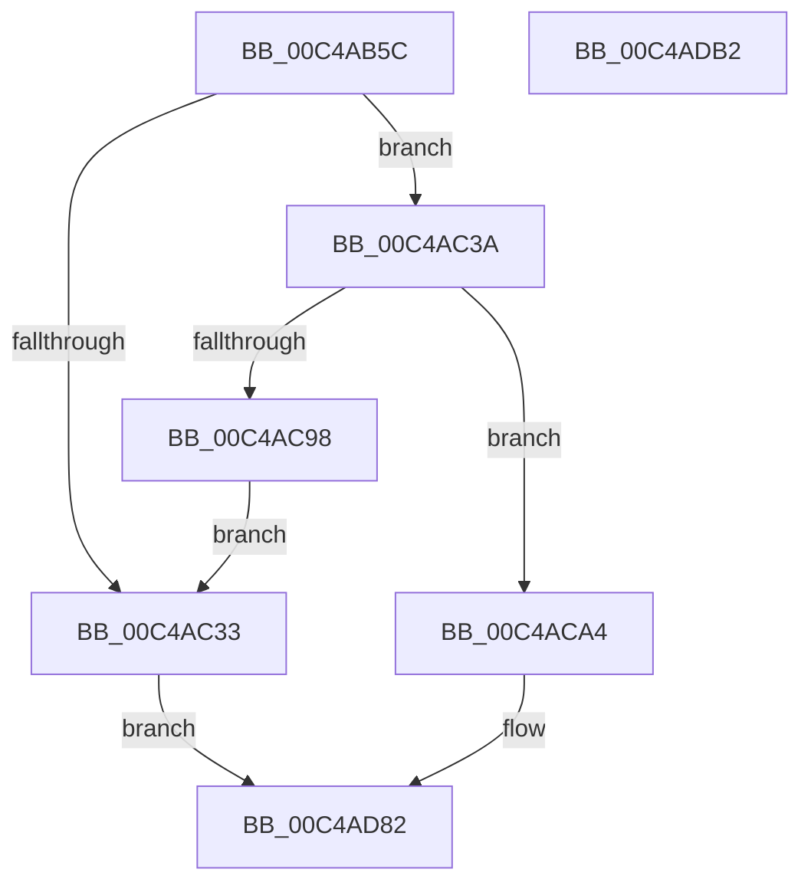

# SeMakeAnonymousLogonTokenNoEveryone

- RVA: `0x00C4AB5C`–`0x00C4ADB3` (길이 `599` bytes)
- VA: `0x0000000140C4AB5C`
- 실행 섹션: `INIT`
- PDB 이름 있음: `예`; PDB Function 태그: `아니요`
- unwind 정보 RVA: `0x000D14AC`
- 디코드: `140`개 명령, `599/599` bytes 표시
- 미해석 바이트: `0` (있으면 어셈블리에 `.byte`로 보존)

> 이 문서는 커널 이미지의 기계어와 PDB 기호를 분석해 생성했습니다. 4번과 5번은 함수 원형과 자료형을 바이너리 사용 방식에서 추정한 C 해석이며 원본 소스 복구 결과는 아닙니다.

## 1. Dependencies

- 직접 호출 지점: **16**; 고유 호출 대상: **12**
- 직접 호출자로 확인된 함수: **1**
- RIP 상대 이미지 참조: **6**

### Outgoing calls
- `0x00C4ABC6` → [RtlpTimeFieldsToTime](../../text/42/RtlpTimeFieldsToTime_function_0042E6C8.md) (function, `0x0042E6C8`)
- `0x00C4AC26` → [ExAllocatePool2](../../poolcode/B8/ExAllocatePool2_function_00B820F0.md) (function, `0x00B820F0`)
- `0x00C4AC48` → [RtlCreateAcl](../../page/91/RtlCreateAcl_function_00916F00.md) (function, `0x00916F00`)
- `0x00C4AC62` → [RtlAddAccessAllowedAce](../../page/92/RtlAddAccessAllowedAce_function_009298C0.md) (function, `0x009298C0`)
- `0x00C4AC77` → [RtlAddAccessAllowedAce](../../page/92/RtlAddAccessAllowedAce_function_009298C0.md) (function, `0x009298C0`)
- `0x00C4AC8B` → [ExAllocatePool2](../../poolcode/B8/ExAllocatePool2_function_00B820F0.md) (function, `0x00B820F0`)
- `0x00C4AC9D` → [ExFreePoolWithTag](../../poolcode/B8/ExFreePoolWithTag_function_00B82870.md) (function, `0x00B82870`)
- `0x00C4ACAC` → [RtlCreateSecurityDescriptor](../../page/9F/RtlCreateSecurityDescriptor_function_009F1DF0.md) (function, `0x009F1DF0`)
- `0x00C4ACBC` → [RtlSetDaclSecurityDescriptor](../../page/9E/RtlSetDaclSecurityDescriptor_function_009EC210.md) (function, `0x009EC210`)
- `0x00C4ACCE` → [RtlSetOwnerSecurityDescriptor](../../page/91/RtlSetOwnerSecurityDescriptor_function_00916F90.md) (function, `0x00916F90`)
- `0x00C4ACE0` → [RtlSetGroupSecurityDescriptor](../../page/A2/RtlSetGroupSecurityDescriptor_function_00A2EB10.md) (function, `0x00A2EB10`)
- `0x00C4AD58` → [SepCreateToken](../../page/7A/SepCreateToken_function_007A0DEC.md) (function, `0x007A0DEC`)
- `0x00C4AD65` → [SeSetMandatoryPolicyToken](../../page/A5/SeSetMandatoryPolicyToken_function_00A5EDCC.md) (function, `0x00A5EDCC`)
- `0x00C4AD6F` → [ExFreePoolWithTag](../../poolcode/B8/ExFreePoolWithTag_function_00B82870.md) (function, `0x00B82870`)
- `0x00C4AD79` → [ExFreePoolWithTag](../../poolcode/B8/ExFreePoolWithTag_function_00B82870.md) (function, `0x00B82870`)
- `0x00C4AD8C` → [_security_check_cookie](../../text/6A/_security_check_cookie_function_006AC640.md) (function, `0x006AC640`)

### Direct callers
- [SepInitializationPhase1](../../page/79/SepInitializationPhase1_function_0079C580.md) at `0x0079C61A`

### Static image references
- `0x00C4AB82` → RVA `0x00E0A740` (`.data`; read)
- `0x00C4AB93` → RVA `0x00042ED0` (`.rdata`; read)
- `0x00C4ABCB` → RVA `0x00F05818` (`.data`; read)
- `0x00C4ABD7` → RVA `0x00FD9AC8` (`PAGEDATA`; read)
- `0x00C4AC03` → RVA `0x00E67D48` (`.data`; read)
- `0x00C4AD31` → RVA `0x00B4AD00` (`SeAnonymousAuthenticationId`; read)

## 2. Other-region calls and transfers

- 다른 실행 섹션으로 향하는 call: **16**
  - `0x00C4ABC6` → [RtlpTimeFieldsToTime](../../text/42/RtlpTimeFieldsToTime_function_0042E6C8.md) (`INIT` → `.text`)
  - `0x00C4AC26` → [ExAllocatePool2](../../poolcode/B8/ExAllocatePool2_function_00B820F0.md) (`INIT` → `POOLCODE`)
  - `0x00C4AC48` → [RtlCreateAcl](../../page/91/RtlCreateAcl_function_00916F00.md) (`INIT` → `PAGE`)
  - `0x00C4AC62` → [RtlAddAccessAllowedAce](../../page/92/RtlAddAccessAllowedAce_function_009298C0.md) (`INIT` → `PAGE`)
  - `0x00C4AC77` → [RtlAddAccessAllowedAce](../../page/92/RtlAddAccessAllowedAce_function_009298C0.md) (`INIT` → `PAGE`)
  - `0x00C4AC8B` → [ExAllocatePool2](../../poolcode/B8/ExAllocatePool2_function_00B820F0.md) (`INIT` → `POOLCODE`)
  - `0x00C4AC9D` → [ExFreePoolWithTag](../../poolcode/B8/ExFreePoolWithTag_function_00B82870.md) (`INIT` → `POOLCODE`)
  - `0x00C4ACAC` → [RtlCreateSecurityDescriptor](../../page/9F/RtlCreateSecurityDescriptor_function_009F1DF0.md) (`INIT` → `PAGE`)
  - `0x00C4ACBC` → [RtlSetDaclSecurityDescriptor](../../page/9E/RtlSetDaclSecurityDescriptor_function_009EC210.md) (`INIT` → `PAGE`)
  - `0x00C4ACCE` → [RtlSetOwnerSecurityDescriptor](../../page/91/RtlSetOwnerSecurityDescriptor_function_00916F90.md) (`INIT` → `PAGE`)
  - `0x00C4ACE0` → [RtlSetGroupSecurityDescriptor](../../page/A2/RtlSetGroupSecurityDescriptor_function_00A2EB10.md) (`INIT` → `PAGE`)
  - `0x00C4AD58` → [SepCreateToken](../../page/7A/SepCreateToken_function_007A0DEC.md) (`INIT` → `PAGE`)
  - `0x00C4AD65` → [SeSetMandatoryPolicyToken](../../page/A5/SeSetMandatoryPolicyToken_function_00A5EDCC.md) (`INIT` → `PAGE`)
  - `0x00C4AD6F` → [ExFreePoolWithTag](../../poolcode/B8/ExFreePoolWithTag_function_00B82870.md) (`INIT` → `POOLCODE`)
  - `0x00C4AD79` → [ExFreePoolWithTag](../../poolcode/B8/ExFreePoolWithTag_function_00B82870.md) (`INIT` → `POOLCODE`)
  - `0x00C4AD8C` → [_security_check_cookie](../../text/6A/_security_check_cookie_function_006AC640.md) (`INIT` → `.text`)
- 별도 외부 분기/꼬리 이동을 확인하지 못했습니다.

## 3. Assembly (complete function range)

```asm
00C4AB5C  48 8B C4                        mov rax, rsp
00C4AB5F  48 89 58 08                     mov qword ptr [rax + 8], rbx
00C4AB63  48 89 70 10                     mov qword ptr [rax + 0x10], rsi
00C4AB67  48 89 78 18                     mov qword ptr [rax + 0x18], rdi
00C4AB6B  4C 89 60 20                     mov qword ptr [rax + 0x20], r12
00C4AB6F  55                              push rbp
00C4AB70  41 56                           push r14
00C4AB72  41 57                           push r15
00C4AB74  48 8D A8 E8 FB FF FF            lea rbp, [rax - 0x418]
00C4AB7B  48 81 EC 20 05 00 00            sub rsp, 0x520
00C4AB82  48 8B 05 B7 FB 1B 00            mov rax, qword ptr [rip + 0x1bfbb7]
00C4AB89  48 33 C4                        xor rax, rsp
00C4AB8C  48 89 85 F0 03 00 00            mov qword ptr [rbp + 0x3f0], rax
00C4AB93  66 0F 6F 05 35 83 3F FF         movdqa xmm0, xmmword ptr [rip - 0xc07ccb]
00C4AB9B  48 8D 55 90                     lea rdx, [rbp - 0x70]
00C4AB9F  45 33 E4                        xor r12d, r12d
00C4ABA2  C7 45 80 01 00 00 00            mov dword ptr [rbp - 0x80], 1
00C4ABA9  48 8D 4D D8                     lea rcx, [rbp - 0x28]
00C4ABAD  4C 89 65 88                     mov qword ptr [rbp - 0x78], r12
00C4ABB1  44 89 65 A4                     mov dword ptr [rbp - 0x5c], r12d
00C4ABB5  44 89 65 AC                     mov dword ptr [rbp - 0x54], r12d
00C4ABB9  44 89 65 C4                     mov dword ptr [rbp - 0x3c], r12d
00C4ABBD  4C 89 65 90                     mov qword ptr [rbp - 0x70], r12
00C4ABC1  F3 0F 7F 45 D8                  movdqu xmmword ptr [rbp - 0x28], xmm0
00C4ABC6  E8 FD 3A 7E FF                  call 0x14042e6c8
00C4ABCB  48 8B 05 46 AC 2B 00            mov rax, qword ptr [rip + 0x2bac46]
00C4ABD2  BA C8 00 00 00                  mov edx, 0xc8
00C4ABD7  48 8B 1D EA EE 38 00            mov rbx, qword ptr [rip + 0x38eeea]
00C4ABDE  41 B8 53 65 41 63               mov r8d, 0x63416553
00C4ABE4  48 89 45 F0                     mov qword ptr [rbp - 0x10], rax
00C4ABE8  48 89 5D 98                     mov qword ptr [rbp - 0x68], rbx
00C4ABEC  44 89 65 A0                     mov dword ptr [rbp - 0x60], r12d
00C4ABF0  C7 45 F8 60 00 00 00            mov dword ptr [rbp - 8], 0x60
00C4ABF7  0F B6 40 01                     movzx eax, byte ptr [rax + 1]
00C4ABFB  44 8D 34 85 0B 00 00 00         lea r14d, [rax*4 + 0xb]
00C4AC03  48 8B 05 3E D1 21 00            mov rax, qword ptr [rip + 0x21d13e]
00C4AC0A  41 83 E6 FC                     and r14d, 0xfffffffc
00C4AC0E  41 83 C6 10                     add r14d, 0x10
00C4AC12  0F B6 48 01                     movzx ecx, byte ptr [rax + 1]
00C4AC16  0F B6 43 01                     movzx eax, byte ptr [rbx + 1]
00C4AC1A  03 C8                           add ecx, eax
00C4AC1C  8D 3C 8D 30 00 00 00            lea edi, [rcx*4 + 0x30]
00C4AC23  8D 4A 38                        lea ecx, [rdx + 0x38]
00C4AC26  E8 C5 74 F3 FF                  call 0x140b820f0
00C4AC2B  48 8B F0                        mov rsi, rax
00C4AC2E  48 85 C0                        test rax, rax
00C4AC31  75 07                           jne 0x140c4ac3a
00C4AC33  33 C0                           xor eax, eax
00C4AC35  E9 48 01 00 00                  jmp 0x140c4ad82
00C4AC3A  41 BF 02 00 00 00               mov r15d, 2
00C4AC40  8B D7                           mov edx, edi
00C4AC42  45 8B C7                        mov r8d, r15d
00C4AC45  48 8B CE                        mov rcx, rsi
00C4AC48  E8 B3 C2 CC FF                  call 0x140916f00
00C4AC4D  4C 8B 0D F4 D0 21 00            mov r9, qword ptr [rip + 0x21d0f4]
00C4AC54  BF FF 01 0F 00                  mov edi, 0xf01ff
00C4AC59  44 8B C7                        mov r8d, edi
00C4AC5C  41 8B D7                        mov edx, r15d
00C4AC5F  48 8B CE                        mov rcx, rsi
00C4AC62  E8 59 EC CD FF                  call 0x1409298c0
00C4AC67  4C 8B 0D 5A EE 38 00            mov r9, qword ptr [rip + 0x38ee5a]
00C4AC6E  44 8B C7                        mov r8d, edi
00C4AC71  41 8B D7                        mov edx, r15d
00C4AC74  48 8B CE                        mov rcx, rsi
00C4AC77  E8 44 EC CD FF                  call 0x1409298c0
00C4AC7C  41 8D 57 26                     lea edx, [r15 + 0x26]
00C4AC80  B9 00 01 00 00                  mov ecx, 0x100
00C4AC85  41 B8 53 65 53 64               mov r8d, 0x64536553
00C4AC8B  E8 60 74 F3 FF                  call 0x140b820f0
00C4AC90  4C 8B F8                        mov r15, rax
00C4AC93  48 85 C0                        test rax, rax
00C4AC96  75 0C                           jne 0x140c4aca4
00C4AC98  33 D2                           xor edx, edx
00C4AC9A  48 8B CE                        mov rcx, rsi
00C4AC9D  E8 CE 7B F3 FF                  call 0x140b82870
00C4ACA2  EB 8F                           jmp 0x140c4ac33
00C4ACA4  BA 01 00 00 00                  mov edx, 1
00C4ACA9  49 8B CF                        mov rcx, r15
00C4ACAC  E8 3F 71 DA FF                  call 0x1409f1df0
00C4ACB1  45 33 C9                        xor r9d, r9d
00C4ACB4  4C 8B C6                        mov r8, rsi
00C4ACB7  B2 01                           mov dl, 1
00C4ACB9  49 8B CF                        mov rcx, r15
00C4ACBC  E8 4F 15 DA FF                  call 0x1409ec210
00C4ACC1  48 8B 15 80 D0 21 00            mov rdx, qword ptr [rip + 0x21d080]
00C4ACC8  45 33 C0                        xor r8d, r8d
00C4ACCB  49 8B CF                        mov rcx, r15
00C4ACCE  E8 BD C2 CC FF                  call 0x140916f90
00C4ACD3  48 8B 15 6E D0 21 00            mov rdx, qword ptr [rip + 0x21d06e]
00C4ACDA  45 33 C0                        xor r8d, r8d
00C4ACDD  49 8B CF                        mov rcx, r15
00C4ACE0  E8 2B 3E DE FF                  call 0x140a2eb10
00C4ACE5  48 89 B4 24 80 00 00 00         mov qword ptr [rsp + 0x80], rsi
00C4ACED  48 8D 45 F0                     lea rax, [rbp - 0x10]
00C4ACF1  48 89 5C 24 78                  mov qword ptr [rsp + 0x78], rbx
00C4ACF6  4C 8D 4D A8                     lea r9, [rbp - 0x58]
00C4ACFA  4C 89 64 24 70                  mov qword ptr [rsp + 0x70], r12
00C4ACFF  48 8D 4D 88                     lea rcx, [rbp - 0x78]
00C4AD03  4C 89 64 24 68                  mov qword ptr [rsp + 0x68], r12
00C4AD08  44 89 64 24 60                  mov dword ptr [rsp + 0x60], r12d
00C4AD0D  44 89 74 24 58                  mov dword ptr [rsp + 0x58], r14d
00C4AD12  48 89 44 24 50                  mov qword ptr [rsp + 0x50], rax
00C4AD17  48 8D 45 98                     lea rax, [rbp - 0x68]
00C4AD1B  C7 44 24 48 01 00 00 00         mov dword ptr [rsp + 0x48], 1
00C4AD23  48 89 44 24 40                  mov qword ptr [rsp + 0x40], rax
00C4AD28  48 8D 45 90                     lea rax, [rbp - 0x70]
00C4AD2C  48 89 44 24 38                  mov qword ptr [rsp + 0x38], rax
00C4AD31  48 8D 05 C8 FF EF FF            lea rax, [rip - 0x100038]
00C4AD38  48 89 44 24 30                  mov qword ptr [rsp + 0x30], rax
00C4AD3D  C7 45 A8 30 00 00 00            mov dword ptr [rbp - 0x58], 0x30
00C4AD44  4C 89 65 B0                     mov qword ptr [rbp - 0x50], r12
00C4AD48  44 89 65 C0                     mov dword ptr [rbp - 0x40], r12d
00C4AD4C  4C 89 65 B8                     mov qword ptr [rbp - 0x48], r12
00C4AD50  4C 89 7D C8                     mov qword ptr [rbp - 0x38], r15
00C4AD54  4C 89 65 D0                     mov qword ptr [rbp - 0x30], r12
00C4AD58  E8 8F 60 B5 FF                  call 0x1407a0dec
00C4AD5D  48 8B 4D 88                     mov rcx, qword ptr [rbp - 0x78]
00C4AD61  48 8D 55 80                     lea rdx, [rbp - 0x80]
00C4AD65  E8 62 40 E1 FF                  call 0x140a5edcc
00C4AD6A  33 D2                           xor edx, edx
00C4AD6C  48 8B CE                        mov rcx, rsi
00C4AD6F  E8 FC 7A F3 FF                  call 0x140b82870
00C4AD74  33 D2                           xor edx, edx
00C4AD76  49 8B CF                        mov rcx, r15
00C4AD79  E8 F2 7A F3 FF                  call 0x140b82870
00C4AD7E  48 8B 45 88                     mov rax, qword ptr [rbp - 0x78]
00C4AD82  48 8B 8D F0 03 00 00            mov rcx, qword ptr [rbp + 0x3f0]
00C4AD89  48 33 CC                        xor rcx, rsp
00C4AD8C  E8 AF 18 A6 FF                  call 0x1406ac640
00C4AD91  4C 8D 9C 24 20 05 00 00         lea r11, [rsp + 0x520]
00C4AD99  49 8B 5B 20                     mov rbx, qword ptr [r11 + 0x20]
00C4AD9D  49 8B 73 28                     mov rsi, qword ptr [r11 + 0x28]
00C4ADA1  49 8B 7B 30                     mov rdi, qword ptr [r11 + 0x30]
00C4ADA5  4D 8B 63 38                     mov r12, qword ptr [r11 + 0x38]
00C4ADA9  49 8B E3                        mov rsp, r11
00C4ADAC  41 5F                           pop r15
00C4ADAE  41 5E                           pop r14
00C4ADB0  5D                              pop rbp
00C4ADB1  C3                              ret
00C4ADB2  CC                              int3
```

## 4. C-style interpretation (structured pseudocode)

```c
__int64 __fastcall SeMakeAnonymousLogonTokenNoEveryone(void)
{
    __int64 result;
    __int64 v_r12;
    __int64 v_r14;
    __int64 v_rsp;
    unsigned __int64 v_stack_m18;
    unsigned __int64 v_stack_m4B8;
    unsigned __int64 v_stack_m4C0;
    unsigned __int64 v_stack_m4C8;
    unsigned __int64 v_stack_m4D0;
    unsigned int v_stack_m4D8;
    unsigned int v_stack_m4E0;
    unsigned __int64 v_stack_m4E8;
    unsigned int v_stack_m4F0;
    unsigned __int64 v_stack_m4F8;
    unsigned __int64 v_stack_m500;
    unsigned __int64 v_stack_m508;

    *(unsigned __int64 *)(v_rsp + 8) = v_rbx;
    *(unsigned __int64 *)(v_rsp + 16) = v_rsi;
    *(unsigned __int64 *)(v_rsp + 24) = v_rdi;
    *(unsigned __int64 *)(v_rsp + 32) = v_r12;
    v_rsp = (v_rsp) - (0x520ULL);
    result = (*(unsigned __int64 *)(v_rip + 1833911)) ^ (v_rsp);
    *(unsigned __int64 *)(v_rsp - 1048 + 1008) = result;
    v_r12 = 0;
    *(unsigned int *)(v_rsp - 1048 - 128) = 1;
    *(unsigned __int64 *)(v_rsp - 1048 - 120) = 0;
    *(unsigned int *)(v_rsp - 1048 - 92) = 0;
    *(unsigned int *)(v_rsp - 1048 - 84) = 0;
    *(unsigned int *)(v_rsp - 1048 - 60) = 0;
    *(unsigned __int64 *)(v_rsp - 1048 - 112) = 0;
    *(unsigned __int64 *)(v_rsp - 1048 - 40) = v_xmm0;
    result = RtlpTimeFieldsToTime(v_rsp - 1048 - 40, v_rsp - 1048 - 112, a3, a4);
    *(unsigned __int64 *)(v_rsp - 1048 - 16) = *(unsigned __int64 *)(v_rip + 2862150);
    *(unsigned __int64 *)(v_rsp - 1048 - 104) = *(unsigned __int64 *)(v_rip + 3731178);
    *(unsigned int *)(v_rsp - 1048 - 96) = 0;
    *(unsigned int *)(v_rsp - 1048 - 8) = 96;
    v_r14 = (unsigned int)((*(unsigned __int8 *)(*(unsigned __int64 *)(v_rip + 2862150) + 1) * 4 + 11) & (0xFFFFFFFCULL));
    v_r14 = (unsigned int)((v_r14) + (16));
    a1 = (unsigned int)((*(unsigned __int8 *)(*(unsigned __int64 *)(v_rip + 2216254) + 1)) + ((unsigned int)(*(unsigned __int8 *)(*(unsigned __int64 *)(v_rip + 3731178) + 1))));
    result = ExAllocatePool2(200 + 56, 200, (unsigned int)(0x63416553ULL), a4);
    if (result != 0) goto loc_00C4AC3A;
loc_00C4AC33:
    result = 0;
    goto loc_00C4AD82;
loc_00C4AC3A:
    result = RtlCreateAcl(0, (unsigned int)((unsigned int)(a1 * 4 + 48)), 2, a4);
    result = RtlAddAccessAllowedAce(result, 2, (unsigned int)((unsigned int)((unsigned int)(0xF01FFULL))), *(unsigned __int64 *)(v_rip + 2216180));
    result = RtlAddAccessAllowedAce(result, 2, (unsigned int)((unsigned int)((unsigned int)(0xF01FFULL))), *(unsigned __int64 *)(v_rip + 3731034));
    result = ExAllocatePool2(256, 2 + 38, (unsigned int)(0x64536553ULL), *(unsigned __int64 *)(v_rip + 3731034));
    if (result != 0) goto loc_00C4ACA4;
    a2 = 0;
    result = ExFreePoolWithTag(result, a2, (unsigned int)(0x64536553ULL), *(unsigned __int64 *)(v_rip + 3731034));
    goto loc_00C4AC33;
loc_00C4ACA4:
    result = RtlCreateSecurityDescriptor(result, 1, (unsigned int)(0x64536553ULL), *(unsigned __int64 *)(v_rip + 3731034));
    a4 = 0;
    result = RtlSetDaclSecurityDescriptor(result, 1, result, a4);
    a3 = 0;
    result = RtlSetOwnerSecurityDescriptor(result, *(unsigned __int64 *)(v_rip + 2216064), a3, a4);
    a3 = 0;
    result = RtlSetGroupSecurityDescriptor(result, *(unsigned __int64 *)(v_rip + 2216046), a3, a4);
    v_stack_m4B8 = result;
    v_stack_m4C0 = *(unsigned __int64 *)(v_rip + 3731178);
    v_stack_m4C8 = 0;
    v_stack_m4D0 = 0;
    v_stack_m4D8 = 0;
    v_stack_m4E0 = (unsigned int)(v_r14);
    v_stack_m4E8 = v_rsp - 1048 - 16;
    v_stack_m4F0 = 1;
    v_stack_m4F8 = v_rsp - 1048 - 104;
    v_stack_m500 = v_rsp - 1048 - 112;
    v_stack_m508 = v_rip - 1048632;
    *(unsigned int *)(v_rsp - 1048 - 88) = 48;
    *(unsigned __int64 *)(v_rsp - 1048 - 80) = 0;
    *(unsigned int *)(v_rsp - 1048 - 64) = 0;
    *(unsigned __int64 *)(v_rsp - 1048 - 72) = 0;
    *(unsigned __int64 *)(v_rsp - 1048 - 56) = result;
    *(unsigned __int64 *)(v_rsp - 1048 - 48) = 0;
    result = SepCreateToken(v_rsp - 1048 - 120, *(unsigned __int64 *)(v_rip + 2216046), a3, v_rsp - 1048 - 88);
    result = SeSetMandatoryPolicyToken(*(unsigned __int64 *)(v_rsp - 1048 - 120), v_rsp - 1048 - 128, a3, v_rsp - 1048 - 88);
    a2 = 0;
    result = ExFreePoolWithTag(result, a2, a3, v_rsp - 1048 - 88);
    a2 = 0;
    result = ExFreePoolWithTag(result, a2, a3, v_rsp - 1048 - 88);
loc_00C4AD82:
    a1 = (*(unsigned __int64 *)(v_rsp - 1048 + 1008)) ^ (v_rsp);
    result = _security_check_cookie(a1, a2, a3, v_rsp - 1048 - 88);
    return result;
}
```

## 5. (Beta) C Style

```c
void SeMakeAnonymousLogonTokenNoEveryone(void)
{
    int64_t result;
    int64_t local_r12;
    int64_t local_r14;
    int64_t local_rsp;
    uint64_t v_stack_m18;
    uint64_t v_stack_m4B8;
    uint64_t v_stack_m4C0;
    uint64_t v_stack_m4C8;
    uint64_t v_stack_m4D0;
    uint32_t v_stack_m4D8;
    uint32_t v_stack_m4E0;
    uint64_t v_stack_m4E8;
    uint32_t v_stack_m4F0;
    uint64_t v_stack_m4F8;
    uint64_t v_stack_m500;
    uint64_t v_stack_m508;

    *(uint64_t *)(local_rsp + 0x8) = local_rbx;
    *(uint64_t *)(local_rsp + 0x10) = local_rsi;
    *(uint64_t *)(local_rsp + 0x18) = local_rdi;
    *(uint64_t *)(local_rsp + 0x20) = local_r12;
    local_rsp = (local_rsp) - (0x520ULL);
    result = (*(uint64_t *)(v_rip + 0x1BFBB7)) ^ (local_rsp);
    *(uint64_t *)(local_rsp - 0x418 + 0x3F0) = result;
    local_r12 = 0;
    *(uint32_t *)(local_rsp - 0x418 - 0x80) = 1;
    *(uint64_t *)(local_rsp - 0x418 - 0x78) = 0;
    *(uint32_t *)(local_rsp - 0x418 - 0x5C) = 0;
    *(uint32_t *)(local_rsp - 0x418 - 0x54) = 0;
    *(uint32_t *)(local_rsp - 0x418 - 0x3C) = 0;
    *(uint64_t *)(local_rsp - 0x418 - 0x70) = 0;
    *(uint64_t *)(local_rsp - 0x418 - 0x28) = v_xmm0;
    result = RtlpTimeFieldsToTime(local_rsp - 1048 - 40, local_rsp - 1048 - 112, a3, a4);
    *(uint64_t *)(local_rsp - 0x418 - 0x10) = *(uint64_t *)(v_rip + 0x2BAC46);
    *(uint64_t *)(local_rsp - 0x418 - 0x68) = *(uint64_t *)(v_rip + 0x38EEEA);
    *(uint32_t *)(local_rsp - 0x418 - 0x60) = 0;
    *(uint32_t *)(local_rsp - 0x418 - 0x8) = 96;
    local_r14 = (uint32_t)((*(uint8_t *)(*(uint64_t *)(v_rip + 0x2BAC46) + 0x1) * 4 + 11) & (0xFFFFFFFCULL));
    local_r14 = (uint32_t)((local_r14) + (16));
    a1 = (uint32_t)((*(uint8_t *)(*(uint64_t *)(v_rip + 0x21D13E) + 0x1)) + ((uint32_t)(*(uint8_t *)(*(uint64_t *)(v_rip + 0x38EEEA) + 0x1))));
    result = ExAllocatePool2(200 + 56, 200, (uint32_t)(0x63416553ULL), a4);
    if (result != 0) goto loc_00C4AC3A;
loc_00C4AC33:
    result = 0;
    goto loc_00C4AD82;
loc_00C4AC3A:
    result = RtlCreateAcl(0, (uint32_t)((uint32_t)(a1 * 4 + 48)), 2, a4);
    result = RtlAddAccessAllowedAce(result, 2, (uint32_t)((uint32_t)((uint32_t)(0xF01FFULL))), *(uint64_t *)(v_rip + 0x21D0F4));
    result = RtlAddAccessAllowedAce(result, 2, (uint32_t)((uint32_t)((uint32_t)(0xF01FFULL))), *(uint64_t *)(v_rip + 0x38EE5A));
    result = ExAllocatePool2(256, 2 + 38, (uint32_t)(0x64536553ULL), *(uint64_t *)(v_rip + 0x38EE5A));
    if (result != 0) goto loc_00C4ACA4;
    a2 = 0;
    result = ExFreePoolWithTag(result, a2, (uint32_t)(0x64536553ULL), *(uint64_t *)(v_rip + 0x38EE5A));
    goto loc_00C4AC33;
loc_00C4ACA4:
    result = RtlCreateSecurityDescriptor(result, 1, (uint32_t)(0x64536553ULL), *(uint64_t *)(v_rip + 0x38EE5A));
    a4 = 0;
    result = RtlSetDaclSecurityDescriptor(result, 1, result, a4);
    a3 = 0;
    result = RtlSetOwnerSecurityDescriptor(result, *(uint64_t *)(v_rip + 0x21D080), a3, a4);
    a3 = 0;
    result = RtlSetGroupSecurityDescriptor(result, *(uint64_t *)(v_rip + 0x21D06E), a3, a4);
    v_stack_m4B8 = result;
    v_stack_m4C0 = *(uint64_t *)(v_rip + 0x38EEEA);
    v_stack_m4C8 = 0;
    v_stack_m4D0 = 0;
    v_stack_m4D8 = 0;
    v_stack_m4E0 = (uint32_t)(local_r14);
    v_stack_m4E8 = local_rsp - 1048 - 16;
    v_stack_m4F0 = 1;
    v_stack_m4F8 = local_rsp - 1048 - 104;
    v_stack_m500 = local_rsp - 1048 - 112;
    v_stack_m508 = v_rip - 1048632;
    *(uint32_t *)(local_rsp - 0x418 - 0x58) = 48;
    *(uint64_t *)(local_rsp - 0x418 - 0x50) = 0;
    *(uint32_t *)(local_rsp - 0x418 - 0x40) = 0;
    *(uint64_t *)(local_rsp - 0x418 - 0x48) = 0;
    *(uint64_t *)(local_rsp - 0x418 - 0x38) = result;
    *(uint64_t *)(local_rsp - 0x418 - 0x30) = 0;
    result = SepCreateToken(local_rsp - 1048 - 120, *(uint64_t *)(v_rip + 0x21D06E), a3, local_rsp - 1048 - 88);
    result = SeSetMandatoryPolicyToken(*(uint64_t *)(local_rsp - 0x418 - 0x78), local_rsp - 1048 - 128, a3, local_rsp - 1048 - 88);
    a2 = 0;
    result = ExFreePoolWithTag(result, a2, a3, local_rsp - 1048 - 88);
    a2 = 0;
    result = ExFreePoolWithTag(result, a2, a3, local_rsp - 1048 - 88);
loc_00C4AD82:
    a1 = (*(uint64_t *)(local_rsp - 0x418 + 0x3F0)) ^ (local_rsp);
    result = _security_check_cookie(a1, a2, a3, local_rsp - 1048 - 88);
    return result;
}
```

## 6. Execution-region graph

[열기: 2D/3D 그래프와 함수 탐색 컨트롤 패널](../../../control-panel.html?section=init&rva=0x00C4AB5C&view=graph)

- 2D 그래프는 위에서 아래로 흐르고, 3D 그래프는 빈 공간을 드래그해 회전합니다. Shift+드래그는 이동, 휠은 확대·축소, 함수 노드 선택은 대상 보고서 이동입니다.

### Static fallback


