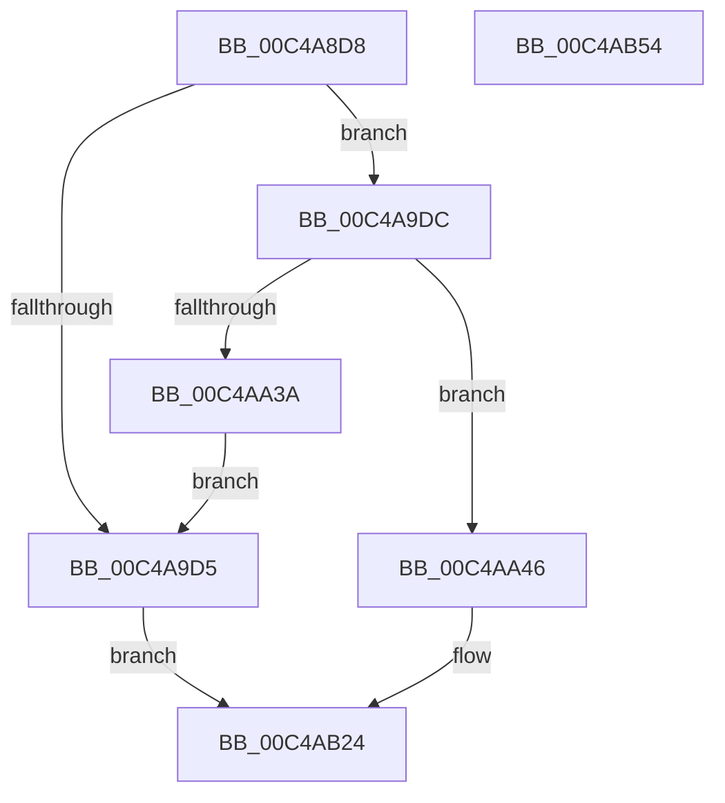

# SeMakeAnonymousLogonToken

- RVA: `0x00C4A8D8`–`0x00C4AB55` (길이 `637` bytes)
- VA: `0x0000000140C4A8D8`
- 실행 섹션: `INIT`
- PDB 이름 있음: `예`; PDB Function 태그: `아니요`
- unwind 정보 RVA: `0x000D14AC`
- 디코드: `147`개 명령, `637/637` bytes 표시
- 미해석 바이트: `0` (있으면 어셈블리에 `.byte`로 보존)

> 이 문서는 커널 이미지의 기계어와 PDB 기호를 분석해 생성했습니다. 4번과 5번은 함수 원형과 자료형을 바이너리 사용 방식에서 추정한 C 해석이며 원본 소스 복구 결과는 아닙니다.

## 1. Dependencies

- 직접 호출 지점: **16**; 고유 호출 대상: **12**
- 직접 호출자로 확인된 함수: **1**
- RIP 상대 이미지 참조: **6**

### Outgoing calls
- `0x00C4A942` → [RtlpTimeFieldsToTime](../../text/42/RtlpTimeFieldsToTime_function_0042E6C8.md) (function, `0x0042E6C8`)
- `0x00C4A9C8` → [ExAllocatePool2](../../poolcode/B8/ExAllocatePool2_function_00B820F0.md) (function, `0x00B820F0`)
- `0x00C4A9E7` → [RtlCreateAcl](../../page/91/RtlCreateAcl_function_00916F00.md) (function, `0x00916F00`)
- `0x00C4AA03` → [RtlAddAccessAllowedAce](../../page/92/RtlAddAccessAllowedAce_function_009298C0.md) (function, `0x009298C0`)
- `0x00C4AA1A` → [RtlAddAccessAllowedAce](../../page/92/RtlAddAccessAllowedAce_function_009298C0.md) (function, `0x009298C0`)
- `0x00C4AA2D` → [ExAllocatePool2](../../poolcode/B8/ExAllocatePool2_function_00B820F0.md) (function, `0x00B820F0`)
- `0x00C4AA3F` → [ExFreePoolWithTag](../../poolcode/B8/ExFreePoolWithTag_function_00B82870.md) (function, `0x00B82870`)
- `0x00C4AA4E` → [RtlCreateSecurityDescriptor](../../page/9F/RtlCreateSecurityDescriptor_function_009F1DF0.md) (function, `0x009F1DF0`)
- `0x00C4AA5E` → [RtlSetDaclSecurityDescriptor](../../page/9E/RtlSetDaclSecurityDescriptor_function_009EC210.md) (function, `0x009EC210`)
- `0x00C4AA70` → [RtlSetOwnerSecurityDescriptor](../../page/91/RtlSetOwnerSecurityDescriptor_function_00916F90.md) (function, `0x00916F90`)
- `0x00C4AA82` → [RtlSetGroupSecurityDescriptor](../../page/A2/RtlSetGroupSecurityDescriptor_function_00A2EB10.md) (function, `0x00A2EB10`)
- `0x00C4AAFA` → [SepCreateToken](../../page/7A/SepCreateToken_function_007A0DEC.md) (function, `0x007A0DEC`)
- `0x00C4AB07` → [SeSetMandatoryPolicyToken](../../page/A5/SeSetMandatoryPolicyToken_function_00A5EDCC.md) (function, `0x00A5EDCC`)
- `0x00C4AB11` → [ExFreePoolWithTag](../../poolcode/B8/ExFreePoolWithTag_function_00B82870.md) (function, `0x00B82870`)
- `0x00C4AB1B` → [ExFreePoolWithTag](../../poolcode/B8/ExFreePoolWithTag_function_00B82870.md) (function, `0x00B82870`)
- `0x00C4AB2E` → [_security_check_cookie](../../text/6A/_security_check_cookie_function_006AC640.md) (function, `0x006AC640`)

### Direct callers
- [SepInitializationPhase1](../../page/79/SepInitializationPhase1_function_0079C580.md) at `0x0079C60E`

### Static image references
- `0x00C4A8FE` → RVA `0x00E0A740` (`.data`; read)
- `0x00C4A90F` → RVA `0x00042ED0` (`.rdata`; read)
- `0x00C4A947` → RVA `0x00E67D48` (`.data`; read)
- `0x00C4A954` → RVA `0x00F05878` (`.data`; read)
- `0x00C4A95B` → RVA `0x00FD9AC8` (`PAGEDATA`; read)
- `0x00C4AAD3` → RVA `0x00B4AD00` (`SeAnonymousAuthenticationId`; read)

## 2. Other-region calls and transfers

- 다른 실행 섹션으로 향하는 call: **16**
  - `0x00C4A942` → [RtlpTimeFieldsToTime](../../text/42/RtlpTimeFieldsToTime_function_0042E6C8.md) (`INIT` → `.text`)
  - `0x00C4A9C8` → [ExAllocatePool2](../../poolcode/B8/ExAllocatePool2_function_00B820F0.md) (`INIT` → `POOLCODE`)
  - `0x00C4A9E7` → [RtlCreateAcl](../../page/91/RtlCreateAcl_function_00916F00.md) (`INIT` → `PAGE`)
  - `0x00C4AA03` → [RtlAddAccessAllowedAce](../../page/92/RtlAddAccessAllowedAce_function_009298C0.md) (`INIT` → `PAGE`)
  - `0x00C4AA1A` → [RtlAddAccessAllowedAce](../../page/92/RtlAddAccessAllowedAce_function_009298C0.md) (`INIT` → `PAGE`)
  - `0x00C4AA2D` → [ExAllocatePool2](../../poolcode/B8/ExAllocatePool2_function_00B820F0.md) (`INIT` → `POOLCODE`)
  - `0x00C4AA3F` → [ExFreePoolWithTag](../../poolcode/B8/ExFreePoolWithTag_function_00B82870.md) (`INIT` → `POOLCODE`)
  - `0x00C4AA4E` → [RtlCreateSecurityDescriptor](../../page/9F/RtlCreateSecurityDescriptor_function_009F1DF0.md) (`INIT` → `PAGE`)
  - `0x00C4AA5E` → [RtlSetDaclSecurityDescriptor](../../page/9E/RtlSetDaclSecurityDescriptor_function_009EC210.md) (`INIT` → `PAGE`)
  - `0x00C4AA70` → [RtlSetOwnerSecurityDescriptor](../../page/91/RtlSetOwnerSecurityDescriptor_function_00916F90.md) (`INIT` → `PAGE`)
  - `0x00C4AA82` → [RtlSetGroupSecurityDescriptor](../../page/A2/RtlSetGroupSecurityDescriptor_function_00A2EB10.md) (`INIT` → `PAGE`)
  - `0x00C4AAFA` → [SepCreateToken](../../page/7A/SepCreateToken_function_007A0DEC.md) (`INIT` → `PAGE`)
  - `0x00C4AB07` → [SeSetMandatoryPolicyToken](../../page/A5/SeSetMandatoryPolicyToken_function_00A5EDCC.md) (`INIT` → `PAGE`)
  - `0x00C4AB11` → [ExFreePoolWithTag](../../poolcode/B8/ExFreePoolWithTag_function_00B82870.md) (`INIT` → `POOLCODE`)
  - `0x00C4AB1B` → [ExFreePoolWithTag](../../poolcode/B8/ExFreePoolWithTag_function_00B82870.md) (`INIT` → `POOLCODE`)
  - `0x00C4AB2E` → [_security_check_cookie](../../text/6A/_security_check_cookie_function_006AC640.md) (`INIT` → `.text`)
- 별도 외부 분기/꼬리 이동을 확인하지 못했습니다.

## 3. Assembly (complete function range)

```asm
00C4A8D8  48 8B C4                        mov rax, rsp
00C4A8DB  48 89 58 08                     mov qword ptr [rax + 8], rbx
00C4A8DF  48 89 70 10                     mov qword ptr [rax + 0x10], rsi
00C4A8E3  48 89 78 18                     mov qword ptr [rax + 0x18], rdi
00C4A8E7  4C 89 60 20                     mov qword ptr [rax + 0x20], r12
00C4A8EB  55                              push rbp
00C4A8EC  41 56                           push r14
00C4A8EE  41 57                           push r15
00C4A8F0  48 8D A8 E8 FB FF FF            lea rbp, [rax - 0x418]
00C4A8F7  48 81 EC 20 05 00 00            sub rsp, 0x520
00C4A8FE  48 8B 05 3B FE 1B 00            mov rax, qword ptr [rip + 0x1bfe3b]
00C4A905  48 33 C4                        xor rax, rsp
00C4A908  48 89 85 F0 03 00 00            mov qword ptr [rbp + 0x3f0], rax
00C4A90F  66 0F 6F 05 B9 85 3F FF         movdqa xmm0, xmmword ptr [rip - 0xc07a47]
00C4A917  48 8D 55 90                     lea rdx, [rbp - 0x70]
00C4A91B  45 33 E4                        xor r12d, r12d
00C4A91E  C7 45 80 01 00 00 00            mov dword ptr [rbp - 0x80], 1
00C4A925  48 8D 4D D8                     lea rcx, [rbp - 0x28]
00C4A929  4C 89 65 88                     mov qword ptr [rbp - 0x78], r12
00C4A92D  44 89 65 A4                     mov dword ptr [rbp - 0x5c], r12d
00C4A931  44 89 65 AC                     mov dword ptr [rbp - 0x54], r12d
00C4A935  44 89 65 C4                     mov dword ptr [rbp - 0x3c], r12d
00C4A939  4C 89 65 90                     mov qword ptr [rbp - 0x70], r12
00C4A93D  F3 0F 7F 45 D8                  movdqu xmmword ptr [rbp - 0x28], xmm0
00C4A942  E8 81 3D 7E FF                  call 0x14042e6c8
00C4A947  4C 8B 05 FA D3 21 00            mov r8, qword ptr [rip + 0x21d3fa]
00C4A94E  41 B9 FC FF FF FF               mov r9d, 0xfffffffc
00C4A954  48 8B 15 1D AF 2B 00            mov rdx, qword ptr [rip + 0x2baf1d]
00C4A95B  48 8B 1D 66 F1 38 00            mov rbx, qword ptr [rip + 0x38f166]
00C4A962  4C 89 45 F0                     mov qword ptr [rbp - 0x10], r8
00C4A966  48 89 55 00                     mov qword ptr [rbp], rdx
00C4A96A  48 89 5D 98                     mov qword ptr [rbp - 0x68], rbx
00C4A96E  44 89 65 A0                     mov dword ptr [rbp - 0x60], r12d
00C4A972  C7 45 F8 07 00 00 00            mov dword ptr [rbp - 8], 7
00C4A979  C7 45 08 60 00 00 00            mov dword ptr [rbp + 8], 0x60
00C4A980  41 0F B6 40 01                  movzx eax, byte ptr [r8 + 1]
00C4A985  8D 0C 85 0B 00 00 00            lea ecx, [rax*4 + 0xb]
00C4A98C  0F B6 42 01                     movzx eax, byte ptr [rdx + 1]
00C4A990  41 23 C9                        and ecx, r9d
00C4A993  BA C8 00 00 00                  mov edx, 0xc8
00C4A998  83 C1 10                        add ecx, 0x10
00C4A99B  44 8D 3C 85 0B 00 00 00         lea r15d, [rax*4 + 0xb]
00C4A9A3  0F B6 43 01                     movzx eax, byte ptr [rbx + 1]
00C4A9A7  45 23 F9                        and r15d, r9d
00C4A9AA  44 8D 72 38                     lea r14d, [rdx + 0x38]
00C4A9AE  44 03 F9                        add r15d, ecx
00C4A9B1  41 0F B6 48 01                  movzx ecx, byte ptr [r8 + 1]
00C4A9B6  03 C8                           add ecx, eax
00C4A9B8  41 B8 53 65 41 63               mov r8d, 0x63416553
00C4A9BE  8D 3C 8D 30 00 00 00            lea edi, [rcx*4 + 0x30]
00C4A9C5  41 8B CE                        mov ecx, r14d
00C4A9C8  E8 23 77 F3 FF                  call 0x140b820f0
00C4A9CD  48 8B F0                        mov rsi, rax
00C4A9D0  48 85 C0                        test rax, rax
00C4A9D3  75 07                           jne 0x140c4a9dc
00C4A9D5  33 C0                           xor eax, eax
00C4A9D7  E9 48 01 00 00                  jmp 0x140c4ab24
00C4A9DC  41 B8 02 00 00 00               mov r8d, 2
00C4A9E2  8B D7                           mov edx, edi
00C4A9E4  48 8B CE                        mov rcx, rsi
00C4A9E7  E8 14 C5 CC FF                  call 0x140916f00
00C4A9EC  4C 8B 0D 55 D3 21 00            mov r9, qword ptr [rip + 0x21d355]
00C4A9F3  BF FF 01 0F 00                  mov edi, 0xf01ff
00C4A9F8  44 8B C7                        mov r8d, edi
00C4A9FB  BA 02 00 00 00                  mov edx, 2
00C4AA00  48 8B CE                        mov rcx, rsi
00C4AA03  E8 B8 EE CD FF                  call 0x1409298c0
00C4AA08  4C 8B 0D B9 F0 38 00            mov r9, qword ptr [rip + 0x38f0b9]
00C4AA0F  44 8B C7                        mov r8d, edi
00C4AA12  BA 02 00 00 00                  mov edx, 2
00C4AA17  48 8B CE                        mov rcx, rsi
00C4AA1A  E8 A1 EE CD FF                  call 0x1409298c0
00C4AA1F  BA 28 00 00 00                  mov edx, 0x28
00C4AA24  41 B8 53 65 53 64               mov r8d, 0x64536553
00C4AA2A  49 8B CE                        mov rcx, r14
00C4AA2D  E8 BE 76 F3 FF                  call 0x140b820f0
00C4AA32  4C 8B F0                        mov r14, rax
00C4AA35  48 85 C0                        test rax, rax
00C4AA38  75 0C                           jne 0x140c4aa46
00C4AA3A  33 D2                           xor edx, edx
00C4AA3C  48 8B CE                        mov rcx, rsi
00C4AA3F  E8 2C 7E F3 FF                  call 0x140b82870
00C4AA44  EB 8F                           jmp 0x140c4a9d5
00C4AA46  BA 01 00 00 00                  mov edx, 1
00C4AA4B  49 8B CE                        mov rcx, r14
00C4AA4E  E8 9D 73 DA FF                  call 0x1409f1df0
00C4AA53  45 33 C9                        xor r9d, r9d
00C4AA56  4C 8B C6                        mov r8, rsi
00C4AA59  B2 01                           mov dl, 1
00C4AA5B  49 8B CE                        mov rcx, r14
00C4AA5E  E8 AD 17 DA FF                  call 0x1409ec210
00C4AA63  48 8B 15 DE D2 21 00            mov rdx, qword ptr [rip + 0x21d2de]
00C4AA6A  45 33 C0                        xor r8d, r8d
00C4AA6D  49 8B CE                        mov rcx, r14
00C4AA70  E8 1B C5 CC FF                  call 0x140916f90
00C4AA75  48 8B 15 CC D2 21 00            mov rdx, qword ptr [rip + 0x21d2cc]
00C4AA7C  45 33 C0                        xor r8d, r8d
00C4AA7F  49 8B CE                        mov rcx, r14
00C4AA82  E8 89 40 DE FF                  call 0x140a2eb10
00C4AA87  48 89 B4 24 80 00 00 00         mov qword ptr [rsp + 0x80], rsi
00C4AA8F  48 8D 45 F0                     lea rax, [rbp - 0x10]
00C4AA93  48 89 5C 24 78                  mov qword ptr [rsp + 0x78], rbx
00C4AA98  4C 8D 4D A8                     lea r9, [rbp - 0x58]
00C4AA9C  4C 89 64 24 70                  mov qword ptr [rsp + 0x70], r12
00C4AAA1  48 8D 4D 88                     lea rcx, [rbp - 0x78]
00C4AAA5  4C 89 64 24 68                  mov qword ptr [rsp + 0x68], r12
00C4AAAA  44 89 64 24 60                  mov dword ptr [rsp + 0x60], r12d
00C4AAAF  44 89 7C 24 58                  mov dword ptr [rsp + 0x58], r15d
00C4AAB4  48 89 44 24 50                  mov qword ptr [rsp + 0x50], rax
00C4AAB9  48 8D 45 98                     lea rax, [rbp - 0x68]
00C4AABD  C7 44 24 48 02 00 00 00         mov dword ptr [rsp + 0x48], 2
00C4AAC5  48 89 44 24 40                  mov qword ptr [rsp + 0x40], rax
00C4AACA  48 8D 45 90                     lea rax, [rbp - 0x70]
00C4AACE  48 89 44 24 38                  mov qword ptr [rsp + 0x38], rax
00C4AAD3  48 8D 05 26 02 F0 FF            lea rax, [rip - 0xffdda]
00C4AADA  48 89 44 24 30                  mov qword ptr [rsp + 0x30], rax
00C4AADF  C7 45 A8 30 00 00 00            mov dword ptr [rbp - 0x58], 0x30
00C4AAE6  4C 89 65 B0                     mov qword ptr [rbp - 0x50], r12
00C4AAEA  44 89 65 C0                     mov dword ptr [rbp - 0x40], r12d
00C4AAEE  4C 89 65 B8                     mov qword ptr [rbp - 0x48], r12
00C4AAF2  4C 89 75 C8                     mov qword ptr [rbp - 0x38], r14
00C4AAF6  4C 89 65 D0                     mov qword ptr [rbp - 0x30], r12
00C4AAFA  E8 ED 62 B5 FF                  call 0x1407a0dec
00C4AAFF  48 8B 4D 88                     mov rcx, qword ptr [rbp - 0x78]
00C4AB03  48 8D 55 80                     lea rdx, [rbp - 0x80]
00C4AB07  E8 C0 42 E1 FF                  call 0x140a5edcc
00C4AB0C  33 D2                           xor edx, edx
00C4AB0E  48 8B CE                        mov rcx, rsi
00C4AB11  E8 5A 7D F3 FF                  call 0x140b82870
00C4AB16  33 D2                           xor edx, edx
00C4AB18  49 8B CE                        mov rcx, r14
00C4AB1B  E8 50 7D F3 FF                  call 0x140b82870
00C4AB20  48 8B 45 88                     mov rax, qword ptr [rbp - 0x78]
00C4AB24  48 8B 8D F0 03 00 00            mov rcx, qword ptr [rbp + 0x3f0]
00C4AB2B  48 33 CC                        xor rcx, rsp
00C4AB2E  E8 0D 1B A6 FF                  call 0x1406ac640
00C4AB33  4C 8D 9C 24 20 05 00 00         lea r11, [rsp + 0x520]
00C4AB3B  49 8B 5B 20                     mov rbx, qword ptr [r11 + 0x20]
00C4AB3F  49 8B 73 28                     mov rsi, qword ptr [r11 + 0x28]
00C4AB43  49 8B 7B 30                     mov rdi, qword ptr [r11 + 0x30]
00C4AB47  4D 8B 63 38                     mov r12, qword ptr [r11 + 0x38]
00C4AB4B  49 8B E3                        mov rsp, r11
00C4AB4E  41 5F                           pop r15
00C4AB50  41 5E                           pop r14
00C4AB52  5D                              pop rbp
00C4AB53  C3                              ret
00C4AB54  CC                              int3
```

## 4. C-style interpretation (structured pseudocode)

```c
__int64 __fastcall SeMakeAnonymousLogonToken(void)
{
    __int64 result;
    __int64 v_r12;
    __int64 v_r15;
    __int64 v_rsp;
    unsigned __int64 v_stack_m18;
    unsigned __int64 v_stack_m4B8;
    unsigned __int64 v_stack_m4C0;
    unsigned __int64 v_stack_m4C8;
    unsigned __int64 v_stack_m4D0;
    unsigned int v_stack_m4D8;
    unsigned int v_stack_m4E0;
    unsigned __int64 v_stack_m4E8;
    unsigned int v_stack_m4F0;
    unsigned __int64 v_stack_m4F8;
    unsigned __int64 v_stack_m500;
    unsigned __int64 v_stack_m508;

    *(unsigned __int64 *)(v_rsp + 8) = v_rbx;
    *(unsigned __int64 *)(v_rsp + 16) = v_rsi;
    *(unsigned __int64 *)(v_rsp + 24) = v_rdi;
    *(unsigned __int64 *)(v_rsp + 32) = v_r12;
    v_rsp = (v_rsp) - (0x520ULL);
    result = (*(unsigned __int64 *)(v_rip + 1834555)) ^ (v_rsp);
    *(unsigned __int64 *)(v_rsp - 1048 + 1008) = result;
    v_r12 = 0;
    *(unsigned int *)(v_rsp - 1048 - 128) = 1;
    *(unsigned __int64 *)(v_rsp - 1048 - 120) = 0;
    *(unsigned int *)(v_rsp - 1048 - 92) = 0;
    *(unsigned int *)(v_rsp - 1048 - 84) = 0;
    *(unsigned int *)(v_rsp - 1048 - 60) = 0;
    *(unsigned __int64 *)(v_rsp - 1048 - 112) = 0;
    *(unsigned __int64 *)(v_rsp - 1048 - 40) = v_xmm0;
    result = RtlpTimeFieldsToTime(v_rsp - 1048 - 40, v_rsp - 1048 - 112, a3, a4);
    *(unsigned __int64 *)(v_rsp - 1048 - 16) = *(unsigned __int64 *)(v_rip + 2216954);
    *(unsigned __int64 *)(v_rsp - 1048) = *(unsigned __int64 *)(v_rip + 2862877);
    *(unsigned __int64 *)(v_rsp - 1048 - 104) = *(unsigned __int64 *)(v_rip + 3731814);
    *(unsigned int *)(v_rsp - 1048 - 96) = 0;
    *(unsigned int *)(v_rsp - 1048 - 8) = 7;
    *(unsigned int *)(v_rsp - 1048 + 8) = 96;
    a1 = (unsigned int)((*(unsigned __int8 *)(*(unsigned __int64 *)(v_rip + 2216954) + 1) * 4 + 11) & ((unsigned int)((unsigned int)(0xFFFFFFFCULL))));
    a1 = (unsigned int)((a1) + (16));
    v_r15 = (unsigned int)((*(unsigned __int8 *)(*(unsigned __int64 *)(v_rip + 2862877) + 1) * 4 + 11) & ((unsigned int)((unsigned int)(0xFFFFFFFCULL))));
    v_r15 = (unsigned int)((v_r15) + ((unsigned int)(a1)));
    a1 = (unsigned int)((*(unsigned __int8 *)(*(unsigned __int64 *)(v_rip + 2216954) + 1)) + ((unsigned int)(*(unsigned __int8 *)(*(unsigned __int64 *)(v_rip + 3731814) + 1))));
    result = ExAllocatePool2((unsigned int)((unsigned int)(200 + 56)), 200, (unsigned int)(0x63416553ULL), (unsigned int)(0xFFFFFFFCULL));
    if (result != 0) goto loc_00C4A9DC;
loc_00C4A9D5:
    result = 0;
    goto loc_00C4AB24;
loc_00C4A9DC:
    result = RtlCreateAcl(0, (unsigned int)((unsigned int)(a1 * 4 + 48)), 2, (unsigned int)(0xFFFFFFFCULL));
    result = RtlAddAccessAllowedAce(result, 2, (unsigned int)((unsigned int)((unsigned int)(0xF01FFULL))), *(unsigned __int64 *)(v_rip + 2216789));
    result = RtlAddAccessAllowedAce(result, 2, (unsigned int)((unsigned int)((unsigned int)(0xF01FFULL))), *(unsigned __int64 *)(v_rip + 3731641));
    result = ExAllocatePool2(200 + 56, 40, (unsigned int)(0x64536553ULL), *(unsigned __int64 *)(v_rip + 3731641));
    if (result != 0) goto loc_00C4AA46;
    a2 = 0;
    result = ExFreePoolWithTag(result, a2, (unsigned int)(0x64536553ULL), *(unsigned __int64 *)(v_rip + 3731641));
    goto loc_00C4A9D5;
loc_00C4AA46:
    result = RtlCreateSecurityDescriptor(result, 1, (unsigned int)(0x64536553ULL), *(unsigned __int64 *)(v_rip + 3731641));
    a4 = 0;
    result = RtlSetDaclSecurityDescriptor(result, 1, result, a4);
    a3 = 0;
    result = RtlSetOwnerSecurityDescriptor(result, *(unsigned __int64 *)(v_rip + 2216670), a3, a4);
    a3 = 0;
    result = RtlSetGroupSecurityDescriptor(result, *(unsigned __int64 *)(v_rip + 2216652), a3, a4);
    v_stack_m4B8 = result;
    v_stack_m4C0 = *(unsigned __int64 *)(v_rip + 3731814);
    v_stack_m4C8 = 0;
    v_stack_m4D0 = 0;
    v_stack_m4D8 = 0;
    v_stack_m4E0 = (unsigned int)(v_r15);
    v_stack_m4E8 = v_rsp - 1048 - 16;
    v_stack_m4F0 = 2;
    v_stack_m4F8 = v_rsp - 1048 - 104;
    v_stack_m500 = v_rsp - 1048 - 112;
    v_stack_m508 = v_rip - 1048026;
    *(unsigned int *)(v_rsp - 1048 - 88) = 48;
    *(unsigned __int64 *)(v_rsp - 1048 - 80) = 0;
    *(unsigned int *)(v_rsp - 1048 - 64) = 0;
    *(unsigned __int64 *)(v_rsp - 1048 - 72) = 0;
    *(unsigned __int64 *)(v_rsp - 1048 - 56) = result;
    *(unsigned __int64 *)(v_rsp - 1048 - 48) = 0;
    result = SepCreateToken(v_rsp - 1048 - 120, *(unsigned __int64 *)(v_rip + 2216652), a3, v_rsp - 1048 - 88);
    result = SeSetMandatoryPolicyToken(*(unsigned __int64 *)(v_rsp - 1048 - 120), v_rsp - 1048 - 128, a3, v_rsp - 1048 - 88);
    a2 = 0;
    result = ExFreePoolWithTag(result, a2, a3, v_rsp - 1048 - 88);
    a2 = 0;
    result = ExFreePoolWithTag(result, a2, a3, v_rsp - 1048 - 88);
loc_00C4AB24:
    a1 = (*(unsigned __int64 *)(v_rsp - 1048 + 1008)) ^ (v_rsp);
    result = _security_check_cookie(a1, a2, a3, v_rsp - 1048 - 88);
    return result;
}
```

## 5. (Beta) C Style

```c
void SeMakeAnonymousLogonToken(void)
{
    int64_t result;
    int64_t local_r12;
    int64_t local_r15;
    int64_t local_rsp;
    uint64_t v_stack_m18;
    uint64_t v_stack_m4B8;
    uint64_t v_stack_m4C0;
    uint64_t v_stack_m4C8;
    uint64_t v_stack_m4D0;
    uint32_t v_stack_m4D8;
    uint32_t v_stack_m4E0;
    uint64_t v_stack_m4E8;
    uint32_t v_stack_m4F0;
    uint64_t v_stack_m4F8;
    uint64_t v_stack_m500;
    uint64_t v_stack_m508;

    *(uint64_t *)(local_rsp + 0x8) = local_rbx;
    *(uint64_t *)(local_rsp + 0x10) = local_rsi;
    *(uint64_t *)(local_rsp + 0x18) = local_rdi;
    *(uint64_t *)(local_rsp + 0x20) = local_r12;
    local_rsp = (local_rsp) - (0x520ULL);
    result = (*(uint64_t *)(v_rip + 0x1BFE3B)) ^ (local_rsp);
    *(uint64_t *)(local_rsp - 0x418 + 0x3F0) = result;
    local_r12 = 0;
    *(uint32_t *)(local_rsp - 0x418 - 0x80) = 1;
    *(uint64_t *)(local_rsp - 0x418 - 0x78) = 0;
    *(uint32_t *)(local_rsp - 0x418 - 0x5C) = 0;
    *(uint32_t *)(local_rsp - 0x418 - 0x54) = 0;
    *(uint32_t *)(local_rsp - 0x418 - 0x3C) = 0;
    *(uint64_t *)(local_rsp - 0x418 - 0x70) = 0;
    *(uint64_t *)(local_rsp - 0x418 - 0x28) = v_xmm0;
    result = RtlpTimeFieldsToTime(local_rsp - 1048 - 40, local_rsp - 1048 - 112, a3, a4);
    *(uint64_t *)(local_rsp - 0x418 - 0x10) = *(uint64_t *)(v_rip + 0x21D3FA);
    *(uint64_t *)(local_rsp - 0x418) = *(uint64_t *)(v_rip + 0x2BAF1D);
    *(uint64_t *)(local_rsp - 0x418 - 0x68) = *(uint64_t *)(v_rip + 0x38F166);
    *(uint32_t *)(local_rsp - 0x418 - 0x60) = 0;
    *(uint32_t *)(local_rsp - 0x418 - 0x8) = 7;
    *(uint32_t *)(local_rsp - 0x418 + 0x8) = 96;
    a1 = (uint32_t)((*(uint8_t *)(*(uint64_t *)(v_rip + 0x21D3FA) + 0x1) * 4 + 11) & ((uint32_t)((uint32_t)(0xFFFFFFFCULL))));
    a1 = (uint32_t)((a1) + (16));
    local_r15 = (uint32_t)((*(uint8_t *)(*(uint64_t *)(v_rip + 0x2BAF1D) + 0x1) * 4 + 11) & ((uint32_t)((uint32_t)(0xFFFFFFFCULL))));
    local_r15 = (uint32_t)((local_r15) + ((uint32_t)(a1)));
    a1 = (uint32_t)((*(uint8_t *)(*(uint64_t *)(v_rip + 0x21D3FA) + 0x1)) + ((uint32_t)(*(uint8_t *)(*(uint64_t *)(v_rip + 0x38F166) + 0x1))));
    result = ExAllocatePool2((uint32_t)((uint32_t)(200 + 56)), 200, (uint32_t)(0x63416553ULL), (uint32_t)(0xFFFFFFFCULL));
    if (result != 0) goto loc_00C4A9DC;
loc_00C4A9D5:
    result = 0;
    goto loc_00C4AB24;
loc_00C4A9DC:
    result = RtlCreateAcl(0, (uint32_t)((uint32_t)(a1 * 4 + 48)), 2, (uint32_t)(0xFFFFFFFCULL));
    result = RtlAddAccessAllowedAce(result, 2, (uint32_t)((uint32_t)((uint32_t)(0xF01FFULL))), *(uint64_t *)(v_rip + 0x21D355));
    result = RtlAddAccessAllowedAce(result, 2, (uint32_t)((uint32_t)((uint32_t)(0xF01FFULL))), *(uint64_t *)(v_rip + 0x38F0B9));
    result = ExAllocatePool2(200 + 56, 40, (uint32_t)(0x64536553ULL), *(uint64_t *)(v_rip + 0x38F0B9));
    if (result != 0) goto loc_00C4AA46;
    a2 = 0;
    result = ExFreePoolWithTag(result, a2, (uint32_t)(0x64536553ULL), *(uint64_t *)(v_rip + 0x38F0B9));
    goto loc_00C4A9D5;
loc_00C4AA46:
    result = RtlCreateSecurityDescriptor(result, 1, (uint32_t)(0x64536553ULL), *(uint64_t *)(v_rip + 0x38F0B9));
    a4 = 0;
    result = RtlSetDaclSecurityDescriptor(result, 1, result, a4);
    a3 = 0;
    result = RtlSetOwnerSecurityDescriptor(result, *(uint64_t *)(v_rip + 0x21D2DE), a3, a4);
    a3 = 0;
    result = RtlSetGroupSecurityDescriptor(result, *(uint64_t *)(v_rip + 0x21D2CC), a3, a4);
    v_stack_m4B8 = result;
    v_stack_m4C0 = *(uint64_t *)(v_rip + 0x38F166);
    v_stack_m4C8 = 0;
    v_stack_m4D0 = 0;
    v_stack_m4D8 = 0;
    v_stack_m4E0 = (uint32_t)(local_r15);
    v_stack_m4E8 = local_rsp - 1048 - 16;
    v_stack_m4F0 = 2;
    v_stack_m4F8 = local_rsp - 1048 - 104;
    v_stack_m500 = local_rsp - 1048 - 112;
    v_stack_m508 = v_rip - 1048026;
    *(uint32_t *)(local_rsp - 0x418 - 0x58) = 48;
    *(uint64_t *)(local_rsp - 0x418 - 0x50) = 0;
    *(uint32_t *)(local_rsp - 0x418 - 0x40) = 0;
    *(uint64_t *)(local_rsp - 0x418 - 0x48) = 0;
    *(uint64_t *)(local_rsp - 0x418 - 0x38) = result;
    *(uint64_t *)(local_rsp - 0x418 - 0x30) = 0;
    result = SepCreateToken(local_rsp - 1048 - 120, *(uint64_t *)(v_rip + 0x21D2CC), a3, local_rsp - 1048 - 88);
    result = SeSetMandatoryPolicyToken(*(uint64_t *)(local_rsp - 0x418 - 0x78), local_rsp - 1048 - 128, a3, local_rsp - 1048 - 88);
    a2 = 0;
    result = ExFreePoolWithTag(result, a2, a3, local_rsp - 1048 - 88);
    a2 = 0;
    result = ExFreePoolWithTag(result, a2, a3, local_rsp - 1048 - 88);
loc_00C4AB24:
    a1 = (*(uint64_t *)(local_rsp - 0x418 + 0x3F0)) ^ (local_rsp);
    result = _security_check_cookie(a1, a2, a3, local_rsp - 1048 - 88);
    return result;
}
```

## 6. Execution-region graph

[열기: 2D/3D 그래프와 함수 탐색 컨트롤 패널](../../../control-panel.html?section=init&rva=0x00C4A8D8&view=graph)

- 2D 그래프는 위에서 아래로 흐르고, 3D 그래프는 빈 공간을 드래그해 회전합니다. Shift+드래그는 이동, 휠은 확대·축소, 함수 노드 선택은 대상 보고서 이동입니다.

### Static fallback


