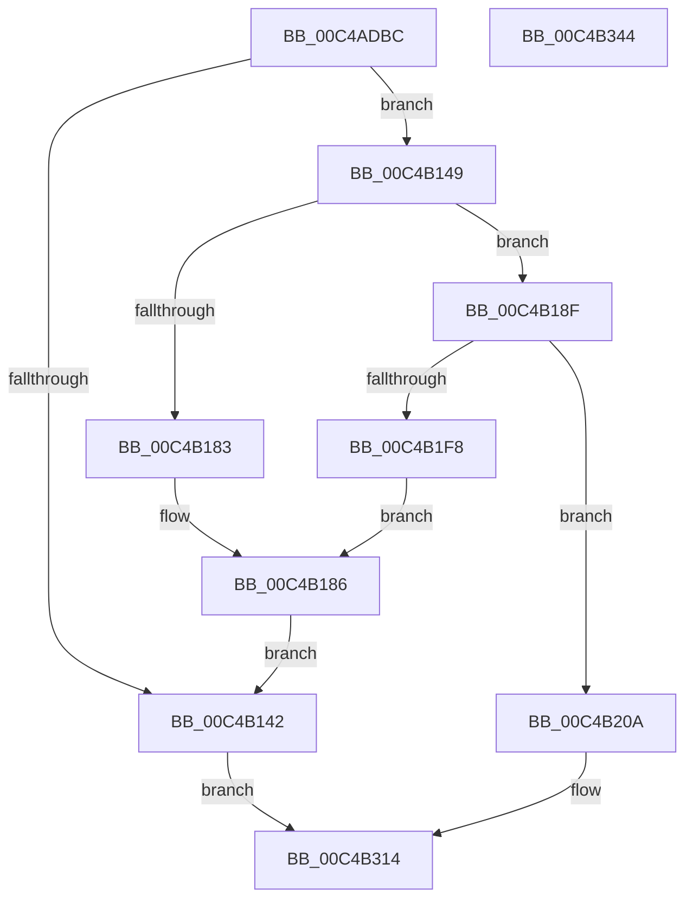

# SeMakeSystemToken

- RVA: `0x00C4ADBC`–`0x00C4B345` (길이 `1,417` bytes)
- VA: `0x0000000140C4ADBC`
- 실행 섹션: `INIT`
- PDB 이름 있음: `예`; PDB Function 태그: `아니요`
- unwind 정보 RVA: `0x000D1480`
- 디코드: `288`개 명령, `1,417/1,417` bytes 표시
- 미해석 바이트: `0` (있으면 어셈블리에 `.byte`로 보존)

> 이 문서는 커널 이미지의 기계어와 PDB 기호를 분석해 생성했습니다. 4번과 5번은 함수 원형과 자료형을 바이너리 사용 방식에서 추정한 C 해석이며 원본 소스 복구 결과는 아닙니다.

## 1. Dependencies

- 직접 호출 지점: **21**; 고유 호출 대상: **14**
- 직접 호출자로 확인된 함수: **1**
- RIP 상대 이미지 참조: **41**

### Outgoing calls
- `0x00C4AE26` → [RtlpTimeFieldsToTime](../../text/42/RtlpTimeFieldsToTime_function_0042E6C8.md) (function, `0x0042E6C8`)
- `0x00C4B135` → [ExAllocatePool2](../../poolcode/B8/ExAllocatePool2_function_00B820F0.md) (function, `0x00B820F0`)
- `0x00C4B154` → [RtlCreateAcl](../../page/91/RtlCreateAcl_function_00916F00.md) (function, `0x00916F00`)
- `0x00C4B176` → [ExAllocatePool2](../../poolcode/B8/ExAllocatePool2_function_00B820F0.md) (function, `0x00B820F0`)
- `0x00C4B188` → [ExFreePoolWithTag](../../poolcode/B8/ExFreePoolWithTag_function_00B82870.md) (function, `0x00B82870`)
- `0x00C4B19D` → [RtlCreateAcl](../../page/91/RtlCreateAcl_function_00916F00.md) (function, `0x00916F00`)
- `0x00C4B1B5` → [RtlAddAccessAllowedAce](../../page/92/RtlAddAccessAllowedAce_function_009298C0.md) (function, `0x009298C0`)
- `0x00C4B1D7` → [RtlAddProcessTrustLabelAce](../../page/92/RtlAddProcessTrustLabelAce_function_00929740.md) (function, `0x00929740`)
- `0x00C4B1EB` → [ExAllocatePool2](../../poolcode/B8/ExAllocatePool2_function_00B820F0.md) (function, `0x00B820F0`)
- `0x00C4B1FD` → [ExFreePoolWithTag](../../poolcode/B8/ExFreePoolWithTag_function_00B82870.md) (function, `0x00B82870`)
- `0x00C4B212` → [RtlCreateSecurityDescriptor](../../page/9F/RtlCreateSecurityDescriptor_function_009F1DF0.md) (function, `0x009F1DF0`)
- `0x00C4B222` → [RtlSetDaclSecurityDescriptor](../../page/9E/RtlSetDaclSecurityDescriptor_function_009EC210.md) (function, `0x009EC210`)
- `0x00C4B232` → [RtlSetSaclSecurityDescriptor](../../page/A1/RtlSetSaclSecurityDescriptor_function_00A18B80.md) (function, `0x00A18B80`)
- `0x00C4B244` → [RtlSetOwnerSecurityDescriptor](../../page/91/RtlSetOwnerSecurityDescriptor_function_00916F90.md) (function, `0x00916F90`)
- `0x00C4B256` → [RtlSetGroupSecurityDescriptor](../../page/A2/RtlSetGroupSecurityDescriptor_function_00A2EB10.md) (function, `0x00A2EB10`)
- `0x00C4B2E0` → [SepCreateToken](../../page/7A/SepCreateToken_function_007A0DEC.md) (function, `0x007A0DEC`)
- `0x00C4B2ED` → [SeSetMandatoryPolicyToken](../../page/A5/SeSetMandatoryPolicyToken_function_00A5EDCC.md) (function, `0x00A5EDCC`)
- `0x00C4B2F7` → [ExFreePoolWithTag](../../poolcode/B8/ExFreePoolWithTag_function_00B82870.md) (function, `0x00B82870`)
- `0x00C4B301` → [ExFreePoolWithTag](../../poolcode/B8/ExFreePoolWithTag_function_00B82870.md) (function, `0x00B82870`)
- `0x00C4B30B` → [ExFreePoolWithTag](../../poolcode/B8/ExFreePoolWithTag_function_00B82870.md) (function, `0x00B82870`)
- `0x00C4B31E` → [_security_check_cookie](../../text/6A/_security_check_cookie_function_006AC640.md) (function, `0x006AC640`)

### Direct callers
- [SepInitializationPhase0](SepInitializationPhase0_function_00C4A790.md) at `0x00C4A7E2`

### Static image references
- `0x00C4ADE2` → RVA `0x00E0A740` (`.data`; read)
- `0x00C4ADF3` → RVA `0x00042ED0` (`.rdata`; read)
- `0x00C4AE2B` → RVA `0x00F05840` (`.data`; read)
- `0x00C4AE36` → RVA `0x00FD9A68` (`PAGEDATA`; read)
- `0x00C4AE43` → RVA `0x00E67D48` (`.data`; read)
- `0x00C4AE4A` → RVA `0x00FD9CA8` (`PAGEDATA`; read)
- `0x00C4AE51` → RVA `0x00E67D58` (`.data`; read)
- `0x00C4AEEC` → RVA `0x00FD9A78` (`PAGEDATA`; read)
- `0x00C4AEFE` → RVA `0x00FD9B80` (`PAGEDATA`; read)
- `0x00C4AF0C` → RVA `0x00FD9B38` (`PAGEDATA`; read)
- `0x00C4AF17` → RVA `0x00FD9D40` (`PAGEDATA`; read)
- `0x00C4AF22` → RVA `0x00FD9AD0` (`PAGEDATA`; read)
- `0x00C4AF2D` → RVA `0x00FD9BC8` (`PAGEDATA`; read)
- `0x00C4AF38` → RVA `0x00FD9B70` (`PAGEDATA`; read)
- `0x00C4AF43` → RVA `0x00FD9AE8` (`PAGEDATA`; read)
- `0x00C4AF4E` → RVA `0x00FD9BD0` (`PAGEDATA`; read)
- `0x00C4AF59` → RVA `0x00FD9A80` (`PAGEDATA`; read)
- `0x00C4AF64` → RVA `0x00FD9C10` (`PAGEDATA`; read)
- `0x00C4AF6F` → RVA `0x00FD9B00` (`PAGEDATA`; read)
- `0x00C4AF91` → RVA `0x00FD9AB8` (`PAGEDATA`; read)
- `0x00C4AFAA` → RVA `0x00FD9D50` (`PAGEDATA`; read)
- `0x00C4AFB8` → RVA `0x00FD9AC0` (`PAGEDATA`; read)
- `0x00C4AFC6` → RVA `0x00FD9AE0` (`PAGEDATA`; read)
- `0x00C4AFD4` → RVA `0x00FD9B30` (`PAGEDATA`; read)
- `0x00C4AFE2` → RVA `0x00FD9B20` (`PAGEDATA`; read)
- `0x00C4AFF0` → RVA `0x00FD9B08` (`PAGEDATA`; read)
- `0x00C4AFFE` → RVA `0x00FD9BE0` (`PAGEDATA`; read)
- `0x00C4B00C` → RVA `0x00FD9F40` (`PAGEDATA`; read)
- `0x00C4B01A` → RVA `0x00FD9D68` (`PAGEDATA`; read)
- `0x00C4B028` → RVA `0x00FD9E68` (`PAGEDATA`; read)
- `0x00C4B036` → RVA `0x00FD9C98` (`PAGEDATA`; read)
- `0x00C4B044` → RVA `0x00FD9D58` (`PAGEDATA`; read)
- `0x00C4B052` → RVA `0x00FD9B28` (`PAGEDATA`; read)
- `0x00C4B060` → RVA `0x00FD9E50` (`PAGEDATA`; read)
- `0x00C4B06E` → RVA `0x00FD9D70` (`PAGEDATA`; read)
- `0x00C4B07C` → RVA `0x00FD9F48` (`PAGEDATA`; read)
- `0x00C4B08A` → RVA `0x00FD9B48` (`PAGEDATA`; read)
- `0x00C4B098` → RVA `0x00FD9E70` (`PAGEDATA`; read)
- `0x00C4B159` → RVA `0x00F05828` (`.data`; read)
- `0x00C4B27B` → RVA `0x00FD9C38` (`PAGEDATA`; read)
- `0x00C4B2D0` → RVA `0x00B4AD18` (`SeSystemAuthenticationId`; read)

## 2. Other-region calls and transfers

- 다른 실행 섹션으로 향하는 call: **21**
  - `0x00C4AE26` → [RtlpTimeFieldsToTime](../../text/42/RtlpTimeFieldsToTime_function_0042E6C8.md) (`INIT` → `.text`)
  - `0x00C4B135` → [ExAllocatePool2](../../poolcode/B8/ExAllocatePool2_function_00B820F0.md) (`INIT` → `POOLCODE`)
  - `0x00C4B154` → [RtlCreateAcl](../../page/91/RtlCreateAcl_function_00916F00.md) (`INIT` → `PAGE`)
  - `0x00C4B176` → [ExAllocatePool2](../../poolcode/B8/ExAllocatePool2_function_00B820F0.md) (`INIT` → `POOLCODE`)
  - `0x00C4B188` → [ExFreePoolWithTag](../../poolcode/B8/ExFreePoolWithTag_function_00B82870.md) (`INIT` → `POOLCODE`)
  - `0x00C4B19D` → [RtlCreateAcl](../../page/91/RtlCreateAcl_function_00916F00.md) (`INIT` → `PAGE`)
  - `0x00C4B1B5` → [RtlAddAccessAllowedAce](../../page/92/RtlAddAccessAllowedAce_function_009298C0.md) (`INIT` → `PAGE`)
  - `0x00C4B1D7` → [RtlAddProcessTrustLabelAce](../../page/92/RtlAddProcessTrustLabelAce_function_00929740.md) (`INIT` → `PAGE`)
  - `0x00C4B1EB` → [ExAllocatePool2](../../poolcode/B8/ExAllocatePool2_function_00B820F0.md) (`INIT` → `POOLCODE`)
  - `0x00C4B1FD` → [ExFreePoolWithTag](../../poolcode/B8/ExFreePoolWithTag_function_00B82870.md) (`INIT` → `POOLCODE`)
  - `0x00C4B212` → [RtlCreateSecurityDescriptor](../../page/9F/RtlCreateSecurityDescriptor_function_009F1DF0.md) (`INIT` → `PAGE`)
  - `0x00C4B222` → [RtlSetDaclSecurityDescriptor](../../page/9E/RtlSetDaclSecurityDescriptor_function_009EC210.md) (`INIT` → `PAGE`)
  - `0x00C4B232` → [RtlSetSaclSecurityDescriptor](../../page/A1/RtlSetSaclSecurityDescriptor_function_00A18B80.md) (`INIT` → `PAGE`)
  - `0x00C4B244` → [RtlSetOwnerSecurityDescriptor](../../page/91/RtlSetOwnerSecurityDescriptor_function_00916F90.md) (`INIT` → `PAGE`)
  - `0x00C4B256` → [RtlSetGroupSecurityDescriptor](../../page/A2/RtlSetGroupSecurityDescriptor_function_00A2EB10.md) (`INIT` → `PAGE`)
  - `0x00C4B2E0` → [SepCreateToken](../../page/7A/SepCreateToken_function_007A0DEC.md) (`INIT` → `PAGE`)
  - `0x00C4B2ED` → [SeSetMandatoryPolicyToken](../../page/A5/SeSetMandatoryPolicyToken_function_00A5EDCC.md) (`INIT` → `PAGE`)
  - `0x00C4B2F7` → [ExFreePoolWithTag](../../poolcode/B8/ExFreePoolWithTag_function_00B82870.md) (`INIT` → `POOLCODE`)
  - `0x00C4B301` → [ExFreePoolWithTag](../../poolcode/B8/ExFreePoolWithTag_function_00B82870.md) (`INIT` → `POOLCODE`)
  - `0x00C4B30B` → [ExFreePoolWithTag](../../poolcode/B8/ExFreePoolWithTag_function_00B82870.md) (`INIT` → `POOLCODE`)
  - `0x00C4B31E` → [_security_check_cookie](../../text/6A/_security_check_cookie_function_006AC640.md) (`INIT` → `.text`)
- 별도 외부 분기/꼬리 이동을 확인하지 못했습니다.

## 3. Assembly (complete function range)

```asm
00C4ADBC  48 8B C4                        mov rax, rsp
00C4ADBF  48 89 58 08                     mov qword ptr [rax + 8], rbx
00C4ADC3  48 89 70 10                     mov qword ptr [rax + 0x10], rsi
00C4ADC7  48 89 78 18                     mov qword ptr [rax + 0x18], rdi
00C4ADCB  55                              push rbp
00C4ADCC  41 54                           push r12
00C4ADCE  41 55                           push r13
00C4ADD0  41 56                           push r14
00C4ADD2  41 57                           push r15
00C4ADD4  48 8D A8 58 FA FF FF            lea rbp, [rax - 0x5a8]
00C4ADDB  48 81 EC A0 06 00 00            sub rsp, 0x6a0
00C4ADE2  48 8B 05 57 F9 1B 00            mov rax, qword ptr [rip + 0x1bf957]
00C4ADE9  48 33 C4                        xor rax, rsp
00C4ADEC  48 89 85 70 05 00 00            mov qword ptr [rbp + 0x570], rax
00C4ADF3  66 0F 6F 05 D5 80 3F FF         movdqa xmm0, xmmword ptr [rip - 0xc07f2b]
00C4ADFB  48 8D 55 90                     lea rdx, [rbp - 0x70]
00C4ADFF  45 33 F6                        xor r14d, r14d
00C4AE02  C7 45 80 01 00 00 00            mov dword ptr [rbp - 0x80], 1
00C4AE09  48 8D 4D D8                     lea rcx, [rbp - 0x28]
00C4AE0D  4C 89 75 88                     mov qword ptr [rbp - 0x78], r14
00C4AE11  44 89 75 A4                     mov dword ptr [rbp - 0x5c], r14d
00C4AE15  44 89 75 AC                     mov dword ptr [rbp - 0x54], r14d
00C4AE19  44 89 75 C4                     mov dword ptr [rbp - 0x3c], r14d
00C4AE1D  4C 89 75 90                     mov qword ptr [rbp - 0x70], r14
00C4AE21  F3 0F 7F 45 D8                  movdqu xmmword ptr [rbp - 0x28], xmm0
00C4AE26  E8 9D 38 7E FF                  call 0x14042e6c8
00C4AE2B  48 8B 0D 0E AA 2B 00            mov rcx, qword ptr [rip + 0x2baa0e]
00C4AE32  41 8D 46 07                     lea eax, [r14 + 7]
00C4AE36  4C 8B 25 2B EC 38 00            mov r12, qword ptr [rip + 0x38ec2b]
00C4AE3D  41 BA FC FF FF FF               mov r10d, 0xfffffffc
00C4AE43  4C 8B 0D FE CE 21 00            mov r9, qword ptr [rip + 0x21cefe]
00C4AE4A  4C 8B 05 57 EE 38 00            mov r8, qword ptr [rip + 0x38ee57]
00C4AE51  48 8B 1D 00 CF 21 00            mov rbx, qword ptr [rip + 0x21cf00]
00C4AE58  89 85 88 01 00 00               mov dword ptr [rbp + 0x188], eax
00C4AE5E  89 85 98 01 00 00               mov dword ptr [rbp + 0x198], eax
00C4AE64  48 89 8D A0 01 00 00            mov qword ptr [rbp + 0x1a0], rcx
00C4AE6B  48 89 5D 98                     mov qword ptr [rbp - 0x68], rbx
00C4AE6F  44 89 75 A0                     mov dword ptr [rbp - 0x60], r14d
00C4AE73  4C 89 A5 70 01 00 00            mov qword ptr [rbp + 0x170], r12
00C4AE7A  4C 89 8D 80 01 00 00            mov qword ptr [rbp + 0x180], r9
00C4AE81  4C 89 85 90 01 00 00            mov qword ptr [rbp + 0x190], r8
00C4AE88  C7 85 78 01 00 00 0E 00 00 00   mov dword ptr [rbp + 0x178], 0xe
00C4AE92  C7 85 A8 01 00 00 60 00 00 00   mov dword ptr [rbp + 0x1a8], 0x60
00C4AE9C  41 0F B6 44 24 01               movzx eax, byte ptr [r12 + 1]
00C4AEA2  8D 14 85 0B 00 00 00            lea edx, [rax*4 + 0xb]
00C4AEA9  0F B6 41 01                     movzx eax, byte ptr [rcx + 1]
00C4AEAD  41 8D 4E 03                     lea ecx, [r14 + 3]
00C4AEB1  41 23 D2                        and edx, r10d
00C4AEB4  8D 04 85 0B 00 00 00            lea eax, [rax*4 + 0xb]
00C4AEBB  41 23 C2                        and eax, r10d
00C4AEBE  03 D0                           add edx, eax
00C4AEC0  41 0F B6 40 01                  movzx eax, byte ptr [r8 + 1]
00C4AEC5  8D 04 85 0B 00 00 00            lea eax, [rax*4 + 0xb]
00C4AECC  41 23 C2                        and eax, r10d
00C4AECF  03 D0                           add edx, eax
00C4AED1  41 0F B6 41 01                  movzx eax, byte ptr [r9 + 1]
00C4AED6  89 4D F8                        mov dword ptr [rbp - 8], ecx
00C4AED9  44 89 75 04                     mov dword ptr [rbp + 4], r14d
00C4AEDD  44 89 75 10                     mov dword ptr [rbp + 0x10], r14d
00C4AEE1  44 8D 2C 85 0B 00 00 00         lea r13d, [rax*4 + 0xb]
00C4AEE9  89 4D 1C                        mov dword ptr [rbp + 0x1c], ecx
00C4AEEC  48 8B 05 85 EB 38 00            mov rax, qword ptr [rip + 0x38eb85]
00C4AEF3  45 23 EA                        and r13d, r10d
00C4AEF6  48 89 45 F0                     mov qword ptr [rbp - 0x10], rax
00C4AEFA  41 83 C5 10                     add r13d, 0x10
00C4AEFE  48 8B 05 7B EC 38 00            mov rax, qword ptr [rip + 0x38ec7b]
00C4AF05  44 03 EA                        add r13d, edx
00C4AF08  48 89 45 FC                     mov qword ptr [rbp - 4], rax
00C4AF0C  48 8B 05 25 EC 38 00            mov rax, qword ptr [rip + 0x38ec25]
00C4AF13  48 89 45 08                     mov qword ptr [rbp + 8], rax
00C4AF17  48 8B 05 22 EE 38 00            mov rax, qword ptr [rip + 0x38ee22]
00C4AF1E  48 89 45 14                     mov qword ptr [rbp + 0x14], rax
00C4AF22  48 8B 05 A7 EB 38 00            mov rax, qword ptr [rip + 0x38eba7]
00C4AF29  48 89 45 20                     mov qword ptr [rbp + 0x20], rax
00C4AF2D  48 8B 05 94 EC 38 00            mov rax, qword ptr [rip + 0x38ec94]
00C4AF34  48 89 45 2C                     mov qword ptr [rbp + 0x2c], rax
00C4AF38  48 8B 05 31 EC 38 00            mov rax, qword ptr [rip + 0x38ec31]
00C4AF3F  48 89 45 38                     mov qword ptr [rbp + 0x38], rax
00C4AF43  48 8B 05 9E EB 38 00            mov rax, qword ptr [rip + 0x38eb9e]
00C4AF4A  48 89 45 44                     mov qword ptr [rbp + 0x44], rax
00C4AF4E  48 8B 05 7B EC 38 00            mov rax, qword ptr [rip + 0x38ec7b]
00C4AF55  48 89 45 50                     mov qword ptr [rbp + 0x50], rax
00C4AF59  48 8B 05 20 EB 38 00            mov rax, qword ptr [rip + 0x38eb20]
00C4AF60  48 89 45 5C                     mov qword ptr [rbp + 0x5c], rax
00C4AF64  48 8B 05 A5 EC 38 00            mov rax, qword ptr [rip + 0x38eca5]
00C4AF6B  48 89 45 68                     mov qword ptr [rbp + 0x68], rax
00C4AF6F  48 8B 05 8A EB 38 00            mov rax, qword ptr [rip + 0x38eb8a]
00C4AF76  48 89 45 74                     mov qword ptr [rbp + 0x74], rax
00C4AF7A  89 4D 28                        mov dword ptr [rbp + 0x28], ecx
00C4AF7D  44 89 75 34                     mov dword ptr [rbp + 0x34], r14d
00C4AF81  44 89 75 40                     mov dword ptr [rbp + 0x40], r14d
00C4AF85  89 4D 4C                        mov dword ptr [rbp + 0x4c], ecx
00C4AF88  89 4D 58                        mov dword ptr [rbp + 0x58], ecx
00C4AF8B  89 4D 64                        mov dword ptr [rbp + 0x64], ecx
00C4AF8E  89 4D 70                        mov dword ptr [rbp + 0x70], ecx
00C4AF91  48 8B 05 20 EB 38 00            mov rax, qword ptr [rip + 0x38eb20]
00C4AF98  BE 00 01 00 00                  mov esi, 0x100
00C4AF9D  48 89 85 80 00 00 00            mov qword ptr [rbp + 0x80], rax
00C4AFA4  41 B8 53 65 41 63               mov r8d, 0x63416553
00C4AFAA  48 8B 05 9F ED 38 00            mov rax, qword ptr [rip + 0x38ed9f]
00C4AFB1  48 89 85 8C 00 00 00            mov qword ptr [rbp + 0x8c], rax
00C4AFB8  48 8B 05 01 EB 38 00            mov rax, qword ptr [rip + 0x38eb01]
00C4AFBF  48 89 85 98 00 00 00            mov qword ptr [rbp + 0x98], rax
00C4AFC6  48 8B 05 13 EB 38 00            mov rax, qword ptr [rip + 0x38eb13]
00C4AFCD  48 89 85 A4 00 00 00            mov qword ptr [rbp + 0xa4], rax
00C4AFD4  48 8B 05 55 EB 38 00            mov rax, qword ptr [rip + 0x38eb55]
00C4AFDB  48 89 85 B0 00 00 00            mov qword ptr [rbp + 0xb0], rax
00C4AFE2  48 8B 05 37 EB 38 00            mov rax, qword ptr [rip + 0x38eb37]
00C4AFE9  48 89 85 BC 00 00 00            mov qword ptr [rbp + 0xbc], rax
00C4AFF0  48 8B 05 11 EB 38 00            mov rax, qword ptr [rip + 0x38eb11]
00C4AFF7  48 89 85 C8 00 00 00            mov qword ptr [rbp + 0xc8], rax
00C4AFFE  48 8B 05 DB EB 38 00            mov rax, qword ptr [rip + 0x38ebdb]
00C4B005  48 89 85 D4 00 00 00            mov qword ptr [rbp + 0xd4], rax
00C4B00C  48 8B 05 2D EF 38 00            mov rax, qword ptr [rip + 0x38ef2d]
00C4B013  48 89 85 E0 00 00 00            mov qword ptr [rbp + 0xe0], rax
00C4B01A  48 8B 05 47 ED 38 00            mov rax, qword ptr [rip + 0x38ed47]
00C4B021  48 89 85 EC 00 00 00            mov qword ptr [rbp + 0xec], rax
00C4B028  48 8B 05 39 EE 38 00            mov rax, qword ptr [rip + 0x38ee39]
00C4B02F  48 89 85 F8 00 00 00            mov qword ptr [rbp + 0xf8], rax
00C4B036  48 8B 05 5B EC 38 00            mov rax, qword ptr [rip + 0x38ec5b]
00C4B03D  48 89 85 04 01 00 00            mov qword ptr [rbp + 0x104], rax
00C4B044  48 8B 05 0D ED 38 00            mov rax, qword ptr [rip + 0x38ed0d]
00C4B04B  48 89 85 10 01 00 00            mov qword ptr [rbp + 0x110], rax
00C4B052  48 8B 05 CF EA 38 00            mov rax, qword ptr [rip + 0x38eacf]
00C4B059  48 89 85 1C 01 00 00            mov qword ptr [rbp + 0x11c], rax
00C4B060  48 8B 05 E9 ED 38 00            mov rax, qword ptr [rip + 0x38ede9]
00C4B067  48 89 85 28 01 00 00            mov qword ptr [rbp + 0x128], rax
00C4B06E  48 8B 05 FB EC 38 00            mov rax, qword ptr [rip + 0x38ecfb]
00C4B075  48 89 85 34 01 00 00            mov qword ptr [rbp + 0x134], rax
00C4B07C  48 8B 05 C5 EE 38 00            mov rax, qword ptr [rip + 0x38eec5]
00C4B083  48 89 85 40 01 00 00            mov qword ptr [rbp + 0x140], rax
00C4B08A  48 8B 05 B7 EA 38 00            mov rax, qword ptr [rip + 0x38eab7]
00C4B091  48 89 85 4C 01 00 00            mov qword ptr [rbp + 0x14c], rax
00C4B098  48 8B 05 D1 ED 38 00            mov rax, qword ptr [rip + 0x38edd1]
00C4B09F  89 8D 94 00 00 00               mov dword ptr [rbp + 0x94], ecx
00C4B0A5  89 8D D0 00 00 00               mov dword ptr [rbp + 0xd0], ecx
00C4B0AB  89 8D 00 01 00 00               mov dword ptr [rbp + 0x100], ecx
00C4B0B1  89 8D 0C 01 00 00               mov dword ptr [rbp + 0x10c], ecx
00C4B0B7  89 8D 30 01 00 00               mov dword ptr [rbp + 0x130], ecx
00C4B0BD  89 8D 3C 01 00 00               mov dword ptr [rbp + 0x13c], ecx
00C4B0C3  89 8D 48 01 00 00               mov dword ptr [rbp + 0x148], ecx
00C4B0C9  89 8D 54 01 00 00               mov dword ptr [rbp + 0x154], ecx
00C4B0CF  89 8D 60 01 00 00               mov dword ptr [rbp + 0x160], ecx
00C4B0D5  8B CE                           mov ecx, esi
00C4B0D7  48 89 85 58 01 00 00            mov qword ptr [rbp + 0x158], rax
00C4B0DE  44 89 75 7C                     mov dword ptr [rbp + 0x7c], r14d
00C4B0E2  44 89 B5 88 00 00 00            mov dword ptr [rbp + 0x88], r14d
00C4B0E9  44 89 B5 A0 00 00 00            mov dword ptr [rbp + 0xa0], r14d
00C4B0F0  44 89 B5 AC 00 00 00            mov dword ptr [rbp + 0xac], r14d
00C4B0F7  44 89 B5 B8 00 00 00            mov dword ptr [rbp + 0xb8], r14d
00C4B0FE  44 89 B5 C4 00 00 00            mov dword ptr [rbp + 0xc4], r14d
00C4B105  44 89 B5 DC 00 00 00            mov dword ptr [rbp + 0xdc], r14d
00C4B10C  44 89 B5 E8 00 00 00            mov dword ptr [rbp + 0xe8], r14d
00C4B113  44 89 B5 F4 00 00 00            mov dword ptr [rbp + 0xf4], r14d
00C4B11A  44 89 B5 18 01 00 00            mov dword ptr [rbp + 0x118], r14d
00C4B121  44 89 B5 24 01 00 00            mov dword ptr [rbp + 0x124], r14d
00C4B128  0F B6 43 01                     movzx eax, byte ptr [rbx + 1]
00C4B12C  8D 3C 85 18 00 00 00            lea edi, [rax*4 + 0x18]
00C4B133  8B D7                           mov edx, edi
00C4B135  E8 B6 6F F3 FF                  call 0x140b820f0
00C4B13A  4C 8B F8                        mov r15, rax
00C4B13D  48 85 C0                        test rax, rax
00C4B140  75 07                           jne 0x140c4b149
00C4B142  33 C0                           xor eax, eax
00C4B144  E9 CB 01 00 00                  jmp 0x140c4b314
00C4B149  41 B8 02 00 00 00               mov r8d, 2
00C4B14F  8B D7                           mov edx, edi
00C4B151  49 8B CF                        mov rcx, r15
00C4B154  E8 A7 BD CC FF                  call 0x140916f00
00C4B159  48 8B 05 C8 A6 2B 00            mov rax, qword ptr [rip + 0x2ba6c8]
00C4B160  41 B8 53 65 41 63               mov r8d, 0x63416553
00C4B166  0F B6 48 01                     movzx ecx, byte ptr [rax + 1]
00C4B16A  8D 3C 8D 18 00 00 00            lea edi, [rcx*4 + 0x18]
00C4B171  48 8B CE                        mov rcx, rsi
00C4B174  8B D7                           mov edx, edi
00C4B176  E8 75 6F F3 FF                  call 0x140b820f0
00C4B17B  48 8B F0                        mov rsi, rax
00C4B17E  48 85 C0                        test rax, rax
00C4B181  75 0C                           jne 0x140c4b18f
00C4B183  49 8B CF                        mov rcx, r15
00C4B186  33 D2                           xor edx, edx
00C4B188  E8 E3 76 F3 FF                  call 0x140b82870
00C4B18D  EB B3                           jmp 0x140c4b142
00C4B18F  41 BE 02 00 00 00               mov r14d, 2
00C4B195  8B D7                           mov edx, edi
00C4B197  45 8B C6                        mov r8d, r14d
00C4B19A  48 8B CE                        mov rcx, rsi
00C4B19D  E8 5E BD CC FF                  call 0x140916f00
00C4B1A2  4C 8B 0D AF CB 21 00            mov r9, qword ptr [rip + 0x21cbaf]
00C4B1A9  41 B8 FF 01 0F 00               mov r8d, 0xf01ff
00C4B1AF  41 8B D6                        mov edx, r14d
00C4B1B2  49 8B CF                        mov rcx, r15
00C4B1B5  E8 06 E7 CD FF                  call 0x1409298c0
00C4B1BA  4C 8B 0D 67 A6 2B 00            mov r9, qword ptr [rip + 0x2ba667]
00C4B1C1  45 33 C0                        xor r8d, r8d
00C4B1C4  41 8B D6                        mov edx, r14d
00C4B1C7  C7 44 24 28 18 00 02 00         mov dword ptr [rsp + 0x28], 0x20018
00C4B1CF  48 8B CE                        mov rcx, rsi
00C4B1D2  C6 44 24 20 14                  mov byte ptr [rsp + 0x20], 0x14
00C4B1D7  E8 64 E5 CD FF                  call 0x140929740
00C4B1DC  41 8D 56 26                     lea edx, [r14 + 0x26]
00C4B1E0  B9 00 01 00 00                  mov ecx, 0x100
00C4B1E5  41 B8 53 65 53 64               mov r8d, 0x64536553
00C4B1EB  E8 00 6F F3 FF                  call 0x140b820f0
00C4B1F0  4C 8B F0                        mov r14, rax
00C4B1F3  48 85 C0                        test rax, rax
00C4B1F6  75 12                           jne 0x140c4b20a
00C4B1F8  33 D2                           xor edx, edx
00C4B1FA  49 8B CF                        mov rcx, r15
00C4B1FD  E8 6E 76 F3 FF                  call 0x140b82870
00C4B202  48 8B CE                        mov rcx, rsi
00C4B205  E9 7C FF FF FF                  jmp 0x140c4b186
00C4B20A  BA 01 00 00 00                  mov edx, 1
00C4B20F  49 8B CE                        mov rcx, r14
00C4B212  E8 D9 6B DA FF                  call 0x1409f1df0
00C4B217  45 33 C9                        xor r9d, r9d
00C4B21A  4D 8B C7                        mov r8, r15
00C4B21D  B2 01                           mov dl, 1
00C4B21F  49 8B CE                        mov rcx, r14
00C4B222  E8 E9 0F DA FF                  call 0x1409ec210
00C4B227  45 33 C9                        xor r9d, r9d
00C4B22A  4C 8B C6                        mov r8, rsi
00C4B22D  B2 01                           mov dl, 1
00C4B22F  49 8B CE                        mov rcx, r14
00C4B232  E8 49 D9 DC FF                  call 0x140a18b80
00C4B237  48 8B 15 2A E8 38 00            mov rdx, qword ptr [rip + 0x38e82a]
00C4B23E  45 33 C0                        xor r8d, r8d
00C4B241  49 8B CE                        mov rcx, r14
00C4B244  E8 47 BD CC FF                  call 0x140916f90
00C4B249  48 8B 15 18 E8 38 00            mov rdx, qword ptr [rip + 0x38e818]
00C4B250  45 33 C0                        xor r8d, r8d
00C4B253  49 8B CE                        mov rcx, r14
00C4B256  E8 B5 38 DE FF                  call 0x140a2eb10
00C4B25B  33 C0                           xor eax, eax
00C4B25D  C7 45 A8 30 00 00 00            mov dword ptr [rbp - 0x58], 0x30
00C4B264  48 89 45 B0                     mov qword ptr [rbp - 0x50], rax
00C4B268  4C 8D 4D A8                     lea r9, [rbp - 0x58]
00C4B26C  89 45 C0                        mov dword ptr [rbp - 0x40], eax
00C4B26F  48 8D 4D 88                     lea rcx, [rbp - 0x78]
00C4B273  48 89 45 B8                     mov qword ptr [rbp - 0x48], rax
00C4B277  48 89 45 D0                     mov qword ptr [rbp - 0x30], rax
00C4B27B  48 8B 05 B6 E9 38 00            mov rax, qword ptr [rip + 0x38e9b6]
00C4B282  48 89 84 24 80 00 00 00         mov qword ptr [rsp + 0x80], rax
00C4B28A  48 8D 45 F0                     lea rax, [rbp - 0x10]
00C4B28E  48 89 5C 24 78                  mov qword ptr [rsp + 0x78], rbx
00C4B293  4C 89 64 24 70                  mov qword ptr [rsp + 0x70], r12
00C4B298  48 89 44 24 68                  mov qword ptr [rsp + 0x68], rax
00C4B29D  48 8D 85 70 01 00 00            lea rax, [rbp + 0x170]
00C4B2A4  C7 44 24 60 1F 00 00 00         mov dword ptr [rsp + 0x60], 0x1f
00C4B2AC  44 89 6C 24 58                  mov dword ptr [rsp + 0x58], r13d
00C4B2B1  48 89 44 24 50                  mov qword ptr [rsp + 0x50], rax
00C4B2B6  48 8D 45 98                     lea rax, [rbp - 0x68]
00C4B2BA  C7 44 24 48 04 00 00 00         mov dword ptr [rsp + 0x48], 4
00C4B2C2  48 89 44 24 40                  mov qword ptr [rsp + 0x40], rax
00C4B2C7  48 8D 45 90                     lea rax, [rbp - 0x70]
00C4B2CB  48 89 44 24 38                  mov qword ptr [rsp + 0x38], rax
00C4B2D0  48 8D 05 41 FA EF FF            lea rax, [rip - 0x1005bf]
00C4B2D7  48 89 44 24 30                  mov qword ptr [rsp + 0x30], rax
00C4B2DC  4C 89 75 C8                     mov qword ptr [rbp - 0x38], r14
00C4B2E0  E8 07 5B B5 FF                  call 0x1407a0dec
00C4B2E5  48 8B 4D 88                     mov rcx, qword ptr [rbp - 0x78]
00C4B2E9  48 8D 55 80                     lea rdx, [rbp - 0x80]
00C4B2ED  E8 DA 3A E1 FF                  call 0x140a5edcc
00C4B2F2  33 D2                           xor edx, edx
00C4B2F4  49 8B CF                        mov rcx, r15
00C4B2F7  E8 74 75 F3 FF                  call 0x140b82870
00C4B2FC  33 D2                           xor edx, edx
00C4B2FE  48 8B CE                        mov rcx, rsi
00C4B301  E8 6A 75 F3 FF                  call 0x140b82870
00C4B306  33 D2                           xor edx, edx
00C4B308  49 8B CE                        mov rcx, r14
00C4B30B  E8 60 75 F3 FF                  call 0x140b82870
00C4B310  48 8B 45 88                     mov rax, qword ptr [rbp - 0x78]
00C4B314  48 8B 8D 70 05 00 00            mov rcx, qword ptr [rbp + 0x570]
00C4B31B  48 33 CC                        xor rcx, rsp
00C4B31E  E8 1D 13 A6 FF                  call 0x1406ac640
00C4B323  4C 8D 9C 24 A0 06 00 00         lea r11, [rsp + 0x6a0]
00C4B32B  49 8B 5B 30                     mov rbx, qword ptr [r11 + 0x30]
00C4B32F  49 8B 73 38                     mov rsi, qword ptr [r11 + 0x38]
00C4B333  49 8B 7B 40                     mov rdi, qword ptr [r11 + 0x40]
00C4B337  49 8B E3                        mov rsp, r11
00C4B33A  41 5F                           pop r15
00C4B33C  41 5E                           pop r14
00C4B33E  41 5D                           pop r13
00C4B340  41 5C                           pop r12
00C4B342  5D                              pop rbp
00C4B343  C3                              ret
00C4B344  CC                              int3
```

## 4. C-style interpretation (structured pseudocode)

```c
__int64 __fastcall SeMakeSystemToken(void)
{
    __int64 result;
    __int64 v_r13;
    __int64 v_r14;
    __int64 v_rsp;
    unsigned __int64 v_stack_m28;
    unsigned __int64 v_stack_m648;
    unsigned __int64 v_stack_m650;
    unsigned __int64 v_stack_m658;
    unsigned __int64 v_stack_m660;
    unsigned int v_stack_m668;
    unsigned int v_stack_m670;
    unsigned __int64 v_stack_m678;
    unsigned int v_stack_m680;
    unsigned __int64 v_stack_m688;
    unsigned __int64 v_stack_m690;
    unsigned __int64 v_stack_m698;
    unsigned int v_stack_m6A0;
    unsigned __int8 v_stack_m6A8;

    *(unsigned __int64 *)(v_rsp + 8) = v_rbx;
    *(unsigned __int64 *)(v_rsp + 16) = v_rsi;
    *(unsigned __int64 *)(v_rsp + 24) = v_rdi;
    v_rsp = (v_rsp) - (0x6A0ULL);
    result = (*(unsigned __int64 *)(v_rip + 1833303)) ^ (v_rsp);
    *(unsigned __int64 *)(v_rsp - 1448 + 1392) = result;
    v_r14 = 0;
    *(unsigned int *)(v_rsp - 1448 - 128) = 1;
    *(unsigned __int64 *)(v_rsp - 1448 - 120) = 0;
    *(unsigned int *)(v_rsp - 1448 - 92) = 0;
    *(unsigned int *)(v_rsp - 1448 - 84) = 0;
    *(unsigned int *)(v_rsp - 1448 - 60) = 0;
    *(unsigned __int64 *)(v_rsp - 1448 - 112) = 0;
    *(unsigned __int64 *)(v_rsp - 1448 - 40) = v_xmm0;
    result = RtlpTimeFieldsToTime(v_rsp - 1448 - 40, v_rsp - 1448 - 112, a3, a4);
    *(unsigned int *)(v_rsp - 1448 + 392) = (unsigned int)(v_r14 + 7);
    *(unsigned int *)(v_rsp - 1448 + 408) = (unsigned int)(v_r14 + 7);
    *(unsigned __int64 *)(v_rsp - 1448 + 416) = *(unsigned __int64 *)(v_rip + 2861582);
    *(unsigned __int64 *)(v_rsp - 1448 - 104) = *(unsigned __int64 *)(v_rip + 2215680);
    *(unsigned int *)(v_rsp - 1448 - 96) = 0;
    *(unsigned __int64 *)(v_rsp - 1448 + 368) = *(unsigned __int64 *)(v_rip + 3730475);
    *(unsigned __int64 *)(v_rsp - 1448 + 384) = *(unsigned __int64 *)(v_rip + 2215678);
    *(unsigned __int64 *)(v_rsp - 1448 + 400) = *(unsigned __int64 *)(v_rip + 3731031);
    *(unsigned int *)(v_rsp - 1448 + 376) = 14;
    *(unsigned int *)(v_rsp - 1448 + 424) = 96;
    a2 = (unsigned int)((*(unsigned __int8 *)(*(unsigned __int64 *)(v_rip + 3730475) + 1) * 4 + 11) & ((unsigned int)((unsigned int)(0xFFFFFFFCULL))));
    result = (unsigned int)((*(unsigned __int8 *)(*(unsigned __int64 *)(v_rip + 2861582) + 1) * 4 + 11) & ((unsigned int)((unsigned int)(0xFFFFFFFCULL))));
    a2 = (unsigned int)((a2) + ((unsigned int)(result)));
    result = (unsigned int)((*(unsigned __int8 *)(*(unsigned __int64 *)(v_rip + 3731031) + 1) * 4 + 11) & ((unsigned int)((unsigned int)(0xFFFFFFFCULL))));
    a2 = (unsigned int)((a2) + ((unsigned int)(result)));
    *(unsigned int *)(v_rsp - 1448 - 8) = (unsigned int)(v_r14 + 3);
    *(unsigned int *)(v_rsp - 1448 + 4) = 0;
    *(unsigned int *)(v_rsp - 1448 + 16) = 0;
    *(unsigned int *)(v_rsp - 1448 + 28) = (unsigned int)(v_r14 + 3);
    v_r13 = (unsigned int)((*(unsigned __int8 *)(*(unsigned __int64 *)(v_rip + 2215678) + 1) * 4 + 11) & ((unsigned int)((unsigned int)(0xFFFFFFFCULL))));
    *(unsigned __int64 *)(v_rsp - 1448 - 16) = *(unsigned __int64 *)(v_rip + 3730309);
    v_r13 = (unsigned int)((v_r13) + (16));
    v_r13 = (unsigned int)((v_r13) + ((unsigned int)(a2)));
    *(unsigned __int64 *)(v_rsp - 1448 - 4) = *(unsigned __int64 *)(v_rip + 3730555);
    *(unsigned __int64 *)(v_rsp - 1448 + 8) = *(unsigned __int64 *)(v_rip + 3730469);
    *(unsigned __int64 *)(v_rsp - 1448 + 20) = *(unsigned __int64 *)(v_rip + 3730978);
    *(unsigned __int64 *)(v_rsp - 1448 + 32) = *(unsigned __int64 *)(v_rip + 3730343);
    *(unsigned __int64 *)(v_rsp - 1448 + 44) = *(unsigned __int64 *)(v_rip + 3730580);
    *(unsigned __int64 *)(v_rsp - 1448 + 56) = *(unsigned __int64 *)(v_rip + 3730481);
    *(unsigned __int64 *)(v_rsp - 1448 + 68) = *(unsigned __int64 *)(v_rip + 3730334);
    *(unsigned __int64 *)(v_rsp - 1448 + 80) = *(unsigned __int64 *)(v_rip + 3730555);
    *(unsigned __int64 *)(v_rsp - 1448 + 92) = *(unsigned __int64 *)(v_rip + 3730208);
    *(unsigned __int64 *)(v_rsp - 1448 + 104) = *(unsigned __int64 *)(v_rip + 3730597);
    *(unsigned __int64 *)(v_rsp - 1448 + 116) = *(unsigned __int64 *)(v_rip + 3730314);
    *(unsigned int *)(v_rsp - 1448 + 40) = (unsigned int)(v_r14 + 3);
    *(unsigned int *)(v_rsp - 1448 + 52) = 0;
    *(unsigned int *)(v_rsp - 1448 + 64) = 0;
    *(unsigned int *)(v_rsp - 1448 + 76) = (unsigned int)(v_r14 + 3);
    *(unsigned int *)(v_rsp - 1448 + 88) = (unsigned int)(v_r14 + 3);
    *(unsigned int *)(v_rsp - 1448 + 100) = (unsigned int)(v_r14 + 3);
    *(unsigned int *)(v_rsp - 1448 + 112) = (unsigned int)(v_r14 + 3);
    *(unsigned __int64 *)(v_rsp - 1448 + 128) = *(unsigned __int64 *)(v_rip + 3730208);
    *(unsigned __int64 *)(v_rsp - 1448 + 140) = *(unsigned __int64 *)(v_rip + 3730847);
    *(unsigned __int64 *)(v_rsp - 1448 + 152) = *(unsigned __int64 *)(v_rip + 3730177);
    *(unsigned __int64 *)(v_rsp - 1448 + 164) = *(unsigned __int64 *)(v_rip + 3730195);
    *(unsigned __int64 *)(v_rsp - 1448 + 176) = *(unsigned __int64 *)(v_rip + 3730261);
    *(unsigned __int64 *)(v_rsp - 1448 + 188) = *(unsigned __int64 *)(v_rip + 3730231);
    *(unsigned __int64 *)(v_rsp - 1448 + 200) = *(unsigned __int64 *)(v_rip + 3730193);
    *(unsigned __int64 *)(v_rsp - 1448 + 212) = *(unsigned __int64 *)(v_rip + 3730395);
    *(unsigned __int64 *)(v_rsp - 1448 + 224) = *(unsigned __int64 *)(v_rip + 3731245);
    *(unsigned __int64 *)(v_rsp - 1448 + 236) = *(unsigned __int64 *)(v_rip + 3730759);
    *(unsigned __int64 *)(v_rsp - 1448 + 248) = *(unsigned __int64 *)(v_rip + 3731001);
    *(unsigned __int64 *)(v_rsp - 1448 + 260) = *(unsigned __int64 *)(v_rip + 3730523);
    *(unsigned __int64 *)(v_rsp - 1448 + 272) = *(unsigned __int64 *)(v_rip + 3730701);
    *(unsigned __int64 *)(v_rsp - 1448 + 284) = *(unsigned __int64 *)(v_rip + 3730127);
    *(unsigned __int64 *)(v_rsp - 1448 + 296) = *(unsigned __int64 *)(v_rip + 3730921);
    *(unsigned __int64 *)(v_rsp - 1448 + 308) = *(unsigned __int64 *)(v_rip + 3730683);
    *(unsigned __int64 *)(v_rsp - 1448 + 320) = *(unsigned __int64 *)(v_rip + 3731141);
    *(unsigned __int64 *)(v_rsp - 1448 + 332) = *(unsigned __int64 *)(v_rip + 3730103);
    *(unsigned int *)(v_rsp - 1448 + 148) = (unsigned int)(v_r14 + 3);
    *(unsigned int *)(v_rsp - 1448 + 208) = (unsigned int)(v_r14 + 3);
    *(unsigned int *)(v_rsp - 1448 + 256) = (unsigned int)(v_r14 + 3);
    *(unsigned int *)(v_rsp - 1448 + 268) = (unsigned int)(v_r14 + 3);
    *(unsigned int *)(v_rsp - 1448 + 304) = (unsigned int)(v_r14 + 3);
    *(unsigned int *)(v_rsp - 1448 + 316) = (unsigned int)(v_r14 + 3);
    *(unsigned int *)(v_rsp - 1448 + 328) = (unsigned int)(v_r14 + 3);
    *(unsigned int *)(v_rsp - 1448 + 340) = (unsigned int)(v_r14 + 3);
    *(unsigned int *)(v_rsp - 1448 + 352) = (unsigned int)(v_r14 + 3);
    *(unsigned __int64 *)(v_rsp - 1448 + 344) = *(unsigned __int64 *)(v_rip + 3730897);
    *(unsigned int *)(v_rsp - 1448 + 124) = 0;
    *(unsigned int *)(v_rsp - 1448 + 136) = 0;
    *(unsigned int *)(v_rsp - 1448 + 160) = 0;
    *(unsigned int *)(v_rsp - 1448 + 172) = 0;
    *(unsigned int *)(v_rsp - 1448 + 184) = 0;
    *(unsigned int *)(v_rsp - 1448 + 196) = 0;
    *(unsigned int *)(v_rsp - 1448 + 220) = 0;
    *(unsigned int *)(v_rsp - 1448 + 232) = 0;
    *(unsigned int *)(v_rsp - 1448 + 244) = 0;
    *(unsigned int *)(v_rsp - 1448 + 280) = 0;
    *(unsigned int *)(v_rsp - 1448 + 292) = 0;
    result = ExAllocatePool2(256, (unsigned int)((unsigned int)(*(unsigned __int8 *)(*(unsigned __int64 *)(v_rip + 2215680) + 1) * 4 + 24)), (unsigned int)(0x63416553ULL), *(unsigned __int64 *)(v_rip + 2215678));
    if (result != 0) goto loc_00C4B149;
loc_00C4B142:
    result = 0;
    goto loc_00C4B314;
loc_00C4B149:
    result = RtlCreateAcl(0, (unsigned int)((unsigned int)(*(unsigned __int8 *)(*(unsigned __int64 *)(v_rip + 2215680) + 1) * 4 + 24)), 2, *(unsigned __int64 *)(v_rip + 2215678));
    result = ExAllocatePool2(256, (unsigned int)((unsigned int)(*(unsigned __int8 *)(*(unsigned __int64 *)(v_rip + 2860744) + 1) * 4 + 24)), (unsigned int)(0x63416553ULL), *(unsigned __int64 *)(v_rip + 2215678));
    if (result != 0) goto loc_00C4B18F;
loc_00C4B186:
    a2 = 0;
    result = ExFreePoolWithTag(result, a2, (unsigned int)(0x63416553ULL), *(unsigned __int64 *)(v_rip + 2215678));
    goto loc_00C4B142;
loc_00C4B18F:
    result = RtlCreateAcl(result, (unsigned int)((unsigned int)(*(unsigned __int8 *)(*(unsigned __int64 *)(v_rip + 2860744) + 1) * 4 + 24)), 2, *(unsigned __int64 *)(v_rip + 2215678));
    result = RtlAddAccessAllowedAce(result, 2, (unsigned int)(0xF01FFULL), *(unsigned __int64 *)(v_rip + 2214831));
    a3 = 0;
    v_stack_m6A0 = 0x20018ULL;
    v_stack_m6A8 = 20;
    result = RtlAddProcessTrustLabelAce(result, 2, a3, *(unsigned __int64 *)(v_rip + 2860647));
    result = ExAllocatePool2(256, 2 + 38, (unsigned int)(0x64536553ULL), *(unsigned __int64 *)(v_rip + 2860647));
    if (result != 0) goto loc_00C4B20A;
    a2 = 0;
    result = ExFreePoolWithTag(result, a2, (unsigned int)(0x64536553ULL), *(unsigned __int64 *)(v_rip + 2860647));
    goto loc_00C4B186;
loc_00C4B20A:
    result = RtlCreateSecurityDescriptor(result, 1, (unsigned int)(0x64536553ULL), *(unsigned __int64 *)(v_rip + 2860647));
    a4 = 0;
    result = RtlSetDaclSecurityDescriptor(result, 1, result, a4);
    a4 = 0;
    result = RtlSetSaclSecurityDescriptor(result, 1, result, a4);
    a3 = 0;
    result = RtlSetOwnerSecurityDescriptor(result, *(unsigned __int64 *)(v_rip + 3729450), a3, a4);
    a3 = 0;
    result = RtlSetGroupSecurityDescriptor(result, *(unsigned __int64 *)(v_rip + 3729432), a3, a4);
    result = 0;
    *(unsigned int *)(v_rsp - 1448 - 88) = 48;
    *(unsigned __int64 *)(v_rsp - 1448 - 80) = 0;
    *(unsigned int *)(v_rsp - 1448 - 64) = 0;
    *(unsigned __int64 *)(v_rsp - 1448 - 72) = 0;
    *(unsigned __int64 *)(v_rsp - 1448 - 48) = 0;
    v_stack_m648 = *(unsigned __int64 *)(v_rip + 3729846);
    v_stack_m650 = *(unsigned __int64 *)(v_rip + 2215680);
    v_stack_m658 = *(unsigned __int64 *)(v_rip + 3730475);
    v_stack_m660 = v_rsp - 1448 - 16;
    v_stack_m668 = 31;
    v_stack_m670 = (unsigned int)(v_r13);
    v_stack_m678 = v_rsp - 1448 + 368;
    v_stack_m680 = 4;
    v_stack_m688 = v_rsp - 1448 - 104;
    v_stack_m690 = v_rsp - 1448 - 112;
    v_stack_m698 = v_rip - 1050047;
    *(unsigned __int64 *)(v_rsp - 1448 - 56) = 0;
    result = SepCreateToken(v_rsp - 1448 - 120, *(unsigned __int64 *)(v_rip + 3729432), a3, v_rsp - 1448 - 88);
    result = SeSetMandatoryPolicyToken(*(unsigned __int64 *)(v_rsp - 1448 - 120), v_rsp - 1448 - 128, a3, v_rsp - 1448 - 88);
    a2 = 0;
    result = ExFreePoolWithTag(result, a2, a3, v_rsp - 1448 - 88);
    a2 = 0;
    result = ExFreePoolWithTag(result, a2, a3, v_rsp - 1448 - 88);
    a2 = 0;
    result = ExFreePoolWithTag(result, a2, a3, v_rsp - 1448 - 88);
loc_00C4B314:
    a1 = (*(unsigned __int64 *)(v_rsp - 1448 + 1392)) ^ (v_rsp);
    result = _security_check_cookie(a1, a2, a3, v_rsp - 1448 - 88);
    return result;
}
```

## 5. (Beta) C Style

```c
void SeMakeSystemToken(void)
{
    int64_t result;
    int64_t local_r13;
    int64_t local_r14;
    int64_t local_rsp;
    uint64_t v_stack_m28;
    uint64_t v_stack_m648;
    uint64_t v_stack_m650;
    uint64_t v_stack_m658;
    uint64_t v_stack_m660;
    uint32_t v_stack_m668;
    uint32_t v_stack_m670;
    uint64_t v_stack_m678;
    uint32_t v_stack_m680;
    uint64_t v_stack_m688;
    uint64_t v_stack_m690;
    uint64_t v_stack_m698;
    uint32_t v_stack_m6A0;
    uint8_t v_stack_m6A8;

    *(uint64_t *)(local_rsp + 0x8) = local_rbx;
    *(uint64_t *)(local_rsp + 0x10) = local_rsi;
    *(uint64_t *)(local_rsp + 0x18) = local_rdi;
    local_rsp = (local_rsp) - (0x6A0ULL);
    result = (*(uint64_t *)(v_rip + 0x1BF957)) ^ (local_rsp);
    *(uint64_t *)(local_rsp - 0x5A8 + 0x570) = result;
    local_r14 = 0;
    *(uint32_t *)(local_rsp - 0x5A8 - 0x80) = 1;
    *(uint64_t *)(local_rsp - 0x5A8 - 0x78) = 0;
    *(uint32_t *)(local_rsp - 0x5A8 - 0x5C) = 0;
    *(uint32_t *)(local_rsp - 0x5A8 - 0x54) = 0;
    *(uint32_t *)(local_rsp - 0x5A8 - 0x3C) = 0;
    *(uint64_t *)(local_rsp - 0x5A8 - 0x70) = 0;
    *(uint64_t *)(local_rsp - 0x5A8 - 0x28) = v_xmm0;
    result = RtlpTimeFieldsToTime(local_rsp - 1448 - 40, local_rsp - 1448 - 112, a3, a4);
    *(uint32_t *)(local_rsp - 0x5A8 + 0x188) = (uint32_t)(local_r14 + 7);
    *(uint32_t *)(local_rsp - 0x5A8 + 0x198) = (uint32_t)(local_r14 + 7);
    *(uint64_t *)(local_rsp - 0x5A8 + 0x1A0) = *(uint64_t *)(v_rip + 0x2BAA0E);
    *(uint64_t *)(local_rsp - 0x5A8 - 0x68) = *(uint64_t *)(v_rip + 0x21CF00);
    *(uint32_t *)(local_rsp - 0x5A8 - 0x60) = 0;
    *(uint64_t *)(local_rsp - 0x5A8 + 0x170) = *(uint64_t *)(v_rip + 0x38EC2B);
    *(uint64_t *)(local_rsp - 0x5A8 + 0x180) = *(uint64_t *)(v_rip + 0x21CEFE);
    *(uint64_t *)(local_rsp - 0x5A8 + 0x190) = *(uint64_t *)(v_rip + 0x38EE57);
    *(uint32_t *)(local_rsp - 0x5A8 + 0x178) = 14;
    *(uint32_t *)(local_rsp - 0x5A8 + 0x1A8) = 96;
    a2 = (uint32_t)((*(uint8_t *)(*(uint64_t *)(v_rip + 0x38EC2B) + 0x1) * 4 + 11) & ((uint32_t)((uint32_t)(0xFFFFFFFCULL))));
    result = (uint32_t)((*(uint8_t *)(*(uint64_t *)(v_rip + 0x2BAA0E) + 0x1) * 4 + 11) & ((uint32_t)((uint32_t)(0xFFFFFFFCULL))));
    a2 = (uint32_t)((a2) + ((uint32_t)(result)));
    result = (uint32_t)((*(uint8_t *)(*(uint64_t *)(v_rip + 0x38EE57) + 0x1) * 4 + 11) & ((uint32_t)((uint32_t)(0xFFFFFFFCULL))));
    a2 = (uint32_t)((a2) + ((uint32_t)(result)));
    *(uint32_t *)(local_rsp - 0x5A8 - 0x8) = (uint32_t)(local_r14 + 3);
    *(uint32_t *)(local_rsp - 0x5A8 + 0x4) = 0;
    *(uint32_t *)(local_rsp - 0x5A8 + 0x10) = 0;
    *(uint32_t *)(local_rsp - 0x5A8 + 0x1C) = (uint32_t)(local_r14 + 3);
    local_r13 = (uint32_t)((*(uint8_t *)(*(uint64_t *)(v_rip + 0x21CEFE) + 0x1) * 4 + 11) & ((uint32_t)((uint32_t)(0xFFFFFFFCULL))));
    *(uint64_t *)(local_rsp - 0x5A8 - 0x10) = *(uint64_t *)(v_rip + 0x38EB85);
    local_r13 = (uint32_t)((local_r13) + (16));
    local_r13 = (uint32_t)((local_r13) + ((uint32_t)(a2)));
    *(uint64_t *)(local_rsp - 0x5A8 - 0x4) = *(uint64_t *)(v_rip + 0x38EC7B);
    *(uint64_t *)(local_rsp - 0x5A8 + 0x8) = *(uint64_t *)(v_rip + 0x38EC25);
    *(uint64_t *)(local_rsp - 0x5A8 + 0x14) = *(uint64_t *)(v_rip + 0x38EE22);
    *(uint64_t *)(local_rsp - 0x5A8 + 0x20) = *(uint64_t *)(v_rip + 0x38EBA7);
    *(uint64_t *)(local_rsp - 0x5A8 + 0x2C) = *(uint64_t *)(v_rip + 0x38EC94);
    *(uint64_t *)(local_rsp - 0x5A8 + 0x38) = *(uint64_t *)(v_rip + 0x38EC31);
    *(uint64_t *)(local_rsp - 0x5A8 + 0x44) = *(uint64_t *)(v_rip + 0x38EB9E);
    *(uint64_t *)(local_rsp - 0x5A8 + 0x50) = *(uint64_t *)(v_rip + 0x38EC7B);
    *(uint64_t *)(local_rsp - 0x5A8 + 0x5C) = *(uint64_t *)(v_rip + 0x38EB20);
    *(uint64_t *)(local_rsp - 0x5A8 + 0x68) = *(uint64_t *)(v_rip + 0x38ECA5);
    *(uint64_t *)(local_rsp - 0x5A8 + 0x74) = *(uint64_t *)(v_rip + 0x38EB8A);
    *(uint32_t *)(local_rsp - 0x5A8 + 0x28) = (uint32_t)(local_r14 + 3);
    *(uint32_t *)(local_rsp - 0x5A8 + 0x34) = 0;
    *(uint32_t *)(local_rsp - 0x5A8 + 0x40) = 0;
    *(uint32_t *)(local_rsp - 0x5A8 + 0x4C) = (uint32_t)(local_r14 + 3);
    *(uint32_t *)(local_rsp - 0x5A8 + 0x58) = (uint32_t)(local_r14 + 3);
    *(uint32_t *)(local_rsp - 0x5A8 + 0x64) = (uint32_t)(local_r14 + 3);
    *(uint32_t *)(local_rsp - 0x5A8 + 0x70) = (uint32_t)(local_r14 + 3);
    *(uint64_t *)(local_rsp - 0x5A8 + 0x80) = *(uint64_t *)(v_rip + 0x38EB20);
    *(uint64_t *)(local_rsp - 0x5A8 + 0x8C) = *(uint64_t *)(v_rip + 0x38ED9F);
    *(uint64_t *)(local_rsp - 0x5A8 + 0x98) = *(uint64_t *)(v_rip + 0x38EB01);
    *(uint64_t *)(local_rsp - 0x5A8 + 0xA4) = *(uint64_t *)(v_rip + 0x38EB13);
    *(uint64_t *)(local_rsp - 0x5A8 + 0xB0) = *(uint64_t *)(v_rip + 0x38EB55);
    *(uint64_t *)(local_rsp - 0x5A8 + 0xBC) = *(uint64_t *)(v_rip + 0x38EB37);
    *(uint64_t *)(local_rsp - 0x5A8 + 0xC8) = *(uint64_t *)(v_rip + 0x38EB11);
    *(uint64_t *)(local_rsp - 0x5A8 + 0xD4) = *(uint64_t *)(v_rip + 0x38EBDB);
    *(uint64_t *)(local_rsp - 0x5A8 + 0xE0) = *(uint64_t *)(v_rip + 0x38EF2D);
    *(uint64_t *)(local_rsp - 0x5A8 + 0xEC) = *(uint64_t *)(v_rip + 0x38ED47);
    *(uint64_t *)(local_rsp - 0x5A8 + 0xF8) = *(uint64_t *)(v_rip + 0x38EE39);
    *(uint64_t *)(local_rsp - 0x5A8 + 0x104) = *(uint64_t *)(v_rip + 0x38EC5B);
    *(uint64_t *)(local_rsp - 0x5A8 + 0x110) = *(uint64_t *)(v_rip + 0x38ED0D);
    *(uint64_t *)(local_rsp - 0x5A8 + 0x11C) = *(uint64_t *)(v_rip + 0x38EACF);
    *(uint64_t *)(local_rsp - 0x5A8 + 0x128) = *(uint64_t *)(v_rip + 0x38EDE9);
    *(uint64_t *)(local_rsp - 0x5A8 + 0x134) = *(uint64_t *)(v_rip + 0x38ECFB);
    *(uint64_t *)(local_rsp - 0x5A8 + 0x140) = *(uint64_t *)(v_rip + 0x38EEC5);
    *(uint64_t *)(local_rsp - 0x5A8 + 0x14C) = *(uint64_t *)(v_rip + 0x38EAB7);
    *(uint32_t *)(local_rsp - 0x5A8 + 0x94) = (uint32_t)(local_r14 + 3);
    *(uint32_t *)(local_rsp - 0x5A8 + 0xD0) = (uint32_t)(local_r14 + 3);
    *(uint32_t *)(local_rsp - 0x5A8 + 0x100) = (uint32_t)(local_r14 + 3);
    *(uint32_t *)(local_rsp - 0x5A8 + 0x10C) = (uint32_t)(local_r14 + 3);
    *(uint32_t *)(local_rsp - 0x5A8 + 0x130) = (uint32_t)(local_r14 + 3);
    *(uint32_t *)(local_rsp - 0x5A8 + 0x13C) = (uint32_t)(local_r14 + 3);
    *(uint32_t *)(local_rsp - 0x5A8 + 0x148) = (uint32_t)(local_r14 + 3);
    *(uint32_t *)(local_rsp - 0x5A8 + 0x154) = (uint32_t)(local_r14 + 3);
    *(uint32_t *)(local_rsp - 0x5A8 + 0x160) = (uint32_t)(local_r14 + 3);
    *(uint64_t *)(local_rsp - 0x5A8 + 0x158) = *(uint64_t *)(v_rip + 0x38EDD1);
    *(uint32_t *)(local_rsp - 0x5A8 + 0x7C) = 0;
    *(uint32_t *)(local_rsp - 0x5A8 + 0x88) = 0;
    *(uint32_t *)(local_rsp - 0x5A8 + 0xA0) = 0;
    *(uint32_t *)(local_rsp - 0x5A8 + 0xAC) = 0;
    *(uint32_t *)(local_rsp - 0x5A8 + 0xB8) = 0;
    *(uint32_t *)(local_rsp - 0x5A8 + 0xC4) = 0;
    *(uint32_t *)(local_rsp - 0x5A8 + 0xDC) = 0;
    *(uint32_t *)(local_rsp - 0x5A8 + 0xE8) = 0;
    *(uint32_t *)(local_rsp - 0x5A8 + 0xF4) = 0;
    *(uint32_t *)(local_rsp - 0x5A8 + 0x118) = 0;
    *(uint32_t *)(local_rsp - 0x5A8 + 0x124) = 0;
    result = ExAllocatePool2(256, (uint32_t)((uint32_t)(*(uint8_t *)(*(uint64_t *)(v_rip + 0x21CF00) + 0x1) * 4 + 24)), (uint32_t)(0x63416553ULL), *(uint64_t *)(v_rip + 0x21CEFE));
    if (result != 0) goto loc_00C4B149;
loc_00C4B142:
    result = 0;
    goto loc_00C4B314;
loc_00C4B149:
    result = RtlCreateAcl(0, (uint32_t)((uint32_t)(*(uint8_t *)(*(uint64_t *)(v_rip + 0x21CF00) + 0x1) * 4 + 24)), 2, *(uint64_t *)(v_rip + 0x21CEFE));
    result = ExAllocatePool2(256, (uint32_t)((uint32_t)(*(uint8_t *)(*(uint64_t *)(v_rip + 0x2BA6C8) + 0x1) * 4 + 24)), (uint32_t)(0x63416553ULL), *(uint64_t *)(v_rip + 0x21CEFE));
    if (result != 0) goto loc_00C4B18F;
loc_00C4B186:
    a2 = 0;
    result = ExFreePoolWithTag(result, a2, (uint32_t)(0x63416553ULL), *(uint64_t *)(v_rip + 0x21CEFE));
    goto loc_00C4B142;
loc_00C4B18F:
    result = RtlCreateAcl(result, (uint32_t)((uint32_t)(*(uint8_t *)(*(uint64_t *)(v_rip + 0x2BA6C8) + 0x1) * 4 + 24)), 2, *(uint64_t *)(v_rip + 0x21CEFE));
    result = RtlAddAccessAllowedAce(result, 2, (uint32_t)(0xF01FFULL), *(uint64_t *)(v_rip + 0x21CBAF));
    a3 = 0;
    v_stack_m6A0 = 0x20018ULL;
    v_stack_m6A8 = 20;
    result = RtlAddProcessTrustLabelAce(result, 2, a3, *(uint64_t *)(v_rip + 0x2BA667));
    result = ExAllocatePool2(256, 2 + 38, (uint32_t)(0x64536553ULL), *(uint64_t *)(v_rip + 0x2BA667));
    if (result != 0) goto loc_00C4B20A;
    a2 = 0;
    result = ExFreePoolWithTag(result, a2, (uint32_t)(0x64536553ULL), *(uint64_t *)(v_rip + 0x2BA667));
    goto loc_00C4B186;
loc_00C4B20A:
    result = RtlCreateSecurityDescriptor(result, 1, (uint32_t)(0x64536553ULL), *(uint64_t *)(v_rip + 0x2BA667));
    a4 = 0;
    result = RtlSetDaclSecurityDescriptor(result, 1, result, a4);
    a4 = 0;
    result = RtlSetSaclSecurityDescriptor(result, 1, result, a4);
    a3 = 0;
    result = RtlSetOwnerSecurityDescriptor(result, *(uint64_t *)(v_rip + 0x38E82A), a3, a4);
    a3 = 0;
    result = RtlSetGroupSecurityDescriptor(result, *(uint64_t *)(v_rip + 0x38E818), a3, a4);
    result = 0;
    *(uint32_t *)(local_rsp - 0x5A8 - 0x58) = 48;
    *(uint64_t *)(local_rsp - 0x5A8 - 0x50) = 0;
    *(uint32_t *)(local_rsp - 0x5A8 - 0x40) = 0;
    *(uint64_t *)(local_rsp - 0x5A8 - 0x48) = 0;
    *(uint64_t *)(local_rsp - 0x5A8 - 0x30) = 0;
    v_stack_m648 = *(uint64_t *)(v_rip + 0x38E9B6);
    v_stack_m650 = *(uint64_t *)(v_rip + 0x21CF00);
    v_stack_m658 = *(uint64_t *)(v_rip + 0x38EC2B);
    v_stack_m660 = local_rsp - 1448 - 16;
    v_stack_m668 = 31;
    v_stack_m670 = (uint32_t)(local_r13);
    v_stack_m678 = local_rsp - 1448 + 368;
    v_stack_m680 = 4;
    v_stack_m688 = local_rsp - 1448 - 104;
    v_stack_m690 = local_rsp - 1448 - 112;
    v_stack_m698 = v_rip - 1050047;
    *(uint64_t *)(local_rsp - 0x5A8 - 0x38) = 0;
    result = SepCreateToken(local_rsp - 1448 - 120, *(uint64_t *)(v_rip + 0x38E818), a3, local_rsp - 1448 - 88);
    result = SeSetMandatoryPolicyToken(*(uint64_t *)(local_rsp - 0x5A8 - 0x78), local_rsp - 1448 - 128, a3, local_rsp - 1448 - 88);
    a2 = 0;
    result = ExFreePoolWithTag(result, a2, a3, local_rsp - 1448 - 88);
    a2 = 0;
    result = ExFreePoolWithTag(result, a2, a3, local_rsp - 1448 - 88);
    a2 = 0;
    result = ExFreePoolWithTag(result, a2, a3, local_rsp - 1448 - 88);
loc_00C4B314:
    a1 = (*(uint64_t *)(local_rsp - 0x5A8 + 0x570)) ^ (local_rsp);
    result = _security_check_cookie(a1, a2, a3, local_rsp - 1448 - 88);
    return result;
}
```

## 6. Execution-region graph

[열기: 2D/3D 그래프와 함수 탐색 컨트롤 패널](../../../control-panel.html?section=init&rva=0x00C4ADBC&view=graph)

- 2D 그래프는 위에서 아래로 흐르고, 3D 그래프는 빈 공간을 드래그해 회전합니다. Shift+드래그는 이동, 휠은 확대·축소, 함수 노드 선택은 대상 보고서 이동입니다.

### Static fallback


