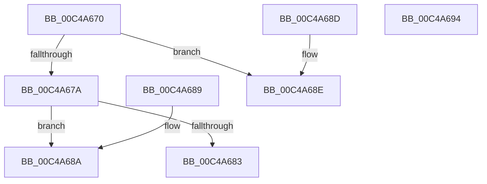

# SeMinTcbLowering

- RVA: `0x00C4A670`–`0x00C4A695` (길이 `37` bytes)
- VA: `0x0000000140C4A670`
- 실행 섹션: `INIT`
- PDB 이름 있음: `예`; PDB Function 태그: `아니요`
- unwind 정보 RVA: `0x000DB714`
- 디코드: `15`개 명령, `37/37` bytes 표시
- 미해석 바이트: `0` (있으면 어셈블리에 `.byte`로 보존)

> 이 문서는 커널 이미지의 기계어와 PDB 기호를 분석해 생성했습니다. 4번과 5번은 함수 원형과 자료형을 바이너리 사용 방식에서 추정한 C 해석이며 원본 소스 복구 결과는 아닙니다.

## 1. Dependencies

- 직접 호출 지점: **0**; 고유 호출 대상: **0**
- 직접 호출자로 확인된 함수: **1**
- RIP 상대 이미지 참조: **2**

### Outgoing calls
- 직접 디코드된 call 명령이 없습니다.

### Direct callers
- [sub_00BF16D0](../BF/Unknown_function_00BF16D0.md) at `0x00C07BDD`

### Static image references
- `0x00C4A670` → RVA `0x00E67D6C` (`.data`; read)
- `0x00C4A67A` → RVA `0x00E0AA1D` (`.data`; read)

## 2. Other-region calls and transfers

- 다른 실행 섹션으로 향하는 call: **0**
- 별도 외부 분기/꼬리 이동을 확인하지 못했습니다.

## 3. Assembly (complete function range)

```asm
00C4A670  8B 05 F6 D6 21 00               mov eax, dword ptr [rip + 0x21d6f6]
00C4A676  A8 04                           test al, 4
00C4A678  75 14                           jne 0x140c4a68e
00C4A67A  80 3D 9C 03 1C 00 00            cmp byte ptr [rip + 0x1c039c], 0
00C4A681  75 07                           jne 0x140c4a68a
00C4A683  D1 E8                           shr eax, 1
00C4A685  83 E0 01                        and eax, 1
00C4A688  C3                              ret
00C4A689  CC                              int3
00C4A68A  33 C0                           xor eax, eax
00C4A68C  C3                              ret
00C4A68D  CC                              int3
00C4A68E  B8 01 00 00 00                  mov eax, 1
00C4A693  C3                              ret
00C4A694  CC                              int3
```

## 4. C-style interpretation (structured pseudocode)

```c
__int64 __fastcall SeMinTcbLowering(void)
{
    __int64 result;

    if ((((unsigned __int8)((unsigned int)(*(unsigned int *)(v_rip + 2217718)))) & (4)) != 0) goto loc_00C4A68E;
    if ((*(unsigned __int8 *)(v_rip + 1835932)) != 0) goto loc_00C4A68A;
    result = (unsigned int)(((unsigned int)(*(unsigned int *)(v_rip + 2217718))) >> (1));
    result = (unsigned int)((result) & (1));
    return result;
loc_00C4A68A:
    result = 0;
    return result;
loc_00C4A68E:
    return 1;
}
```

## 5. (Beta) C Style

```c
void SeMinTcbLowering(void)
{
    int64_t result;

    if ((((uint8_t)((uint32_t)(*(uint32_t *)(v_rip + 0x21D6F6)))) & (4)) != 0) goto loc_00C4A68E;
    if ((*(uint8_t *)(v_rip + 0x1C039C)) != 0) goto loc_00C4A68A;
    result = (uint32_t)(((uint32_t)(*(uint32_t *)(v_rip + 0x21D6F6))) >> (1));
    result = (uint32_t)((result) & (1));
    return result;
loc_00C4A68A:
    result = 0;
    return result;
loc_00C4A68E:
    return 1;
}
```

## 6. Execution-region graph

[열기: 2D/3D 그래프와 함수 탐색 컨트롤 패널](../../../control-panel.html?section=init&rva=0x00C4A670&view=graph)

- 2D 그래프는 위에서 아래로 흐르고, 3D 그래프는 빈 공간을 드래그해 회전합니다. Shift+드래그는 이동, 휠은 확대·축소, 함수 노드 선택은 대상 보고서 이동입니다.

### Static fallback


