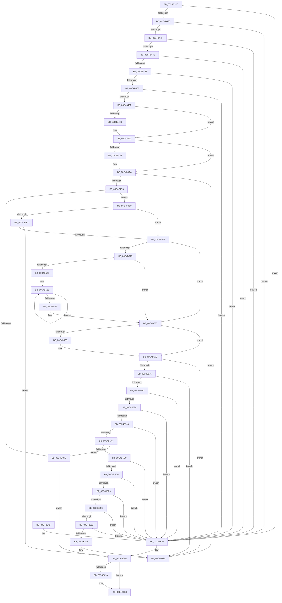

# SeSecureBootRegisterPolicy

- RVA: `0x00C4B3FC`–`0x00C4B681` (길이 `645` bytes)
- VA: `0x0000000140C4B3FC`
- 실행 섹션: `INIT`
- PDB 이름 있음: `예`; PDB Function 태그: `아니요`
- unwind 정보 RVA: `0x000D15C8`
- 디코드: `170`개 명령, `645/645` bytes 표시
- 미해석 바이트: `0` (있으면 어셈블리에 `.byte`로 보존)

> 이 문서는 커널 이미지의 기계어와 PDB 기호를 분석해 생성했습니다. 4번과 5번은 함수 원형과 자료형을 바이너리 사용 방식에서 추정한 C 해석이며 원본 소스 복구 결과는 아닙니다.

## 1. Dependencies

- 직접 호출 지점: **8**; 고유 호출 대상: **6**
- 직접 호출자로 확인된 함수: **1**
- RIP 상대 이미지 참조: **12**

### Outgoing calls
- `0x00C4B496` → [SepSecureBootSetRegistryKey](SepSecureBootSetRegistryKey_function_00C4B798.md) (function, `0x00C4B798`)
- `0x00C4B4A5` → [SepSecureBootCheckForUpdates](SepSecureBootCheckForUpdates_function_00C4B688.md) (function, `0x00C4B688`)
- `0x00C4B4C1` → [ExAllocatePool2](../../poolcode/B8/ExAllocatePool2_function_00B820F0.md) (function, `0x00B820F0`)
- `0x00C4B4E2` → [memcpy](../../text/6C/memcpy_function_006C6840.md) (function, `0x006C6840`)
- `0x00C4B5AF` → [ExAllocatePool2](../../poolcode/B8/ExAllocatePool2_function_00B820F0.md) (function, `0x00B820F0`)
- `0x00C4B5CD` → [memcpy](../../text/6C/memcpy_function_006C6840.md) (function, `0x006C6840`)
- `0x00C4B65C` → [ExFreePoolWithTag](../../poolcode/B8/ExFreePoolWithTag_function_00B82870.md) (function, `0x00B82870`)
- `0x00C4B67B` → [KeBugCheckEx](../../text/4F/KeBugCheckEx_function_004FD660.md) (function, `0x004FD660`)

### Direct callers
- [SeCodeIntegrityInitializePolicy](SeCodeIntegrityInitializePolicy_function_00C4A5CC.md) at `0x00C4A611`

### Static image references
- `0x00C4B474` → RVA `0x00E67E00` (`.data`; read)
- `0x00C4B480` → RVA `0x00E67E10` (`.data`; write)
- `0x00C4B49B` → RVA `0x00E67E04` (`.data`; read)
- `0x00C4B4E7` → RVA `0x00E67DF0` (`.data`; write)
- `0x00C4B508` → RVA `0x00E67DE0` (`.data`; write)
- `0x00C4B522` → RVA `0x00E67DD0` (`.data`; write)
- `0x00C4B535` → RVA `0x00E67DD8` (`.data`; read)
- `0x00C4B54F` → RVA `0x00E67DD8` (`.data`; write)
- `0x00C4B565` → RVA `0x00E67DE8` (`.data`; write)
- `0x00C4B61E` → RVA `0x00F04E18` (`.data`; write)
- `0x00C4B624` → RVA `0x00F04E20` (`.data`; write)
- `0x00C4B64E` → RVA `0x00E67DF0` (`.data`; read)

## 2. Other-region calls and transfers

- 다른 실행 섹션으로 향하는 call: **6**
  - `0x00C4B4C1` → [ExAllocatePool2](../../poolcode/B8/ExAllocatePool2_function_00B820F0.md) (`INIT` → `POOLCODE`)
  - `0x00C4B4E2` → [memcpy](../../text/6C/memcpy_function_006C6840.md) (`INIT` → `.text`)
  - `0x00C4B5AF` → [ExAllocatePool2](../../poolcode/B8/ExAllocatePool2_function_00B820F0.md) (`INIT` → `POOLCODE`)
  - `0x00C4B5CD` → [memcpy](../../text/6C/memcpy_function_006C6840.md) (`INIT` → `.text`)
  - `0x00C4B65C` → [ExFreePoolWithTag](../../poolcode/B8/ExFreePoolWithTag_function_00B82870.md) (`INIT` → `POOLCODE`)
  - `0x00C4B67B` → [KeBugCheckEx](../../text/4F/KeBugCheckEx_function_004FD660.md) (`INIT` → `.text`)
- 별도 외부 분기/꼬리 이동을 확인하지 못했습니다.

## 3. Assembly (complete function range)

```asm
00C4B3FC  48 8B C4                        mov rax, rsp
00C4B3FF  48 89 58 08                     mov qword ptr [rax + 8], rbx
00C4B403  48 89 68 10                     mov qword ptr [rax + 0x10], rbp
00C4B407  48 89 70 18                     mov qword ptr [rax + 0x18], rsi
00C4B40B  48 89 78 20                     mov qword ptr [rax + 0x20], rdi
00C4B40F  41 56                           push r14
00C4B411  48 83 EC 30                     sub rsp, 0x30
00C4B415  33 FF                           xor edi, edi
00C4B417  44 8B F2                        mov r14d, edx
00C4B41A  48 8B F1                        mov rsi, rcx
00C4B41D  83 FA 10                        cmp edx, 0x10
00C4B420  0F 82 23 02 00 00               jb 0x140c4b649
00C4B426  8B 51 08                        mov edx, dword ptr [rcx + 8]
00C4B429  44 8B C7                        mov r8d, edi
00C4B42C  8B 49 0C                        mov ecx, dword ptr [rcx + 0xc]
00C4B42F  8B C7                           mov eax, edi
00C4B431  85 C9                           test ecx, ecx
00C4B433  41 0F 94 C0                     sete r8b
00C4B437  85 D2                           test edx, edx
00C4B439  0F 94 C0                        sete al
00C4B43C  41 3B C0                        cmp eax, r8d
00C4B43F  0F 85 04 02 00 00               jne 0x140c4b649
00C4B445  41 3B D6                        cmp edx, r14d
00C4B448  0F 83 FB 01 00 00               jae 0x140c4b649
00C4B44E  41 3B CE                        cmp ecx, r14d
00C4B451  0F 83 F2 01 00 00               jae 0x140c4b649
00C4B457  8D 41 FF                        lea eax, [rcx - 1]
00C4B45A  83 F8 3E                        cmp eax, 0x3e
00C4B45D  0F 86 E6 01 00 00               jbe 0x140c4b649
00C4B463  8D 04 11                        lea eax, [rcx + rdx]
00C4B466  41 3B C6                        cmp eax, r14d
00C4B469  0F 87 DA 01 00 00               ja 0x140c4b649
00C4B46F  0F 10 06                        movups xmm0, xmmword ptr [rsi]
00C4B472  8B DF                           mov ebx, edi
00C4B474  0F 11 05 85 C9 21 00            movups xmmword ptr [rip + 0x21c985], xmm0
00C4B47B  F2 0F 10 4E 10                  movsd xmm1, qword ptr [rsi + 0x10]
00C4B480  F2 0F 11 0D 88 C9 21 00         movsd qword ptr [rip + 0x21c988], xmm1
00C4B488  39 7E 0C                        cmp dword ptr [rsi + 0xc], edi
00C4B48B  74 06                           je 0x140c4b493
00C4B48D  8B 5E 08                        mov ebx, dword ptr [rsi + 8]
00C4B490  48 03 DE                        add rbx, rsi
00C4B493  48 8B CB                        mov rcx, rbx
00C4B496  E8 FD 02 00 00                  call 0x140c4b798
00C4B49B  8B 05 63 C9 21 00               mov eax, dword ptr [rip + 0x21c963]
00C4B4A1  A8 08                           test al, 8
00C4B4A3  74 05                           je 0x140c4b4aa
00C4B4A5  E8 DE 01 00 00                  call 0x140c4b688
00C4B4AA  48 85 DB                        test rbx, rbx
00C4B4AD  0F 84 78 01 00 00               je 0x140c4b62b
00C4B4B3  8B 56 0C                        mov edx, dword ptr [rsi + 0xc]
00C4B4B6  B9 40 00 00 00                  mov ecx, 0x40
00C4B4BB  41 B8 53 65 53 62               mov r8d, 0x62536553
00C4B4C1  E8 2A 6C F3 FF                  call 0x140b820f0
00C4B4C6  48 8B E8                        mov rbp, rax
00C4B4C9  48 85 C0                        test rax, rax
00C4B4CC  75 0A                           jne 0x140c4b4d8
00C4B4CE  BB 9A 00 00 C0                  mov ebx, 0xc000009a
00C4B4D3  E9 76 01 00 00                  jmp 0x140c4b64e
00C4B4D8  44 8B 46 0C                     mov r8d, dword ptr [rsi + 0xc]
00C4B4DC  48 8B D3                        mov rdx, rbx
00C4B4DF  48 8B CD                        mov rcx, rbp
00C4B4E2  E8 59 B3 A7 FF                  call 0x1406c6840
00C4B4E7  48 89 2D 02 C9 21 00            mov qword ptr [rip + 0x21c902], rbp
00C4B4EE  66 39 7B 24                     cmp word ptr [rbx + 0x24], di
00C4B4F2  75 0A                           jne 0x140c4b4fe
00C4B4F4  66 39 7B 26                     cmp word ptr [rbx + 0x26], di
00C4B4F8  0F 84 2D 01 00 00               je 0x140c4b62b
00C4B4FE  8B 4D 34                        mov ecx, dword ptr [rbp + 0x34]
00C4B501  48 83 C1 3C                     add rcx, 0x3c
00C4B505  48 03 CD                        add rcx, rbp
00C4B508  48 89 0D D1 C8 21 00            mov qword ptr [rip + 0x21c8d1], rcx
00C4B50F  0F B7 4D 24                     movzx ecx, word ptr [rbp + 0x24]
00C4B513  66 85 C9                        test cx, cx
00C4B516  74 3D                           je 0x140c4b555
00C4B518  8B 55 28                        mov edx, dword ptr [rbp + 0x28]
00C4B51B  48 83 C2 3C                     add rdx, 0x3c
00C4B51F  48 03 D5                        add rdx, rbp
00C4B522  48 89 15 A7 C8 21 00            mov qword ptr [rip + 0x21c8a7], rdx
00C4B529  66 3B F9                        cmp di, cx
00C4B52C  73 27                           jae 0x140c4b555
00C4B52E  44 8B C1                        mov r8d, ecx
00C4B531  48 83 C2 04                     add rdx, 4
00C4B535  8B 0D 9D C8 21 00               mov ecx, dword ptr [rip + 0x21c89d]
00C4B53B  0F B6 42 03                     movzx eax, byte ptr [rdx + 3]
00C4B53F  48 8D 52 0C                     lea rdx, [rdx + 0xc]
00C4B543  83 E0 0F                        and eax, 0xf
00C4B546  0F AB C1                        bts ecx, eax
00C4B549  49 83 E8 01                     sub r8, 1
00C4B54D  75 EC                           jne 0x140c4b53b
00C4B54F  89 0D 83 C8 21 00               mov dword ptr [rip + 0x21c883], ecx
00C4B555  66 39 7D 26                     cmp word ptr [rbp + 0x26], di
00C4B559  74 11                           je 0x140c4b56c
00C4B55B  8B 4D 2C                        mov ecx, dword ptr [rbp + 0x2c]
00C4B55E  48 83 C1 3C                     add rcx, 0x3c
00C4B562  48 03 CD                        add rcx, rbp
00C4B565  48 89 0D 7C C8 21 00            mov qword ptr [rip + 0x21c87c], rcx
00C4B56C  83 3E 02                        cmp dword ptr [rsi], 2
00C4B56F  0F 82 B6 00 00 00               jb 0x140c4b62b
00C4B575  8B 56 14                        mov edx, dword ptr [rsi + 0x14]
00C4B578  85 D2                           test edx, edx
00C4B57A  0F 84 AB 00 00 00               je 0x140c4b62b
00C4B580  41 3B D6                        cmp edx, r14d
00C4B583  0F 83 C0 00 00 00               jae 0x140c4b649
00C4B589  44 8B 4E 10                     mov r9d, dword ptr [rsi + 0x10]
00C4B58D  45 3B CE                        cmp r9d, r14d
00C4B590  0F 83 B3 00 00 00               jae 0x140c4b649
00C4B596  41 8B C6                        mov eax, r14d
00C4B599  2B C2                           sub eax, edx
00C4B59B  44 3B C8                        cmp r9d, eax
00C4B59E  0F 87 A5 00 00 00               ja 0x140c4b649
00C4B5A4  B9 40 00 00 00                  mov ecx, 0x40
00C4B5A9  41 B8 53 65 53 62               mov r8d, 0x62536553
00C4B5AF  E8 3C 6B F3 FF                  call 0x140b820f0
00C4B5B4  48 8B D8                        mov rbx, rax
00C4B5B7  48 85 C0                        test rax, rax
00C4B5BA  0F 84 0E FF FF FF               je 0x140c4b4ce
00C4B5C0  8B 56 10                        mov edx, dword ptr [rsi + 0x10]
00C4B5C3  48 8B C8                        mov rcx, rax
00C4B5C6  44 8B 46 14                     mov r8d, dword ptr [rsi + 0x14]
00C4B5CA  48 03 D6                        add rdx, rsi
00C4B5CD  E8 6E B2 A7 FF                  call 0x1406c6840
00C4B5D2  8B 4E 14                        mov ecx, dword ptr [rsi + 0x14]
00C4B5D5  83 F9 18                        cmp ecx, 0x18
00C4B5D8  72 6F                           jb 0x140c4b649
00C4B5DA  8B 03                           mov eax, dword ptr [rbx]
00C4B5DC  48 8D 53 18                     lea rdx, [rbx + 0x18]
00C4B5E0  4C 69 C0 14 01 00 00            imul r8, rax, 0x114
00C4B5E7  83 C1 E8                        add ecx, -0x18
00C4B5EA  48 89 53 08                     mov qword ptr [rbx + 8], rdx
00C4B5EE  41 B9 FF FF FF FF               mov r9d, 0xffffffff
00C4B5F4  4D 3B C1                        cmp r8, r9
00C4B5F7  77 50                           ja 0x140c4b649
00C4B5F9  41 3B C8                        cmp ecx, r8d
00C4B5FC  72 4B                           jb 0x140c4b649
00C4B5FE  41 8B C0                        mov eax, r8d
00C4B601  41 2B C8                        sub ecx, r8d
00C4B604  48 03 D0                        add rdx, rax
00C4B607  8B 43 04                        mov eax, dword ptr [rbx + 4]
00C4B60A  48 C1 E0 05                     shl rax, 5
00C4B60E  49 3B C1                        cmp rax, r9
00C4B611  77 36                           ja 0x140c4b649
00C4B613  3B C8                           cmp ecx, eax
00C4B615  72 32                           jb 0x140c4b649
00C4B617  48 89 53 10                     mov qword ptr [rbx + 0x10], rdx
00C4B61B  8B 46 14                        mov eax, dword ptr [rsi + 0x14]
00C4B61E  89 05 F4 97 2B 00               mov dword ptr [rip + 0x2b97f4], eax
00C4B624  48 89 1D F5 97 2B 00            mov qword ptr [rip + 0x2b97f5], rbx
00C4B62B  48 8B 5C 24 40                  mov rbx, qword ptr [rsp + 0x40]
00C4B630  8B C7                           mov eax, edi
00C4B632  48 8B 7C 24 58                  mov rdi, qword ptr [rsp + 0x58]
00C4B637  48 8B 6C 24 48                  mov rbp, qword ptr [rsp + 0x48]
00C4B63C  48 8B 74 24 50                  mov rsi, qword ptr [rsp + 0x50]
00C4B641  48 83 C4 30                     add rsp, 0x30
00C4B645  41 5E                           pop r14
00C4B647  C3                              ret
00C4B648  CC                              int3
00C4B649  BB 03 00 43 C0                  mov ebx, 0xc0430003
00C4B64E  48 8B 0D 9B C7 21 00            mov rcx, qword ptr [rip + 0x21c79b]
00C4B655  48 85 C9                        test rcx, rcx
00C4B658  74 0E                           je 0x140c4b668
00C4B65A  33 D2                           xor edx, edx
00C4B65C  E8 0F 72 F3 FF                  call 0x140b82870
00C4B661  48 89 3D 88 C7 21 00            mov qword ptr [rip + 0x21c788], rdi
00C4B668  4D 8B CE                        mov r9, r14
00C4B66B  48 63 D3                        movsxd rdx, ebx
00C4B66E  4C 8B C6                        mov r8, rsi
00C4B671  48 89 7C 24 20                  mov qword ptr [rsp + 0x20], rdi
00C4B676  B9 45 01 00 00                  mov ecx, 0x145
00C4B67B  E8 E0 1F 8B FF                  call 0x1404fd660
00C4B680  CC                              int3
```

## 4. C-style interpretation (structured pseudocode)

```c
__int64 __fastcall SeSecureBootRegisterPolicy(__int64 a1, int a2)
{
    __int64 result;
    __int64 v_rbx;
    __int64 v_rdi;
    __int64 v_rsp;
    unsigned __int64 v_stack_p10;
    unsigned __int64 v_stack_p18;
    unsigned __int64 v_stack_p20;
    unsigned __int64 v_stack_p8;

    *(unsigned __int64 *)(v_rsp + 8) = v_rbx;
    *(unsigned __int64 *)(v_rsp + 16) = v_rbp;
    *(unsigned __int64 *)(v_rsp + 24) = v_rsi;
    *(unsigned __int64 *)(v_rsp + 32) = v_rdi;
    v_rsp = (v_rsp) - (48);
    v_rdi = 0;
    if (a2 < 16) goto loc_00C4B649;
    a3 = ((unsigned int)((unsigned int)(*(unsigned int *)(a1 + 12))) == 0) ? 1 : 0;
    result = ((unsigned int)((unsigned int)(*(unsigned int *)(a1 + 8))) == 0) ? 1 : 0;
    if (((unsigned int)(result)) != ((unsigned int)(a3))) goto loc_00C4B649;
    if (((unsigned int)((unsigned int)(*(unsigned int *)(a1 + 8)))) >= ((unsigned int)((unsigned int)(a2)))) goto loc_00C4B649;
    if (((unsigned int)((unsigned int)(*(unsigned int *)(a1 + 12)))) >= ((unsigned int)((unsigned int)(a2)))) goto loc_00C4B649;
    if (((unsigned int)((unsigned int)(*(unsigned int *)(a1 + 12)) - 1)) <= 62) goto loc_00C4B649;
    if (((unsigned int)((unsigned int)(*(unsigned int *)(a1 + 12)) + (unsigned int)(*(unsigned int *)(a1 + 8)) * 1)) > ((unsigned int)((unsigned int)(a2)))) goto loc_00C4B649;
    *(unsigned __int64 *)(v_rip + 2214277) = v_xmm0;
    *(unsigned __int64 *)(v_rip + 2214280) = v_xmm1;
    v_rbx = 0;
    if ((*(unsigned int *)(a1 + 12)) != 0) {
        v_rbx = *(unsigned int *)(a1 + 8);
        v_rbx = (v_rbx) + (a1);
    }
    result = SepSecureBootSetRegistryKey(v_rbx, (unsigned int)(*(unsigned int *)(a1 + 8)), a3, a4);
    result = (unsigned int)(*(unsigned int *)(v_rip + 2214243));
    if ((((unsigned __int8)((unsigned int)(*(unsigned int *)(v_rip + 2214243)))) & (8)) != 0) {
        result = SepSecureBootCheckForUpdates(v_rbx, (unsigned int)(*(unsigned int *)(a1 + 8)), a3, a4);
    }
    if (v_rbx == 0) goto loc_00C4B62B;
    result = ExAllocatePool2(64, (unsigned int)(*(unsigned int *)(a1 + 12)), (unsigned int)(0x62536553ULL), a4);
    if (result != 0) goto loc_00C4B4D8;
loc_00C4B4CE:
    goto loc_00C4B64E;
loc_00C4B4D8:
    result = memcpy(result, (unsigned int)(0xC000009AULL), (unsigned int)(*(unsigned int *)(a1 + 12)), a4);
    *(unsigned __int64 *)(v_rip + 2214146) = result;
    if ((*(unsigned __int16 *)((unsigned int)(0xC000009AULL) + 36)) != 0) goto loc_00C4B4FE;
    if ((*(unsigned __int16 *)((unsigned int)(0xC000009AULL) + 38)) == 0) goto loc_00C4B62B;
loc_00C4B4FE:
    a1 = ((unsigned int)(*(unsigned int *)(result + 52))) + (60);
    a1 = (a1) + (result);
    *(unsigned __int64 *)(v_rip + 2214097) = a1;
    if ((unsigned __int16)(*(unsigned __int16 *)(result + 36)) == 0) goto loc_00C4B555;
    a2 = ((unsigned int)(*(unsigned int *)(result + 40))) + (60);
    a2 = (a2) + (result);
    *(unsigned __int64 *)(v_rip + 2214055) = a2;
    if (0 >= ((unsigned __int16)(*(unsigned __int16 *)(result + 36)))) goto loc_00C4B555;
    a2 = (a2) + (4);
loc_00C4B53B:
    result = (unsigned int)((*(unsigned __int8 *)(a2 + 3)) & (15));
    a3 = ((unsigned int)((unsigned int)(*(unsigned __int16 *)(result + 36)))) - (1);
    if (condition_is_not_equal) goto loc_00C4B53B;
    *(unsigned int *)(v_rip + 2214019) = (unsigned int)((unsigned int)(*(unsigned int *)(v_rip + 2214045)));
loc_00C4B555:
    if ((*(unsigned __int16 *)(result + 38)) != 0) {
        a1 = *(unsigned int *)(result + 44);
        a1 = (a1) + (60);
        a1 = (a1) + (result);
        *(unsigned __int64 *)(v_rip + 2214012) = a1;
    }
    if ((*(unsigned int *)(a1)) < 2) goto loc_00C4B62B;
    if ((unsigned int)((unsigned int)(*(unsigned int *)(a1 + 20))) == 0) goto loc_00C4B62B;
    if (((unsigned int)((unsigned int)(*(unsigned int *)(a1 + 20)))) >= ((unsigned int)((unsigned int)(a2)))) goto loc_00C4B649;
    if (((unsigned int)((unsigned int)(*(unsigned int *)(a1 + 16)))) >= ((unsigned int)((unsigned int)(a2)))) goto loc_00C4B649;
    result = (unsigned int)(((unsigned int)((unsigned int)((unsigned int)(a2)))) - ((unsigned int)((unsigned int)(*(unsigned int *)(a1 + 20)))));
    if (((unsigned int)((unsigned int)(*(unsigned int *)(a1 + 16)))) > ((unsigned int)(result))) goto loc_00C4B649;
    result = ExAllocatePool2(64, (unsigned int)(*(unsigned int *)(a1 + 20)), (unsigned int)(0x62536553ULL), (unsigned int)(*(unsigned int *)(a1 + 16)));
    if (result == 0) goto loc_00C4B4CE;
    a2 = ((unsigned int)(*(unsigned int *)(a1 + 16))) + (a1);
    result = memcpy(result, a2, (unsigned int)(*(unsigned int *)(a1 + 20)), (unsigned int)(*(unsigned int *)(a1 + 16)));
    if (((unsigned int)((unsigned int)(*(unsigned int *)(a1 + 20)))) < 24) goto loc_00C4B649;
    a3 = ((unsigned int)(*(unsigned int *)(a1 + 20))) * ((unsigned int)(*(unsigned int *)(result)));
    a1 = (unsigned int)(((unsigned int)(*(unsigned int *)(a1 + 20))) + (-24));
    *(unsigned __int64 *)(result + 8) = result + 24;
    if (a3 > ((unsigned int)(0xFFFFFFFFULL))) goto loc_00C4B649;
    if (((unsigned int)(a1)) < ((unsigned int)(a3))) goto loc_00C4B649;
    a1 = (unsigned int)((a1) - ((unsigned int)(a3)));
    a2 = (result + 24) + ((unsigned int)((unsigned int)(a3)));
    result = ((unsigned int)(*(unsigned int *)(result + 4))) << (5);
    if (result > ((unsigned int)(0xFFFFFFFFULL))) goto loc_00C4B649;
    if (((unsigned int)(a1)) < ((unsigned int)(result))) goto loc_00C4B649;
    *(unsigned __int64 *)(result + 16) = a2;
    *(unsigned int *)(v_rip + 2856948) = (unsigned int)((unsigned int)(*(unsigned int *)(a1 + 20)));
    *(unsigned __int64 *)(v_rip + 2856949) = result;
loc_00C4B62B:
    v_rsp = (v_rsp) + (48);
    return 0;
loc_00C4B649:
loc_00C4B64E:
    result = 0;
    if (*(unsigned __int64 *)(v_rip + 2213787) != 0) {
        a2 = 0;
        result = ExFreePoolWithTag(*(unsigned __int64 *)(v_rip + 2213787), a2, a3, (unsigned int)(0xFFFFFFFFULL));
        *(unsigned __int64 *)(v_rip + 2213768) = v_stack_p20;
    }
    v_stack_p20 = v_stack_p20;
    result = KeBugCheckEx(325, (int)((unsigned int)((unsigned int)(0xC0430003ULL))), v_stack_p18, (unsigned int)(a2));
    return result;
}
```

## 5. (Beta) C Style

```c
int64_t SeSecureBootRegisterPolicy(void *Arg1, int32_t Arg2)
{
    uint8_t *arg1 = (uint8_t *)Arg1;

    int64_t result;
    int64_t local_rbx;
    int64_t local_rdi;
    int64_t local_rsp;
    uint64_t v_stack_p10;
    uint64_t v_stack_p18;
    uint64_t v_stack_p20;
    uint64_t v_stack_p8;

    *(uint64_t *)(local_rsp + 0x8) = local_rbx;
    *(uint64_t *)(local_rsp + 0x10) = local_rbp;
    *(uint64_t *)(local_rsp + 0x18) = local_rsi;
    *(uint64_t *)(local_rsp + 0x20) = local_rdi;
    local_rsp = (local_rsp) - (48);
    local_rdi = 0;
    if (Arg2 < 16) goto loc_00C4B649;
    a3 = ((uint32_t)((uint32_t)(*(uint32_t *)(arg1 + 0xC))) == 0) ? 1 : 0;
    result = ((uint32_t)((uint32_t)(*(uint32_t *)(arg1 + 0x8))) == 0) ? 1 : 0;
    if (((uint32_t)(result)) != ((uint32_t)(a3))) goto loc_00C4B649;
    if (((uint32_t)((uint32_t)(*(uint32_t *)(arg1 + 0x8)))) >= ((uint32_t)((uint32_t)(Arg2)))) goto loc_00C4B649;
    if (((uint32_t)((uint32_t)(*(uint32_t *)(arg1 + 0xC)))) >= ((uint32_t)((uint32_t)(Arg2)))) goto loc_00C4B649;
    if (((uint32_t)((uint32_t)(*(uint32_t *)(arg1 + 0xC)) - 1)) <= 62) goto loc_00C4B649;
    if (((uint32_t)((uint32_t)(*(uint32_t *)(arg1 + 0xC)) + (uint32_t)(*(uint32_t *)(arg1 + 0x8)) * 1)) > ((uint32_t)((uint32_t)(Arg2)))) goto loc_00C4B649;
    *(uint64_t *)(v_rip + 0x21C985) = v_xmm0;
    *(uint64_t *)(v_rip + 0x21C988) = v_xmm1;
    local_rbx = 0;
    if ((*(uint32_t *)(arg1 + 0xC)) != 0) {
        local_rbx = *(uint32_t *)(arg1 + 0x8);
        local_rbx = (local_rbx) + (Arg1);
    }
    result = SepSecureBootSetRegistryKey(local_rbx, (uint32_t)(*(uint32_t *)(arg1 + 0x8)), a3, a4);
    result = (uint32_t)(*(uint32_t *)(v_rip + 0x21C963));
    if ((((uint8_t)((uint32_t)(*(uint32_t *)(v_rip + 0x21C963)))) & (8)) != 0) {
        result = SepSecureBootCheckForUpdates(local_rbx, (uint32_t)(*(uint32_t *)(arg1 + 0x8)), a3, a4);
    }
    if (local_rbx == 0) goto loc_00C4B62B;
    result = ExAllocatePool2(64, (uint32_t)(*(uint32_t *)(arg1 + 0xC)), (uint32_t)(0x62536553ULL), a4);
    if (result != 0) goto loc_00C4B4D8;
loc_00C4B4CE:
    goto loc_00C4B64E;
loc_00C4B4D8:
    result = memcpy(result, (uint32_t)(0xC000009AULL), (uint32_t)(*(uint32_t *)(arg1 + 0xC)), a4);
    *(uint64_t *)(v_rip + 0x21C902) = result;
    if ((*(uint16_t *)((uint32_t)(0xC000009AULL) + 0x24)) != 0) goto loc_00C4B4FE;
    if ((*(uint16_t *)((uint32_t)(0xC000009AULL) + 0x26)) == 0) goto loc_00C4B62B;
loc_00C4B4FE:
    Arg1 = ((uint32_t)(*(uint32_t *)(result + 0x34))) + (60);
    Arg1 = (Arg1) + (result);
    *(void **)(v_rip + 0x21C8D1) = Arg1;
    if ((uint16_t)(*(uint16_t *)(result + 0x24)) == 0) goto loc_00C4B555;
    Arg2 = ((uint32_t)(*(uint32_t *)(result + 0x28))) + (60);
    Arg2 = (Arg2) + (result);
    *(uint64_t *)(v_rip + 0x21C8A7) = Arg2;
    if (0 >= ((uint16_t)(*(uint16_t *)(result + 0x24)))) goto loc_00C4B555;
    Arg2 = (Arg2) + (4);
loc_00C4B53B:
    result = (uint32_t)((*(uint8_t *)(Arg2 + 0x3)) & (15));
    a3 = ((uint32_t)((uint32_t)(*(uint16_t *)(result + 0x24)))) - (1);
    if (condition_is_not_equal) goto loc_00C4B53B;
    *(uint32_t *)(v_rip + 0x21C883) = (uint32_t)((uint32_t)(*(uint32_t *)(v_rip + 0x21C89D)));
loc_00C4B555:
    if ((*(uint16_t *)(result + 0x26)) != 0) {
        Arg1 = *(uint32_t *)(result + 0x2C);
        Arg1 = (Arg1) + (60);
        Arg1 = (Arg1) + (result);
        *(void **)(v_rip + 0x21C87C) = Arg1;
    }
    if ((*(uint32_t *)(arg1)) < 2) goto loc_00C4B62B;
    if ((uint32_t)((uint32_t)(*(uint32_t *)(arg1 + 0x14))) == 0) goto loc_00C4B62B;
    if (((uint32_t)((uint32_t)(*(uint32_t *)(arg1 + 0x14)))) >= ((uint32_t)((uint32_t)(Arg2)))) goto loc_00C4B649;
    if (((uint32_t)((uint32_t)(*(uint32_t *)(arg1 + 0x10)))) >= ((uint32_t)((uint32_t)(Arg2)))) goto loc_00C4B649;
    result = (uint32_t)(((uint32_t)((uint32_t)((uint32_t)(Arg2)))) - ((uint32_t)((uint32_t)(*(uint32_t *)(arg1 + 0x14)))));
    if (((uint32_t)((uint32_t)(*(uint32_t *)(arg1 + 0x10)))) > ((uint32_t)(result))) goto loc_00C4B649;
    result = ExAllocatePool2(64, (uint32_t)(*(uint32_t *)(arg1 + 0x14)), (uint32_t)(0x62536553ULL), (uint32_t)(*(uint32_t *)(arg1 + 0x10)));
    if (result == 0) goto loc_00C4B4CE;
    Arg2 = ((uint32_t)(*(uint32_t *)(arg1 + 0x10))) + (Arg1);
    result = memcpy(result, Arg2, (uint32_t)(*(uint32_t *)(arg1 + 0x14)), (uint32_t)(*(uint32_t *)(arg1 + 0x10)));
    if (((uint32_t)((uint32_t)(*(uint32_t *)(arg1 + 0x14)))) < 24) goto loc_00C4B649;
    a3 = ((uint32_t)(*(uint32_t *)(arg1 + 0x14))) * ((uint32_t)(*(uint32_t *)(result)));
    Arg1 = (uint32_t)(((uint32_t)(*(uint32_t *)(arg1 + 0x14))) + (-24));
    *(uint64_t *)(result + 0x8) = result + 24;
    if (a3 > ((uint32_t)(0xFFFFFFFFULL))) goto loc_00C4B649;
    if (((uint32_t)(Arg1)) < ((uint32_t)(a3))) goto loc_00C4B649;
    Arg1 = (uint32_t)((Arg1) - ((uint32_t)(a3)));
    Arg2 = (result + 24) + ((uint32_t)((uint32_t)(a3)));
    result = ((uint32_t)(*(uint32_t *)(result + 0x4))) << (5);
    if (result > ((uint32_t)(0xFFFFFFFFULL))) goto loc_00C4B649;
    if (((uint32_t)(Arg1)) < ((uint32_t)(result))) goto loc_00C4B649;
    *(uint64_t *)(result + 0x10) = Arg2;
    *(uint32_t *)(v_rip + 0x2B97F4) = (uint32_t)((uint32_t)(*(uint32_t *)(arg1 + 0x14)));
    *(uint64_t *)(v_rip + 0x2B97F5) = result;
loc_00C4B62B:
    local_rsp = (local_rsp) + (48);
    return 0;
loc_00C4B649:
loc_00C4B64E:
    result = 0;
    if (*(uint64_t *)(v_rip + 0x21C79B) != 0) {
        Arg2 = 0;
        result = ExFreePoolWithTag(*(uint64_t *)(v_rip + 0x21C79B), Arg2, a3, (uint32_t)(0xFFFFFFFFULL));
        *(uint64_t *)(v_rip + 0x21C788) = v_stack_p20;
    }
    v_stack_p20 = v_stack_p20;
    result = KeBugCheckEx(325, (int32_t)((uint32_t)((uint32_t)(0xC0430003ULL))), v_stack_p18, (uint32_t)(Arg2));
    return result;
}
```

### 관측된 메모리 오프셋

구조체 형식이 확인되지 않은 접근은 인자 기준의 오프셋으로만 기록했습니다.

| 기준 인자 | 오프셋 표현 | 폭 (bit) | 접근 |
|---|---:|---:|---|
| `Arg1` | `+ 0x0` | `32` | `R` |
| `Arg1` | `+ 0x0` | `128` | `R` |
| `Arg1` | `+ 0x8` | `32` | `R` |
| `Arg1` | `+ 0xC` | `32` | `R` |
| `Arg1` | `+ 0x10` | `32` | `R` |
| `Arg1` | `+ 0x10` | `64` | `R` |
| `Arg1` | `+ 0x14` | `32` | `R` |

## 6. Execution-region graph

[열기: 2D/3D 그래프와 함수 탐색 컨트롤 패널](../../../control-panel.html?section=init&rva=0x00C4B3FC&view=graph)

- 2D 그래프는 위에서 아래로 흐르고, 3D 그래프는 빈 공간을 드래그해 회전합니다. Shift+드래그는 이동, 휠은 확대·축소, 함수 노드 선택은 대상 보고서 이동입니다.

### Static fallback


