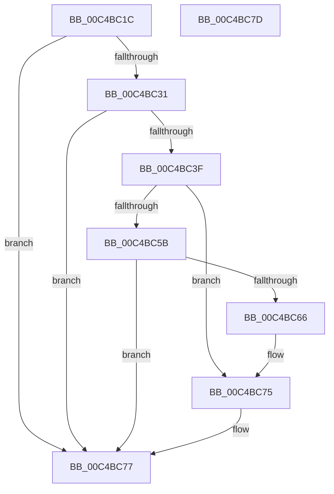

# SepAdtInitializeAuditingOptions

- RVA: `0x00C4BC1C`–`0x00C4BC7E` (길이 `98` bytes)
- VA: `0x0000000140C4BC1C`
- 실행 섹션: `INIT`
- PDB 이름 있음: `예`; PDB Function 태그: `아니요`
- unwind 정보 RVA: `0x0005CF00`
- 디코드: `30`개 명령, `98/98` bytes 표시
- 미해석 바이트: `0` (있으면 어셈블리에 `.byte`로 보존)

> 이 문서는 커널 이미지의 기계어와 PDB 기호를 분석해 생성했습니다. 4번과 5번은 함수 원형과 자료형을 바이너리 사용 방식에서 추정한 C 해석이며 원본 소스 복구 결과는 아닙니다.

## 1. Dependencies

- 직접 호출 지점: **8**; 고유 호출 대상: **8**
- 직접 호출자로 확인된 함수: **1**
- RIP 상대 이미지 참조: **0**

### Outgoing calls
- `0x00C4BC28` → [AdtpInitializeAuditingCommon](../../page/82/AdtpInitializeAuditingCommon_function_00823018.md) (function, `0x00823018`)
- `0x00C4BC36` → [SepAdtOpenEtwReadyEvent](../../page/AC/SepAdtOpenEtwReadyEvent_function_00AC403C.md) (function, `0x00AC403C`)
- `0x00C4BC46` → [NtSetEvent](../../page/99/NtSetEvent_function_0099C550.md) (function, `0x0099C550`)
- `0x00C4BC52` → [NtClose](../../page/86/NtClose_function_00868870.md) (function, `0x00868870`)
- `0x00C4BC5B` → [SepAdtOpenRegAndSetupNotification](../../page/7A/SepAdtOpenRegAndSetupNotification_function_007A4A80.md) (function, `0x007A4A80`)
- `0x00C4BC66` → [SepAdtInitializeCrashOnFail](../../page/7A/SepAdtInitializeCrashOnFail_function_007A49C0.md) (function, `0x007A49C0`)
- `0x00C4BC6B` → [SepAdtInitializePrivilegeAuditing](../../page/7A/SepAdtInitializePrivilegeAuditing_function_007A4A20.md) (function, `0x007A4A20`)
- `0x00C4BC70` → [SepAdtInitializeBounds](../../page/7A/SepAdtInitializeBounds_function_007A493C.md) (function, `0x007A493C`)

### Direct callers
- [SeRmInitPhase1](../C7/SeRmInitPhase1_function_00C70B2C.md) at `0x00C70BAD`

### Static image references
- 디코드된 RIP-relative 메모리 참조가 없습니다.

## 2. Other-region calls and transfers

- 다른 실행 섹션으로 향하는 call: **8**
  - `0x00C4BC28` → [AdtpInitializeAuditingCommon](../../page/82/AdtpInitializeAuditingCommon_function_00823018.md) (`INIT` → `PAGE`)
  - `0x00C4BC36` → [SepAdtOpenEtwReadyEvent](../../page/AC/SepAdtOpenEtwReadyEvent_function_00AC403C.md) (`INIT` → `PAGE`)
  - `0x00C4BC46` → [NtSetEvent](../../page/99/NtSetEvent_function_0099C550.md) (`INIT` → `PAGE`)
  - `0x00C4BC52` → [NtClose](../../page/86/NtClose_function_00868870.md) (`INIT` → `PAGE`)
  - `0x00C4BC5B` → [SepAdtOpenRegAndSetupNotification](../../page/7A/SepAdtOpenRegAndSetupNotification_function_007A4A80.md) (`INIT` → `PAGE`)
  - `0x00C4BC66` → [SepAdtInitializeCrashOnFail](../../page/7A/SepAdtInitializeCrashOnFail_function_007A49C0.md) (`INIT` → `PAGE`)
  - `0x00C4BC6B` → [SepAdtInitializePrivilegeAuditing](../../page/7A/SepAdtInitializePrivilegeAuditing_function_007A4A20.md) (`INIT` → `PAGE`)
  - `0x00C4BC70` → [SepAdtInitializeBounds](../../page/7A/SepAdtInitializeBounds_function_007A493C.md) (`INIT` → `PAGE`)
- 별도 외부 분기/꼬리 이동을 확인하지 못했습니다.

## 3. Assembly (complete function range)

```asm
00C4BC1C  40 53                           push rbx
00C4BC1E  48 83 EC 20                     sub rsp, 0x20
00C4BC22  48 83 64 24 30 00               and qword ptr [rsp + 0x30], 0
00C4BC28  E8 EB 73 BD FF                  call 0x140823018
00C4BC2D  85 C0                           test eax, eax
00C4BC2F  78 46                           js 0x140c4bc77
00C4BC31  48 8D 4C 24 30                  lea rcx, [rsp + 0x30]
00C4BC36  E8 01 84 E7 FF                  call 0x140ac403c
00C4BC3B  85 C0                           test eax, eax
00C4BC3D  78 38                           js 0x140c4bc77
00C4BC3F  48 8B 4C 24 30                  mov rcx, qword ptr [rsp + 0x30]
00C4BC44  33 D2                           xor edx, edx
00C4BC46  E8 05 09 D5 FF                  call 0x14099c550
00C4BC4B  48 8B 4C 24 30                  mov rcx, qword ptr [rsp + 0x30]
00C4BC50  8B D8                           mov ebx, eax
00C4BC52  E8 19 CC C1 FF                  call 0x140868870
00C4BC57  85 DB                           test ebx, ebx
00C4BC59  78 1A                           js 0x140c4bc75
00C4BC5B  E8 20 8E B5 FF                  call 0x1407a4a80
00C4BC60  8B D8                           mov ebx, eax
00C4BC62  85 C0                           test eax, eax
00C4BC64  78 11                           js 0x140c4bc77
00C4BC66  E8 55 8D B5 FF                  call 0x1407a49c0
00C4BC6B  E8 B0 8D B5 FF                  call 0x1407a4a20
00C4BC70  E8 C7 8C B5 FF                  call 0x1407a493c
00C4BC75  8B C3                           mov eax, ebx
00C4BC77  48 83 C4 20                     add rsp, 0x20
00C4BC7B  5B                              pop rbx
00C4BC7C  C3                              ret
00C4BC7D  CC                              int3
```

## 4. C-style interpretation (structured pseudocode)

```c
__int64 __fastcall SepAdtInitializeAuditingOptions(__int64 a1, int a2)
{
    __int64 result;
    __int64 v_rsp;
    unsigned __int64 v_stack_p8;

    v_rsp = (v_rsp) - (32);
    result = AdtpInitializeAuditingCommon(a1, a2, a3, a4);
    if (sign_flag) goto loc_00C4BC77;
    result = SepAdtOpenEtwReadyEvent(v_stack_p8, a2, a3, a4);
    if (sign_flag) goto loc_00C4BC77;
    a2 = 0;
    result = NtSetEvent(v_stack_p8, a2, a3, a4);
    result = NtClose(v_stack_p8, a2, a3, a4);
    if (sign_flag) goto loc_00C4BC75;
    result = SepAdtOpenRegAndSetupNotification(v_stack_p8, a2, a3, a4);
    if (sign_flag) goto loc_00C4BC77;
    result = SepAdtInitializeCrashOnFail(v_stack_p8, a2, a3, a4);
    result = SepAdtInitializePrivilegeAuditing(v_stack_p8, a2, a3, a4);
    result = SepAdtInitializeBounds(v_stack_p8, a2, a3, a4);
loc_00C4BC75:
loc_00C4BC77:
    v_rsp = (v_rsp) + (32);
    return (unsigned int)((unsigned int)((unsigned int)((unsigned int)(result))));
}
```

## 5. (Beta) C Style

```c
int64_t SepAdtInitializeAuditingOptions(int64_t Arg1, int32_t Arg2)
{
    int64_t result;
    int64_t local_rsp;
    uint64_t v_stack_p8;

    local_rsp = (local_rsp) - (32);
    result = AdtpInitializeAuditingCommon(Arg1, Arg2, a3, a4);
    if (sign_flag) goto loc_00C4BC77;
    result = SepAdtOpenEtwReadyEvent(v_stack_p8, Arg2, a3, a4);
    if (sign_flag) goto loc_00C4BC77;
    Arg2 = 0;
    result = NtSetEvent(v_stack_p8, Arg2, a3, a4);
    result = NtClose(v_stack_p8, Arg2, a3, a4);
    if (sign_flag) goto loc_00C4BC75;
    result = SepAdtOpenRegAndSetupNotification(v_stack_p8, Arg2, a3, a4);
    if (sign_flag) goto loc_00C4BC77;
    result = SepAdtInitializeCrashOnFail(v_stack_p8, Arg2, a3, a4);
    result = SepAdtInitializePrivilegeAuditing(v_stack_p8, Arg2, a3, a4);
    result = SepAdtInitializeBounds(v_stack_p8, Arg2, a3, a4);
loc_00C4BC75:
loc_00C4BC77:
    local_rsp = (local_rsp) + (32);
    return (uint32_t)((uint32_t)((uint32_t)((uint32_t)(result))));
}
```

## 6. Execution-region graph

[열기: 2D/3D 그래프와 함수 탐색 컨트롤 패널](../../../control-panel.html?section=init&rva=0x00C4BC1C&view=graph)

- 2D 그래프는 위에서 아래로 흐르고, 3D 그래프는 빈 공간을 드래그해 회전합니다. Shift+드래그는 이동, 휠은 확대·축소, 함수 노드 선택은 대상 보고서 이동입니다.

### Static fallback


