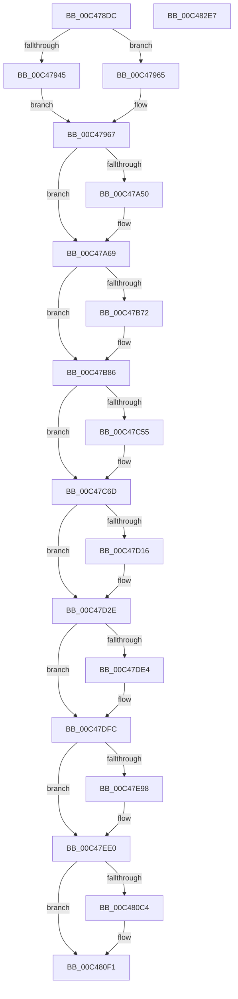

# SepInitSystemDacls

- RVA: `0x00C478DC`–`0x00C482E8` (길이 `2,572` bytes)
- VA: `0x0000000140C478DC`
- 실행 섹션: `INIT`
- PDB 이름 있음: `예`; PDB Function 태그: `아니요`
- unwind 정보 RVA: `0x0008C2BC`
- 디코드: `563`개 명령, `2,572/2,572` bytes 표시
- 미해석 바이트: `0` (있으면 어셈블리에 `.byte`로 보존)

> 이 문서는 커널 이미지의 기계어와 PDB 기호를 분석해 생성했습니다. 4번과 5번은 함수 원형과 자료형을 바이너리 사용 방식에서 추정한 C 해석이며 원본 소스 복구 결과는 아닙니다.

## 1. Dependencies

- 직접 호출 지점: **102**; 고유 호출 대상: **10**
- 직접 호출자로 확인된 함수: **1**
- RIP 상대 이미지 참조: **58**

### Outgoing calls
- `0x00C4793C` → [Feature_AppContainerVolumeDeviceAccess__private_IsEnabledDeviceUsageNoInline](../../text/59/Feature_AppContainerVolumeDeviceAccess__private_IsEnabledDeviceUsageNoInline_function_0059788C.md) (function, `0x0059788C`)
- `0x00C47A1F` → [ExAllocatePool2](../../poolcode/B8/ExAllocatePool2_function_00B820F0.md) (function, `0x00B820F0`)
- `0x00C47A3B` → [ExAllocatePool2](../../poolcode/B8/ExAllocatePool2_function_00B820F0.md) (function, `0x00B820F0`)
- `0x00C47A47` → [Feature_AppContainerVolumeDeviceAccess__private_IsEnabledDeviceUsageNoInline](../../text/59/Feature_AppContainerVolumeDeviceAccess__private_IsEnabledDeviceUsageNoInline_function_0059788C.md) (function, `0x0059788C`)
- `0x00C47A5D` → [ExAllocatePool2](../../poolcode/B8/ExAllocatePool2_function_00B820F0.md) (function, `0x00B820F0`)
- `0x00C47A76` → [ExAllocatePool2](../../poolcode/B8/ExAllocatePool2_function_00B820F0.md) (function, `0x00B820F0`)
- `0x00C47A90` → [ExAllocatePool2](../../poolcode/B8/ExAllocatePool2_function_00B820F0.md) (function, `0x00B820F0`)
- `0x00C47AA9` → [ExAllocatePool2](../../poolcode/B8/ExAllocatePool2_function_00B820F0.md) (function, `0x00B820F0`)
- `0x00C47AC3` → [ExAllocatePool2](../../poolcode/B8/ExAllocatePool2_function_00B820F0.md) (function, `0x00B820F0`)
- `0x00C47ADD` → [ExAllocatePool2](../../poolcode/B8/ExAllocatePool2_function_00B820F0.md) (function, `0x00B820F0`)
- `0x00C47AFA` → [ExAllocatePool2](../../poolcode/B8/ExAllocatePool2_function_00B820F0.md) (function, `0x00B820F0`)
- `0x00C47B11` → [ExAllocatePool2](../../poolcode/B8/ExAllocatePool2_function_00B820F0.md) (function, `0x00B820F0`)
- `0x00C47B30` → [ExAllocatePool2](../../poolcode/B8/ExAllocatePool2_function_00B820F0.md) (function, `0x00B820F0`)
- `0x00C47B3C` → [Feature_AppContainerVolumeDeviceAccess__private_IsEnabledDeviceUsageNoInline](../../text/59/Feature_AppContainerVolumeDeviceAccess__private_IsEnabledDeviceUsageNoInline_function_0059788C.md) (function, `0x0059788C`)
- `0x00C47B50` → [RtlCreateAcl](../../page/91/RtlCreateAcl_function_00916F00.md) (function, `0x00916F00`)
- `0x00C47B64` → [RtlCreateAcl](../../page/91/RtlCreateAcl_function_00916F00.md) (function, `0x00916F00`)
- `0x00C47B69` → [Feature_AppContainerVolumeDeviceAccess__private_IsEnabledDeviceUsageNoInline](../../text/59/Feature_AppContainerVolumeDeviceAccess__private_IsEnabledDeviceUsageNoInline_function_0059788C.md) (function, `0x0059788C`)
- `0x00C47B81` → [RtlCreateAcl](../../page/91/RtlCreateAcl_function_00916F00.md) (function, `0x00916F00`)
- `0x00C47B97` → [RtlCreateAcl](../../page/91/RtlCreateAcl_function_00916F00.md) (function, `0x00916F00`)
- `0x00C47BA8` → [RtlCreateAcl](../../page/91/RtlCreateAcl_function_00916F00.md) (function, `0x00916F00`)
- `0x00C47BB9` → [RtlCreateAcl](../../page/91/RtlCreateAcl_function_00916F00.md) (function, `0x00916F00`)
- `0x00C47BCB` → [RtlCreateAcl](../../page/91/RtlCreateAcl_function_00916F00.md) (function, `0x00916F00`)
- `0x00C47BDC` → [RtlCreateAcl](../../page/91/RtlCreateAcl_function_00916F00.md) (function, `0x00916F00`)
- `0x00C47BEE` → [RtlCreateAcl](../../page/91/RtlCreateAcl_function_00916F00.md) (function, `0x00916F00`)
- `0x00C47C00` → [RtlCreateAcl](../../page/91/RtlCreateAcl_function_00916F00.md) (function, `0x00916F00`)
- `0x00C47C12` → [RtlCreateAcl](../../page/91/RtlCreateAcl_function_00916F00.md) (function, `0x00916F00`)
- `0x00C47C2F` → [RtlAddAccessAllowedAce](../../page/92/RtlAddAccessAllowedAce_function_009298C0.md) (function, `0x009298C0`)
- `0x00C47C47` → [RtlAddAccessAllowedAce](../../page/92/RtlAddAccessAllowedAce_function_009298C0.md) (function, `0x009298C0`)
- `0x00C47C4C` → [Feature_AppContainerVolumeDeviceAccess__private_IsEnabledDeviceUsageNoInline](../../text/59/Feature_AppContainerVolumeDeviceAccess__private_IsEnabledDeviceUsageNoInline_function_0059788C.md) (function, `0x0059788C`)
- `0x00C47C68` → [RtlAddAccessAllowedAce](../../page/92/RtlAddAccessAllowedAce_function_009298C0.md) (function, `0x009298C0`)
- `0x00C47C85` → [RtlAddAccessAllowedAce](../../page/92/RtlAddAccessAllowedAce_function_009298C0.md) (function, `0x009298C0`)
- `0x00C47C9D` → [RtlAddAccessAllowedAce](../../page/92/RtlAddAccessAllowedAce_function_009298C0.md) (function, `0x009298C0`)
- `0x00C47CB5` → [RtlAddAccessAllowedAce](../../page/92/RtlAddAccessAllowedAce_function_009298C0.md) (function, `0x009298C0`)
- `0x00C47CD3` → [RtlAddAccessAllowedAce](../../page/92/RtlAddAccessAllowedAce_function_009298C0.md) (function, `0x009298C0`)
- `0x00C47CF0` → [RtlAddAccessAllowedAce](../../page/92/RtlAddAccessAllowedAce_function_009298C0.md) (function, `0x009298C0`)
- `0x00C47D08` → [RtlAddAccessAllowedAce](../../page/92/RtlAddAccessAllowedAce_function_009298C0.md) (function, `0x009298C0`)
- `0x00C47D0D` → [Feature_AppContainerVolumeDeviceAccess__private_IsEnabledDeviceUsageNoInline](../../text/59/Feature_AppContainerVolumeDeviceAccess__private_IsEnabledDeviceUsageNoInline_function_0059788C.md) (function, `0x0059788C`)
- `0x00C47D29` → [RtlAddAccessAllowedAce](../../page/92/RtlAddAccessAllowedAce_function_009298C0.md) (function, `0x009298C0`)
- `0x00C47D41` → [RtlAddAccessAllowedAce](../../page/92/RtlAddAccessAllowedAce_function_009298C0.md) (function, `0x009298C0`)
- `0x00C47D59` → [RtlAddAccessAllowedAce](../../page/92/RtlAddAccessAllowedAce_function_009298C0.md) (function, `0x009298C0`)
- `0x00C47D71` → [RtlAddAccessAllowedAce](../../page/92/RtlAddAccessAllowedAce_function_009298C0.md) (function, `0x009298C0`)
- `0x00C47D89` → [RtlAddAccessAllowedAce](../../page/92/RtlAddAccessAllowedAce_function_009298C0.md) (function, `0x009298C0`)
- `0x00C47DA6` → [RtlAddAccessAllowedAce](../../page/92/RtlAddAccessAllowedAce_function_009298C0.md) (function, `0x009298C0`)
- `0x00C47DBE` → [RtlAddAccessAllowedAce](../../page/92/RtlAddAccessAllowedAce_function_009298C0.md) (function, `0x009298C0`)
- `0x00C47DD6` → [RtlAddAccessAllowedAce](../../page/92/RtlAddAccessAllowedAce_function_009298C0.md) (function, `0x009298C0`)
- `0x00C47DDB` → [Feature_AppContainerVolumeDeviceAccess__private_IsEnabledDeviceUsageNoInline](../../text/59/Feature_AppContainerVolumeDeviceAccess__private_IsEnabledDeviceUsageNoInline_function_0059788C.md) (function, `0x0059788C`)
- `0x00C47DF7` → [RtlAddAccessAllowedAce](../../page/92/RtlAddAccessAllowedAce_function_009298C0.md) (function, `0x009298C0`)
- `0x00C47E0F` → [RtlAddAccessAllowedAce](../../page/92/RtlAddAccessAllowedAce_function_009298C0.md) (function, `0x009298C0`)
- `0x00C47E27` → [RtlAddAccessAllowedAce](../../page/92/RtlAddAccessAllowedAce_function_009298C0.md) (function, `0x009298C0`)
- `0x00C47E42` → [RtlAddAccessAllowedAce](../../page/92/RtlAddAccessAllowedAce_function_009298C0.md) (function, `0x009298C0`)
- `0x00C47E5A` → [RtlAddAccessAllowedAce](../../page/92/RtlAddAccessAllowedAce_function_009298C0.md) (function, `0x009298C0`)
- `0x00C47E72` → [RtlAddAccessAllowedAce](../../page/92/RtlAddAccessAllowedAce_function_009298C0.md) (function, `0x009298C0`)
- `0x00C47E8A` → [RtlAddAccessAllowedAce](../../page/92/RtlAddAccessAllowedAce_function_009298C0.md) (function, `0x009298C0`)
- `0x00C47E8F` → [Feature_AppContainerVolumeDeviceAccess__private_IsEnabledDeviceUsageNoInline](../../text/59/Feature_AppContainerVolumeDeviceAccess__private_IsEnabledDeviceUsageNoInline_function_0059788C.md) (function, `0x0059788C`)
- `0x00C47EAB` → [RtlAddAccessAllowedAce](../../page/92/RtlAddAccessAllowedAce_function_009298C0.md) (function, `0x009298C0`)
- `0x00C47EC3` → [RtlAddAccessAllowedAce](../../page/92/RtlAddAccessAllowedAce_function_009298C0.md) (function, `0x009298C0`)
- `0x00C47EDB` → [RtlAddAccessAllowedAce](../../page/92/RtlAddAccessAllowedAce_function_009298C0.md) (function, `0x009298C0`)
- `0x00C47EF6` → [RtlAddAccessAllowedAce](../../page/92/RtlAddAccessAllowedAce_function_009298C0.md) (function, `0x009298C0`)
- `0x00C47F0E` → [RtlAddAccessAllowedAce](../../page/92/RtlAddAccessAllowedAce_function_009298C0.md) (function, `0x009298C0`)
- `0x00C47F26` → [RtlAddAccessAllowedAce](../../page/92/RtlAddAccessAllowedAce_function_009298C0.md) (function, `0x009298C0`)
- `0x00C47F43` → [RtlAddAccessAllowedAce](../../page/92/RtlAddAccessAllowedAce_function_009298C0.md) (function, `0x009298C0`)
- `0x00C47F5B` → [RtlAddAccessAllowedAce](../../page/92/RtlAddAccessAllowedAce_function_009298C0.md) (function, `0x009298C0`)
- `0x00C47F73` → [RtlAddAccessAllowedAce](../../page/92/RtlAddAccessAllowedAce_function_009298C0.md) (function, `0x009298C0`)
- `0x00C47F8B` → [RtlAddAccessAllowedAce](../../page/92/RtlAddAccessAllowedAce_function_009298C0.md) (function, `0x009298C0`)
- `0x00C47FA3` → [RtlAddAccessAllowedAce](../../page/92/RtlAddAccessAllowedAce_function_009298C0.md) (function, `0x009298C0`)
- `0x00C47FBB` → [RtlAddAccessAllowedAce](../../page/92/RtlAddAccessAllowedAce_function_009298C0.md) (function, `0x009298C0`)
- `0x00C47FD3` → [RtlAddAccessAllowedAce](../../page/92/RtlAddAccessAllowedAce_function_009298C0.md) (function, `0x009298C0`)
- `0x00C47FEB` → [RtlAddAccessAllowedAce](../../page/92/RtlAddAccessAllowedAce_function_009298C0.md) (function, `0x009298C0`)
- `0x00C48003` → [RtlAddAccessAllowedAce](../../page/92/RtlAddAccessAllowedAce_function_009298C0.md) (function, `0x009298C0`)
- `0x00C4801B` → [RtlAddAccessAllowedAce](../../page/92/RtlAddAccessAllowedAce_function_009298C0.md) (function, `0x009298C0`)
- `0x00C48036` → [RtlAddAccessAllowedAce](../../page/92/RtlAddAccessAllowedAce_function_009298C0.md) (function, `0x009298C0`)
- `0x00C48057` → [RtlAddMandatoryAce](../../page/92/RtlAddMandatoryAce_function_00929BA0.md) (function, `0x00929BA0`)
- `0x00C48074` → [RtlCreateSecurityDescriptor](../../page/9F/RtlCreateSecurityDescriptor_function_009F1DF0.md) (function, `0x009F1DF0`)
- `0x00C48089` → [RtlSetDaclSecurityDescriptor](../../page/9E/RtlSetDaclSecurityDescriptor_function_009EC210.md) (function, `0x009EC210`)
- `0x00C480A1` → [RtlCreateSecurityDescriptor](../../page/9F/RtlCreateSecurityDescriptor_function_009F1DF0.md) (function, `0x009F1DF0`)
- `0x00C480B6` → [RtlSetDaclSecurityDescriptor](../../page/9E/RtlSetDaclSecurityDescriptor_function_009EC210.md) (function, `0x009EC210`)
- `0x00C480BB` → [Feature_AppContainerVolumeDeviceAccess__private_IsEnabledDeviceUsageNoInline](../../text/59/Feature_AppContainerVolumeDeviceAccess__private_IsEnabledDeviceUsageNoInline_function_0059788C.md) (function, `0x0059788C`)
- `0x00C480D7` → [RtlCreateSecurityDescriptor](../../page/9F/RtlCreateSecurityDescriptor_function_009F1DF0.md) (function, `0x009F1DF0`)
- `0x00C480EC` → [RtlSetDaclSecurityDescriptor](../../page/9E/RtlSetDaclSecurityDescriptor_function_009EC210.md) (function, `0x009EC210`)
- `0x00C48104` → [RtlCreateSecurityDescriptor](../../page/9F/RtlCreateSecurityDescriptor_function_009F1DF0.md) (function, `0x009F1DF0`)
- `0x00C48119` → [RtlSetDaclSecurityDescriptor](../../page/9E/RtlSetDaclSecurityDescriptor_function_009EC210.md) (function, `0x009EC210`)
- `0x00C48131` → [RtlCreateSecurityDescriptor](../../page/9F/RtlCreateSecurityDescriptor_function_009F1DF0.md) (function, `0x009F1DF0`)
- `0x00C48146` → [RtlSetDaclSecurityDescriptor](../../page/9E/RtlSetDaclSecurityDescriptor_function_009EC210.md) (function, `0x009EC210`)
- `0x00C4815B` → [RtlCreateSecurityDescriptor](../../page/9F/RtlCreateSecurityDescriptor_function_009F1DF0.md) (function, `0x009F1DF0`)
- `0x00C48174` → [RtlSetDaclSecurityDescriptor](../../page/9E/RtlSetDaclSecurityDescriptor_function_009EC210.md) (function, `0x009EC210`)
- `0x00C4818C` → [RtlCreateSecurityDescriptor](../../page/9F/RtlCreateSecurityDescriptor_function_009F1DF0.md) (function, `0x009F1DF0`)
- `0x00C481A1` → [RtlSetDaclSecurityDescriptor](../../page/9E/RtlSetDaclSecurityDescriptor_function_009EC210.md) (function, `0x009EC210`)
- `0x00C481B9` → [RtlCreateSecurityDescriptor](../../page/9F/RtlCreateSecurityDescriptor_function_009F1DF0.md) (function, `0x009F1DF0`)
- `0x00C481CE` → [RtlSetDaclSecurityDescriptor](../../page/9E/RtlSetDaclSecurityDescriptor_function_009EC210.md) (function, `0x009EC210`)
- `0x00C481E6` → [RtlCreateSecurityDescriptor](../../page/9F/RtlCreateSecurityDescriptor_function_009F1DF0.md) (function, `0x009F1DF0`)
- `0x00C481FB` → [RtlSetDaclSecurityDescriptor](../../page/9E/RtlSetDaclSecurityDescriptor_function_009EC210.md) (function, `0x009EC210`)
- `0x00C48210` → [RtlSetOwnerSecurityDescriptor](../../page/91/RtlSetOwnerSecurityDescriptor_function_00916F90.md) (function, `0x00916F90`)
- `0x00C4821E` → [RtlSetGroupSecurityDescriptor](../../page/A2/RtlSetGroupSecurityDescriptor_function_00A2EB10.md) (function, `0x00A2EB10`)
- `0x00C48236` → [RtlCreateSecurityDescriptor](../../page/9F/RtlCreateSecurityDescriptor_function_009F1DF0.md) (function, `0x009F1DF0`)
- `0x00C4824B` → [RtlSetDaclSecurityDescriptor](../../page/9E/RtlSetDaclSecurityDescriptor_function_009EC210.md) (function, `0x009EC210`)
- `0x00C48259` → [RtlSetOwnerSecurityDescriptor](../../page/91/RtlSetOwnerSecurityDescriptor_function_00916F90.md) (function, `0x00916F90`)
- `0x00C48267` → [RtlSetGroupSecurityDescriptor](../../page/A2/RtlSetGroupSecurityDescriptor_function_00A2EB10.md) (function, `0x00A2EB10`)
- `0x00C4827C` → [RtlCreateSecurityDescriptor](../../page/9F/RtlCreateSecurityDescriptor_function_009F1DF0.md) (function, `0x009F1DF0`)
- `0x00C48294` → [RtlCreateSecurityDescriptor](../../page/9F/RtlCreateSecurityDescriptor_function_009F1DF0.md) (function, `0x009F1DF0`)
- `0x00C482A9` → [RtlSetSaclSecurityDescriptor](../../page/A1/RtlSetSaclSecurityDescriptor_function_00A18B80.md) (function, `0x00A18B80`)
- `0x00C482B7` → [RtlSetOwnerSecurityDescriptor](../../page/91/RtlSetOwnerSecurityDescriptor_function_00916F90.md) (function, `0x00916F90`)
- `0x00C482C5` → [RtlSetGroupSecurityDescriptor](../../page/A2/RtlSetGroupSecurityDescriptor_function_00A2EB10.md) (function, `0x00A2EB10`)

### Direct callers
- [SepVariableInitialization](SepVariableInitialization_function_00C483A4.md) at `0x00C49CC7`

### Static image references
- `0x00C478F8` → RVA `0x00FD9A68` (`PAGEDATA`; read)
- `0x00C47903` → RVA `0x00E67D58` (`.data`; read)
- `0x00C4790E` → RVA `0x00E67D48` (`.data`; read)
- `0x00C47922` → RVA `0x00FD9B10` (`PAGEDATA`; read)
- `0x00C47945` → RVA `0x00E67BC0` (`.data`; read)
- `0x00C47950` → RVA `0x00E67D60` (`.data`; read)
- `0x00C47967` → RVA `0x00FD9B58` (`PAGEDATA`; read)
- `0x00C47995` → RVA `0x00E67CF0` (`.data`; read)
- `0x00C479B0` → RVA `0x00FD9CA0` (`PAGEDATA`; read)
- `0x00C479C1` → RVA `0x00FD9BA8` (`PAGEDATA`; read)
- `0x00C479F9` → RVA `0x00F05820` (`.data`; read)
- `0x00C47A31` → RVA `0x00FD9C30` (`PAGEDATA`; write)
- `0x00C47A40` → RVA `0x00FD9B40` (`PAGEDATA`; write)
- `0x00C47A62` → RVA `0x00FD9B88` (`PAGEDATA`; write)
- `0x00C47A81` → RVA `0x00FD9C40` (`PAGEDATA`; write)
- `0x00C47AA2` → RVA `0x00FD9BE8` (`PAGEDATA`; write)
- `0x00C47ABC` → RVA `0x00FD9C38` (`PAGEDATA`; write)
- `0x00C47ACE` → RVA `0x00FD9C20` (`PAGEDATA`; write)
- `0x00C47AEE` → RVA `0x00FD9C18` (`PAGEDATA`; write)
- `0x00C47B0A` → RVA `0x00FD9CB0` (`PAGEDATA`; write)
- `0x00C47B23` → RVA `0x00FD9B50` (`PAGEDATA`; write)
- `0x00C47B35` → RVA `0x00FD9E78` (`PAGEDATA`; write)
- `0x00C47B41` → RVA `0x00FD9C30` (`PAGEDATA`; read)
- `0x00C47B55` → RVA `0x00FD9B40` (`PAGEDATA`; read)
- `0x00C47B72` → RVA `0x00FD9B88` (`PAGEDATA`; read)
- `0x00C47B86` → RVA `0x00FD9C40` (`PAGEDATA`; read)
- `0x00C47B9C` → RVA `0x00FD9BE8` (`PAGEDATA`; read)
- `0x00C47BAD` → RVA `0x00FD9C38` (`PAGEDATA`; read)
- `0x00C47BBE` → RVA `0x00FD9C20` (`PAGEDATA`; read)
- `0x00C47BD0` → RVA `0x00FD9C18` (`PAGEDATA`; read)
- `0x00C47BE1` → RVA `0x00FD9CB0` (`PAGEDATA`; read)
- `0x00C47BF3` → RVA `0x00FD9B50` (`PAGEDATA`; read)
- `0x00C47C05` → RVA `0x00FD9E78` (`PAGEDATA`; read)
- `0x00C4805C` → RVA `0x00FDA7B8` (`PAGEDATA`; read)
- `0x00C48068` → RVA `0x00FD9D88` (`PAGEDATA`; write)
- `0x00C4808E` → RVA `0x00FDA790` (`PAGEDATA`; read)
- `0x00C4809A` → RVA `0x00FD9AA8` (`PAGEDATA`; write)
- `0x00C480C4` → RVA `0x00FDA678` (`PAGEDATA`; read)
- `0x00C480D0` → RVA `0x00FD9F78` (`PAGEDATA`; write)
- `0x00C480F1` → RVA `0x00FDA6C8` (`PAGEDATA`; read)
- `0x00C480FD` → RVA `0x00FD9F50` (`PAGEDATA`; write)
- `0x00C4811E` → RVA `0x00FDA650` (`PAGEDATA`; read)
- `0x00C4812A` → RVA `0x00FD9F58` (`PAGEDATA`; write)
- `0x00C4814B` → RVA `0x00FDA6A0` (`PAGEDATA`; read)
- `0x00C48154` → RVA `0x00FD9F68` (`PAGEDATA`; write)
- `0x00C4816A` → RVA `0x00FD9F68` (`PAGEDATA`; read)
- `0x00C48179` → RVA `0x00FDA718` (`PAGEDATA`; read)
- `0x00C48185` → RVA `0x00FD9F60` (`PAGEDATA`; write)
- `0x00C481A6` → RVA `0x00FDA628` (`PAGEDATA`; read)
- `0x00C481B2` → RVA `0x00FD9E80` (`PAGEDATA`; write)
- `0x00C481D3` → RVA `0x00FDA740` (`PAGEDATA`; read)
- `0x00C481DF` → RVA `0x00FD9CC8` (`PAGEDATA`; write)
- `0x00C48223` → RVA `0x00FDA600` (`PAGEDATA`; read)
- `0x00C4822F` → RVA `0x00FD9CC0` (`PAGEDATA`; write)
- `0x00C4826C` → RVA `0x00FDA6F0` (`PAGEDATA`; read)
- `0x00C48275` → RVA `0x00FD9F70` (`PAGEDATA`; write)
- `0x00C48281` → RVA `0x00FDA768` (`PAGEDATA`; read)
- `0x00C4828D` → RVA `0x00FD9CB8` (`PAGEDATA`; write)

## 2. Other-region calls and transfers

- 다른 실행 섹션으로 향하는 call: **102**
  - `0x00C4793C` → [Feature_AppContainerVolumeDeviceAccess__private_IsEnabledDeviceUsageNoInline](../../text/59/Feature_AppContainerVolumeDeviceAccess__private_IsEnabledDeviceUsageNoInline_function_0059788C.md) (`INIT` → `.text`)
  - `0x00C47A1F` → [ExAllocatePool2](../../poolcode/B8/ExAllocatePool2_function_00B820F0.md) (`INIT` → `POOLCODE`)
  - `0x00C47A3B` → [ExAllocatePool2](../../poolcode/B8/ExAllocatePool2_function_00B820F0.md) (`INIT` → `POOLCODE`)
  - `0x00C47A47` → [Feature_AppContainerVolumeDeviceAccess__private_IsEnabledDeviceUsageNoInline](../../text/59/Feature_AppContainerVolumeDeviceAccess__private_IsEnabledDeviceUsageNoInline_function_0059788C.md) (`INIT` → `.text`)
  - `0x00C47A5D` → [ExAllocatePool2](../../poolcode/B8/ExAllocatePool2_function_00B820F0.md) (`INIT` → `POOLCODE`)
  - `0x00C47A76` → [ExAllocatePool2](../../poolcode/B8/ExAllocatePool2_function_00B820F0.md) (`INIT` → `POOLCODE`)
  - `0x00C47A90` → [ExAllocatePool2](../../poolcode/B8/ExAllocatePool2_function_00B820F0.md) (`INIT` → `POOLCODE`)
  - `0x00C47AA9` → [ExAllocatePool2](../../poolcode/B8/ExAllocatePool2_function_00B820F0.md) (`INIT` → `POOLCODE`)
  - `0x00C47AC3` → [ExAllocatePool2](../../poolcode/B8/ExAllocatePool2_function_00B820F0.md) (`INIT` → `POOLCODE`)
  - `0x00C47ADD` → [ExAllocatePool2](../../poolcode/B8/ExAllocatePool2_function_00B820F0.md) (`INIT` → `POOLCODE`)
  - `0x00C47AFA` → [ExAllocatePool2](../../poolcode/B8/ExAllocatePool2_function_00B820F0.md) (`INIT` → `POOLCODE`)
  - `0x00C47B11` → [ExAllocatePool2](../../poolcode/B8/ExAllocatePool2_function_00B820F0.md) (`INIT` → `POOLCODE`)
  - `0x00C47B30` → [ExAllocatePool2](../../poolcode/B8/ExAllocatePool2_function_00B820F0.md) (`INIT` → `POOLCODE`)
  - `0x00C47B3C` → [Feature_AppContainerVolumeDeviceAccess__private_IsEnabledDeviceUsageNoInline](../../text/59/Feature_AppContainerVolumeDeviceAccess__private_IsEnabledDeviceUsageNoInline_function_0059788C.md) (`INIT` → `.text`)
  - `0x00C47B50` → [RtlCreateAcl](../../page/91/RtlCreateAcl_function_00916F00.md) (`INIT` → `PAGE`)
  - `0x00C47B64` → [RtlCreateAcl](../../page/91/RtlCreateAcl_function_00916F00.md) (`INIT` → `PAGE`)
  - `0x00C47B69` → [Feature_AppContainerVolumeDeviceAccess__private_IsEnabledDeviceUsageNoInline](../../text/59/Feature_AppContainerVolumeDeviceAccess__private_IsEnabledDeviceUsageNoInline_function_0059788C.md) (`INIT` → `.text`)
  - `0x00C47B81` → [RtlCreateAcl](../../page/91/RtlCreateAcl_function_00916F00.md) (`INIT` → `PAGE`)
  - `0x00C47B97` → [RtlCreateAcl](../../page/91/RtlCreateAcl_function_00916F00.md) (`INIT` → `PAGE`)
  - `0x00C47BA8` → [RtlCreateAcl](../../page/91/RtlCreateAcl_function_00916F00.md) (`INIT` → `PAGE`)
  - `0x00C47BB9` → [RtlCreateAcl](../../page/91/RtlCreateAcl_function_00916F00.md) (`INIT` → `PAGE`)
  - `0x00C47BCB` → [RtlCreateAcl](../../page/91/RtlCreateAcl_function_00916F00.md) (`INIT` → `PAGE`)
  - `0x00C47BDC` → [RtlCreateAcl](../../page/91/RtlCreateAcl_function_00916F00.md) (`INIT` → `PAGE`)
  - `0x00C47BEE` → [RtlCreateAcl](../../page/91/RtlCreateAcl_function_00916F00.md) (`INIT` → `PAGE`)
  - `0x00C47C00` → [RtlCreateAcl](../../page/91/RtlCreateAcl_function_00916F00.md) (`INIT` → `PAGE`)
  - `0x00C47C12` → [RtlCreateAcl](../../page/91/RtlCreateAcl_function_00916F00.md) (`INIT` → `PAGE`)
  - `0x00C47C2F` → [RtlAddAccessAllowedAce](../../page/92/RtlAddAccessAllowedAce_function_009298C0.md) (`INIT` → `PAGE`)
  - `0x00C47C47` → [RtlAddAccessAllowedAce](../../page/92/RtlAddAccessAllowedAce_function_009298C0.md) (`INIT` → `PAGE`)
  - `0x00C47C4C` → [Feature_AppContainerVolumeDeviceAccess__private_IsEnabledDeviceUsageNoInline](../../text/59/Feature_AppContainerVolumeDeviceAccess__private_IsEnabledDeviceUsageNoInline_function_0059788C.md) (`INIT` → `.text`)
  - `0x00C47C68` → [RtlAddAccessAllowedAce](../../page/92/RtlAddAccessAllowedAce_function_009298C0.md) (`INIT` → `PAGE`)
  - `0x00C47C85` → [RtlAddAccessAllowedAce](../../page/92/RtlAddAccessAllowedAce_function_009298C0.md) (`INIT` → `PAGE`)
  - `0x00C47C9D` → [RtlAddAccessAllowedAce](../../page/92/RtlAddAccessAllowedAce_function_009298C0.md) (`INIT` → `PAGE`)
  - `0x00C47CB5` → [RtlAddAccessAllowedAce](../../page/92/RtlAddAccessAllowedAce_function_009298C0.md) (`INIT` → `PAGE`)
  - `0x00C47CD3` → [RtlAddAccessAllowedAce](../../page/92/RtlAddAccessAllowedAce_function_009298C0.md) (`INIT` → `PAGE`)
  - `0x00C47CF0` → [RtlAddAccessAllowedAce](../../page/92/RtlAddAccessAllowedAce_function_009298C0.md) (`INIT` → `PAGE`)
  - `0x00C47D08` → [RtlAddAccessAllowedAce](../../page/92/RtlAddAccessAllowedAce_function_009298C0.md) (`INIT` → `PAGE`)
  - `0x00C47D0D` → [Feature_AppContainerVolumeDeviceAccess__private_IsEnabledDeviceUsageNoInline](../../text/59/Feature_AppContainerVolumeDeviceAccess__private_IsEnabledDeviceUsageNoInline_function_0059788C.md) (`INIT` → `.text`)
  - `0x00C47D29` → [RtlAddAccessAllowedAce](../../page/92/RtlAddAccessAllowedAce_function_009298C0.md) (`INIT` → `PAGE`)
  - `0x00C47D41` → [RtlAddAccessAllowedAce](../../page/92/RtlAddAccessAllowedAce_function_009298C0.md) (`INIT` → `PAGE`)
  - `0x00C47D59` → [RtlAddAccessAllowedAce](../../page/92/RtlAddAccessAllowedAce_function_009298C0.md) (`INIT` → `PAGE`)
  - `0x00C47D71` → [RtlAddAccessAllowedAce](../../page/92/RtlAddAccessAllowedAce_function_009298C0.md) (`INIT` → `PAGE`)
  - `0x00C47D89` → [RtlAddAccessAllowedAce](../../page/92/RtlAddAccessAllowedAce_function_009298C0.md) (`INIT` → `PAGE`)
  - `0x00C47DA6` → [RtlAddAccessAllowedAce](../../page/92/RtlAddAccessAllowedAce_function_009298C0.md) (`INIT` → `PAGE`)
  - `0x00C47DBE` → [RtlAddAccessAllowedAce](../../page/92/RtlAddAccessAllowedAce_function_009298C0.md) (`INIT` → `PAGE`)
  - `0x00C47DD6` → [RtlAddAccessAllowedAce](../../page/92/RtlAddAccessAllowedAce_function_009298C0.md) (`INIT` → `PAGE`)
  - `0x00C47DDB` → [Feature_AppContainerVolumeDeviceAccess__private_IsEnabledDeviceUsageNoInline](../../text/59/Feature_AppContainerVolumeDeviceAccess__private_IsEnabledDeviceUsageNoInline_function_0059788C.md) (`INIT` → `.text`)
  - `0x00C47DF7` → [RtlAddAccessAllowedAce](../../page/92/RtlAddAccessAllowedAce_function_009298C0.md) (`INIT` → `PAGE`)
  - `0x00C47E0F` → [RtlAddAccessAllowedAce](../../page/92/RtlAddAccessAllowedAce_function_009298C0.md) (`INIT` → `PAGE`)
  - `0x00C47E27` → [RtlAddAccessAllowedAce](../../page/92/RtlAddAccessAllowedAce_function_009298C0.md) (`INIT` → `PAGE`)
  - `0x00C47E42` → [RtlAddAccessAllowedAce](../../page/92/RtlAddAccessAllowedAce_function_009298C0.md) (`INIT` → `PAGE`)
  - `0x00C47E5A` → [RtlAddAccessAllowedAce](../../page/92/RtlAddAccessAllowedAce_function_009298C0.md) (`INIT` → `PAGE`)
  - `0x00C47E72` → [RtlAddAccessAllowedAce](../../page/92/RtlAddAccessAllowedAce_function_009298C0.md) (`INIT` → `PAGE`)
  - `0x00C47E8A` → [RtlAddAccessAllowedAce](../../page/92/RtlAddAccessAllowedAce_function_009298C0.md) (`INIT` → `PAGE`)
  - `0x00C47E8F` → [Feature_AppContainerVolumeDeviceAccess__private_IsEnabledDeviceUsageNoInline](../../text/59/Feature_AppContainerVolumeDeviceAccess__private_IsEnabledDeviceUsageNoInline_function_0059788C.md) (`INIT` → `.text`)
  - `0x00C47EAB` → [RtlAddAccessAllowedAce](../../page/92/RtlAddAccessAllowedAce_function_009298C0.md) (`INIT` → `PAGE`)
  - `0x00C47EC3` → [RtlAddAccessAllowedAce](../../page/92/RtlAddAccessAllowedAce_function_009298C0.md) (`INIT` → `PAGE`)
  - `0x00C47EDB` → [RtlAddAccessAllowedAce](../../page/92/RtlAddAccessAllowedAce_function_009298C0.md) (`INIT` → `PAGE`)
  - `0x00C47EF6` → [RtlAddAccessAllowedAce](../../page/92/RtlAddAccessAllowedAce_function_009298C0.md) (`INIT` → `PAGE`)
  - `0x00C47F0E` → [RtlAddAccessAllowedAce](../../page/92/RtlAddAccessAllowedAce_function_009298C0.md) (`INIT` → `PAGE`)
  - `0x00C47F26` → [RtlAddAccessAllowedAce](../../page/92/RtlAddAccessAllowedAce_function_009298C0.md) (`INIT` → `PAGE`)
  - `0x00C47F43` → [RtlAddAccessAllowedAce](../../page/92/RtlAddAccessAllowedAce_function_009298C0.md) (`INIT` → `PAGE`)
  - `0x00C47F5B` → [RtlAddAccessAllowedAce](../../page/92/RtlAddAccessAllowedAce_function_009298C0.md) (`INIT` → `PAGE`)
  - `0x00C47F73` → [RtlAddAccessAllowedAce](../../page/92/RtlAddAccessAllowedAce_function_009298C0.md) (`INIT` → `PAGE`)
  - `0x00C47F8B` → [RtlAddAccessAllowedAce](../../page/92/RtlAddAccessAllowedAce_function_009298C0.md) (`INIT` → `PAGE`)
  - `0x00C47FA3` → [RtlAddAccessAllowedAce](../../page/92/RtlAddAccessAllowedAce_function_009298C0.md) (`INIT` → `PAGE`)
  - `0x00C47FBB` → [RtlAddAccessAllowedAce](../../page/92/RtlAddAccessAllowedAce_function_009298C0.md) (`INIT` → `PAGE`)
  - `0x00C47FD3` → [RtlAddAccessAllowedAce](../../page/92/RtlAddAccessAllowedAce_function_009298C0.md) (`INIT` → `PAGE`)
  - `0x00C47FEB` → [RtlAddAccessAllowedAce](../../page/92/RtlAddAccessAllowedAce_function_009298C0.md) (`INIT` → `PAGE`)
  - `0x00C48003` → [RtlAddAccessAllowedAce](../../page/92/RtlAddAccessAllowedAce_function_009298C0.md) (`INIT` → `PAGE`)
  - `0x00C4801B` → [RtlAddAccessAllowedAce](../../page/92/RtlAddAccessAllowedAce_function_009298C0.md) (`INIT` → `PAGE`)
  - `0x00C48036` → [RtlAddAccessAllowedAce](../../page/92/RtlAddAccessAllowedAce_function_009298C0.md) (`INIT` → `PAGE`)
  - `0x00C48057` → [RtlAddMandatoryAce](../../page/92/RtlAddMandatoryAce_function_00929BA0.md) (`INIT` → `PAGE`)
  - `0x00C48074` → [RtlCreateSecurityDescriptor](../../page/9F/RtlCreateSecurityDescriptor_function_009F1DF0.md) (`INIT` → `PAGE`)
  - `0x00C48089` → [RtlSetDaclSecurityDescriptor](../../page/9E/RtlSetDaclSecurityDescriptor_function_009EC210.md) (`INIT` → `PAGE`)
  - `0x00C480A1` → [RtlCreateSecurityDescriptor](../../page/9F/RtlCreateSecurityDescriptor_function_009F1DF0.md) (`INIT` → `PAGE`)
  - `0x00C480B6` → [RtlSetDaclSecurityDescriptor](../../page/9E/RtlSetDaclSecurityDescriptor_function_009EC210.md) (`INIT` → `PAGE`)
  - `0x00C480BB` → [Feature_AppContainerVolumeDeviceAccess__private_IsEnabledDeviceUsageNoInline](../../text/59/Feature_AppContainerVolumeDeviceAccess__private_IsEnabledDeviceUsageNoInline_function_0059788C.md) (`INIT` → `.text`)
  - `0x00C480D7` → [RtlCreateSecurityDescriptor](../../page/9F/RtlCreateSecurityDescriptor_function_009F1DF0.md) (`INIT` → `PAGE`)
  - `0x00C480EC` → [RtlSetDaclSecurityDescriptor](../../page/9E/RtlSetDaclSecurityDescriptor_function_009EC210.md) (`INIT` → `PAGE`)
  - `0x00C48104` → [RtlCreateSecurityDescriptor](../../page/9F/RtlCreateSecurityDescriptor_function_009F1DF0.md) (`INIT` → `PAGE`)
  - `0x00C48119` → [RtlSetDaclSecurityDescriptor](../../page/9E/RtlSetDaclSecurityDescriptor_function_009EC210.md) (`INIT` → `PAGE`)
  - `0x00C48131` → [RtlCreateSecurityDescriptor](../../page/9F/RtlCreateSecurityDescriptor_function_009F1DF0.md) (`INIT` → `PAGE`)
  - `0x00C48146` → [RtlSetDaclSecurityDescriptor](../../page/9E/RtlSetDaclSecurityDescriptor_function_009EC210.md) (`INIT` → `PAGE`)
  - `0x00C4815B` → [RtlCreateSecurityDescriptor](../../page/9F/RtlCreateSecurityDescriptor_function_009F1DF0.md) (`INIT` → `PAGE`)
  - `0x00C48174` → [RtlSetDaclSecurityDescriptor](../../page/9E/RtlSetDaclSecurityDescriptor_function_009EC210.md) (`INIT` → `PAGE`)
  - `0x00C4818C` → [RtlCreateSecurityDescriptor](../../page/9F/RtlCreateSecurityDescriptor_function_009F1DF0.md) (`INIT` → `PAGE`)
  - `0x00C481A1` → [RtlSetDaclSecurityDescriptor](../../page/9E/RtlSetDaclSecurityDescriptor_function_009EC210.md) (`INIT` → `PAGE`)
  - `0x00C481B9` → [RtlCreateSecurityDescriptor](../../page/9F/RtlCreateSecurityDescriptor_function_009F1DF0.md) (`INIT` → `PAGE`)
  - `0x00C481CE` → [RtlSetDaclSecurityDescriptor](../../page/9E/RtlSetDaclSecurityDescriptor_function_009EC210.md) (`INIT` → `PAGE`)
  - `0x00C481E6` → [RtlCreateSecurityDescriptor](../../page/9F/RtlCreateSecurityDescriptor_function_009F1DF0.md) (`INIT` → `PAGE`)
  - `0x00C481FB` → [RtlSetDaclSecurityDescriptor](../../page/9E/RtlSetDaclSecurityDescriptor_function_009EC210.md) (`INIT` → `PAGE`)
  - `0x00C48210` → [RtlSetOwnerSecurityDescriptor](../../page/91/RtlSetOwnerSecurityDescriptor_function_00916F90.md) (`INIT` → `PAGE`)
  - `0x00C4821E` → [RtlSetGroupSecurityDescriptor](../../page/A2/RtlSetGroupSecurityDescriptor_function_00A2EB10.md) (`INIT` → `PAGE`)
  - `0x00C48236` → [RtlCreateSecurityDescriptor](../../page/9F/RtlCreateSecurityDescriptor_function_009F1DF0.md) (`INIT` → `PAGE`)
  - `0x00C4824B` → [RtlSetDaclSecurityDescriptor](../../page/9E/RtlSetDaclSecurityDescriptor_function_009EC210.md) (`INIT` → `PAGE`)
  - `0x00C48259` → [RtlSetOwnerSecurityDescriptor](../../page/91/RtlSetOwnerSecurityDescriptor_function_00916F90.md) (`INIT` → `PAGE`)
  - `0x00C48267` → [RtlSetGroupSecurityDescriptor](../../page/A2/RtlSetGroupSecurityDescriptor_function_00A2EB10.md) (`INIT` → `PAGE`)
  - `0x00C4827C` → [RtlCreateSecurityDescriptor](../../page/9F/RtlCreateSecurityDescriptor_function_009F1DF0.md) (`INIT` → `PAGE`)
  - `0x00C48294` → [RtlCreateSecurityDescriptor](../../page/9F/RtlCreateSecurityDescriptor_function_009F1DF0.md) (`INIT` → `PAGE`)
  - `0x00C482A9` → [RtlSetSaclSecurityDescriptor](../../page/A1/RtlSetSaclSecurityDescriptor_function_00A18B80.md) (`INIT` → `PAGE`)
  - `0x00C482B7` → [RtlSetOwnerSecurityDescriptor](../../page/91/RtlSetOwnerSecurityDescriptor_function_00916F90.md) (`INIT` → `PAGE`)
  - `0x00C482C5` → [RtlSetGroupSecurityDescriptor](../../page/A2/RtlSetGroupSecurityDescriptor_function_00A2EB10.md) (`INIT` → `PAGE`)
- 별도 외부 분기/꼬리 이동을 확인하지 못했습니다.

## 3. Assembly (complete function range)

```asm
00C478DC  48 89 5C 24 10                  mov qword ptr [rsp + 0x10], rbx
00C478E1  48 89 6C 24 18                  mov qword ptr [rsp + 0x18], rbp
00C478E6  48 89 74 24 20                  mov qword ptr [rsp + 0x20], rsi
00C478EB  57                              push rdi
00C478EC  41 54                           push r12
00C478EE  41 55                           push r13
00C478F0  41 56                           push r14
00C478F2  41 57                           push r15
00C478F4  48 83 EC 30                     sub rsp, 0x30
00C478F8  48 8B 05 69 21 39 00            mov rax, qword ptr [rip + 0x392169]
00C478FF  0F B6 50 01                     movzx edx, byte ptr [rax + 1]
00C47903  48 8B 05 4E 04 22 00            mov rax, qword ptr [rip + 0x22044e]
00C4790A  0F B6 48 01                     movzx ecx, byte ptr [rax + 1]
00C4790E  48 8B 05 33 04 22 00            mov rax, qword ptr [rip + 0x220433]
00C47915  03 D1                           add edx, ecx
00C47917  0F B6 48 01                     movzx ecx, byte ptr [rax + 1]
00C4791B  8D 2C 95 30 00 00 00            lea ebp, [rdx*4 + 0x30]
00C47922  48 8B 05 E7 21 39 00            mov rax, qword ptr [rip + 0x3921e7]
00C47929  8D 34 8D 14 00 00 00            lea esi, [rcx*4 + 0x14]
00C47930  0F B6 48 01                     movzx ecx, byte ptr [rax + 1]
00C47934  03 F5                           add esi, ebp
00C47936  83 C1 05                        add ecx, 5
00C47939  8D 1C 8E                        lea ebx, [rsi + rcx*4]
00C4793C  E8 4B FF 94 FF                  call 0x14059788c
00C47941  85 C0                           test eax, eax
00C47943  74 20                           je 0x140c47965
00C47945  48 8B 05 74 02 22 00            mov rax, qword ptr [rip + 0x220274]
00C4794C  0F B6 78 01                     movzx edi, byte ptr [rax + 1]
00C47950  48 8B 05 09 04 22 00            mov rax, qword ptr [rip + 0x220409]
00C47957  83 C7 0A                        add edi, 0xa
00C4795A  0F B6 48 01                     movzx ecx, byte ptr [rax + 1]
00C4795E  03 F9                           add edi, ecx
00C47960  8D 3C BB                        lea edi, [rbx + rdi*4]
00C47963  EB 02                           jmp 0x140c47967
00C47965  33 FF                           xor edi, edi
00C47967  48 8B 05 EA 21 39 00            mov rax, qword ptr [rip + 0x3921ea]
00C4796E  44 0F B6 48 01                  movzx r9d, byte ptr [rax + 1]
00C47973  48 8B 05 EE 20 39 00            mov rax, qword ptr [rip + 0x3920ee]
00C4797A  44 0F B6 40 01                  movzx r8d, byte ptr [rax + 1]
00C4797F  48 8B 05 D2 03 22 00            mov rax, qword ptr [rip + 0x2203d2]
00C47986  0F B6 50 01                     movzx edx, byte ptr [rax + 1]
00C4798A  48 8B 05 B7 03 22 00            mov rax, qword ptr [rip + 0x2203b7]
00C47991  0F B6 48 01                     movzx ecx, byte ptr [rax + 1]
00C47995  48 8B 05 54 03 22 00            mov rax, qword ptr [rip + 0x220354]
00C4799C  03 CA                           add ecx, edx
00C4799E  41 03 C8                        add ecx, r8d
00C479A1  41 03 C9                        add ecx, r9d
00C479A4  44 8D 24 8D 58 00 00 00         lea r12d, [rcx*4 + 0x58]
00C479AC  0F B6 48 01                     movzx ecx, byte ptr [rax + 1]
00C479B0  48 8B 05 E9 22 39 00            mov rax, qword ptr [rip + 0x3922e9]
00C479B7  03 CA                           add ecx, edx
00C479B9  41 03 C8                        add ecx, r8d
00C479BC  44 0F B6 40 01                  movzx r8d, byte ptr [rax + 1]
00C479C1  48 8B 05 E0 21 39 00            mov rax, qword ptr [rip + 0x3921e0]
00C479C8  44 8D 34 8D 44 00 00 00         lea r14d, [rcx*4 + 0x44]
00C479D0  0F B6 48 01                     movzx ecx, byte ptr [rax + 1]
00C479D4  48 8B 05 85 03 22 00            mov rax, qword ptr [rip + 0x220385]
00C479DB  44 03 C1                        add r8d, ecx
00C479DE  0F B6 50 01                     movzx edx, byte ptr [rax + 1]
00C479E2  48 8B 05 27 21 39 00            mov rax, qword ptr [rip + 0x392127]
00C479E9  41 03 D1                        add edx, r9d
00C479EC  41 03 D0                        add edx, r8d
00C479EF  41 B8 53 65 41 63               mov r8d, 0x63416553
00C479F5  0F B6 48 01                     movzx ecx, byte ptr [rax + 1]
00C479F9  48 8B 05 20 DE 2B 00            mov rax, qword ptr [rip + 0x2bde20]
00C47A00  83 C1 19                        add ecx, 0x19
00C47A03  03 CA                           add ecx, edx
00C47A05  8B D6                           mov edx, esi
00C47A07  45 8D 2C 8E                     lea r13d, [r14 + rcx*4]
00C47A0B  0F B6 48 01                     movzx ecx, byte ptr [rax + 1]
00C47A0F  8D 04 8D 1C 00 00 00            lea eax, [rcx*4 + 0x1c]
00C47A16  B9 20 01 00 00                  mov ecx, 0x120
00C47A1B  89 44 24 60                     mov dword ptr [rsp + 0x60], eax
00C47A1F  E8 CC A6 F3 FF                  call 0x140b820f0
00C47A24  41 B8 53 65 41 63               mov r8d, 0x63416553
00C47A2A  8B D3                           mov edx, ebx
00C47A2C  B9 20 01 00 00                  mov ecx, 0x120
00C47A31  48 89 05 F8 21 39 00            mov qword ptr [rip + 0x3921f8], rax
00C47A38  44 8B FB                        mov r15d, ebx
00C47A3B  E8 B0 A6 F3 FF                  call 0x140b820f0
00C47A40  48 89 05 F9 20 39 00            mov qword ptr [rip + 0x3920f9], rax
00C47A47  E8 40 FE 94 FF                  call 0x14059788c
00C47A4C  85 C0                           test eax, eax
00C47A4E  74 19                           je 0x140c47a69
00C47A50  8B D7                           mov edx, edi
00C47A52  B9 20 01 00 00                  mov ecx, 0x120
00C47A57  41 B8 53 65 41 63               mov r8d, 0x63416553
00C47A5D  E8 8E A6 F3 FF                  call 0x140b820f0
00C47A62  48 89 05 1F 21 39 00            mov qword ptr [rip + 0x39211f], rax
00C47A69  41 B8 53 65 41 63               mov r8d, 0x63416553
00C47A6F  8B D6                           mov edx, esi
00C47A71  B9 20 01 00 00                  mov ecx, 0x120
00C47A76  E8 75 A6 F3 FF                  call 0x140b820f0
00C47A7B  41 B8 53 65 41 63               mov r8d, 0x63416553
00C47A81  48 89 05 B8 21 39 00            mov qword ptr [rip + 0x3921b8], rax
00C47A88  49 8B D7                        mov rdx, r15
00C47A8B  B9 20 01 00 00                  mov ecx, 0x120
00C47A90  E8 5B A6 F3 FF                  call 0x140b820f0
00C47A95  8B D5                           mov edx, ebp
00C47A97  B9 20 01 00 00                  mov ecx, 0x120
00C47A9C  41 B8 53 65 41 63               mov r8d, 0x63416553
00C47AA2  48 89 05 3F 21 39 00            mov qword ptr [rip + 0x39213f], rax
00C47AA9  E8 42 A6 F3 FF                  call 0x140b820f0
00C47AAE  41 8B D4                        mov edx, r12d
00C47AB1  B9 20 01 00 00                  mov ecx, 0x120
00C47AB6  41 B8 53 65 41 63               mov r8d, 0x63416553
00C47ABC  48 89 05 75 21 39 00            mov qword ptr [rip + 0x392175], rax
00C47AC3  E8 28 A6 F3 FF                  call 0x140b820f0
00C47AC8  41 B8 53 65 41 63               mov r8d, 0x63416553
00C47ACE  48 89 05 4B 21 39 00            mov qword ptr [rip + 0x39214b], rax
00C47AD5  49 8B D7                        mov rdx, r15
00C47AD8  B9 20 01 00 00                  mov ecx, 0x120
00C47ADD  E8 0E A6 F3 FF                  call 0x140b820f0
00C47AE2  41 BF 53 65 41 63               mov r15d, 0x63416553
00C47AE8  41 8B D6                        mov edx, r14d
00C47AEB  45 8B C7                        mov r8d, r15d
00C47AEE  48 89 05 23 21 39 00            mov qword ptr [rip + 0x392123], rax
00C47AF5  B9 20 01 00 00                  mov ecx, 0x120
00C47AFA  E8 F1 A5 F3 FF                  call 0x140b820f0
00C47AFF  41 8B D5                        mov edx, r13d
00C47B02  45 8B C7                        mov r8d, r15d
00C47B05  B9 20 01 00 00                  mov ecx, 0x120
00C47B0A  48 89 05 9F 21 39 00            mov qword ptr [rip + 0x39219f], rax
00C47B11  E8 DA A5 F3 FF                  call 0x140b820f0
00C47B16  44 8B 7C 24 60                  mov r15d, dword ptr [rsp + 0x60]
00C47B1B  B9 20 01 00 00                  mov ecx, 0x120
00C47B20  41 8B D7                        mov edx, r15d
00C47B23  48 89 05 26 20 39 00            mov qword ptr [rip + 0x392026], rax
00C47B2A  41 B8 53 65 41 63               mov r8d, 0x63416553
00C47B30  E8 BB A5 F3 FF                  call 0x140b820f0
00C47B35  48 89 05 3C 23 39 00            mov qword ptr [rip + 0x39233c], rax
00C47B3C  E8 4B FD 94 FF                  call 0x14059788c
00C47B41  48 8B 0D E8 20 39 00            mov rcx, qword ptr [rip + 0x3920e8]
00C47B48  41 B8 02 00 00 00               mov r8d, 2
00C47B4E  8B D6                           mov edx, esi
00C47B50  E8 AB F3 CC FF                  call 0x140916f00
00C47B55  48 8B 0D E4 1F 39 00            mov rcx, qword ptr [rip + 0x391fe4]
00C47B5C  41 B8 02 00 00 00               mov r8d, 2
00C47B62  8B D3                           mov edx, ebx
00C47B64  E8 97 F3 CC FF                  call 0x140916f00
00C47B69  E8 1E FD 94 FF                  call 0x14059788c
00C47B6E  85 C0                           test eax, eax
00C47B70  74 14                           je 0x140c47b86
00C47B72  48 8B 0D 0F 20 39 00            mov rcx, qword ptr [rip + 0x39200f]
00C47B79  41 B8 02 00 00 00               mov r8d, 2
00C47B7F  8B D7                           mov edx, edi
00C47B81  E8 7A F3 CC FF                  call 0x140916f00
00C47B86  48 8B 0D B3 20 39 00            mov rcx, qword ptr [rip + 0x3920b3]
00C47B8D  BF 02 00 00 00                  mov edi, 2
00C47B92  44 8B C7                        mov r8d, edi
00C47B95  8B D6                           mov edx, esi
00C47B97  E8 64 F3 CC FF                  call 0x140916f00
00C47B9C  48 8B 0D 45 20 39 00            mov rcx, qword ptr [rip + 0x392045]
00C47BA3  44 8B C7                        mov r8d, edi
00C47BA6  8B D3                           mov edx, ebx
00C47BA8  E8 53 F3 CC FF                  call 0x140916f00
00C47BAD  48 8B 0D 84 20 39 00            mov rcx, qword ptr [rip + 0x392084]
00C47BB4  44 8B C7                        mov r8d, edi
00C47BB7  8B D5                           mov edx, ebp
00C47BB9  E8 42 F3 CC FF                  call 0x140916f00
00C47BBE  48 8B 0D 5B 20 39 00            mov rcx, qword ptr [rip + 0x39205b]
00C47BC5  44 8B C7                        mov r8d, edi
00C47BC8  41 8B D4                        mov edx, r12d
00C47BCB  E8 30 F3 CC FF                  call 0x140916f00
00C47BD0  48 8B 0D 41 20 39 00            mov rcx, qword ptr [rip + 0x392041]
00C47BD7  44 8B C7                        mov r8d, edi
00C47BDA  8B D3                           mov edx, ebx
00C47BDC  E8 1F F3 CC FF                  call 0x140916f00
00C47BE1  48 8B 0D C8 20 39 00            mov rcx, qword ptr [rip + 0x3920c8]
00C47BE8  44 8B C7                        mov r8d, edi
00C47BEB  41 8B D6                        mov edx, r14d
00C47BEE  E8 0D F3 CC FF                  call 0x140916f00
00C47BF3  48 8B 0D 56 1F 39 00            mov rcx, qword ptr [rip + 0x391f56]
00C47BFA  44 8B C7                        mov r8d, edi
00C47BFD  41 8B D5                        mov edx, r13d
00C47C00  E8 FB F2 CC FF                  call 0x140916f00
00C47C05  48 8B 0D 6C 22 39 00            mov rcx, qword ptr [rip + 0x39226c]
00C47C0C  44 8B C7                        mov r8d, edi
00C47C0F  41 8B D7                        mov edx, r15d
00C47C12  E8 E9 F2 CC FF                  call 0x140916f00
00C47C17  4C 8B 0D 2A 01 22 00            mov r9, qword ptr [rip + 0x22012a]
00C47C1E  BE 00 00 00 20                  mov esi, 0x20000000
00C47C23  48 8B 0D 06 20 39 00            mov rcx, qword ptr [rip + 0x392006]
00C47C2A  44 8B C6                        mov r8d, esi
00C47C2D  8B D7                           mov edx, edi
00C47C2F  E8 8C 1C CE FF                  call 0x1409298c0
00C47C34  4C 8B 0D 0D 01 22 00            mov r9, qword ptr [rip + 0x22010d]
00C47C3B  44 8B C6                        mov r8d, esi
00C47C3E  48 8B 0D FB 1E 39 00            mov rcx, qword ptr [rip + 0x391efb]
00C47C45  8B D7                           mov edx, edi
00C47C47  E8 74 1C CE FF                  call 0x1409298c0
00C47C4C  E8 3B FC 94 FF                  call 0x14059788c
00C47C51  85 C0                           test eax, eax
00C47C53  74 18                           je 0x140c47c6d
00C47C55  4C 8B 0D EC 00 22 00            mov r9, qword ptr [rip + 0x2200ec]
00C47C5C  44 8B C6                        mov r8d, esi
00C47C5F  48 8B 0D 22 1F 39 00            mov rcx, qword ptr [rip + 0x391f22]
00C47C66  8B D7                           mov edx, edi
00C47C68  E8 53 1C CE FF                  call 0x1409298c0
00C47C6D  4C 8B 0D D4 00 22 00            mov r9, qword ptr [rip + 0x2200d4]
00C47C74  BB 00 00 00 E0                  mov ebx, 0xe0000000
00C47C79  48 8B 0D C0 1F 39 00            mov rcx, qword ptr [rip + 0x391fc0]
00C47C80  44 8B C3                        mov r8d, ebx
00C47C83  8B D7                           mov edx, edi
00C47C85  E8 36 1C CE FF                  call 0x1409298c0
00C47C8A  4C 8B 0D B7 00 22 00            mov r9, qword ptr [rip + 0x2200b7]
00C47C91  44 8B C3                        mov r8d, ebx
00C47C94  48 8B 0D 4D 1F 39 00            mov rcx, qword ptr [rip + 0x391f4d]
00C47C9B  8B D7                           mov edx, edi
00C47C9D  E8 1E 1C CE FF                  call 0x1409298c0
00C47CA2  4C 8B 0D 9F 00 22 00            mov r9, qword ptr [rip + 0x22009f]
00C47CA9  44 8B C6                        mov r8d, esi
00C47CAC  48 8B 0D 6D 1F 39 00            mov rcx, qword ptr [rip + 0x391f6d]
00C47CB3  8B D7                           mov edx, edi
00C47CB5  E8 06 1C CE FF                  call 0x1409298c0
00C47CBA  4C 8B 0D 87 00 22 00            mov r9, qword ptr [rip + 0x220087]
00C47CC1  41 BE 00 00 02 00               mov r14d, 0x20000
00C47CC7  48 8B 0D 4A 1F 39 00            mov rcx, qword ptr [rip + 0x391f4a]
00C47CCE  45 8B C6                        mov r8d, r14d
00C47CD1  8B D7                           mov edx, edi
00C47CD3  E8 E8 1B CE FF                  call 0x1409298c0
00C47CD8  4C 8B 0D 79 00 22 00            mov r9, qword ptr [rip + 0x220079]
00C47CDF  BB 00 00 00 10                  mov ebx, 0x10000000
00C47CE4  48 8B 0D 45 1F 39 00            mov rcx, qword ptr [rip + 0x391f45]
00C47CEB  44 8B C3                        mov r8d, ebx
00C47CEE  8B D7                           mov edx, edi
00C47CF0  E8 CB 1B CE FF                  call 0x1409298c0
00C47CF5  4C 8B 0D 5C 00 22 00            mov r9, qword ptr [rip + 0x22005c]
00C47CFC  44 8B C3                        mov r8d, ebx
00C47CFF  48 8B 0D 3A 1E 39 00            mov rcx, qword ptr [rip + 0x391e3a]
00C47D06  8B D7                           mov edx, edi
00C47D08  E8 B3 1B CE FF                  call 0x1409298c0
00C47D0D  E8 7A FB 94 FF                  call 0x14059788c
00C47D12  85 C0                           test eax, eax
00C47D14  74 18                           je 0x140c47d2e
00C47D16  4C 8B 0D 3B 00 22 00            mov r9, qword ptr [rip + 0x22003b]
00C47D1D  44 8B C3                        mov r8d, ebx
00C47D20  48 8B 0D 61 1E 39 00            mov rcx, qword ptr [rip + 0x391e61]
00C47D27  8B D7                           mov edx, edi
00C47D29  E8 92 1B CE FF                  call 0x1409298c0
00C47D2E  4C 8B 0D 23 00 22 00            mov r9, qword ptr [rip + 0x220023]
00C47D35  44 8B C3                        mov r8d, ebx
00C47D38  48 8B 0D 01 1F 39 00            mov rcx, qword ptr [rip + 0x391f01]
00C47D3F  8B D7                           mov edx, edi
00C47D41  E8 7A 1B CE FF                  call 0x1409298c0
00C47D46  4C 8B 0D 0B 00 22 00            mov r9, qword ptr [rip + 0x22000b]
00C47D4D  44 8B C3                        mov r8d, ebx
00C47D50  48 8B 0D 91 1E 39 00            mov rcx, qword ptr [rip + 0x391e91]
00C47D57  8B D7                           mov edx, edi
00C47D59  E8 62 1B CE FF                  call 0x1409298c0
00C47D5E  4C 8B 0D F3 FF 21 00            mov r9, qword ptr [rip + 0x21fff3]
00C47D65  44 8B C3                        mov r8d, ebx
00C47D68  48 8B 0D C9 1E 39 00            mov rcx, qword ptr [rip + 0x391ec9]
00C47D6F  8B D7                           mov edx, edi
00C47D71  E8 4A 1B CE FF                  call 0x1409298c0
00C47D76  4C 8B 0D DB FF 21 00            mov r9, qword ptr [rip + 0x21ffdb]
00C47D7D  44 8B C3                        mov r8d, ebx
00C47D80  48 8B 0D 99 1E 39 00            mov rcx, qword ptr [rip + 0x391e99]
00C47D87  8B D7                           mov edx, edi
00C47D89  E8 32 1B CE FF                  call 0x1409298c0
00C47D8E  4C 8B 0D C3 FF 21 00            mov r9, qword ptr [rip + 0x21ffc3]
00C47D95  BD 00 00 1F 00                  mov ebp, 0x1f0000
00C47D9A  48 8B 0D 77 1E 39 00            mov rcx, qword ptr [rip + 0x391e77]
00C47DA1  44 8B C5                        mov r8d, ebp
00C47DA4  8B D7                           mov edx, edi
00C47DA6  E8 15 1B CE FF                  call 0x1409298c0
00C47DAB  4C 8B 0D B6 1C 39 00            mov r9, qword ptr [rip + 0x391cb6]
00C47DB2  44 8B C3                        mov r8d, ebx
00C47DB5  48 8B 0D 74 1E 39 00            mov rcx, qword ptr [rip + 0x391e74]
00C47DBC  8B D7                           mov edx, edi
00C47DBE  E8 FD 1A CE FF                  call 0x1409298c0
00C47DC3  4C 8B 0D 9E 1C 39 00            mov r9, qword ptr [rip + 0x391c9e]
00C47DCA  44 8B C3                        mov r8d, ebx
00C47DCD  48 8B 0D 6C 1D 39 00            mov rcx, qword ptr [rip + 0x391d6c]
00C47DD4  8B D7                           mov edx, edi
00C47DD6  E8 E5 1A CE FF                  call 0x1409298c0
00C47DDB  E8 AC FA 94 FF                  call 0x14059788c
00C47DE0  85 C0                           test eax, eax
00C47DE2  74 18                           je 0x140c47dfc
00C47DE4  4C 8B 0D 7D 1C 39 00            mov r9, qword ptr [rip + 0x391c7d]
00C47DEB  44 8B C3                        mov r8d, ebx
00C47DEE  48 8B 0D 93 1D 39 00            mov rcx, qword ptr [rip + 0x391d93]
00C47DF5  8B D7                           mov edx, edi
00C47DF7  E8 C4 1A CE FF                  call 0x1409298c0
00C47DFC  4C 8B 0D 65 1C 39 00            mov r9, qword ptr [rip + 0x391c65]
00C47E03  44 8B C3                        mov r8d, ebx
00C47E06  48 8B 0D 33 1E 39 00            mov rcx, qword ptr [rip + 0x391e33]
00C47E0D  8B D7                           mov edx, edi
00C47E0F  E8 AC 1A CE FF                  call 0x1409298c0
00C47E14  4C 8B 0D 4D 1C 39 00            mov r9, qword ptr [rip + 0x391c4d]
00C47E1B  44 8B C3                        mov r8d, ebx
00C47E1E  48 8B 0D C3 1D 39 00            mov rcx, qword ptr [rip + 0x391dc3]
00C47E25  8B D7                           mov edx, edi
00C47E27  E8 94 1A CE FF                  call 0x1409298c0
00C47E2C  4C 8B 0D 35 1C 39 00            mov r9, qword ptr [rip + 0x391c35]
00C47E33  41 B8 00 00 02 A0               mov r8d, 0xa0020000
00C47E39  48 8B 0D F8 1D 39 00            mov rcx, qword ptr [rip + 0x391df8]
00C47E40  8B D7                           mov edx, edi
00C47E42  E8 79 1A CE FF                  call 0x1409298c0
00C47E47  4C 8B 0D 1A 1C 39 00            mov r9, qword ptr [rip + 0x391c1a]
00C47E4E  44 8B C3                        mov r8d, ebx
00C47E51  48 8B 0D C8 1D 39 00            mov rcx, qword ptr [rip + 0x391dc8]
00C47E58  8B D7                           mov edx, edi
00C47E5A  E8 61 1A CE FF                  call 0x1409298c0
00C47E5F  4C 8B 0D 02 1C 39 00            mov r9, qword ptr [rip + 0x391c02]
00C47E66  44 8B C5                        mov r8d, ebp
00C47E69  48 8B 0D A8 1D 39 00            mov rcx, qword ptr [rip + 0x391da8]
00C47E70  8B D7                           mov edx, edi
00C47E72  E8 49 1A CE FF                  call 0x1409298c0
00C47E77  4C 8B 0D 92 1C 39 00            mov r9, qword ptr [rip + 0x391c92]
00C47E7E  44 8B C6                        mov r8d, esi
00C47E81  48 8B 0D B8 1C 39 00            mov rcx, qword ptr [rip + 0x391cb8]
00C47E88  8B D7                           mov edx, edi
00C47E8A  E8 31 1A CE FF                  call 0x1409298c0
00C47E8F  E8 F8 F9 94 FF                  call 0x14059788c
00C47E94  85 C0                           test eax, eax
00C47E96  74 48                           je 0x140c47ee0
00C47E98  4C 8B 0D 71 1C 39 00            mov r9, qword ptr [rip + 0x391c71]
00C47E9F  44 8B C6                        mov r8d, esi
00C47EA2  48 8B 0D DF 1C 39 00            mov rcx, qword ptr [rip + 0x391cdf]
00C47EA9  8B D7                           mov edx, edi
00C47EAB  E8 10 1A CE FF                  call 0x1409298c0
00C47EB0  4C 8B 0D A9 FE 21 00            mov r9, qword ptr [rip + 0x21fea9]
00C47EB7  44 8B C6                        mov r8d, esi
00C47EBA  48 8B 0D C7 1C 39 00            mov rcx, qword ptr [rip + 0x391cc7]
00C47EC1  8B D7                           mov edx, edi
00C47EC3  E8 F8 19 CE FF                  call 0x1409298c0
00C47EC8  4C 8B 0D F1 FC 21 00            mov r9, qword ptr [rip + 0x21fcf1]
00C47ECF  44 8B C6                        mov r8d, esi
00C47ED2  48 8B 0D AF 1C 39 00            mov rcx, qword ptr [rip + 0x391caf]
00C47ED9  8B D7                           mov edx, edi
00C47EDB  E8 E0 19 CE FF                  call 0x1409298c0
00C47EE0  4C 8B 0D 29 1C 39 00            mov r9, qword ptr [rip + 0x391c29]
00C47EE7  41 B8 00 00 00 A0               mov r8d, 0xa0000000
00C47EED  48 8B 0D F4 1C 39 00            mov rcx, qword ptr [rip + 0x391cf4]
00C47EF4  8B D7                           mov edx, edi
00C47EF6  E8 C5 19 CE FF                  call 0x1409298c0
00C47EFB  4C 8B 0D 0E 1C 39 00            mov r9, qword ptr [rip + 0x391c0e]
00C47F02  45 8B C6                        mov r8d, r14d
00C47F05  48 8B 0D 0C 1D 39 00            mov rcx, qword ptr [rip + 0x391d0c]
00C47F0C  8B D7                           mov edx, edi
00C47F0E  E8 AD 19 CE FF                  call 0x1409298c0
00C47F13  4C 8B 0D 3E 1C 39 00            mov r9, qword ptr [rip + 0x391c3e]
00C47F1A  44 8B C3                        mov r8d, ebx
00C47F1D  48 8B 0D FC 1C 39 00            mov rcx, qword ptr [rip + 0x391cfc]
00C47F24  8B D7                           mov edx, edi
00C47F26  E8 95 19 CE FF                  call 0x1409298c0
00C47F2B  4C 8B 0D 26 FE 21 00            mov r9, qword ptr [rip + 0x21fe26]
00C47F32  BB FF FF 1F 00                  mov ebx, 0x1fffff
00C47F37  48 8B 0D 72 1D 39 00            mov rcx, qword ptr [rip + 0x391d72]
00C47F3E  44 8B C3                        mov r8d, ebx
00C47F41  8B D7                           mov edx, edi
00C47F43  E8 78 19 CE FF                  call 0x1409298c0
00C47F48  4C 8B 0D 19 1B 39 00            mov r9, qword ptr [rip + 0x391b19]
00C47F4F  44 8B C3                        mov r8d, ebx
00C47F52  48 8B 0D 57 1D 39 00            mov rcx, qword ptr [rip + 0x391d57]
00C47F59  8B D7                           mov edx, edi
00C47F5B  E8 60 19 CE FF                  call 0x1409298c0
00C47F60  4C 8B 0D 89 FD 21 00            mov r9, qword ptr [rip + 0x21fd89]
00C47F67  45 33 C0                        xor r8d, r8d
00C47F6A  48 8B 0D 3F 1D 39 00            mov rcx, qword ptr [rip + 0x391d3f]
00C47F71  8B D7                           mov edx, edi
00C47F73  E8 48 19 CE FF                  call 0x1409298c0
00C47F78  4C 8B 0D D9 FD 21 00            mov r9, qword ptr [rip + 0x21fdd9]
00C47F7F  44 8B C3                        mov r8d, ebx
00C47F82  48 8B 0D C7 1B 39 00            mov rcx, qword ptr [rip + 0x391bc7]
00C47F89  8B D7                           mov edx, edi
00C47F8B  E8 30 19 CE FF                  call 0x1409298c0
00C47F90  4C 8B 0D D1 1A 39 00            mov r9, qword ptr [rip + 0x391ad1]
00C47F97  44 8B C3                        mov r8d, ebx
00C47F9A  48 8B 0D AF 1B 39 00            mov rcx, qword ptr [rip + 0x391baf]
00C47FA1  8B D7                           mov edx, edi
00C47FA3  E8 18 19 CE FF                  call 0x1409298c0
00C47FA8  4C 8B 0D 41 FD 21 00            mov r9, qword ptr [rip + 0x21fd41]
00C47FAF  45 33 C0                        xor r8d, r8d
00C47FB2  48 8B 0D 97 1B 39 00            mov rcx, qword ptr [rip + 0x391b97]
00C47FB9  8B D7                           mov edx, edi
00C47FBB  E8 00 19 CE FF                  call 0x1409298c0
00C47FC0  4C 8B 0D 91 1B 39 00            mov r9, qword ptr [rip + 0x391b91]
00C47FC7  44 8B C3                        mov r8d, ebx
00C47FCA  48 8B 0D 7F 1B 39 00            mov rcx, qword ptr [rip + 0x391b7f]
00C47FD1  8B D7                           mov edx, edi
00C47FD3  E8 E8 18 CE FF                  call 0x1409298c0
00C47FD8  4C 8B 0D C9 1B 39 00            mov r9, qword ptr [rip + 0x391bc9]
00C47FDF  44 8B C3                        mov r8d, ebx
00C47FE2  48 8B 0D 67 1B 39 00            mov rcx, qword ptr [rip + 0x391b67]
00C47FE9  8B D7                           mov edx, edi
00C47FEB  E8 D0 18 CE FF                  call 0x1409298c0
00C47FF0  4C 8B 0D 19 1B 39 00            mov r9, qword ptr [rip + 0x391b19]
00C47FF7  44 8B C3                        mov r8d, ebx
00C47FFA  48 8B 0D 4F 1B 39 00            mov rcx, qword ptr [rip + 0x391b4f]
00C48001  8B D7                           mov edx, edi
00C48003  E8 B8 18 CE FF                  call 0x1409298c0
00C48008  4C 8B 0D 91 1C 39 00            mov r9, qword ptr [rip + 0x391c91]
00C4800F  44 8B C3                        mov r8d, ebx
00C48012  48 8B 0D 37 1B 39 00            mov rcx, qword ptr [rip + 0x391b37]
00C48019  8B D7                           mov edx, edi
00C4801B  E8 A0 18 CE FF                  call 0x1409298c0
00C48020  4C 8B 0D 39 FD 21 00            mov r9, qword ptr [rip + 0x21fd39]
00C48027  41 B8 A9 00 12 00               mov r8d, 0x1200a9
00C4802D  48 8B 0D 1C 1B 39 00            mov rcx, qword ptr [rip + 0x391b1c]
00C48034  8B D7                           mov edx, edi
00C48036  E8 85 18 CE FF                  call 0x1409298c0
00C4803B  4C 8B 0D DE D7 2B 00            mov r9, qword ptr [rip + 0x2bd7de]
00C48042  45 33 C0                        xor r8d, r8d
00C48045  48 8B 0D 2C 1E 39 00            mov rcx, qword ptr [rip + 0x391e2c]
00C4804C  8B D7                           mov edx, edi
00C4804E  89 7C 24 28                     mov dword ptr [rsp + 0x28], edi
00C48052  C6 44 24 20 11                  mov byte ptr [rsp + 0x20], 0x11
00C48057  E8 44 1B CE FF                  call 0x140929ba0
00C4805C  48 8D 1D 55 27 39 00            lea rbx, [rip + 0x392755]
00C48063  BE 01 00 00 00                  mov esi, 1
00C48068  48 89 1D 19 1D 39 00            mov qword ptr [rip + 0x391d19], rbx
00C4806F  8B D6                           mov edx, esi
00C48071  48 8B CB                        mov rcx, rbx
00C48074  E8 77 9D DA FF                  call 0x1409f1df0
00C48079  4C 8B 05 B0 1B 39 00            mov r8, qword ptr [rip + 0x391bb0]
00C48080  45 33 C9                        xor r9d, r9d
00C48083  40 8A D6                        mov dl, sil
00C48086  48 8B CB                        mov rcx, rbx
00C48089  E8 82 41 DA FF                  call 0x1409ec210
00C4808E  48 8D 1D FB 26 39 00            lea rbx, [rip + 0x3926fb]
00C48095  8B D6                           mov edx, esi
00C48097  48 8B CB                        mov rcx, rbx
00C4809A  48 89 1D 07 1A 39 00            mov qword ptr [rip + 0x391a07], rbx
00C480A1  E8 4A 9D DA FF                  call 0x1409f1df0
00C480A6  4C 8B 05 93 1A 39 00            mov r8, qword ptr [rip + 0x391a93]
00C480AD  45 33 C9                        xor r9d, r9d
00C480B0  40 8A D6                        mov dl, sil
00C480B3  48 8B CB                        mov rcx, rbx
00C480B6  E8 55 41 DA FF                  call 0x1409ec210
00C480BB  E8 CC F7 94 FF                  call 0x14059788c
00C480C0  85 C0                           test eax, eax
00C480C2  74 2D                           je 0x140c480f1
00C480C4  48 8D 1D AD 25 39 00            lea rbx, [rip + 0x3925ad]
00C480CB  8B D6                           mov edx, esi
00C480CD  48 8B CB                        mov rcx, rbx
00C480D0  48 89 1D A1 1E 39 00            mov qword ptr [rip + 0x391ea1], rbx
00C480D7  E8 14 9D DA FF                  call 0x1409f1df0
00C480DC  4C 8B 05 A5 1A 39 00            mov r8, qword ptr [rip + 0x391aa5]
00C480E3  45 33 C9                        xor r9d, r9d
00C480E6  40 8A D6                        mov dl, sil
00C480E9  48 8B CB                        mov rcx, rbx
00C480EC  E8 1F 41 DA FF                  call 0x1409ec210
00C480F1  48 8D 1D D0 25 39 00            lea rbx, [rip + 0x3925d0]
00C480F8  8B D6                           mov edx, esi
00C480FA  48 8B CB                        mov rcx, rbx
00C480FD  48 89 1D 4C 1E 39 00            mov qword ptr [rip + 0x391e4c], rbx
00C48104  E8 E7 9C DA FF                  call 0x1409f1df0
00C48109  4C 8B 05 30 1B 39 00            mov r8, qword ptr [rip + 0x391b30]
00C48110  45 33 C9                        xor r9d, r9d
00C48113  40 8A D6                        mov dl, sil
00C48116  48 8B CB                        mov rcx, rbx
00C48119  E8 F2 40 DA FF                  call 0x1409ec210
00C4811E  48 8D 1D 2B 25 39 00            lea rbx, [rip + 0x39252b]
00C48125  8B D6                           mov edx, esi
00C48127  48 8B CB                        mov rcx, rbx
00C4812A  48 89 1D 27 1E 39 00            mov qword ptr [rip + 0x391e27], rbx
00C48131  E8 BA 9C DA FF                  call 0x1409f1df0
00C48136  4C 8B 05 AB 1A 39 00            mov r8, qword ptr [rip + 0x391aab]
00C4813D  45 33 C9                        xor r9d, r9d
00C48140  40 8A D6                        mov dl, sil
00C48143  48 8B CB                        mov rcx, rbx
00C48146  E8 C5 40 DA FF                  call 0x1409ec210
00C4814B  48 8D 0D 4E 25 39 00            lea rcx, [rip + 0x39254e]
00C48152  8B D6                           mov edx, esi
00C48154  48 89 0D 0D 1E 39 00            mov qword ptr [rip + 0x391e0d], rcx
00C4815B  E8 90 9C DA FF                  call 0x1409f1df0
00C48160  4C 8B 05 D1 1A 39 00            mov r8, qword ptr [rip + 0x391ad1]
00C48167  45 33 C9                        xor r9d, r9d
00C4816A  48 8B 0D F7 1D 39 00            mov rcx, qword ptr [rip + 0x391df7]
00C48171  40 8A D6                        mov dl, sil
00C48174  E8 97 40 DA FF                  call 0x1409ec210
00C48179  48 8D 1D 98 25 39 00            lea rbx, [rip + 0x392598]
00C48180  8B D6                           mov edx, esi
00C48182  48 8B CB                        mov rcx, rbx
00C48185  48 89 1D D4 1D 39 00            mov qword ptr [rip + 0x391dd4], rbx
00C4818C  E8 5F 9C DA FF                  call 0x1409f1df0
00C48191  4C 8B 05 88 1A 39 00            mov r8, qword ptr [rip + 0x391a88]
00C48198  45 33 C9                        xor r9d, r9d
00C4819B  40 8A D6                        mov dl, sil
00C4819E  48 8B CB                        mov rcx, rbx
00C481A1  E8 6A 40 DA FF                  call 0x1409ec210
00C481A6  48 8D 1D 7B 24 39 00            lea rbx, [rip + 0x39247b]
00C481AD  8B D6                           mov edx, esi
00C481AF  48 8B CB                        mov rcx, rbx
00C481B2  48 89 1D C7 1C 39 00            mov qword ptr [rip + 0x391cc7], rbx
00C481B9  E8 32 9C DA FF                  call 0x1409f1df0
00C481BE  4C 8B 05 53 1A 39 00            mov r8, qword ptr [rip + 0x391a53]
00C481C5  45 33 C9                        xor r9d, r9d
00C481C8  40 8A D6                        mov dl, sil
00C481CB  48 8B CB                        mov rcx, rbx
00C481CE  E8 3D 40 DA FF                  call 0x1409ec210
00C481D3  48 8D 3D 66 25 39 00            lea rdi, [rip + 0x392566]
00C481DA  8B D6                           mov edx, esi
00C481DC  48 8B CF                        mov rcx, rdi
00C481DF  48 89 3D E2 1A 39 00            mov qword ptr [rip + 0x391ae2], rdi
00C481E6  E8 05 9C DA FF                  call 0x1409f1df0
00C481EB  4C 8B 05 BE 1A 39 00            mov r8, qword ptr [rip + 0x391abe]
00C481F2  45 33 C9                        xor r9d, r9d
00C481F5  40 8A D6                        mov dl, sil
00C481F8  48 8B CF                        mov rcx, rdi
00C481FB  E8 10 40 DA FF                  call 0x1409ec210
00C48200  48 8B 1D 51 FB 21 00            mov rbx, qword ptr [rip + 0x21fb51]
00C48207  45 33 C0                        xor r8d, r8d
00C4820A  48 8B D3                        mov rdx, rbx
00C4820D  48 8B CF                        mov rcx, rdi
00C48210  E8 7B ED CC FF                  call 0x140916f90
00C48215  45 33 C0                        xor r8d, r8d
00C48218  48 8B D3                        mov rdx, rbx
00C4821B  48 8B CF                        mov rcx, rdi
00C4821E  E8 ED 68 DE FF                  call 0x140a2eb10
00C48223  48 8D 3D D6 23 39 00            lea rdi, [rip + 0x3923d6]
00C4822A  8B D6                           mov edx, esi
00C4822C  48 8B CF                        mov rcx, rdi
00C4822F  48 89 3D 8A 1A 39 00            mov qword ptr [rip + 0x391a8a], rdi
00C48236  E8 B5 9B DA FF                  call 0x1409f1df0
00C4823B  4C 8B 05 0E 19 39 00            mov r8, qword ptr [rip + 0x39190e]
00C48242  45 33 C9                        xor r9d, r9d
00C48245  40 8A D6                        mov dl, sil
00C48248  48 8B CF                        mov rcx, rdi
00C4824B  E8 C0 3F DA FF                  call 0x1409ec210
00C48250  45 33 C0                        xor r8d, r8d
00C48253  48 8B D3                        mov rdx, rbx
00C48256  48 8B CF                        mov rcx, rdi
00C48259  E8 32 ED CC FF                  call 0x140916f90
00C4825E  45 33 C0                        xor r8d, r8d
00C48261  48 8B D3                        mov rdx, rbx
00C48264  48 8B CF                        mov rcx, rdi
00C48267  E8 A4 68 DE FF                  call 0x140a2eb10
00C4826C  48 8D 0D 7D 24 39 00            lea rcx, [rip + 0x39247d]
00C48273  8B D6                           mov edx, esi
00C48275  48 89 0D F4 1C 39 00            mov qword ptr [rip + 0x391cf4], rcx
00C4827C  E8 6F 9B DA FF                  call 0x1409f1df0
00C48281  48 8D 3D E0 24 39 00            lea rdi, [rip + 0x3924e0]
00C48288  8B D6                           mov edx, esi
00C4828A  48 8B CF                        mov rcx, rdi
00C4828D  48 89 3D 24 1A 39 00            mov qword ptr [rip + 0x391a24], rdi
00C48294  E8 57 9B DA FF                  call 0x1409f1df0
00C48299  4C 8B 05 D8 1B 39 00            mov r8, qword ptr [rip + 0x391bd8]
00C482A0  45 33 C9                        xor r9d, r9d
00C482A3  40 8A D6                        mov dl, sil
00C482A6  48 8B CF                        mov rcx, rdi
00C482A9  E8 D2 08 DD FF                  call 0x140a18b80
00C482AE  45 33 C0                        xor r8d, r8d
00C482B1  48 8B D3                        mov rdx, rbx
00C482B4  48 8B CF                        mov rcx, rdi
00C482B7  E8 D4 EC CC FF                  call 0x140916f90
00C482BC  45 33 C0                        xor r8d, r8d
00C482BF  48 8B D3                        mov rdx, rbx
00C482C2  48 8B CF                        mov rcx, rdi
00C482C5  E8 46 68 DE FF                  call 0x140a2eb10
00C482CA  48 8B 5C 24 68                  mov rbx, qword ptr [rsp + 0x68]
00C482CF  48 8B 6C 24 70                  mov rbp, qword ptr [rsp + 0x70]
00C482D4  48 8B 74 24 78                  mov rsi, qword ptr [rsp + 0x78]
00C482D9  48 83 C4 30                     add rsp, 0x30
00C482DD  41 5F                           pop r15
00C482DF  41 5E                           pop r14
00C482E1  41 5D                           pop r13
00C482E3  41 5C                           pop r12
00C482E5  5F                              pop rdi
00C482E6  C3                              ret
00C482E7  CC                              int3
```

## 4. C-style interpretation (structured pseudocode)

```c
__int64 __fastcall SepInitSystemDacls(void)
{
    __int64 result;
    __int64 v_rbx;
    __int64 v_rdi;
    __int64 v_rsi;
    __int64 v_rsp;
    unsigned int v_stack_m30;
    unsigned __int8 v_stack_m38;
    unsigned __int64 v_stack_p10;
    unsigned __int64 v_stack_p18;
    unsigned __int64 v_stack_p20;
    unsigned int v_stack_p8;

    v_stack_p10 = v_rbx;
    v_stack_p18 = v_rbp;
    v_stack_p20 = v_rsi;
    v_rsp = (v_rsp) - (48);
    a2 = (unsigned int)((*(unsigned __int8 *)(*(unsigned __int64 *)(v_rip + 3744105) + 1)) + ((unsigned int)(*(unsigned __int8 *)(*(unsigned __int64 *)(v_rip + 2229326) + 1))));
    v_rsi = (unsigned int)((*(unsigned __int8 *)(*(unsigned __int64 *)(v_rip + 2229299) + 1) * 4 + 20) + ((unsigned int)(a2 * 4 + 48)));
    a1 = (unsigned int)((*(unsigned __int8 *)(*(unsigned __int64 *)(v_rip + 3744231) + 1)) + (5));
    result = Feature_AppContainerVolumeDeviceAccess__private_IsEnabledDeviceUsageNoInline(a1, a2, a3, a4);
    if ((unsigned int)(result) == 0) goto loc_00C47965;
    v_rdi = (unsigned int)((*(unsigned __int8 *)(*(unsigned __int64 *)(v_rip + 2228852) + 1)) + (10));
    v_rdi = (unsigned int)((v_rdi) + ((unsigned int)(*(unsigned __int8 *)(*(unsigned __int64 *)(v_rip + 2229257) + 1))));
    goto loc_00C47967;
loc_00C47965:
    v_rdi = 0;
loc_00C47967:
    a1 = (unsigned int)((*(unsigned __int8 *)(*(unsigned __int64 *)(v_rip + 2229175) + 1)) + ((unsigned int)(*(unsigned __int8 *)(*(unsigned __int64 *)(v_rip + 2229202) + 1))));
    a1 = (unsigned int)((a1) + ((unsigned int)(*(unsigned __int8 *)(*(unsigned __int64 *)(v_rip + 3743982) + 1))));
    a1 = (unsigned int)((a1) + ((unsigned int)(*(unsigned __int8 *)(*(unsigned __int64 *)(v_rip + 3744234) + 1))));
    a1 = (unsigned int)((*(unsigned __int8 *)(*(unsigned __int64 *)(v_rip + 2229076) + 1)) + ((unsigned int)(*(unsigned __int8 *)(*(unsigned __int64 *)(v_rip + 2229202) + 1))));
    a1 = (unsigned int)((a1) + ((unsigned int)(*(unsigned __int8 *)(*(unsigned __int64 *)(v_rip + 3743982) + 1))));
    a3 = (unsigned int)((*(unsigned __int8 *)(*(unsigned __int64 *)(v_rip + 3744489) + 1)) + ((unsigned int)(*(unsigned __int8 *)(*(unsigned __int64 *)(v_rip + 3744224) + 1))));
    a2 = (unsigned int)((*(unsigned __int8 *)(*(unsigned __int64 *)(v_rip + 2229125) + 1)) + ((unsigned int)(*(unsigned __int8 *)(*(unsigned __int64 *)(v_rip + 3744234) + 1))));
    a2 = (unsigned int)((a2) + ((unsigned int)(a3)));
    a1 = (unsigned int)((*(unsigned __int8 *)(*(unsigned __int64 *)(v_rip + 3744039) + 1)) + (25));
    a1 = (unsigned int)((a1) + ((unsigned int)(a2)));
    v_stack_p8 = (unsigned int)(*(unsigned __int8 *)(*(unsigned __int64 *)(v_rip + 2874912) + 1) * 4 + 28);
    result = ExAllocatePool2(288, (unsigned int)((unsigned int)(v_rsi)), (unsigned int)(0x63416553ULL), *(unsigned __int8 *)(*(unsigned __int64 *)(v_rip + 3744234) + 1));
    *(unsigned __int64 *)(v_rip + 3744248) = result;
    result = ExAllocatePool2(288, (unsigned int)((unsigned int)(v_rsi + a1 * 4)), (unsigned int)(0x63416553ULL), *(unsigned __int8 *)(*(unsigned __int64 *)(v_rip + 3744234) + 1));
    *(unsigned __int64 *)(v_rip + 3743993) = result;
    result = Feature_AppContainerVolumeDeviceAccess__private_IsEnabledDeviceUsageNoInline(288, (unsigned int)((unsigned int)(v_rsi + a1 * 4)), (unsigned int)(0x63416553ULL), *(unsigned __int8 *)(*(unsigned __int64 *)(v_rip + 3744234) + 1));
    if ((unsigned int)(result) != 0) {
        a2 = 0;
        a1 = 288;
        a3 = 0x63416553ULL;
        result = ExAllocatePool2(a1, a2, a3, *(unsigned __int8 *)(*(unsigned __int64 *)(v_rip + 3744234) + 1));
        *(unsigned __int64 *)(v_rip + 3744031) = result;
    }
    result = ExAllocatePool2(288, (unsigned int)((unsigned int)(v_rsi)), (unsigned int)(0x63416553ULL), *(unsigned __int8 *)(*(unsigned __int64 *)(v_rip + 3744234) + 1));
    *(unsigned __int64 *)(v_rip + 3744184) = result;
    result = ExAllocatePool2(288, (unsigned int)((unsigned int)(v_rsi + a1 * 4)), (unsigned int)(0x63416553ULL), *(unsigned __int8 *)(*(unsigned __int64 *)(v_rip + 3744234) + 1));
    *(unsigned __int64 *)(v_rip + 3744063) = result;
    result = ExAllocatePool2(288, (unsigned int)((unsigned int)(a2 * 4 + 48)), (unsigned int)(0x63416553ULL), *(unsigned __int8 *)(*(unsigned __int64 *)(v_rip + 3744234) + 1));
    *(unsigned __int64 *)(v_rip + 3744117) = result;
    result = ExAllocatePool2(288, (unsigned int)((unsigned int)(a1 * 4 + 88)), (unsigned int)(0x63416553ULL), *(unsigned __int8 *)(*(unsigned __int64 *)(v_rip + 3744234) + 1));
    *(unsigned __int64 *)(v_rip + 3744075) = result;
    result = ExAllocatePool2(288, (unsigned int)((unsigned int)(v_rsi + a1 * 4)), (unsigned int)(0x63416553ULL), *(unsigned __int8 *)(*(unsigned __int64 *)(v_rip + 3744234) + 1));
    *(unsigned __int64 *)(v_rip + 3744035) = result;
    result = ExAllocatePool2(288, (unsigned int)((unsigned int)(a1 * 4 + 68)), (unsigned int)((unsigned int)((unsigned int)(0x63416553ULL))), *(unsigned __int8 *)(*(unsigned __int64 *)(v_rip + 3744234) + 1));
    *(unsigned __int64 *)(v_rip + 3744159) = result;
    result = ExAllocatePool2(288, (unsigned int)((unsigned int)(a1 * 4 + 68 + a1 * 4)), (unsigned int)((unsigned int)((unsigned int)(0x63416553ULL))), *(unsigned __int8 *)(*(unsigned __int64 *)(v_rip + 3744234) + 1));
    *(unsigned __int64 *)(v_rip + 3743782) = result;
    result = ExAllocatePool2(288, (unsigned int)((unsigned int)((unsigned int)(v_stack_p8))), (unsigned int)(0x63416553ULL), *(unsigned __int8 *)(*(unsigned __int64 *)(v_rip + 3744234) + 1));
    *(unsigned __int64 *)(v_rip + 3744572) = result;
    result = Feature_AppContainerVolumeDeviceAccess__private_IsEnabledDeviceUsageNoInline(288, (unsigned int)((unsigned int)((unsigned int)(v_stack_p8))), (unsigned int)(0x63416553ULL), *(unsigned __int8 *)(*(unsigned __int64 *)(v_rip + 3744234) + 1));
    result = RtlCreateAcl(*(unsigned __int64 *)(v_rip + 3743976), (unsigned int)((unsigned int)(v_rsi)), 2, *(unsigned __int8 *)(*(unsigned __int64 *)(v_rip + 3744234) + 1));
    result = RtlCreateAcl(*(unsigned __int64 *)(v_rip + 3743716), (unsigned int)((unsigned int)(v_rsi + a1 * 4)), 2, *(unsigned __int8 *)(*(unsigned __int64 *)(v_rip + 3744234) + 1));
    result = Feature_AppContainerVolumeDeviceAccess__private_IsEnabledDeviceUsageNoInline(*(unsigned __int64 *)(v_rip + 3743716), (unsigned int)((unsigned int)(v_rsi + a1 * 4)), 2, *(unsigned __int8 *)(*(unsigned __int64 *)(v_rip + 3744234) + 1));
    if ((unsigned int)(result) != 0) {
        a1 = *(unsigned __int64 *)(v_rip + 3743759);
        a3 = 2;
        a2 = 0;
        result = RtlCreateAcl(a1, a2, a3, *(unsigned __int8 *)(*(unsigned __int64 *)(v_rip + 3744234) + 1));
    }
    result = RtlCreateAcl(*(unsigned __int64 *)(v_rip + 3743923), (unsigned int)((unsigned int)(v_rsi)), 2, *(unsigned __int8 *)(*(unsigned __int64 *)(v_rip + 3744234) + 1));
    result = RtlCreateAcl(*(unsigned __int64 *)(v_rip + 3743813), (unsigned int)((unsigned int)(v_rsi + a1 * 4)), 2, *(unsigned __int8 *)(*(unsigned __int64 *)(v_rip + 3744234) + 1));
    result = RtlCreateAcl(*(unsigned __int64 *)(v_rip + 3743876), (unsigned int)((unsigned int)(a2 * 4 + 48)), 2, *(unsigned __int8 *)(*(unsigned __int64 *)(v_rip + 3744234) + 1));
    result = RtlCreateAcl(*(unsigned __int64 *)(v_rip + 3743835), (unsigned int)((unsigned int)(a1 * 4 + 88)), 2, *(unsigned __int8 *)(*(unsigned __int64 *)(v_rip + 3744234) + 1));
    result = RtlCreateAcl(*(unsigned __int64 *)(v_rip + 3743809), (unsigned int)((unsigned int)(v_rsi + a1 * 4)), 2, *(unsigned __int8 *)(*(unsigned __int64 *)(v_rip + 3744234) + 1));
    result = RtlCreateAcl(*(unsigned __int64 *)(v_rip + 3743944), (unsigned int)((unsigned int)(a1 * 4 + 68)), 2, *(unsigned __int8 *)(*(unsigned __int64 *)(v_rip + 3744234) + 1));
    result = RtlCreateAcl(*(unsigned __int64 *)(v_rip + 3743574), (unsigned int)((unsigned int)(a1 * 4 + 68 + a1 * 4)), 2, *(unsigned __int8 *)(*(unsigned __int64 *)(v_rip + 3744234) + 1));
    result = RtlCreateAcl(*(unsigned __int64 *)(v_rip + 3744364), (unsigned int)((unsigned int)((unsigned int)(v_stack_p8))), 2, *(unsigned __int8 *)(*(unsigned __int64 *)(v_rip + 3744234) + 1));
    result = RtlAddAccessAllowedAce(*(unsigned __int64 *)(v_rip + 3743750), 2, (unsigned int)((unsigned int)((unsigned int)(0x20000000ULL))), *(unsigned __int64 *)(v_rip + 2228522));
    result = RtlAddAccessAllowedAce(*(unsigned __int64 *)(v_rip + 3743483), 2, (unsigned int)((unsigned int)((unsigned int)(0x20000000ULL))), *(unsigned __int64 *)(v_rip + 2228493));
    result = Feature_AppContainerVolumeDeviceAccess__private_IsEnabledDeviceUsageNoInline(*(unsigned __int64 *)(v_rip + 3743483), 2, (unsigned int)((unsigned int)((unsigned int)(0x20000000ULL))), *(unsigned __int64 *)(v_rip + 2228493));
    if ((unsigned int)(result) != 0) {
        a4 = *(unsigned __int64 *)(v_rip + 2228460);
        a3 = (unsigned int)((unsigned int)(0x20000000ULL));
        a1 = *(unsigned __int64 *)(v_rip + 3743522);
        a2 = 2;
        result = RtlAddAccessAllowedAce(a1, a2, a3, a4);
    }
    result = RtlAddAccessAllowedAce(*(unsigned __int64 *)(v_rip + 3743680), 2, (unsigned int)((unsigned int)((unsigned int)(0xE0000000ULL))), *(unsigned __int64 *)(v_rip + 2228436));
    result = RtlAddAccessAllowedAce(*(unsigned __int64 *)(v_rip + 3743565), 2, (unsigned int)((unsigned int)((unsigned int)(0xE0000000ULL))), *(unsigned __int64 *)(v_rip + 2228407));
    result = RtlAddAccessAllowedAce(*(unsigned __int64 *)(v_rip + 3743597), 2, (unsigned int)((unsigned int)((unsigned int)(0x20000000ULL))), *(unsigned __int64 *)(v_rip + 2228383));
    result = RtlAddAccessAllowedAce(*(unsigned __int64 *)(v_rip + 3743562), 2, (unsigned int)((unsigned int)((unsigned int)(0x20000ULL))), *(unsigned __int64 *)(v_rip + 2228359));
    result = RtlAddAccessAllowedAce(*(unsigned __int64 *)(v_rip + 3743557), 2, (unsigned int)((unsigned int)((unsigned int)(0x10000000ULL))), *(unsigned __int64 *)(v_rip + 2228345));
    result = RtlAddAccessAllowedAce(*(unsigned __int64 *)(v_rip + 3743290), 2, (unsigned int)((unsigned int)((unsigned int)(0x10000000ULL))), *(unsigned __int64 *)(v_rip + 2228316));
    result = Feature_AppContainerVolumeDeviceAccess__private_IsEnabledDeviceUsageNoInline(*(unsigned __int64 *)(v_rip + 3743290), 2, (unsigned int)((unsigned int)((unsigned int)(0x10000000ULL))), *(unsigned __int64 *)(v_rip + 2228316));
    if ((unsigned int)(result) != 0) {
        a4 = *(unsigned __int64 *)(v_rip + 2228283);
        a3 = (unsigned int)((unsigned int)(0x10000000ULL));
        a1 = *(unsigned __int64 *)(v_rip + 3743329);
        a2 = 2;
        result = RtlAddAccessAllowedAce(a1, a2, a3, a4);
    }
    result = RtlAddAccessAllowedAce(*(unsigned __int64 *)(v_rip + 3743489), 2, (unsigned int)((unsigned int)((unsigned int)(0x10000000ULL))), *(unsigned __int64 *)(v_rip + 2228259));
    result = RtlAddAccessAllowedAce(*(unsigned __int64 *)(v_rip + 3743377), 2, (unsigned int)((unsigned int)((unsigned int)(0x10000000ULL))), *(unsigned __int64 *)(v_rip + 2228235));
    result = RtlAddAccessAllowedAce(*(unsigned __int64 *)(v_rip + 3743433), 2, (unsigned int)((unsigned int)((unsigned int)(0x10000000ULL))), *(unsigned __int64 *)(v_rip + 2228211));
    result = RtlAddAccessAllowedAce(*(unsigned __int64 *)(v_rip + 3743385), 2, (unsigned int)((unsigned int)((unsigned int)(0x10000000ULL))), *(unsigned __int64 *)(v_rip + 2228187));
    result = RtlAddAccessAllowedAce(*(unsigned __int64 *)(v_rip + 3743351), 2, (unsigned int)((unsigned int)((unsigned int)(0x1F0000ULL))), *(unsigned __int64 *)(v_rip + 2228163));
    result = RtlAddAccessAllowedAce(*(unsigned __int64 *)(v_rip + 3743348), 2, (unsigned int)((unsigned int)((unsigned int)(0x10000000ULL))), *(unsigned __int64 *)(v_rip + 3742902));
    result = RtlAddAccessAllowedAce(*(unsigned __int64 *)(v_rip + 3743084), 2, (unsigned int)((unsigned int)((unsigned int)(0x10000000ULL))), *(unsigned __int64 *)(v_rip + 3742878));
    result = Feature_AppContainerVolumeDeviceAccess__private_IsEnabledDeviceUsageNoInline(*(unsigned __int64 *)(v_rip + 3743084), 2, (unsigned int)((unsigned int)((unsigned int)(0x10000000ULL))), *(unsigned __int64 *)(v_rip + 3742878));
    if ((unsigned int)(result) != 0) {
        a4 = *(unsigned __int64 *)(v_rip + 3742845);
        a3 = (unsigned int)((unsigned int)(0x10000000ULL));
        a1 = *(unsigned __int64 *)(v_rip + 3743123);
        a2 = 2;
        result = RtlAddAccessAllowedAce(a1, a2, a3, a4);
    }
    result = RtlAddAccessAllowedAce(*(unsigned __int64 *)(v_rip + 3743283), 2, (unsigned int)((unsigned int)((unsigned int)(0x10000000ULL))), *(unsigned __int64 *)(v_rip + 3742821));
    result = RtlAddAccessAllowedAce(*(unsigned __int64 *)(v_rip + 3743171), 2, (unsigned int)((unsigned int)((unsigned int)(0x10000000ULL))), *(unsigned __int64 *)(v_rip + 3742797));
    result = RtlAddAccessAllowedAce(*(unsigned __int64 *)(v_rip + 3743224), 2, (unsigned int)(0xA0020000ULL), *(unsigned __int64 *)(v_rip + 3742773));
    result = RtlAddAccessAllowedAce(*(unsigned __int64 *)(v_rip + 3743176), 2, (unsigned int)((unsigned int)((unsigned int)(0x10000000ULL))), *(unsigned __int64 *)(v_rip + 3742746));
    result = RtlAddAccessAllowedAce(*(unsigned __int64 *)(v_rip + 3743144), 2, (unsigned int)((unsigned int)((unsigned int)(0x1F0000ULL))), *(unsigned __int64 *)(v_rip + 3742722));
    result = RtlAddAccessAllowedAce(*(unsigned __int64 *)(v_rip + 3742904), 2, (unsigned int)((unsigned int)((unsigned int)(0x20000000ULL))), *(unsigned __int64 *)(v_rip + 3742866));
    result = Feature_AppContainerVolumeDeviceAccess__private_IsEnabledDeviceUsageNoInline(*(unsigned __int64 *)(v_rip + 3742904), 2, (unsigned int)((unsigned int)((unsigned int)(0x20000000ULL))), *(unsigned __int64 *)(v_rip + 3742866));
    if ((unsigned int)(result) != 0) {
        a4 = *(unsigned __int64 *)(v_rip + 3742833);
        a3 = (unsigned int)((unsigned int)(0x20000000ULL));
        a1 = *(unsigned __int64 *)(v_rip + 3742943);
        a2 = 2;
        result = RtlAddAccessAllowedAce(a1, a2, a3, a4);
        a4 = *(unsigned __int64 *)(v_rip + 2227881);
        a3 = (unsigned int)((unsigned int)(0x20000000ULL));
        a1 = *(unsigned __int64 *)(v_rip + 3742919);
        a2 = 2;
        result = RtlAddAccessAllowedAce(a1, a2, a3, a4);
        a4 = *(unsigned __int64 *)(v_rip + 2227441);
        a3 = (unsigned int)((unsigned int)(0x20000000ULL));
        a1 = *(unsigned __int64 *)(v_rip + 3742895);
        a2 = 2;
        result = RtlAddAccessAllowedAce(a1, a2, a3, a4);
    }
    result = RtlAddAccessAllowedAce(*(unsigned __int64 *)(v_rip + 3742964), 2, (unsigned int)(0xA0000000ULL), *(unsigned __int64 *)(v_rip + 3742761));
    result = RtlAddAccessAllowedAce(*(unsigned __int64 *)(v_rip + 3742988), 2, (unsigned int)((unsigned int)((unsigned int)(0x20000ULL))), *(unsigned __int64 *)(v_rip + 3742734));
    result = RtlAddAccessAllowedAce(*(unsigned __int64 *)(v_rip + 3742972), 2, (unsigned int)((unsigned int)((unsigned int)(0x10000000ULL))), *(unsigned __int64 *)(v_rip + 3742782));
    result = RtlAddAccessAllowedAce(*(unsigned __int64 *)(v_rip + 3743090), 2, (unsigned int)((unsigned int)((unsigned int)(0x1FFFFFULL))), *(unsigned __int64 *)(v_rip + 2227750));
    result = RtlAddAccessAllowedAce(*(unsigned __int64 *)(v_rip + 3743063), 2, (unsigned int)((unsigned int)((unsigned int)(0x1FFFFFULL))), *(unsigned __int64 *)(v_rip + 3742489));
    a3 = 0;
    result = RtlAddAccessAllowedAce(*(unsigned __int64 *)(v_rip + 3743039), 2, a3, *(unsigned __int64 *)(v_rip + 2227593));
    result = RtlAddAccessAllowedAce(*(unsigned __int64 *)(v_rip + 3742663), 2, (unsigned int)((unsigned int)((unsigned int)(0x1FFFFFULL))), *(unsigned __int64 *)(v_rip + 2227673));
    result = RtlAddAccessAllowedAce(*(unsigned __int64 *)(v_rip + 3742639), 2, (unsigned int)((unsigned int)((unsigned int)(0x1FFFFFULL))), *(unsigned __int64 *)(v_rip + 3742417));
    a3 = 0;
    result = RtlAddAccessAllowedAce(*(unsigned __int64 *)(v_rip + 3742615), 2, a3, *(unsigned __int64 *)(v_rip + 2227521));
    result = RtlAddAccessAllowedAce(*(unsigned __int64 *)(v_rip + 3742591), 2, (unsigned int)((unsigned int)((unsigned int)(0x1FFFFFULL))), *(unsigned __int64 *)(v_rip + 3742609));
    result = RtlAddAccessAllowedAce(*(unsigned __int64 *)(v_rip + 3742567), 2, (unsigned int)((unsigned int)((unsigned int)(0x1FFFFFULL))), *(unsigned __int64 *)(v_rip + 3742665));
    result = RtlAddAccessAllowedAce(*(unsigned __int64 *)(v_rip + 3742543), 2, (unsigned int)((unsigned int)((unsigned int)(0x1FFFFFULL))), *(unsigned __int64 *)(v_rip + 3742489));
    result = RtlAddAccessAllowedAce(*(unsigned __int64 *)(v_rip + 3742519), 2, (unsigned int)((unsigned int)((unsigned int)(0x1FFFFFULL))), *(unsigned __int64 *)(v_rip + 3742865));
    result = RtlAddAccessAllowedAce(*(unsigned __int64 *)(v_rip + 3742492), 2, (unsigned int)(0x1200A9ULL), *(unsigned __int64 *)(v_rip + 2227513));
    a3 = 0;
    v_stack_m30 = 2;
    v_stack_m38 = 17;
    result = RtlAddMandatoryAce(*(unsigned __int64 *)(v_rip + 3743276), 2, a3, *(unsigned __int64 *)(v_rip + 2873310));
    *(unsigned __int64 *)(v_rip + 3743001) = v_rip + 3745621;
    result = RtlCreateSecurityDescriptor(v_rip + 3745621, 1, a3, *(unsigned __int64 *)(v_rip + 2873310));
    a4 = 0;
    result = RtlSetDaclSecurityDescriptor(v_rip + 3745621, 1, *(unsigned __int64 *)(v_rip + 3742640), a4);
    *(unsigned __int64 *)(v_rip + 3742215) = v_rip + 3745531;
    result = RtlCreateSecurityDescriptor(v_rip + 3745531, 1, *(unsigned __int64 *)(v_rip + 3742640), a4);
    a4 = 0;
    result = RtlSetDaclSecurityDescriptor(v_rip + 3745531, 1, *(unsigned __int64 *)(v_rip + 3742355), a4);
    result = Feature_AppContainerVolumeDeviceAccess__private_IsEnabledDeviceUsageNoInline(v_rip + 3745531, 1, *(unsigned __int64 *)(v_rip + 3742355), a4);
    v_rbx = v_rip + 3745531;
    if ((unsigned int)(result) != 0) {
        v_rbx = v_rip + 3745197;
        a2 = 1;
        a1 = v_rbx;
        *(unsigned __int64 *)(v_rip + 3743393) = v_rbx;
        result = RtlCreateSecurityDescriptor(a1, a2, *(unsigned __int64 *)(v_rip + 3742355), a4);
        a3 = *(unsigned __int64 *)(v_rip + 3742373);
        a4 = 0;
        a2 = 1;
        a1 = v_rbx;
        result = RtlSetDaclSecurityDescriptor(a1, a2, a3, a4);
    }
    *(unsigned __int64 *)(v_rip + 3743308) = v_rip + 3745232;
    result = RtlCreateSecurityDescriptor(v_rip + 3745232, 1, a3, a4);
    a4 = 0;
    result = RtlSetDaclSecurityDescriptor(v_rip + 3745232, 1, *(unsigned __int64 *)(v_rip + 3742512), a4);
    *(unsigned __int64 *)(v_rip + 3743271) = v_rip + 3745067;
    result = RtlCreateSecurityDescriptor(v_rip + 3745067, 1, *(unsigned __int64 *)(v_rip + 3742512), a4);
    a4 = 0;
    result = RtlSetDaclSecurityDescriptor(v_rip + 3745067, 1, *(unsigned __int64 *)(v_rip + 3742379), a4);
    *(unsigned __int64 *)(v_rip + 3743245) = v_rip + 3745102;
    result = RtlCreateSecurityDescriptor(v_rip + 3745102, 1, *(unsigned __int64 *)(v_rip + 3742379), a4);
    a4 = 0;
    result = RtlSetDaclSecurityDescriptor(*(unsigned __int64 *)(v_rip + 3743223), 1, *(unsigned __int64 *)(v_rip + 3742417), a4);
    *(unsigned __int64 *)(v_rip + 3743188) = v_rip + 3745176;
    result = RtlCreateSecurityDescriptor(v_rip + 3745176, 1, *(unsigned __int64 *)(v_rip + 3742417), a4);
    a4 = 0;
    result = RtlSetDaclSecurityDescriptor(v_rip + 3745176, 1, *(unsigned __int64 *)(v_rip + 3742344), a4);
    *(unsigned __int64 *)(v_rip + 3742919) = v_rip + 3744891;
    result = RtlCreateSecurityDescriptor(v_rip + 3744891, 1, *(unsigned __int64 *)(v_rip + 3742344), a4);
    a4 = 0;
    result = RtlSetDaclSecurityDescriptor(v_rip + 3744891, 1, *(unsigned __int64 *)(v_rip + 3742291), a4);
    *(unsigned __int64 *)(v_rip + 3742434) = v_rip + 3745126;
    result = RtlCreateSecurityDescriptor(v_rip + 3745126, 1, *(unsigned __int64 *)(v_rip + 3742291), a4);
    a4 = 0;
    result = RtlSetDaclSecurityDescriptor(v_rip + 3745126, 1, *(unsigned __int64 *)(v_rip + 3742398), a4);
    a3 = 0;
    result = RtlSetOwnerSecurityDescriptor(v_rip + 3745126, *(unsigned __int64 *)(v_rip + 2227025), a3, a4);
    a3 = 0;
    result = RtlSetGroupSecurityDescriptor(v_rip + 3745126, *(unsigned __int64 *)(v_rip + 2227025), a3, a4);
    *(unsigned __int64 *)(v_rip + 3742346) = v_rip + 3744726;
    result = RtlCreateSecurityDescriptor(v_rip + 3744726, 1, a3, a4);
    a4 = 0;
    result = RtlSetDaclSecurityDescriptor(v_rip + 3744726, 1, *(unsigned __int64 *)(v_rip + 3741966), a4);
    a3 = 0;
    result = RtlSetOwnerSecurityDescriptor(v_rip + 3744726, *(unsigned __int64 *)(v_rip + 2227025), a3, a4);
    a3 = 0;
    result = RtlSetGroupSecurityDescriptor(v_rip + 3744726, *(unsigned __int64 *)(v_rip + 2227025), a3, a4);
    *(unsigned __int64 *)(v_rip + 3742964) = v_rip + 3744893;
    result = RtlCreateSecurityDescriptor(v_rip + 3744893, 1, a3, a4);
    *(unsigned __int64 *)(v_rip + 3742244) = v_rip + 3744992;
    result = RtlCreateSecurityDescriptor(v_rip + 3744992, 1, a3, a4);
    a4 = 0;
    result = RtlSetSaclSecurityDescriptor(v_rip + 3744992, 1, *(unsigned __int64 *)(v_rip + 3742680), a4);
    a3 = 0;
    result = RtlSetOwnerSecurityDescriptor(v_rip + 3744992, *(unsigned __int64 *)(v_rip + 2227025), a3, a4);
    a3 = 0;
    result = RtlSetGroupSecurityDescriptor(v_rip + 3744992, *(unsigned __int64 *)(v_rip + 2227025), a3, a4);
    v_rsp = (v_rsp) + (48);
    return result;
}
```

## 5. (Beta) C Style

```c
void SepInitSystemDacls(void)
{
    int64_t result;
    int64_t local_rbx;
    int64_t local_rdi;
    int64_t local_rsi;
    int64_t local_rsp;
    uint32_t v_stack_m30;
    uint8_t v_stack_m38;
    uint64_t v_stack_p10;
    uint64_t v_stack_p18;
    uint64_t v_stack_p20;
    uint32_t v_stack_p8;

    v_stack_p10 = local_rbx;
    v_stack_p18 = local_rbp;
    v_stack_p20 = local_rsi;
    local_rsp = (local_rsp) - (48);
    a2 = (uint32_t)((*(uint8_t *)(*(uint64_t *)(v_rip + 0x392169) + 0x1)) + ((uint32_t)(*(uint8_t *)(*(uint64_t *)(v_rip + 0x22044E) + 0x1))));
    local_rsi = (uint32_t)((*(uint8_t *)(*(uint64_t *)(v_rip + 0x220433) + 0x1) * 4 + 20) + ((uint32_t)(a2 * 4 + 48)));
    a1 = (uint32_t)((*(uint8_t *)(*(uint64_t *)(v_rip + 0x3921E7) + 0x1)) + (5));
    result = Feature_AppContainerVolumeDeviceAccess__private_IsEnabledDeviceUsageNoInline(a1, a2, a3, a4);
    if ((uint32_t)(result) == 0) goto loc_00C47965;
    local_rdi = (uint32_t)((*(uint8_t *)(*(uint64_t *)(v_rip + 0x220274) + 0x1)) + (10));
    local_rdi = (uint32_t)((local_rdi) + ((uint32_t)(*(uint8_t *)(*(uint64_t *)(v_rip + 0x220409) + 0x1))));
    goto loc_00C47967;
loc_00C47965:
    local_rdi = 0;
loc_00C47967:
    a1 = (uint32_t)((*(uint8_t *)(*(uint64_t *)(v_rip + 0x2203B7) + 0x1)) + ((uint32_t)(*(uint8_t *)(*(uint64_t *)(v_rip + 0x2203D2) + 0x1))));
    a1 = (uint32_t)((a1) + ((uint32_t)(*(uint8_t *)(*(uint64_t *)(v_rip + 0x3920EE) + 0x1))));
    a1 = (uint32_t)((a1) + ((uint32_t)(*(uint8_t *)(*(uint64_t *)(v_rip + 0x3921EA) + 0x1))));
    a1 = (uint32_t)((*(uint8_t *)(*(uint64_t *)(v_rip + 0x220354) + 0x1)) + ((uint32_t)(*(uint8_t *)(*(uint64_t *)(v_rip + 0x2203D2) + 0x1))));
    a1 = (uint32_t)((a1) + ((uint32_t)(*(uint8_t *)(*(uint64_t *)(v_rip + 0x3920EE) + 0x1))));
    a3 = (uint32_t)((*(uint8_t *)(*(uint64_t *)(v_rip + 0x3922E9) + 0x1)) + ((uint32_t)(*(uint8_t *)(*(uint64_t *)(v_rip + 0x3921E0) + 0x1))));
    a2 = (uint32_t)((*(uint8_t *)(*(uint64_t *)(v_rip + 0x220385) + 0x1)) + ((uint32_t)(*(uint8_t *)(*(uint64_t *)(v_rip + 0x3921EA) + 0x1))));
    a2 = (uint32_t)((a2) + ((uint32_t)(a3)));
    a1 = (uint32_t)((*(uint8_t *)(*(uint64_t *)(v_rip + 0x392127) + 0x1)) + (25));
    a1 = (uint32_t)((a1) + ((uint32_t)(a2)));
    v_stack_p8 = (uint32_t)(*(uint8_t *)(*(uint64_t *)(v_rip + 0x2BDE20) + 0x1) * 4 + 28);
    result = ExAllocatePool2(288, (uint32_t)((uint32_t)(local_rsi)), (uint32_t)(0x63416553ULL), *(uint8_t *)(*(uint64_t *)(v_rip + 0x3921EA) + 0x1));
    *(uint64_t *)(v_rip + 0x3921F8) = result;
    result = ExAllocatePool2(288, (uint32_t)((uint32_t)(local_rsi + a1 * 4)), (uint32_t)(0x63416553ULL), *(uint8_t *)(*(uint64_t *)(v_rip + 0x3921EA) + 0x1));
    *(uint64_t *)(v_rip + 0x3920F9) = result;
    result = Feature_AppContainerVolumeDeviceAccess__private_IsEnabledDeviceUsageNoInline(288, (uint32_t)((uint32_t)(local_rsi + a1 * 4)), (uint32_t)(0x63416553ULL), *(uint8_t *)(*(uint64_t *)(v_rip + 0x3921EA) + 0x1));
    if ((uint32_t)(result) != 0) {
        a2 = 0;
        a1 = 288;
        a3 = 0x63416553ULL;
        result = ExAllocatePool2(a1, a2, a3, *(uint8_t *)(*(uint64_t *)(v_rip + 0x3921EA) + 0x1));
        *(uint64_t *)(v_rip + 0x39211F) = result;
    }
    result = ExAllocatePool2(288, (uint32_t)((uint32_t)(local_rsi)), (uint32_t)(0x63416553ULL), *(uint8_t *)(*(uint64_t *)(v_rip + 0x3921EA) + 0x1));
    *(uint64_t *)(v_rip + 0x3921B8) = result;
    result = ExAllocatePool2(288, (uint32_t)((uint32_t)(local_rsi + a1 * 4)), (uint32_t)(0x63416553ULL), *(uint8_t *)(*(uint64_t *)(v_rip + 0x3921EA) + 0x1));
    *(uint64_t *)(v_rip + 0x39213F) = result;
    result = ExAllocatePool2(288, (uint32_t)((uint32_t)(a2 * 4 + 48)), (uint32_t)(0x63416553ULL), *(uint8_t *)(*(uint64_t *)(v_rip + 0x3921EA) + 0x1));
    *(uint64_t *)(v_rip + 0x392175) = result;
    result = ExAllocatePool2(288, (uint32_t)((uint32_t)(a1 * 4 + 88)), (uint32_t)(0x63416553ULL), *(uint8_t *)(*(uint64_t *)(v_rip + 0x3921EA) + 0x1));
    *(uint64_t *)(v_rip + 0x39214B) = result;
    result = ExAllocatePool2(288, (uint32_t)((uint32_t)(local_rsi + a1 * 4)), (uint32_t)(0x63416553ULL), *(uint8_t *)(*(uint64_t *)(v_rip + 0x3921EA) + 0x1));
    *(uint64_t *)(v_rip + 0x392123) = result;
    result = ExAllocatePool2(288, (uint32_t)((uint32_t)(a1 * 4 + 68)), (uint32_t)((uint32_t)((uint32_t)(0x63416553ULL))), *(uint8_t *)(*(uint64_t *)(v_rip + 0x3921EA) + 0x1));
    *(uint64_t *)(v_rip + 0x39219F) = result;
    result = ExAllocatePool2(288, (uint32_t)((uint32_t)(a1 * 4 + 68 + a1 * 4)), (uint32_t)((uint32_t)((uint32_t)(0x63416553ULL))), *(uint8_t *)(*(uint64_t *)(v_rip + 0x3921EA) + 0x1));
    *(uint64_t *)(v_rip + 0x392026) = result;
    result = ExAllocatePool2(288, (uint32_t)((uint32_t)((uint32_t)(v_stack_p8))), (uint32_t)(0x63416553ULL), *(uint8_t *)(*(uint64_t *)(v_rip + 0x3921EA) + 0x1));
    *(uint64_t *)(v_rip + 0x39233C) = result;
    result = Feature_AppContainerVolumeDeviceAccess__private_IsEnabledDeviceUsageNoInline(288, (uint32_t)((uint32_t)((uint32_t)(v_stack_p8))), (uint32_t)(0x63416553ULL), *(uint8_t *)(*(uint64_t *)(v_rip + 0x3921EA) + 0x1));
    result = RtlCreateAcl(*(uint64_t *)(v_rip + 0x3920E8), (uint32_t)((uint32_t)(local_rsi)), 2, *(uint8_t *)(*(uint64_t *)(v_rip + 0x3921EA) + 0x1));
    result = RtlCreateAcl(*(uint64_t *)(v_rip + 0x391FE4), (uint32_t)((uint32_t)(local_rsi + a1 * 4)), 2, *(uint8_t *)(*(uint64_t *)(v_rip + 0x3921EA) + 0x1));
    result = Feature_AppContainerVolumeDeviceAccess__private_IsEnabledDeviceUsageNoInline(*(uint64_t *)(v_rip + 0x391FE4), (uint32_t)((uint32_t)(local_rsi + a1 * 4)), 2, *(uint8_t *)(*(uint64_t *)(v_rip + 0x3921EA) + 0x1));
    if ((uint32_t)(result) != 0) {
        a1 = *(uint64_t *)(v_rip + 0x39200F);
        a3 = 2;
        a2 = 0;
        result = RtlCreateAcl(a1, a2, a3, *(uint8_t *)(*(uint64_t *)(v_rip + 0x3921EA) + 0x1));
    }
    result = RtlCreateAcl(*(uint64_t *)(v_rip + 0x3920B3), (uint32_t)((uint32_t)(local_rsi)), 2, *(uint8_t *)(*(uint64_t *)(v_rip + 0x3921EA) + 0x1));
    result = RtlCreateAcl(*(uint64_t *)(v_rip + 0x392045), (uint32_t)((uint32_t)(local_rsi + a1 * 4)), 2, *(uint8_t *)(*(uint64_t *)(v_rip + 0x3921EA) + 0x1));
    result = RtlCreateAcl(*(uint64_t *)(v_rip + 0x392084), (uint32_t)((uint32_t)(a2 * 4 + 48)), 2, *(uint8_t *)(*(uint64_t *)(v_rip + 0x3921EA) + 0x1));
    result = RtlCreateAcl(*(uint64_t *)(v_rip + 0x39205B), (uint32_t)((uint32_t)(a1 * 4 + 88)), 2, *(uint8_t *)(*(uint64_t *)(v_rip + 0x3921EA) + 0x1));
    result = RtlCreateAcl(*(uint64_t *)(v_rip + 0x392041), (uint32_t)((uint32_t)(local_rsi + a1 * 4)), 2, *(uint8_t *)(*(uint64_t *)(v_rip + 0x3921EA) + 0x1));
    result = RtlCreateAcl(*(uint64_t *)(v_rip + 0x3920C8), (uint32_t)((uint32_t)(a1 * 4 + 68)), 2, *(uint8_t *)(*(uint64_t *)(v_rip + 0x3921EA) + 0x1));
    result = RtlCreateAcl(*(uint64_t *)(v_rip + 0x391F56), (uint32_t)((uint32_t)(a1 * 4 + 68 + a1 * 4)), 2, *(uint8_t *)(*(uint64_t *)(v_rip + 0x3921EA) + 0x1));
    result = RtlCreateAcl(*(uint64_t *)(v_rip + 0x39226C), (uint32_t)((uint32_t)((uint32_t)(v_stack_p8))), 2, *(uint8_t *)(*(uint64_t *)(v_rip + 0x3921EA) + 0x1));
    result = RtlAddAccessAllowedAce(*(uint64_t *)(v_rip + 0x392006), 2, (uint32_t)((uint32_t)((uint32_t)(0x20000000ULL))), *(uint64_t *)(v_rip + 0x22012A));
    result = RtlAddAccessAllowedAce(*(uint64_t *)(v_rip + 0x391EFB), 2, (uint32_t)((uint32_t)((uint32_t)(0x20000000ULL))), *(uint64_t *)(v_rip + 0x22010D));
    result = Feature_AppContainerVolumeDeviceAccess__private_IsEnabledDeviceUsageNoInline(*(uint64_t *)(v_rip + 0x391EFB), 2, (uint32_t)((uint32_t)((uint32_t)(0x20000000ULL))), *(uint64_t *)(v_rip + 0x22010D));
    if ((uint32_t)(result) != 0) {
        a4 = *(uint64_t *)(v_rip + 0x2200EC);
        a3 = (uint32_t)((uint32_t)(0x20000000ULL));
        a1 = *(uint64_t *)(v_rip + 0x391F22);
        a2 = 2;
        result = RtlAddAccessAllowedAce(a1, a2, a3, a4);
    }
    result = RtlAddAccessAllowedAce(*(uint64_t *)(v_rip + 0x391FC0), 2, (uint32_t)((uint32_t)((uint32_t)(0xE0000000ULL))), *(uint64_t *)(v_rip + 0x2200D4));
    result = RtlAddAccessAllowedAce(*(uint64_t *)(v_rip + 0x391F4D), 2, (uint32_t)((uint32_t)((uint32_t)(0xE0000000ULL))), *(uint64_t *)(v_rip + 0x2200B7));
    result = RtlAddAccessAllowedAce(*(uint64_t *)(v_rip + 0x391F6D), 2, (uint32_t)((uint32_t)((uint32_t)(0x20000000ULL))), *(uint64_t *)(v_rip + 0x22009F));
    result = RtlAddAccessAllowedAce(*(uint64_t *)(v_rip + 0x391F4A), 2, (uint32_t)((uint32_t)((uint32_t)(0x20000ULL))), *(uint64_t *)(v_rip + 0x220087));
    result = RtlAddAccessAllowedAce(*(uint64_t *)(v_rip + 0x391F45), 2, (uint32_t)((uint32_t)((uint32_t)(0x10000000ULL))), *(uint64_t *)(v_rip + 0x220079));
    result = RtlAddAccessAllowedAce(*(uint64_t *)(v_rip + 0x391E3A), 2, (uint32_t)((uint32_t)((uint32_t)(0x10000000ULL))), *(uint64_t *)(v_rip + 0x22005C));
    result = Feature_AppContainerVolumeDeviceAccess__private_IsEnabledDeviceUsageNoInline(*(uint64_t *)(v_rip + 0x391E3A), 2, (uint32_t)((uint32_t)((uint32_t)(0x10000000ULL))), *(uint64_t *)(v_rip + 0x22005C));
    if ((uint32_t)(result) != 0) {
        a4 = *(uint64_t *)(v_rip + 0x22003B);
        a3 = (uint32_t)((uint32_t)(0x10000000ULL));
        a1 = *(uint64_t *)(v_rip + 0x391E61);
        a2 = 2;
        result = RtlAddAccessAllowedAce(a1, a2, a3, a4);
    }
    result = RtlAddAccessAllowedAce(*(uint64_t *)(v_rip + 0x391F01), 2, (uint32_t)((uint32_t)((uint32_t)(0x10000000ULL))), *(uint64_t *)(v_rip + 0x220023));
    result = RtlAddAccessAllowedAce(*(uint64_t *)(v_rip + 0x391E91), 2, (uint32_t)((uint32_t)((uint32_t)(0x10000000ULL))), *(uint64_t *)(v_rip + 0x22000B));
    result = RtlAddAccessAllowedAce(*(uint64_t *)(v_rip + 0x391EC9), 2, (uint32_t)((uint32_t)((uint32_t)(0x10000000ULL))), *(uint64_t *)(v_rip + 0x21FFF3));
    result = RtlAddAccessAllowedAce(*(uint64_t *)(v_rip + 0x391E99), 2, (uint32_t)((uint32_t)((uint32_t)(0x10000000ULL))), *(uint64_t *)(v_rip + 0x21FFDB));
    result = RtlAddAccessAllowedAce(*(uint64_t *)(v_rip + 0x391E77), 2, (uint32_t)((uint32_t)((uint32_t)(0x1F0000ULL))), *(uint64_t *)(v_rip + 0x21FFC3));
    result = RtlAddAccessAllowedAce(*(uint64_t *)(v_rip + 0x391E74), 2, (uint32_t)((uint32_t)((uint32_t)(0x10000000ULL))), *(uint64_t *)(v_rip + 0x391CB6));
    result = RtlAddAccessAllowedAce(*(uint64_t *)(v_rip + 0x391D6C), 2, (uint32_t)((uint32_t)((uint32_t)(0x10000000ULL))), *(uint64_t *)(v_rip + 0x391C9E));
    result = Feature_AppContainerVolumeDeviceAccess__private_IsEnabledDeviceUsageNoInline(*(uint64_t *)(v_rip + 0x391D6C), 2, (uint32_t)((uint32_t)((uint32_t)(0x10000000ULL))), *(uint64_t *)(v_rip + 0x391C9E));
    if ((uint32_t)(result) != 0) {
        a4 = *(uint64_t *)(v_rip + 0x391C7D);
        a3 = (uint32_t)((uint32_t)(0x10000000ULL));
        a1 = *(uint64_t *)(v_rip + 0x391D93);
        a2 = 2;
        result = RtlAddAccessAllowedAce(a1, a2, a3, a4);
    }
    result = RtlAddAccessAllowedAce(*(uint64_t *)(v_rip + 0x391E33), 2, (uint32_t)((uint32_t)((uint32_t)(0x10000000ULL))), *(uint64_t *)(v_rip + 0x391C65));
    result = RtlAddAccessAllowedAce(*(uint64_t *)(v_rip + 0x391DC3), 2, (uint32_t)((uint32_t)((uint32_t)(0x10000000ULL))), *(uint64_t *)(v_rip + 0x391C4D));
    result = RtlAddAccessAllowedAce(*(uint64_t *)(v_rip + 0x391DF8), 2, (uint32_t)(0xA0020000ULL), *(uint64_t *)(v_rip + 0x391C35));
    result = RtlAddAccessAllowedAce(*(uint64_t *)(v_rip + 0x391DC8), 2, (uint32_t)((uint32_t)((uint32_t)(0x10000000ULL))), *(uint64_t *)(v_rip + 0x391C1A));
    result = RtlAddAccessAllowedAce(*(uint64_t *)(v_rip + 0x391DA8), 2, (uint32_t)((uint32_t)((uint32_t)(0x1F0000ULL))), *(uint64_t *)(v_rip + 0x391C02));
    result = RtlAddAccessAllowedAce(*(uint64_t *)(v_rip + 0x391CB8), 2, (uint32_t)((uint32_t)((uint32_t)(0x20000000ULL))), *(uint64_t *)(v_rip + 0x391C92));
    result = Feature_AppContainerVolumeDeviceAccess__private_IsEnabledDeviceUsageNoInline(*(uint64_t *)(v_rip + 0x391CB8), 2, (uint32_t)((uint32_t)((uint32_t)(0x20000000ULL))), *(uint64_t *)(v_rip + 0x391C92));
    if ((uint32_t)(result) != 0) {
        a4 = *(uint64_t *)(v_rip + 0x391C71);
        a3 = (uint32_t)((uint32_t)(0x20000000ULL));
        a1 = *(uint64_t *)(v_rip + 0x391CDF);
        a2 = 2;
        result = RtlAddAccessAllowedAce(a1, a2, a3, a4);
        a4 = *(uint64_t *)(v_rip + 0x21FEA9);
        a3 = (uint32_t)((uint32_t)(0x20000000ULL));
        a1 = *(uint64_t *)(v_rip + 0x391CC7);
        a2 = 2;
        result = RtlAddAccessAllowedAce(a1, a2, a3, a4);
        a4 = *(uint64_t *)(v_rip + 0x21FCF1);
        a3 = (uint32_t)((uint32_t)(0x20000000ULL));
        a1 = *(uint64_t *)(v_rip + 0x391CAF);
        a2 = 2;
        result = RtlAddAccessAllowedAce(a1, a2, a3, a4);
    }
    result = RtlAddAccessAllowedAce(*(uint64_t *)(v_rip + 0x391CF4), 2, (uint32_t)(0xA0000000ULL), *(uint64_t *)(v_rip + 0x391C29));
    result = RtlAddAccessAllowedAce(*(uint64_t *)(v_rip + 0x391D0C), 2, (uint32_t)((uint32_t)((uint32_t)(0x20000ULL))), *(uint64_t *)(v_rip + 0x391C0E));
    result = RtlAddAccessAllowedAce(*(uint64_t *)(v_rip + 0x391CFC), 2, (uint32_t)((uint32_t)((uint32_t)(0x10000000ULL))), *(uint64_t *)(v_rip + 0x391C3E));
    result = RtlAddAccessAllowedAce(*(uint64_t *)(v_rip + 0x391D72), 2, (uint32_t)((uint32_t)((uint32_t)(0x1FFFFFULL))), *(uint64_t *)(v_rip + 0x21FE26));
    result = RtlAddAccessAllowedAce(*(uint64_t *)(v_rip + 0x391D57), 2, (uint32_t)((uint32_t)((uint32_t)(0x1FFFFFULL))), *(uint64_t *)(v_rip + 0x391B19));
    a3 = 0;
    result = RtlAddAccessAllowedAce(*(uint64_t *)(v_rip + 0x391D3F), 2, a3, *(uint64_t *)(v_rip + 0x21FD89));
    result = RtlAddAccessAllowedAce(*(uint64_t *)(v_rip + 0x391BC7), 2, (uint32_t)((uint32_t)((uint32_t)(0x1FFFFFULL))), *(uint64_t *)(v_rip + 0x21FDD9));
    result = RtlAddAccessAllowedAce(*(uint64_t *)(v_rip + 0x391BAF), 2, (uint32_t)((uint32_t)((uint32_t)(0x1FFFFFULL))), *(uint64_t *)(v_rip + 0x391AD1));
    a3 = 0;
    result = RtlAddAccessAllowedAce(*(uint64_t *)(v_rip + 0x391B97), 2, a3, *(uint64_t *)(v_rip + 0x21FD41));
    result = RtlAddAccessAllowedAce(*(uint64_t *)(v_rip + 0x391B7F), 2, (uint32_t)((uint32_t)((uint32_t)(0x1FFFFFULL))), *(uint64_t *)(v_rip + 0x391B91));
    result = RtlAddAccessAllowedAce(*(uint64_t *)(v_rip + 0x391B67), 2, (uint32_t)((uint32_t)((uint32_t)(0x1FFFFFULL))), *(uint64_t *)(v_rip + 0x391BC9));
    result = RtlAddAccessAllowedAce(*(uint64_t *)(v_rip + 0x391B4F), 2, (uint32_t)((uint32_t)((uint32_t)(0x1FFFFFULL))), *(uint64_t *)(v_rip + 0x391B19));
    result = RtlAddAccessAllowedAce(*(uint64_t *)(v_rip + 0x391B37), 2, (uint32_t)((uint32_t)((uint32_t)(0x1FFFFFULL))), *(uint64_t *)(v_rip + 0x391C91));
    result = RtlAddAccessAllowedAce(*(uint64_t *)(v_rip + 0x391B1C), 2, (uint32_t)(0x1200A9ULL), *(uint64_t *)(v_rip + 0x21FD39));
    a3 = 0;
    v_stack_m30 = 2;
    v_stack_m38 = 17;
    result = RtlAddMandatoryAce(*(uint64_t *)(v_rip + 0x391E2C), 2, a3, *(uint64_t *)(v_rip + 0x2BD7DE));
    *(uint64_t *)(v_rip + 0x391D19) = v_rip + 3745621;
    result = RtlCreateSecurityDescriptor(v_rip + 3745621, 1, a3, *(uint64_t *)(v_rip + 0x2BD7DE));
    a4 = 0;
    result = RtlSetDaclSecurityDescriptor(v_rip + 3745621, 1, *(uint64_t *)(v_rip + 0x391BB0), a4);
    *(uint64_t *)(v_rip + 0x391A07) = v_rip + 3745531;
    result = RtlCreateSecurityDescriptor(v_rip + 3745531, 1, *(uint64_t *)(v_rip + 0x391BB0), a4);
    a4 = 0;
    result = RtlSetDaclSecurityDescriptor(v_rip + 3745531, 1, *(uint64_t *)(v_rip + 0x391A93), a4);
    result = Feature_AppContainerVolumeDeviceAccess__private_IsEnabledDeviceUsageNoInline(v_rip + 3745531, 1, *(uint64_t *)(v_rip + 0x391A93), a4);
    local_rbx = v_rip + 3745531;
    if ((uint32_t)(result) != 0) {
        local_rbx = v_rip + 3745197;
        a2 = 1;
        a1 = local_rbx;
        *(uint64_t *)(v_rip + 0x391EA1) = local_rbx;
        result = RtlCreateSecurityDescriptor(a1, a2, *(uint64_t *)(v_rip + 0x391A93), a4);
        a3 = *(uint64_t *)(v_rip + 0x391AA5);
        a4 = 0;
        a2 = 1;
        a1 = local_rbx;
        result = RtlSetDaclSecurityDescriptor(a1, a2, a3, a4);
    }
    *(uint64_t *)(v_rip + 0x391E4C) = v_rip + 3745232;
    result = RtlCreateSecurityDescriptor(v_rip + 3745232, 1, a3, a4);
    a4 = 0;
    result = RtlSetDaclSecurityDescriptor(v_rip + 3745232, 1, *(uint64_t *)(v_rip + 0x391B30), a4);
    *(uint64_t *)(v_rip + 0x391E27) = v_rip + 3745067;
    result = RtlCreateSecurityDescriptor(v_rip + 3745067, 1, *(uint64_t *)(v_rip + 0x391B30), a4);
    a4 = 0;
    result = RtlSetDaclSecurityDescriptor(v_rip + 3745067, 1, *(uint64_t *)(v_rip + 0x391AAB), a4);
    *(uint64_t *)(v_rip + 0x391E0D) = v_rip + 3745102;
    result = RtlCreateSecurityDescriptor(v_rip + 3745102, 1, *(uint64_t *)(v_rip + 0x391AAB), a4);
    a4 = 0;
    result = RtlSetDaclSecurityDescriptor(*(uint64_t *)(v_rip + 0x391DF7), 1, *(uint64_t *)(v_rip + 0x391AD1), a4);
    *(uint64_t *)(v_rip + 0x391DD4) = v_rip + 3745176;
    result = RtlCreateSecurityDescriptor(v_rip + 3745176, 1, *(uint64_t *)(v_rip + 0x391AD1), a4);
    a4 = 0;
    result = RtlSetDaclSecurityDescriptor(v_rip + 3745176, 1, *(uint64_t *)(v_rip + 0x391A88), a4);
    *(uint64_t *)(v_rip + 0x391CC7) = v_rip + 3744891;
    result = RtlCreateSecurityDescriptor(v_rip + 3744891, 1, *(uint64_t *)(v_rip + 0x391A88), a4);
    a4 = 0;
    result = RtlSetDaclSecurityDescriptor(v_rip + 3744891, 1, *(uint64_t *)(v_rip + 0x391A53), a4);
    *(uint64_t *)(v_rip + 0x391AE2) = v_rip + 3745126;
    result = RtlCreateSecurityDescriptor(v_rip + 3745126, 1, *(uint64_t *)(v_rip + 0x391A53), a4);
    a4 = 0;
    result = RtlSetDaclSecurityDescriptor(v_rip + 3745126, 1, *(uint64_t *)(v_rip + 0x391ABE), a4);
    a3 = 0;
    result = RtlSetOwnerSecurityDescriptor(v_rip + 3745126, *(uint64_t *)(v_rip + 0x21FB51), a3, a4);
    a3 = 0;
    result = RtlSetGroupSecurityDescriptor(v_rip + 3745126, *(uint64_t *)(v_rip + 0x21FB51), a3, a4);
    *(uint64_t *)(v_rip + 0x391A8A) = v_rip + 3744726;
    result = RtlCreateSecurityDescriptor(v_rip + 3744726, 1, a3, a4);
    a4 = 0;
    result = RtlSetDaclSecurityDescriptor(v_rip + 3744726, 1, *(uint64_t *)(v_rip + 0x39190E), a4);
    a3 = 0;
    result = RtlSetOwnerSecurityDescriptor(v_rip + 3744726, *(uint64_t *)(v_rip + 0x21FB51), a3, a4);
    a3 = 0;
    result = RtlSetGroupSecurityDescriptor(v_rip + 3744726, *(uint64_t *)(v_rip + 0x21FB51), a3, a4);
    *(uint64_t *)(v_rip + 0x391CF4) = v_rip + 3744893;
    result = RtlCreateSecurityDescriptor(v_rip + 3744893, 1, a3, a4);
    *(uint64_t *)(v_rip + 0x391A24) = v_rip + 3744992;
    result = RtlCreateSecurityDescriptor(v_rip + 3744992, 1, a3, a4);
    a4 = 0;
    result = RtlSetSaclSecurityDescriptor(v_rip + 3744992, 1, *(uint64_t *)(v_rip + 0x391BD8), a4);
    a3 = 0;
    result = RtlSetOwnerSecurityDescriptor(v_rip + 3744992, *(uint64_t *)(v_rip + 0x21FB51), a3, a4);
    a3 = 0;
    result = RtlSetGroupSecurityDescriptor(v_rip + 3744992, *(uint64_t *)(v_rip + 0x21FB51), a3, a4);
    local_rsp = (local_rsp) + (48);
    return result;
}
```

## 6. Execution-region graph

[열기: 2D/3D 그래프와 함수 탐색 컨트롤 패널](../../../control-panel.html?section=init&rva=0x00C478DC&view=graph)

- 2D 그래프는 위에서 아래로 흐르고, 3D 그래프는 빈 공간을 드래그해 회전합니다. Shift+드래그는 이동, 휠은 확대·축소, 함수 노드 선택은 대상 보고서 이동입니다.

### Static fallback


