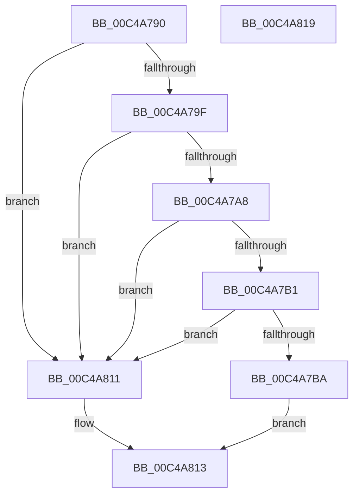

# SepInitializationPhase0

- RVA: `0x00C4A790`–`0x00C4A81A` (길이 `138` bytes)
- VA: `0x0000000140C4A790`
- 실행 섹션: `INIT`
- PDB 이름 있음: `예`; PDB Function 태그: `아니요`
- unwind 정보 RVA: `0x0005CF00`
- 디코드: `33`개 명령, `138/138` bytes 표시
- 미해석 바이트: `0` (있으면 어셈블리에 `.byte`로 보존)

> 이 문서는 커널 이미지의 기계어와 PDB 기호를 분석해 생성했습니다. 4번과 5번은 함수 원형과 자료형을 바이너리 사용 방식에서 추정한 C 해석이며 원본 소스 복구 결과는 아닙니다.

## 1. Dependencies

- 직접 호출 지점: **6**; 고유 호출 대상: **6**
- 직접 호출자로 확인된 함수: **1**
- RIP 상대 이미지 참조: **2**

### Outgoing calls
- `0x00C4A796` → [SepVariableInitialization](SepVariableInitialization_function_00C483A4.md) (function, `0x00C483A4`)
- `0x00C4A79F` → [SepRmDbInitialization](SepRmDbInitialization_function_00C4BAF4.md) (function, `0x00C4BAF4`)
- `0x00C4A7A8` → [SepTokenInitialization](SepTokenInitialization_function_00C4B34C.md) (function, `0x00C4B34C`)
- `0x00C4A7B1` → [SepInitializeWorkList](SepInitializeWorkList_function_00C482F0.md) (function, `0x00C482F0`)
- `0x00C4A7E2` → [SeMakeSystemToken](SeMakeSystemToken_function_00C4ADBC.md) (function, `0x00C4ADBC`)
- `0x00C4A7F1` → [ObInitializeFastReference](../../page/9F/ObInitializeFastReference_function_009F0D24.md) (function, `0x009F0D24`)

### Direct callers
- [SeInitSystem](SeInitSystem_function_00C4A74C.md) at `0x00C4A77F`

### Static image references
- `0x00C4A7F6` → RVA `0x00F05820` (`.data`; read)
- `0x00C4A805` → RVA `0x00E67DB0` (`.data`; write)

## 2. Other-region calls and transfers

- 다른 실행 섹션으로 향하는 call: **1**
  - `0x00C4A7F1` → [ObInitializeFastReference](../../page/9F/ObInitializeFastReference_function_009F0D24.md) (`INIT` → `PAGE`)
- 별도 외부 분기/꼬리 이동을 확인하지 못했습니다.

## 3. Assembly (complete function range)

```asm
00C4A790  40 53                           push rbx
00C4A792  48 83 EC 20                     sub rsp, 0x20
00C4A796  E8 09 DC FF FF                  call 0x140c483a4
00C4A79B  84 C0                           test al, al
00C4A79D  74 72                           je 0x140c4a811
00C4A79F  E8 50 13 00 00                  call 0x140c4baf4
00C4A7A4  84 C0                           test al, al
00C4A7A6  74 69                           je 0x140c4a811
00C4A7A8  E8 9F 0B 00 00                  call 0x140c4b34c
00C4A7AD  84 C0                           test al, al
00C4A7AF  74 60                           je 0x140c4a811
00C4A7B1  E8 3A DB FF FF                  call 0x140c482f0
00C4A7B6  84 C0                           test al, al
00C4A7B8  74 57                           je 0x140c4a811
00C4A7BA  65 48 8B 04 25 88 01 00 00      mov rax, qword ptr gs:[0x188]
00C4A7C3  48 8B 98 B8 00 00 00            mov rbx, qword ptr [rax + 0xb8]
00C4A7CA  48 83 A0 38 05 00 00 00         and qword ptr [rax + 0x538], 0
00C4A7D2  F0 83 A0 A0 05 00 00 F7         lock and dword ptr [rax + 0x5a0], 0xfffffff7
00C4A7DA  48 83 A3 48 02 00 00 00         and qword ptr [rbx + 0x248], 0
00C4A7E2  E8 D5 05 00 00                  call 0x140c4adbc
00C4A7E7  48 8B D0                        mov rdx, rax
00C4A7EA  48 8D 8B 48 02 00 00            lea rcx, [rbx + 0x248]
00C4A7F1  E8 2E 65 DA FF                  call 0x1409f0d24
00C4A7F6  48 8B 05 23 B0 2B 00            mov rax, qword ptr [rip + 0x2bb023]
00C4A7FD  48 83 BB 48 02 00 00 00         cmp qword ptr [rbx + 0x248], 0
00C4A805  48 89 05 A4 D5 21 00            mov qword ptr [rip + 0x21d5a4], rax
00C4A80C  0F 95 C0                        setne al
00C4A80F  EB 02                           jmp 0x140c4a813
00C4A811  32 C0                           xor al, al
00C4A813  48 83 C4 20                     add rsp, 0x20
00C4A817  5B                              pop rbx
00C4A818  C3                              ret
00C4A819  CC                              int3
```

## 4. C-style interpretation (structured pseudocode)

```c
__int64 __fastcall SepInitializationPhase0(void)
{
    __int64 result;
    __int64 v_rsp;

    v_rsp = (v_rsp) - (32);
    result = SepVariableInitialization(a1, a2, a3, a4);
    if ((unsigned __int8)(result) == 0) goto loc_00C4A811;
    result = SepRmDbInitialization(a1, a2, a3, a4);
    if ((unsigned __int8)(result) == 0) goto loc_00C4A811;
    result = SepTokenInitialization(a1, a2, a3, a4);
    if ((unsigned __int8)(result) == 0) goto loc_00C4A811;
    result = SepInitializeWorkList(a1, a2, a3, a4);
    if ((unsigned __int8)(result) == 0) goto loc_00C4A811;
    result = SeMakeSystemToken(a1, a2, a3, a4);
    result = ObInitializeFastReference(*(unsigned __int64 *)(*(unsigned __int64 *)(gs_base + (0 + 392)) + 184) + 584, result, a3, a4);
    *(unsigned __int64 *)(v_rip + 2217380) = *(unsigned __int64 *)(v_rip + 2863139);
    result = ((*(unsigned __int64 *)(*(unsigned __int64 *)(*(unsigned __int64 *)(gs_base + (0 + 392)) + 184) + 584)) != 0) ? 1 : 0;
    goto loc_00C4A813;
loc_00C4A811:
    result = 0;
loc_00C4A813:
    v_rsp = (v_rsp) + (32);
    return result;
}
```

## 5. (Beta) C Style

```c
void SepInitializationPhase0(void)
{
    int64_t result;
    int64_t local_rsp;

    local_rsp = (local_rsp) - (32);
    result = SepVariableInitialization(a1, a2, a3, a4);
    if ((uint8_t)(result) == 0) goto loc_00C4A811;
    result = SepRmDbInitialization(a1, a2, a3, a4);
    if ((uint8_t)(result) == 0) goto loc_00C4A811;
    result = SepTokenInitialization(a1, a2, a3, a4);
    if ((uint8_t)(result) == 0) goto loc_00C4A811;
    result = SepInitializeWorkList(a1, a2, a3, a4);
    if ((uint8_t)(result) == 0) goto loc_00C4A811;
    result = SeMakeSystemToken(a1, a2, a3, a4);
    result = ObInitializeFastReference(*(uint64_t *)(*(uint64_t *)(gs_base + (0 + 0x188)) + 0xB8) + 584, result, a3, a4);
    *(uint64_t *)(v_rip + 0x21D5A4) = *(uint64_t *)(v_rip + 0x2BB023);
    result = ((*(uint64_t *)(*(uint64_t *)(*(uint64_t *)(gs_base + (0 + 0x188)) + 0xB8) + 0x248)) != 0) ? 1 : 0;
    goto loc_00C4A813;
loc_00C4A811:
    result = 0;
loc_00C4A813:
    local_rsp = (local_rsp) + (32);
    return result;
}
```

## 6. Execution-region graph

[열기: 2D/3D 그래프와 함수 탐색 컨트롤 패널](../../../control-panel.html?section=init&rva=0x00C4A790&view=graph)

- 2D 그래프는 위에서 아래로 흐르고, 3D 그래프는 빈 공간을 드래그해 회전합니다. Shift+드래그는 이동, 휠은 확대·축소, 함수 노드 선택은 대상 보고서 이동입니다.

### Static fallback


