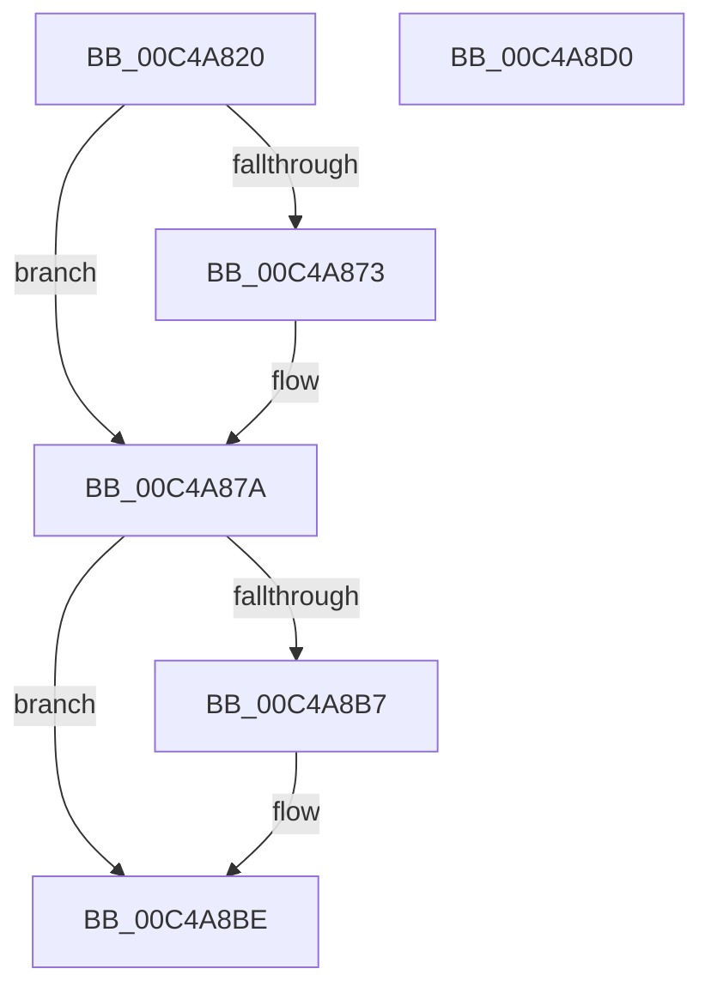

# SepInitializeAuthorizationCallbacks

- RVA: `0x00C4A820`–`0x00C4A8D1` (길이 `177` bytes)
- VA: `0x0000000140C4A820`
- 실행 섹션: `INIT`
- PDB 이름 있음: `예`; PDB Function 태그: `아니요`
- unwind 정보 RVA: `0x000D07FC`
- 디코드: `41`개 명령, `177/177` bytes 표시
- 미해석 바이트: `0` (있으면 어셈블리에 `.byte`로 보존)

> 이 문서는 커널 이미지의 기계어와 PDB 기호를 분석해 생성했습니다. 4번과 5번은 함수 원형과 자료형을 바이너리 사용 방식에서 추정한 C 해석이며 원본 소스 복구 결과는 아닙니다.

## 1. Dependencies

- 직접 호출 지점: **2**; 고유 호출 대상: **1**
- 직접 호출자로 확인된 함수: **1**
- RIP 상대 이미지 참조: **4**

### Outgoing calls
- `0x00C4A86A` → [ExRegisterHost](../../page/7D/ExRegisterHost_function_007D06CC.md) (function, `0x007D06CC`)
- `0x00C4A8AE` → [ExRegisterHost](../../page/7D/ExRegisterHost_function_007D06CC.md) (function, `0x007D06CC`)

### Direct callers
- [SepInitializationPhase1](../../page/79/SepInitializationPhase1_function_0079C580.md) at `0x0079C7DD`

### Static image references
- `0x00C4A84C` → RVA `0x00F04E28` (`.data`; read)
- `0x00C4A873` → RVA `0x00F04E28` (`.data`; write)
- `0x00C4A88D` → RVA `0x00F04E30` (`.data`; read)
- `0x00C4A8B7` → RVA `0x00F04E30` (`.data`; write)

## 2. Other-region calls and transfers

- 다른 실행 섹션으로 향하는 call: **2**
  - `0x00C4A86A` → [ExRegisterHost](../../page/7D/ExRegisterHost_function_007D06CC.md) (`INIT` → `PAGE`)
  - `0x00C4A8AE` → [ExRegisterHost](../../page/7D/ExRegisterHost_function_007D06CC.md) (`INIT` → `PAGE`)
- 별도 외부 분기/꼬리 이동을 확인하지 못했습니다.

## 3. Assembly (complete function range)

```asm
00C4A820  48 89 5C 24 08                  mov qword ptr [rsp + 8], rbx
00C4A825  48 89 7C 24 10                  mov qword ptr [rsp + 0x10], rdi
00C4A82A  55                              push rbp
00C4A82B  48 8B EC                        mov rbp, rsp
00C4A82E  48 83 EC 70                     sub rsp, 0x70
00C4A832  33 DB                           xor ebx, ebx
00C4A834  48 C7 45 D0 02 00 01 00         mov qword ptr [rbp - 0x30], 0x10002
00C4A83C  48 8D 45 B0                     lea rax, [rbp - 0x50]
00C4A840  48 89 5D B8                     mov qword ptr [rbp - 0x48], rbx
00C4A844  4C 8D 45 D0                     lea r8, [rbp - 0x30]
00C4A848  48 89 45 D8                     mov qword ptr [rbp - 0x28], rax
00C4A84C  48 8D 0D D5 A5 2B 00            lea rcx, [rip + 0x2ba5d5]
00C4A853  48 89 5D E8                     mov qword ptr [rbp - 0x18], rbx
00C4A857  48 89 5D F0                     mov qword ptr [rbp - 0x10], rbx
00C4A85B  48 C7 45 E0 01 00 00 00         mov qword ptr [rbp - 0x20], 1
00C4A863  C7 45 B0 01 00 00 00            mov dword ptr [rbp - 0x50], 1
00C4A86A  E8 5D 5E B8 FF                  call 0x1407d06cc
00C4A86F  85 C0                           test eax, eax
00C4A871  79 07                           jns 0x140c4a87a
00C4A873  48 89 1D AE A5 2B 00            mov qword ptr [rip + 0x2ba5ae], rbx
00C4A87A  48 8D 45 C0                     lea rax, [rbp - 0x40]
00C4A87E  C7 45 C0 01 00 00 00            mov dword ptr [rbp - 0x40], 1
00C4A885  4C 8D 45 D0                     lea r8, [rbp - 0x30]
00C4A889  48 89 45 D8                     mov qword ptr [rbp - 0x28], rax
00C4A88D  48 8D 0D 9C A5 2B 00            lea rcx, [rip + 0x2ba59c]
00C4A894  48 89 5D C8                     mov qword ptr [rbp - 0x38], rbx
00C4A898  C7 45 D0 03 00 01 00            mov dword ptr [rbp - 0x30], 0x10003
00C4A89F  C7 45 E0 00 02 00 00            mov dword ptr [rbp - 0x20], 0x200
00C4A8A6  48 89 5D E8                     mov qword ptr [rbp - 0x18], rbx
00C4A8AA  48 89 5D F0                     mov qword ptr [rbp - 0x10], rbx
00C4A8AE  E8 19 5E B8 FF                  call 0x1407d06cc
00C4A8B3  85 C0                           test eax, eax
00C4A8B5  79 07                           jns 0x140c4a8be
00C4A8B7  48 89 1D 72 A5 2B 00            mov qword ptr [rip + 0x2ba572], rbx
00C4A8BE  4C 8D 5C 24 70                  lea r11, [rsp + 0x70]
00C4A8C3  49 8B 5B 10                     mov rbx, qword ptr [r11 + 0x10]
00C4A8C7  49 8B 7B 18                     mov rdi, qword ptr [r11 + 0x18]
00C4A8CB  49 8B E3                        mov rsp, r11
00C4A8CE  5D                              pop rbp
00C4A8CF  C3                              ret
00C4A8D0  CC                              int3
```

## 4. C-style interpretation (structured pseudocode)

```c
__int64 __fastcall SepInitializeAuthorizationCallbacks(void)
{
    __int64 result;
    __int64 v_rbx;
    __int64 v_rsp;
    unsigned __int64 v_stack_m18;
    unsigned __int64 v_stack_m20;
    unsigned __int64 v_stack_m28;
    unsigned __int64 v_stack_m30;
    unsigned __int64 v_stack_m38;
    unsigned __int64 v_stack_m40;
    unsigned __int64 v_stack_m48;
    unsigned __int64 v_stack_m50;
    unsigned __int64 v_stack_m58;
    unsigned __int64 v_stack_m8;
    unsigned __int64 v_stack_p10;
    unsigned __int64 v_stack_p8;

    v_stack_p8 = v_rbx;
    v_stack_p10 = v_rdi;
    v_rsp = (v_rsp) - (112);
    v_rbx = 0;
    v_stack_m38 = 0x10002ULL;
    v_stack_m50 = 0;
    v_stack_m30 = v_stack_m58;
    v_stack_m20 = 0;
    v_stack_m18 = 0;
    v_stack_m28 = 1;
    v_stack_m58 = 1;
    result = ExRegisterHost(v_rip + 2860501, a2, v_stack_m38, a4);
    if (sign_flag) {
        *(unsigned __int64 *)(v_rip + 2860462) = 0;
    }
    v_stack_m48 = 1;
    v_stack_m30 = v_stack_m48;
    v_stack_m40 = 0;
    v_stack_m38 = 0x10003ULL;
    v_stack_m28 = 512;
    v_stack_m20 = 0;
    v_stack_m18 = 0;
    result = ExRegisterHost(v_rip + 2860444, a2, v_stack_m38, a4);
    if (sign_flag) {
        *(unsigned __int64 *)(v_rip + 2860402) = 0;
    }
    return result;
}
```

## 5. (Beta) C Style

```c
void SepInitializeAuthorizationCallbacks(void)
{
    int64_t result;
    int64_t local_rbx;
    int64_t local_rsp;
    uint64_t v_stack_m18;
    uint64_t v_stack_m20;
    uint64_t v_stack_m28;
    uint64_t v_stack_m30;
    uint64_t v_stack_m38;
    uint64_t v_stack_m40;
    uint64_t v_stack_m48;
    uint64_t v_stack_m50;
    uint64_t v_stack_m58;
    uint64_t v_stack_m8;
    uint64_t v_stack_p10;
    uint64_t v_stack_p8;

    v_stack_p8 = local_rbx;
    v_stack_p10 = local_rdi;
    local_rsp = (local_rsp) - (112);
    local_rbx = 0;
    v_stack_m38 = 0x10002ULL;
    v_stack_m50 = 0;
    v_stack_m30 = v_stack_m58;
    v_stack_m20 = 0;
    v_stack_m18 = 0;
    v_stack_m28 = 1;
    v_stack_m58 = 1;
    result = ExRegisterHost(v_rip + 2860501, a2, v_stack_m38, a4);
    if (sign_flag) {
        *(uint64_t *)(v_rip + 0x2BA5AE) = 0;
    }
    v_stack_m48 = 1;
    v_stack_m30 = v_stack_m48;
    v_stack_m40 = 0;
    v_stack_m38 = 0x10003ULL;
    v_stack_m28 = 512;
    v_stack_m20 = 0;
    v_stack_m18 = 0;
    result = ExRegisterHost(v_rip + 2860444, a2, v_stack_m38, a4);
    if (sign_flag) {
        *(uint64_t *)(v_rip + 0x2BA572) = 0;
    }
    return result;
}
```

## 6. Execution-region graph

[열기: 2D/3D 그래프와 함수 탐색 컨트롤 패널](../../../control-panel.html?section=init&rva=0x00C4A820&view=graph)

- 2D 그래프는 위에서 아래로 흐르고, 3D 그래프는 빈 공간을 드래그해 회전합니다. Shift+드래그는 이동, 휠은 확대·축소, 함수 노드 선택은 대상 보고서 이동입니다.

### Static fallback


