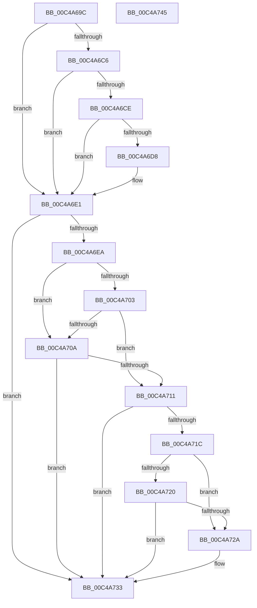

# SepInitializeDebugOptions

- RVA: `0x00C4A69C`–`0x00C4A746` (길이 `170` bytes)
- VA: `0x0000000140C4A69C`
- 실행 섹션: `INIT`
- PDB 이름 있음: `예`; PDB Function 태그: `아니요`
- unwind 정보 RVA: `0x000C4098`
- 디코드: `45`개 명령, `170/170` bytes 표시
- 미해석 바이트: `0` (있으면 어셈블리에 `.byte`로 보존)

> 이 문서는 커널 이미지의 기계어와 PDB 기호를 분석해 생성했습니다. 4번과 5번은 함수 원형과 자료형을 바이너리 사용 방식에서 추정한 C 해석이며 원본 소스 복구 결과는 아닙니다.

## 1. Dependencies

- 직접 호출 지점: **2**; 고유 호출 대상: **2**
- 직접 호출자로 확인된 함수: **1**
- RIP 상대 이미지 참조: **6**

### Outgoing calls
- `0x00C4A6FA` → [ZwQuerySystemInformation](../../text/6A/ZwQuerySystemInformation_function_006AD790.md) (function, `0x006AD790`)
- `0x00C4A73B` → [_security_check_cookie](../../text/6A/_security_check_cookie_function_006AC640.md) (function, `0x006AC640`)

### Direct callers
- [SeCodeIntegrityInitializePolicy](SeCodeIntegrityInitializePolicy_function_00C4A5CC.md) at `0x00C4A61C`

### Static image references
- `0x00C4A6A0` → RVA `0x00E0A740` (`.data`; read)
- `0x00C4A6B4` → RVA `0x00F475F8` (`.data`; read)
- `0x00C4A6C6` → RVA `0x00F475DC` (`.data`; read)
- `0x00C4A6CE` → RVA `0x00E67D6C` (`.data`; read)
- `0x00C4A6DB` → RVA `0x00E67D6C` (`.data`; write)
- `0x00C4A6E1` → RVA `0x00170000` (`PROTDATA`; read)

## 2. Other-region calls and transfers

- 다른 실행 섹션으로 향하는 call: **2**
  - `0x00C4A6FA` → [ZwQuerySystemInformation](../../text/6A/ZwQuerySystemInformation_function_006AD790.md) (`INIT` → `.text`)
  - `0x00C4A73B` → [_security_check_cookie](../../text/6A/_security_check_cookie_function_006AC640.md) (`INIT` → `.text`)
- 별도 외부 분기/꼬리 이동을 확인하지 못했습니다.

## 3. Assembly (complete function range)

```asm
00C4A69C  48 83 EC 48                     sub rsp, 0x48
00C4A6A0  48 8B 05 99 00 1C 00            mov rax, qword ptr [rip + 0x1c0099]
00C4A6A7  48 33 C4                        xor rax, rsp
00C4A6AA  48 89 44 24 38                  mov qword ptr [rsp + 0x38], rax
00C4A6AF  33 C0                           xor eax, eax
00C4A6B1  0F 57 C0                        xorps xmm0, xmm0
00C4A6B4  38 05 3E CF 2F 00               cmp byte ptr [rip + 0x2fcf3e], al
00C4A6BA  0F 11 44 24 20                  movups xmmword ptr [rsp + 0x20], xmm0
00C4A6BF  48 89 44 24 30                  mov qword ptr [rsp + 0x30], rax
00C4A6C4  74 1B                           je 0x140c4a6e1
00C4A6C6  38 05 10 CF 2F 00               cmp byte ptr [rip + 0x2fcf10], al
00C4A6CC  75 13                           jne 0x140c4a6e1
00C4A6CE  8B 05 98 D6 21 00               mov eax, dword ptr [rip + 0x21d698]
00C4A6D4  A8 01                           test al, 1
00C4A6D6  75 09                           jne 0x140c4a6e1
00C4A6D8  83 C8 02                        or eax, 2
00C4A6DB  89 05 8B D6 21 00               mov dword ptr [rip + 0x21d68b], eax
00C4A6E1  80 3D 18 59 52 FF 00            cmp byte ptr [rip - 0xada6e8], 0
00C4A6E8  74 49                           je 0x140c4a733
00C4A6EA  45 33 C9                        xor r9d, r9d
00C4A6ED  48 8D 54 24 20                  lea rdx, [rsp + 0x20]
00C4A6F2  45 8D 41 18                     lea r8d, [r9 + 0x18]
00C4A6F6  41 8D 48 77                     lea ecx, [r8 + 0x77]
00C4A6FA  E8 91 30 A6 FF                  call 0x1406ad790
00C4A6FF  85 C0                           test eax, eax
00C4A701  78 07                           js 0x140c4a70a
00C4A703  F6 44 24 34 10                  test byte ptr [rsp + 0x34], 0x10
00C4A708  75 07                           jne 0x140c4a711
00C4A70A  3D 06 00 43 80                  cmp eax, 0x80430006
00C4A70F  75 22                           jne 0x140c4a733
00C4A711  8B 0D 55 D6 21 00               mov ecx, dword ptr [rip + 0x21d655]
00C4A717  F6 C1 01                        test cl, 1
00C4A71A  75 17                           jne 0x140c4a733
00C4A71C  85 C0                           test eax, eax
00C4A71E  78 0A                           js 0x140c4a72a
00C4A720  F7 44 24 34 00 80 00 00         test dword ptr [rsp + 0x34], 0x8000
00C4A728  75 09                           jne 0x140c4a733
00C4A72A  83 C9 04                        or ecx, 4
00C4A72D  89 0D 39 D6 21 00               mov dword ptr [rip + 0x21d639], ecx
00C4A733  48 8B 4C 24 38                  mov rcx, qword ptr [rsp + 0x38]
00C4A738  48 33 CC                        xor rcx, rsp
00C4A73B  E8 00 1F A6 FF                  call 0x1406ac640
00C4A740  48 83 C4 48                     add rsp, 0x48
00C4A744  C3                              ret
00C4A745  CC                              int3
```

## 4. C-style interpretation (structured pseudocode)

```c
__int64 __fastcall SepInitializeDebugOptions(__int64 a1, __int64 a2, __int64 a3, int a4)
{
    __int64 result;
    __int64 v_rsp;
    unsigned __int64 v_stack_m10;
    unsigned __int8 v_stack_m14;
    unsigned __int64 v_stack_m18;
    unsigned __int64 v_stack_m28;

    v_rsp = (v_rsp) - (72);
    result = (*(unsigned __int64 *)(v_rip + 1835161)) ^ (v_rsp);
    v_stack_m10 = result;
    result = 0;
    v_stack_m28 = v_xmm0;
    v_stack_m18 = 0;
    if ((*(unsigned __int8 *)(v_rip + 3133246)) == 0) goto loc_00C4A6E1;
    if ((*(unsigned __int8 *)(v_rip + 3133200)) != 0) goto loc_00C4A6E1;
    result = (unsigned int)(*(unsigned int *)(v_rip + 2217624));
    if ((((unsigned __int8)((unsigned int)(*(unsigned int *)(v_rip + 2217624)))) & (1)) == 0) {
        result = (unsigned int)(((unsigned int)(*(unsigned int *)(v_rip + 2217624))) | (2));
        *(unsigned int *)(v_rip + 2217611) = (unsigned int)(result);
    }
    if ((*(unsigned __int8 *)(v_rip - 11380456)) == 0) goto loc_00C4A733;
    a4 = 0;
    result = ZwQuerySystemInformation(a4 + 24 + 119, v_stack_m28, a4 + 24, a4);
    if (sign_flag) goto loc_00C4A70A;
    if (((v_stack_m14) & (16)) != 0) goto loc_00C4A711;
loc_00C4A70A:
    if (((unsigned int)(result)) != 0x80430006ULL) goto loc_00C4A733;
loc_00C4A711:
    if ((((unsigned __int8)((unsigned int)(*(unsigned int *)(v_rip + 2217557)))) & (1)) != 0) goto loc_00C4A733;
    if (sign_flag) goto loc_00C4A72A;
    if (((v_stack_m14) & (0x8000ULL)) == 0) {
        a1 = (unsigned int)(((unsigned int)(*(unsigned int *)(v_rip + 2217557))) | (4));
        *(unsigned int *)(v_rip + 2217529) = (unsigned int)(a1);
    }
    a1 = (v_stack_m10) ^ (v_rsp);
    result = _security_check_cookie(a1, v_stack_m28, a4 + 24, a4);
    v_rsp = (v_rsp) + (72);
    return result;
}
```

## 5. (Beta) C Style

```c
int64_t SepInitializeDebugOptions(int64_t Arg1, int64_t Arg2, int64_t Arg3, int32_t Arg4)
{
    int64_t result;
    int64_t local_rsp;
    uint64_t v_stack_m10;
    uint8_t v_stack_m14;
    uint64_t v_stack_m18;
    uint64_t v_stack_m28;

    local_rsp = (local_rsp) - (72);
    result = (*(uint64_t *)(v_rip + 0x1C0099)) ^ (local_rsp);
    v_stack_m10 = result;
    result = 0;
    v_stack_m28 = v_xmm0;
    v_stack_m18 = 0;
    if ((*(uint8_t *)(v_rip + 0x2FCF3E)) == 0) goto loc_00C4A6E1;
    if ((*(uint8_t *)(v_rip + 0x2FCF10)) != 0) goto loc_00C4A6E1;
    result = (uint32_t)(*(uint32_t *)(v_rip + 0x21D698));
    if ((((uint8_t)((uint32_t)(*(uint32_t *)(v_rip + 0x21D698)))) & (1)) == 0) {
        result = (uint32_t)(((uint32_t)(*(uint32_t *)(v_rip + 0x21D698))) | (2));
        *(uint32_t *)(v_rip + 0x21D68B) = (uint32_t)(result);
    }
    if ((*(uint8_t *)(v_rip - 0xADA6E8)) == 0) goto loc_00C4A733;
    Arg4 = 0;
    result = ZwQuerySystemInformation(Arg4 + 24 + 119, v_stack_m28, Arg4 + 24, Arg4);
    if (sign_flag) goto loc_00C4A70A;
    if (((v_stack_m14) & (16)) != 0) goto loc_00C4A711;
loc_00C4A70A:
    if (((uint32_t)(result)) != 0x80430006ULL) goto loc_00C4A733;
loc_00C4A711:
    if ((((uint8_t)((uint32_t)(*(uint32_t *)(v_rip + 0x21D655)))) & (1)) != 0) goto loc_00C4A733;
    if (sign_flag) goto loc_00C4A72A;
    if (((v_stack_m14) & (0x8000ULL)) == 0) {
        Arg1 = (uint32_t)(((uint32_t)(*(uint32_t *)(v_rip + 0x21D655))) | (4));
        *(uint32_t *)(v_rip + 0x21D639) = (uint32_t)(Arg1);
    }
    Arg1 = (v_stack_m10) ^ (local_rsp);
    result = _security_check_cookie(Arg1, v_stack_m28, Arg4 + 24, Arg4);
    local_rsp = (local_rsp) + (72);
    return result;
}
```

## 6. Execution-region graph

[열기: 2D/3D 그래프와 함수 탐색 컨트롤 패널](../../../control-panel.html?section=init&rva=0x00C4A69C&view=graph)

- 2D 그래프는 위에서 아래로 흐르고, 3D 그래프는 빈 공간을 드래그해 회전합니다. Shift+드래그는 이동, 휠은 확대·축소, 함수 노드 선택은 대상 보고서 이동입니다.

### Static fallback


