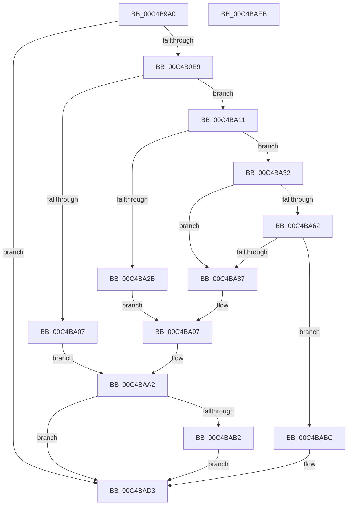

# SepInitializeSingletonAttributesStructures

- RVA: `0x00C4B9A0`–`0x00C4BAEC` (길이 `332` bytes)
- VA: `0x0000000140C4B9A0`
- 실행 섹션: `INIT`
- PDB 이름 있음: `예`; PDB Function 태그: `아니요`
- unwind 정보 RVA: `0x0006F978`
- 디코드: `86`개 명령, `332/332` bytes 표시
- 미해석 바이트: `0` (있으면 어셈블리에 `.byte`로 보존)

> 이 문서는 커널 이미지의 기계어와 PDB 기호를 분석해 생성했습니다. 4번과 5번은 함수 원형과 자료형을 바이너리 사용 방식에서 추정한 C 해석이며 원본 소스 복구 결과는 아닙니다.

## 1. Dependencies

- 직접 호출 지점: **8**; 고유 호출 대상: **4**
- 직접 호출자로 확인된 함수: **1**
- RIP 상대 이미지 참조: **3**

### Outgoing calls
- `0x00C4B9FA` → [ExAllocatePool2](../../poolcode/B8/ExAllocatePool2_function_00B820F0.md) (function, `0x00B820F0`)
- `0x00C4BA1E` → [ExAllocatePool2](../../poolcode/B8/ExAllocatePool2_function_00B820F0.md) (function, `0x00B820F0`)
- `0x00C4BA3D` → [memset](../../text/6C/memset_function_006C6C40.md) (function, `0x006C6C40`)
- `0x00C4BA4D` → [ExAllocatePool2](../../poolcode/B8/ExAllocatePool2_function_00B820F0.md) (function, `0x00B820F0`)
- `0x00C4BA7E` → [RtlpCreateHashTable](../../text/48/RtlpCreateHashTable_function_0048C400.md) (function, `0x0048C400`)
- `0x00C4BA92` → [ExFreePoolWithTag](../../poolcode/B8/ExFreePoolWithTag_function_00B82870.md) (function, `0x00B82870`)
- `0x00C4BA9D` → [ExFreePoolWithTag](../../poolcode/B8/ExFreePoolWithTag_function_00B82870.md) (function, `0x00B82870`)
- `0x00C4BAB5` → [ExFreePoolWithTag](../../poolcode/B8/ExFreePoolWithTag_function_00B82870.md) (function, `0x00B82870`)

### Direct callers
- [SepInitializationPhase1](../../page/79/SepInitializationPhase1_function_0079C580.md) at `0x0079C7E2`

### Static image references
- `0x00C4B9B5` → RVA `0x00E08960` (`.data`; read)
- `0x00C4B9CA` → RVA `0x00FD8068` (`PAGEDATA`; read)
- `0x00C4B9D8` → RVA `0x00E67E20` (`.data`; read)

## 2. Other-region calls and transfers

- 다른 실행 섹션으로 향하는 call: **8**
  - `0x00C4B9FA` → [ExAllocatePool2](../../poolcode/B8/ExAllocatePool2_function_00B820F0.md) (`INIT` → `POOLCODE`)
  - `0x00C4BA1E` → [ExAllocatePool2](../../poolcode/B8/ExAllocatePool2_function_00B820F0.md) (`INIT` → `POOLCODE`)
  - `0x00C4BA3D` → [memset](../../text/6C/memset_function_006C6C40.md) (`INIT` → `.text`)
  - `0x00C4BA4D` → [ExAllocatePool2](../../poolcode/B8/ExAllocatePool2_function_00B820F0.md) (`INIT` → `POOLCODE`)
  - `0x00C4BA7E` → [RtlpCreateHashTable](../../text/48/RtlpCreateHashTable_function_0048C400.md) (`INIT` → `.text`)
  - `0x00C4BA92` → [ExFreePoolWithTag](../../poolcode/B8/ExFreePoolWithTag_function_00B82870.md) (`INIT` → `POOLCODE`)
  - `0x00C4BA9D` → [ExFreePoolWithTag](../../poolcode/B8/ExFreePoolWithTag_function_00B82870.md) (`INIT` → `POOLCODE`)
  - `0x00C4BAB5` → [ExFreePoolWithTag](../../poolcode/B8/ExFreePoolWithTag_function_00B82870.md) (`INIT` → `POOLCODE`)
- 별도 외부 분기/꼬리 이동을 확인하지 못했습니다.

## 3. Assembly (complete function range)

```asm
00C4B9A0  48 89 5C 24 08                  mov qword ptr [rsp + 8], rbx
00C4B9A5  48 89 74 24 10                  mov qword ptr [rsp + 0x10], rsi
00C4B9AA  48 89 7C 24 18                  mov qword ptr [rsp + 0x18], rdi
00C4B9AF  41 56                           push r14
00C4B9B1  48 83 EC 20                     sub rsp, 0x20
00C4B9B5  48 8B 05 A4 CF 1B 00            mov rax, qword ptr [rip + 0x1bcfa4]
00C4B9BC  33 DB                           xor ebx, ebx
00C4B9BE  21 58 04                        and dword ptr [rax + 4], ebx
00C4B9C1  48 21 58 08                     and qword ptr [rax + 8], rbx
00C4B9C5  21 58 10                        and dword ptr [rax + 0x10], ebx
00C4B9C8  89 18                           mov dword ptr [rax], ebx
00C4B9CA  48 8B 05 97 C6 38 00            mov rax, qword ptr [rip + 0x38c697]
00C4B9D1  48 21 18                        and qword ptr [rax], rbx
00C4B9D4  48 21 58 08                     and qword ptr [rax + 8], rbx
00C4B9D8  8B 05 42 C4 21 00               mov eax, dword ptr [rip + 0x21c442]
00C4B9DE  83 E0 03                        and eax, 3
00C4B9E1  3C 03                           cmp al, 3
00C4B9E3  0F 85 EA 00 00 00               jne 0x140c4bad3
00C4B9E9  41 BE 53 65 44 74               mov r14d, 0x74446553
00C4B9EF  8D 53 08                        lea edx, [rbx + 8]
00C4B9F2  45 8B C6                        mov r8d, r14d
00C4B9F5  B9 00 01 00 00                  mov ecx, 0x100
00C4B9FA  E8 F1 66 F3 FF                  call 0x140b820f0
00C4B9FF  48 8B F8                        mov rdi, rax
00C4BA02  48 85 C0                        test rax, rax
00C4BA05  75 0A                           jne 0x140c4ba11
00C4BA07  BB 17 00 00 C0                  mov ebx, 0xc0000017
00C4BA0C  E9 91 00 00 00                  jmp 0x140c4baa2
00C4BA11  45 8B C6                        mov r8d, r14d
00C4BA14  BA 00 06 00 00                  mov edx, 0x600
00C4BA19  B9 40 00 00 00                  mov ecx, 0x40
00C4BA1E  E8 CD 66 F3 FF                  call 0x140b820f0
00C4BA23  48 8B F0                        mov rsi, rax
00C4BA26  48 85 C0                        test rax, rax
00C4BA29  75 07                           jne 0x140c4ba32
00C4BA2B  BB 17 00 00 C0                  mov ebx, 0xc0000017
00C4BA30  EB 65                           jmp 0x140c4ba97
00C4BA32  33 D2                           xor edx, edx
00C4BA34  41 B8 00 06 00 00               mov r8d, 0x600
00C4BA3A  48 8B CE                        mov rcx, rsi
00C4BA3D  E8 FE B1 A7 FF                  call 0x1406c6c40
00C4BA42  BA 08 00 00 00                  mov edx, 8
00C4BA47  45 8B C6                        mov r8d, r14d
00C4BA4A  8D 4A 38                        lea ecx, [rdx + 0x38]
00C4BA4D  E8 9E 66 F3 FF                  call 0x140b820f0
00C4BA52  48 8B 0D 07 CF 1B 00            mov rcx, qword ptr [rip + 0x1bcf07]
00C4BA59  48 89 41 08                     mov qword ptr [rcx + 8], rax
00C4BA5D  48 85 C0                        test rax, rax
00C4BA60  74 25                           je 0x140c4ba87
00C4BA62  48 89 30                        mov qword ptr [rax], rsi
00C4BA65  45 33 C9                        xor r9d, r9d
00C4BA68  FF 41 04                        inc dword ptr [rcx + 4]
00C4BA6B  45 33 C0                        xor r8d, r8d
00C4BA6E  48 8B 0D F3 C5 38 00            mov rcx, qword ptr [rip + 0x38c5f3]
00C4BA75  BA 80 00 00 00                  mov edx, 0x80
00C4BA7A  48 83 C1 08                     add rcx, 8
00C4BA7E  E8 7D 09 84 FF                  call 0x14048c400
00C4BA83  84 C0                           test al, al
00C4BA85  75 35                           jne 0x140c4babc
00C4BA87  41 8B D6                        mov edx, r14d
00C4BA8A  48 8B CE                        mov rcx, rsi
00C4BA8D  BB 17 00 00 C0                  mov ebx, 0xc0000017
00C4BA92  E8 D9 6D F3 FF                  call 0x140b82870
00C4BA97  41 8B D6                        mov edx, r14d
00C4BA9A  48 8B CF                        mov rcx, rdi
00C4BA9D  E8 CE 6D F3 FF                  call 0x140b82870
00C4BAA2  48 8B 05 B7 CE 1B 00            mov rax, qword ptr [rip + 0x1bceb7]
00C4BAA9  48 8B 48 08                     mov rcx, qword ptr [rax + 8]
00C4BAAD  48 85 C9                        test rcx, rcx
00C4BAB0  74 21                           je 0x140c4bad3
00C4BAB2  41 8B D6                        mov edx, r14d
00C4BAB5  E8 B6 6D F3 FF                  call 0x140b82870
00C4BABA  EB 17                           jmp 0x140c4bad3
00C4BABC  48 8B 0D A5 C5 38 00            mov rcx, qword ptr [rip + 0x38c5a5]
00C4BAC3  33 C0                           xor eax, eax
00C4BAC5  C7 41 10 40 00 00 00            mov dword ptr [rcx + 0x10], 0x40
00C4BACC  48 89 79 18                     mov qword ptr [rcx + 0x18], rdi
00C4BAD0  48 89 07                        mov qword ptr [rdi], rax
00C4BAD3  48 8B 74 24 38                  mov rsi, qword ptr [rsp + 0x38]
00C4BAD8  8B C3                           mov eax, ebx
00C4BADA  48 8B 5C 24 30                  mov rbx, qword ptr [rsp + 0x30]
00C4BADF  48 8B 7C 24 40                  mov rdi, qword ptr [rsp + 0x40]
00C4BAE4  48 83 C4 20                     add rsp, 0x20
00C4BAE8  41 5E                           pop r14
00C4BAEA  C3                              ret
00C4BAEB  CC                              int3
```

## 4. C-style interpretation (structured pseudocode)

```c
__int64 __fastcall SepInitializeSingletonAttributesStructures(__int64 a1, __int64 a2, __int64 a3, int a4)
{
    __int64 result;
    __int64 v_rbx;
    __int64 v_rsp;
    unsigned __int64 v_stack_p10;
    unsigned __int64 v_stack_p18;
    unsigned __int64 v_stack_p8;

    v_stack_p8 = v_rbx;
    v_stack_p10 = v_rsi;
    v_stack_p18 = v_rdi;
    v_rsp = (v_rsp) - (32);
    v_rbx = 0;
    *(unsigned int *)(*(unsigned __int64 *)(v_rip + 1822628)) = 0;
    result = (unsigned int)(((unsigned int)(*(unsigned int *)(v_rip + 2212930))) & (3));
    if (((unsigned __int8)(result)) != 3) goto loc_00C4BAD3;
    result = ExAllocatePool2(256, v_rbx + 8, (unsigned int)((unsigned int)((unsigned int)(0x74446553ULL))), a4);
    if (result != 0) goto loc_00C4BA11;
    goto loc_00C4BAA2;
loc_00C4BA11:
    result = ExAllocatePool2(64, (unsigned int)(0x600ULL), (unsigned int)((unsigned int)((unsigned int)(0x74446553ULL))), a4);
    if (result != 0) goto loc_00C4BA32;
    goto loc_00C4BA97;
loc_00C4BA32:
    a2 = 0;
    result = memset(result, a2, (unsigned int)(0x600ULL), a4);
    result = ExAllocatePool2(8 + 56, 8, (unsigned int)((unsigned int)((unsigned int)(0x74446553ULL))), a4);
    *(unsigned __int64 *)(*(unsigned __int64 *)(v_rip + 1822471) + 8) = result;
    if (result == 0) goto loc_00C4BA87;
    *(unsigned __int64 *)(result) = result;
    a4 = 0;
    a3 = 0;
    a1 = (*(unsigned __int64 *)(v_rip + 3720691)) + (8);
    result = RtlpCreateHashTable(a1, 128, a3, a4);
    if ((unsigned __int8)(result) != 0) goto loc_00C4BABC;
loc_00C4BA87:
    result = ExFreePoolWithTag(result, (unsigned int)((unsigned int)((unsigned int)(0x74446553ULL))), a3, a4);
loc_00C4BA97:
    result = ExFreePoolWithTag(result, (unsigned int)((unsigned int)((unsigned int)(0x74446553ULL))), a3, a4);
loc_00C4BAA2:
    if (*(unsigned __int64 *)(*(unsigned __int64 *)(v_rip + 1822391) + 8) == 0) goto loc_00C4BAD3;
    result = ExFreePoolWithTag(*(unsigned __int64 *)(*(unsigned __int64 *)(v_rip + 1822391) + 8), (unsigned int)((unsigned int)((unsigned int)(0x74446553ULL))), a3, a4);
    goto loc_00C4BAD3;
loc_00C4BABC:
    result = 0;
    *(unsigned int *)(*(unsigned __int64 *)(v_rip + 3720613) + 16) = 64;
    *(unsigned __int64 *)(*(unsigned __int64 *)(v_rip + 3720613) + 24) = 0;
    *(unsigned __int64 *)(result) = 0;
loc_00C4BAD3:
    v_rsp = (v_rsp) + (32);
    return (unsigned int)((unsigned int)((unsigned int)(0xC0000017ULL)));
}
```

## 5. (Beta) C Style

```c
int64_t SepInitializeSingletonAttributesStructures(int64_t Arg1, int64_t Arg2, int64_t Arg3, int32_t Arg4)
{
    int64_t result;
    int64_t local_rbx;
    int64_t local_rsp;
    uint64_t v_stack_p10;
    uint64_t v_stack_p18;
    uint64_t v_stack_p8;

    v_stack_p8 = local_rbx;
    v_stack_p10 = local_rsi;
    v_stack_p18 = local_rdi;
    local_rsp = (local_rsp) - (32);
    local_rbx = 0;
    *(uint32_t *)(*(uint64_t *)(v_rip + 0x1BCFA4)) = 0;
    result = (uint32_t)(((uint32_t)(*(uint32_t *)(v_rip + 0x21C442))) & (3));
    if (((uint8_t)(result)) != 3) goto loc_00C4BAD3;
    result = ExAllocatePool2(256, local_rbx + 8, (uint32_t)((uint32_t)((uint32_t)(0x74446553ULL))), Arg4);
    if (result != 0) goto loc_00C4BA11;
    goto loc_00C4BAA2;
loc_00C4BA11:
    result = ExAllocatePool2(64, (uint32_t)(0x600ULL), (uint32_t)((uint32_t)((uint32_t)(0x74446553ULL))), Arg4);
    if (result != 0) goto loc_00C4BA32;
    goto loc_00C4BA97;
loc_00C4BA32:
    Arg2 = 0;
    result = memset(result, Arg2, (uint32_t)(0x600ULL), Arg4);
    result = ExAllocatePool2(8 + 56, 8, (uint32_t)((uint32_t)((uint32_t)(0x74446553ULL))), Arg4);
    *(uint64_t *)(*(uint64_t *)(v_rip + 0x1BCF07) + 0x8) = result;
    if (result == 0) goto loc_00C4BA87;
    *(uint64_t *)(result) = result;
    Arg4 = 0;
    Arg3 = 0;
    Arg1 = (*(uint64_t *)(v_rip + 0x38C5F3)) + (8);
    result = RtlpCreateHashTable(Arg1, 128, Arg3, Arg4);
    if ((uint8_t)(result) != 0) goto loc_00C4BABC;
loc_00C4BA87:
    result = ExFreePoolWithTag(result, (uint32_t)((uint32_t)((uint32_t)(0x74446553ULL))), Arg3, Arg4);
loc_00C4BA97:
    result = ExFreePoolWithTag(result, (uint32_t)((uint32_t)((uint32_t)(0x74446553ULL))), Arg3, Arg4);
loc_00C4BAA2:
    if (*(uint64_t *)(*(uint64_t *)(v_rip + 0x1BCEB7) + 0x8) == 0) goto loc_00C4BAD3;
    result = ExFreePoolWithTag(*(uint64_t *)(*(uint64_t *)(v_rip + 0x1BCEB7) + 0x8), (uint32_t)((uint32_t)((uint32_t)(0x74446553ULL))), Arg3, Arg4);
    goto loc_00C4BAD3;
loc_00C4BABC:
    result = 0;
    *(uint32_t *)(*(uint64_t *)(v_rip + 0x38C5A5) + 0x10) = 64;
    *(uint64_t *)(*(uint64_t *)(v_rip + 0x38C5A5) + 0x18) = 0;
    *(uint64_t *)(result) = 0;
loc_00C4BAD3:
    local_rsp = (local_rsp) + (32);
    return (uint32_t)((uint32_t)((uint32_t)(0xC0000017ULL)));
}
```

## 6. Execution-region graph

[열기: 2D/3D 그래프와 함수 탐색 컨트롤 패널](../../../control-panel.html?section=init&rva=0x00C4B9A0&view=graph)

- 2D 그래프는 위에서 아래로 흐르고, 3D 그래프는 빈 공간을 드래그해 회전합니다. Shift+드래그는 이동, 휠은 확대·축소, 함수 노드 선택은 대상 보고서 이동입니다.

### Static fallback


