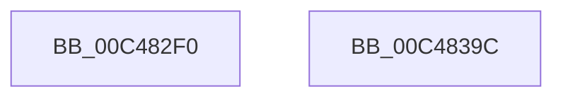

# SepInitializeWorkList

- RVA: `0x00C482F0`–`0x00C4839D` (길이 `173` bytes)
- VA: `0x0000000140C482F0`
- 실행 섹션: `INIT`
- PDB 이름 있음: `예`; PDB Function 태그: `아니요`
- unwind 정보 RVA: `0x0005CF00`
- 디코드: `31`개 명령, `173/173` bytes 표시
- 미해석 바이트: `0` (있으면 어셈블리에 `.byte`로 보존)

> 이 문서는 커널 이미지의 기계어와 PDB 기호를 분석해 생성했습니다. 4번과 5번은 함수 원형과 자료형을 바이너리 사용 방식에서 추정한 C 해석이며 원본 소스 복구 결과는 아닙니다.

## 1. Dependencies

- 직접 호출 지점: **2**; 고유 호출 대상: **1**
- 직접 호출자로 확인된 함수: **1**
- RIP 상대 이미지 참조: **19**

### Outgoing calls
- `0x00C48300` → [ExInitializeResourceLite2](../../text/41/ExInitializeResourceLite2_function_0041F710.md) (function, `0x0041F710`)
- `0x00C48369` → [ExInitializeResourceLite2](../../text/41/ExInitializeResourceLite2_function_0041F710.md) (function, `0x0041F710`)

### Direct callers
- [SepInitializationPhase0](SepInitializationPhase0_function_00C4A790.md) at `0x00C4A7B1`

### Static image references
- `0x00C482F9` → RVA `0x00E67E50` (`.data`; read)
- `0x00C48305` → RVA `0x00E67EB8` (`.data`; read/write)
- `0x00C4830D` → RVA `0x00E67E30` (`.data`; read)
- `0x00C48314` → RVA `0x00E67E38` (`.data`; write)
- `0x00C4831B` → RVA `0x00B82850` (`ExFreePool`; read)
- `0x00C48322` → RVA `0x00E67E30` (`.data`; write)
- `0x00C48329` → RVA `0x00E67C20` (`.data`; read)
- `0x00C48330` → RVA `0x00E67E40` (`.data`; read)
- `0x00C48337` → RVA `0x00E67F08` (`.data`; write)
- `0x00C4833E` → RVA `0x00E67E48` (`.data`; write)
- `0x00C48348` → RVA `0x00E67E40` (`.data`; write)
- `0x00C4834F` → RVA `0x00496730` (`SepAdtDetermineInsertQueue`; read)
- `0x00C48356` → RVA `0x00E67F00` (`.data`; write)
- `0x00C48362` → RVA `0x00E67F10` (`.data`; write)
- `0x00C4836E` → RVA `0x00E67C00` (`.data`; read)
- `0x00C48375` → RVA `0x00E67CD8` (`.data`; write)
- `0x00C4837C` → RVA `0x00E67C08` (`.data`; write)
- `0x00C48383` → RVA `0x00E67C00` (`.data`; write)
- `0x00C4838F` → RVA `0x00E67CE0` (`.data`; write)

## 2. Other-region calls and transfers

- 다른 실행 섹션으로 향하는 call: **2**
  - `0x00C48300` → [ExInitializeResourceLite2](../../text/41/ExInitializeResourceLite2_function_0041F710.md) (`INIT` → `.text`)
  - `0x00C48369` → [ExInitializeResourceLite2](../../text/41/ExInitializeResourceLite2_function_0041F710.md) (`INIT` → `.text`)
- 별도 외부 분기/꼬리 이동을 확인하지 못했습니다.

## 3. Assembly (complete function range)

```asm
00C482F0  40 53                           push rbx
00C482F2  48 83 EC 20                     sub rsp, 0x20
00C482F6  83 CA FF                        or edx, 0xffffffff
00C482F9  48 8D 0D 50 FB 21 00            lea rcx, [rip + 0x21fb50]
00C48300  E8 0B 74 7D FF                  call 0x14041f710
00C48305  48 83 25 AB FB 21 00 00         and qword ptr [rip + 0x21fbab], 0
00C4830D  48 8D 05 1C FB 21 00            lea rax, [rip + 0x21fb1c]
00C48314  48 89 05 1D FB 21 00            mov qword ptr [rip + 0x21fb1d], rax
00C4831B  48 8D 1D 2E A5 F3 FF            lea rbx, [rip - 0xc5ad2]
00C48322  48 89 05 07 FB 21 00            mov qword ptr [rip + 0x21fb07], rax
00C48329  48 8D 0D F0 F8 21 00            lea rcx, [rip + 0x21f8f0]
00C48330  48 8D 05 09 FB 21 00            lea rax, [rip + 0x21fb09]
00C48337  48 89 1D CA FB 21 00            mov qword ptr [rip + 0x21fbca], rbx
00C4833E  48 89 05 03 FB 21 00            mov qword ptr [rip + 0x21fb03], rax
00C48345  83 CA FF                        or edx, 0xffffffff
00C48348  48 89 05 F1 FA 21 00            mov qword ptr [rip + 0x21faf1], rax
00C4834F  48 8D 05 DA E3 84 FF            lea rax, [rip - 0x7b1c26]
00C48356  48 89 05 A3 FB 21 00            mov qword ptr [rip + 0x21fba3], rax
00C4835D  B8 03 00 00 00                  mov eax, 3
00C48362  66 89 05 A7 FB 21 00            mov word ptr [rip + 0x21fba7], ax
00C48369  E8 A2 73 7D FF                  call 0x14041f710
00C4836E  48 8D 05 8B F8 21 00            lea rax, [rip + 0x21f88b]
00C48375  48 89 1D 5C F9 21 00            mov qword ptr [rip + 0x21f95c], rbx
00C4837C  48 89 05 85 F8 21 00            mov qword ptr [rip + 0x21f885], rax
00C48383  48 89 05 76 F8 21 00            mov qword ptr [rip + 0x21f876], rax
00C4838A  B8 01 00 00 00                  mov eax, 1
00C4838F  66 89 05 4A F9 21 00            mov word ptr [rip + 0x21f94a], ax
00C48396  48 83 C4 20                     add rsp, 0x20
00C4839A  5B                              pop rbx
00C4839B  C3                              ret
00C4839C  CC                              int3
```

## 4. C-style interpretation (structured pseudocode)

```c
__int64 __fastcall SepInitializeWorkList(__int64 a1, int a2)
{
    __int64 result;
    __int64 v_rsp;

    v_rsp = (v_rsp) - (32);
    a2 = (unsigned int)((a2) | (0xFFFFFFFFULL));
    result = ExInitializeResourceLite2(v_rip + 2227024, a2, a3, a4);
    *(unsigned __int64 *)(v_rip + 2226973) = v_rip + 2226972;
    *(unsigned __int64 *)(v_rip + 2226951) = v_rip + 2226972;
    *(unsigned __int64 *)(v_rip + 2227146) = v_rip - 809682;
    *(unsigned __int64 *)(v_rip + 2226947) = v_rip + 2226953;
    a2 = (unsigned int)((a2) | (0xFFFFFFFFULL));
    *(unsigned __int64 *)(v_rip + 2226929) = v_rip + 2226953;
    *(unsigned __int64 *)(v_rip + 2227107) = v_rip - 8068134;
    *(unsigned __int16 *)(v_rip + 2227111) = 3;
    result = ExInitializeResourceLite2(v_rip + 2226416, a2, a3, a4);
    *(unsigned __int64 *)(v_rip + 2226524) = v_rip - 809682;
    *(unsigned __int64 *)(v_rip + 2226309) = v_rip + 2226315;
    *(unsigned __int64 *)(v_rip + 2226294) = v_rip + 2226315;
    *(unsigned __int16 *)(v_rip + 2226506) = 1;
    v_rsp = (v_rsp) + (32);
    return 1;
}
```

## 5. (Beta) C Style

```c
int64_t SepInitializeWorkList(int64_t Arg1, int32_t Arg2)
{
    int64_t result;
    int64_t local_rsp;

    local_rsp = (local_rsp) - (32);
    Arg2 = (uint32_t)((Arg2) | (0xFFFFFFFFULL));
    result = ExInitializeResourceLite2(v_rip + 2227024, Arg2, a3, a4);
    *(uint64_t *)(v_rip + 0x21FB1D) = v_rip + 2226972;
    *(uint64_t *)(v_rip + 0x21FB07) = v_rip + 2226972;
    *(uint64_t *)(v_rip + 0x21FBCA) = v_rip - 809682;
    *(uint64_t *)(v_rip + 0x21FB03) = v_rip + 2226953;
    Arg2 = (uint32_t)((Arg2) | (0xFFFFFFFFULL));
    *(uint64_t *)(v_rip + 0x21FAF1) = v_rip + 2226953;
    *(uint64_t *)(v_rip + 0x21FBA3) = v_rip - 8068134;
    *(uint16_t *)(v_rip + 0x21FBA7) = 3;
    result = ExInitializeResourceLite2(v_rip + 2226416, Arg2, a3, a4);
    *(uint64_t *)(v_rip + 0x21F95C) = v_rip - 809682;
    *(uint64_t *)(v_rip + 0x21F885) = v_rip + 2226315;
    *(uint64_t *)(v_rip + 0x21F876) = v_rip + 2226315;
    *(uint16_t *)(v_rip + 0x21F94A) = 1;
    local_rsp = (local_rsp) + (32);
    return 1;
}
```

## 6. Execution-region graph

[열기: 2D/3D 그래프와 함수 탐색 컨트롤 패널](../../../control-panel.html?section=init&rva=0x00C482F0&view=graph)

- 2D 그래프는 위에서 아래로 흐르고, 3D 그래프는 빈 공간을 드래그해 회전합니다. Shift+드래그는 이동, 휠은 확대·축소, 함수 노드 선택은 대상 보고서 이동입니다.

### Static fallback


