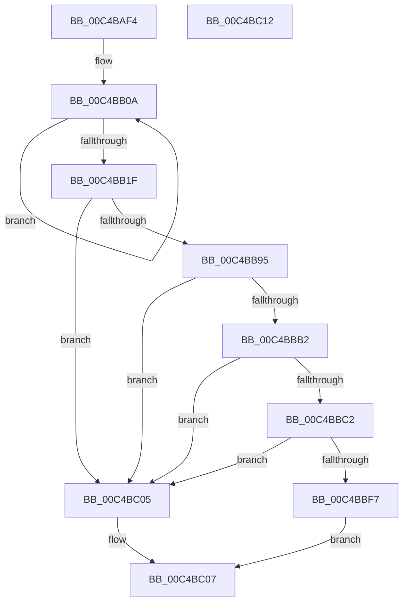

# SepRmDbInitialization

- RVA: `0x00C4BAF4`–`0x00C4BC13` (길이 `287` bytes)
- VA: `0x0000000140C4BAF4`
- 실행 섹션: `INIT`
- PDB 이름 있음: `예`; PDB Function 태그: `아니요`
- unwind 정보 RVA: `0x0005CAAC`
- 디코드: `64`개 명령, `287/287` bytes 표시
- 미해석 바이트: `0` (있으면 어셈블리에 `.byte`로 보존)

> 이 문서는 커널 이미지의 기계어와 PDB 기호를 분석해 생성했습니다. 4번과 5번은 함수 원형과 자료형을 바이너리 사용 방식에서 추정한 C 해석이며 원본 소스 복구 결과는 아닙니다.

## 1. Dependencies

- 직접 호출 지점: **8**; 고유 호출 대상: **5**
- 직접 호출자로 확인된 함수: **1**
- RIP 상대 이미지 참조: **20**

### Outgoing calls
- `0x00C4BB10` → [ExInitializeResourceLite2](../../text/41/ExInitializeResourceLite2_function_0041F710.md) (function, `0x0041F710`)
- `0x00C4BB29` → [ExInitializeResourceLite2](../../text/41/ExInitializeResourceLite2_function_0041F710.md) (function, `0x0041F710`)
- `0x00C4BB84` → [ExAllocatePool2](../../poolcode/B8/ExAllocatePool2_function_00B820F0.md) (function, `0x00B820F0`)
- `0x00C4BB9D` → [memset](../../text/6C/memset_function_006C6C40.md) (function, `0x006C6C40`)
- `0x00C4BBA9` → [SepCreateLogonSessionTrack](../../page/A2/SepCreateLogonSessionTrack_function_00A2CD3C.md) (function, `0x00A2CD3C`)
- `0x00C4BBB9` → [SepCreateLogonSessionTrack](../../page/A2/SepCreateLogonSessionTrack_function_00A2CD3C.md) (function, `0x00A2CD3C`)
- `0x00C4BBD5` → [memset](../../text/6C/memset_function_006C6C40.md) (function, `0x006C6C40`)
- `0x00C4BBEE` → [SepBuildDefaultCap](../../page/7A/SepBuildDefaultCap_function_007A38B8.md) (function, `0x007A38B8`)

### Direct callers
- [SepInitializationPhase0](SepInitializationPhase0_function_00C4A790.md) at `0x00C4A79F`

### Static image references
- `0x00C4BAFE` → RVA `0x00E67F20` (`.data`; read)
- `0x00C4BB22` → RVA `0x00E68100` (`.data`; read)
- `0x00C4BB2E` → RVA `0x00E680E0` (`.data`; read)
- `0x00C4BB35` → RVA `0x00E680C0` (`.data`; write)
- `0x00C4BB41` → RVA `0x00E680E8` (`.data`; write)
- `0x00C4BB4D` → RVA `0x00E680E0` (`.data`; write)
- `0x00C4BB56` → RVA `0x00E680C8` (`.data`; write)
- `0x00C4BB63` → RVA `0x00E680D0` (`.data`; write)
- `0x00C4BB6E` → RVA `0x00E680D8` (`.data`; write)
- `0x00C4BB77` → RVA `0x00E680DA` (`.data`; write)
- `0x00C4BB7E` → RVA `0x00E680DC` (`.data`; write)
- `0x00C4BB89` → RVA `0x00FD9AF0` (`PAGEDATA`; write)
- `0x00C4BBA2` → RVA `0x00B4AD18` (`SeSystemAuthenticationId`; read)
- `0x00C4BBB2` → RVA `0x00B4AD00` (`SeAnonymousAuthenticationId`; read)
- `0x00C4BBC4` → RVA `0x00F04AC8` (`.data`; write)
- `0x00C4BBCE` → RVA `0x00F04AE0` (`.data`; read)
- `0x00C4BBDA` → RVA `0x00F04B24` (`.data`; write)
- `0x00C4BBE1` → RVA `0x00F04AD0` (`.data`; write)
- `0x00C4BBE8` → RVA `0x00F04AC5` (`.data`; write)
- `0x00C4BBF7` → RVA `0x00FD9F24` (`PAGEDATA`; write)

## 2. Other-region calls and transfers

- 다른 실행 섹션으로 향하는 call: **8**
  - `0x00C4BB10` → [ExInitializeResourceLite2](../../text/41/ExInitializeResourceLite2_function_0041F710.md) (`INIT` → `.text`)
  - `0x00C4BB29` → [ExInitializeResourceLite2](../../text/41/ExInitializeResourceLite2_function_0041F710.md) (`INIT` → `.text`)
  - `0x00C4BB84` → [ExAllocatePool2](../../poolcode/B8/ExAllocatePool2_function_00B820F0.md) (`INIT` → `POOLCODE`)
  - `0x00C4BB9D` → [memset](../../text/6C/memset_function_006C6C40.md) (`INIT` → `.text`)
  - `0x00C4BBA9` → [SepCreateLogonSessionTrack](../../page/A2/SepCreateLogonSessionTrack_function_00A2CD3C.md) (`INIT` → `PAGE`)
  - `0x00C4BBB9` → [SepCreateLogonSessionTrack](../../page/A2/SepCreateLogonSessionTrack_function_00A2CD3C.md) (`INIT` → `PAGE`)
  - `0x00C4BBD5` → [memset](../../text/6C/memset_function_006C6C40.md) (`INIT` → `.text`)
  - `0x00C4BBEE` → [SepBuildDefaultCap](../../page/7A/SepBuildDefaultCap_function_007A38B8.md) (`INIT` → `PAGE`)
- 별도 외부 분기/꼬리 이동을 확인하지 못했습니다.

## 3. Assembly (complete function range)

```asm
00C4BAF4  48 89 5C 24 08                  mov qword ptr [rsp + 8], rbx
00C4BAF9  57                              push rdi
00C4BAFA  48 83 EC 20                     sub rsp, 0x20
00C4BAFE  48 8D 1D 1B C4 21 00            lea rbx, [rip + 0x21c41b]
00C4BB05  BF 04 00 00 00                  mov edi, 4
00C4BB0A  83 CA FF                        or edx, 0xffffffff
00C4BB0D  48 8B CB                        mov rcx, rbx
00C4BB10  E8 FB 3B 7D FF                  call 0x14041f710
00C4BB15  48 83 C3 68                     add rbx, 0x68
00C4BB19  48 83 EF 01                     sub rdi, 1
00C4BB1D  75 EB                           jne 0x140c4bb0a
00C4BB1F  83 CA FF                        or edx, 0xffffffff
00C4BB22  48 8D 0D D7 C5 21 00            lea rcx, [rip + 0x21c5d7]
00C4BB29  E8 E2 3B 7D FF                  call 0x14041f710
00C4BB2E  48 8D 05 AB C5 21 00            lea rax, [rip + 0x21c5ab]
00C4BB35  C7 05 81 C5 21 00 01 00 00 00   mov dword ptr [rip + 0x21c581], 1
00C4BB3F  33 DB                           xor ebx, ebx
00C4BB41  48 89 05 A0 C5 21 00            mov qword ptr [rip + 0x21c5a0], rax
00C4BB48  BF 80 00 00 00                  mov edi, 0x80
00C4BB4D  48 89 05 8C C5 21 00            mov qword ptr [rip + 0x21c58c], rax
00C4BB54  8B D7                           mov edx, edi
00C4BB56  48 89 1D 6B C5 21 00            mov qword ptr [rip + 0x21c56b], rbx
00C4BB5D  41 B8 53 65 4C 73               mov r8d, 0x734c6553
00C4BB63  89 1D 67 C5 21 00               mov dword ptr [rip + 0x21c567], ebx
00C4BB69  B9 00 01 00 00                  mov ecx, 0x100
00C4BB6E  66 C7 05 61 C5 21 00 01 00      mov word ptr [rip + 0x21c561], 1
00C4BB77  C6 05 5C C5 21 00 06            mov byte ptr [rip + 0x21c55c], 6
00C4BB7E  89 1D 58 C5 21 00               mov dword ptr [rip + 0x21c558], ebx
00C4BB84  E8 67 65 F3 FF                  call 0x140b820f0
00C4BB89  48 89 05 60 DF 38 00            mov qword ptr [rip + 0x38df60], rax
00C4BB90  48 85 C0                        test rax, rax
00C4BB93  74 70                           je 0x140c4bc05
00C4BB95  44 8B C7                        mov r8d, edi
00C4BB98  33 D2                           xor edx, edx
00C4BB9A  48 8B C8                        mov rcx, rax
00C4BB9D  E8 9E B0 A7 FF                  call 0x1406c6c40
00C4BBA2  48 8D 0D 6F F1 EF FF            lea rcx, [rip - 0x100e91]
00C4BBA9  E8 8E 11 DE FF                  call 0x140a2cd3c
00C4BBAE  85 C0                           test eax, eax
00C4BBB0  78 53                           js 0x140c4bc05
00C4BBB2  48 8D 0D 47 F1 EF FF            lea rcx, [rip - 0x100eb9]
00C4BBB9  E8 7E 11 DE FF                  call 0x140a2cd3c
00C4BBBE  85 C0                           test eax, eax
00C4BBC0  78 43                           js 0x140c4bc05
00C4BBC2  33 D2                           xor edx, edx
00C4BBC4  89 1D FE 8E 2B 00               mov dword ptr [rip + 0x2b8efe], ebx
00C4BBCA  44 8D 43 78                     lea r8d, [rbx + 0x78]
00C4BBCE  48 8D 0D 0B 8F 2B 00            lea rcx, [rip + 0x2b8f0b]
00C4BBD5  E8 66 B0 A7 FF                  call 0x1406c6c40
00C4BBDA  C6 05 43 8F 2B 00 01            mov byte ptr [rip + 0x2b8f43], 1
00C4BBE1  48 89 1D E8 8E 2B 00            mov qword ptr [rip + 0x2b8ee8], rbx
00C4BBE8  88 1D D7 8E 2B 00               mov byte ptr [rip + 0x2b8ed7], bl
00C4BBEE  E8 C5 7C B5 FF                  call 0x1407a38b8
00C4BBF3  85 C0                           test eax, eax
00C4BBF5  78 0E                           js 0x140c4bc05
00C4BBF7  C7 05 23 E3 38 00 01 00 00 00   mov dword ptr [rip + 0x38e323], 1
00C4BC01  B0 01                           mov al, 1
00C4BC03  EB 02                           jmp 0x140c4bc07
00C4BC05  32 C0                           xor al, al
00C4BC07  48 8B 5C 24 30                  mov rbx, qword ptr [rsp + 0x30]
00C4BC0C  48 83 C4 20                     add rsp, 0x20
00C4BC10  5F                              pop rdi
00C4BC11  C3                              ret
00C4BC12  CC                              int3
```

## 4. C-style interpretation (structured pseudocode)

```c
__int64 __fastcall SepRmDbInitialization(__int64 a1, int a2)
{
    __int64 result;
    __int64 v_rbx;
    __int64 v_rdi;
    __int64 v_rsp;
    unsigned __int64 v_stack_p8;

    v_stack_p8 = v_rbx;
    v_rsp = (v_rsp) - (32);
loc_00C4BB0A:
    a2 = (unsigned int)((a2) | (0xFFFFFFFFULL));
    result = ExInitializeResourceLite2(v_rip + 2212891, a2, a3, a4);
    v_rbx = (v_rip + 2212891) + (104);
    v_rdi = (4) - (1);
    if (condition_is_not_equal) goto loc_00C4BB0A;
    a2 = (unsigned int)((a2) | (0xFFFFFFFFULL));
    result = ExInitializeResourceLite2(v_rip + 2213335, a2, a3, a4);
    *(unsigned int *)(v_rip + 2213249) = 1;
    v_rbx = 0;
    *(unsigned __int64 *)(v_rip + 2213280) = v_rip + 2213291;
    *(unsigned __int64 *)(v_rip + 2213260) = v_rip + 2213291;
    *(unsigned __int64 *)(v_rip + 2213227) = 0;
    *(unsigned int *)(v_rip + 2213223) = 0;
    *(unsigned __int16 *)(v_rip + 2213217) = 1;
    *(unsigned __int8 *)(v_rip + 2213212) = 6;
    *(unsigned int *)(v_rip + 2213208) = 0;
    result = ExAllocatePool2(256, 128, (unsigned int)(0x734C6553ULL), a4);
    *(unsigned __int64 *)(v_rip + 3727200) = result;
    if (result == 0) goto loc_00C4BC05;
    a2 = 0;
    result = memset(result, a2, 128, a4);
    result = SepCreateLogonSessionTrack(v_rip - 1052305, a2, 128, a4);
    if (sign_flag) goto loc_00C4BC05;
    result = SepCreateLogonSessionTrack(v_rip - 1052345, a2, 128, a4);
    if (sign_flag) goto loc_00C4BC05;
    a2 = 0;
    *(unsigned int *)(v_rip + 2854654) = 0;
    result = memset(v_rip + 2854667, a2, v_rbx + 120, a4);
    *(unsigned __int8 *)(v_rip + 2854723) = 1;
    *(unsigned __int64 *)(v_rip + 2854632) = 0;
    *(unsigned __int8 *)(v_rip + 2854615) = 0;
    result = SepBuildDefaultCap(v_rip + 2854667, a2, v_rbx + 120, a4);
    if (sign_flag) goto loc_00C4BC05;
    *(unsigned int *)(v_rip + 3728163) = 1;
    goto loc_00C4BC07;
loc_00C4BC05:
    result = 0;
loc_00C4BC07:
    v_rsp = (v_rsp) + (32);
    return result;
}
```

## 5. (Beta) C Style

```c
int64_t SepRmDbInitialization(int64_t Arg1, int32_t Arg2)
{
    int64_t result;
    int64_t local_rbx;
    int64_t local_rdi;
    int64_t local_rsp;
    uint64_t v_stack_p8;

    v_stack_p8 = local_rbx;
    local_rsp = (local_rsp) - (32);
loc_00C4BB0A:
    Arg2 = (uint32_t)((Arg2) | (0xFFFFFFFFULL));
    result = ExInitializeResourceLite2(v_rip + 2212891, Arg2, a3, a4);
    local_rbx = (v_rip + 2212891) + (104);
    local_rdi = (4) - (1);
    if (condition_is_not_equal) goto loc_00C4BB0A;
    Arg2 = (uint32_t)((Arg2) | (0xFFFFFFFFULL));
    result = ExInitializeResourceLite2(v_rip + 2213335, Arg2, a3, a4);
    *(uint32_t *)(v_rip + 0x21C581) = 1;
    local_rbx = 0;
    *(uint64_t *)(v_rip + 0x21C5A0) = v_rip + 2213291;
    *(uint64_t *)(v_rip + 0x21C58C) = v_rip + 2213291;
    *(uint64_t *)(v_rip + 0x21C56B) = 0;
    *(uint32_t *)(v_rip + 0x21C567) = 0;
    *(uint16_t *)(v_rip + 0x21C561) = 1;
    *(uint8_t *)(v_rip + 0x21C55C) = 6;
    *(uint32_t *)(v_rip + 0x21C558) = 0;
    result = ExAllocatePool2(256, 128, (uint32_t)(0x734C6553ULL), a4);
    *(uint64_t *)(v_rip + 0x38DF60) = result;
    if (result == 0) goto loc_00C4BC05;
    Arg2 = 0;
    result = memset(result, Arg2, 128, a4);
    result = SepCreateLogonSessionTrack(v_rip - 1052305, Arg2, 128, a4);
    if (sign_flag) goto loc_00C4BC05;
    result = SepCreateLogonSessionTrack(v_rip - 1052345, Arg2, 128, a4);
    if (sign_flag) goto loc_00C4BC05;
    Arg2 = 0;
    *(uint32_t *)(v_rip + 0x2B8EFE) = 0;
    result = memset(v_rip + 2854667, Arg2, local_rbx + 120, a4);
    *(uint8_t *)(v_rip + 0x2B8F43) = 1;
    *(uint64_t *)(v_rip + 0x2B8EE8) = 0;
    *(uint8_t *)(v_rip + 0x2B8ED7) = 0;
    result = SepBuildDefaultCap(v_rip + 2854667, Arg2, local_rbx + 120, a4);
    if (sign_flag) goto loc_00C4BC05;
    *(uint32_t *)(v_rip + 0x38E323) = 1;
    goto loc_00C4BC07;
loc_00C4BC05:
    result = 0;
loc_00C4BC07:
    local_rsp = (local_rsp) + (32);
    return result;
}
```

## 6. Execution-region graph

[열기: 2D/3D 그래프와 함수 탐색 컨트롤 패널](../../../control-panel.html?section=init&rva=0x00C4BAF4&view=graph)

- 2D 그래프는 위에서 아래로 흐르고, 3D 그래프는 빈 공간을 드래그해 회전합니다. Shift+드래그는 이동, 휠은 확대·축소, 함수 노드 선택은 대상 보고서 이동입니다.

### Static fallback


