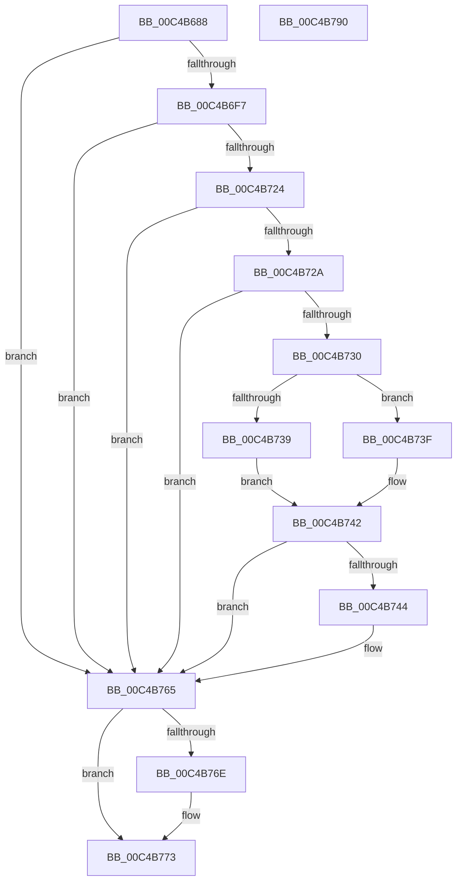

# SepSecureBootCheckForUpdates

- RVA: `0x00C4B688`–`0x00C4B791` (길이 `265` bytes)
- VA: `0x0000000140C4B688`
- 실행 섹션: `INIT`
- PDB 이름 있음: `예`; PDB Function 태그: `아니요`
- unwind 정보 RVA: `0x000D155C`
- 디코드: `67`개 명령, `265/265` bytes 표시
- 미해석 바이트: `0` (있으면 어셈블리에 `.byte`로 보존)

> 이 문서는 커널 이미지의 기계어와 PDB 기호를 분석해 생성했습니다. 4번과 5번은 함수 원형과 자료형을 바이너리 사용 방식에서 추정한 C 해석이며 원본 소스 복구 결과는 아닙니다.

## 1. Dependencies

- 직접 호출 지점: **6**; 고유 호출 대상: **6**
- 직접 호출자로 확인된 함수: **1**
- RIP 상대 이미지 참조: **4**

### Outgoing calls
- `0x00C4B6EE` → [ZwOpenKey](../../text/6A/ZwOpenKey_function_006AD310.md) (function, `0x006AD310`)
- `0x00C4B71B` → [ZwQueryValueKey](../../text/6A/ZwQueryValueKey_function_006AD3B0.md) (function, `0x006AD3B0`)
- `0x00C4B730` → [Feature_Servicing_DbxRaceCondition__private_IsEnabledDeviceUsageNoInline](../../text/60/Feature_Servicing_DbxRaceCondition__private_IsEnabledDeviceUsageNoInline_function_00609B20.md) (function, `0x00609B20`)
- `0x00C4B760` → [NtUpdateWnfStateData](../../page/90/NtUpdateWnfStateData_function_0090A760.md) (function, `0x0090A760`)
- `0x00C4B76E` → [ZwClose](../../text/6A/ZwClose_function_006AD2B0.md) (function, `0x006AD2B0`)
- `0x00C4B77A` → [_security_check_cookie](../../text/6A/_security_check_cookie_function_006AC640.md) (function, `0x006AC640`)

### Direct callers
- [SeSecureBootRegisterPolicy](SeSecureBootRegisterPolicy_function_00C4B3FC.md) at `0x00C4B4A5`

### Static image references
- `0x00C4B69A` → RVA `0x00E0A740` (`.data`; read)
- `0x00C4B6BE` → RVA `0x0000B7F8` (`.rdata`; read)
- `0x00C4B714` → RVA `0x0000B828` (`.rdata`; read)
- `0x00C4B748` → RVA `0x00020A20` (`.rdata`; read)

## 2. Other-region calls and transfers

- 다른 실행 섹션으로 향하는 call: **6**
  - `0x00C4B6EE` → [ZwOpenKey](../../text/6A/ZwOpenKey_function_006AD310.md) (`INIT` → `.text`)
  - `0x00C4B71B` → [ZwQueryValueKey](../../text/6A/ZwQueryValueKey_function_006AD3B0.md) (`INIT` → `.text`)
  - `0x00C4B730` → [Feature_Servicing_DbxRaceCondition__private_IsEnabledDeviceUsageNoInline](../../text/60/Feature_Servicing_DbxRaceCondition__private_IsEnabledDeviceUsageNoInline_function_00609B20.md) (`INIT` → `.text`)
  - `0x00C4B760` → [NtUpdateWnfStateData](../../page/90/NtUpdateWnfStateData_function_0090A760.md) (`INIT` → `PAGE`)
  - `0x00C4B76E` → [ZwClose](../../text/6A/ZwClose_function_006AD2B0.md) (`INIT` → `.text`)
  - `0x00C4B77A` → [_security_check_cookie](../../text/6A/_security_check_cookie_function_006AC640.md) (`INIT` → `.text`)
- 별도 외부 분기/꼬리 이동을 확인하지 못했습니다.

## 3. Assembly (complete function range)

```asm
00C4B688  48 89 5C 24 08                  mov qword ptr [rsp + 8], rbx
00C4B68D  55                              push rbp
00C4B68E  48 8D 6C 24 A9                  lea rbp, [rsp - 0x57]
00C4B693  48 81 EC A0 00 00 00            sub rsp, 0xa0
00C4B69A  48 8B 05 9F F0 1B 00            mov rax, qword ptr [rip + 0x1bf09f]
00C4B6A1  48 33 C4                        xor rax, rsp
00C4B6A4  48 89 45 4F                     mov qword ptr [rbp + 0x4f], rax
00C4B6A8  33 C0                           xor eax, eax
00C4B6AA  48 C7 45 07 30 00 00 00         mov qword ptr [rbp + 7], 0x30
00C4B6B2  33 DB                           xor ebx, ebx
00C4B6B4  89 45 47                        mov dword ptr [rbp + 0x47], eax
00C4B6B7  0F 57 C0                        xorps xmm0, xmm0
00C4B6BA  48 89 5D FF                     mov qword ptr [rbp - 1], rbx
00C4B6BE  48 8D 05 33 01 3C FF            lea rax, [rip - 0xc3fecd]
00C4B6C5  89 5D F7                        mov dword ptr [rbp - 9], ebx
00C4B6C8  4C 8D 45 07                     lea r8, [rbp + 7]
00C4B6CC  48 89 45 17                     mov qword ptr [rbp + 0x17], rax
00C4B6D0  BA 19 00 02 00                  mov edx, 0x20019
00C4B6D5  48 C7 45 1F 40 02 00 00         mov qword ptr [rbp + 0x1f], 0x240
00C4B6DD  48 8D 4D FF                     lea rcx, [rbp - 1]
00C4B6E1  48 89 5D 0F                     mov qword ptr [rbp + 0xf], rbx
00C4B6E5  0F 11 45 37                     movups xmmword ptr [rbp + 0x37], xmm0
00C4B6E9  F3 0F 7F 45 27                  movdqu xmmword ptr [rbp + 0x27], xmm0
00C4B6EE  E8 1D 1C A6 FF                  call 0x1406ad310
00C4B6F3  85 C0                           test eax, eax
00C4B6F5  78 6E                           js 0x140c4b765
00C4B6F7  48 8B 4D FF                     mov rcx, qword ptr [rbp - 1]
00C4B6FB  48 8D 45 F7                     lea rax, [rbp - 9]
00C4B6FF  48 89 44 24 28                  mov qword ptr [rsp + 0x28], rax
00C4B704  4C 8D 4D 37                     lea r9, [rbp + 0x37]
00C4B708  44 8D 43 02                     lea r8d, [rbx + 2]
00C4B70C  C7 44 24 20 14 00 00 00         mov dword ptr [rsp + 0x20], 0x14
00C4B714  48 8D 15 0D 01 3C FF            lea rdx, [rip - 0xc3fef3]
00C4B71B  E8 90 1C A6 FF                  call 0x1406ad3b0
00C4B720  85 C0                           test eax, eax
00C4B722  78 41                           js 0x140c4b765
00C4B724  83 7D 3B 04                     cmp dword ptr [rbp + 0x3b], 4
00C4B728  75 3B                           jne 0x140c4b765
00C4B72A  83 7D 3F 04                     cmp dword ptr [rbp + 0x3f], 4
00C4B72E  75 35                           jne 0x140c4b765
00C4B730  E8 EB E3 9B FF                  call 0x140609b20
00C4B735  85 C0                           test eax, eax
00C4B737  74 06                           je 0x140c4b73f
00C4B739  F6 45 43 02                     test byte ptr [rbp + 0x43], 2
00C4B73D  EB 03                           jmp 0x140c4b742
00C4B73F  39 5D 43                        cmp dword ptr [rbp + 0x43], ebx
00C4B742  74 21                           je 0x140c4b765
00C4B744  89 5C 24 30                     mov dword ptr [rsp + 0x30], ebx
00C4B748  48 8D 0D D1 52 3D FF            lea rcx, [rip - 0xc2ad2f]
00C4B74F  89 5C 24 28                     mov dword ptr [rsp + 0x28], ebx
00C4B753  45 33 C9                        xor r9d, r9d
00C4B756  45 33 C0                        xor r8d, r8d
00C4B759  48 89 5C 24 20                  mov qword ptr [rsp + 0x20], rbx
00C4B75E  33 D2                           xor edx, edx
00C4B760  E8 FB EF CB FF                  call 0x14090a760
00C4B765  48 8B 4D FF                     mov rcx, qword ptr [rbp - 1]
00C4B769  48 85 C9                        test rcx, rcx
00C4B76C  74 05                           je 0x140c4b773
00C4B76E  E8 3D 1B A6 FF                  call 0x1406ad2b0
00C4B773  48 8B 4D 4F                     mov rcx, qword ptr [rbp + 0x4f]
00C4B777  48 33 CC                        xor rcx, rsp
00C4B77A  E8 C1 0E A6 FF                  call 0x1406ac640
00C4B77F  48 8B 9C 24 B0 00 00 00         mov rbx, qword ptr [rsp + 0xb0]
00C4B787  48 81 C4 A0 00 00 00            add rsp, 0xa0
00C4B78E  5D                              pop rbp
00C4B78F  C3                              ret
00C4B790  CC                              int3
```

## 4. C-style interpretation (structured pseudocode)

```c
__int64 __fastcall SepSecureBootCheckForUpdates(void)
{
    __int64 result;
    __int64 v_rbx;
    __int64 v_rsp;
    unsigned __int64 v_stack_m10;
    unsigned int v_stack_m18;
    unsigned __int8 v_stack_m1C;
    unsigned int v_stack_m20;
    unsigned int v_stack_m24;
    unsigned __int64 v_stack_m28;
    unsigned __int64 v_stack_m38;
    unsigned __int64 v_stack_m40;
    unsigned __int64 v_stack_m48;
    unsigned __int64 v_stack_m50;
    unsigned __int64 v_stack_m58;
    unsigned __int64 v_stack_m5F;
    unsigned __int64 v_stack_m60;
    unsigned int v_stack_m68;
    unsigned int v_stack_m78;
    unsigned __int64 v_stack_m80;
    unsigned int v_stack_m88;
    unsigned __int64 v_stack_p8;

    v_stack_p8 = v_rbx;
    v_rsp = (v_rsp) - (160);
    result = (*(unsigned __int64 *)(v_rip + 1831071)) ^ (v_rsp);
    v_stack_m10 = result;
    result = 0;
    v_stack_m58 = 48;
    v_rbx = 0;
    v_stack_m18 = 0;
    v_stack_m60 = 0;
    v_stack_m68 = 0;
    v_stack_m48 = v_rip - 12844749;
    v_stack_m40 = 576;
    v_stack_m50 = 0;
    v_stack_m28 = v_xmm0;
    v_stack_m38 = v_xmm0;
    result = ZwOpenKey(v_stack_m60, (unsigned int)(0x20019ULL), v_stack_m58, a4);
    if (sign_flag) goto loc_00C4B765;
    v_stack_m80 = v_stack_m68;
    v_stack_m88 = 20;
    result = ZwQueryValueKey(v_stack_m60, v_rip - 12844787, v_rbx + 2, v_stack_m28);
    if (sign_flag) goto loc_00C4B765;
    if (v_stack_m24 != 4) goto loc_00C4B765;
    if (v_stack_m20 != 4) goto loc_00C4B765;
    result = Feature_Servicing_DbxRaceCondition__private_IsEnabledDeviceUsageNoInline(v_stack_m60, v_rip - 12844787, v_rbx + 2, v_stack_m28);
    if ((unsigned int)(result) == 0) goto loc_00C4B73F;
    goto loc_00C4B742;
loc_00C4B73F:
loc_00C4B742:
    if (v_stack_m1C != 0) {
        v_stack_m78 = 0;
        a1 = v_rip - 12758319;
        v_stack_m80 = 0;
        a4 = 0;
        a3 = 0;
        v_stack_m88 = 0;
        a2 = 0;
        result = NtUpdateWnfStateData(a1, a2, a3, a4);
    }
    if (v_stack_m60 != 0) {
        result = ZwClose(v_stack_m60, a2, a3, a4);
    }
    a1 = (v_stack_m10) ^ (v_rsp);
    result = _security_check_cookie(a1, a2, a3, a4);
    v_rsp = (v_rsp) + (160);
    return result;
}
```

## 5. (Beta) C Style

```c
void SepSecureBootCheckForUpdates(void)
{
    int64_t result;
    int64_t local_rbx;
    int64_t local_rsp;
    uint64_t v_stack_m10;
    uint32_t v_stack_m18;
    uint8_t v_stack_m1C;
    uint32_t v_stack_m20;
    uint32_t v_stack_m24;
    uint64_t v_stack_m28;
    uint64_t v_stack_m38;
    uint64_t v_stack_m40;
    uint64_t v_stack_m48;
    uint64_t v_stack_m50;
    uint64_t v_stack_m58;
    uint64_t v_stack_m5F;
    uint64_t v_stack_m60;
    uint32_t v_stack_m68;
    uint32_t v_stack_m78;
    uint64_t v_stack_m80;
    uint32_t v_stack_m88;
    uint64_t v_stack_p8;

    v_stack_p8 = local_rbx;
    local_rsp = (local_rsp) - (160);
    result = (*(uint64_t *)(v_rip + 0x1BF09F)) ^ (local_rsp);
    v_stack_m10 = result;
    result = 0;
    v_stack_m58 = 48;
    local_rbx = 0;
    v_stack_m18 = 0;
    v_stack_m60 = 0;
    v_stack_m68 = 0;
    v_stack_m48 = v_rip - 12844749;
    v_stack_m40 = 576;
    v_stack_m50 = 0;
    v_stack_m28 = v_xmm0;
    v_stack_m38 = v_xmm0;
    result = ZwOpenKey(v_stack_m60, (uint32_t)(0x20019ULL), v_stack_m58, a4);
    if (sign_flag) goto loc_00C4B765;
    v_stack_m80 = v_stack_m68;
    v_stack_m88 = 20;
    result = ZwQueryValueKey(v_stack_m60, v_rip - 12844787, local_rbx + 2, v_stack_m28);
    if (sign_flag) goto loc_00C4B765;
    if (v_stack_m24 != 4) goto loc_00C4B765;
    if (v_stack_m20 != 4) goto loc_00C4B765;
    result = Feature_Servicing_DbxRaceCondition__private_IsEnabledDeviceUsageNoInline(v_stack_m60, v_rip - 12844787, local_rbx + 2, v_stack_m28);
    if ((uint32_t)(result) == 0) goto loc_00C4B73F;
    goto loc_00C4B742;
loc_00C4B73F:
loc_00C4B742:
    if (v_stack_m1C != 0) {
        v_stack_m78 = 0;
        a1 = v_rip - 12758319;
        v_stack_m80 = 0;
        a4 = 0;
        a3 = 0;
        v_stack_m88 = 0;
        a2 = 0;
        result = NtUpdateWnfStateData(a1, a2, a3, a4);
    }
    if (v_stack_m60 != 0) {
        result = ZwClose(v_stack_m60, a2, a3, a4);
    }
    a1 = (v_stack_m10) ^ (local_rsp);
    result = _security_check_cookie(a1, a2, a3, a4);
    local_rsp = (local_rsp) + (160);
    return result;
}
```

## 6. Execution-region graph

[열기: 2D/3D 그래프와 함수 탐색 컨트롤 패널](../../../control-panel.html?section=init&rva=0x00C4B688&view=graph)

- 2D 그래프는 위에서 아래로 흐르고, 3D 그래프는 빈 공간을 드래그해 회전합니다. Shift+드래그는 이동, 휠은 확대·축소, 함수 노드 선택은 대상 보고서 이동입니다.

### Static fallback


