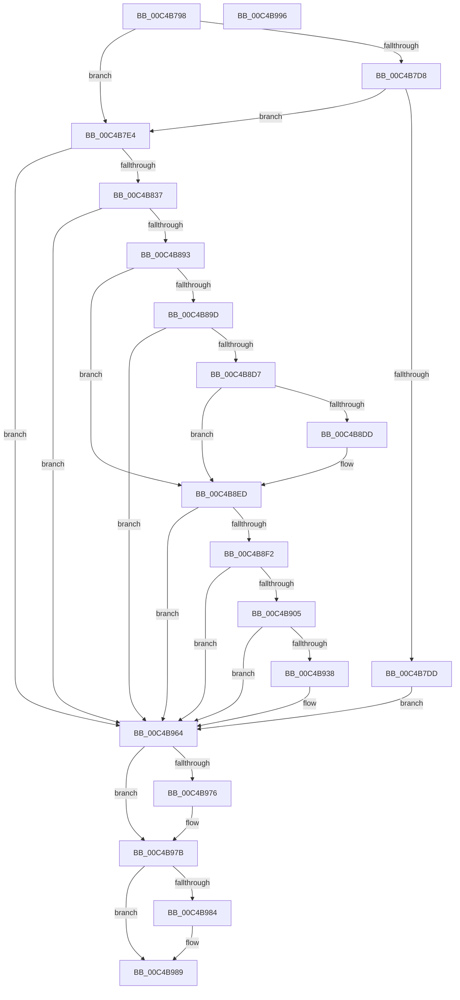

# SepSecureBootSetRegistryKey

- RVA: `0x00C4B798`–`0x00C4B997` (길이 `511` bytes)
- VA: `0x0000000140C4B798`
- 실행 섹션: `INIT`
- PDB 이름 있음: `예`; PDB Function 태그: `아니요`
- unwind 정보 RVA: `0x000D1578`
- 디코드: `126`개 명령, `511/511` bytes 표시
- 미해석 바이트: `0` (있으면 어셈블리에 `.byte`로 보존)

> 이 문서는 커널 이미지의 기계어와 PDB 기호를 분석해 생성했습니다. 4번과 5번은 함수 원형과 자료형을 바이너리 사용 방식에서 추정한 C 해석이며 원본 소스 복구 결과는 아닙니다.

## 1. Dependencies

- 직접 호출 지점: **9**; 고유 호출 대상: **5**
- 직접 호출자로 확인된 함수: **1**
- RIP 상대 이미지 참조: **7**

### Outgoing calls
- `0x00C4B828` → [ZwCreateKey](../../text/6A/ZwCreateKey_function_006AD470.md) (function, `0x006AD470`)
- `0x00C4B884` → [ZwCreateKey](../../text/6A/ZwCreateKey_function_006AD470.md) (function, `0x006AD470`)
- `0x00C4B8C8` → [ZwSetValueKey](../../text/6A/ZwSetValueKey_function_006ADCD0.md) (function, `0x006ADCD0`)
- `0x00C4B8FA` → [RtlStringFromGUID](../../page/91/RtlStringFromGUID_function_00914BA0.md) (function, `0x00914BA0`)
- `0x00C4B92D` → [ZwSetValueKey](../../text/6A/ZwSetValueKey_function_006ADCD0.md) (function, `0x006ADCD0`)
- `0x00C4B95D` → [ZwSetValueKey](../../text/6A/ZwSetValueKey_function_006ADCD0.md) (function, `0x006ADCD0`)
- `0x00C4B968` → [RtlFreeAnsiString](../../page/9C/RtlFreeAnsiString_function_009C0800.md) (function, `0x009C0800`)
- `0x00C4B976` → [ZwClose](../../text/6A/ZwClose_function_006AD2B0.md) (function, `0x006AD2B0`)
- `0x00C4B984` → [ZwClose](../../text/6A/ZwClose_function_006AD2B0.md) (function, `0x006AD2B0`)

### Direct callers
- [SeSecureBootRegisterPolicy](SeSecureBootRegisterPolicy_function_00C4B3FC.md) at `0x00C4B496`

### Static image references
- `0x00C4B7C2` → RVA `0x00E67E04` (`.data`; read)
- `0x00C4B7EA` → RVA `0x0000B7F8` (`.rdata`; read)
- `0x00C4B850` → RVA `0x0000B808` (`.rdata`; read)
- `0x00C4B8A1` → RVA `0x0000B838` (`.rdata`; read)
- `0x00C4B8DD` → RVA `0x00FC5008` (`ALMOSTRO`; read)
- `0x00C4B909` → RVA `0x0000B848` (`.rdata`; read)
- `0x00C4B948` → RVA `0x0000B818` (`.rdata`; read)

## 2. Other-region calls and transfers

- 다른 실행 섹션으로 향하는 call: **9**
  - `0x00C4B828` → [ZwCreateKey](../../text/6A/ZwCreateKey_function_006AD470.md) (`INIT` → `.text`)
  - `0x00C4B884` → [ZwCreateKey](../../text/6A/ZwCreateKey_function_006AD470.md) (`INIT` → `.text`)
  - `0x00C4B8C8` → [ZwSetValueKey](../../text/6A/ZwSetValueKey_function_006ADCD0.md) (`INIT` → `.text`)
  - `0x00C4B8FA` → [RtlStringFromGUID](../../page/91/RtlStringFromGUID_function_00914BA0.md) (`INIT` → `PAGE`)
  - `0x00C4B92D` → [ZwSetValueKey](../../text/6A/ZwSetValueKey_function_006ADCD0.md) (`INIT` → `.text`)
  - `0x00C4B95D` → [ZwSetValueKey](../../text/6A/ZwSetValueKey_function_006ADCD0.md) (`INIT` → `.text`)
  - `0x00C4B968` → [RtlFreeAnsiString](../../page/9C/RtlFreeAnsiString_function_009C0800.md) (`INIT` → `PAGE`)
  - `0x00C4B976` → [ZwClose](../../text/6A/ZwClose_function_006AD2B0.md) (`INIT` → `.text`)
  - `0x00C4B984` → [ZwClose](../../text/6A/ZwClose_function_006AD2B0.md) (`INIT` → `.text`)
- 별도 외부 분기/꼬리 이동을 확인하지 못했습니다.

## 3. Assembly (complete function range)

```asm
00C4B798  40 55                           push rbp
00C4B79A  53                              push rbx
00C4B79B  57                              push rdi
00C4B79C  48 8B EC                        mov rbp, rsp
00C4B79F  48 81 EC 80 00 00 00            sub rsp, 0x80
00C4B7A6  48 83 65 38 00                  and qword ptr [rbp + 0x38], 0
00C4B7AB  33 C0                           xor eax, eax
00C4B7AD  21 45 28                        and dword ptr [rbp + 0x28], eax
00C4B7B0  0F 57 C0                        xorps xmm0, xmm0
00C4B7B3  48 83 65 30 00                  and qword ptr [rbp + 0x30], 0
00C4B7B8  48 8B F9                        mov rdi, rcx
00C4B7BB  48 89 45 F0                     mov qword ptr [rbp - 0x10], rax
00C4B7BF  89 45 F8                        mov dword ptr [rbp - 8], eax
00C4B7C2  8B 05 3C C6 21 00               mov eax, dword ptr [rip + 0x21c63c]
00C4B7C8  0F 11 45 D0                     movups xmmword ptr [rbp - 0x30], xmm0
00C4B7CC  0F 11 45 E0                     movups xmmword ptr [rbp - 0x20], xmm0
00C4B7D0  0F 11 45 C0                     movups xmmword ptr [rbp - 0x40], xmm0
00C4B7D4  A8 08                           test al, 8
00C4B7D6  75 0C                           jne 0x140c4b7e4
00C4B7D8  48 85 C9                        test rcx, rcx
00C4B7DB  75 07                           jne 0x140c4b7e4
00C4B7DD  33 DB                           xor ebx, ebx
00C4B7DF  E9 80 01 00 00                  jmp 0x140c4b964
00C4B7E4  48 83 64 24 30 00               and qword ptr [rsp + 0x30], 0
00C4B7EA  48 8D 05 07 00 3C FF            lea rax, [rip - 0xc3fff9]
00C4B7F1  83 64 24 28 00                  and dword ptr [rsp + 0x28], 0
00C4B7F6  4C 8D 45 D0                     lea r8, [rbp - 0x30]
00C4B7FA  48 83 64 24 20 00               and qword ptr [rsp + 0x20], 0
00C4B800  48 8D 4D 38                     lea rcx, [rbp + 0x38]
00C4B804  48 83 65 D8 00                  and qword ptr [rbp - 0x28], 0
00C4B809  45 33 C9                        xor r9d, r9d
00C4B80C  BA 06 00 02 00                  mov edx, 0x20006
00C4B811  48 89 45 E0                     mov qword ptr [rbp - 0x20], rax
00C4B815  C7 45 D0 30 00 00 00            mov dword ptr [rbp - 0x30], 0x30
00C4B81C  C7 45 E8 40 02 00 00            mov dword ptr [rbp - 0x18], 0x240
00C4B823  F3 0F 7F 45 F0                  movdqu xmmword ptr [rbp - 0x10], xmm0
00C4B828  E8 43 1C A6 FF                  call 0x1406ad470
00C4B82D  8B D8                           mov ebx, eax
00C4B82F  85 C0                           test eax, eax
00C4B831  0F 88 2D 01 00 00               js 0x140c4b964
00C4B837  48 8B 45 38                     mov rax, qword ptr [rbp + 0x38]
00C4B83B  4C 8D 45 D0                     lea r8, [rbp - 0x30]
00C4B83F  48 83 64 24 30 00               and qword ptr [rsp + 0x30], 0
00C4B845  48 8D 4D 30                     lea rcx, [rbp + 0x30]
00C4B849  48 89 45 D8                     mov qword ptr [rbp - 0x28], rax
00C4B84D  0F 57 C0                        xorps xmm0, xmm0
00C4B850  48 8D 05 B1 FF 3B FF            lea rax, [rip - 0xc4004f]
00C4B857  C7 44 24 28 01 00 00 00         mov dword ptr [rsp + 0x28], 1
00C4B85F  48 83 64 24 20 00               and qword ptr [rsp + 0x20], 0
00C4B865  45 33 C9                        xor r9d, r9d
00C4B868  BA 06 00 02 00                  mov edx, 0x20006
00C4B86D  48 89 45 E0                     mov qword ptr [rbp - 0x20], rax
00C4B871  C7 45 D0 30 00 00 00            mov dword ptr [rbp - 0x30], 0x30
00C4B878  C7 45 E8 40 02 00 00            mov dword ptr [rbp - 0x18], 0x240
00C4B87F  F3 0F 7F 45 F0                  movdqu xmmword ptr [rbp - 0x10], xmm0
00C4B884  E8 E7 1B A6 FF                  call 0x1406ad470
00C4B889  8B D8                           mov ebx, eax
00C4B88B  85 C0                           test eax, eax
00C4B88D  0F 88 D1 00 00 00               js 0x140c4b964
00C4B893  8B 05 6B C5 21 00               mov eax, dword ptr [rip + 0x21c56b]
00C4B899  A8 08                           test al, 8
00C4B89B  74 50                           je 0x140c4b8ed
00C4B89D  48 8B 4D 30                     mov rcx, qword ptr [rbp + 0x30]
00C4B8A1  48 8D 15 90 FF 3B FF            lea rdx, [rip - 0xc40070]
00C4B8A8  83 E0 01                        and eax, 1
00C4B8AB  C7 44 24 28 04 00 00 00         mov dword ptr [rsp + 0x28], 4
00C4B8B3  89 45 28                        mov dword ptr [rbp + 0x28], eax
00C4B8B6  41 B9 04 00 00 00               mov r9d, 4
00C4B8BC  48 8D 45 28                     lea rax, [rbp + 0x28]
00C4B8C0  45 33 C0                        xor r8d, r8d
00C4B8C3  48 89 44 24 20                  mov qword ptr [rsp + 0x20], rax
00C4B8C8  E8 03 24 A6 FF                  call 0x1406adcd0
00C4B8CD  8B D8                           mov ebx, eax
00C4B8CF  85 C0                           test eax, eax
00C4B8D1  0F 88 8D 00 00 00               js 0x140c4b964
00C4B8D7  83 7D 28 00                     cmp dword ptr [rbp + 0x28], 0
00C4B8DB  74 10                           je 0x140c4b8ed
00C4B8DD  48 8B 05 24 97 37 00            mov rax, qword ptr [rip + 0x379724]
00C4B8E4  F0 0F BA A8 F0 02 00 00 07      lock bts dword ptr [rax + 0x2f0], 7
00C4B8ED  48 85 FF                        test rdi, rdi
00C4B8F0  74 72                           je 0x140c4b964
00C4B8F2  48 8D 4F 04                     lea rcx, [rdi + 4]
00C4B8F6  48 8D 55 C0                     lea rdx, [rbp - 0x40]
00C4B8FA  E8 A1 92 CC FF                  call 0x140914ba0
00C4B8FF  8B D8                           mov ebx, eax
00C4B901  85 C0                           test eax, eax
00C4B903  78 5F                           js 0x140c4b964
00C4B905  0F B7 45 C0                     movzx eax, word ptr [rbp - 0x40]
00C4B909  48 8D 15 38 FF 3B FF            lea rdx, [rip - 0xc400c8]
00C4B910  48 8B 4D 30                     mov rcx, qword ptr [rbp + 0x30]
00C4B914  83 C0 02                        add eax, 2
00C4B917  89 44 24 28                     mov dword ptr [rsp + 0x28], eax
00C4B91B  41 B9 01 00 00 00               mov r9d, 1
00C4B921  48 8B 45 C8                     mov rax, qword ptr [rbp - 0x38]
00C4B925  45 33 C0                        xor r8d, r8d
00C4B928  48 89 44 24 20                  mov qword ptr [rsp + 0x20], rax
00C4B92D  E8 9E 23 A6 FF                  call 0x1406adcd0
00C4B932  8B D8                           mov ebx, eax
00C4B934  85 C0                           test eax, eax
00C4B936  78 2C                           js 0x140c4b964
00C4B938  48 8B 4D 30                     mov rcx, qword ptr [rbp + 0x30]
00C4B93C  48 8D 47 14                     lea rax, [rdi + 0x14]
00C4B940  C7 44 24 28 04 00 00 00         mov dword ptr [rsp + 0x28], 4
00C4B948  48 8D 15 C9 FE 3B FF            lea rdx, [rip - 0xc40137]
00C4B94F  41 B9 04 00 00 00               mov r9d, 4
00C4B955  48 89 44 24 20                  mov qword ptr [rsp + 0x20], rax
00C4B95A  45 33 C0                        xor r8d, r8d
00C4B95D  E8 6E 23 A6 FF                  call 0x1406adcd0
00C4B962  8B D8                           mov ebx, eax
00C4B964  48 8D 4D C0                     lea rcx, [rbp - 0x40]
00C4B968  E8 93 4E D7 FF                  call 0x1409c0800
00C4B96D  48 8B 4D 30                     mov rcx, qword ptr [rbp + 0x30]
00C4B971  48 85 C9                        test rcx, rcx
00C4B974  74 05                           je 0x140c4b97b
00C4B976  E8 35 19 A6 FF                  call 0x1406ad2b0
00C4B97B  48 8B 4D 38                     mov rcx, qword ptr [rbp + 0x38]
00C4B97F  48 85 C9                        test rcx, rcx
00C4B982  74 05                           je 0x140c4b989
00C4B984  E8 27 19 A6 FF                  call 0x1406ad2b0
00C4B989  8B C3                           mov eax, ebx
00C4B98B  48 81 C4 80 00 00 00            add rsp, 0x80
00C4B992  5F                              pop rdi
00C4B993  5B                              pop rbx
00C4B994  5D                              pop rbp
00C4B995  C3                              ret
00C4B996  CC                              int3
```

## 4. C-style interpretation (structured pseudocode)

```c
__int64 __fastcall SepSecureBootSetRegistryKey(__int64 a1, __int64 a2, __int64 a3, int a4)
{
    __int64 result;
    __int64 v_rbx;
    __int64 v_rsp;
    unsigned int v_stack_m20;
    unsigned __int64 v_stack_m28;
    unsigned int v_stack_m30;
    unsigned __int64 v_stack_m38;
    unsigned __int64 v_stack_m40;
    unsigned __int64 v_stack_m48;
    unsigned __int64 v_stack_m50;
    unsigned __int64 v_stack_m58;
    unsigned __int64 v_stack_m68;
    unsigned int v_stack_m70;
    unsigned __int64 v_stack_m78;
    unsigned int v_stack_p10;
    unsigned __int64 v_stack_p18;
    unsigned __int64 v_stack_p20;

    v_rsp = (v_rsp) - (128);
    result = 0;
    v_stack_m28 = 0;
    v_stack_m20 = 0;
    v_stack_m48 = v_xmm0;
    v_stack_m38 = v_xmm0;
    v_stack_m58 = v_xmm0;
    if ((((unsigned __int8)((unsigned int)(*(unsigned int *)(v_rip + 2213436)))) & (8)) != 0) goto loc_00C4B7E4;
    if (a1 != 0) goto loc_00C4B7E4;
    v_rbx = 0;
    goto loc_00C4B964;
loc_00C4B7E4:
    a4 = 0;
    v_stack_m38 = v_rip - 12845049;
    v_stack_m48 = 48;
    v_stack_m30 = 576;
    v_stack_m28 = v_xmm0;
    result = ZwCreateKey(v_stack_p20, (unsigned int)(0x20006ULL), v_stack_m48, a4);
    if (sign_flag) goto loc_00C4B964;
    v_stack_m40 = v_stack_p20;
    v_stack_m70 = 1;
    a4 = 0;
    v_stack_m38 = v_rip - 12845135;
    v_stack_m48 = 48;
    v_stack_m30 = 576;
    v_stack_m28 = v_xmm0;
    result = ZwCreateKey(v_stack_p18, (unsigned int)(0x20006ULL), v_stack_m48, a4);
    if (sign_flag) goto loc_00C4B964;
    if ((((unsigned __int8)((unsigned int)(*(unsigned int *)(v_rip + 2213227)))) & (8)) == 0) goto loc_00C4B8ED;
    result = (unsigned int)(((unsigned int)(*(unsigned int *)(v_rip + 2213227))) & (1));
    v_stack_m70 = 4;
    v_stack_p10 = (unsigned int)(result);
    a3 = 0;
    v_stack_m78 = v_stack_p10;
    result = ZwSetValueKey(v_stack_p18, v_rip - 12845168, a3, 4);
    if (sign_flag) goto loc_00C4B964;
    if (v_stack_p10 != 0) {
        result = *(unsigned __int64 *)(v_rip + 3643172);
    }
    if (a1 == 0) goto loc_00C4B964;
    result = RtlStringFromGUID(a1 + 4, v_stack_m58, a3, 4);
    if (sign_flag) goto loc_00C4B964;
    result = (unsigned int)((v_stack_m58) + (2));
    v_stack_m70 = (unsigned int)(result);
    a3 = 0;
    v_stack_m78 = v_stack_m50;
    result = ZwSetValueKey(v_stack_p18, v_rip - 12845256, a3, 1);
    v_rbx = (unsigned int)((unsigned int)(result));
    if (!(sign_flag)) {
        a1 = v_stack_p18;
        result = a1 + 20;
        v_stack_m70 = 4;
        a2 = v_rip - 12845367;
        a4 = 4;
        v_stack_m78 = result;
        a3 = 0;
        result = ZwSetValueKey(a1, a2, a3, a4);
        v_rbx = (unsigned int)(result);
    }
    result = RtlFreeAnsiString(v_stack_m58, a2, a3, a4);
    if (v_stack_p18 != 0) {
        result = ZwClose(v_stack_p18, a2, a3, a4);
    }
    if (v_stack_p20 != 0) {
        result = ZwClose(v_stack_p20, a2, a3, a4);
    }
    v_rsp = (v_rsp) + (128);
    return (unsigned int)((unsigned int)(v_rbx));
}
```

## 5. (Beta) C Style

```c
int64_t SepSecureBootSetRegistryKey(int64_t Arg1, int64_t Arg2, int64_t Arg3, int32_t Arg4)
{
    int64_t result;
    int64_t local_rbx;
    int64_t local_rsp;
    uint32_t v_stack_m20;
    uint64_t v_stack_m28;
    uint32_t v_stack_m30;
    uint64_t v_stack_m38;
    uint64_t v_stack_m40;
    uint64_t v_stack_m48;
    uint64_t v_stack_m50;
    uint64_t v_stack_m58;
    uint64_t v_stack_m68;
    uint32_t v_stack_m70;
    uint64_t v_stack_m78;
    uint32_t v_stack_p10;
    uint64_t v_stack_p18;
    uint64_t v_stack_p20;

    local_rsp = (local_rsp) - (128);
    result = 0;
    v_stack_m28 = 0;
    v_stack_m20 = 0;
    v_stack_m48 = v_xmm0;
    v_stack_m38 = v_xmm0;
    v_stack_m58 = v_xmm0;
    if ((((uint8_t)((uint32_t)(*(uint32_t *)(v_rip + 0x21C63C)))) & (8)) != 0) goto loc_00C4B7E4;
    if (Arg1 != 0) goto loc_00C4B7E4;
    local_rbx = 0;
    goto loc_00C4B964;
loc_00C4B7E4:
    Arg4 = 0;
    v_stack_m38 = v_rip - 12845049;
    v_stack_m48 = 48;
    v_stack_m30 = 576;
    v_stack_m28 = v_xmm0;
    result = ZwCreateKey(v_stack_p20, (uint32_t)(0x20006ULL), v_stack_m48, Arg4);
    if (sign_flag) goto loc_00C4B964;
    v_stack_m40 = v_stack_p20;
    v_stack_m70 = 1;
    Arg4 = 0;
    v_stack_m38 = v_rip - 12845135;
    v_stack_m48 = 48;
    v_stack_m30 = 576;
    v_stack_m28 = v_xmm0;
    result = ZwCreateKey(v_stack_p18, (uint32_t)(0x20006ULL), v_stack_m48, Arg4);
    if (sign_flag) goto loc_00C4B964;
    if ((((uint8_t)((uint32_t)(*(uint32_t *)(v_rip + 0x21C56B)))) & (8)) == 0) goto loc_00C4B8ED;
    result = (uint32_t)(((uint32_t)(*(uint32_t *)(v_rip + 0x21C56B))) & (1));
    v_stack_m70 = 4;
    v_stack_p10 = (uint32_t)(result);
    Arg3 = 0;
    v_stack_m78 = v_stack_p10;
    result = ZwSetValueKey(v_stack_p18, v_rip - 12845168, Arg3, 4);
    if (sign_flag) goto loc_00C4B964;
    if (v_stack_p10 != 0) {
        result = *(uint64_t *)(v_rip + 0x379724);
    }
    if (Arg1 == 0) goto loc_00C4B964;
    result = RtlStringFromGUID(Arg1 + 4, v_stack_m58, Arg3, 4);
    if (sign_flag) goto loc_00C4B964;
    result = (uint32_t)((v_stack_m58) + (2));
    v_stack_m70 = (uint32_t)(result);
    Arg3 = 0;
    v_stack_m78 = v_stack_m50;
    result = ZwSetValueKey(v_stack_p18, v_rip - 12845256, Arg3, 1);
    local_rbx = (uint32_t)((uint32_t)(result));
    if (!(sign_flag)) {
        Arg1 = v_stack_p18;
        result = Arg1 + 20;
        v_stack_m70 = 4;
        Arg2 = v_rip - 12845367;
        Arg4 = 4;
        v_stack_m78 = result;
        Arg3 = 0;
        result = ZwSetValueKey(Arg1, Arg2, Arg3, Arg4);
        local_rbx = (uint32_t)(result);
    }
    result = RtlFreeAnsiString(v_stack_m58, Arg2, Arg3, Arg4);
    if (v_stack_p18 != 0) {
        result = ZwClose(v_stack_p18, Arg2, Arg3, Arg4);
    }
    if (v_stack_p20 != 0) {
        result = ZwClose(v_stack_p20, Arg2, Arg3, Arg4);
    }
    local_rsp = (local_rsp) + (128);
    return (uint32_t)((uint32_t)(local_rbx));
}
```

## 6. Execution-region graph

[열기: 2D/3D 그래프와 함수 탐색 컨트롤 패널](../../../control-panel.html?section=init&rva=0x00C4B798&view=graph)

- 2D 그래프는 위에서 아래로 흐르고, 3D 그래프는 빈 공간을 드래그해 회전합니다. Shift+드래그는 이동, 휠은 확대·축소, 함수 노드 선택은 대상 보고서 이동입니다.

### Static fallback


