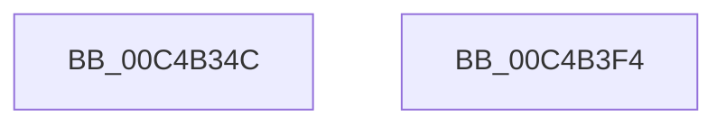

# SepTokenInitialization

- RVA: `0x00C4B34C`–`0x00C4B3F5` (길이 `169` bytes)
- VA: `0x0000000140C4B34C`
- 실행 섹션: `INIT`
- PDB 이름 있음: `예`; PDB Function 태그: `아니요`
- unwind 정보 RVA: `0x000C5DBC`
- 디코드: `38`개 명령, `169/169` bytes 표시
- 미해석 바이트: `0` (있으면 어셈블리에 `.byte`로 보존)

> 이 문서는 커널 이미지의 기계어와 PDB 기호를 분석해 생성했습니다. 4번과 5번은 함수 원형과 자료형을 바이너리 사용 방식에서 추정한 C 해석이며 원본 소스 복구 결과는 아닙니다.

## 1. Dependencies

- 직접 호출 지점: **3**; 고유 호출 대상: **3**
- 직접 호출자로 확인된 함수: **1**
- RIP 상대 이미지 참조: **4**

### Outgoing calls
- `0x00C4B370` → [RtlInitUnicodeString](../../text/42/RtlInitUnicodeString_function_0042A780.md) (function, `0x0042A780`)
- `0x00C4B383` → [memset](../../text/6C/memset_function_006C6C40.md) (function, `0x006C6C40`)
- `0x00C4B3D9` → [ObCreateObjectType](../../page/70/ObCreateObjectType_function_00705230.md) (function, `0x00705230`)

### Direct callers
- [SepInitializationPhase0](SepInitializationPhase0_function_00C4A790.md) at `0x00C4A7A8`

### Static image references
- `0x00C4B361` → RVA `0x00C7CE70` (` ?? ::PBOPGDP::`string'`; read)
- `0x00C4B388` → RVA `0x00B4B0B0` (`SepTokenMapping`; read)
- `0x00C4B393` → RVA `0x00AF23D0` (`SepTokenDeleteMethod`; read)
- `0x00C4B39E` → RVA `0x00FD8020` (`PAGEDATA`; read)

## 2. Other-region calls and transfers

- 다른 실행 섹션으로 향하는 call: **3**
  - `0x00C4B370` → [RtlInitUnicodeString](../../text/42/RtlInitUnicodeString_function_0042A780.md) (`INIT` → `.text`)
  - `0x00C4B383` → [memset](../../text/6C/memset_function_006C6C40.md) (`INIT` → `.text`)
  - `0x00C4B3D9` → [ObCreateObjectType](../../page/70/ObCreateObjectType_function_00705230.md) (`INIT` → `PAGE`)
- 별도 외부 분기/꼬리 이동을 확인하지 못했습니다.

## 3. Assembly (complete function range)

```asm
00C4B34C  48 89 5C 24 08                  mov qword ptr [rsp + 8], rbx
00C4B351  55                              push rbp
00C4B352  48 8D 6C 24 A9                  lea rbp, [rsp - 0x57]
00C4B357  48 81 EC B0 00 00 00            sub rsp, 0xb0
00C4B35E  0F 57 C0                        xorps xmm0, xmm0
00C4B361  48 8D 15 08 1B 03 00            lea rdx, [rip + 0x31b08]
00C4B368  48 8D 4D C7                     lea rcx, [rbp - 0x39]
00C4B36C  0F 11 45 C7                     movups xmmword ptr [rbp - 0x39], xmm0
00C4B370  E8 0B F4 7D FF                  call 0x14042a780
00C4B375  BB 80 00 00 00                  mov ebx, 0x80
00C4B37A  48 8D 4D D7                     lea rcx, [rbp - 0x29]
00C4B37E  44 8B C3                        mov r8d, ebx
00C4B381  33 D2                           xor edx, edx
00C4B383  E8 B8 B8 A7 FF                  call 0x1406c6c40
00C4B388  0F 10 05 21 FD EF FF            movups xmm0, xmmword ptr [rip - 0x1002df]
00C4B38F  80 4D D9 0E                     or byte ptr [rbp - 0x27], 0xe
00C4B393  48 8D 05 36 70 EA FF            lea rax, [rip - 0x158fca]
00C4B39A  66 89 5D D7                     mov word ptr [rbp - 0x29], bx
00C4B39E  4C 8D 0D 7B CC 38 00            lea r9, [rip + 0x38cc7b]
00C4B3A5  BB 01 00 00 00                  mov ebx, 1
00C4B3AA  C7 45 DB 00 02 00 00            mov dword ptr [rbp - 0x25], 0x200
00C4B3B1  45 33 C0                        xor r8d, r8d
00C4B3B4  C7 45 DF 00 01 00 00            mov dword ptr [rbp - 0x21], 0x100
00C4B3BB  48 8D 55 D7                     lea rdx, [rbp - 0x29]
00C4B3BF  89 5D FB                        mov dword ptr [rbp - 5], ebx
00C4B3C2  48 8D 4D C7                     lea rcx, [rbp - 0x39]
00C4B3C6  C7 45 F3 FF 01 0F 00            mov dword ptr [rbp - 0xd], 0xf01ff
00C4B3CD  F3 0F 7F 45 E3                  movdqu xmmword ptr [rbp - 0x1d], xmm0
00C4B3D2  48 89 45 1F                     mov qword ptr [rbp + 0x1f], rax
00C4B3D6  89 5D 4F                        mov dword ptr [rbp + 0x4f], ebx
00C4B3D9  E8 52 9E AB FF                  call 0x140705230
00C4B3DE  C1 E8 1F                        shr eax, 0x1f
00C4B3E1  32 C3                           xor al, bl
00C4B3E3  48 8B 9C 24 C0 00 00 00         mov rbx, qword ptr [rsp + 0xc0]
00C4B3EB  48 81 C4 B0 00 00 00            add rsp, 0xb0
00C4B3F2  5D                              pop rbp
00C4B3F3  C3                              ret
00C4B3F4  CC                              int3
```

## 4. C-style interpretation (structured pseudocode)

```c
__int64 __fastcall SepTokenInitialization(void)
{
    __int64 result;
    __int64 v_rsp;
    unsigned int v_stack_m10;
    unsigned __int64 v_stack_m40;
    unsigned __int64 v_stack_m5F;
    unsigned int v_stack_m64;
    unsigned int v_stack_m6C;
    unsigned __int64 v_stack_m7C;
    unsigned int v_stack_m80;
    unsigned int v_stack_m84;
    unsigned __int8 v_stack_m86;
    unsigned __int64 v_stack_m88;
    unsigned __int64 v_stack_m98;
    unsigned __int64 v_stack_p8;

    v_stack_p8 = v_rbx;
    v_rsp = (v_rsp) - (176);
    v_stack_m98 = v_xmm0;
    result = RtlInitUnicodeString(v_stack_m98, v_rip + 203528, a3, a4);
    a2 = 0;
    result = memset(v_stack_m88, a2, 128, a4);
    v_stack_m88 = 128;
    v_stack_m84 = 512;
    a3 = 0;
    v_stack_m80 = 256;
    v_stack_m64 = 1;
    v_stack_m6C = 0xF01FFULL;
    v_stack_m7C = v_xmm0;
    v_stack_m40 = v_rip - 1413066;
    v_stack_m10 = 1;
    result = ObCreateObjectType(v_stack_m98, v_stack_m88, a3, v_rip + 3722363);
    result = (unsigned int)((result) >> (31));
    result = (unsigned __int8)((result) ^ (1));
    v_rsp = (v_rsp) + (176);
    return result;
}
```

## 5. (Beta) C Style

```c
void SepTokenInitialization(void)
{
    int64_t result;
    int64_t local_rsp;
    uint32_t v_stack_m10;
    uint64_t v_stack_m40;
    uint64_t v_stack_m5F;
    uint32_t v_stack_m64;
    uint32_t v_stack_m6C;
    uint64_t v_stack_m7C;
    uint32_t v_stack_m80;
    uint32_t v_stack_m84;
    uint8_t v_stack_m86;
    uint64_t v_stack_m88;
    uint64_t v_stack_m98;
    uint64_t v_stack_p8;

    v_stack_p8 = local_rbx;
    local_rsp = (local_rsp) - (176);
    v_stack_m98 = v_xmm0;
    result = RtlInitUnicodeString(v_stack_m98, v_rip + 203528, a3, a4);
    a2 = 0;
    result = memset(v_stack_m88, a2, 128, a4);
    v_stack_m88 = 128;
    v_stack_m84 = 512;
    a3 = 0;
    v_stack_m80 = 256;
    v_stack_m64 = 1;
    v_stack_m6C = 0xF01FFULL;
    v_stack_m7C = v_xmm0;
    v_stack_m40 = v_rip - 1413066;
    v_stack_m10 = 1;
    result = ObCreateObjectType(v_stack_m98, v_stack_m88, a3, v_rip + 3722363);
    result = (uint32_t)((result) >> (31));
    result = (uint8_t)((result) ^ (1));
    local_rsp = (local_rsp) + (176);
    return result;
}
```

## 6. Execution-region graph

[열기: 2D/3D 그래프와 함수 탐색 컨트롤 패널](../../../control-panel.html?section=init&rva=0x00C4B34C&view=graph)

- 2D 그래프는 위에서 아래로 흐르고, 3D 그래프는 빈 공간을 드래그해 회전합니다. Shift+드래그는 이동, 휠은 확대·축소, 함수 노드 선택은 대상 보고서 이동입니다.

### Static fallback


