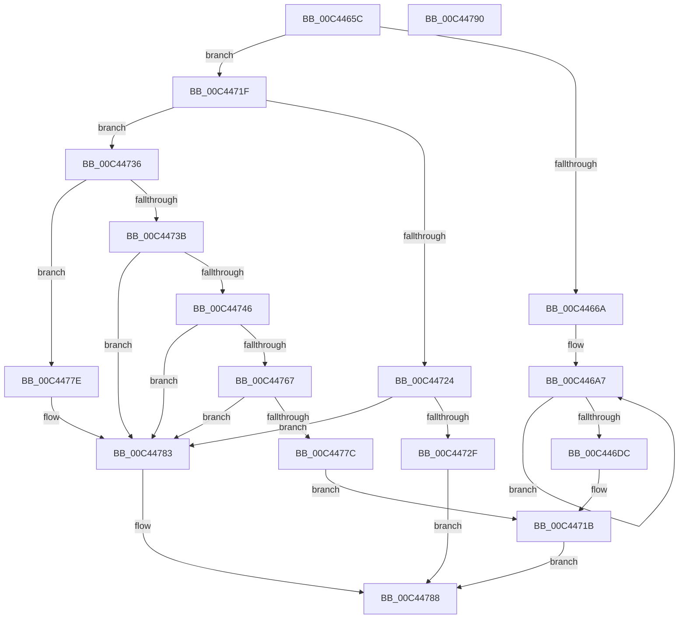

# SshInitialize

- RVA: `0x00C4465C`–`0x00C44791` (길이 `309` bytes)
- VA: `0x0000000140C4465C`
- 실행 섹션: `INIT`
- PDB 이름 있음: `예`; PDB Function 태그: `아니요`
- unwind 정보 RVA: `0x00064C80`
- 디코드: `75`개 명령, `309/309` bytes 표시
- 미해석 바이트: `0` (있으면 어셈블리에 `.byte`로 보존)

> 이 문서는 커널 이미지의 기계어와 PDB 기호를 분석해 생성했습니다. 4번과 5번은 함수 원형과 자료형을 바이너리 사용 방식에서 추정한 C 해석이며 원본 소스 복구 결과는 아닙니다.

## 1. Dependencies

- 직접 호출 지점: **9**; 고유 호출 대상: **8**
- 직접 호출자로 확인된 함수: **1**
- RIP 상대 이미지 참조: **18**

### Outgoing calls
- `0x00C44671` → [CmSiRWLockInitialize](../../page/AD/CmSiRWLockInitialize_function_00AD69E0.md) (function, `0x00AD69E0`)
- `0x00C446AB` → [CmSiRWLockInitialize](../../page/AD/CmSiRWLockInitialize_function_00AD69E0.md) (function, `0x00AD69E0`)
- `0x00C4470F` → [SshpSetCollectionActive](../../text/48/SshpSetCollectionActive_function_0048507C.md) (function, `0x0048507C`)
- `0x00C44724` → [SshpAlpcInitialize](SshpAlpcInitialize_function_00C448B4.md) (function, `0x00C448B4`)
- `0x00C4472F` → [SshpSessionManagerInitialize](SshpSessionManagerInitialize_function_00C44820.md) (function, `0x00C44820`)
- `0x00C4473B` → [SSHSupportEtwRegister](../../page/77/SSHSupportEtwRegister_function_007749C8.md) (function, `0x007749C8`)
- `0x00C4475C` → [TraceLoggingRegisterEx_EtwRegister_EtwSetInformation](../../page/92/TraceLoggingRegisterEx_EtwRegister_EtwSetInformation_function_009208A0.md) (function, `0x009208A0`)
- `0x00C44771` → [SSHSupportRegisterPowerSettingCallback](../../page/77/SSHSupportRegisterPowerSettingCallback_function_007749F8.md) (function, `0x007749F8`)
- `0x00C44783` → [SshpUninitialize](SshpUninitialize_function_00C44798.md) (function, `0x00C44798`)

### Direct callers
- [PoInitSystem](../C7/PoInitSystem_function_00C72358.md) at `0x00C72C5F`
- [PoInitSystem](../C7/PoInitSystem_function_00C72358.md) at `0x00C72CD5`
- [PoInitSystem](../C7/PoInitSystem_function_00C72358.md) at `0x00C72ED7`

### Static image references
- `0x00C4466A` → RVA `0x00F07030` (`.data`; read)
- `0x00C44676` → RVA `0x00F07018` (`.data`; read/write)
- `0x00C4467D` → RVA `0x00F07020` (`.data`; read)
- `0x00C44684` → RVA `0x00F07040` (`.data`; read/write)
- `0x00C4468C` → RVA `0x00E08420` (`.data`; read)
- `0x00C44693` → RVA `0x00F07028` (`.data`; write)
- `0x00C446A0` → RVA `0x00F07020` (`.data`; write)
- `0x00C446DC` → RVA `0x00F07078` (`.data`; read/write)
- `0x00C446E3` → RVA `0x00A4DE90` (`SshpPurgeBlockersWorker`; read)
- `0x00C446EA` → RVA `0x00F07060` (`.data`; read/write)
- `0x00C446F1` → RVA `0x00E08580` (`.data`; read)
- `0x00C446F8` → RVA `0x00F07070` (`.data`; write)
- `0x00C44701` → RVA `0x00F07080` (`.data`; write)
- `0x00C44708` → RVA `0x00F07088` (`.data`; write)
- `0x00C44714` → RVA `0x00F07094` (`.data`; write)
- `0x00C44749` → RVA `0x00F07038` (`.data`; write)
- `0x00C44755` → RVA `0x00E083C8` (`.data`; read)
- `0x00C44767` → RVA `0x00F07090` (`.data`; write)

## 2. Other-region calls and transfers

- 다른 실행 섹션으로 향하는 call: **6**
  - `0x00C44671` → [CmSiRWLockInitialize](../../page/AD/CmSiRWLockInitialize_function_00AD69E0.md) (`INIT` → `PAGE`)
  - `0x00C446AB` → [CmSiRWLockInitialize](../../page/AD/CmSiRWLockInitialize_function_00AD69E0.md) (`INIT` → `PAGE`)
  - `0x00C4470F` → [SshpSetCollectionActive](../../text/48/SshpSetCollectionActive_function_0048507C.md) (`INIT` → `.text`)
  - `0x00C4473B` → [SSHSupportEtwRegister](../../page/77/SSHSupportEtwRegister_function_007749C8.md) (`INIT` → `PAGE`)
  - `0x00C4475C` → [TraceLoggingRegisterEx_EtwRegister_EtwSetInformation](../../page/92/TraceLoggingRegisterEx_EtwRegister_EtwSetInformation_function_009208A0.md) (`INIT` → `PAGE`)
  - `0x00C44771` → [SSHSupportRegisterPowerSettingCallback](../../page/77/SSHSupportRegisterPowerSettingCallback_function_007749F8.md) (`INIT` → `PAGE`)
- 별도 외부 분기/꼬리 이동을 확인하지 못했습니다.

## 3. Assembly (complete function range)

```asm
00C4465C  40 53                           push rbx
00C4465E  48 83 EC 30                     sub rsp, 0x30
00C44662  85 C9                           test ecx, ecx
00C44664  0F 85 B5 00 00 00               jne 0x140c4471f
00C4466A  48 8D 0D BF 29 2C 00            lea rcx, [rip + 0x2c29bf]
00C44671  E8 6A 23 E9 FF                  call 0x140ad69e0
00C44676  83 25 9B 29 2C 00 00            and dword ptr [rip + 0x2c299b], 0
00C4467D  48 8D 05 9C 29 2C 00            lea rax, [rip + 0x2c299c]
00C44684  48 83 25 B4 29 2C 00 00         and qword ptr [rip + 0x2c29b4], 0
00C4468C  4C 8D 05 8D 3D 1C 00            lea r8, [rip + 0x1c3d8d]
00C44693  48 89 05 8E 29 2C 00            mov qword ptr [rip + 0x2c298e], rax
00C4469A  41 B9 09 00 00 00               mov r9d, 9
00C446A0  48 89 05 79 29 2C 00            mov qword ptr [rip + 0x2c2979], rax
00C446A7  49 8D 48 E0                     lea rcx, [r8 - 0x20]
00C446AB  E8 30 23 E9 FF                  call 0x140ad69e0
00C446B0  4D 89 40 08                     mov qword ptr [r8 + 8], r8
00C446B4  4D 89 00                        mov qword ptr [r8], r8
00C446B7  41 8B 50 FC                     mov edx, dword ptr [r8 - 4]
00C446BB  83 E2 FE                        and edx, 0xfffffffe
00C446BE  8B C2                           mov eax, edx
00C446C0  83 CA 02                        or edx, 2
00C446C3  83 E0 FD                        and eax, 0xfffffffd
00C446C6  41 F6 40 FA 01                  test byte ptr [r8 - 6], 1
00C446CB  0F 44 D0                        cmove edx, eax
00C446CE  41 89 50 FC                     mov dword ptr [r8 - 4], edx
00C446D2  49 83 C0 30                     add r8, 0x30
00C446D6  49 83 E9 01                     sub r9, 1
00C446DA  75 CB                           jne 0x140c446a7
00C446DC  4C 21 0D 95 29 2C 00            and qword ptr [rip + 0x2c2995], r9
00C446E3  48 8D 05 A6 97 E0 FF            lea rax, [rip - 0x1f685a]
00C446EA  4C 21 0D 6F 29 2C 00            and qword ptr [rip + 0x2c296f], r9
00C446F1  48 8D 0D 88 3E 1C 00            lea rcx, [rip + 0x1c3e88]
00C446F8  48 89 05 71 29 2C 00            mov qword ptr [rip + 0x2c2971], rax
00C446FF  B2 01                           mov dl, 1
00C44701  44 89 0D 78 29 2C 00            mov dword ptr [rip + 0x2c2978], r9d
00C44708  4C 89 0D 79 29 2C 00            mov qword ptr [rip + 0x2c2979], r9
00C4470F  E8 68 09 84 FF                  call 0x14048507c
00C44714  C6 05 79 29 2C 00 01            mov byte ptr [rip + 0x2c2979], 1
00C4471B  33 DB                           xor ebx, ebx
00C4471D  EB 69                           jmp 0x140c44788
00C4471F  83 F9 01                        cmp ecx, 1
00C44722  75 12                           jne 0x140c44736
00C44724  E8 8B 01 00 00                  call 0x140c448b4
00C44729  8B D8                           mov ebx, eax
00C4472B  85 C0                           test eax, eax
00C4472D  78 54                           js 0x140c44783
00C4472F  E8 EC 00 00 00                  call 0x140c44820
00C44734  EB 52                           jmp 0x140c44788
00C44736  83 F9 03                        cmp ecx, 3
00C44739  75 43                           jne 0x140c4477e
00C4473B  E8 88 02 B3 FF                  call 0x1407749c8
00C44740  8B D8                           mov ebx, eax
00C44742  85 C0                           test eax, eax
00C44744  78 3D                           js 0x140c44783
00C44746  45 33 C0                        xor r8d, r8d
00C44749  C7 05 E5 28 2C 00 01 00 00 00   mov dword ptr [rip + 0x2c28e5], 1
00C44753  33 D2                           xor edx, edx
00C44755  48 8D 0D 6C 3C 1C 00            lea rcx, [rip + 0x1c3c6c]
00C4475C  E8 3F C1 CD FF                  call 0x1409208a0
00C44761  8B D8                           mov ebx, eax
00C44763  85 C0                           test eax, eax
00C44765  78 1C                           js 0x140c44783
00C44767  C7 05 1F 29 2C 00 01 00 00 00   mov dword ptr [rip + 0x2c291f], 1
00C44771  E8 82 02 B3 FF                  call 0x1407749f8
00C44776  8B D8                           mov ebx, eax
00C44778  85 C0                           test eax, eax
00C4477A  78 07                           js 0x140c44783
00C4477C  EB 9D                           jmp 0x140c4471b
00C4477E  BB 0D 00 00 C0                  mov ebx, 0xc000000d
00C44783  E8 10 00 00 00                  call 0x140c44798
00C44788  8B C3                           mov eax, ebx
00C4478A  48 83 C4 30                     add rsp, 0x30
00C4478E  5B                              pop rbx
00C4478F  C3                              ret
00C44790  CC                              int3
```

## 4. C-style interpretation (structured pseudocode)

```c
__int64 __fastcall SshInitialize(int a1)
{
    __int64 result;
    __int64 v_rbx;
    __int64 v_rsp;

    v_rsp = (v_rsp) - (48);
    if (a1 != 0) goto loc_00C4471F;
    result = CmSiRWLockInitialize(v_rip + 2894271, a2, a3, a4);
    *(unsigned __int64 *)(v_rip + 2894222) = v_rip + 2894236;
    *(unsigned __int64 *)(v_rip + 2894201) = v_rip + 2894236;
loc_00C446A7:
    result = CmSiRWLockInitialize(v_rip + 1850765 - 32, a2, v_rip + 1850765, 9);
    *(unsigned __int64 *)(v_rip + 1850765 + 8) = v_rip + 1850765;
    *(unsigned __int64 *)(v_rip + 1850765) = v_rip + 1850765;
    a2 = (unsigned int)(((unsigned int)(*(unsigned int *)(v_rip + 1850765 - 4))) & (0xFFFFFFFEULL));
    a2 = (unsigned int)((a2) | (2));
    result = (unsigned int)(((unsigned int)((unsigned int)(a2))) & (0xFFFFFFFDULL));
    if (((*(unsigned __int8 *)(v_rip + 1850765 - 6)) & (1)) == 0) { a2 = (unsigned int)(result); }
    *(unsigned int *)(v_rip + 1850765 - 4) = (unsigned int)(a2);
    a3 = (v_rip + 1850765) + (48);
    a4 = (9) - (1);
    if (condition_is_not_equal) goto loc_00C446A7;
    *(unsigned __int64 *)(v_rip + 2894193) = v_rip - 2058330;
    *(unsigned int *)(v_rip + 2894200) = (unsigned int)(a4);
    *(unsigned __int64 *)(v_rip + 2894201) = a4;
    result = SshpSetCollectionActive(v_rip + 1851016, 1, a3, a4);
    *(unsigned __int8 *)(v_rip + 2894201) = 1;
loc_00C4471B:
    v_rbx = 0;
    goto loc_00C44788;
loc_00C4471F:
    if (((unsigned int)(v_rip + 1851016)) != 1) goto loc_00C44736;
    result = SshpAlpcInitialize(v_rip + 1851016, 1, a3, a4);
    if (sign_flag) goto loc_00C44783;
    result = SshpSessionManagerInitialize(v_rip + 1851016, 1, a3, a4);
    goto loc_00C44788;
loc_00C44736:
    if (((unsigned int)(v_rip + 1851016)) != 3) goto loc_00C4477E;
    result = SSHSupportEtwRegister(v_rip + 1851016, 1, a3, a4);
    if (sign_flag) goto loc_00C44783;
    a3 = 0;
    *(unsigned int *)(v_rip + 2894053) = 1;
    a2 = 0;
    result = TraceLoggingRegisterEx_EtwRegister_EtwSetInformation(v_rip + 1850476, a2, a3, a4);
    if (sign_flag) goto loc_00C44783;
    *(unsigned int *)(v_rip + 2894111) = 1;
    result = SSHSupportRegisterPowerSettingCallback(v_rip + 1850476, a2, a3, a4);
    if (sign_flag) goto loc_00C44783;
    goto loc_00C4471B;
loc_00C4477E:
loc_00C44783:
    result = SshpUninitialize(v_rip + 1850476, a2, a3, a4);
loc_00C44788:
    v_rsp = (v_rsp) + (48);
    return (unsigned int)((unsigned int)((unsigned int)(0xC000000DULL)));
}
```

## 5. (Beta) C Style

```c
int64_t SshInitialize(int32_t Arg1)
{
    int64_t result;
    int64_t local_rbx;
    int64_t local_rsp;

    local_rsp = (local_rsp) - (48);
    if (Arg1 != 0) goto loc_00C4471F;
    result = CmSiRWLockInitialize(v_rip + 2894271, a2, a3, a4);
    *(uint64_t *)(v_rip + 0x2C298E) = v_rip + 2894236;
    *(uint64_t *)(v_rip + 0x2C2979) = v_rip + 2894236;
loc_00C446A7:
    result = CmSiRWLockInitialize(v_rip + 1850765 - 32, a2, v_rip + 1850765, 9);
    *(uint64_t *)(v_rip + 0x1C3D8D + 0x8) = v_rip + 1850765;
    *(uint64_t *)(v_rip + 0x1C3D8D) = v_rip + 1850765;
    a2 = (uint32_t)(((uint32_t)(*(uint32_t *)(v_rip + 0x1C3D8D - 0x4))) & (0xFFFFFFFEULL));
    a2 = (uint32_t)((a2) | (2));
    result = (uint32_t)(((uint32_t)((uint32_t)(a2))) & (0xFFFFFFFDULL));
    if (((*(uint8_t *)(v_rip + 0x1C3D8D - 0x6)) & (1)) == 0) { a2 = (uint32_t)(result); }
    *(uint32_t *)(v_rip + 0x1C3D8D - 0x4) = (uint32_t)(a2);
    a3 = (v_rip + 1850765) + (48);
    a4 = (9) - (1);
    if (condition_is_not_equal) goto loc_00C446A7;
    *(uint64_t *)(v_rip + 0x2C2971) = v_rip - 2058330;
    *(uint32_t *)(v_rip + 0x2C2978) = (uint32_t)(a4);
    *(uint64_t *)(v_rip + 0x2C2979) = a4;
    result = SshpSetCollectionActive(v_rip + 1851016, 1, a3, a4);
    *(uint8_t *)(v_rip + 0x2C2979) = 1;
loc_00C4471B:
    local_rbx = 0;
    goto loc_00C44788;
loc_00C4471F:
    if (((uint32_t)(v_rip + 1851016)) != 1) goto loc_00C44736;
    result = SshpAlpcInitialize(v_rip + 1851016, 1, a3, a4);
    if (sign_flag) goto loc_00C44783;
    result = SshpSessionManagerInitialize(v_rip + 1851016, 1, a3, a4);
    goto loc_00C44788;
loc_00C44736:
    if (((uint32_t)(v_rip + 1851016)) != 3) goto loc_00C4477E;
    result = SSHSupportEtwRegister(v_rip + 1851016, 1, a3, a4);
    if (sign_flag) goto loc_00C44783;
    a3 = 0;
    *(uint32_t *)(v_rip + 0x2C28E5) = 1;
    a2 = 0;
    result = TraceLoggingRegisterEx_EtwRegister_EtwSetInformation(v_rip + 1850476, a2, a3, a4);
    if (sign_flag) goto loc_00C44783;
    *(uint32_t *)(v_rip + 0x2C291F) = 1;
    result = SSHSupportRegisterPowerSettingCallback(v_rip + 1850476, a2, a3, a4);
    if (sign_flag) goto loc_00C44783;
    goto loc_00C4471B;
loc_00C4477E:
loc_00C44783:
    result = SshpUninitialize(v_rip + 1850476, a2, a3, a4);
loc_00C44788:
    local_rsp = (local_rsp) + (48);
    return (uint32_t)((uint32_t)((uint32_t)(0xC000000DULL)));
}
```

## 6. Execution-region graph

[열기: 2D/3D 그래프와 함수 탐색 컨트롤 패널](../../../control-panel.html?section=init&rva=0x00C4465C&view=graph)

- 2D 그래프는 위에서 아래로 흐르고, 3D 그래프는 빈 공간을 드래그해 회전합니다. Shift+드래그는 이동, 휠은 확대·축소, 함수 노드 선택은 대상 보고서 이동입니다.

### Static fallback


