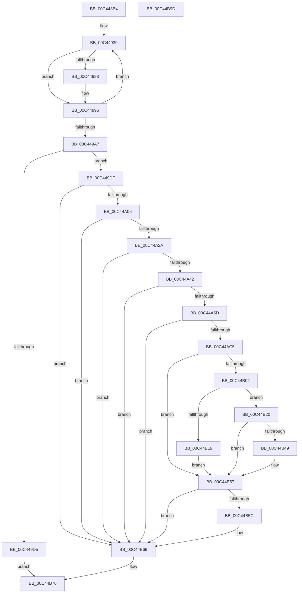

# SshpAlpcInitialize

- RVA: `0x00C448B4`–`0x00C44B9E` (길이 `746` bytes)
- VA: `0x0000000140C448B4`
- 실행 섹션: `INIT`
- PDB 이름 있음: `예`; PDB Function 태그: `아니요`
- unwind 정보 RVA: `0x000CDB3C`
- 디코드: `183`개 명령, `746/746` bytes 표시
- 미해석 바이트: `0` (있으면 어셈블리에 `.byte`로 보존)

> 이 문서는 커널 이미지의 기계어와 PDB 기호를 분석해 생성했습니다. 4번과 5번은 함수 원형과 자료형을 바이너리 사용 방식에서 추정한 C 해석이며 원본 소스 복구 결과는 아닙니다.

## 1. Dependencies

- 직접 호출 지점: **18**; 고유 호출 대상: **17**
- 직접 호출자로 확인된 함수: **1**
- RIP 상대 이미지 참조: **9**

### Outgoing calls
- `0x00C44900` → [memset](../../text/6C/memset_function_006C6C40.md) (function, `0x006C6C40`)
- `0x00C44929` → [CmSiRWLockInitialize](../../page/AD/CmSiRWLockInitialize_function_00AD69E0.md) (function, `0x00AD69E0`)
- `0x00C4496A` → [KiInitializeTimer2](../../text/3A/KiInitializeTimer2_function_003A3288.md) (function, `0x003A3288`)
- `0x00C449C8` → [ExAllocatePool2](../../poolcode/B8/ExAllocatePool2_function_00B820F0.md) (function, `0x00B820F0`)
- `0x00C449E7` → [memset](../../text/6C/memset_function_006C6C40.md) (function, `0x006C6C40`)
- `0x00C449F7` → [RtlCreateAcl](../../page/91/RtlCreateAcl_function_00916F00.md) (function, `0x00916F00`)
- `0x00C44A1B` → [RtlAddAccessAllowedAce](../../page/92/RtlAddAccessAllowedAce_function_009298C0.md) (function, `0x009298C0`)
- `0x00C44A33` → [RtlCreateSecurityDescriptor](../../page/9F/RtlCreateSecurityDescriptor_function_009F1DF0.md) (function, `0x009F1DF0`)
- `0x00C44A4E` → [RtlSetDaclSecurityDescriptor](../../page/9E/RtlSetDaclSecurityDescriptor_function_009EC210.md) (function, `0x009EC210`)
- `0x00C44A68` → [RtlInitUnicodeString](../../text/42/RtlInitUnicodeString_function_0042A780.md) (function, `0x0042A780`)
- `0x00C44AB6` → [ZwAlpcCreatePort](../../text/6A/ZwAlpcCreatePort_function_006AE070.md) (function, `0x006AE070`)
- `0x00C44AF2` → [ExCreateCallback](../../page/A7/ExCreateCallback_function_00A7B9D0.md) (function, `0x00A7B9D0`)
- `0x00C44B0F` → [ExRegisterCallback](../../text/4B/ExRegisterCallback_function_004BDFC0.md) (function, `0x004BDFC0`)
- `0x00C44B3E` → [ZwAlpcSetInformation](../../text/6A/ZwAlpcSetInformation_function_006AE2B0.md) (function, `0x006AE2B0`)
- `0x00C44B50` → [SshpAlpcMessageCallback](../../page/77/SshpAlpcMessageCallback_function_00774E80.md) (function, `0x00774E80`)
- `0x00C44B64` → [ObfDereferenceObjectWithTag](../../text/2F/ObfDereferenceObjectWithTag_function_002F78E0.md) (function, `0x002F78E0`)
- `0x00C44B71` → [ExFreePoolWithTag](../../poolcode/B8/ExFreePoolWithTag_function_00B82870.md) (function, `0x00B82870`)
- `0x00C44B7F` → [_security_check_cookie](../../text/6A/_security_check_cookie_function_006AC640.md) (function, `0x006AC640`)

### Direct callers
- [SshInitialize](SshInitialize_function_00C4465C.md) at `0x00C44724`

### Static image references
- `0x00C448CF` → RVA `0x00E0A740` (`.data`; read)
- `0x00C44908` → RVA `0x00F069C8` (`.data`; read)
- `0x00C44930` → RVA `0x00F069E2` (`.data`; read)
- `0x00C44953` → RVA `0x005E20D0` (`SshpAlpcOpenGracePeriodTimerCallback`; read)
- `0x00C44977` → RVA `0x00774FC0` (`SshpAlpcOpenGracePeriodWorker`; read)
- `0x00C449A7` → RVA `0x00E67D58` (`.data`; read)
- `0x00C44A5D` → RVA `0x0002B318` (`.rdata`; read)
- `0x00C44A9D` → RVA `0x00F069C0` (`.data`; read)
- `0x00C44B05` → RVA `0x00774E80` (`SshpAlpcMessageCallback`; read)

## 2. Other-region calls and transfers

- 다른 실행 섹션으로 향하는 call: **18**
  - `0x00C44900` → [memset](../../text/6C/memset_function_006C6C40.md) (`INIT` → `.text`)
  - `0x00C44929` → [CmSiRWLockInitialize](../../page/AD/CmSiRWLockInitialize_function_00AD69E0.md) (`INIT` → `PAGE`)
  - `0x00C4496A` → [KiInitializeTimer2](../../text/3A/KiInitializeTimer2_function_003A3288.md) (`INIT` → `.text`)
  - `0x00C449C8` → [ExAllocatePool2](../../poolcode/B8/ExAllocatePool2_function_00B820F0.md) (`INIT` → `POOLCODE`)
  - `0x00C449E7` → [memset](../../text/6C/memset_function_006C6C40.md) (`INIT` → `.text`)
  - `0x00C449F7` → [RtlCreateAcl](../../page/91/RtlCreateAcl_function_00916F00.md) (`INIT` → `PAGE`)
  - `0x00C44A1B` → [RtlAddAccessAllowedAce](../../page/92/RtlAddAccessAllowedAce_function_009298C0.md) (`INIT` → `PAGE`)
  - `0x00C44A33` → [RtlCreateSecurityDescriptor](../../page/9F/RtlCreateSecurityDescriptor_function_009F1DF0.md) (`INIT` → `PAGE`)
  - `0x00C44A4E` → [RtlSetDaclSecurityDescriptor](../../page/9E/RtlSetDaclSecurityDescriptor_function_009EC210.md) (`INIT` → `PAGE`)
  - `0x00C44A68` → [RtlInitUnicodeString](../../text/42/RtlInitUnicodeString_function_0042A780.md) (`INIT` → `.text`)
  - `0x00C44AB6` → [ZwAlpcCreatePort](../../text/6A/ZwAlpcCreatePort_function_006AE070.md) (`INIT` → `.text`)
  - `0x00C44AF2` → [ExCreateCallback](../../page/A7/ExCreateCallback_function_00A7B9D0.md) (`INIT` → `PAGE`)
  - `0x00C44B0F` → [ExRegisterCallback](../../text/4B/ExRegisterCallback_function_004BDFC0.md) (`INIT` → `.text`)
  - `0x00C44B3E` → [ZwAlpcSetInformation](../../text/6A/ZwAlpcSetInformation_function_006AE2B0.md) (`INIT` → `.text`)
  - `0x00C44B50` → [SshpAlpcMessageCallback](../../page/77/SshpAlpcMessageCallback_function_00774E80.md) (`INIT` → `PAGE`)
  - `0x00C44B64` → [ObfDereferenceObjectWithTag](../../text/2F/ObfDereferenceObjectWithTag_function_002F78E0.md) (`INIT` → `.text`)
  - `0x00C44B71` → [ExFreePoolWithTag](../../poolcode/B8/ExFreePoolWithTag_function_00B82870.md) (`INIT` → `POOLCODE`)
  - `0x00C44B7F` → [_security_check_cookie](../../text/6A/_security_check_cookie_function_006AC640.md) (`INIT` → `.text`)
- 별도 외부 분기/꼬리 이동을 확인하지 못했습니다.

## 3. Assembly (complete function range)

```asm
00C448B4  48 8B C4                        mov rax, rsp
00C448B7  48 89 58 08                     mov qword ptr [rax + 8], rbx
00C448BB  48 89 70 10                     mov qword ptr [rax + 0x10], rsi
00C448BF  48 89 78 18                     mov qword ptr [rax + 0x18], rdi
00C448C3  55                              push rbp
00C448C4  48 8D 68 A1                     lea rbp, [rax - 0x5f]
00C448C8  48 81 EC 00 01 00 00            sub rsp, 0x100
00C448CF  48 8B 05 6A 5E 1C 00            mov rax, qword ptr [rip + 0x1c5e6a]
00C448D6  48 33 C4                        xor rax, rsp
00C448D9  48 89 45 47                     mov qword ptr [rbp + 0x47], rax
00C448DD  33 C0                           xor eax, eax
00C448DF  48 8D 4D F7                     lea rcx, [rbp - 9]
00C448E3  0F 57 C0                        xorps xmm0, xmm0
00C448E6  48 89 45 9F                     mov qword ptr [rbp - 0x61], rax
00C448EA  33 D2                           xor edx, edx
00C448EC  89 45 A7                        mov dword ptr [rbp - 0x59], eax
00C448EF  0F 11 45 AF                     movups xmmword ptr [rbp - 0x51], xmm0
00C448F3  44 8D 40 48                     lea r8d, [rax + 0x48]
00C448F7  0F 11 44 24 28                  movups xmmword ptr [rsp + 0x28], xmm0
00C448FC  0F 11 45 8F                     movups xmmword ptr [rbp - 0x71], xmm0
00C44900  E8 3B 23 A8 FF                  call 0x1406c6c40
00C44905  0F 57 C9                        xorps xmm1, xmm1
00C44908  48 8D 0D B9 20 2C 00            lea rcx, [rip + 0x2c20b9]
00C4490F  33 C0                           xor eax, eax
00C44911  0F 57 C0                        xorps xmm0, xmm0
00C44914  48 21 44 24 20                  and qword ptr [rsp + 0x20], rax
00C44919  0F 11 45 BF                     movups xmmword ptr [rbp - 0x41], xmm0
00C4491D  48 89 45 EF                     mov qword ptr [rbp - 0x11], rax
00C44921  0F 11 4D CF                     movups xmmword ptr [rbp - 0x31], xmm1
00C44925  0F 11 4D DF                     movups xmmword ptr [rbp - 0x21], xmm1
00C44929  E8 B2 20 E9 FF                  call 0x140ad69e0
00C4492E  33 FF                           xor edi, edi
00C44930  48 8D 1D AB 20 2C 00            lea rbx, [rip + 0x2c20ab]
00C44937  33 F6                           xor esi, esi
00C44939  83 63 F6 00                     and dword ptr [rbx - 0xa], 0
00C4493D  48 8D 83 A6 00 00 00            lea rax, [rbx + 0xa6]
00C44944  C6 43 FA 00                     mov byte ptr [rbx - 6], 0
00C44948  48 8D 4B FE                     lea rcx, [rbx - 2]
00C4494C  48 89 83 AE 00 00 00            mov qword ptr [rbx + 0xae], rax
00C44953  48 8D 15 76 D7 99 FF            lea rdx, [rip - 0x66288a]
00C4495A  48 89 00                        mov qword ptr [rax], rax
00C4495D  41 B9 08 00 00 00               mov r9d, 8
00C44963  66 83 23 00                     and word ptr [rbx], 0
00C44967  4C 8B C6                        mov r8, rsi
00C4496A  E8 19 E9 75 FF                  call 0x1403a3288
00C4496F  48 83 A3 86 00 00 00 00         and qword ptr [rbx + 0x86], 0
00C44977  48 8D 05 42 06 B3 FF            lea rax, [rip - 0x4cf9be]
00C4497E  48 89 83 96 00 00 00            mov qword ptr [rbx + 0x96], rax
00C44985  8D 47 FF                        lea eax, [rdi - 1]
00C44988  48 89 B3 9E 00 00 00            mov qword ptr [rbx + 0x9e], rsi
00C4498F  85 C0                           test eax, eax
00C44991  75 03                           jne 0x140c44996
00C44993  FF 43 F6                        inc dword ptr [rbx - 0xa]
00C44996  FF C7                           inc edi
00C44998  48 FF C6                        inc rsi
00C4499B  48 81 C3 C0 00 00 00            add rbx, 0xc0
00C449A2  83 FF 02                        cmp edi, 2
00C449A5  72 92                           jb 0x140c44939
00C449A7  48 8B 05 AA 33 22 00            mov rax, qword ptr [rip + 0x2233aa]
00C449AE  41 B8 73 73 68 70               mov r8d, 0x70687373
00C449B4  0F B6 48 01                     movzx ecx, byte ptr [rax + 1]
00C449B8  8D 1C 8D 1C 00 00 00            lea ebx, [rcx*4 + 0x1c]
00C449BF  B9 40 00 00 00                  mov ecx, 0x40
00C449C4  8B D3                           mov edx, ebx
00C449C6  8B FB                           mov edi, ebx
00C449C8  E8 23 D7 F3 FF                  call 0x140b820f0
00C449CD  48 8B F0                        mov rsi, rax
00C449D0  48 85 C0                        test rax, rax
00C449D3  75 0A                           jne 0x140c449df
00C449D5  BB 9A 00 00 C0                  mov ebx, 0xc000009a
00C449DA  E9 97 01 00 00                  jmp 0x140c44b76
00C449DF  4C 8B C7                        mov r8, rdi
00C449E2  33 D2                           xor edx, edx
00C449E4  48 8B CE                        mov rcx, rsi
00C449E7  E8 54 22 A8 FF                  call 0x1406c6c40
00C449EC  41 B8 02 00 00 00               mov r8d, 2
00C449F2  8B D3                           mov edx, ebx
00C449F4  48 8B CE                        mov rcx, rsi
00C449F7  E8 04 25 CD FF                  call 0x140916f00
00C449FC  8B D8                           mov ebx, eax
00C449FE  85 C0                           test eax, eax
00C44A00  0F 88 63 01 00 00               js 0x140c44b69
00C44A06  4C 8B 0D 4B 33 22 00            mov r9, qword ptr [rip + 0x22334b]
00C44A0D  BA 02 00 00 00                  mov edx, 2
00C44A12  41 B8 00 00 00 10               mov r8d, 0x10000000
00C44A18  48 8B CE                        mov rcx, rsi
00C44A1B  E8 A0 4E CE FF                  call 0x1409298c0
00C44A20  8B D8                           mov ebx, eax
00C44A22  85 C0                           test eax, eax
00C44A24  0F 88 3F 01 00 00               js 0x140c44b69
00C44A2A  BA 01 00 00 00                  mov edx, 1
00C44A2F  48 8D 4D CF                     lea rcx, [rbp - 0x31]
00C44A33  E8 B8 D3 DA FF                  call 0x1409f1df0
00C44A38  8B D8                           mov ebx, eax
00C44A3A  85 C0                           test eax, eax
00C44A3C  0F 88 27 01 00 00               js 0x140c44b69
00C44A42  45 33 C9                        xor r9d, r9d
00C44A45  48 8D 4D CF                     lea rcx, [rbp - 0x31]
00C44A49  4C 8B C6                        mov r8, rsi
00C44A4C  B2 01                           mov dl, 1
00C44A4E  E8 BD 77 DA FF                  call 0x1409ec210
00C44A53  8B D8                           mov ebx, eax
00C44A55  85 C0                           test eax, eax
00C44A57  0F 88 0C 01 00 00               js 0x140c44b69
00C44A5D  48 8D 15 B4 68 3E FF            lea rdx, [rip - 0xc1974c]
00C44A64  48 8D 4D BF                     lea rcx, [rbp - 0x41]
00C44A68  E8 13 5D 7E FF                  call 0x14042a780
00C44A6D  48 83 65 87 00                  and qword ptr [rbp - 0x79], 0
00C44A72  48 8D 45 BF                     lea rax, [rbp - 0x41]
00C44A76  48 83 65 A7 00                  and qword ptr [rbp - 0x59], 0
00C44A7B  4C 8D 45 F7                     lea r8, [rbp - 9]
00C44A7F  48 89 45 8F                     mov qword ptr [rbp - 0x71], rax
00C44A83  48 8D 54 24 28                  lea rdx, [rsp + 0x28]
00C44A88  48 8D 45 CF                     lea rax, [rbp - 0x31]
00C44A8C  48 C7 45 07 40 00 00 00         mov qword ptr [rbp + 7], 0x40
00C44A94  BF 30 00 00 00                  mov edi, 0x30
00C44A99  48 89 45 9F                     mov qword ptr [rbp - 0x61], rax
00C44A9D  48 8D 0D 1C 1F 2C 00            lea rcx, [rip + 0x2c1f1c]
00C44AA4  C7 45 F7 00 00 10 00            mov dword ptr [rbp - 9], 0x100000
00C44AAB  89 7C 24 28                     mov dword ptr [rsp + 0x28], edi
00C44AAF  C7 45 97 00 02 00 00            mov dword ptr [rbp - 0x69], 0x200
00C44AB6  E8 B5 95 A6 FF                  call 0x1406ae070
00C44ABB  8B D8                           mov ebx, eax
00C44ABD  85 C0                           test eax, eax
00C44ABF  0F 88 A4 00 00 00               js 0x140c44b69
00C44AC5  48 83 65 87 00                  and qword ptr [rbp - 0x79], 0
00C44ACA  48 8D 54 24 28                  lea rdx, [rsp + 0x28]
00C44ACF  48 83 65 8F 00                  and qword ptr [rbp - 0x71], 0
00C44AD4  48 8D 4C 24 20                  lea rcx, [rsp + 0x20]
00C44AD9  0F 57 C0                        xorps xmm0, xmm0
00C44ADC  89 7C 24 28                     mov dword ptr [rsp + 0x28], edi
00C44AE0  45 33 C9                        xor r9d, r9d
00C44AE3  C7 45 97 00 02 00 00            mov dword ptr [rbp - 0x69], 0x200
00C44AEA  41 B0 01                        mov r8b, 1
00C44AED  F3 0F 7F 45 9F                  movdqu xmmword ptr [rbp - 0x61], xmm0
00C44AF2  E8 D9 6E E3 FF                  call 0x140a7b9d0
00C44AF7  48 8B 7C 24 20                  mov rdi, qword ptr [rsp + 0x20]
00C44AFC  8B D8                           mov ebx, eax
00C44AFE  85 C0                           test eax, eax
00C44B00  78 55                           js 0x140c44b57
00C44B02  45 33 C0                        xor r8d, r8d
00C44B05  48 8D 15 74 03 B3 FF            lea rdx, [rip - 0x4cfc8c]
00C44B0C  48 8B CF                        mov rcx, rdi
00C44B0F  E8 AC 94 87 FF                  call 0x1404bdfc0
00C44B14  48 85 C0                        test rax, rax
00C44B17  75 07                           jne 0x140c44b20
00C44B19  BB 9A 00 00 C0                  mov ebx, 0xc000009a
00C44B1E  EB 37                           jmp 0x140c44b57
00C44B20  48 8B 0D 99 1E 2C 00            mov rcx, qword ptr [rip + 0x2c1e99]
00C44B27  4C 8D 45 AF                     lea r8, [rbp - 0x51]
00C44B2B  48 83 65 B7 00                  and qword ptr [rbp - 0x49], 0
00C44B30  41 B9 10 00 00 00               mov r9d, 0x10
00C44B36  48 89 7D AF                     mov qword ptr [rbp - 0x51], rdi
00C44B3A  41 8D 51 F9                     lea edx, [r9 - 7]
00C44B3E  E8 6D 97 A6 FF                  call 0x1406ae2b0
00C44B43  8B D8                           mov ebx, eax
00C44B45  85 C0                           test eax, eax
00C44B47  78 0E                           js 0x140c44b57
00C44B49  45 33 C0                        xor r8d, r8d
00C44B4C  33 D2                           xor edx, edx
00C44B4E  33 C9                           xor ecx, ecx
00C44B50  E8 2B 03 B3 FF                  call 0x140774e80
00C44B55  33 DB                           xor ebx, ebx
00C44B57  48 85 FF                        test rdi, rdi
00C44B5A  74 0D                           je 0x140c44b69
00C44B5C  BA 44 66 6C 74                  mov edx, 0x746c6644
00C44B61  48 8B CF                        mov rcx, rdi
00C44B64  E8 77 2D 6B FF                  call 0x1402f78e0
00C44B69  BA 73 73 68 70                  mov edx, 0x70687373
00C44B6E  48 8B CE                        mov rcx, rsi
00C44B71  E8 FA DC F3 FF                  call 0x140b82870
00C44B76  8B C3                           mov eax, ebx
00C44B78  48 8B 4D 47                     mov rcx, qword ptr [rbp + 0x47]
00C44B7C  48 33 CC                        xor rcx, rsp
00C44B7F  E8 BC 7A A6 FF                  call 0x1406ac640
00C44B84  4C 8D 9C 24 00 01 00 00         lea r11, [rsp + 0x100]
00C44B8C  49 8B 5B 10                     mov rbx, qword ptr [r11 + 0x10]
00C44B90  49 8B 73 18                     mov rsi, qword ptr [r11 + 0x18]
00C44B94  49 8B 7B 20                     mov rdi, qword ptr [r11 + 0x20]
00C44B98  49 8B E3                        mov rsp, r11
00C44B9B  5D                              pop rbp
00C44B9C  C3                              ret
00C44B9D  CC                              int3
```

## 4. C-style interpretation (structured pseudocode)

```c
__int64 __fastcall SshpAlpcInitialize(__int64 a1, int a2)
{
    __int64 result;
    __int64 v_rbx;
    __int64 v_rdi;
    __int64 v_rsi;
    __int64 v_rsp;
    unsigned __int64 v_stack_m8;
    unsigned __int64 v_stack_mE0;
    unsigned __int64 v_stack_mE8;

    *(unsigned __int64 *)(v_rsp + 8) = v_rbx;
    *(unsigned __int64 *)(v_rsp + 16) = v_rsi;
    *(unsigned __int64 *)(v_rsp + 24) = v_rdi;
    v_rsp = (v_rsp) - (256);
    result = (*(unsigned __int64 *)(v_rip + 1859178)) ^ (v_rsp);
    *(unsigned __int64 *)(v_rsp - 95 + 71) = result;
    result = 0;
    *(unsigned __int64 *)(v_rsp - 95 - 97) = 0;
    a2 = 0;
    *(unsigned int *)(v_rsp - 95 - 89) = 0;
    *(unsigned __int64 *)(v_rsp - 95 - 81) = v_xmm0;
    v_stack_mE0 = v_xmm0;
    *(unsigned __int64 *)(v_rsp - 95 - 113) = v_xmm0;
    result = memset(v_rsp - 95 - 9, a2, result + 72, a4);
    result = 0;
    *(unsigned __int64 *)(v_rsp - 95 - 65) = v_xmm0;
    *(unsigned __int64 *)(v_rsp - 95 - 17) = 0;
    *(unsigned __int64 *)(v_rsp - 95 - 49) = v_xmm1;
    *(unsigned __int64 *)(v_rsp - 95 - 33) = v_xmm1;
    result = CmSiRWLockInitialize(v_rip + 2891961, a2, result + 72, a4);
    v_rdi = 0;
    v_rsi = 0;
loc_00C44939:
    *(unsigned __int8 *)(v_rip + 2891947 - 6) = 0;
    *(unsigned __int64 *)(v_rip + 2891947 + 174) = v_rip + 2891947 + 166;
    *(unsigned __int64 *)(v_rip + 2891947 + 166) = v_rip + 2891947 + 166;
    result = KiInitializeTimer2(v_rip + 2891947 - 2, v_rip - 6695050, 0, 8);
    *(unsigned __int64 *)(v_rip + 2891947 + 150) = v_rip - 5044670;
    *(unsigned __int64 *)(v_rip + 2891947 + 158) = 0;
    if ((unsigned int)(v_rdi - 1) == 0) {
    }
    v_rdi = (unsigned int)((v_rdi) + 1);
    v_rsi = (v_rsi) + 1;
    v_rbx = (v_rip + 2891947) + (192);
    if (((unsigned int)(v_rdi)) < 2) goto loc_00C44939;
    result = ExAllocatePool2(64, (unsigned int)((unsigned int)(*(unsigned __int8 *)(*(unsigned __int64 *)(v_rip + 2241450) + 1) * 4 + 28)), (unsigned int)(0x70687373ULL), 8);
    if (result != 0) goto loc_00C449DF;
    goto loc_00C44B76;
loc_00C449DF:
    a2 = 0;
    result = memset(result, a2, (unsigned int)((unsigned int)(*(unsigned __int8 *)(*(unsigned __int64 *)(v_rip + 2241450) + 1) * 4 + 28)), 8);
    result = RtlCreateAcl(result, (unsigned int)((unsigned int)((unsigned int)(0xC000009AULL))), 2, 8);
    if (sign_flag) goto loc_00C44B69;
    result = RtlAddAccessAllowedAce(result, 2, (unsigned int)(0x10000000ULL), *(unsigned __int64 *)(v_rip + 2241355));
    if (sign_flag) goto loc_00C44B69;
    result = RtlCreateSecurityDescriptor(v_rsp - 95 - 49, 1, (unsigned int)(0x10000000ULL), *(unsigned __int64 *)(v_rip + 2241355));
    if (sign_flag) goto loc_00C44B69;
    a4 = 0;
    result = RtlSetDaclSecurityDescriptor(v_rsp - 95 - 49, 1, result, a4);
    if (sign_flag) goto loc_00C44B69;
    result = RtlInitUnicodeString(v_rsp - 95 - 65, v_rip - 12687180, result, a4);
    *(unsigned __int64 *)(v_rsp - 95 - 113) = v_rsp - 95 - 65;
    *(unsigned __int64 *)(v_rsp - 95 + 7) = 64;
    *(unsigned __int64 *)(v_rsp - 95 - 97) = v_rsp - 95 - 49;
    *(unsigned int *)(v_rsp - 95 - 9) = 0x100000ULL;
    v_stack_mE0 = 48;
    *(unsigned int *)(v_rsp - 95 - 105) = 512;
    result = ZwAlpcCreatePort(v_rip + 2891548, v_stack_mE0, v_rsp - 95 - 9, a4);
    if (sign_flag) goto loc_00C44B69;
    v_stack_mE0 = 48;
    a4 = 0;
    *(unsigned int *)(v_rsp - 95 - 105) = 512;
    *(unsigned __int64 *)(v_rsp - 95 - 97) = v_xmm0;
    result = ExCreateCallback(v_stack_mE8, v_stack_mE0, 1, a4);
    if (sign_flag) goto loc_00C44B57;
    a3 = 0;
    result = ExRegisterCallback(v_stack_mE8, v_rip - 5045388, a3, a4);
    if (result != 0) goto loc_00C44B20;
    goto loc_00C44B57;
loc_00C44B20:
    *(unsigned __int64 *)(v_rsp - 95 - 81) = v_stack_mE8;
    result = ZwAlpcSetInformation(*(unsigned __int64 *)(v_rip + 2891417), 16 - 7, v_rsp - 95 - 81, 16);
    v_rbx = (unsigned int)((unsigned int)(result));
    if (!(sign_flag)) {
        a3 = 0;
        a2 = 0;
        a1 = 0;
        result = SshpAlpcMessageCallback(a1, a2, a3, 16);
        v_rbx = 0;
    }
    if (v_stack_mE8 != 0) {
        a2 = 0x746C6644ULL;
        a1 = v_stack_mE8;
        result = ObfDereferenceObjectWithTag(a1, a2, a3, 16);
    }
    result = ExFreePoolWithTag(result, (unsigned int)(0x70687373ULL), a3, 16);
loc_00C44B76:
    a1 = (*(unsigned __int64 *)(v_rsp - 95 + 71)) ^ (v_rsp);
    result = _security_check_cookie(a1, (unsigned int)(0x70687373ULL), a3, 16);
    return result;
}
```

## 5. (Beta) C Style

```c
int64_t SshpAlpcInitialize(int64_t Arg1, int32_t Arg2)
{
    int64_t result;
    int64_t local_rbx;
    int64_t local_rdi;
    int64_t local_rsi;
    int64_t local_rsp;
    uint64_t v_stack_m8;
    uint64_t v_stack_mE0;
    uint64_t v_stack_mE8;

    *(uint64_t *)(local_rsp + 0x8) = local_rbx;
    *(uint64_t *)(local_rsp + 0x10) = local_rsi;
    *(uint64_t *)(local_rsp + 0x18) = local_rdi;
    local_rsp = (local_rsp) - (256);
    result = (*(uint64_t *)(v_rip + 0x1C5E6A)) ^ (local_rsp);
    *(uint64_t *)(local_rsp - 0x5F + 0x47) = result;
    result = 0;
    *(uint64_t *)(local_rsp - 0x5F - 0x61) = 0;
    Arg2 = 0;
    *(uint32_t *)(local_rsp - 0x5F - 0x59) = 0;
    *(uint64_t *)(local_rsp - 0x5F - 0x51) = v_xmm0;
    v_stack_mE0 = v_xmm0;
    *(uint64_t *)(local_rsp - 0x5F - 0x71) = v_xmm0;
    result = memset(local_rsp - 95 - 9, Arg2, result + 72, a4);
    result = 0;
    *(uint64_t *)(local_rsp - 0x5F - 0x41) = v_xmm0;
    *(uint64_t *)(local_rsp - 0x5F - 0x11) = 0;
    *(uint64_t *)(local_rsp - 0x5F - 0x31) = v_xmm1;
    *(uint64_t *)(local_rsp - 0x5F - 0x21) = v_xmm1;
    result = CmSiRWLockInitialize(v_rip + 2891961, Arg2, result + 72, a4);
    local_rdi = 0;
    local_rsi = 0;
loc_00C44939:
    *(uint8_t *)(v_rip + 0x2C20AB - 0x6) = 0;
    *(uint64_t *)(v_rip + 0x2C20AB + 0xAE) = v_rip + 2891947 + 166;
    *(uint64_t *)(v_rip + 0x2C20AB + 0xA6) = v_rip + 2891947 + 166;
    result = KiInitializeTimer2(v_rip + 2891947 - 2, v_rip - 6695050, 0, 8);
    *(uint64_t *)(v_rip + 0x2C20AB + 0x96) = v_rip - 5044670;
    *(uint64_t *)(v_rip + 0x2C20AB + 0x9E) = 0;
    if ((uint32_t)(local_rdi - 1) == 0) {
    }
    local_rdi = (uint32_t)((local_rdi) + 1);
    local_rsi = (local_rsi) + 1;
    local_rbx = (v_rip + 2891947) + (192);
    if (((uint32_t)(local_rdi)) < 2) goto loc_00C44939;
    result = ExAllocatePool2(64, (uint32_t)((uint32_t)(*(uint8_t *)(*(uint64_t *)(v_rip + 0x2233AA) + 0x1) * 4 + 28)), (uint32_t)(0x70687373ULL), 8);
    if (result != 0) goto loc_00C449DF;
    goto loc_00C44B76;
loc_00C449DF:
    Arg2 = 0;
    result = memset(result, Arg2, (uint32_t)((uint32_t)(*(uint8_t *)(*(uint64_t *)(v_rip + 0x2233AA) + 0x1) * 4 + 28)), 8);
    result = RtlCreateAcl(result, (uint32_t)((uint32_t)((uint32_t)(0xC000009AULL))), 2, 8);
    if (sign_flag) goto loc_00C44B69;
    result = RtlAddAccessAllowedAce(result, 2, (uint32_t)(0x10000000ULL), *(uint64_t *)(v_rip + 0x22334B));
    if (sign_flag) goto loc_00C44B69;
    result = RtlCreateSecurityDescriptor(local_rsp - 95 - 49, 1, (uint32_t)(0x10000000ULL), *(uint64_t *)(v_rip + 0x22334B));
    if (sign_flag) goto loc_00C44B69;
    a4 = 0;
    result = RtlSetDaclSecurityDescriptor(local_rsp - 95 - 49, 1, result, a4);
    if (sign_flag) goto loc_00C44B69;
    result = RtlInitUnicodeString(local_rsp - 95 - 65, v_rip - 12687180, result, a4);
    *(uint64_t *)(local_rsp - 0x5F - 0x71) = local_rsp - 95 - 65;
    *(uint64_t *)(local_rsp - 0x5F + 0x7) = 64;
    *(uint64_t *)(local_rsp - 0x5F - 0x61) = local_rsp - 95 - 49;
    *(uint32_t *)(local_rsp - 0x5F - 0x9) = 0x100000ULL;
    v_stack_mE0 = 48;
    *(uint32_t *)(local_rsp - 0x5F - 0x69) = 512;
    result = ZwAlpcCreatePort(v_rip + 2891548, v_stack_mE0, local_rsp - 95 - 9, a4);
    if (sign_flag) goto loc_00C44B69;
    v_stack_mE0 = 48;
    a4 = 0;
    *(uint32_t *)(local_rsp - 0x5F - 0x69) = 512;
    *(uint64_t *)(local_rsp - 0x5F - 0x61) = v_xmm0;
    result = ExCreateCallback(v_stack_mE8, v_stack_mE0, 1, a4);
    if (sign_flag) goto loc_00C44B57;
    a3 = 0;
    result = ExRegisterCallback(v_stack_mE8, v_rip - 5045388, a3, a4);
    if (result != 0) goto loc_00C44B20;
    goto loc_00C44B57;
loc_00C44B20:
    *(uint64_t *)(local_rsp - 0x5F - 0x51) = v_stack_mE8;
    result = ZwAlpcSetInformation(*(uint64_t *)(v_rip + 0x2C1E99), 16 - 7, local_rsp - 95 - 81, 16);
    local_rbx = (uint32_t)((uint32_t)(result));
    if (!(sign_flag)) {
        a3 = 0;
        Arg2 = 0;
        Arg1 = 0;
        result = SshpAlpcMessageCallback(Arg1, Arg2, a3, 16);
        local_rbx = 0;
    }
    if (v_stack_mE8 != 0) {
        Arg2 = 0x746C6644ULL;
        Arg1 = v_stack_mE8;
        result = ObfDereferenceObjectWithTag(Arg1, Arg2, a3, 16);
    }
    result = ExFreePoolWithTag(result, (uint32_t)(0x70687373ULL), a3, 16);
loc_00C44B76:
    Arg1 = (*(uint64_t *)(local_rsp - 0x5F + 0x47)) ^ (local_rsp);
    result = _security_check_cookie(Arg1, (uint32_t)(0x70687373ULL), a3, 16);
    return result;
}
```

## 6. Execution-region graph

[열기: 2D/3D 그래프와 함수 탐색 컨트롤 패널](../../../control-panel.html?section=init&rva=0x00C448B4&view=graph)

- 2D 그래프는 위에서 아래로 흐르고, 3D 그래프는 빈 공간을 드래그해 회전합니다. Shift+드래그는 이동, 휠은 확대·축소, 함수 노드 선택은 대상 보고서 이동입니다.

### Static fallback


