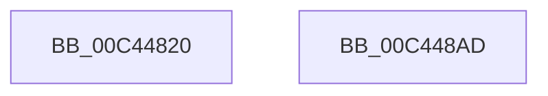

# SshpSessionManagerInitialize

- RVA: `0x00C44820`–`0x00C448AE` (길이 `142` bytes)
- VA: `0x0000000140C44820`
- 실행 섹션: `INIT`
- PDB 이름 있음: `예`; PDB Function 태그: `아니요`
- unwind 정보 RVA: `0x0005C788`
- 디코드: `25`개 명령, `142/142` bytes 표시
- 미해석 바이트: `0` (있으면 어셈블리에 `.byte`로 보존)

> 이 문서는 커널 이미지의 기계어와 PDB 기호를 분석해 생성했습니다. 4번과 5번은 함수 원형과 자료형을 바이너리 사용 방식에서 추정한 C 해석이며 원본 소스 복구 결과는 아닙니다.

## 1. Dependencies

- 직접 호출 지점: **3**; 고유 호출 대상: **3**
- 직접 호출자로 확인된 함수: **1**
- RIP 상대 이미지 참조: **15**

### Outgoing calls
- `0x00C4482B` → [CmSiRWLockInitialize](../../page/AD/CmSiRWLockInitialize_function_00AD69E0.md) (function, `0x00AD69E0`)
- `0x00C4483F` → [memset](../../text/6C/memset_function_006C6C40.md) (function, `0x006C6C40`)
- `0x00C448A3` → [SshpSessionManagerTraceSystemStart](../../page/77/SshpSessionManagerTraceSystemStart_function_007746CC.md) (function, `0x007746CC`)

### Direct callers
- [SshInitialize](SshInitialize_function_00C4465C.md) at `0x00C4472F`

### Static image references
- `0x00C44824` → RVA `0x00F06B70` (`.data`; read)
- `0x00C44832` → RVA `0x00F06B80` (`.data`; read)
- `0x00C44844` → RVA `0x00774360` (`SshpSessionManagerControlSessionCallback`; read)
- `0x00C4484B` → RVA `0x00F06BF2` (`.data`; write)
- `0x00C44852` → RVA `0x00F06B90` (`.data`; write)
- `0x00C44859` → RVA `0x00A76CC0` (`SshpSessionManagerFlushControlEventBufferWorker`; read)
- `0x00C44860` → RVA `0x00F06BC0` (`.data`; write)
- `0x00C44869` → RVA `0x00F06BC8` (`.data`; write)
- `0x00C44870` → RVA `0x00F06BB0` (`.data`; write)
- `0x00C44877` → RVA `0x00F06BD0` (`.data`; write)
- `0x00C4487D` → RVA `0x00F06BF0` (`.data`; write)
- `0x00C44884` → RVA `0x00F06BF8` (`.data`; read)
- `0x00C4488B` → RVA `0x00F06C00` (`.data`; write)
- `0x00C44892` → RVA `0x00F06BF8` (`.data`; write)
- `0x00C44899` → RVA `0x00F06BF4` (`.data`; write)

## 2. Other-region calls and transfers

- 다른 실행 섹션으로 향하는 call: **3**
  - `0x00C4482B` → [CmSiRWLockInitialize](../../page/AD/CmSiRWLockInitialize_function_00AD69E0.md) (`INIT` → `PAGE`)
  - `0x00C4483F` → [memset](../../text/6C/memset_function_006C6C40.md) (`INIT` → `.text`)
  - `0x00C448A3` → [SshpSessionManagerTraceSystemStart](../../page/77/SshpSessionManagerTraceSystemStart_function_007746CC.md) (`INIT` → `PAGE`)
- 별도 외부 분기/꼬리 이동을 확인하지 못했습니다.

## 3. Assembly (complete function range)

```asm
00C44820  48 83 EC 28                     sub rsp, 0x28
00C44824  48 8D 0D 45 23 2C 00            lea rcx, [rip + 0x2c2345]
00C4482B  E8 B0 21 E9 FF                  call 0x140ad69e0
00C44830  33 D2                           xor edx, edx
00C44832  48 8D 0D 47 23 2C 00            lea rcx, [rip + 0x2c2347]
00C44839  41 B8 90 04 00 00               mov r8d, 0x490
00C4483F  E8 FC 23 A8 FF                  call 0x1406c6c40
00C44844  48 8D 05 15 FB B2 FF            lea rax, [rip - 0x4d04eb]
00C4484B  C6 05 A0 23 2C 00 06            mov byte ptr [rip + 0x2c23a0], 6
00C44852  48 89 05 37 23 2C 00            mov qword ptr [rip + 0x2c2337], rax
00C44859  48 8D 05 60 24 E3 FF            lea rax, [rip - 0x1cdba0]
00C44860  48 89 05 59 23 2C 00            mov qword ptr [rip + 0x2c2359], rax
00C44867  33 C0                           xor eax, eax
00C44869  48 89 05 58 23 2C 00            mov qword ptr [rip + 0x2c2358], rax
00C44870  48 89 05 39 23 2C 00            mov qword ptr [rip + 0x2c2339], rax
00C44877  89 05 53 23 2C 00               mov dword ptr [rip + 0x2c2353], eax
00C4487D  66 89 05 6C 23 2C 00            mov word ptr [rip + 0x2c236c], ax
00C44884  48 8D 05 6D 23 2C 00            lea rax, [rip + 0x2c236d]
00C4488B  48 89 05 6E 23 2C 00            mov qword ptr [rip + 0x2c236e], rax
00C44892  48 89 05 5F 23 2C 00            mov qword ptr [rip + 0x2c235f], rax
00C44899  C7 05 51 23 2C 00 01 00 00 00   mov dword ptr [rip + 0x2c2351], 1
00C448A3  E8 24 FE B2 FF                  call 0x1407746cc
00C448A8  48 83 C4 28                     add rsp, 0x28
00C448AC  C3                              ret
00C448AD  CC                              int3
```

## 4. C-style interpretation (structured pseudocode)

```c
__int64 __fastcall SshpSessionManagerInitialize(__int64 a1, int a2)
{
    __int64 result;
    __int64 v_rsp;

    v_rsp = (v_rsp) - (40);
    result = CmSiRWLockInitialize(v_rip + 2892613, a2, a3, a4);
    a2 = 0;
    result = memset(v_rip + 2892615, a2, (unsigned int)(0x490ULL), a4);
    *(unsigned __int8 *)(v_rip + 2892704) = 6;
    *(unsigned __int64 *)(v_rip + 2892599) = v_rip - 5047531;
    *(unsigned __int64 *)(v_rip + 2892633) = v_rip - 1891232;
    result = 0;
    *(unsigned __int64 *)(v_rip + 2892632) = 0;
    *(unsigned __int64 *)(v_rip + 2892601) = 0;
    *(unsigned int *)(v_rip + 2892627) = 0;
    *(unsigned __int16 *)(v_rip + 2892652) = 0;
    *(unsigned __int64 *)(v_rip + 2892654) = v_rip + 2892653;
    *(unsigned __int64 *)(v_rip + 2892639) = v_rip + 2892653;
    *(unsigned int *)(v_rip + 2892625) = 1;
    result = SshpSessionManagerTraceSystemStart(v_rip + 2892615, a2, (unsigned int)(0x490ULL), a4);
    v_rsp = (v_rsp) + (40);
    return result;
}
```

## 5. (Beta) C Style

```c
int64_t SshpSessionManagerInitialize(int64_t Arg1, int32_t Arg2)
{
    int64_t result;
    int64_t local_rsp;

    local_rsp = (local_rsp) - (40);
    result = CmSiRWLockInitialize(v_rip + 2892613, Arg2, a3, a4);
    Arg2 = 0;
    result = memset(v_rip + 2892615, Arg2, (uint32_t)(0x490ULL), a4);
    *(uint8_t *)(v_rip + 0x2C23A0) = 6;
    *(uint64_t *)(v_rip + 0x2C2337) = v_rip - 5047531;
    *(uint64_t *)(v_rip + 0x2C2359) = v_rip - 1891232;
    result = 0;
    *(uint64_t *)(v_rip + 0x2C2358) = 0;
    *(uint64_t *)(v_rip + 0x2C2339) = 0;
    *(uint32_t *)(v_rip + 0x2C2353) = 0;
    *(uint16_t *)(v_rip + 0x2C236C) = 0;
    *(uint64_t *)(v_rip + 0x2C236E) = v_rip + 2892653;
    *(uint64_t *)(v_rip + 0x2C235F) = v_rip + 2892653;
    *(uint32_t *)(v_rip + 0x2C2351) = 1;
    result = SshpSessionManagerTraceSystemStart(v_rip + 2892615, Arg2, (uint32_t)(0x490ULL), a4);
    local_rsp = (local_rsp) + (40);
    return result;
}
```

## 6. Execution-region graph

[열기: 2D/3D 그래프와 함수 탐색 컨트롤 패널](../../../control-panel.html?section=init&rva=0x00C44820&view=graph)

- 2D 그래프는 위에서 아래로 흐르고, 3D 그래프는 빈 공간을 드래그해 회전합니다. Shift+드래그는 이동, 휠은 확대·축소, 함수 노드 선택은 대상 보고서 이동입니다.

### Static fallback


