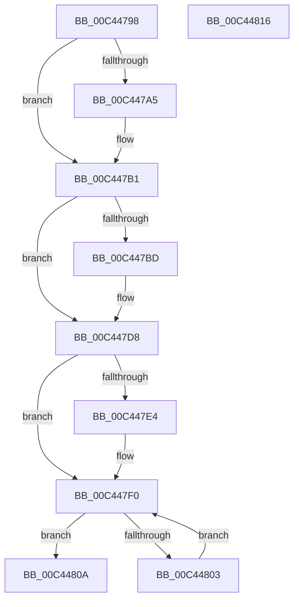

# SshpUninitialize

- RVA: `0x00C44798`–`0x00C44817` (길이 `127` bytes)
- VA: `0x0000000140C44798`
- 실행 섹션: `INIT`
- PDB 이름 있음: `예`; PDB Function 태그: `아니요`
- unwind 정보 RVA: `0x0005C788`
- 디코드: `29`개 명령, `127/127` bytes 표시
- 미해석 바이트: `0` (있으면 어셈블리에 `.byte`로 보존)

> 이 문서는 커널 이미지의 기계어와 PDB 기호를 분석해 생성했습니다. 4번과 5번은 함수 원형과 자료형을 바이너리 사용 방식에서 추정한 C 해석이며 원본 소스 복구 결과는 아닙니다.

## 1. Dependencies

- 직접 호출 지점: **4**; 고유 호출 대상: **3**
- 직접 호출자로 확인된 함수: **1**
- RIP 상대 이미지 참조: **10**

### Outgoing calls
- `0x00C447A5` → [SSHSupportUnregisterPowerSettingCallback](../../page/77/SSHSupportUnregisterPowerSettingCallback_function_00774A2C.md) (function, `0x00774A2C`)
- `0x00C447D3` → [EtwUnregister](../../page/A7/EtwUnregister_function_00A723D0.md) (function, `0x00A723D0`)
- `0x00C447EB` → [EtwUnregister](../../page/A7/EtwUnregister_function_00A723D0.md) (function, `0x00A723D0`)
- `0x00C44803` → [SleepstudyHelperDestroyLibrary](../../page/77/SleepstudyHelperDestroyLibrary_function_00774720.md) (function, `0x00774720`)

### Direct callers
- [SshInitialize](SshInitialize_function_00C4465C.md) at `0x00C44783`

### Static image references
- `0x00C4479C` → RVA `0x00F06B61` (`.data`; read)
- `0x00C447AA` → RVA `0x00F06B61` (`.data`; write)
- `0x00C447B3` → RVA `0x00F07090` (`.data`; read/write)
- `0x00C447BD` → RVA `0x00E083E8` (`.data`; read)
- `0x00C447C4` → RVA `0x00E083E8` (`.data`; read/write)
- `0x00C447CC` → RVA `0x00E083C8` (`.data`; read/write)
- `0x00C447DA` → RVA `0x00F07038` (`.data`; read/write)
- `0x00C447E4` → RVA `0x00F07010` (`.data`; read)
- `0x00C447F0` → RVA `0x00F07020` (`.data`; read)
- `0x00C4480A` → RVA `0x00F07094` (`.data`; write)

## 2. Other-region calls and transfers

- 다른 실행 섹션으로 향하는 call: **4**
  - `0x00C447A5` → [SSHSupportUnregisterPowerSettingCallback](../../page/77/SSHSupportUnregisterPowerSettingCallback_function_00774A2C.md) (`INIT` → `PAGE`)
  - `0x00C447D3` → [EtwUnregister](../../page/A7/EtwUnregister_function_00A723D0.md) (`INIT` → `PAGE`)
  - `0x00C447EB` → [EtwUnregister](../../page/A7/EtwUnregister_function_00A723D0.md) (`INIT` → `PAGE`)
  - `0x00C44803` → [SleepstudyHelperDestroyLibrary](../../page/77/SleepstudyHelperDestroyLibrary_function_00774720.md) (`INIT` → `PAGE`)
- 별도 외부 분기/꼬리 이동을 확인하지 못했습니다.

## 3. Assembly (complete function range)

```asm
00C44798  48 83 EC 28                     sub rsp, 0x28
00C4479C  80 3D BE 23 2C 00 00            cmp byte ptr [rip + 0x2c23be], 0
00C447A3  74 0C                           je 0x140c447b1
00C447A5  E8 82 02 B3 FF                  call 0x140774a2c
00C447AA  C6 05 B0 23 2C 00 00            mov byte ptr [rip + 0x2c23b0], 0
00C447B1  33 C0                           xor eax, eax
00C447B3  87 05 D7 28 2C 00               xchg dword ptr [rip + 0x2c28d7], eax
00C447B9  85 C0                           test eax, eax
00C447BB  74 1B                           je 0x140c447d8
00C447BD  48 8B 0D 24 3C 1C 00            mov rcx, qword ptr [rip + 0x1c3c24]
00C447C4  48 83 25 1C 3C 1C 00 00         and qword ptr [rip + 0x1c3c1c], 0
00C447CC  83 25 F5 3B 1C 00 00            and dword ptr [rip + 0x1c3bf5], 0
00C447D3  E8 F8 DB E2 FF                  call 0x140a723d0
00C447D8  33 C0                           xor eax, eax
00C447DA  87 05 58 28 2C 00               xchg dword ptr [rip + 0x2c2858], eax
00C447E0  85 C0                           test eax, eax
00C447E2  74 0C                           je 0x140c447f0
00C447E4  48 8B 0D 25 28 2C 00            mov rcx, qword ptr [rip + 0x2c2825]
00C447EB  E8 E0 DB E2 FF                  call 0x140a723d0
00C447F0  48 8B 0D 29 28 2C 00            mov rcx, qword ptr [rip + 0x2c2829]
00C447F7  48 8D 05 22 28 2C 00            lea rax, [rip + 0x2c2822]
00C447FE  48 3B C8                        cmp rcx, rax
00C44801  74 07                           je 0x140c4480a
00C44803  E8 18 FF B2 FF                  call 0x140774720
00C44808  EB E6                           jmp 0x140c447f0
00C4480A  C6 05 83 28 2C 00 00            mov byte ptr [rip + 0x2c2883], 0
00C44811  48 83 C4 28                     add rsp, 0x28
00C44815  C3                              ret
00C44816  CC                              int3
```

## 4. C-style interpretation (structured pseudocode)

```c
__int64 __fastcall SshpUninitialize(void)
{
    __int64 result;
    __int64 v_rsp;

    v_rsp = (v_rsp) - (40);
    if ((*(unsigned __int8 *)(v_rip + 2892734)) != 0) {
        result = SSHSupportUnregisterPowerSettingCallback(a1, a2, a3, a4);
        *(unsigned __int8 *)(v_rip + 2892720) = 0;
    }
    result = 0;
    if (0 != 0) {
        a1 = *(unsigned __int64 *)(v_rip + 1850404);
        result = EtwUnregister(a1, a2, a3, a4);
    }
    result = 0;
    if (0 != 0) {
        a1 = *(unsigned __int64 *)(v_rip + 2893861);
        result = EtwUnregister(a1, a2, a3, a4);
    }
    if ((*(unsigned __int64 *)(v_rip + 2893865)) == (v_rip + 2893858)) goto loc_00C4480A;
    result = SleepstudyHelperDestroyLibrary(*(unsigned __int64 *)(v_rip + 2893865), a2, a3, a4);
    goto loc_00C447F0;
loc_00C4480A:
    *(unsigned __int8 *)(v_rip + 2893955) = 0;
    v_rsp = (v_rsp) + (40);
    return result;
}
```

## 5. (Beta) C Style

```c
void SshpUninitialize(void)
{
    int64_t result;
    int64_t local_rsp;

    local_rsp = (local_rsp) - (40);
    if ((*(uint8_t *)(v_rip + 0x2C23BE)) != 0) {
        result = SSHSupportUnregisterPowerSettingCallback(a1, a2, a3, a4);
        *(uint8_t *)(v_rip + 0x2C23B0) = 0;
    }
    result = 0;
    if (0 != 0) {
        a1 = *(uint64_t *)(v_rip + 0x1C3C24);
        result = EtwUnregister(a1, a2, a3, a4);
    }
    result = 0;
    if (0 != 0) {
        a1 = *(uint64_t *)(v_rip + 0x2C2825);
        result = EtwUnregister(a1, a2, a3, a4);
    }
    if ((*(uint64_t *)(v_rip + 0x2C2829)) == (v_rip + 2893858)) goto loc_00C4480A;
    result = SleepstudyHelperDestroyLibrary(*(uint64_t *)(v_rip + 0x2C2829), a2, a3, a4);
    goto loc_00C447F0;
loc_00C4480A:
    *(uint8_t *)(v_rip + 0x2C2883) = 0;
    local_rsp = (local_rsp) + (40);
    return result;
}
```

## 6. Execution-region graph

[열기: 2D/3D 그래프와 함수 탐색 컨트롤 패널](../../../control-panel.html?section=init&rva=0x00C44798&view=graph)

- 2D 그래프는 위에서 아래로 흐르고, 3D 그래프는 빈 공간을 드래그해 회전합니다. Shift+드래그는 이동, 휠은 확대·축소, 함수 노드 선택은 대상 보고서 이동입니다.

### Static fallback


