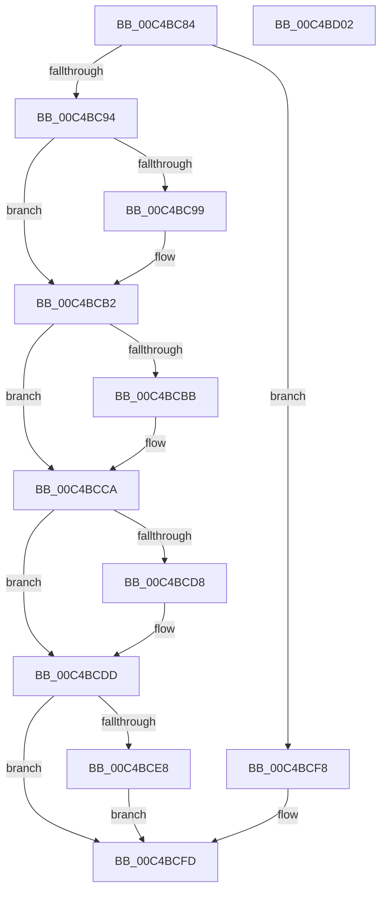

# VerifierInitSystem

- RVA: `0x00C4BC84`–`0x00C4BD03` (길이 `127` bytes)
- VA: `0x0000000140C4BC84`
- 실행 섹션: `INIT`
- PDB 이름 있음: `예`; PDB Function 태그: `아니요`
- unwind 정보 RVA: `0x0005D2F4`
- 디코드: `34`개 명령, `127/127` bytes 표시
- 미해석 바이트: `0` (있으면 어셈블리에 `.byte`로 보존)

> 이 문서는 커널 이미지의 기계어와 PDB 기호를 분석해 생성했습니다. 4번과 5번은 함수 원형과 자료형을 바이너리 사용 방식에서 추정한 C 해석이며 원본 소스 복구 결과는 아닙니다.

## 1. Dependencies

- 직접 호출 지점: **7**; 고유 호출 대상: **7**
- 직접 호출자로 확인된 함수: **2**
- RIP 상대 이미지 참조: **4**

### Outgoing calls
- `0x00C4BCAC` → [KeBugCheckEx](../../text/4F/KeBugCheckEx_function_004FD660.md) (function, `0x004FD660`)
- `0x00C4BCBB` → [VfPoolInitPhase1](../../pagevrfy/BA/VfPoolInitPhase1_function_00BAA3E0.md) (function, `0x00BAA3E0`)
- `0x00C4BCC0` → [VfSettingsMiscellaneousChecksInitPhase1](../../pagevrfy/BA/VfSettingsMiscellaneousChecksInitPhase1_function_00BAB32C.md) (function, `0x00BAB32C`)
- `0x00C4BCC5` → [VfPendingInitPhase1](../../pagevrfy/BA/VfPendingInitPhase1_function_00BA1AA4.md) (function, `0x00BA1AA4`)
- `0x00C4BCCF` → [VfIsRuleClassEnabled](../../pagevrfy/BB/VfIsRuleClassEnabled_function_00BB7540.md) (function, `0x00BB7540`)
- `0x00C4BCD8` → [VfFaultsInitPhase1](../../pagevrfy/BA/VfFaultsInitPhase1_function_00BA6458.md) (function, `0x00BA6458`)
- `0x00C4BCF8` → [ViInitSystemPhase0](ViInitSystemPhase0_function_00C4C1B0.md) (function, `0x00C4C1B0`)

### Direct callers
- [InitBootProcessor](../C1/InitBootProcessor_function_00C1B1C8.md) at `0x00C1B6FD`
- [Phase1InitializationDiscard](../C1/Phase1InitializationDiscard_function_00C1C728.md) at `0x00C1D302`

### Static image references
- `0x00C4BC88` → RVA `0x00FC41A0` (`.data`; read)
- `0x00C4BCB2` → RVA `0x00F04984` (`.data`; read)
- `0x00C4BCDD` → RVA `0x00FFDAB4` (`PAGEVRFD`; read)
- `0x00C4BCE8` → RVA `0x00FC5008` (`ALMOSTRO`; read)

## 2. Other-region calls and transfers

- 다른 실행 섹션으로 향하는 call: **6**
  - `0x00C4BCAC` → [KeBugCheckEx](../../text/4F/KeBugCheckEx_function_004FD660.md) (`INIT` → `.text`)
  - `0x00C4BCBB` → [VfPoolInitPhase1](../../pagevrfy/BA/VfPoolInitPhase1_function_00BAA3E0.md) (`INIT` → `PAGEVRFY`)
  - `0x00C4BCC0` → [VfSettingsMiscellaneousChecksInitPhase1](../../pagevrfy/BA/VfSettingsMiscellaneousChecksInitPhase1_function_00BAB32C.md) (`INIT` → `PAGEVRFY`)
  - `0x00C4BCC5` → [VfPendingInitPhase1](../../pagevrfy/BA/VfPendingInitPhase1_function_00BA1AA4.md) (`INIT` → `PAGEVRFY`)
  - `0x00C4BCCF` → [VfIsRuleClassEnabled](../../pagevrfy/BB/VfIsRuleClassEnabled_function_00BB7540.md) (`INIT` → `PAGEVRFY`)
  - `0x00C4BCD8` → [VfFaultsInitPhase1](../../pagevrfy/BA/VfFaultsInitPhase1_function_00BA6458.md) (`INIT` → `PAGEVRFY`)
- 별도 외부 분기/꼬리 이동을 확인하지 못했습니다.

## 3. Assembly (complete function range)

```asm
00C4BC84  48 83 EC 38                     sub rsp, 0x38
00C4BC88  8B 15 12 85 37 00               mov edx, dword ptr [rip + 0x378512]
00C4BC8E  8B C2                           mov eax, edx
00C4BC90  85 D2                           test edx, edx
00C4BC92  74 64                           je 0x140c4bcf8
00C4BC94  83 F8 01                        cmp eax, 1
00C4BC97  74 19                           je 0x140c4bcb2
00C4BC99  48 83 64 24 20 00               and qword ptr [rsp + 0x20], 0
00C4BC9F  45 33 C9                        xor r9d, r9d
00C4BCA2  44 8B C2                        mov r8d, edx
00C4BCA5  41 8D 51 04                     lea edx, [r9 + 4]
00C4BCA9  8D 4A 2F                        lea ecx, [rdx + 0x2f]
00C4BCAC  E8 AF 19 8B FF                  call 0x1404fd660
00C4BCB1  CC                              int3
00C4BCB2  83 3D CB 8C 2B 00 00            cmp dword ptr [rip + 0x2b8ccb], 0
00C4BCB9  74 0F                           je 0x140c4bcca
00C4BCBB  E8 20 E7 F5 FF                  call 0x140baa3e0
00C4BCC0  E8 67 F6 F5 FF                  call 0x140bab32c
00C4BCC5  E8 DA 5D F5 FF                  call 0x140ba1aa4
00C4BCCA  B9 02 00 00 00                  mov ecx, 2
00C4BCCF  E8 6C B8 F6 FF                  call 0x140bb7540
00C4BCD4  84 C0                           test al, al
00C4BCD6  74 05                           je 0x140c4bcdd
00C4BCD8  E8 7B A7 F5 FF                  call 0x140ba6458
00C4BCDD  8B 0D D1 1D 3B 00               mov ecx, dword ptr [rip + 0x3b1dd1]
00C4BCE3  83 F9 01                        cmp ecx, 1
00C4BCE6  75 15                           jne 0x140c4bcfd
00C4BCE8  48 8B 05 19 93 37 00            mov rax, qword ptr [rip + 0x379319]
00C4BCEF  F0 09 88 A0 03 00 00            lock or dword ptr [rax + 0x3a0], ecx
00C4BCF6  EB 05                           jmp 0x140c4bcfd
00C4BCF8  E8 B3 04 00 00                  call 0x140c4c1b0
00C4BCFD  48 83 C4 38                     add rsp, 0x38
00C4BD01  C3                              ret
00C4BD02  CC                              int3
```

## 4. C-style interpretation (structured pseudocode)

```c
__int64 __fastcall VerifierInitSystem(__int64 a1, __int64 a2, __int64 a3, int a4)
{
    __int64 result;
    __int64 v_rsp;
    unsigned __int64 v_stack_m18;

    v_rsp = (v_rsp) - (56);
    if ((unsigned int)((unsigned int)(*(unsigned int *)(v_rip + 3638546))) == 0) goto loc_00C4BCF8;
    result = (unsigned int)((unsigned int)((unsigned int)(*(unsigned int *)(v_rip + 3638546))));
    if (((unsigned int)((unsigned int)((unsigned int)((unsigned int)(*(unsigned int *)(v_rip + 3638546)))))) != 1) {
        a4 = 0;
        a3 = (unsigned int)((unsigned int)(*(unsigned int *)(v_rip + 3638546)));
        a2 = a4 + 4;
        a1 = a2 + 47;
        result = KeBugCheckEx(a1, a2, a3, a4);
    }
    if ((*(unsigned int *)(v_rip + 2854091)) != 0) {
        result = VfPoolInitPhase1(a1, a2, a3, a4);
        result = VfSettingsMiscellaneousChecksInitPhase1(a1, a2, a3, a4);
        result = VfPendingInitPhase1(a1, a2, a3, a4);
    }
    result = VfIsRuleClassEnabled(2, a2, a3, a4);
    if ((unsigned __int8)(result) != 0) {
        result = VfFaultsInitPhase1(2, a2, a3, a4);
    }
    if (((unsigned int)((unsigned int)(*(unsigned int *)(v_rip + 3874257)))) != 1) goto loc_00C4BCFD;
    goto loc_00C4BCFD;
loc_00C4BCF8:
    result = ViInitSystemPhase0((unsigned int)(*(unsigned int *)(v_rip + 3874257)), a2, a3, a4);
loc_00C4BCFD:
    v_rsp = (v_rsp) + (56);
    return result;
}
```

## 5. (Beta) C Style

```c
int64_t VerifierInitSystem(int64_t Arg1, int64_t Arg2, int64_t Arg3, int32_t Arg4)
{
    int64_t result;
    int64_t local_rsp;
    uint64_t v_stack_m18;

    local_rsp = (local_rsp) - (56);
    if ((uint32_t)((uint32_t)(*(uint32_t *)(v_rip + 0x378512))) == 0) goto loc_00C4BCF8;
    result = (uint32_t)((uint32_t)((uint32_t)(*(uint32_t *)(v_rip + 0x378512))));
    if (((uint32_t)((uint32_t)((uint32_t)((uint32_t)(*(uint32_t *)(v_rip + 0x378512)))))) != 1) {
        Arg4 = 0;
        Arg3 = (uint32_t)((uint32_t)(*(uint32_t *)(v_rip + 0x378512)));
        Arg2 = Arg4 + 4;
        Arg1 = Arg2 + 47;
        result = KeBugCheckEx(Arg1, Arg2, Arg3, Arg4);
    }
    if ((*(uint32_t *)(v_rip + 0x2B8CCB)) != 0) {
        result = VfPoolInitPhase1(Arg1, Arg2, Arg3, Arg4);
        result = VfSettingsMiscellaneousChecksInitPhase1(Arg1, Arg2, Arg3, Arg4);
        result = VfPendingInitPhase1(Arg1, Arg2, Arg3, Arg4);
    }
    result = VfIsRuleClassEnabled(2, Arg2, Arg3, Arg4);
    if ((uint8_t)(result) != 0) {
        result = VfFaultsInitPhase1(2, Arg2, Arg3, Arg4);
    }
    if (((uint32_t)((uint32_t)(*(uint32_t *)(v_rip + 0x3B1DD1)))) != 1) goto loc_00C4BCFD;
    goto loc_00C4BCFD;
loc_00C4BCF8:
    result = ViInitSystemPhase0((uint32_t)(*(uint32_t *)(v_rip + 0x3B1DD1)), Arg2, Arg3, Arg4);
loc_00C4BCFD:
    local_rsp = (local_rsp) + (56);
    return result;
}
```

## 6. Execution-region graph

[열기: 2D/3D 그래프와 함수 탐색 컨트롤 패널](../../../control-panel.html?section=init&rva=0x00C4BC84&view=graph)

- 2D 그래프는 위에서 아래로 흐르고, 3D 그래프는 빈 공간을 드래그해 회전합니다. Shift+드래그는 이동, 휠은 확대·축소, 함수 노드 선택은 대상 보고서 이동입니다.

### Static fallback


