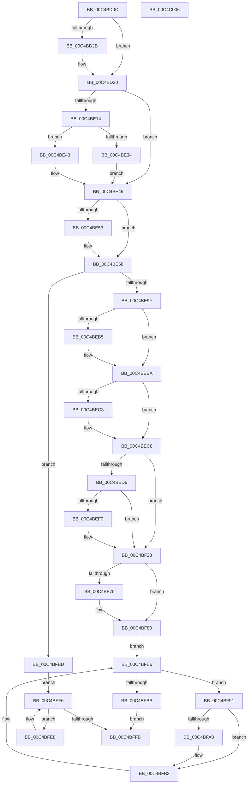

# VfInitBootDriversLoaded

- RVA: `0x00C4BD0C`–`0x00C4C007` (길이 `763` bytes)
- VA: `0x0000000140C4BD0C`
- 실행 섹션: `INIT`
- PDB 이름 있음: `예`; PDB Function 태그: `아니요`
- unwind 정보 RVA: `0x00065960`
- 디코드: `155`개 명령, `763/763` bytes 표시
- 미해석 바이트: `0` (있으면 어셈블리에 `.byte`로 보존)

> 이 문서는 커널 이미지의 기계어와 PDB 기호를 분석해 생성했습니다. 4번과 5번은 함수 원형과 자료형을 바이너리 사용 방식에서 추정한 C 해석이며 원본 소스 복구 결과는 아닙니다.

## 1. Dependencies

- 직접 호출 지점: **23**; 고유 호출 대상: **17**
- 직접 호출자로 확인된 함수: **1**
- RIP 상대 이미지 참조: **47**

### Outgoing calls
- `0x00C4BD16` → [VfThunkGetNumberOfWdmThunk](../../pagevrfy/BA/VfThunkGetNumberOfWdmThunk_function_00BA729C.md) (function, `0x00BA729C`)
- `0x00C4BD2B` → [CarInit](../../text/61/CarInit_function_006189FC.md) (function, `0x006189FC`)
- `0x00C4BD7C` → [RtlSetAllBits](../../text/36/RtlSetAllBits_function_00362490.md) (function, `0x00362490`)
- `0x00C4BD9C` → [RtlSetAllBits](../../text/36/RtlSetAllBits_function_00362490.md) (function, `0x00362490`)
- `0x00C4BDC0` → [RtlSetAllBits](../../text/36/RtlSetAllBits_function_00362490.md) (function, `0x00362490`)
- `0x00C4BDFD` → [ExInitializeNPagedLookasideListInternal](../../text/46/ExInitializeNPagedLookasideListInternal_function_00468720.md) (function, `0x00468720`)
- `0x00C4BE28` → [VfAvlInitializeTreeEx](../../pagevrfy/B9/VfAvlInitializeTreeEx_function_00B93CC8.md) (function, `0x00B93CC8`)
- `0x00C4BE53` → [VfObjectContextInit](../../pagevrfy/B9/VfObjectContextInit_function_00B94834.md) (function, `0x00B94834`)
- `0x00C4BE66` → [ViThunkFindAllExportAddresses](ViThunkFindAllExportAddresses_function_00C4C5F8.md) (function, `0x00C4C5F8`)
- `0x00C4BE79` → [ViThunkFindAllExportAddresses](ViThunkFindAllExportAddresses_function_00C4C5F8.md) (function, `0x00C4C5F8`)
- `0x00C4BE8C` → [ViThunkFindAllExportAddresses](ViThunkFindAllExportAddresses_function_00C4C5F8.md) (function, `0x00C4C5F8`)
- `0x00C4BEA7` → [NtSetDebugFilterState](../../page/83/NtSetDebugFilterState_function_0083C990.md) (function, `0x0083C990`)
- `0x00C4BEB5` → [VfSuspectDriversParseRegistryString](VfSuspectDriversParseRegistryString_function_00C4C820.md) (function, `0x00C4C820`)
- `0x00C4BEC3` → [VfXdvExcludeParseRegistryString](VfXdvExcludeParseRegistryString_function_00C4C9CC.md) (function, `0x00C4C9CC`)
- `0x00C4BEDF` → [ExAllocatePool2](../../poolcode/B8/ExAllocatePool2_function_00B820F0.md) (function, `0x00B820F0`)
- `0x00C4BF01` → [memcpy](../../text/6C/memcpy_function_006C6840.md) (function, `0x006C6840`)
- `0x00C4BF23` → [DifRegisterKernelPlugins](../../text/61/DifRegisterKernelPlugins_function_0061AA40.md) (function, `0x0061AA40`)
- `0x00C4BF3E` → [VfInitVerifierComponents](../../pagevrfy/B9/VfInitVerifierComponents_function_00B93AC0.md) (function, `0x00B93AC0`)
- `0x00C4BF7B` → [VfDriverLoadImage](../../pagevrfy/BB/VfDriverLoadImage_function_00BB7DE4.md) (function, `0x00BB7DE4`)
- `0x00C4BF83` → [ViLogAndLoadXdv](../../pagevrfy/B9/ViLogAndLoadXdv_function_00B93B30.md) (function, `0x00B93B30`)
- `0x00C4BF9F` → [RtlEqualUnicodeString](../../page/93/RtlEqualUnicodeString_function_00932A20.md) (function, `0x00932A20`)
- `0x00C4BFAE` → [VfDriverLoadImage](../../pagevrfy/BB/VfDriverLoadImage_function_00BB7DE4.md) (function, `0x00BB7DE4`)
- `0x00C4BFEE` → [VfDriverLoadImage](../../pagevrfy/BB/VfDriverLoadImage_function_00BB7DE4.md) (function, `0x00BB7DE4`)

### Direct callers
- [MiInitializeLoadedModuleList](../C6/MiInitializeLoadedModuleList_function_00C6BCDC.md) at `0x00C6BF08`

### Static image references
- `0x00C4BD1B` → RVA `0x00F04890` (`.data`; read)
- `0x00C4BD23` → RVA `0x00F044C4` (`.data`; write)
- `0x00C4BD30` → RVA `0x00FFDA70` (`PAGEVRFD`; read/write)
- `0x00C4BD38` → RVA `0x00F03E90` (`.data`; read)
- `0x00C4BD3F` → RVA `0x00F03E98` (`.data`; write)
- `0x00C4BD46` → RVA `0x00FFDC80` (`PAGEVRFD`; read)
- `0x00C4BD4D` → RVA `0x00F03E90` (`.data`; write)
- `0x00C4BD59` → RVA `0x00E0EA74` (`.data`; read)
- `0x00C4BD62` → RVA `0x00E0EA70` (`.data`; write)
- `0x00C4BD68` → RVA `0x00FFEFE0` (`PAGEVRFD`; read)
- `0x00C4BD6F` → RVA `0x00FFDC88` (`PAGEVRFD`; write)
- `0x00C4BD76` → RVA `0x00FFDC80` (`PAGEVRFD`; write)
- `0x00C4BD81` → RVA `0x00FFEFD8` (`PAGEVRFD`; read)
- `0x00C4BD88` → RVA `0x00FFDC70` (`PAGEVRFD`; write)
- `0x00C4BD8E` → RVA `0x00FFDC70` (`PAGEVRFD`; read)
- `0x00C4BD95` → RVA `0x00FFDC78` (`PAGEVRFD`; write)
- `0x00C4BDA1` → RVA `0x00FFF7C0` (`PAGEVRFD`; read)
- `0x00C4BDA8` → RVA `0x00FFDC90` (`PAGEVRFD`; write)
- `0x00C4BDB2` → RVA `0x00FFDC90` (`PAGEVRFD`; read)
- `0x00C4BDB9` → RVA `0x00FFDC98` (`PAGEVRFD`; write)
- `0x00C4BDC5` → RVA `0x00F04368` (`.data`; read)
- `0x00C4BDCB` → RVA `0x004C65D0` (`VfUtilFreePoolCheckIRQL`; read)
- `0x00C4BDD6` → RVA `0x00E28A00` (`.data`; read)
- `0x00C4BE05` → RVA `0x00F04860` (`.data`; read/write)
- `0x00C4BE0B` → RVA `0x00F044C0` (`.data`; read)
- `0x00C4BE14` → RVA `0x004D67F0` (`ViTargetDelayFreeAvlNode`; read)
- `0x00C4BE21` → RVA `0x00F049A0` (`.data`; read)
- `0x00C4BE34` → RVA `0x00F049C0` (`.data`; read/write)
- `0x00C4BE3B` → RVA `0x00F04954` (`.data`; read/write)
- `0x00C4BE43` → RVA `0x00F04958` (`.data`; read/write)
- `0x00C4BE5F` → RVA `0x00FF51B0` (`PAGEVRFD`; read)
- `0x00C4BE72` → RVA `0x00FF4A40` (`PAGEVRFD`; read)
- `0x00C4BE85` → RVA `0x00FF5F20` (`PAGEVRFD`; read)
- `0x00C4BEAC` → RVA `0x01008150` (`INITDATA`; read)
- `0x00C4BEBA` → RVA `0x01008158` (`INITDATA`; read)
- `0x00C4BEC8` → RVA `0x01008154` (`INITDATA`; read)
- `0x00C4BEE4` → RVA `0x00F03DB0` (`.data`; write)
- `0x00C4BEF7` → RVA `0x010090D0` (`INITDATA`; read)
- `0x00C4BF1D` → RVA `0x00F03DB8` (`.data`; write)
- `0x00C4BF28` → RVA `0x00F04ABC` (`.data`; read)
- `0x00C4BF32` → RVA `0x00F04A04` (`.data`; read)
- `0x00C4BF38` → RVA `0x00F04A20` (`.data`; read)
- `0x00C4BF43` → RVA `0x00EF54C0` (`.data`; read)
- `0x00C4BF4A` → RVA `0x00F0437C` (`.data`; write)
- `0x00C4BF5E` → RVA `0x00F044D0` (`.data`; write)
- `0x00C4BF6C` → RVA `0x00F044D8` (`.data`; write)
- `0x00C4BF98` → RVA `0x00FF4150` (`PAGEVRFD`; read)

## 2. Other-region calls and transfers

- 다른 실행 섹션으로 향하는 call: **18**
  - `0x00C4BD16` → [VfThunkGetNumberOfWdmThunk](../../pagevrfy/BA/VfThunkGetNumberOfWdmThunk_function_00BA729C.md) (`INIT` → `PAGEVRFY`)
  - `0x00C4BD2B` → [CarInit](../../text/61/CarInit_function_006189FC.md) (`INIT` → `.text`)
  - `0x00C4BD7C` → [RtlSetAllBits](../../text/36/RtlSetAllBits_function_00362490.md) (`INIT` → `.text`)
  - `0x00C4BD9C` → [RtlSetAllBits](../../text/36/RtlSetAllBits_function_00362490.md) (`INIT` → `.text`)
  - `0x00C4BDC0` → [RtlSetAllBits](../../text/36/RtlSetAllBits_function_00362490.md) (`INIT` → `.text`)
  - `0x00C4BDFD` → [ExInitializeNPagedLookasideListInternal](../../text/46/ExInitializeNPagedLookasideListInternal_function_00468720.md) (`INIT` → `.text`)
  - `0x00C4BE28` → [VfAvlInitializeTreeEx](../../pagevrfy/B9/VfAvlInitializeTreeEx_function_00B93CC8.md) (`INIT` → `PAGEVRFY`)
  - `0x00C4BE53` → [VfObjectContextInit](../../pagevrfy/B9/VfObjectContextInit_function_00B94834.md) (`INIT` → `PAGEVRFY`)
  - `0x00C4BEA7` → [NtSetDebugFilterState](../../page/83/NtSetDebugFilterState_function_0083C990.md) (`INIT` → `PAGE`)
  - `0x00C4BEDF` → [ExAllocatePool2](../../poolcode/B8/ExAllocatePool2_function_00B820F0.md) (`INIT` → `POOLCODE`)
  - `0x00C4BF01` → [memcpy](../../text/6C/memcpy_function_006C6840.md) (`INIT` → `.text`)
  - `0x00C4BF23` → [DifRegisterKernelPlugins](../../text/61/DifRegisterKernelPlugins_function_0061AA40.md) (`INIT` → `.text`)
  - `0x00C4BF3E` → [VfInitVerifierComponents](../../pagevrfy/B9/VfInitVerifierComponents_function_00B93AC0.md) (`INIT` → `PAGEVRFY`)
  - `0x00C4BF7B` → [VfDriverLoadImage](../../pagevrfy/BB/VfDriverLoadImage_function_00BB7DE4.md) (`INIT` → `PAGEVRFY`)
  - `0x00C4BF83` → [ViLogAndLoadXdv](../../pagevrfy/B9/ViLogAndLoadXdv_function_00B93B30.md) (`INIT` → `PAGEVRFY`)
  - `0x00C4BF9F` → [RtlEqualUnicodeString](../../page/93/RtlEqualUnicodeString_function_00932A20.md) (`INIT` → `PAGE`)
  - `0x00C4BFAE` → [VfDriverLoadImage](../../pagevrfy/BB/VfDriverLoadImage_function_00BB7DE4.md) (`INIT` → `PAGEVRFY`)
  - `0x00C4BFEE` → [VfDriverLoadImage](../../pagevrfy/BB/VfDriverLoadImage_function_00BB7DE4.md) (`INIT` → `PAGEVRFY`)
- 별도 외부 분기/꼬리 이동을 확인하지 못했습니다.

## 3. Assembly (complete function range)

```asm
00C4BD0C  48 89 5C 24 08                  mov qword ptr [rsp + 8], rbx
00C4BD11  57                              push rdi
00C4BD12  48 83 EC 40                     sub rsp, 0x40
00C4BD16  E8 81 B5 F5 FF                  call 0x140ba729c
00C4BD1B  48 83 3D 6D 8B 2B 00 00         cmp qword ptr [rip + 0x2b8b6d], 0
00C4BD23  89 05 9B 87 2B 00               mov dword ptr [rip + 0x2b879b], eax
00C4BD29  74 05                           je 0x140c4bd30
00C4BD2B  E8 CC CC 9C FF                  call 0x1406189fc
00C4BD30  48 83 25 38 1D 3B 00 00         and qword ptr [rip + 0x3b1d38], 0
00C4BD38  48 8D 05 51 81 2B 00            lea rax, [rip + 0x2b8151]
00C4BD3F  48 89 05 52 81 2B 00            mov qword ptr [rip + 0x2b8152], rax
00C4BD46  48 8D 0D 33 1F 3B 00            lea rcx, [rip + 0x3b1f33]
00C4BD4D  48 89 05 3C 81 2B 00            mov qword ptr [rip + 0x2b813c], rax
00C4BD54  BB 40 00 00 00                  mov ebx, 0x40
00C4BD59  8B 05 15 2D 1C 00               mov eax, dword ptr [rip + 0x1c2d15]
00C4BD5F  C1 E8 02                        shr eax, 2
00C4BD62  89 05 08 2D 1C 00               mov dword ptr [rip + 0x1c2d08], eax
00C4BD68  48 8D 05 71 32 3B 00            lea rax, [rip + 0x3b3271]
00C4BD6F  48 89 05 12 1F 3B 00            mov qword ptr [rip + 0x3b1f12], rax
00C4BD76  89 1D 04 1F 3B 00               mov dword ptr [rip + 0x3b1f04], ebx
00C4BD7C  E8 0F 67 71 FF                  call 0x140362490
00C4BD81  48 8D 05 50 32 3B 00            lea rax, [rip + 0x3b3250]
00C4BD88  89 1D E2 1E 3B 00               mov dword ptr [rip + 0x3b1ee2], ebx
00C4BD8E  48 8D 0D DB 1E 3B 00            lea rcx, [rip + 0x3b1edb]
00C4BD95  48 89 05 DC 1E 3B 00            mov qword ptr [rip + 0x3b1edc], rax
00C4BD9C  E8 EF 66 71 FF                  call 0x140362490
00C4BDA1  48 8D 05 18 3A 3B 00            lea rax, [rip + 0x3b3a18]
00C4BDA8  C7 05 DE 1E 3B 00 40 02 00 00   mov dword ptr [rip + 0x3b1ede], 0x240
00C4BDB2  48 8D 0D D7 1E 3B 00            lea rcx, [rip + 0x3b1ed7]
00C4BDB9  48 89 05 D8 1E 3B 00            mov qword ptr [rip + 0x3b1ed8], rax
00C4BDC0  E8 CB 66 71 FF                  call 0x140362490
00C4BDC5  8B 05 9D 85 2B 00               mov eax, dword ptr [rip + 0x2b859d]
00C4BDCB  4C 8D 05 FE A7 87 FF            lea r8, [rip - 0x785802]
00C4BDD2  89 44 24 38                     mov dword ptr [rsp + 0x38], eax
00C4BDD6  48 8D 0D 23 CC 1D 00            lea rcx, [rip + 0x1dcc23]
00C4BDDD  66 C7 44 24 30 10 00            mov word ptr [rsp + 0x30], 0x10
00C4BDE4  41 B9 00 02 00 00               mov r9d, 0x200
00C4BDEA  C7 44 24 28 56 66 41 54         mov dword ptr [rsp + 0x28], 0x54416656
00C4BDF2  33 D2                           xor edx, edx
00C4BDF4  48 C7 44 24 20 30 00 00 00      mov qword ptr [rsp + 0x20], 0x30
00C4BDFD  E8 1E C9 81 FF                  call 0x140468720
00C4BE02  8D 43 C1                        lea eax, [rbx - 0x3f]
00C4BE05  87 05 55 8A 2B 00               xchg dword ptr [rip + 0x2b8a55], eax
00C4BE0B  83 3D AE 86 2B 00 00            cmp dword ptr [rip + 0x2b86ae], 0
00C4BE12  75 35                           jne 0x140c4be49
00C4BE14  4C 8D 0D D5 A9 88 FF            lea r9, [rip - 0x77562b]
00C4BE1B  33 D2                           xor edx, edx
00C4BE1D  44 8D 43 08                     lea r8d, [rbx + 8]
00C4BE21  48 8D 0D 78 8B 2B 00            lea rcx, [rip + 0x2b8b78]
00C4BE28  E8 9B 7E F4 FF                  call 0x140b93cc8
00C4BE2D  85 C0                           test eax, eax
00C4BE2F  8D 43 C1                        lea eax, [rbx - 0x3f]
00C4BE32  78 0F                           js 0x140c4be43
00C4BE34  83 25 85 8B 2B 00 00            and dword ptr [rip + 0x2b8b85], 0
00C4BE3B  87 05 13 8B 2B 00               xchg dword ptr [rip + 0x2b8b13], eax
00C4BE41  EB 06                           jmp 0x140c4be49
00C4BE43  87 05 0F 8B 2B 00               xchg dword ptr [rip + 0x2b8b0f], eax
00C4BE49  48 83 3D 3F 8A 2B 00 00         cmp qword ptr [rip + 0x2b8a3f], 0
00C4BE51  74 05                           je 0x140c4be58
00C4BE53  E8 DC 89 F4 FF                  call 0x140b94834
00C4BE58  4C 8D 05 21 1E 3B 00            lea r8, [rip + 0x3b1e21]
00C4BE5F  48 8D 0D 4A 93 3A 00            lea rcx, [rip + 0x3a934a]
00C4BE66  E8 8D 07 00 00                  call 0x140c4c5f8
00C4BE6B  4C 8D 05 FE 1D 3B 00            lea r8, [rip + 0x3b1dfe]
00C4BE72  48 8D 0D C7 8B 3A 00            lea rcx, [rip + 0x3a8bc7]
00C4BE79  E8 7A 07 00 00                  call 0x140c4c5f8
00C4BE7E  4C 8D 05 0B 1E 3B 00            lea r8, [rip + 0x3b1e0b]
00C4BE85  48 8D 0D 94 A0 3A 00            lea rcx, [rip + 0x3aa094]
00C4BE8C  E8 67 07 00 00                  call 0x140c4c5f8
00C4BE91  48 83 3D F7 89 2B 00 00         cmp qword ptr [rip + 0x2b89f7], 0
00C4BE99  0F 84 1E 01 00 00               je 0x140c4bfbd
00C4BE9F  33 D2                           xor edx, edx
00C4BEA1  41 B0 01                        mov r8b, 1
00C4BEA4  8D 4A 5D                        lea ecx, [rdx + 0x5d]
00C4BEA7  E8 E4 0A BF FF                  call 0x14083c990
00C4BEAC  83 3D 9D C2 3B 00 00            cmp dword ptr [rip + 0x3bc29d], 0
00C4BEB3  74 05                           je 0x140c4beba
00C4BEB5  E8 66 09 00 00                  call 0x140c4c820
00C4BEBA  83 3D 97 C2 3B 00 00            cmp dword ptr [rip + 0x3bc297], 0
00C4BEC1  74 05                           je 0x140c4bec8
00C4BEC3  E8 04 0B 00 00                  call 0x140c4c9cc
00C4BEC8  8B 15 86 C2 3B 00               mov edx, dword ptr [rip + 0x3bc286]
00C4BECE  8D 42 FF                        lea eax, [rdx - 1]
00C4BED1  83 F8 FD                        cmp eax, -3
00C4BED4  77 4D                           ja 0x140c4bf23
00C4BED6  41 B8 44 66 43 66               mov r8d, 0x66436644
00C4BEDC  48 8B CB                        mov rcx, rbx
00C4BEDF  E8 0C 62 F3 FF                  call 0x140b820f0
00C4BEE4  48 89 05 C5 7E 2B 00            mov qword ptr [rip + 0x2b7ec5], rax
00C4BEEB  48 85 C0                        test rax, rax
00C4BEEE  74 33                           je 0x140c4bf23
00C4BEF0  44 8B 05 5D C2 3B 00            mov r8d, dword ptr [rip + 0x3bc25d]
00C4BEF7  48 8D 15 D2 D1 3B 00            lea rdx, [rip + 0x3bd1d2]
00C4BEFE  48 8B C8                        mov rcx, rax
00C4BF01  E8 3A A9 A7 FF                  call 0x1406c6840
00C4BF06  8B 0D 48 C2 3B 00               mov ecx, dword ptr [rip + 0x3bc248]
00C4BF0C  48 B8 AB AA AA AA AA AA AA AA   movabs rax, 0xaaaaaaaaaaaaaaab
00C4BF16  48 F7 E1                        mul rcx
00C4BF19  48 C1 EA 03                     shr rdx, 3
00C4BF1D  89 15 95 7E 2B 00               mov dword ptr [rip + 0x2b7e95], edx
00C4BF23  E8 18 EB 9C FF                  call 0x14061aa40
00C4BF28  44 8B 05 8D 8B 2B 00            mov r8d, dword ptr [rip + 0x2b8b8d]
00C4BF2F  45 33 C9                        xor r9d, r9d
00C4BF32  8B 15 CC 8A 2B 00               mov edx, dword ptr [rip + 0x2b8acc]
00C4BF38  8B 0D E2 8A 2B 00               mov ecx, dword ptr [rip + 0x2b8ae2]
00C4BF3E  E8 7D 7B F4 FF                  call 0x140b93ac0
00C4BF43  48 8B 1D 76 95 2A 00            mov rbx, qword ptr [rip + 0x2a9576]
00C4BF4A  C7 05 28 84 2B 00 01 00 00 00   mov dword ptr [rip + 0x2b8428], 1
00C4BF54  48 8B 4B 30                     mov rcx, qword ptr [rbx + 0x30]
00C4BF58  8B 43 40                        mov eax, dword ptr [rbx + 0x40]
00C4BF5B  48 03 C1                        add rax, rcx
00C4BF5E  48 89 0D 6B 85 2B 00            mov qword ptr [rip + 0x2b856b], rcx
00C4BF65  83 3D 50 8B 2B 00 00            cmp dword ptr [rip + 0x2b8b50], 0
00C4BF6C  48 89 05 65 85 2B 00            mov qword ptr [rip + 0x2b8565], rax
00C4BF73  74 0B                           je 0x140c4bf80
00C4BF75  41 B0 01                        mov r8b, 1
00C4BF78  48 8B CB                        mov rcx, rbx
00C4BF7B  E8 64 BE F6 FF                  call 0x140bb7de4
00C4BF80  48 8B 1B                        mov rbx, qword ptr [rbx]
00C4BF83  E8 A8 7B F4 FF                  call 0x140b93b30
00C4BF88  48 8D 3D 31 95 2A 00            lea rdi, [rip + 0x2a9531]
00C4BF8F  EB 25                           jmp 0x140c4bfb6
00C4BF91  48 8D 4B 58                     lea rcx, [rbx + 0x58]
00C4BF95  41 B0 01                        mov r8b, 1
00C4BF98  48 8D 15 B1 81 3A 00            lea rdx, [rip + 0x3a81b1]
00C4BF9F  E8 7C 6A CE FF                  call 0x140932a20
00C4BFA4  84 C0                           test al, al
00C4BFA6  75 0B                           jne 0x140c4bfb3
00C4BFA8  45 33 C0                        xor r8d, r8d
00C4BFAB  48 8B CB                        mov rcx, rbx
00C4BFAE  E8 31 BE F6 FF                  call 0x140bb7de4
00C4BFB3  48 8B 1B                        mov rbx, qword ptr [rbx]
00C4BFB6  48 3B DF                        cmp rbx, rdi
00C4BFB9  75 D6                           jne 0x140c4bf91
00C4BFBB  EB 3E                           jmp 0x140c4bffb
00C4BFBD  48 8B 15 FC 94 2A 00            mov rdx, qword ptr [rip + 0x2a94fc]
00C4BFC4  48 8D 3D F5 94 2A 00            lea rdi, [rip + 0x2a94f5]
00C4BFCB  48 8B 4A 30                     mov rcx, qword ptr [rdx + 0x30]
00C4BFCF  8B 42 40                        mov eax, dword ptr [rdx + 0x40]
00C4BFD2  48 8B 1A                        mov rbx, qword ptr [rdx]
00C4BFD5  48 03 C1                        add rax, rcx
00C4BFD8  48 89 05 F9 84 2B 00            mov qword ptr [rip + 0x2b84f9], rax
00C4BFDF  48 89 0D EA 84 2B 00            mov qword ptr [rip + 0x2b84ea], rcx
00C4BFE6  EB 0E                           jmp 0x140c4bff6
00C4BFE8  45 33 C0                        xor r8d, r8d
00C4BFEB  48 8B CB                        mov rcx, rbx
00C4BFEE  E8 F1 BD F6 FF                  call 0x140bb7de4
00C4BFF3  48 8B 1B                        mov rbx, qword ptr [rbx]
00C4BFF6  48 3B DF                        cmp rbx, rdi
00C4BFF9  75 ED                           jne 0x140c4bfe8
00C4BFFB  48 8B 5C 24 50                  mov rbx, qword ptr [rsp + 0x50]
00C4C000  48 83 C4 40                     add rsp, 0x40
00C4C004  5F                              pop rdi
00C4C005  C3                              ret
00C4C006  CC                              int3
```

## 4. C-style interpretation (structured pseudocode)

```c
__int64 __fastcall VfInitBootDriversLoaded(__int64 a1, int a2)
{
    __int64 result;
    __int64 v_rsp;
    unsigned int v_stack_m10;
    unsigned __int16 v_stack_m18;
    unsigned int v_stack_m20;
    unsigned __int64 v_stack_m28;
    unsigned __int64 v_stack_p8;

    v_stack_p8 = v_rbx;
    v_rsp = (v_rsp) - (64);
    result = VfThunkGetNumberOfWdmThunk(a1, a2, a3, a4);
    *(unsigned int *)(v_rip + 2852763) = (unsigned int)(result);
    if ((*(unsigned __int64 *)(v_rip + 2853741)) != 0) {
        result = CarInit(a1, a2, a3, a4);
    }
    *(unsigned __int64 *)(v_rip + 2851154) = v_rip + 2851153;
    *(unsigned __int64 *)(v_rip + 2851132) = v_rip + 2851153;
    result = (unsigned int)(((unsigned int)(*(unsigned int *)(v_rip + 1846549))) >> (2));
    *(unsigned int *)(v_rip + 1846536) = (unsigned int)(result);
    *(unsigned __int64 *)(v_rip + 3874578) = v_rip + 3879537;
    *(unsigned int *)(v_rip + 3874564) = 64;
    result = RtlSetAllBits(v_rip + 3874611, a2, a3, a4);
    *(unsigned int *)(v_rip + 3874530) = 64;
    *(unsigned __int64 *)(v_rip + 3874524) = v_rip + 3879504;
    result = RtlSetAllBits(v_rip + 3874523, a2, a3, a4);
    *(unsigned int *)(v_rip + 3874526) = 576;
    *(unsigned __int64 *)(v_rip + 3874520) = v_rip + 3881496;
    result = RtlSetAllBits(v_rip + 3874519, a2, a3, a4);
    v_stack_m10 = (unsigned int)((unsigned int)(*(unsigned int *)(v_rip + 2852253)));
    v_stack_m18 = 16;
    v_stack_m20 = 0x54416656ULL;
    a2 = 0;
    v_stack_m28 = 48;
    result = ExInitializeNPagedLookasideListInternal(v_rip + 1952803, a2, v_rip - 7886850, 512);
    if ((*(unsigned int *)(v_rip + 2852526)) != 0) goto loc_00C4BE49;
    a2 = 0;
    result = VfAvlInitializeTreeEx(v_rip + 2853752, a2, 64 + 8, v_rip - 7820843);
    if (sign_flag) goto loc_00C4BE43;
    goto loc_00C4BE49;
loc_00C4BE43:
loc_00C4BE49:
    result = 64 - 63;
    if ((*(unsigned __int64 *)(v_rip + 2853439)) != 0) {
        result = VfObjectContextInit(v_rip + 2853752, a2, 64 + 8, v_rip - 7820843);
    }
    result = ViThunkFindAllExportAddresses(v_rip + 3838794, a2, v_rip + 3874337, v_rip - 7820843);
    result = ViThunkFindAllExportAddresses(v_rip + 3836871, a2, v_rip + 3874302, v_rip - 7820843);
    result = ViThunkFindAllExportAddresses(v_rip + 3842196, a2, v_rip + 3874315, v_rip - 7820843);
    if ((*(unsigned __int64 *)(v_rip + 2853367)) == 0) goto loc_00C4BFBD;
    a2 = 0;
    result = NtSetDebugFilterState(a2 + 93, a2, 1, v_rip - 7820843);
    if ((*(unsigned int *)(v_rip + 3916445)) != 0) {
        result = VfSuspectDriversParseRegistryString(a2 + 93, a2, 1, v_rip - 7820843);
    }
    if ((*(unsigned int *)(v_rip + 3916439)) != 0) {
        result = VfXdvExcludeParseRegistryString(a2 + 93, a2, 1, v_rip - 7820843);
    }
    if (((unsigned int)((unsigned int)(*(unsigned int *)(v_rip + 3916422)) - 1)) > -3) goto loc_00C4BF23;
    result = ExAllocatePool2(64, (unsigned int)(*(unsigned int *)(v_rip + 3916422)), (unsigned int)(0x66436644ULL), v_rip - 7820843);
    *(unsigned __int64 *)(v_rip + 2850501) = result;
    if (result != 0) {
        a3 = *(unsigned int *)(v_rip + 3916381);
        a2 = v_rip + 3920338;
        a1 = result;
        result = memcpy(a1, a2, a3, v_rip - 7820843);
        a1 = *(unsigned int *)(v_rip + 3916360);
        a2 = (a2) >> (3);
        *(unsigned int *)(v_rip + 2850453) = a2;
    }
    result = DifRegisterKernelPlugins(a1, a2, a3, v_rip - 7820843);
    a4 = 0;
    result = VfInitVerifierComponents((unsigned int)(*(unsigned int *)(v_rip + 2853602)), (unsigned int)(*(unsigned int *)(v_rip + 2853580)), (unsigned int)(*(unsigned int *)(v_rip + 2853773)), a4);
    *(unsigned int *)(v_rip + 2851880) = 1;
    result = ((unsigned int)(*(unsigned int *)(*(unsigned __int64 *)(v_rip + 2790774) + 64))) + (*(unsigned __int64 *)(*(unsigned __int64 *)(v_rip + 2790774) + 48));
    *(unsigned __int64 *)(v_rip + 2852203) = *(unsigned __int64 *)(*(unsigned __int64 *)(v_rip + 2790774) + 48);
    *(unsigned __int64 *)(v_rip + 2852197) = result;
    if ((*(unsigned int *)(v_rip + 2853712)) != 0) {
        a3 = 1;
        a1 = *(unsigned __int64 *)(v_rip + 2790774);
        result = VfDriverLoadImage(a1, (unsigned int)(*(unsigned int *)(v_rip + 2853580)), a3, a4);
    }
    result = ViLogAndLoadXdv(a1, (unsigned int)(*(unsigned int *)(v_rip + 2853580)), a3, a4);
    goto loc_00C4BFB6;
loc_00C4BF91:
    result = RtlEqualUnicodeString(*(unsigned __int64 *)(*(unsigned __int64 *)(v_rip + 2790774)) + 88, v_rip + 3834289, 1, a4);
    if ((unsigned __int8)(result) == 0) {
        a3 = 0;
        a1 = *(unsigned __int64 *)(*(unsigned __int64 *)(v_rip + 2790774));
        result = VfDriverLoadImage(a1, v_rip + 3834289, a3, a4);
    }
loc_00C4BFB6:
    if ((*(unsigned __int64 *)(*(unsigned __int64 *)(*(unsigned __int64 *)(v_rip + 2790774)))) != (v_rip + 2790705)) goto loc_00C4BF91;
    goto loc_00C4BFFB;
loc_00C4BFBD:
    result = ((unsigned int)(*(unsigned int *)(*(unsigned __int64 *)(v_rip + 2790652) + 64))) + (*(unsigned __int64 *)(*(unsigned __int64 *)(v_rip + 2790652) + 48));
    *(unsigned __int64 *)(v_rip + 2852089) = result;
    *(unsigned __int64 *)(v_rip + 2852074) = *(unsigned __int64 *)(*(unsigned __int64 *)(v_rip + 2790652) + 48);
    goto loc_00C4BFF6;
loc_00C4BFE8:
    a3 = 0;
    result = VfDriverLoadImage(*(unsigned __int64 *)(*(unsigned __int64 *)(v_rip + 2790652)), *(unsigned __int64 *)(v_rip + 2790652), a3, a4);
loc_00C4BFF6:
    if ((*(unsigned __int64 *)(*(unsigned __int64 *)(*(unsigned __int64 *)(v_rip + 2790652)))) != (v_rip + 2790645)) goto loc_00C4BFE8;
loc_00C4BFFB:
    v_rsp = (v_rsp) + (64);
    return result;
}
```

## 5. (Beta) C Style

```c
int64_t VfInitBootDriversLoaded(int64_t Arg1, int32_t Arg2)
{
    int64_t result;
    int64_t local_rsp;
    uint32_t v_stack_m10;
    uint16_t v_stack_m18;
    uint32_t v_stack_m20;
    uint64_t v_stack_m28;
    uint64_t v_stack_p8;

    v_stack_p8 = local_rbx;
    local_rsp = (local_rsp) - (64);
    result = VfThunkGetNumberOfWdmThunk(Arg1, Arg2, a3, a4);
    *(uint32_t *)(v_rip + 0x2B879B) = (uint32_t)(result);
    if ((*(uint64_t *)(v_rip + 0x2B8B6D)) != 0) {
        result = CarInit(Arg1, Arg2, a3, a4);
    }
    *(uint64_t *)(v_rip + 0x2B8152) = v_rip + 2851153;
    *(uint64_t *)(v_rip + 0x2B813C) = v_rip + 2851153;
    result = (uint32_t)(((uint32_t)(*(uint32_t *)(v_rip + 0x1C2D15))) >> (2));
    *(uint32_t *)(v_rip + 0x1C2D08) = (uint32_t)(result);
    *(uint64_t *)(v_rip + 0x3B1F12) = v_rip + 3879537;
    *(uint32_t *)(v_rip + 0x3B1F04) = 64;
    result = RtlSetAllBits(v_rip + 3874611, Arg2, a3, a4);
    *(uint32_t *)(v_rip + 0x3B1EE2) = 64;
    *(uint64_t *)(v_rip + 0x3B1EDC) = v_rip + 3879504;
    result = RtlSetAllBits(v_rip + 3874523, Arg2, a3, a4);
    *(uint32_t *)(v_rip + 0x3B1EDE) = 576;
    *(uint64_t *)(v_rip + 0x3B1ED8) = v_rip + 3881496;
    result = RtlSetAllBits(v_rip + 3874519, Arg2, a3, a4);
    v_stack_m10 = (uint32_t)((uint32_t)(*(uint32_t *)(v_rip + 0x2B859D)));
    v_stack_m18 = 16;
    v_stack_m20 = 0x54416656ULL;
    Arg2 = 0;
    v_stack_m28 = 48;
    result = ExInitializeNPagedLookasideListInternal(v_rip + 1952803, Arg2, v_rip - 7886850, 512);
    if ((*(uint32_t *)(v_rip + 0x2B86AE)) != 0) goto loc_00C4BE49;
    Arg2 = 0;
    result = VfAvlInitializeTreeEx(v_rip + 2853752, Arg2, 64 + 8, v_rip - 7820843);
    if (sign_flag) goto loc_00C4BE43;
    goto loc_00C4BE49;
loc_00C4BE43:
loc_00C4BE49:
    result = 64 - 63;
    if ((*(uint64_t *)(v_rip + 0x2B8A3F)) != 0) {
        result = VfObjectContextInit(v_rip + 2853752, Arg2, 64 + 8, v_rip - 7820843);
    }
    result = ViThunkFindAllExportAddresses(v_rip + 3838794, Arg2, v_rip + 3874337, v_rip - 7820843);
    result = ViThunkFindAllExportAddresses(v_rip + 3836871, Arg2, v_rip + 3874302, v_rip - 7820843);
    result = ViThunkFindAllExportAddresses(v_rip + 3842196, Arg2, v_rip + 3874315, v_rip - 7820843);
    if ((*(uint64_t *)(v_rip + 0x2B89F7)) == 0) goto loc_00C4BFBD;
    Arg2 = 0;
    result = NtSetDebugFilterState(Arg2 + 93, Arg2, 1, v_rip - 7820843);
    if ((*(uint32_t *)(v_rip + 0x3BC29D)) != 0) {
        result = VfSuspectDriversParseRegistryString(Arg2 + 93, Arg2, 1, v_rip - 7820843);
    }
    if ((*(uint32_t *)(v_rip + 0x3BC297)) != 0) {
        result = VfXdvExcludeParseRegistryString(Arg2 + 93, Arg2, 1, v_rip - 7820843);
    }
    if (((uint32_t)((uint32_t)(*(uint32_t *)(v_rip + 0x3BC286)) - 1)) > -3) goto loc_00C4BF23;
    result = ExAllocatePool2(64, (uint32_t)(*(uint32_t *)(v_rip + 0x3BC286)), (uint32_t)(0x66436644ULL), v_rip - 7820843);
    *(uint64_t *)(v_rip + 0x2B7EC5) = result;
    if (result != 0) {
        a3 = *(uint32_t *)(v_rip + 0x3BC25D);
        Arg2 = v_rip + 3920338;
        Arg1 = result;
        result = memcpy(Arg1, Arg2, a3, v_rip - 7820843);
        Arg1 = *(uint32_t *)(v_rip + 0x3BC248);
        Arg2 = (Arg2) >> (3);
        *(uint32_t *)(v_rip + 0x2B7E95) = Arg2;
    }
    result = DifRegisterKernelPlugins(Arg1, Arg2, a3, v_rip - 7820843);
    a4 = 0;
    result = VfInitVerifierComponents((uint32_t)(*(uint32_t *)(v_rip + 0x2B8AE2)), (uint32_t)(*(uint32_t *)(v_rip + 0x2B8ACC)), (uint32_t)(*(uint32_t *)(v_rip + 0x2B8B8D)), a4);
    *(uint32_t *)(v_rip + 0x2B8428) = 1;
    result = ((uint32_t)(*(uint32_t *)(*(uint64_t *)(v_rip + 0x2A9576) + 0x40))) + (*(uint64_t *)(*(uint64_t *)(v_rip + 0x2A9576) + 0x30));
    *(uint64_t *)(v_rip + 0x2B856B) = *(uint64_t *)(*(uint64_t *)(v_rip + 0x2A9576) + 0x30);
    *(uint64_t *)(v_rip + 0x2B8565) = result;
    if ((*(uint32_t *)(v_rip + 0x2B8B50)) != 0) {
        a3 = 1;
        Arg1 = *(uint64_t *)(v_rip + 0x2A9576);
        result = VfDriverLoadImage(Arg1, (uint32_t)(*(uint32_t *)(v_rip + 0x2B8ACC)), a3, a4);
    }
    result = ViLogAndLoadXdv(Arg1, (uint32_t)(*(uint32_t *)(v_rip + 0x2B8ACC)), a3, a4);
    goto loc_00C4BFB6;
loc_00C4BF91:
    result = RtlEqualUnicodeString(*(uint64_t *)(*(uint64_t *)(v_rip + 0x2A9576)) + 88, v_rip + 3834289, 1, a4);
    if ((uint8_t)(result) == 0) {
        a3 = 0;
        Arg1 = *(uint64_t *)(*(uint64_t *)(v_rip + 0x2A9576));
        result = VfDriverLoadImage(Arg1, v_rip + 3834289, a3, a4);
    }
loc_00C4BFB6:
    if ((*(uint64_t *)(*(uint64_t *)(*(uint64_t *)(v_rip + 0x2A9576)))) != (v_rip + 2790705)) goto loc_00C4BF91;
    goto loc_00C4BFFB;
loc_00C4BFBD:
    result = ((uint32_t)(*(uint32_t *)(*(uint64_t *)(v_rip + 0x2A94FC) + 0x40))) + (*(uint64_t *)(*(uint64_t *)(v_rip + 0x2A94FC) + 0x30));
    *(uint64_t *)(v_rip + 0x2B84F9) = result;
    *(uint64_t *)(v_rip + 0x2B84EA) = *(uint64_t *)(*(uint64_t *)(v_rip + 0x2A94FC) + 0x30);
    goto loc_00C4BFF6;
loc_00C4BFE8:
    a3 = 0;
    result = VfDriverLoadImage(*(uint64_t *)(*(uint64_t *)(v_rip + 0x2A94FC)), *(uint64_t *)(v_rip + 0x2A94FC), a3, a4);
loc_00C4BFF6:
    if ((*(uint64_t *)(*(uint64_t *)(*(uint64_t *)(v_rip + 0x2A94FC)))) != (v_rip + 2790645)) goto loc_00C4BFE8;
loc_00C4BFFB:
    local_rsp = (local_rsp) + (64);
    return result;
}
```

## 6. Execution-region graph

[열기: 2D/3D 그래프와 함수 탐색 컨트롤 패널](../../../control-panel.html?section=init&rva=0x00C4BD0C&view=graph)

- 2D 그래프는 위에서 아래로 흐르고, 3D 그래프는 빈 공간을 드래그해 회전합니다. Shift+드래그는 이동, 휠은 확대·축소, 함수 노드 선택은 대상 보고서 이동입니다.

### Static fallback


