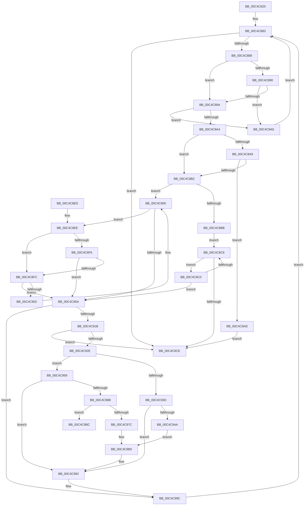

# VfSuspectDriversParseRegistryString

- RVA: `0x00C4C820`–`0x00C4C9C3` (길이 `419` bytes)
- VA: `0x0000000140C4C820`
- 실행 섹션: `INIT`
- PDB 이름 있음: `예`; PDB Function 태그: `아니요`
- unwind 정보 RVA: `0x000D26D0`
- 디코드: `111`개 명령, `419/419` bytes 표시
- 미해석 바이트: `0` (있으면 어셈블리에 `.byte`로 보존)

> 이 문서는 커널 이미지의 기계어와 PDB 기호를 분석해 생성했습니다. 4번과 5번은 함수 원형과 자료형을 바이너리 사용 방식에서 추정한 C 해석이며 원본 소스 복구 결과는 아닙니다.

## 1. Dependencies

- 직접 호출 지점: **6**; 고유 호출 대상: **5**
- 직접 호출자로 확인된 함수: **1**
- RIP 상대 이미지 참조: **7**

### Outgoing calls
- `0x00C4C93D` → [VfSuspectDriversAllocateEntry](../../pagevrfy/BA/VfSuspectDriversAllocateEntry_function_00BAA690.md) (function, `0x00BAA690`)
- `0x00C4C94A` → [VfDriverLock](../../pagevrfy/B9/VfDriverLock_function_00B9A4A4.md) (function, `0x00B9A4A4`)
- `0x00C4C952` → [VfSuspectDriversInsert](../../pagevrfy/BA/VfSuspectDriversInsert_function_00BAAAF8.md) (function, `0x00BAAAF8`)
- `0x00C4C95E` → [VfSuspectExcludedDriversAllocateEntry](../../pagevrfy/BA/VfSuspectExcludedDriversAllocateEntry_function_00BAB0C4.md) (function, `0x00BAB0C4`)
- `0x00C4C96B` → [VfDriverLock](../../pagevrfy/B9/VfDriverLock_function_00B9A4A4.md) (function, `0x00B9A4A4`)
- `0x00C4C98D` → [VfDriverUnlock](../../pagevrfy/B9/VfDriverUnlock_function_00B9A62C.md) (function, `0x00B9A62C`)

### Direct callers
- [VfInitBootDriversLoaded](VfInitBootDriversLoaded_function_00C4BD0C.md) at `0x00C4BEB5`

### Static image references
- `0x00C4C83D` → RVA `0x00F04980` (`.data`; read)
- `0x00C4C843` → RVA `0x0100B1D0` (`INITDATA`; read)
- `0x00C4C84D` → RVA `0x00F04940` (`.data`; read)
- `0x00C4C858` → RVA `0x01008150` (`INITDATA`; read)
- `0x00C4C970` → RVA `0x00F04948` (`.data`; read)
- `0x00C4C986` → RVA `0x00F04948` (`.data`; write)
- `0x00C4C9AD` → RVA `0x00F04A04` (`.data`; write)

## 2. Other-region calls and transfers

- 다른 실행 섹션으로 향하는 call: **6**
  - `0x00C4C93D` → [VfSuspectDriversAllocateEntry](../../pagevrfy/BA/VfSuspectDriversAllocateEntry_function_00BAA690.md) (`INIT` → `PAGEVRFY`)
  - `0x00C4C94A` → [VfDriverLock](../../pagevrfy/B9/VfDriverLock_function_00B9A4A4.md) (`INIT` → `PAGEVRFY`)
  - `0x00C4C952` → [VfSuspectDriversInsert](../../pagevrfy/BA/VfSuspectDriversInsert_function_00BAAAF8.md) (`INIT` → `PAGEVRFY`)
  - `0x00C4C95E` → [VfSuspectExcludedDriversAllocateEntry](../../pagevrfy/BA/VfSuspectExcludedDriversAllocateEntry_function_00BAB0C4.md) (`INIT` → `PAGEVRFY`)
  - `0x00C4C96B` → [VfDriverLock](../../pagevrfy/B9/VfDriverLock_function_00B9A4A4.md) (`INIT` → `PAGEVRFY`)
  - `0x00C4C98D` → [VfDriverUnlock](../../pagevrfy/B9/VfDriverUnlock_function_00B9A62C.md) (`INIT` → `PAGEVRFY`)
- 별도 외부 분기/꼬리 이동을 확인하지 못했습니다.

## 3. Assembly (complete function range)

```asm
00C4C820  48 8B C4                        mov rax, rsp
00C4C823  48 89 58 08                     mov qword ptr [rax + 8], rbx
00C4C827  48 89 68 10                     mov qword ptr [rax + 0x10], rbp
00C4C82B  48 89 70 18                     mov qword ptr [rax + 0x18], rsi
00C4C82F  48 89 78 20                     mov qword ptr [rax + 0x20], rdi
00C4C833  41 54                           push r12
00C4C835  41 55                           push r13
00C4C837  41 57                           push r15
00C4C839  48 83 EC 30                     sub rsp, 0x30
00C4C83D  8B 2D 3D 81 2B 00               mov ebp, dword ptr [rip + 0x2b813d]
00C4C843  48 8D 0D 86 E9 3B 00            lea rcx, [rip + 0x3be986]
00C4C84A  0F 57 C0                        xorps xmm0, xmm0
00C4C84D  4C 8D 2D EC 80 2B 00            lea r13, [rip + 0x2b80ec]
00C4C854  0F 11 40 D8                     movups xmmword ptr [rax - 0x28], xmm0
00C4C858  8B 05 F2 B8 3B 00               mov eax, dword ptr [rip + 0x3bb8f2]
00C4C85E  F7 D5                           not ebp
00C4C860  41 BF 02 00 00 00               mov r15d, 2
00C4C866  83 E5 01                        and ebp, 1
00C4C869  49 2B C7                        sub rax, r15
00C4C86C  49 B8 01 26 00 00 01 00 00 00   movabs r8, 0x100002601
00C4C876  48 D1 E8                        shr rax, 1
00C4C879  41 BC 00 30 00 00               mov r12d, 0x3000
00C4C87F  48 8D 34 41                     lea rsi, [rcx + rax*2]
00C4C883  48 3B CE                        cmp rcx, rsi
00C4C886  73 46                           jae 0x140c4c8ce
00C4C888  0F B7 11                        movzx edx, word ptr [rcx]
00C4C88B  83 FA 20                        cmp edx, 0x20
00C4C88E  77 0A                           ja 0x140c4c89a
00C4C890  49 0F A3 D0                     bt r8, rdx
00C4C894  0F 82 0B 01 00 00               jb 0x140c4c9a5
00C4C89A  66 41 3B D4                     cmp dx, r12w
00C4C89E  0F 84 01 01 00 00               je 0x140c4c9a5
00C4C8A4  83 FA 2A                        cmp edx, 0x2a
00C4C8A7  75 09                           jne 0x140c4c8b2
00C4C8A9  83 FD 01                        cmp ebp, 1
00C4C8AC  0F 84 FB 00 00 00               je 0x140c4c9ad
00C4C8B2  48 8D 59 02                     lea rbx, [rcx + 2]
00C4C8B6  83 FA 22                        cmp edx, 0x22
00C4C8B9  75 4A                           jne 0x140c4c905
00C4C8BB  48 8B CB                        mov rcx, rbx
00C4C8BE  EB 06                           jmp 0x140c4c8c6
00C4C8C0  66 83 3B 22                     cmp word ptr [rbx], 0x22
00C4C8C4  74 44                           je 0x140c4c90a
00C4C8C6  49 03 DF                        add rbx, r15
00C4C8C9  48 3B DE                        cmp rbx, rsi
00C4C8CC  72 F2                           jb 0x140c4c8c0
00C4C8CE  48 8B 5C 24 50                  mov rbx, qword ptr [rsp + 0x50]
00C4C8D3  48 8B 6C 24 58                  mov rbp, qword ptr [rsp + 0x58]
00C4C8D8  48 8B 74 24 60                  mov rsi, qword ptr [rsp + 0x60]
00C4C8DD  48 8B 7C 24 68                  mov rdi, qword ptr [rsp + 0x68]
00C4C8E2  48 83 C4 30                     add rsp, 0x30
00C4C8E6  41 5F                           pop r15
00C4C8E8  41 5D                           pop r13
00C4C8EA  41 5C                           pop r12
00C4C8EC  C3                              ret
00C4C8ED  CC                              int3
00C4C8EE  0F B7 13                        movzx edx, word ptr [rbx]
00C4C8F1  83 FA 20                        cmp edx, 0x20
00C4C8F4  77 06                           ja 0x140c4c8fc
00C4C8F6  49 0F A3 D0                     bt r8, rdx
00C4C8FA  72 0E                           jb 0x140c4c90a
00C4C8FC  66 41 3B D4                     cmp dx, r12w
00C4C900  74 08                           je 0x140c4c90a
00C4C902  49 03 DF                        add rbx, r15
00C4C905  48 3B DE                        cmp rbx, rsi
00C4C908  72 E4                           jb 0x140c4c8ee
00C4C90A  48 8B D3                        mov rdx, rbx
00C4C90D  48 2B D1                        sub rdx, rcx
00C4C910  48 D1 FA                        sar rdx, 1
00C4C913  03 D2                           add edx, edx
00C4C915  0F 84 81 00 00 00               je 0x140c4c99c
00C4C91B  41 8D 04 17                     lea eax, [r15 + rdx]
00C4C91F  66 89 54 24 20                  mov word ptr [rsp + 0x20], dx
00C4C924  66 89 44 24 22                  mov word ptr [rsp + 0x22], ax
00C4C929  66 3B C2                        cmp ax, dx
00C4C92C  72 A0                           jb 0x140c4c8ce
00C4C92E  48 89 4C 24 28                  mov qword ptr [rsp + 0x28], rcx
00C4C933  48 8D 4C 24 20                  lea rcx, [rsp + 0x20]
00C4C938  83 FD 01                        cmp ebp, 1
00C4C93B  75 1C                           jne 0x140c4c959
00C4C93D  E8 4E DD F5 FF                  call 0x140baa690
00C4C942  48 8B F8                        mov rdi, rax
00C4C945  48 85 C0                        test rax, rax
00C4C948  74 48                           je 0x140c4c992
00C4C94A  E8 55 DB F4 FF                  call 0x140b9a4a4
00C4C94F  48 8B CF                        mov rcx, rdi
00C4C952  E8 A1 E1 F5 FF                  call 0x140baaaf8
00C4C957  EB 34                           jmp 0x140c4c98d
00C4C959  BA 56 66 45 44                  mov edx, 0x44456656
00C4C95E  E8 61 E7 F5 FF                  call 0x140bab0c4
00C4C963  48 8B F8                        mov rdi, rax
00C4C966  48 85 C0                        test rax, rax
00C4C969  74 27                           je 0x140c4c992
00C4C96B  E8 34 DB F4 FF                  call 0x140b9a4a4
00C4C970  48 8B 05 D1 7F 2B 00            mov rax, qword ptr [rip + 0x2b7fd1]
00C4C977  4C 39 28                        cmp qword ptr [rax], r13
00C4C97A  75 40                           jne 0x140c4c9bc
00C4C97C  4C 89 2F                        mov qword ptr [rdi], r13
00C4C97F  48 89 47 08                     mov qword ptr [rdi + 8], rax
00C4C983  48 89 38                        mov qword ptr [rax], rdi
00C4C986  48 89 3D BB 7F 2B 00            mov qword ptr [rip + 0x2b7fbb], rdi
00C4C98D  E8 9A DC F4 FF                  call 0x140b9a62c
00C4C992  49 B8 01 26 00 00 01 00 00 00   movabs r8, 0x100002601
00C4C99C  48 8D 4B 02                     lea rcx, [rbx + 2]
00C4C9A0  E9 DE FE FF FF                  jmp 0x140c4c883
00C4C9A5  49 03 CF                        add rcx, r15
00C4C9A8  E9 D6 FE FF FF                  jmp 0x140c4c883
00C4C9AD  C7 05 4D 80 2B 00 01 00 00 00   mov dword ptr [rip + 0x2b804d], 1
00C4C9B7  E9 12 FF FF FF                  jmp 0x140c4c8ce
00C4C9BC  B9 03 00 00 00                  mov ecx, 3
00C4C9C1  CD 29                           int 0x29
```

## 4. C-style interpretation (structured pseudocode)

```c
__int64 __fastcall VfSuspectDriversParseRegistryString(void)
{
    __int64 result;
    __int64 v_rbp;
    __int64 v_rbx;
    __int64 v_rsp;
    unsigned __int64 v_stack_p10;
    unsigned __int64 v_stack_p18;
    unsigned __int64 v_stack_p20;
    unsigned __int16 v_stack_p22;
    unsigned __int64 v_stack_p28;
    unsigned __int64 v_stack_p8;

    *(unsigned __int64 *)(v_rsp + 8) = v_rbx;
    *(unsigned __int64 *)(v_rsp + 16) = v_rbp;
    *(unsigned __int64 *)(v_rsp + 24) = v_rsi;
    *(unsigned __int64 *)(v_rsp + 32) = v_rdi;
    v_rsp = (v_rsp) - (48);
    *(unsigned __int64 *)(v_rsp - 40) = v_xmm0;
    v_rbp = (unsigned int)(~((unsigned int)(*(unsigned int *)(v_rip + 2851133))));
    v_rbp = (unsigned int)((v_rbp) & (1));
    result = ((unsigned int)(*(unsigned int *)(v_rip + 3913970))) - (2);
    result = (result) >> (1);
loc_00C4C883:
    if ((v_rip + 3926406) >= (v_rip + 3926406 + result * 2)) goto loc_00C4C8CE;
    if (((unsigned int)(*(unsigned __int16 *)(v_rip + 3926406))) > 32) goto loc_00C4C89A;
    if (((unsigned int)(*(unsigned __int16 *)(v_rip + 3926406))) < 32) goto loc_00C4C9A5;
loc_00C4C89A:
    if (((unsigned __int16)(*(unsigned __int16 *)(v_rip + 3926406))) == ((unsigned __int16)((unsigned int)(0x3000ULL)))) goto loc_00C4C9A5;
    if (((unsigned int)(*(unsigned __int16 *)(v_rip + 3926406))) != 42) goto loc_00C4C8B2;
    if (((unsigned int)(v_rbp)) == 1) goto loc_00C4C9AD;
loc_00C4C8B2:
    if (((unsigned int)(*(unsigned __int16 *)(v_rip + 3926406))) != 34) goto loc_00C4C905;
    goto loc_00C4C8C6;
loc_00C4C8C0:
    if ((*(unsigned __int16 *)(v_rip + 3926406 + 2)) == 34) goto loc_00C4C90A;
loc_00C4C8C6:
    v_rbx = (v_rip + 3926406 + 2) + (2);
    if (v_rbx < (v_rip + 3926406 + result * 2)) goto loc_00C4C8C0;
loc_00C4C8CE:
    v_rsp = (v_rsp) + (48);
    return result;
loc_00C4C8EE:
    if (((unsigned int)(*(unsigned __int16 *)(v_stack_p8))) > 32) goto loc_00C4C8FC;
    if (((unsigned int)(*(unsigned __int16 *)(v_stack_p8))) < 32) goto loc_00C4C90A;
loc_00C4C8FC:
    if (((unsigned __int16)(*(unsigned __int16 *)(v_stack_p8))) == ((unsigned __int16)((unsigned int)(0x3000ULL)))) goto loc_00C4C90A;
    v_rbx = (v_stack_p8) + (2);
loc_00C4C905:
    if (v_rbx < v_stack_p18) goto loc_00C4C8EE;
loc_00C4C90A:
    a2 = (v_rbx) - (v_rip + 3926406 + 2);
    a2 = (a2) >> (1);
    a2 = (unsigned int)((a2) + ((unsigned int)(a2)));
    if (condition_is_equal) goto loc_00C4C99C;
    v_stack_p20 = (unsigned __int16)(a2);
    v_stack_p22 = (unsigned __int16)(2 + a2 * 1);
    if (((unsigned __int16)(2 + a2 * 1)) < ((unsigned __int16)(a2))) goto loc_00C4C8CE;
    v_stack_p28 = v_rip + 3926406 + 2;
    if (((unsigned int)(v_stack_p10)) != 1) goto loc_00C4C959;
    result = VfSuspectDriversAllocateEntry(v_stack_p20, a2, a3, a4);
    if (result == 0) goto loc_00C4C992;
    result = VfDriverLock(v_stack_p20, a2, a3, a4);
    result = VfSuspectDriversInsert(result, a2, a3, a4);
    goto loc_00C4C98D;
loc_00C4C959:
    result = VfSuspectExcludedDriversAllocateEntry(result, (unsigned int)(0x44456656ULL), a3, a4);
    if (result == 0) goto loc_00C4C992;
    result = VfDriverLock(result, (unsigned int)(0x44456656ULL), a3, a4);
    if ((*(unsigned __int64 *)(*(unsigned __int64 *)(v_rip + 2850769))) != (v_rip + 2851052)) goto loc_00C4C9BC;
    *(unsigned __int64 *)(result) = v_rip + 2851052;
    *(unsigned __int64 *)(result + 8) = *(unsigned __int64 *)(v_rip + 2850769);
    *(unsigned __int64 *)(*(unsigned __int64 *)(v_rip + 2850769)) = result;
    *(unsigned __int64 *)(v_rip + 2850747) = result;
loc_00C4C98D:
    result = VfDriverUnlock(result, (unsigned int)(0x44456656ULL), a3, a4);
loc_00C4C992:
loc_00C4C99C:
    goto loc_00C4C883;
loc_00C4C9A5:
    a1 = (v_rbx + 2) + (2);
    goto loc_00C4C883;
loc_00C4C9AD:
    *(unsigned int *)(v_rip + 2850893) = 1;
    goto loc_00C4C8CE;
loc_00C4C9BC:
    return result;
}
```

## 5. (Beta) C Style

```c
void VfSuspectDriversParseRegistryString(void)
{
    int64_t result;
    int64_t local_rbp;
    int64_t local_rbx;
    int64_t local_rsp;
    uint64_t v_stack_p10;
    uint64_t v_stack_p18;
    uint64_t v_stack_p20;
    uint16_t v_stack_p22;
    uint64_t v_stack_p28;
    uint64_t v_stack_p8;

    *(uint64_t *)(local_rsp + 0x8) = local_rbx;
    *(uint64_t *)(local_rsp + 0x10) = local_rbp;
    *(uint64_t *)(local_rsp + 0x18) = local_rsi;
    *(uint64_t *)(local_rsp + 0x20) = local_rdi;
    local_rsp = (local_rsp) - (48);
    *(uint64_t *)(local_rsp - 0x28) = v_xmm0;
    local_rbp = (uint32_t)(~((uint32_t)(*(uint32_t *)(v_rip + 0x2B813D))));
    local_rbp = (uint32_t)((local_rbp) & (1));
    result = ((uint32_t)(*(uint32_t *)(v_rip + 0x3BB8F2))) - (2);
    result = (result) >> (1);
loc_00C4C883:
    if ((v_rip + 3926406) >= (v_rip + 3926406 + result * 2)) goto loc_00C4C8CE;
    if (((uint32_t)(*(uint16_t *)(v_rip + 0x3BE986))) > 32) goto loc_00C4C89A;
    if (((uint32_t)(*(uint16_t *)(v_rip + 0x3BE986))) < 32) goto loc_00C4C9A5;
loc_00C4C89A:
    if (((uint16_t)(*(uint16_t *)(v_rip + 0x3BE986))) == ((uint16_t)((uint32_t)(0x3000ULL)))) goto loc_00C4C9A5;
    if (((uint32_t)(*(uint16_t *)(v_rip + 0x3BE986))) != 42) goto loc_00C4C8B2;
    if (((uint32_t)(local_rbp)) == 1) goto loc_00C4C9AD;
loc_00C4C8B2:
    if (((uint32_t)(*(uint16_t *)(v_rip + 0x3BE986))) != 34) goto loc_00C4C905;
    goto loc_00C4C8C6;
loc_00C4C8C0:
    if ((*(uint16_t *)(v_rip + 0x3BE986 + 0x2)) == 34) goto loc_00C4C90A;
loc_00C4C8C6:
    local_rbx = (v_rip + 3926406 + 2) + (2);
    if (local_rbx < (v_rip + 3926406 + result * 2)) goto loc_00C4C8C0;
loc_00C4C8CE:
    local_rsp = (local_rsp) + (48);
    return result;
loc_00C4C8EE:
    if (((uint32_t)(*(uint16_t *)(v_stack_p8))) > 32) goto loc_00C4C8FC;
    if (((uint32_t)(*(uint16_t *)(v_stack_p8))) < 32) goto loc_00C4C90A;
loc_00C4C8FC:
    if (((uint16_t)(*(uint16_t *)(v_stack_p8))) == ((uint16_t)((uint32_t)(0x3000ULL)))) goto loc_00C4C90A;
    local_rbx = (v_stack_p8) + (2);
loc_00C4C905:
    if (local_rbx < v_stack_p18) goto loc_00C4C8EE;
loc_00C4C90A:
    a2 = (local_rbx) - (v_rip + 3926406 + 2);
    a2 = (a2) >> (1);
    a2 = (uint32_t)((a2) + ((uint32_t)(a2)));
    if (condition_is_equal) goto loc_00C4C99C;
    v_stack_p20 = (uint16_t)(a2);
    v_stack_p22 = (uint16_t)(2 + a2 * 1);
    if (((uint16_t)(2 + a2 * 1)) < ((uint16_t)(a2))) goto loc_00C4C8CE;
    v_stack_p28 = v_rip + 3926406 + 2;
    if (((uint32_t)(v_stack_p10)) != 1) goto loc_00C4C959;
    result = VfSuspectDriversAllocateEntry(v_stack_p20, a2, a3, a4);
    if (result == 0) goto loc_00C4C992;
    result = VfDriverLock(v_stack_p20, a2, a3, a4);
    result = VfSuspectDriversInsert(result, a2, a3, a4);
    goto loc_00C4C98D;
loc_00C4C959:
    result = VfSuspectExcludedDriversAllocateEntry(result, (uint32_t)(0x44456656ULL), a3, a4);
    if (result == 0) goto loc_00C4C992;
    result = VfDriverLock(result, (uint32_t)(0x44456656ULL), a3, a4);
    if ((*(uint64_t *)(*(uint64_t *)(v_rip + 0x2B7FD1))) != (v_rip + 2851052)) goto loc_00C4C9BC;
    *(uint64_t *)(result) = v_rip + 2851052;
    *(uint64_t *)(result + 0x8) = *(uint64_t *)(v_rip + 0x2B7FD1);
    *(uint64_t *)(*(uint64_t *)(v_rip + 0x2B7FD1)) = result;
    *(uint64_t *)(v_rip + 0x2B7FBB) = result;
loc_00C4C98D:
    result = VfDriverUnlock(result, (uint32_t)(0x44456656ULL), a3, a4);
loc_00C4C992:
loc_00C4C99C:
    goto loc_00C4C883;
loc_00C4C9A5:
    a1 = (local_rbx + 2) + (2);
    goto loc_00C4C883;
loc_00C4C9AD:
    *(uint32_t *)(v_rip + 0x2B804D) = 1;
    goto loc_00C4C8CE;
loc_00C4C9BC:
    return result;
}
```

## 6. Execution-region graph

[열기: 2D/3D 그래프와 함수 탐색 컨트롤 패널](../../../control-panel.html?section=init&rva=0x00C4C820&view=graph)

- 2D 그래프는 위에서 아래로 흐르고, 3D 그래프는 빈 공간을 드래그해 회전합니다. Shift+드래그는 이동, 휠은 확대·축소, 함수 노드 선택은 대상 보고서 이동입니다.

### Static fallback


