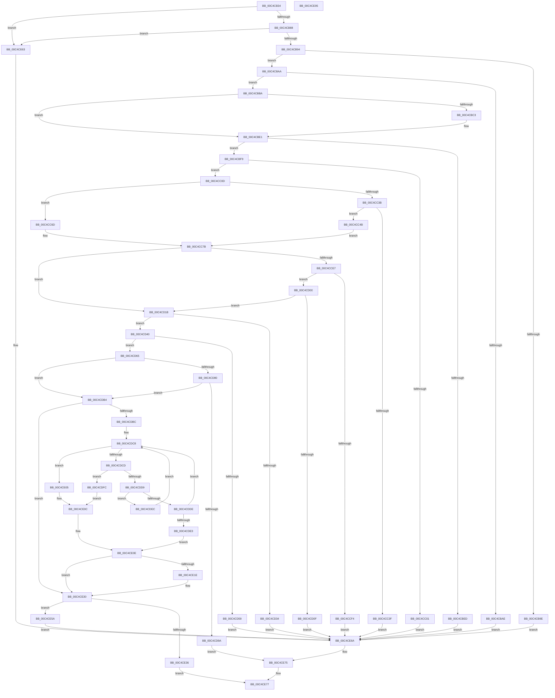

# VfTriageSystem

- RVA: `0x00C4CB34`–`0x00C4CE96` (길이 `866` bytes)
- VA: `0x0000000140C4CB34`
- 실행 섹션: `INIT`
- PDB 이름 있음: `예`; PDB Function 태그: `아니요`
- unwind 정보 RVA: `0x000AD928`
- 디코드: `219`개 명령, `866/866` bytes 표시
- 미해석 바이트: `0` (있으면 어셈블리에 `.byte`로 보존)

> 이 문서는 커널 이미지의 기계어와 PDB 기호를 분석해 생성했습니다. 4번과 5번은 함수 원형과 자료형을 바이너리 사용 방식에서 추정한 C 해석이며 원본 소스 복구 결과는 아닙니다.

## 1. Dependencies

- 직접 호출 지점: **17**; 고유 호출 대상: **7**
- 직접 호출자로 확인된 함수: **1**
- RIP 상대 이미지 참조: **32**

### Outgoing calls
- `0x00C4CB74` → [DbgPrintEx](../../text/35/DbgPrintEx_function_00359290.md) (function, `0x00359290`)
- `0x00C4CBDC` → [DbgPrintEx](../../text/35/DbgPrintEx_function_00359290.md) (function, `0x00359290`)
- `0x00C4CC32` → [TriageGetBugcheckData](../C6/TriageGetBugcheckData_function_00C6F98C.md) (function, `0x00C6F98C`)
- `0x00C4CC81` → [DbgPrintEx](../../text/35/DbgPrintEx_function_00359290.md) (function, `0x00359290`)
- `0x00C4CCBA` → [DbgPrintEx](../../text/35/DbgPrintEx_function_00359290.md) (function, `0x00359290`)
- `0x00C4CCEA` → [MmTriageActiveInLastCrash](../C6/MmTriageActiveInLastCrash_function_00C64D40.md) (function, `0x00C64D40`)
- `0x00C4CD06` → [ViTriageSameDriversFromDump](ViTriageSameDriversFromDump_function_00C4D02C.md) (function, `0x00C4D02C`)
- `0x00C4CD2B` → [ViValidateTriageRules](ViValidateTriageRules_function_00C4D0E4.md) (function, `0x00C4D0E4`)
- `0x00C4CD50` → [ViValidateTriageRules](ViValidateTriageRules_function_00C4D0E4.md) (function, `0x00C4D0E4`)
- `0x00C4CD73` → [ViFindTriageRule](ViFindTriageRule_function_00C4CE9C.md) (function, `0x00C4CE9C`)
- `0x00C4CD8D` → [ViFindTriageRule](ViFindTriageRule_function_00C4CE9C.md) (function, `0x00C4CE9C`)
- `0x00C4CDAA` → [DbgPrintEx](../../text/35/DbgPrintEx_function_00359290.md) (function, `0x00359290`)
- `0x00C4CE14` → [DbgPrintEx](../../text/35/DbgPrintEx_function_00359290.md) (function, `0x00359290`)
- `0x00C4CE2B` → [DbgPrintEx](../../text/35/DbgPrintEx_function_00359290.md) (function, `0x00359290`)
- `0x00C4CE3C` → [ViMakeVerifierSettings](ViMakeVerifierSettings_function_00C4CF3C.md) (function, `0x00C4CF3C`)
- `0x00C4CE4E` → [DbgPrintEx](../../text/35/DbgPrintEx_function_00359290.md) (function, `0x00359290`)
- `0x00C4CE70` → [DbgPrintEx](../../text/35/DbgPrintEx_function_00359290.md) (function, `0x00359290`)

### Direct callers
- [ViInitSystemPhase0](ViInitSystemPhase0_function_00C4C1B0.md) at `0x00C4C353`

### Static image references
- `0x00C4CB53` → RVA `0x00E0E948` (`.data`; read)
- `0x00C4CB5A` → RVA `0x00C7D1C0` (` ?? ::PBOPGDP::`string'`; read)
- `0x00C4CB7C` → RVA `0x00E0E950` (`.data`; read)
- `0x00C4CB88` → RVA `0x00F04A04` (`.data`; read)
- `0x00C4CB9E` → RVA `0x00C7D250` (` ?? ::PBOPGDP::`string'`; read)
- `0x00C4CBAE` → RVA `0x00C7D200` (` ?? ::PBOPGDP::`string'`; read)
- `0x00C4CBC6` → RVA `0x00C7D0E0` (` ?? ::PBOPGDP::`string'`; read)
- `0x00C4CBD0` → RVA `0x00E0E948` (`.data`; write)
- `0x00C4CBED` → RVA `0x00C7D0B0` (` ?? ::PBOPGDP::`string'`; read)
- `0x00C4CC01` → RVA `0x00C7D140` (` ?? ::PBOPGDP::`string'`; read)
- `0x00C4CC3F` → RVA `0x00C7D110` (` ?? ::PBOPGDP::`string'`; read)
- `0x00C4CC4B` → RVA `0x00010850` (`.rdata`; read)
- `0x00C4CC53` → RVA `0x00C7CFE0` (` ?? ::PBOPGDP::`string'`; read)
- `0x00C4CC70` → RVA `0x00C7CFB0` (` ?? ::PBOPGDP::`string'`; read)
- `0x00C4CC8A` → RVA `0x00C7D070` (` ?? ::PBOPGDP::`string'`; read)
- `0x00C4CCC7` → RVA `0x00F04620` (`.data`; read)
- `0x00C4CCD3` → RVA `0x00F04640` (`.data`; write)
- `0x00C4CCDB` → RVA `0x00F04630` (`.data`; read)
- `0x00C4CCF4` → RVA `0x00C7D010` (` ?? ::PBOPGDP::`string'`; read)
- `0x00C4CD0F` → RVA `0x00C7D4E0` (` ?? ::PBOPGDP::`string'`; read)
- `0x00C4CD1B` → RVA `0x00FF4024` (`PAGEVRFD`; read)
- `0x00C4CD21` → RVA `0x01004C50` (`PAGEVRFD`; read)
- `0x00C4CD34` → RVA `0x00C7D4A0` (` ?? ::PBOPGDP::`string'`; read)
- `0x00C4CD46` → RVA `0x00E0EA40` (`.data`; read)
- `0x00C4CD59` → RVA `0x00C7D560` (` ?? ::PBOPGDP::`string'`; read)
- `0x00C4CD9D` → RVA `0x00C7D520` (` ?? ::PBOPGDP::`string'`; read)
- `0x00C4CDE3` → RVA `0x00C7D2A0` (` ?? ::PBOPGDP::`string'`; read)
- `0x00C4CDFC` → RVA `0x00C7D2D0` (` ?? ::PBOPGDP::`string'`; read)
- `0x00C4CE05` → RVA `0x00C7D3F0` (` ?? ::PBOPGDP::`string'`; read)
- `0x00C4CE41` → RVA `0x00C7D3D0` (` ?? ::PBOPGDP::`string'`; read)
- `0x00C4CE5A` → RVA `0x00C7D460` (` ?? ::PBOPGDP::`string'`; read)
- `0x00C4CE63` → RVA `0x00C7D180` (` ?? ::PBOPGDP::`string'`; read)

## 2. Other-region calls and transfers

- 다른 실행 섹션으로 향하는 call: **9**
  - `0x00C4CB74` → [DbgPrintEx](../../text/35/DbgPrintEx_function_00359290.md) (`INIT` → `.text`)
  - `0x00C4CBDC` → [DbgPrintEx](../../text/35/DbgPrintEx_function_00359290.md) (`INIT` → `.text`)
  - `0x00C4CC81` → [DbgPrintEx](../../text/35/DbgPrintEx_function_00359290.md) (`INIT` → `.text`)
  - `0x00C4CCBA` → [DbgPrintEx](../../text/35/DbgPrintEx_function_00359290.md) (`INIT` → `.text`)
  - `0x00C4CDAA` → [DbgPrintEx](../../text/35/DbgPrintEx_function_00359290.md) (`INIT` → `.text`)
  - `0x00C4CE14` → [DbgPrintEx](../../text/35/DbgPrintEx_function_00359290.md) (`INIT` → `.text`)
  - `0x00C4CE2B` → [DbgPrintEx](../../text/35/DbgPrintEx_function_00359290.md) (`INIT` → `.text`)
  - `0x00C4CE4E` → [DbgPrintEx](../../text/35/DbgPrintEx_function_00359290.md) (`INIT` → `.text`)
  - `0x00C4CE70` → [DbgPrintEx](../../text/35/DbgPrintEx_function_00359290.md) (`INIT` → `.text`)
- 별도 외부 분기/꼬리 이동을 확인하지 못했습니다.

## 3. Assembly (complete function range)

```asm
00C4CB34  48 89 5C 24 08                  mov qword ptr [rsp + 8], rbx
00C4CB39  48 89 74 24 10                  mov qword ptr [rsp + 0x10], rsi
00C4CB3E  48 89 7C 24 18                  mov qword ptr [rsp + 0x18], rdi
00C4CB43  55                              push rbp
00C4CB44  41 54                           push r12
00C4CB46  41 55                           push r13
00C4CB48  41 56                           push r14
00C4CB4A  41 57                           push r15
00C4CB4C  48 8B EC                        mov rbp, rsp
00C4CB4F  48 83 EC 70                     sub rsp, 0x70
00C4CB53  44 8B 0D EE 1D 1C 00            mov r9d, dword ptr [rip + 0x1c1dee]
00C4CB5A  4C 8D 05 5F 06 03 00            lea r8, [rip + 0x3065f]
00C4CB61  33 DB                           xor ebx, ebx
00C4CB63  48 8B F9                        mov rdi, rcx
00C4CB66  44 8D 63 03                     lea r12d, [rbx + 3]
00C4CB6A  44 8D 6B 5D                     lea r13d, [rbx + 0x5d]
00C4CB6E  41 8B D4                        mov edx, r12d
00C4CB71  41 8B CD                        mov ecx, r13d
00C4CB74  E8 17 C7 70 FF                  call 0x140359290
00C4CB79  83 C9 FF                        or ecx, 0xffffffff
00C4CB7C  39 0D CE 1D 1C 00               cmp dword ptr [rip + 0x1c1dce], ecx
00C4CB82  0F 85 DB 02 00 00               jne 0x140c4ce63
00C4CB88  39 1D 76 7E 2B 00               cmp dword ptr [rip + 0x2b7e76], ebx
00C4CB8E  0F 85 CF 02 00 00               jne 0x140c4ce63
00C4CB94  8B 05 AE 1D 1C 00               mov eax, dword ptr [rip + 0x1c1dae]
00C4CB9A  3B C1                           cmp eax, ecx
00C4CB9C  75 0C                           jne 0x140c4cbaa
00C4CB9E  4C 8D 05 AB 06 03 00            lea r8, [rip + 0x306ab]
00C4CBA5  E9 C0 02 00 00                  jmp 0x140c4ce6a
00C4CBAA  85 C0                           test eax, eax
00C4CBAC  75 0C                           jne 0x140c4cbba
00C4CBAE  4C 8D 05 4B 06 03 00            lea r8, [rip + 0x3064b]
00C4CBB5  E9 B0 02 00 00                  jmp 0x140c4ce6a
00C4CBBA  BE 01 00 00 00                  mov esi, 1
00C4CBBF  85 C0                           test eax, eax
00C4CBC1  79 1E                           jns 0x140c4cbe1
00C4CBC3  0F B7 D8                        movzx ebx, ax
00C4CBC6  4C 8D 05 13 05 03 00            lea r8, [rip + 0x30513]
00C4CBCD  44 8B CB                        mov r9d, ebx
00C4CBD0  89 35 72 1D 1C 00               mov dword ptr [rip + 0x1c1d72], esi
00C4CBD6  41 8B D4                        mov edx, r12d
00C4CBD9  41 8B CD                        mov ecx, r13d
00C4CBDC  E8 AF C6 70 FF                  call 0x140359290
00C4CBE1  48 8B 87 F0 00 00 00            mov rax, qword ptr [rdi + 0xf0]
00C4CBE8  48 85 C0                        test rax, rax
00C4CBEB  75 0C                           jne 0x140c4cbf9
00C4CBED  4C 8D 05 BC 04 03 00            lea r8, [rip + 0x304bc]
00C4CBF4  E9 71 02 00 00                  jmp 0x140c4ce6a
00C4CBF9  81 38 30 11 00 00               cmp dword ptr [rax], 0x1130
00C4CBFF  73 0C                           jae 0x140c4cc0d
00C4CC01  4C 8D 05 38 05 03 00            lea r8, [rip + 0x30538]
00C4CC08  E9 5D 02 00 00                  jmp 0x140c4ce6a
00C4CC0D  4C 8B 78 28                     mov r15, qword ptr [rax + 0x28]
00C4CC11  4C 8D 4D E0                     lea r9, [rbp - 0x20]
00C4CC15  48 8D 45 F0                     lea rax, [rbp - 0x10]
00C4CC19  49 8B CF                        mov rcx, r15
00C4CC1C  48 89 44 24 28                  mov qword ptr [rsp + 0x28], rax
00C4CC21  4C 8D 45 D8                     lea r8, [rbp - 0x28]
00C4CC25  48 8D 45 E8                     lea rax, [rbp - 0x18]
00C4CC29  48 8D 55 D0                     lea rdx, [rbp - 0x30]
00C4CC2D  48 89 44 24 20                  mov qword ptr [rsp + 0x20], rax
00C4CC32  E8 55 2D 02 00                  call 0x140c6f98c
00C4CC37  85 C0                           test eax, eax
00C4CC39  79 32                           jns 0x140c4cc6d
00C4CC3B  85 DB                           test ebx, ebx
00C4CC3D  75 0C                           jne 0x140c4cc4b
00C4CC3F  4C 8D 05 CA 04 03 00            lea r8, [rip + 0x304ca]
00C4CC46  E9 1F 02 00 00                  jmp 0x140c4ce6a
00C4CC4B  66 0F 6F 05 FD 3B 3C FF         movdqa xmm0, xmmword ptr [rip - 0xc3c403]
00C4CC53  4C 8D 05 86 03 03 00            lea r8, [rip + 0x30386]
00C4CC5A  8B F3                           mov esi, ebx
00C4CC5C  45 33 F6                        xor r14d, r14d
00C4CC5F  48 89 75 D0                     mov qword ptr [rbp - 0x30], rsi
00C4CC63  0F 11 45 D8                     movups xmmword ptr [rbp - 0x28], xmm0
00C4CC67  0F 11 45 E8                     movups xmmword ptr [rbp - 0x18], xmm0
00C4CC6B  EB 0E                           jmp 0x140c4cc7b
00C4CC6D  44 8B F6                        mov r14d, esi
00C4CC70  4C 8D 05 39 03 03 00            lea r8, [rip + 0x30339]
00C4CC77  48 8B 75 D0                     mov rsi, qword ptr [rbp - 0x30]
00C4CC7B  41 8B D4                        mov edx, r12d
00C4CC7E  41 8B CD                        mov ecx, r13d
00C4CC81  E8 0A C6 70 FF                  call 0x140359290
00C4CC86  48 8B 45 F0                     mov rax, qword ptr [rbp - 0x10]
00C4CC8A  4C 8D 05 DF 03 03 00            lea r8, [rip + 0x303df]
00C4CC91  48 89 44 24 38                  mov qword ptr [rsp + 0x38], rax
00C4CC96  4C 8B CE                        mov r9, rsi
00C4CC99  48 8B 45 E8                     mov rax, qword ptr [rbp - 0x18]
00C4CC9D  41 8B D4                        mov edx, r12d
00C4CCA0  48 89 44 24 30                  mov qword ptr [rsp + 0x30], rax
00C4CCA5  41 8B CD                        mov ecx, r13d
00C4CCA8  48 8B 45 E0                     mov rax, qword ptr [rbp - 0x20]
00C4CCAC  48 89 44 24 28                  mov qword ptr [rsp + 0x28], rax
00C4CCB1  48 8B 45 D8                     mov rax, qword ptr [rbp - 0x28]
00C4CCB5  48 89 44 24 20                  mov qword ptr [rsp + 0x20], rax
00C4CCBA  E8 D1 C5 70 FF                  call 0x140359290
00C4CCBF  0F 10 45 D0                     movups xmm0, xmmword ptr [rbp - 0x30]
00C4CCC3  0F 10 4D E0                     movups xmm1, xmmword ptr [rbp - 0x20]
00C4CCC7  0F 11 05 52 79 2B 00            movups xmmword ptr [rip + 0x2b7952], xmm0
00C4CCCE  F2 0F 10 45 F0                  movsd xmm0, qword ptr [rbp - 0x10]
00C4CCD3  F2 0F 11 05 65 79 2B 00         movsd qword ptr [rip + 0x2b7965], xmm0
00C4CCDB  0F 11 0D 4E 79 2B 00            movups xmmword ptr [rip + 0x2b794e], xmm1
00C4CCE2  45 85 F6                        test r14d, r14d
00C4CCE5  74 34                           je 0x140c4cd1b
00C4CCE7  48 8B CF                        mov rcx, rdi
00C4CCEA  E8 51 80 01 00                  call 0x140c64d40
00C4CCEF  83 F8 01                        cmp eax, 1
00C4CCF2  75 0C                           jne 0x140c4cd00
00C4CCF4  4C 8D 05 15 03 03 00            lea r8, [rip + 0x30315]
00C4CCFB  E9 6A 01 00 00                  jmp 0x140c4ce6a
00C4CD00  49 8B D7                        mov rdx, r15
00C4CD03  48 8B CF                        mov rcx, rdi
00C4CD06  E8 21 03 00 00                  call 0x140c4d02c
00C4CD0B  85 C0                           test eax, eax
00C4CD0D  75 0C                           jne 0x140c4cd1b
00C4CD0F  4C 8D 05 CA 07 03 00            lea r8, [rip + 0x307ca]
00C4CD16  E9 4F 01 00 00                  jmp 0x140c4ce6a
00C4CD1B  8B 15 03 73 3A 00               mov edx, dword ptr [rip + 0x3a7303]
00C4CD21  4C 8D 35 28 7F 3B 00            lea r14, [rip + 0x3b7f28]
00C4CD28  49 8B CE                        mov rcx, r14
00C4CD2B  E8 B4 03 00 00                  call 0x140c4d0e4
00C4CD30  85 C0                           test eax, eax
00C4CD32  75 0C                           jne 0x140c4cd40
00C4CD34  4C 8D 05 65 07 03 00            lea r8, [rip + 0x30765]
00C4CD3B  E9 2A 01 00 00                  jmp 0x140c4ce6a
00C4CD40  41 BF 30 00 00 00               mov r15d, 0x30
00C4CD46  48 8D 0D F3 1C 1C 00            lea rcx, [rip + 0x1c1cf3]
00C4CD4D  41 8B D7                        mov edx, r15d
00C4CD50  E8 8F 03 00 00                  call 0x140c4d0e4
00C4CD55  85 C0                           test eax, eax
00C4CD57  75 0C                           jne 0x140c4cd65
00C4CD59  4C 8D 05 00 08 03 00            lea r8, [rip + 0x30800]
00C4CD60  E9 05 01 00 00                  jmp 0x140c4ce6a
00C4CD65  8B 15 B9 72 3A 00               mov edx, dword ptr [rip + 0x3a72b9]
00C4CD6B  44 8B C6                        mov r8d, esi
00C4CD6E  49 8B CE                        mov rcx, r14
00C4CD71  33 DB                           xor ebx, ebx
00C4CD73  E8 24 01 00 00                  call 0x140c4ce9c
00C4CD78  48 8B F8                        mov rdi, rax
00C4CD7B  48 85 C0                        test rax, rax
00C4CD7E  75 34                           jne 0x140c4cdb4
00C4CD80  44 8B C6                        mov r8d, esi
00C4CD83  48 8D 0D B6 1C 1C 00            lea rcx, [rip + 0x1c1cb6]
00C4CD8A  49 8B D7                        mov rdx, r15
00C4CD8D  E8 0A 01 00 00                  call 0x140c4ce9c
00C4CD92  48 8B F8                        mov rdi, rax
00C4CD95  48 85 C0                        test rax, rax
00C4CD98  75 1A                           jne 0x140c4cdb4
00C4CD9A  4C 8B CE                        mov r9, rsi
00C4CD9D  4C 8D 05 7C 07 03 00            lea r8, [rip + 0x3077c]
00C4CDA4  41 8B D4                        mov edx, r12d
00C4CDA7  41 8B CD                        mov ecx, r13d
00C4CDAA  E8 E1 C4 70 FF                  call 0x140359290
00C4CDAF  E9 C1 00 00 00                  jmp 0x140c4ce75
00C4CDB4  81 3F 00 00 08 00               cmp dword ptr [rdi], 0x80000
00C4CDBA  73 74                           jae 0x140c4ce30
00C4CDBC  8B 0D 62 72 3A 00               mov ecx, dword ptr [rip + 0x3a7262]
00C4CDC2  49 8B DE                        mov rbx, r14
00C4CDC5  49 03 CE                        add rcx, r14
00C4CDC8  48 3B D9                        cmp rbx, rcx
00C4CDCB  73 38                           jae 0x140c4ce05
00C4CDCD  8B 13                           mov edx, dword ptr [rbx]
00C4CDCF  8B C2                           mov eax, edx
00C4CDD1  C1 E8 10                        shr eax, 0x10
00C4CDD4  83 E0 07                        and eax, 7
00C4CDD7  74 23                           je 0x140c4cdfc
00C4CDD9  83 E8 01                        sub eax, 1
00C4CDDC  74 0E                           je 0x140c4cdec
00C4CDDE  83 F8 01                        cmp eax, 1
00C4CDE1  75 E5                           jne 0x140c4cdc8
00C4CDE3  4C 8D 05 B6 04 03 00            lea r8, [rip + 0x304b6]
00C4CDEA  EB 22                           jmp 0x140c4ce0e
00C4CDEC  48 8B C2                        mov rax, rdx
00C4CDEF  48 83 C3 08                     add rbx, 8
00C4CDF3  48 C1 E8 13                     shr rax, 0x13
00C4CDF7  48 03 D8                        add rbx, rax
00C4CDFA  EB CC                           jmp 0x140c4cdc8
00C4CDFC  4C 8D 05 CD 04 03 00            lea r8, [rip + 0x304cd]
00C4CE03  EB 07                           jmp 0x140c4ce0c
00C4CE05  4C 8D 05 E4 05 03 00            lea r8, [rip + 0x305e4]
00C4CE0C  33 DB                           xor ebx, ebx
00C4CE0E  41 8B D4                        mov edx, r12d
00C4CE11  41 8B CD                        mov ecx, r13d
00C4CE14  E8 77 C4 70 FF                  call 0x140359290
00C4CE19  48 85 DB                        test rbx, rbx
00C4CE1C  74 12                           je 0x140c4ce30
00C4CE1E  4C 8D 05 CB 05 03 00            lea r8, [rip + 0x305cb]
00C4CE25  41 8B D4                        mov edx, r12d
00C4CE28  41 8B CD                        mov ecx, r13d
00C4CE2B  E8 60 C4 70 FF                  call 0x140359290
00C4CE30  83 7F 04 00                     cmp dword ptr [rdi + 4], 0
00C4CE34  74 24                           je 0x140c4ce5a
00C4CE36  48 8B D3                        mov rdx, rbx
00C4CE39  48 8B CF                        mov rcx, rdi
00C4CE3C  E8 FB 00 00 00                  call 0x140c4cf3c
00C4CE41  4C 8D 05 88 05 03 00            lea r8, [rip + 0x30588]
00C4CE48  41 8B D4                        mov edx, r12d
00C4CE4B  41 8B CD                        mov ecx, r13d
00C4CE4E  E8 3D C4 70 FF                  call 0x140359290
00C4CE53  B8 01 00 00 00                  mov eax, 1
00C4CE58  EB 1D                           jmp 0x140c4ce77
00C4CE5A  4C 8D 05 FF 05 03 00            lea r8, [rip + 0x305ff]
00C4CE61  EB 07                           jmp 0x140c4ce6a
00C4CE63  4C 8D 05 16 03 03 00            lea r8, [rip + 0x30316]
00C4CE6A  41 8B D4                        mov edx, r12d
00C4CE6D  41 8B CD                        mov ecx, r13d
00C4CE70  E8 1B C4 70 FF                  call 0x140359290
00C4CE75  33 C0                           xor eax, eax
00C4CE77  4C 8D 5C 24 70                  lea r11, [rsp + 0x70]
00C4CE7C  49 8B 5B 30                     mov rbx, qword ptr [r11 + 0x30]
00C4CE80  49 8B 73 38                     mov rsi, qword ptr [r11 + 0x38]
00C4CE84  49 8B 7B 40                     mov rdi, qword ptr [r11 + 0x40]
00C4CE88  49 8B E3                        mov rsp, r11
00C4CE8B  41 5F                           pop r15
00C4CE8D  41 5E                           pop r14
00C4CE8F  41 5D                           pop r13
00C4CE91  41 5C                           pop r12
00C4CE93  5D                              pop rbp
00C4CE94  C3                              ret
00C4CE95  CC                              int3
```

## 4. C-style interpretation (structured pseudocode)

```c
__int64 __fastcall VfTriageSystem(__int64 a1)
{
    __int64 result;
    __int64 v_r14;
    __int64 v_rbx;
    __int64 v_rsp;
    unsigned __int64 v_stack_m28;
    unsigned __int64 v_stack_m38;
    unsigned __int64 v_stack_m40;
    unsigned __int64 v_stack_m48;
    unsigned __int64 v_stack_m50;
    unsigned __int64 v_stack_m58;
    unsigned __int64 v_stack_m60;
    unsigned __int64 v_stack_m68;
    unsigned __int64 v_stack_m70;
    unsigned __int64 v_stack_m78;
    unsigned __int64 v_stack_p10;
    unsigned __int64 v_stack_p18;
    unsigned __int64 v_stack_p8;

    v_stack_p8 = v_rbx;
    v_stack_p10 = v_rsi;
    v_stack_p18 = v_rdi;
    v_rsp = (v_rsp) - (112);
    v_rbx = 0;
    result = DbgPrintEx((unsigned int)((unsigned int)(v_rbx + 93)), (unsigned int)((unsigned int)(v_rbx + 3)), v_rip + 198239, (unsigned int)(*(unsigned int *)(v_rip + 1842670)));
    a1 = (unsigned int)(((unsigned int)((unsigned int)(v_rbx + 93))) | (0xFFFFFFFFULL));
    if ((*(unsigned int *)(v_rip + 1842638)) != ((unsigned int)(a1))) goto loc_00C4CE63;
    if ((*(unsigned int *)(v_rip + 2850422)) != 0) goto loc_00C4CE63;
    if (((unsigned int)((unsigned int)(*(unsigned int *)(v_rip + 1842606)))) != ((unsigned int)(a1))) goto loc_00C4CBAA;
    goto loc_00C4CE6A;
loc_00C4CBAA:
    if ((unsigned int)((unsigned int)(*(unsigned int *)(v_rip + 1842606))) != 0) goto loc_00C4CBBA;
    goto loc_00C4CE6A;
loc_00C4CBBA:
    result = (unsigned int)(*(unsigned int *)(v_rip + 1842606));
    if (sign_flag) {
        v_rbx = (unsigned __int16)((unsigned int)(*(unsigned int *)(v_rip + 1842606)));
        a3 = v_rip + 197907;
        a4 = (unsigned int)(v_rbx);
        *(unsigned int *)(v_rip + 1842546) = 1;
        a2 = (unsigned int)(v_rbx + 3);
        a1 = (unsigned int)(v_rbx + 93);
        result = DbgPrintEx(a1, a2, a3, a4);
    }
    if (*(unsigned __int64 *)(a1 + 240) != 0) goto loc_00C4CBF9;
    goto loc_00C4CE6A;
loc_00C4CBF9:
    if ((*(unsigned int *)(*(unsigned __int64 *)(a1 + 240))) >= 0x1130ULL) goto loc_00C4CC0D;
    goto loc_00C4CE6A;
loc_00C4CC0D:
    v_stack_m70 = v_stack_m38;
    v_stack_m78 = v_stack_m40;
    result = TriageGetBugcheckData(*(unsigned __int64 *)(*(unsigned __int64 *)(a1 + 240) + 40), v_stack_m58, v_stack_m50, v_stack_m48);
    if (!sign_flag) goto loc_00C4CC6D;
    if ((unsigned int)(v_rbx) != 0) goto loc_00C4CC4B;
    goto loc_00C4CE6A;
loc_00C4CC4B:
    v_r14 = 0;
    v_stack_m58 = (unsigned int)((unsigned int)(v_rbx));
    v_stack_m50 = v_xmm0;
    v_stack_m40 = v_xmm0;
    goto loc_00C4CC7B;
loc_00C4CC6D:
loc_00C4CC7B:
    result = DbgPrintEx((unsigned int)((unsigned int)(v_rbx + 93)), (unsigned int)((unsigned int)(v_rbx + 3)), v_rip + 197433, v_stack_m48);
    v_stack_m60 = v_stack_m38;
    v_stack_m68 = v_stack_m40;
    v_stack_m70 = v_stack_m48;
    v_stack_m78 = v_stack_m50;
    result = DbgPrintEx((unsigned int)((unsigned int)(v_rbx + 93)), (unsigned int)((unsigned int)(v_rbx + 3)), v_rip + 197599, v_stack_m58);
    *(unsigned __int64 *)(v_rip + 2849106) = v_xmm0;
    *(unsigned __int64 *)(v_rip + 2849125) = v_xmm0;
    *(unsigned __int64 *)(v_rip + 2849102) = v_xmm1;
    if ((unsigned int)((unsigned int)((unsigned int)((unsigned int)((unsigned int)(v_rbx))))) == 0) goto loc_00C4CD1B;
    result = MmTriageActiveInLastCrash(a1, (unsigned int)((unsigned int)(v_rbx + 3)), v_rip + 197599, v_stack_m58);
    if (((unsigned int)(result)) != 1) goto loc_00C4CD00;
    goto loc_00C4CE6A;
loc_00C4CD00:
    result = ViTriageSameDriversFromDump(a1, *(unsigned __int64 *)(*(unsigned __int64 *)(a1 + 240) + 40), v_rip + 197397, v_stack_m58);
    if ((unsigned int)(result) != 0) goto loc_00C4CD1B;
    goto loc_00C4CE6A;
loc_00C4CD1B:
    result = ViValidateTriageRules(v_rip + 3899176, (unsigned int)(*(unsigned int *)(v_rip + 3830531)), v_rip + 198602, v_stack_m58);
    if ((unsigned int)(result) != 0) goto loc_00C4CD40;
    goto loc_00C4CE6A;
loc_00C4CD40:
    result = ViValidateTriageRules(v_rip + 1842419, 48, v_rip + 198501, v_stack_m58);
    if ((unsigned int)(result) != 0) goto loc_00C4CD65;
    goto loc_00C4CE6A;
loc_00C4CD65:
    v_rbx = 0;
    result = ViFindTriageRule(v_rip + 3899176, (unsigned int)(*(unsigned int *)(v_rip + 3830457)), (unsigned int)((unsigned int)(v_stack_m58)), v_stack_m58);
    if (result != 0) goto loc_00C4CDB4;
    result = ViFindTriageRule(v_rip + 1842358, 48, (unsigned int)((unsigned int)(v_stack_m58)), v_stack_m58);
    if (result != 0) goto loc_00C4CDB4;
    result = DbgPrintEx((unsigned int)((unsigned int)(v_rbx + 93)), (unsigned int)((unsigned int)(v_rbx + 3)), v_rip + 198524, v_stack_m58);
    goto loc_00C4CE75;
loc_00C4CDB4:
    if ((*(unsigned int *)(result)) >= 0x80000ULL) goto loc_00C4CE30;
    a1 = ((unsigned int)(*(unsigned int *)(v_rip + 3830370))) + (v_rip + 3899176);
loc_00C4CDC8:
    if ((v_rip + 3899176) >= a1) goto loc_00C4CE05;
    result = (unsigned int)(((unsigned int)((unsigned int)((unsigned int)(*(unsigned int *)(v_rip + 3899176))))) >> (16));
    result = (unsigned int)((result) & (7));
    if (condition_is_equal) goto loc_00C4CDFC;
    result = (unsigned int)((result) - (1));
    if (condition_is_equal) goto loc_00C4CDEC;
    if (((unsigned int)(result)) != 1) goto loc_00C4CDC8;
    goto loc_00C4CE0E;
loc_00C4CDEC:
    v_rbx = (v_rip + 3899176) + (8);
    result = ((unsigned int)(*(unsigned int *)(v_rip + 3899176))) >> (19);
    v_rbx = (v_rbx) + (result);
    goto loc_00C4CDC8;
loc_00C4CDFC:
    goto loc_00C4CE0C;
loc_00C4CE05:
loc_00C4CE0C:
    v_rbx = 0;
loc_00C4CE0E:
    result = DbgPrintEx((unsigned int)((unsigned int)(v_rbx + 93)), (unsigned int)((unsigned int)(v_rbx + 3)), v_rip + 198116, v_stack_m58);
    if (0 != 0) {
        a3 = v_rip + 198091;
        a2 = (unsigned int)(v_rbx + 3);
        a1 = (unsigned int)(v_rbx + 93);
        result = DbgPrintEx(a1, a2, a3, v_stack_m58);
    }
    if ((*(unsigned int *)(result + 4)) == 0) goto loc_00C4CE5A;
    result = ViMakeVerifierSettings(result, 0, a3, v_stack_m58);
    result = DbgPrintEx((unsigned int)((unsigned int)(v_rbx + 93)), (unsigned int)((unsigned int)(v_rbx + 3)), v_rip + 198024, v_stack_m58);
    goto loc_00C4CE77;
loc_00C4CE5A:
    goto loc_00C4CE6A;
loc_00C4CE63:
loc_00C4CE6A:
    result = DbgPrintEx((unsigned int)((unsigned int)(v_rbx + 93)), (unsigned int)((unsigned int)(v_rbx + 3)), v_rip + 197398, v_stack_m58);
loc_00C4CE75:
    result = 0;
loc_00C4CE77:
    return result;
}
```

## 5. (Beta) C Style

```c
int64_t VfTriageSystem(void *Arg1)
{
    uint8_t *arg1 = (uint8_t *)Arg1;

    int64_t result;
    int64_t local_r14;
    int64_t local_rbx;
    int64_t local_rsp;
    uint64_t v_stack_m28;
    uint64_t v_stack_m38;
    uint64_t v_stack_m40;
    uint64_t v_stack_m48;
    uint64_t v_stack_m50;
    uint64_t v_stack_m58;
    uint64_t v_stack_m60;
    uint64_t v_stack_m68;
    uint64_t v_stack_m70;
    uint64_t v_stack_m78;
    uint64_t v_stack_p10;
    uint64_t v_stack_p18;
    uint64_t v_stack_p8;

    v_stack_p8 = local_rbx;
    v_stack_p10 = local_rsi;
    v_stack_p18 = local_rdi;
    local_rsp = (local_rsp) - (112);
    local_rbx = 0;
    result = DbgPrintEx((uint32_t)((uint32_t)(local_rbx + 93)), (uint32_t)((uint32_t)(local_rbx + 3)), v_rip + 198239, (uint32_t)(*(uint32_t *)(v_rip + 0x1C1DEE)));
    Arg1 = (uint32_t)(((uint32_t)((uint32_t)(local_rbx + 93))) | (0xFFFFFFFFULL));
    if ((*(uint32_t *)(v_rip + 0x1C1DCE)) != ((uint32_t)(Arg1))) goto loc_00C4CE63;
    if ((*(uint32_t *)(v_rip + 0x2B7E76)) != 0) goto loc_00C4CE63;
    if (((uint32_t)((uint32_t)(*(uint32_t *)(v_rip + 0x1C1DAE)))) != ((uint32_t)(Arg1))) goto loc_00C4CBAA;
    goto loc_00C4CE6A;
loc_00C4CBAA:
    if ((uint32_t)((uint32_t)(*(uint32_t *)(v_rip + 0x1C1DAE))) != 0) goto loc_00C4CBBA;
    goto loc_00C4CE6A;
loc_00C4CBBA:
    result = (uint32_t)(*(uint32_t *)(v_rip + 0x1C1DAE));
    if (sign_flag) {
        local_rbx = (uint16_t)((uint32_t)(*(uint32_t *)(v_rip + 0x1C1DAE)));
        a3 = v_rip + 197907;
        a4 = (uint32_t)(local_rbx);
        *(uint32_t *)(v_rip + 0x1C1D72) = 1;
        a2 = (uint32_t)(local_rbx + 3);
        Arg1 = (uint32_t)(local_rbx + 93);
        result = DbgPrintEx(Arg1, a2, a3, a4);
    }
    if (*(uint64_t *)(arg1 + 0xF0) != 0) goto loc_00C4CBF9;
    goto loc_00C4CE6A;
loc_00C4CBF9:
    if ((*(uint32_t *)(*(uint64_t *)(arg1 + 0xF0))) >= 0x1130ULL) goto loc_00C4CC0D;
    goto loc_00C4CE6A;
loc_00C4CC0D:
    v_stack_m70 = v_stack_m38;
    v_stack_m78 = v_stack_m40;
    result = TriageGetBugcheckData(*(uint64_t *)(*(uint64_t *)(arg1 + 0xF0) + 0x28), v_stack_m58, v_stack_m50, v_stack_m48);
    if (!sign_flag) goto loc_00C4CC6D;
    if ((uint32_t)(local_rbx) != 0) goto loc_00C4CC4B;
    goto loc_00C4CE6A;
loc_00C4CC4B:
    local_r14 = 0;
    v_stack_m58 = (uint32_t)((uint32_t)(local_rbx));
    v_stack_m50 = v_xmm0;
    v_stack_m40 = v_xmm0;
    goto loc_00C4CC7B;
loc_00C4CC6D:
loc_00C4CC7B:
    result = DbgPrintEx((uint32_t)((uint32_t)(local_rbx + 93)), (uint32_t)((uint32_t)(local_rbx + 3)), v_rip + 197433, v_stack_m48);
    v_stack_m60 = v_stack_m38;
    v_stack_m68 = v_stack_m40;
    v_stack_m70 = v_stack_m48;
    v_stack_m78 = v_stack_m50;
    result = DbgPrintEx((uint32_t)((uint32_t)(local_rbx + 93)), (uint32_t)((uint32_t)(local_rbx + 3)), v_rip + 197599, v_stack_m58);
    *(uint64_t *)(v_rip + 0x2B7952) = v_xmm0;
    *(uint64_t *)(v_rip + 0x2B7965) = v_xmm0;
    *(uint64_t *)(v_rip + 0x2B794E) = v_xmm1;
    if ((uint32_t)((uint32_t)((uint32_t)((uint32_t)((uint32_t)(local_rbx))))) == 0) goto loc_00C4CD1B;
    result = MmTriageActiveInLastCrash(Arg1, (uint32_t)((uint32_t)(local_rbx + 3)), v_rip + 197599, v_stack_m58);
    if (((uint32_t)(result)) != 1) goto loc_00C4CD00;
    goto loc_00C4CE6A;
loc_00C4CD00:
    result = ViTriageSameDriversFromDump(Arg1, *(uint64_t *)(*(uint64_t *)(arg1 + 0xF0) + 0x28), v_rip + 197397, v_stack_m58);
    if ((uint32_t)(result) != 0) goto loc_00C4CD1B;
    goto loc_00C4CE6A;
loc_00C4CD1B:
    result = ViValidateTriageRules(v_rip + 3899176, (uint32_t)(*(uint32_t *)(v_rip + 0x3A7303)), v_rip + 198602, v_stack_m58);
    if ((uint32_t)(result) != 0) goto loc_00C4CD40;
    goto loc_00C4CE6A;
loc_00C4CD40:
    result = ViValidateTriageRules(v_rip + 1842419, 48, v_rip + 198501, v_stack_m58);
    if ((uint32_t)(result) != 0) goto loc_00C4CD65;
    goto loc_00C4CE6A;
loc_00C4CD65:
    local_rbx = 0;
    result = ViFindTriageRule(v_rip + 3899176, (uint32_t)(*(uint32_t *)(v_rip + 0x3A72B9)), (uint32_t)((uint32_t)(v_stack_m58)), v_stack_m58);
    if (result != 0) goto loc_00C4CDB4;
    result = ViFindTriageRule(v_rip + 1842358, 48, (uint32_t)((uint32_t)(v_stack_m58)), v_stack_m58);
    if (result != 0) goto loc_00C4CDB4;
    result = DbgPrintEx((uint32_t)((uint32_t)(local_rbx + 93)), (uint32_t)((uint32_t)(local_rbx + 3)), v_rip + 198524, v_stack_m58);
    goto loc_00C4CE75;
loc_00C4CDB4:
    if ((*(uint32_t *)(result)) >= 0x80000ULL) goto loc_00C4CE30;
    Arg1 = ((uint32_t)(*(uint32_t *)(v_rip + 0x3A7262))) + (v_rip + 3899176);
loc_00C4CDC8:
    if ((v_rip + 3899176) >= Arg1) goto loc_00C4CE05;
    result = (uint32_t)(((uint32_t)((uint32_t)((uint32_t)(*(uint32_t *)(v_rip + 0x3B7F28))))) >> (16));
    result = (uint32_t)((result) & (7));
    if (condition_is_equal) goto loc_00C4CDFC;
    result = (uint32_t)((result) - (1));
    if (condition_is_equal) goto loc_00C4CDEC;
    if (((uint32_t)(result)) != 1) goto loc_00C4CDC8;
    goto loc_00C4CE0E;
loc_00C4CDEC:
    local_rbx = (v_rip + 3899176) + (8);
    result = ((uint32_t)(*(uint32_t *)(v_rip + 0x3B7F28))) >> (19);
    local_rbx = (local_rbx) + (result);
    goto loc_00C4CDC8;
loc_00C4CDFC:
    goto loc_00C4CE0C;
loc_00C4CE05:
loc_00C4CE0C:
    local_rbx = 0;
loc_00C4CE0E:
    result = DbgPrintEx((uint32_t)((uint32_t)(local_rbx + 93)), (uint32_t)((uint32_t)(local_rbx + 3)), v_rip + 198116, v_stack_m58);
    if (0 != 0) {
        a3 = v_rip + 198091;
        a2 = (uint32_t)(local_rbx + 3);
        Arg1 = (uint32_t)(local_rbx + 93);
        result = DbgPrintEx(Arg1, a2, a3, v_stack_m58);
    }
    if ((*(uint32_t *)(result + 0x4)) == 0) goto loc_00C4CE5A;
    result = ViMakeVerifierSettings(result, 0, a3, v_stack_m58);
    result = DbgPrintEx((uint32_t)((uint32_t)(local_rbx + 93)), (uint32_t)((uint32_t)(local_rbx + 3)), v_rip + 198024, v_stack_m58);
    goto loc_00C4CE77;
loc_00C4CE5A:
    goto loc_00C4CE6A;
loc_00C4CE63:
loc_00C4CE6A:
    result = DbgPrintEx((uint32_t)((uint32_t)(local_rbx + 93)), (uint32_t)((uint32_t)(local_rbx + 3)), v_rip + 197398, v_stack_m58);
loc_00C4CE75:
    result = 0;
loc_00C4CE77:
    return result;
}
```

### 관측된 메모리 오프셋

구조체 형식이 확인되지 않은 접근은 인자 기준의 오프셋으로만 기록했습니다.

| 기준 인자 | 오프셋 표현 | 폭 (bit) | 접근 |
|---|---:|---:|---|
| `Arg1` | `+ 0xF0` | `64` | `R` |

## 6. Execution-region graph

[열기: 2D/3D 그래프와 함수 탐색 컨트롤 패널](../../../control-panel.html?section=init&rva=0x00C4CB34&view=graph)

- 2D 그래프는 위에서 아래로 흐르고, 3D 그래프는 빈 공간을 드래그해 회전합니다. Shift+드래그는 이동, 휠은 확대·축소, 함수 노드 선택은 대상 보고서 이동입니다.

### Static fallback


