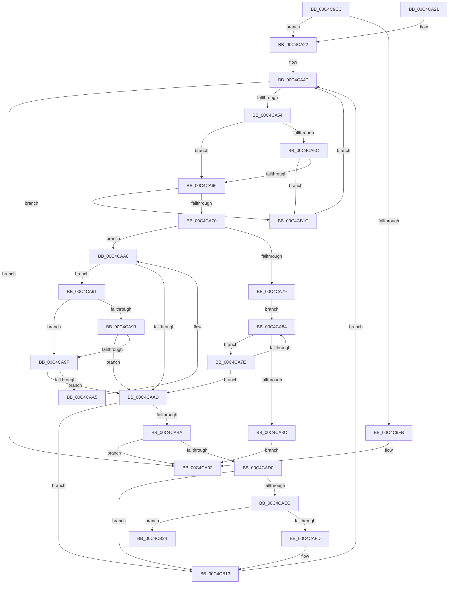

# VfXdvExcludeParseRegistryString

- RVA: `0x00C4C9CC`–`0x00C4CB2B` (길이 `351` bytes)
- VA: `0x0000000140C4C9CC`
- 실행 섹션: `INIT`
- PDB 이름 있음: `예`; PDB Function 태그: `아니요`
- unwind 정보 RVA: `0x000D26F0`
- 디코드: `95`개 명령, `351/351` bytes 표시
- 미해석 바이트: `0` (있으면 어셈블리에 `.byte`로 보존)

> 이 문서는 커널 이미지의 기계어와 PDB 기호를 분석해 생성했습니다. 4번과 5번은 함수 원형과 자료형을 바이너리 사용 방식에서 추정한 C 해석이며 원본 소스 복구 결과는 아닙니다.

## 1. Dependencies

- 직접 호출 지점: **3**; 고유 호출 대상: **3**
- 직접 호출자로 확인된 함수: **1**
- RIP 상대 이미지 참조: **6**

### Outgoing calls
- `0x00C4CADF` → [VfSuspectExcludedDriversAllocateEntry](../../pagevrfy/BA/VfSuspectExcludedDriversAllocateEntry_function_00BAB0C4.md) (function, `0x00BAB0C4`)
- `0x00C4CAEC` → [VfDriverLock](../../pagevrfy/B9/VfDriverLock_function_00B9A4A4.md) (function, `0x00B9A4A4`)
- `0x00C4CB0E` → [VfDriverUnlock](../../pagevrfy/B9/VfDriverUnlock_function_00B9A62C.md) (function, `0x00B9A62C`)

### Direct callers
- [VfInitBootDriversLoaded](VfInitBootDriversLoaded_function_00C4BD0C.md) at `0x00C4BEC3`

### Static image references
- `0x00C4C9F0` → RVA `0x01008158` (`INITDATA`; read)
- `0x00C4C9FB` → RVA `0x01008158` (`INITDATA`; read/write)
- `0x00C4CA27` → RVA `0x0100A9D0` (`INITDATA`; read)
- `0x00C4CA31` → RVA `0x00F048C0` (`.data`; read)
- `0x00C4CAF1` → RVA `0x00F048C8` (`.data`; read)
- `0x00C4CB07` → RVA `0x00F048C8` (`.data`; write)

## 2. Other-region calls and transfers

- 다른 실행 섹션으로 향하는 call: **3**
  - `0x00C4CADF` → [VfSuspectExcludedDriversAllocateEntry](../../pagevrfy/BA/VfSuspectExcludedDriversAllocateEntry_function_00BAB0C4.md) (`INIT` → `PAGEVRFY`)
  - `0x00C4CAEC` → [VfDriverLock](../../pagevrfy/B9/VfDriverLock_function_00B9A4A4.md) (`INIT` → `PAGEVRFY`)
  - `0x00C4CB0E` → [VfDriverUnlock](../../pagevrfy/B9/VfDriverUnlock_function_00B9A62C.md) (`INIT` → `PAGEVRFY`)
- 별도 외부 분기/꼬리 이동을 확인하지 못했습니다.

## 3. Assembly (complete function range)

```asm
00C4C9CC  48 8B C4                        mov rax, rsp
00C4C9CF  48 89 58 08                     mov qword ptr [rax + 8], rbx
00C4C9D3  48 89 68 10                     mov qword ptr [rax + 0x10], rbp
00C4C9D7  48 89 70 18                     mov qword ptr [rax + 0x18], rsi
00C4C9DB  48 89 78 20                     mov qword ptr [rax + 0x20], rdi
00C4C9DF  41 54                           push r12
00C4C9E1  41 56                           push r14
00C4C9E3  41 57                           push r15
00C4C9E5  48 83 EC 30                     sub rsp, 0x30
00C4C9E9  0F 57 C0                        xorps xmm0, xmm0
00C4C9EC  0F 11 40 D8                     movups xmmword ptr [rax - 0x28], xmm0
00C4C9F0  8B 05 62 B7 3B 00               mov eax, dword ptr [rip + 0x3bb762]
00C4C9F6  83 F8 FF                        cmp eax, -1
00C4C9F9  75 27                           jne 0x140c4ca22
00C4C9FB  83 25 56 B7 3B 00 00            and dword ptr [rip + 0x3bb756], 0
00C4CA02  48 8B 5C 24 50                  mov rbx, qword ptr [rsp + 0x50]
00C4CA07  48 8B 6C 24 58                  mov rbp, qword ptr [rsp + 0x58]
00C4CA0C  48 8B 74 24 60                  mov rsi, qword ptr [rsp + 0x60]
00C4CA11  48 8B 7C 24 68                  mov rdi, qword ptr [rsp + 0x68]
00C4CA16  48 83 C4 30                     add rsp, 0x30
00C4CA1A  41 5F                           pop r15
00C4CA1C  41 5E                           pop r14
00C4CA1E  41 5C                           pop r12
00C4CA20  C3                              ret
00C4CA21  CC                              int3
00C4CA22  BD 02 00 00 00                  mov ebp, 2
00C4CA27  48 8D 0D A2 DF 3B 00            lea rcx, [rip + 0x3bdfa2]
00C4CA2E  48 2B C5                        sub rax, rbp
00C4CA31  4C 8D 3D 88 7E 2B 00            lea r15, [rip + 0x2b7e88]
00C4CA38  48 D1 E8                        shr rax, 1
00C4CA3B  49 BC 01 26 00 00 01 00 00 00   movabs r12, 0x100002601
00C4CA45  41 BE 00 30 00 00               mov r14d, 0x3000
00C4CA4B  48 8D 34 41                     lea rsi, [rcx + rax*2]
00C4CA4F  48 3B CE                        cmp rcx, rsi
00C4CA52  73 AE                           jae 0x140c4ca02
00C4CA54  0F B7 11                        movzx edx, word ptr [rcx]
00C4CA57  83 FA 20                        cmp edx, 0x20
00C4CA5A  77 0A                           ja 0x140c4ca66
00C4CA5C  49 0F A3 D4                     bt r12, rdx
00C4CA60  0F 82 B6 00 00 00               jb 0x140c4cb1c
00C4CA66  66 41 3B D6                     cmp dx, r14w
00C4CA6A  0F 84 AC 00 00 00               je 0x140c4cb1c
00C4CA70  48 8D 59 02                     lea rbx, [rcx + 2]
00C4CA74  83 FA 22                        cmp edx, 0x22
00C4CA77  75 2F                           jne 0x140c4caa8
00C4CA79  48 8B CB                        mov rcx, rbx
00C4CA7C  EB 06                           jmp 0x140c4ca84
00C4CA7E  66 83 3B 22                     cmp word ptr [rbx], 0x22
00C4CA82  74 29                           je 0x140c4caad
00C4CA84  48 03 DD                        add rbx, rbp
00C4CA87  48 3B DE                        cmp rbx, rsi
00C4CA8A  72 F2                           jb 0x140c4ca7e
00C4CA8C  E9 71 FF FF FF                  jmp 0x140c4ca02
00C4CA91  0F B7 13                        movzx edx, word ptr [rbx]
00C4CA94  83 FA 20                        cmp edx, 0x20
00C4CA97  77 06                           ja 0x140c4ca9f
00C4CA99  49 0F A3 D4                     bt r12, rdx
00C4CA9D  72 0E                           jb 0x140c4caad
00C4CA9F  66 41 3B D6                     cmp dx, r14w
00C4CAA3  74 08                           je 0x140c4caad
00C4CAA5  48 03 DD                        add rbx, rbp
00C4CAA8  48 3B DE                        cmp rbx, rsi
00C4CAAB  72 E4                           jb 0x140c4ca91
00C4CAAD  48 8B D3                        mov rdx, rbx
00C4CAB0  48 2B D1                        sub rdx, rcx
00C4CAB3  48 D1 FA                        sar rdx, 1
00C4CAB6  03 D2                           add edx, edx
00C4CAB8  74 59                           je 0x140c4cb13
00C4CABA  8D 04 2A                        lea eax, [rdx + rbp]
00C4CABD  66 89 54 24 20                  mov word ptr [rsp + 0x20], dx
00C4CAC2  66 89 44 24 22                  mov word ptr [rsp + 0x22], ax
00C4CAC7  66 3B C2                        cmp ax, dx
00C4CACA  0F 82 32 FF FF FF               jb 0x140c4ca02
00C4CAD0  48 89 4C 24 28                  mov qword ptr [rsp + 0x28], rcx
00C4CAD5  BA 56 66 58 45                  mov edx, 0x45586656
00C4CADA  48 8D 4C 24 20                  lea rcx, [rsp + 0x20]
00C4CADF  E8 E0 E5 F5 FF                  call 0x140bab0c4
00C4CAE4  48 8B F8                        mov rdi, rax
00C4CAE7  48 85 C0                        test rax, rax
00C4CAEA  74 27                           je 0x140c4cb13
00C4CAEC  E8 B3 D9 F4 FF                  call 0x140b9a4a4
00C4CAF1  48 8B 05 D0 7D 2B 00            mov rax, qword ptr [rip + 0x2b7dd0]
00C4CAF8  4C 39 38                        cmp qword ptr [rax], r15
00C4CAFB  75 27                           jne 0x140c4cb24
00C4CAFD  4C 89 3F                        mov qword ptr [rdi], r15
00C4CB00  48 89 47 08                     mov qword ptr [rdi + 8], rax
00C4CB04  48 89 38                        mov qword ptr [rax], rdi
00C4CB07  48 89 3D BA 7D 2B 00            mov qword ptr [rip + 0x2b7dba], rdi
00C4CB0E  E8 19 DB F4 FF                  call 0x140b9a62c
00C4CB13  48 8D 4B 02                     lea rcx, [rbx + 2]
00C4CB17  E9 33 FF FF FF                  jmp 0x140c4ca4f
00C4CB1C  48 03 CD                        add rcx, rbp
00C4CB1F  E9 2B FF FF FF                  jmp 0x140c4ca4f
00C4CB24  B9 03 00 00 00                  mov ecx, 3
00C4CB29  CD 29                           int 0x29
```

## 4. C-style interpretation (structured pseudocode)

```c
__int64 __fastcall VfXdvExcludeParseRegistryString(void)
{
    __int64 result;
    __int64 v_rbx;
    __int64 v_rsp;
    unsigned __int64 v_stack_p10;
    unsigned __int64 v_stack_p18;
    unsigned __int64 v_stack_p20;
    unsigned __int16 v_stack_p22;
    unsigned __int64 v_stack_p28;
    unsigned __int64 v_stack_p8;

    *(unsigned __int64 *)(v_rsp + 8) = v_rbx;
    *(unsigned __int64 *)(v_rsp + 16) = v_rbp;
    *(unsigned __int64 *)(v_rsp + 24) = v_rsi;
    *(unsigned __int64 *)(v_rsp + 32) = v_rdi;
    v_rsp = (v_rsp) - (48);
    *(unsigned __int64 *)(v_rsp - 40) = v_xmm0;
    if (((unsigned int)((unsigned int)(*(unsigned int *)(v_rip + 3913570)))) != -1) goto loc_00C4CA22;
loc_00C4CA02:
    v_rsp = (v_rsp) + (48);
    return (unsigned int)(*(unsigned int *)(v_rip + 3913570));
loc_00C4CA22:
    result = ((unsigned int)(*(unsigned int *)(v_rip + 3913570))) - (2);
    result = (result) >> (1);
loc_00C4CA4F:
    if ((v_rip + 3923874) >= (v_rip + 3923874 + result * 2)) goto loc_00C4CA02;
    if (((unsigned int)(*(unsigned __int16 *)(v_rip + 3923874))) > 32) goto loc_00C4CA66;
    if (((unsigned int)(*(unsigned __int16 *)(v_rip + 3923874))) < 32) goto loc_00C4CB1C;
loc_00C4CA66:
    if (((unsigned __int16)(*(unsigned __int16 *)(v_rip + 3923874))) == ((unsigned __int16)((unsigned int)(0x3000ULL)))) goto loc_00C4CB1C;
    if (((unsigned int)(*(unsigned __int16 *)(v_rip + 3923874))) != 34) goto loc_00C4CAA8;
    goto loc_00C4CA84;
loc_00C4CA7E:
    if ((*(unsigned __int16 *)(v_rip + 3923874 + 2)) == 34) goto loc_00C4CAAD;
loc_00C4CA84:
    v_rbx = (v_rip + 3923874 + 2) + (2);
    if (v_rbx < (v_rip + 3923874 + result * 2)) goto loc_00C4CA7E;
    goto loc_00C4CA02;
loc_00C4CA91:
    if (((unsigned int)(*(unsigned __int16 *)(v_rbx))) > 32) goto loc_00C4CA9F;
    if (((unsigned int)(*(unsigned __int16 *)(v_rbx))) < 32) goto loc_00C4CAAD;
loc_00C4CA9F:
    if (((unsigned __int16)(*(unsigned __int16 *)(v_rbx))) == ((unsigned __int16)((unsigned int)(0x3000ULL)))) goto loc_00C4CAAD;
    v_rbx = (v_rbx) + (2);
loc_00C4CAA8:
    if (v_rbx < (v_rip + 3923874 + result * 2)) goto loc_00C4CA91;
loc_00C4CAAD:
    a2 = (v_rbx) - (v_rip + 3923874 + 2);
    a2 = (a2) >> (1);
    a2 = (unsigned int)((a2) + ((unsigned int)(a2)));
    if (condition_is_equal) goto loc_00C4CB13;
    v_stack_p20 = (unsigned __int16)(a2);
    v_stack_p22 = (unsigned __int16)(a2 + 2 * 1);
    if (((unsigned __int16)(a2 + 2 * 1)) < ((unsigned __int16)(a2))) goto loc_00C4CA02;
    v_stack_p28 = v_rip + 3923874 + 2;
    result = VfSuspectExcludedDriversAllocateEntry(v_stack_p20, (unsigned int)(0x45586656ULL), a3, a4);
    if (result == 0) goto loc_00C4CB13;
    result = VfDriverLock(v_stack_p20, (unsigned int)(0x45586656ULL), a3, a4);
    if ((*(unsigned __int64 *)(*(unsigned __int64 *)(v_rip + 2850256))) != (v_rip + 2850440)) goto loc_00C4CB24;
    *(unsigned __int64 *)(result) = v_rip + 2850440;
    *(unsigned __int64 *)(result + 8) = *(unsigned __int64 *)(v_rip + 2850256);
    *(unsigned __int64 *)(*(unsigned __int64 *)(v_rip + 2850256)) = result;
    *(unsigned __int64 *)(v_rip + 2850234) = result;
    result = VfDriverUnlock(v_stack_p20, (unsigned int)(0x45586656ULL), a3, a4);
loc_00C4CB13:
    goto loc_00C4CA4F;
loc_00C4CB1C:
    a1 = (v_rbx + 2) + (2);
    goto loc_00C4CA4F;
loc_00C4CB24:
    return result;
}
```

## 5. (Beta) C Style

```c
void VfXdvExcludeParseRegistryString(void)
{
    int64_t result;
    int64_t local_rbx;
    int64_t local_rsp;
    uint64_t v_stack_p10;
    uint64_t v_stack_p18;
    uint64_t v_stack_p20;
    uint16_t v_stack_p22;
    uint64_t v_stack_p28;
    uint64_t v_stack_p8;

    *(uint64_t *)(local_rsp + 0x8) = local_rbx;
    *(uint64_t *)(local_rsp + 0x10) = local_rbp;
    *(uint64_t *)(local_rsp + 0x18) = local_rsi;
    *(uint64_t *)(local_rsp + 0x20) = local_rdi;
    local_rsp = (local_rsp) - (48);
    *(uint64_t *)(local_rsp - 0x28) = v_xmm0;
    if (((uint32_t)((uint32_t)(*(uint32_t *)(v_rip + 0x3BB762)))) != -1) goto loc_00C4CA22;
loc_00C4CA02:
    local_rsp = (local_rsp) + (48);
    return (uint32_t)(*(uint32_t *)(v_rip + 0x3BB762));
loc_00C4CA22:
    result = ((uint32_t)(*(uint32_t *)(v_rip + 0x3BB762))) - (2);
    result = (result) >> (1);
loc_00C4CA4F:
    if ((v_rip + 3923874) >= (v_rip + 3923874 + result * 2)) goto loc_00C4CA02;
    if (((uint32_t)(*(uint16_t *)(v_rip + 0x3BDFA2))) > 32) goto loc_00C4CA66;
    if (((uint32_t)(*(uint16_t *)(v_rip + 0x3BDFA2))) < 32) goto loc_00C4CB1C;
loc_00C4CA66:
    if (((uint16_t)(*(uint16_t *)(v_rip + 0x3BDFA2))) == ((uint16_t)((uint32_t)(0x3000ULL)))) goto loc_00C4CB1C;
    if (((uint32_t)(*(uint16_t *)(v_rip + 0x3BDFA2))) != 34) goto loc_00C4CAA8;
    goto loc_00C4CA84;
loc_00C4CA7E:
    if ((*(uint16_t *)(v_rip + 0x3BDFA2 + 0x2)) == 34) goto loc_00C4CAAD;
loc_00C4CA84:
    local_rbx = (v_rip + 3923874 + 2) + (2);
    if (local_rbx < (v_rip + 3923874 + result * 2)) goto loc_00C4CA7E;
    goto loc_00C4CA02;
loc_00C4CA91:
    if (((uint32_t)(*(uint16_t *)(local_rbx))) > 32) goto loc_00C4CA9F;
    if (((uint32_t)(*(uint16_t *)(local_rbx))) < 32) goto loc_00C4CAAD;
loc_00C4CA9F:
    if (((uint16_t)(*(uint16_t *)(local_rbx))) == ((uint16_t)((uint32_t)(0x3000ULL)))) goto loc_00C4CAAD;
    local_rbx = (local_rbx) + (2);
loc_00C4CAA8:
    if (local_rbx < (v_rip + 3923874 + result * 2)) goto loc_00C4CA91;
loc_00C4CAAD:
    a2 = (local_rbx) - (v_rip + 3923874 + 2);
    a2 = (a2) >> (1);
    a2 = (uint32_t)((a2) + ((uint32_t)(a2)));
    if (condition_is_equal) goto loc_00C4CB13;
    v_stack_p20 = (uint16_t)(a2);
    v_stack_p22 = (uint16_t)(a2 + 2 * 1);
    if (((uint16_t)(a2 + 2 * 1)) < ((uint16_t)(a2))) goto loc_00C4CA02;
    v_stack_p28 = v_rip + 3923874 + 2;
    result = VfSuspectExcludedDriversAllocateEntry(v_stack_p20, (uint32_t)(0x45586656ULL), a3, a4);
    if (result == 0) goto loc_00C4CB13;
    result = VfDriverLock(v_stack_p20, (uint32_t)(0x45586656ULL), a3, a4);
    if ((*(uint64_t *)(*(uint64_t *)(v_rip + 0x2B7DD0))) != (v_rip + 2850440)) goto loc_00C4CB24;
    *(uint64_t *)(result) = v_rip + 2850440;
    *(uint64_t *)(result + 0x8) = *(uint64_t *)(v_rip + 0x2B7DD0);
    *(uint64_t *)(*(uint64_t *)(v_rip + 0x2B7DD0)) = result;
    *(uint64_t *)(v_rip + 0x2B7DBA) = result;
    result = VfDriverUnlock(v_stack_p20, (uint32_t)(0x45586656ULL), a3, a4);
loc_00C4CB13:
    goto loc_00C4CA4F;
loc_00C4CB1C:
    a1 = (local_rbx + 2) + (2);
    goto loc_00C4CA4F;
loc_00C4CB24:
    return result;
}
```

## 6. Execution-region graph

[열기: 2D/3D 그래프와 함수 탐색 컨트롤 패널](../../../control-panel.html?section=init&rva=0x00C4C9CC&view=graph)

- 2D 그래프는 위에서 아래로 흐르고, 3D 그래프는 빈 공간을 드래그해 회전합니다. Shift+드래그는 이동, 휠은 확대·축소, 함수 노드 선택은 대상 보고서 이동입니다.

### Static fallback


