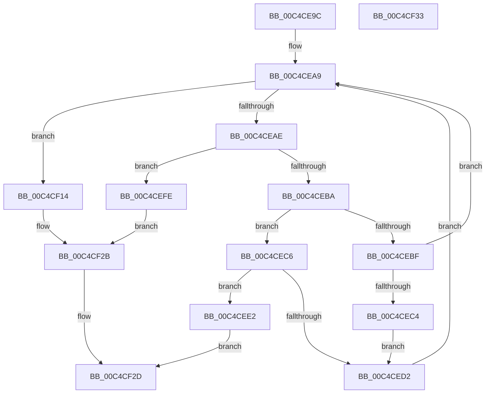

# ViFindTriageRule

- RVA: `0x00C4CE9C`–`0x00C4CF34` (길이 `152` bytes)
- VA: `0x0000000140C4CE9C`
- 실행 섹션: `INIT`
- PDB 이름 있음: `예`; PDB Function 태그: `아니요`
- unwind 정보 RVA: `0x0005CF00`
- 디코드: `48`개 명령, `152/152` bytes 표시
- 미해석 바이트: `0` (있으면 어셈블리에 `.byte`로 보존)

> 이 문서는 커널 이미지의 기계어와 PDB 기호를 분석해 생성했습니다. 4번과 5번은 함수 원형과 자료형을 바이너리 사용 방식에서 추정한 C 해석이며 원본 소스 복구 결과는 아닙니다.

## 1. Dependencies

- 직접 호출 지점: **3**; 고유 호출 대상: **1**
- 직접 호출자로 확인된 함수: **1**
- RIP 상대 이미지 참조: **3**

### Outgoing calls
- `0x00C4CEF4` → [DbgPrintEx](../../text/35/DbgPrintEx_function_00359290.md) (function, `0x00359290`)
- `0x00C4CF0D` → [DbgPrintEx](../../text/35/DbgPrintEx_function_00359290.md) (function, `0x00359290`)
- `0x00C4CF26` → [DbgPrintEx](../../text/35/DbgPrintEx_function_00359290.md) (function, `0x00359290`)

### Direct callers
- [VfTriageSystem](VfTriageSystem_function_00C4CB34.md) at `0x00C4CD73`
- [VfTriageSystem](VfTriageSystem_function_00C4CB34.md) at `0x00C4CD8D`

### Static image references
- `0x00C4CEEA` → RVA `0x00C7D350` (` ?? ::PBOPGDP::`string'`; read)
- `0x00C4CF03` → RVA `0x00C7D2D0` (` ?? ::PBOPGDP::`string'`; read)
- `0x00C4CF1C` → RVA `0x00C7D320` (` ?? ::PBOPGDP::`string'`; read)

## 2. Other-region calls and transfers

- 다른 실행 섹션으로 향하는 call: **3**
  - `0x00C4CEF4` → [DbgPrintEx](../../text/35/DbgPrintEx_function_00359290.md) (`INIT` → `.text`)
  - `0x00C4CF0D` → [DbgPrintEx](../../text/35/DbgPrintEx_function_00359290.md) (`INIT` → `.text`)
  - `0x00C4CF26` → [DbgPrintEx](../../text/35/DbgPrintEx_function_00359290.md) (`INIT` → `.text`)
- 별도 외부 분기/꼬리 이동을 확인하지 못했습니다.

## 3. Assembly (complete function range)

```asm
00C4CE9C  40 53                           push rbx
00C4CE9E  48 83 EC 20                     sub rsp, 0x20
00C4CEA2  48 8B D9                        mov rbx, rcx
00C4CEA5  4C 8D 0C 11                     lea r9, [rcx + rdx]
00C4CEA9  49 3B D9                        cmp rbx, r9
00C4CEAC  73 66                           jae 0x140c4cf14
00C4CEAE  8B 0B                           mov ecx, dword ptr [rbx]
00C4CEB0  8B C1                           mov eax, ecx
00C4CEB2  C1 E8 10                        shr eax, 0x10
00C4CEB5  83 E0 07                        and eax, 7
00C4CEB8  74 44                           je 0x140c4cefe
00C4CEBA  83 E8 01                        sub eax, 1
00C4CEBD  74 07                           je 0x140c4cec6
00C4CEBF  83 F8 01                        cmp eax, 1
00C4CEC2  75 E5                           jne 0x140c4cea9
00C4CEC4  EB 0C                           jmp 0x140c4ced2
00C4CEC6  8B C1                           mov eax, ecx
00C4CEC8  41 33 C0                        xor eax, r8d
00C4CECB  0F B7 C0                        movzx eax, ax
00C4CECE  85 C0                           test eax, eax
00C4CED0  74 10                           je 0x140c4cee2
00C4CED2  48 8B C1                        mov rax, rcx
00C4CED5  48 83 C3 08                     add rbx, 8
00C4CED9  48 C1 E8 13                     shr rax, 0x13
00C4CEDD  48 03 D8                        add rbx, rax
00C4CEE0  EB C7                           jmp 0x140c4cea9
00C4CEE2  BA 03 00 00 00                  mov edx, 3
00C4CEE7  45 8B C8                        mov r9d, r8d
00C4CEEA  4C 8D 05 5F 04 03 00            lea r8, [rip + 0x3045f]
00C4CEF1  8D 4A 5A                        lea ecx, [rdx + 0x5a]
00C4CEF4  E8 97 C3 70 FF                  call 0x140359290
00C4CEF9  48 8B C3                        mov rax, rbx
00C4CEFC  EB 2F                           jmp 0x140c4cf2d
00C4CEFE  BA 03 00 00 00                  mov edx, 3
00C4CF03  4C 8D 05 C6 03 03 00            lea r8, [rip + 0x303c6]
00C4CF0A  8D 4A 5A                        lea ecx, [rdx + 0x5a]
00C4CF0D  E8 7E C3 70 FF                  call 0x140359290
00C4CF12  EB 17                           jmp 0x140c4cf2b
00C4CF14  BA 03 00 00 00                  mov edx, 3
00C4CF19  45 8B C8                        mov r9d, r8d
00C4CF1C  4C 8D 05 FD 03 03 00            lea r8, [rip + 0x303fd]
00C4CF23  8D 4A 5A                        lea ecx, [rdx + 0x5a]
00C4CF26  E8 65 C3 70 FF                  call 0x140359290
00C4CF2B  33 C0                           xor eax, eax
00C4CF2D  48 83 C4 20                     add rsp, 0x20
00C4CF31  5B                              pop rbx
00C4CF32  C3                              ret
00C4CF33  CC                              int3
```

## 4. C-style interpretation (structured pseudocode)

```c
__int64 __fastcall ViFindTriageRule(__int64 a1, __int64 a2, int a3)
{
    __int64 result;
    __int64 v_rbx;
    __int64 v_rsp;

    v_rsp = (v_rsp) - (32);
loc_00C4CEA9:
    if (a1 >= (a1 + a2 * 1)) goto loc_00C4CF14;
    result = (unsigned int)(((unsigned int)((unsigned int)((unsigned int)(*(unsigned int *)(a1))))) >> (16));
    result = (unsigned int)((result) & (7));
    if (condition_is_equal) goto loc_00C4CEFE;
    result = (unsigned int)((result) - (1));
    if (condition_is_equal) goto loc_00C4CEC6;
    if (((unsigned int)(result)) != 1) goto loc_00C4CEA9;
    goto loc_00C4CED2;
loc_00C4CEC6:
    result = (unsigned int)(((unsigned int)((unsigned int)((unsigned int)(*(unsigned int *)(a1))))) ^ (a3));
    if ((unsigned int)((unsigned __int16)(result)) == 0) goto loc_00C4CEE2;
loc_00C4CED2:
    v_rbx = (a1) + (8);
    result = ((unsigned int)(*(unsigned int *)(a1))) >> (19);
    v_rbx = (v_rbx) + (result);
    goto loc_00C4CEA9;
loc_00C4CEE2:
    result = DbgPrintEx(3 + 90, 3, v_rip + 197727, (unsigned int)(a3));
    goto loc_00C4CF2D;
loc_00C4CEFE:
    result = DbgPrintEx(3 + 90, 3, v_rip + 197574, (unsigned int)(a3));
    goto loc_00C4CF2B;
loc_00C4CF14:
    result = DbgPrintEx(3 + 90, 3, v_rip + 197629, (unsigned int)((unsigned int)(v_rip + 197574)));
loc_00C4CF2B:
    result = 0;
loc_00C4CF2D:
    v_rsp = (v_rsp) + (32);
    return result;
}
```

## 5. (Beta) C Style

```c
int64_t ViFindTriageRule(void *Arg1, int64_t Arg2, int32_t Arg3)
{
    uint8_t *arg1 = (uint8_t *)Arg1;

    int64_t result;
    int64_t local_rbx;
    int64_t local_rsp;

    local_rsp = (local_rsp) - (32);
loc_00C4CEA9:
    if (Arg1 >= (Arg1 + Arg2 * 1)) goto loc_00C4CF14;
    result = (uint32_t)(((uint32_t)((uint32_t)((uint32_t)(*(uint32_t *)(arg1))))) >> (16));
    result = (uint32_t)((result) & (7));
    if (condition_is_equal) goto loc_00C4CEFE;
    result = (uint32_t)((result) - (1));
    if (condition_is_equal) goto loc_00C4CEC6;
    if (((uint32_t)(result)) != 1) goto loc_00C4CEA9;
    goto loc_00C4CED2;
loc_00C4CEC6:
    result = (uint32_t)(((uint32_t)((uint32_t)((uint32_t)(*(uint32_t *)(arg1))))) ^ (Arg3));
    if ((uint32_t)((uint16_t)(result)) == 0) goto loc_00C4CEE2;
loc_00C4CED2:
    local_rbx = (Arg1) + (8);
    result = ((uint32_t)(*(uint32_t *)(arg1))) >> (19);
    local_rbx = (local_rbx) + (result);
    goto loc_00C4CEA9;
loc_00C4CEE2:
    result = DbgPrintEx(3 + 90, 3, v_rip + 197727, (uint32_t)(Arg3));
    goto loc_00C4CF2D;
loc_00C4CEFE:
    result = DbgPrintEx(3 + 90, 3, v_rip + 197574, (uint32_t)(Arg3));
    goto loc_00C4CF2B;
loc_00C4CF14:
    result = DbgPrintEx(3 + 90, 3, v_rip + 197629, (uint32_t)((uint32_t)(v_rip + 197574)));
loc_00C4CF2B:
    result = 0;
loc_00C4CF2D:
    local_rsp = (local_rsp) + (32);
    return result;
}
```

### 관측된 메모리 오프셋

구조체 형식이 확인되지 않은 접근은 인자 기준의 오프셋으로만 기록했습니다.

| 기준 인자 | 오프셋 표현 | 폭 (bit) | 접근 |
|---|---:|---:|---|
| `Arg1` | `+ 0x0 + rdx*1` | `64` | `R` |

## 6. Execution-region graph

[열기: 2D/3D 그래프와 함수 탐색 컨트롤 패널](../../../control-panel.html?section=init&rva=0x00C4CE9C&view=graph)

- 2D 그래프는 위에서 아래로 흐르고, 3D 그래프는 빈 공간을 드래그해 회전합니다. Shift+드래그는 이동, 휠은 확대·축소, 함수 노드 선택은 대상 보고서 이동입니다.

### Static fallback


