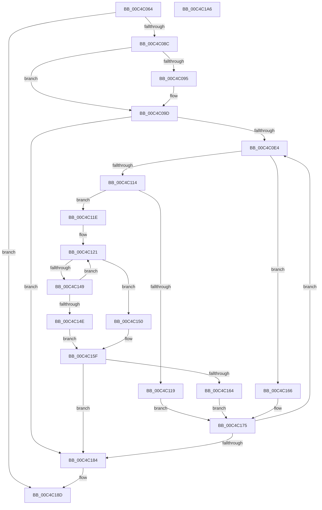

# ViInitPickRandomTargets

- RVA: `0x00C4C064`–`0x00C4C1A7` (길이 `323` bytes)
- VA: `0x0000000140C4C064`
- 실행 섹션: `INIT`
- PDB 이름 있음: `예`; PDB Function 태그: `아니요`
- unwind 정보 RVA: `0x00060300`
- 디코드: `95`개 명령, `323/323` bytes 표시
- 미해석 바이트: `0` (있으면 어셈블리에 `.byte`로 보존)

> 이 문서는 커널 이미지의 기계어와 PDB 기호를 분석해 생성했습니다. 4번과 5번은 함수 원형과 자료형을 바이너리 사용 방식에서 추정한 C 해석이며 원본 소스 복구 결과는 아닙니다.

## 1. Dependencies

- 직접 호출 지점: **2**; 고유 호출 대상: **2**
- 직접 호출자로 확인된 함수: **1**
- RIP 상대 이미지 참조: **8**

### Outgoing calls
- `0x00C4C0CD` → [memset](../../text/6C/memset_function_006C6C40.md) (function, `0x006C6C40`)
- `0x00C4C0EA` → [VfRandomGetNumber](../../pagevrfy/B9/VfRandomGetNumber_function_00B930CC.md) (function, `0x00B930CC`)

### Direct callers
- [ViInitSystemPhase0](ViInitSystemPhase0_function_00C4C1B0.md) at `0x00C4C4F4`

### Static image references
- `0x00C4C07C` → RVA `0x00FFDA08` (`PAGEVRFD`; read)
- `0x00C4C097` → RVA `0x00FFDA08` (`PAGEVRFD`; write)
- `0x00C4C09D` → RVA `0x00FFDA2C` (`PAGEVRFD`; read)
- `0x00C4C0A3` → RVA `0x00FFDBF0` (`PAGEVRFD`; write)
- `0x00C4C0B5` → RVA `0x00FFF780` (`PAGEVRFD`; read)
- `0x00C4C0BC` → RVA `0x00FFDBF8` (`PAGEVRFD`; write)
- `0x00C4C0EF` → RVA `0x00FFDBF8` (`PAGEVRFD`; read)
- `0x00C4C184` → RVA `0x00FFDA08` (`PAGEVRFD`; read/write)

## 2. Other-region calls and transfers

- 다른 실행 섹션으로 향하는 call: **2**
  - `0x00C4C0CD` → [memset](../../text/6C/memset_function_006C6C40.md) (`INIT` → `.text`)
  - `0x00C4C0EA` → [VfRandomGetNumber](../../pagevrfy/B9/VfRandomGetNumber_function_00B930CC.md) (`INIT` → `PAGEVRFY`)
- 별도 외부 분기/꼬리 이동을 확인하지 못했습니다.

## 3. Assembly (complete function range)

```asm
00C4C064  48 89 5C 24 08                  mov qword ptr [rsp + 8], rbx
00C4C069  48 89 6C 24 10                  mov qword ptr [rsp + 0x10], rbp
00C4C06E  48 89 74 24 18                  mov qword ptr [rsp + 0x18], rsi
00C4C073  57                              push rdi
00C4C074  41 56                           push r14
00C4C076  41 57                           push r15
00C4C078  48 83 EC 20                     sub rsp, 0x20
00C4C07C  8B 05 86 19 3B 00               mov eax, dword ptr [rip + 0x3b1986]
00C4C082  33 DB                           xor ebx, ebx
00C4C084  85 C0                           test eax, eax
00C4C086  0F 84 01 01 00 00               je 0x140c4c18d
00C4C08C  BA 00 02 00 00                  mov edx, 0x200
00C4C091  3B C2                           cmp eax, edx
00C4C093  76 08                           jbe 0x140c4c09d
00C4C095  8B C2                           mov eax, edx
00C4C097  89 15 6B 19 3B 00               mov dword ptr [rip + 0x3b196b], edx
00C4C09D  8B 0D 89 19 3B 00               mov ecx, dword ptr [rip + 0x3b1989]
00C4C0A3  89 15 47 1B 3B 00               mov dword ptr [rip + 0x3b1b47], edx
00C4C0A9  8D 79 02                        lea edi, [rcx + 2]
00C4C0AC  3B FA                           cmp edi, edx
00C4C0AE  0F 47 FA                        cmova edi, edx
00C4C0B1  03 C0                           add eax, eax
00C4C0B3  3B C1                           cmp eax, ecx
00C4C0B5  48 8D 0D C4 36 3B 00            lea rcx, [rip + 0x3b36c4]
00C4C0BC  48 89 0D 35 1B 3B 00            mov qword ptr [rip + 0x3b1b35], rcx
00C4C0C3  41 0F 97 C6                     seta r14b
00C4C0C7  33 D2                           xor edx, edx
00C4C0C9  44 8D 42 40                     lea r8d, [rdx + 0x40]
00C4C0CD  E8 6E AB A7 FF                  call 0x1406c6c40
00C4C0D2  33 F6                           xor esi, esi
00C4C0D4  39 1D 2E 19 3B 00               cmp dword ptr [rip + 0x3b192e], ebx
00C4C0DA  44 8D 7E 01                     lea r15d, [rsi + 1]
00C4C0DE  0F 86 A0 00 00 00               jbe 0x140c4c184
00C4C0E4  8D 57 FF                        lea edx, [rdi - 1]
00C4C0E7  41 8B CF                        mov ecx, r15d
00C4C0EA  E8 DD 6F F4 FF                  call 0x140b930cc
00C4C0EF  4C 8B 0D 02 1B 3B 00            mov r9, qword ptr [rip + 0x3b1b02]
00C4C0F6  44 8B C0                        mov r8d, eax
00C4C0F9  8B C0                           mov eax, eax
00C4C0FB  41 8A C8                        mov cl, r8b
00C4C0FE  48 C1 E8 03                     shr rax, 3
00C4C102  80 E1 07                        and cl, 7
00C4C105  46 0F BE 14 08                  movsx r10d, byte ptr [rax + r9]
00C4C10A  41 8A D2                        mov dl, r10b
00C4C10D  D2 FA                           sar dl, cl
00C4C10F  41 84 D7                        test r15b, dl
00C4C112  74 52                           je 0x140c4c166
00C4C114  45 84 F6                        test r14b, r14b
00C4C117  74 05                           je 0x140c4c11e
00C4C119  41 03 DF                        add ebx, r15d
00C4C11C  EB 57                           jmp 0x140c4c175
00C4C11E  41 8B D0                        mov edx, r8d
00C4C121  8D 42 01                        lea eax, [rdx + 1]
00C4C124  33 D2                           xor edx, edx
00C4C126  F7 F7                           div edi
00C4C128  85 D2                           test edx, edx
00C4C12A  41 0F 44 D7                     cmove edx, r15d
00C4C12E  44 8B D2                        mov r10d, edx
00C4C131  8A CA                           mov cl, dl
00C4C133  49 C1 EA 03                     shr r10, 3
00C4C137  80 E1 07                        and cl, 7
00C4C13A  47 0F BE 1C 0A                  movsx r11d, byte ptr [r10 + r9]
00C4C13F  41 8A C3                        mov al, r11b
00C4C142  D2 F8                           sar al, cl
00C4C144  41 84 C7                        test r15b, al
00C4C147  74 07                           je 0x140c4c150
00C4C149  41 3B D0                        cmp edx, r8d
00C4C14C  75 D3                           jne 0x140c4c121
00C4C14E  EB 0F                           jmp 0x140c4c15f
00C4C150  8B C2                           mov eax, edx
00C4C152  41 8B CB                        mov ecx, r11d
00C4C155  83 E0 07                        and eax, 7
00C4C158  0F AB C1                        bts ecx, eax
00C4C15B  43 88 0C 0A                     mov byte ptr [r10 + r9], cl
00C4C15F  41 3B D0                        cmp edx, r8d
00C4C162  74 20                           je 0x140c4c184
00C4C164  EB 0F                           jmp 0x140c4c175
00C4C166  41 8B CA                        mov ecx, r10d
00C4C169  41 83 E0 07                     and r8d, 7
00C4C16D  44 0F AB C1                     bts ecx, r8d
00C4C171  42 88 0C 08                     mov byte ptr [rax + r9], cl
00C4C175  41 03 F7                        add esi, r15d
00C4C178  3B 35 8A 18 3B 00               cmp esi, dword ptr [rip + 0x3b188a]
00C4C17E  0F 82 60 FF FF FF               jb 0x140c4c0e4
00C4C184  29 1D 7E 18 3B 00               sub dword ptr [rip + 0x3b187e], ebx
00C4C18A  41 8B C7                        mov eax, r15d
00C4C18D  48 8B 5C 24 40                  mov rbx, qword ptr [rsp + 0x40]
00C4C192  48 8B 6C 24 48                  mov rbp, qword ptr [rsp + 0x48]
00C4C197  48 8B 74 24 50                  mov rsi, qword ptr [rsp + 0x50]
00C4C19C  48 83 C4 20                     add rsp, 0x20
00C4C1A0  41 5F                           pop r15
00C4C1A2  41 5E                           pop r14
00C4C1A4  5F                              pop rdi
00C4C1A5  C3                              ret
00C4C1A6  CC                              int3
```

## 4. C-style interpretation (structured pseudocode)

```c
__int64 __fastcall ViInitPickRandomTargets(void)
{
    __int64 result;
    __int64 v_r10;
    __int64 v_r14;
    __int64 v_rbx;
    __int64 v_rdi;
    __int64 v_rsi;
    __int64 v_rsp;
    unsigned __int64 v_stack_p10;
    unsigned __int64 v_stack_p18;
    unsigned __int64 v_stack_p8;

    v_stack_p8 = v_rbx;
    v_stack_p10 = v_rbp;
    v_stack_p18 = v_rsi;
    v_rsp = (v_rsp) - (32);
    v_rbx = 0;
    if ((unsigned int)((unsigned int)(*(unsigned int *)(v_rip + 3873158))) == 0) goto loc_00C4C18D;
    result = (unsigned int)(*(unsigned int *)(v_rip + 3873158));
    if (((unsigned int)((unsigned int)(*(unsigned int *)(v_rip + 3873158)))) >= = 512) {
        result = 512;
        *(unsigned int *)(v_rip + 3873131) = 512;
    }
    *(unsigned int *)(v_rip + 3873607) = 512;
    v_rdi = (unsigned int)(*(unsigned int *)(v_rip + 3873161)) + 2;
    if (((unsigned int)((unsigned int)(*(unsigned int *)(v_rip + 3873161)) + 2)) > 512) { v_rdi = 512; }
    result = (unsigned int)((result) + ((unsigned int)(result)));
    *(unsigned __int64 *)(v_rip + 3873589) = v_rip + 3880644;
    v_r14 = (((unsigned int)(result)) > ((unsigned int)((unsigned int)(*(unsigned int *)(v_rip + 3873161))))) ? 1 : 0;
    a2 = 0;
    result = memset(v_rip + 3880644, a2, a2 + 64, a4);
    v_rsi = 0;
    if ((*(unsigned int *)(v_rip + 3873070)) <= 0) goto loc_00C4C184;
loc_00C4C0E4:
    result = VfRandomGetNumber((unsigned int)((unsigned int)(v_rsi + 1)), v_rdi - 1, a2 + 64, a4);
    result = ((unsigned int)((unsigned int)(result))) >> (3);
    a1 = (unsigned __int8)(((unsigned __int8)((unsigned int)((unsigned int)(result)))) & (7));
    a2 = (unsigned __int8)(((unsigned __int8)((__int8)(*(unsigned __int8 *)(result + *(unsigned __int64 *)(v_rip + 3873538) * 1)))) >> ((unsigned __int8)(a1)));
    if ((((unsigned __int8)(v_rsi + 1)) & ((unsigned __int8)(a2))) == 0) goto loc_00C4C166;
    if ((unsigned __int8)(v_r14) == 0) goto loc_00C4C11E;
    v_rbx = (unsigned int)((v_rbx) + ((unsigned int)(v_rsi + 1)));
    goto loc_00C4C175;
loc_00C4C11E:
loc_00C4C121:
    a2 = 0;
    if (0 == 0) { a2 = (unsigned int)(v_rsi + 1); }
    v_r10 = ((unsigned int)((unsigned int)(a2))) >> (3);
    a1 = (unsigned __int8)(((unsigned __int8)(a2)) & (7));
    result = (unsigned __int8)(((unsigned __int8)((__int8)(*(unsigned __int8 *)(v_r10 + *(unsigned __int64 *)(v_rip + 3873538) * 1)))) >> ((unsigned __int8)(a1)));
    if ((((unsigned __int8)(v_rsi + 1)) & ((unsigned __int8)(result))) == 0) goto loc_00C4C150;
    if (((unsigned int)(a2)) != ((unsigned int)((unsigned int)((unsigned int)(result))))) goto loc_00C4C121;
    goto loc_00C4C15F;
loc_00C4C150:
    result = (unsigned int)(((unsigned int)((unsigned int)(a2))) & (7));
    *(unsigned __int8 *)(v_r10 + *(unsigned __int64 *)(v_rip + 3873538) * 1) = (unsigned __int8)((unsigned int)((unsigned int)((__int8)(*(unsigned __int8 *)(v_r10 + *(unsigned __int64 *)(v_rip + 3873538) * 1)))));
loc_00C4C15F:
    if (((unsigned int)(a2)) == ((unsigned int)((unsigned int)((unsigned int)(result))))) goto loc_00C4C184;
    goto loc_00C4C175;
loc_00C4C166:
    a3 = (unsigned int)(((unsigned int)((unsigned int)(result))) & (7));
    *(unsigned __int8 *)(result + *(unsigned __int64 *)(v_rip + 3873538) * 1) = (unsigned __int8)((unsigned int)((unsigned int)(v_r10)));
loc_00C4C175:
    v_rsi = (unsigned int)((v_rsi) + ((unsigned int)(v_rsi + 1)));
    if (((unsigned int)(v_rsi)) < (*(unsigned int *)(v_rip + 3872906))) goto loc_00C4C0E4;
loc_00C4C184:
loc_00C4C18D:
    v_rsp = (v_rsp) + (32);
    return (unsigned int)((unsigned int)(v_rsi + 1));
}
```

## 5. (Beta) C Style

```c
void ViInitPickRandomTargets(void)
{
    int64_t result;
    int64_t local_r10;
    int64_t local_r14;
    int64_t local_rbx;
    int64_t local_rdi;
    int64_t local_rsi;
    int64_t local_rsp;
    uint64_t v_stack_p10;
    uint64_t v_stack_p18;
    uint64_t v_stack_p8;

    v_stack_p8 = local_rbx;
    v_stack_p10 = local_rbp;
    v_stack_p18 = local_rsi;
    local_rsp = (local_rsp) - (32);
    local_rbx = 0;
    if ((uint32_t)((uint32_t)(*(uint32_t *)(v_rip + 0x3B1986))) == 0) goto loc_00C4C18D;
    result = (uint32_t)(*(uint32_t *)(v_rip + 0x3B1986));
    if (((uint32_t)((uint32_t)(*(uint32_t *)(v_rip + 0x3B1986)))) >= = 512) {
        result = 512;
        *(uint32_t *)(v_rip + 0x3B196B) = 512;
    }
    *(uint32_t *)(v_rip + 0x3B1B47) = 512;
    local_rdi = (uint32_t)(*(uint32_t *)(v_rip + 0x3B1989)) + 2;
    if (((uint32_t)((uint32_t)(*(uint32_t *)(v_rip + 0x3B1989)) + 2)) > 512) { local_rdi = 512; }
    result = (uint32_t)((result) + ((uint32_t)(result)));
    *(uint64_t *)(v_rip + 0x3B1B35) = v_rip + 3880644;
    local_r14 = (((uint32_t)(result)) > ((uint32_t)((uint32_t)(*(uint32_t *)(v_rip + 0x3B1989))))) ? 1 : 0;
    a2 = 0;
    result = memset(v_rip + 3880644, a2, a2 + 64, a4);
    local_rsi = 0;
    if ((*(uint32_t *)(v_rip + 0x3B192E)) <= 0) goto loc_00C4C184;
loc_00C4C0E4:
    result = VfRandomGetNumber((uint32_t)((uint32_t)(local_rsi + 1)), local_rdi - 1, a2 + 64, a4);
    result = ((uint32_t)((uint32_t)(result))) >> (3);
    a1 = (uint8_t)(((uint8_t)((uint32_t)((uint32_t)(result)))) & (7));
    a2 = (uint8_t)(((uint8_t)((int8_t)(*(uint8_t *)(result + *(uint64_t *)(v_rip + 0x3B1B02) * 1)))) >> ((uint8_t)(a1)));
    if ((((uint8_t)(local_rsi + 1)) & ((uint8_t)(a2))) == 0) goto loc_00C4C166;
    if ((uint8_t)(local_r14) == 0) goto loc_00C4C11E;
    local_rbx = (uint32_t)((local_rbx) + ((uint32_t)(local_rsi + 1)));
    goto loc_00C4C175;
loc_00C4C11E:
loc_00C4C121:
    a2 = 0;
    if (0 == 0) { a2 = (uint32_t)(local_rsi + 1); }
    local_r10 = ((uint32_t)((uint32_t)(a2))) >> (3);
    a1 = (uint8_t)(((uint8_t)(a2)) & (7));
    result = (uint8_t)(((uint8_t)((int8_t)(*(uint8_t *)(local_r10 + *(uint64_t *)(v_rip + 0x3B1B02) * 1)))) >> ((uint8_t)(a1)));
    if ((((uint8_t)(local_rsi + 1)) & ((uint8_t)(result))) == 0) goto loc_00C4C150;
    if (((uint32_t)(a2)) != ((uint32_t)((uint32_t)((uint32_t)(result))))) goto loc_00C4C121;
    goto loc_00C4C15F;
loc_00C4C150:
    result = (uint32_t)(((uint32_t)((uint32_t)(a2))) & (7));
    *(uint8_t *)(local_r10 + *(uint64_t *)(v_rip + 0x3B1B02) * 1) = (uint8_t)((uint32_t)((uint32_t)((int8_t)(*(uint8_t *)(local_r10 + *(uint64_t *)(v_rip + 0x3B1B02) * 1)))));
loc_00C4C15F:
    if (((uint32_t)(a2)) == ((uint32_t)((uint32_t)((uint32_t)(result))))) goto loc_00C4C184;
    goto loc_00C4C175;
loc_00C4C166:
    a3 = (uint32_t)(((uint32_t)((uint32_t)(result))) & (7));
    *(uint8_t *)(result + *(uint64_t *)(v_rip + 0x3B1B02) * 1) = (uint8_t)((uint32_t)((uint32_t)(local_r10)));
loc_00C4C175:
    local_rsi = (uint32_t)((local_rsi) + ((uint32_t)(local_rsi + 1)));
    if (((uint32_t)(local_rsi)) < (*(uint32_t *)(v_rip + 0x3B188A))) goto loc_00C4C0E4;
loc_00C4C184:
loc_00C4C18D:
    local_rsp = (local_rsp) + (32);
    return (uint32_t)((uint32_t)(local_rsi + 1));
}
```

## 6. Execution-region graph

[열기: 2D/3D 그래프와 함수 탐색 컨트롤 패널](../../../control-panel.html?section=init&rva=0x00C4C064&view=graph)

- 2D 그래프는 위에서 아래로 흐르고, 3D 그래프는 빈 공간을 드래그해 회전합니다. Shift+드래그는 이동, 휠은 확대·축소, 함수 노드 선택은 대상 보고서 이동입니다.

### Static fallback


