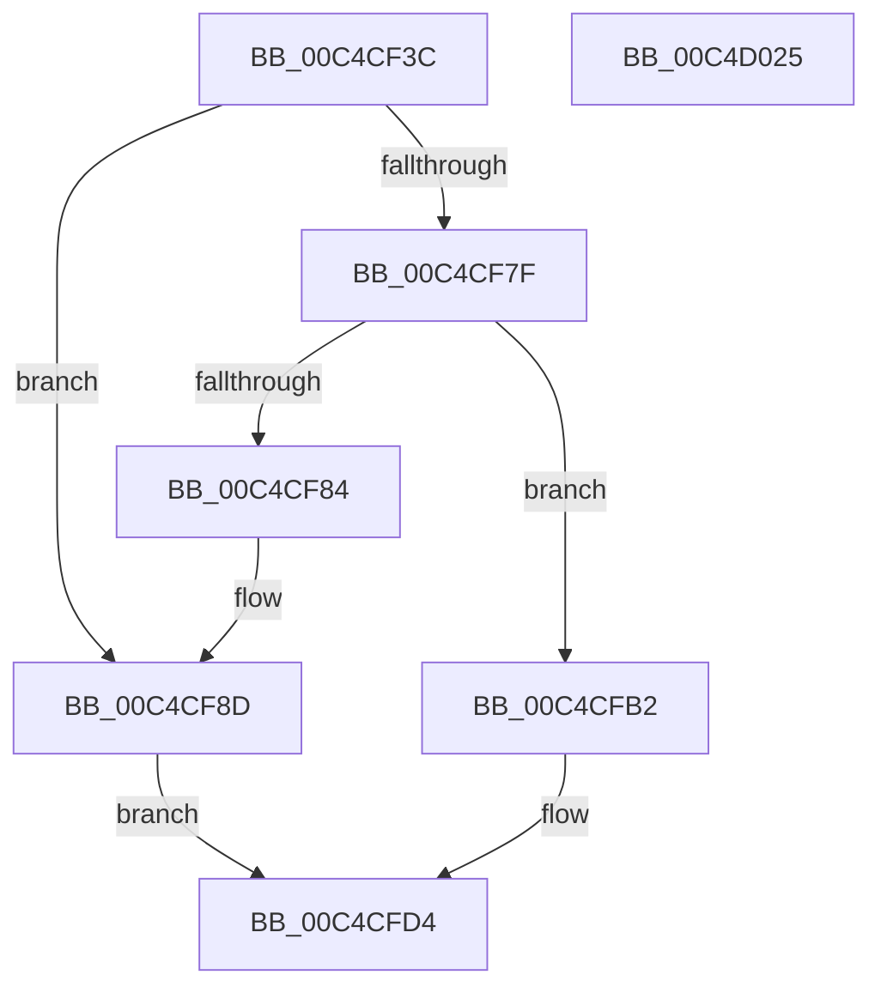

# ViMakeVerifierSettings

- RVA: `0x00C4CF3C`–`0x00C4D026` (길이 `234` bytes)
- VA: `0x0000000140C4CF3C`
- 실행 섹션: `INIT`
- PDB 이름 있음: `예`; PDB Function 태그: `아니요`
- unwind 정보 RVA: `0x0006F978`
- 디코드: `58`개 명령, `234/234` bytes 표시
- 미해석 바이트: `0` (있으면 어셈블리에 `.byte`로 보존)

> 이 문서는 커널 이미지의 기계어와 PDB 기호를 분석해 생성했습니다. 4번과 5번은 함수 원형과 자료형을 바이너리 사용 방식에서 추정한 C 해석이며 원본 소스 복구 결과는 아닙니다.

## 1. Dependencies

- 직접 호출 지점: **6**; 고유 호출 대상: **3**
- 직접 호출자로 확인된 함수: **1**
- RIP 상대 이미지 참조: **8**

### Outgoing calls
- `0x00C4CF94` → [VfInitSetVerifyDriverTargets](VfInitSetVerifyDriverTargets_function_00C4C010.md) (function, `0x00C4C010`)
- `0x00C4CFAB` → [DbgPrintEx](../../text/35/DbgPrintEx_function_00359290.md) (function, `0x00359290`)
- `0x00C4CFBD` → [VfInitSetVerifyDriverTargets](VfInitSetVerifyDriverTargets_function_00C4C010.md) (function, `0x00C4C010`)
- `0x00C4CFCF` → [DbgPrintEx](../../text/35/DbgPrintEx_function_00359290.md) (function, `0x00359290`)
- `0x00C4CFF0` → [DbgPrintEx](../../text/35/DbgPrintEx_function_00359290.md) (function, `0x00359290`)
- `0x00C4D00A` → [RtlStringCbCopyW](../../text/43/RtlStringCbCopyW_function_0043B910.md) (function, `0x0043B910`)

### Direct callers
- [VfTriageSystem](VfTriageSystem_function_00C4CB34.md) at `0x00C4CE3C`

### Static image references
- `0x00C4CF51` → RVA `0x00E0E944` (`.data`; write)
- `0x00C4CF62` → RVA `0x00C7CFA0` (` ?? ::PBOPGDP::`string'`; read)
- `0x00C4CF6C` → RVA `0x00E0E950` (`.data`; write)
- `0x00C4CF9E` → RVA `0x00C7D5E0` (` ?? ::PBOPGDP::`string'`; read)
- `0x00C4CFC2` → RVA `0x00C7D680` (` ?? ::PBOPGDP::`string'`; read)
- `0x00C4CFD9` → RVA `0x00F04AB8` (`.data`; write)
- `0x00C4CFE6` → RVA `0x00C7D5A0` (` ?? ::PBOPGDP::`string'`; read)
- `0x00C4CFF7` → RVA `0x00F04660` (`.data`; read)

## 2. Other-region calls and transfers

- 다른 실행 섹션으로 향하는 call: **4**
  - `0x00C4CFAB` → [DbgPrintEx](../../text/35/DbgPrintEx_function_00359290.md) (`INIT` → `.text`)
  - `0x00C4CFCF` → [DbgPrintEx](../../text/35/DbgPrintEx_function_00359290.md) (`INIT` → `.text`)
  - `0x00C4CFF0` → [DbgPrintEx](../../text/35/DbgPrintEx_function_00359290.md) (`INIT` → `.text`)
  - `0x00C4D00A` → [RtlStringCbCopyW](../../text/43/RtlStringCbCopyW_function_0043B910.md) (`INIT` → `.text`)
- 별도 외부 분기/꼬리 이동을 확인하지 못했습니다.

## 3. Assembly (complete function range)

```asm
00C4CF3C  48 89 5C 24 08                  mov qword ptr [rsp + 8], rbx
00C4CF41  48 89 74 24 10                  mov qword ptr [rsp + 0x10], rsi
00C4CF46  48 89 7C 24 18                  mov qword ptr [rsp + 0x18], rdi
00C4CF4B  41 56                           push r14
00C4CF4D  48 83 EC 20                     sub rsp, 0x20
00C4CF51  C7 05 E9 19 1C 00 01 00 00 00   mov dword ptr [rip + 0x1c19e9], 1
00C4CF5B  4C 8D 71 04                     lea r14, [rcx + 4]
00C4CF5F  41 8B 06                        mov eax, dword ptr [r14]
00C4CF62  48 8D 3D 37 00 03 00            lea rdi, [rip + 0x30037]
00C4CF69  4C 8B C2                        mov r8, rdx
00C4CF6C  89 05 DE 19 1C 00               mov dword ptr [rip + 0x1c19de], eax
00C4CF72  8B 11                           mov edx, dword ptr [rcx]
00C4CF74  33 DB                           xor ebx, ebx
00C4CF76  C1 EA 13                        shr edx, 0x13
00C4CF79  33 F6                           xor esi, esi
00C4CF7B  85 D2                           test edx, edx
00C4CF7D  75 0E                           jne 0x140c4cf8d
00C4CF7F  4D 85 C0                        test r8, r8
00C4CF82  74 2E                           je 0x140c4cfb2
00C4CF84  41 8B 10                        mov edx, dword ptr [r8]
00C4CF87  49 8B C8                        mov rcx, r8
00C4CF8A  C1 EA 13                        shr edx, 0x13
00C4CF8D  48 8D 59 08                     lea rbx, [rcx + 8]
00C4CF91  48 8B CB                        mov rcx, rbx
00C4CF94  E8 77 F0 FF FF                  call 0x140c4c010
00C4CF99  BA 03 00 00 00                  mov edx, 3
00C4CF9E  4C 8D 05 3B 06 03 00            lea r8, [rip + 0x3063b]
00C4CFA5  4C 8B CB                        mov r9, rbx
00C4CFA8  8D 4A 5A                        lea ecx, [rdx + 0x5a]
00C4CFAB  E8 E0 C2 70 FF                  call 0x140359290
00C4CFB0  EB 22                           jmp 0x140c4cfd4
00C4CFB2  BE 01 00 00 00                  mov esi, 1
00C4CFB7  48 8B CF                        mov rcx, rdi
00C4CFBA  8D 56 03                        lea edx, [rsi + 3]
00C4CFBD  E8 4E F0 FF FF                  call 0x140c4c010
00C4CFC2  4C 8D 05 B7 06 03 00            lea r8, [rip + 0x306b7]
00C4CFC9  8D 56 02                        lea edx, [rsi + 2]
00C4CFCC  8D 4E 5C                        lea ecx, [rsi + 0x5c]
00C4CFCF  E8 BC C2 70 FF                  call 0x140359290
00C4CFD4  BA 03 00 00 00                  mov edx, 3
00C4CFD9  C7 05 D5 7A 2B 00 01 00 00 00   mov dword ptr [rip + 0x2b7ad5], 1
00C4CFE3  45 8B 0E                        mov r9d, dword ptr [r14]
00C4CFE6  4C 8D 05 B3 05 03 00            lea r8, [rip + 0x305b3]
00C4CFED  8D 4A 5A                        lea ecx, [rdx + 0x5a]
00C4CFF0  E8 9B C2 70 FF                  call 0x140359290
00C4CFF5  85 F6                           test esi, esi
00C4CFF7  48 8D 0D 62 76 2B 00            lea rcx, [rip + 0x2b7662]
00C4CFFE  BA 00 02 00 00                  mov edx, 0x200
00C4D003  48 0F 44 FB                     cmove rdi, rbx
00C4D007  4C 8B C7                        mov r8, rdi
00C4D00A  E8 01 E9 7E FF                  call 0x14043b910
00C4D00F  48 8B 5C 24 30                  mov rbx, qword ptr [rsp + 0x30]
00C4D014  48 8B 74 24 38                  mov rsi, qword ptr [rsp + 0x38]
00C4D019  48 8B 7C 24 40                  mov rdi, qword ptr [rsp + 0x40]
00C4D01E  48 83 C4 20                     add rsp, 0x20
00C4D022  41 5E                           pop r14
00C4D024  C3                              ret
00C4D025  CC                              int3
```

## 4. C-style interpretation (structured pseudocode)

```c
__int64 __fastcall ViMakeVerifierSettings(__int64 a1, __int64 a2)
{
    __int64 result;
    __int64 v_rbx;
    __int64 v_rdi;
    __int64 v_rsi;
    __int64 v_rsp;
    unsigned __int64 v_stack_p10;
    unsigned __int64 v_stack_p18;
    unsigned __int64 v_stack_p8;

    v_stack_p8 = v_rbx;
    v_stack_p10 = v_rsi;
    v_stack_p18 = v_rdi;
    v_rsp = (v_rsp) - (32);
    *(unsigned int *)(v_rip + 1841641) = 1;
    *(unsigned int *)(v_rip + 1841630) = (unsigned int)((unsigned int)(*(unsigned int *)(a1 + 4)));
    v_rbx = 0;
    a2 = (unsigned int)(((unsigned int)(*(unsigned int *)(a1))) >> (19));
    v_rsi = 0;
    if ((unsigned int)(a2) != 0) goto loc_00C4CF8D;
    if (a2 == 0) goto loc_00C4CFB2;
    a2 = (unsigned int)(((unsigned int)(*(unsigned int *)(a2))) >> (19));
loc_00C4CF8D:
    result = VfInitSetVerifyDriverTargets(a2 + 8, a2, a2, a4);
    result = DbgPrintEx(3 + 90, 3, v_rip + 198203, a2 + 8);
    goto loc_00C4CFD4;
loc_00C4CFB2:
    result = VfInitSetVerifyDriverTargets(v_rip + 196663, 1 + 3, v_rip + 198203, a2 + 8);
    result = DbgPrintEx(1 + 92, 1 + 2, v_rip + 198327, a2 + 8);
loc_00C4CFD4:
    *(unsigned int *)(v_rip + 2849493) = 1;
    result = DbgPrintEx(3 + 90, 3, v_rip + 198067, (unsigned int)(*(unsigned int *)(a1 + 4)));
    v_rdi = v_rip + 196663;
    if (1 == 0) { v_rdi = a2 + 8; }
    result = RtlStringCbCopyW(v_rip + 2848354, 512, v_rdi, (unsigned int)(*(unsigned int *)(a1 + 4)));
    v_rsp = (v_rsp) + (32);
    return result;
}
```

## 5. (Beta) C Style

```c
int64_t ViMakeVerifierSettings(void *Arg1, int64_t Arg2)
{
    uint8_t *arg1 = (uint8_t *)Arg1;

    int64_t result;
    int64_t local_rbx;
    int64_t local_rdi;
    int64_t local_rsi;
    int64_t local_rsp;
    uint64_t v_stack_p10;
    uint64_t v_stack_p18;
    uint64_t v_stack_p8;

    v_stack_p8 = local_rbx;
    v_stack_p10 = local_rsi;
    v_stack_p18 = local_rdi;
    local_rsp = (local_rsp) - (32);
    *(uint32_t *)(v_rip + 0x1C19E9) = 1;
    *(uint32_t *)(v_rip + 0x1C19DE) = (uint32_t)((uint32_t)(*(uint32_t *)(arg1 + 0x4)));
    local_rbx = 0;
    Arg2 = (uint32_t)(((uint32_t)(*(uint32_t *)(arg1))) >> (19));
    local_rsi = 0;
    if ((uint32_t)(Arg2) != 0) goto loc_00C4CF8D;
    if (Arg2 == 0) goto loc_00C4CFB2;
    Arg2 = (uint32_t)(((uint32_t)(*(uint32_t *)(Arg2))) >> (19));
loc_00C4CF8D:
    result = VfInitSetVerifyDriverTargets(Arg2 + 8, Arg2, Arg2, a4);
    result = DbgPrintEx(3 + 90, 3, v_rip + 198203, Arg2 + 8);
    goto loc_00C4CFD4;
loc_00C4CFB2:
    result = VfInitSetVerifyDriverTargets(v_rip + 196663, 1 + 3, v_rip + 198203, Arg2 + 8);
    result = DbgPrintEx(1 + 92, 1 + 2, v_rip + 198327, Arg2 + 8);
loc_00C4CFD4:
    *(uint32_t *)(v_rip + 0x2B7AD5) = 1;
    result = DbgPrintEx(3 + 90, 3, v_rip + 198067, (uint32_t)(*(uint32_t *)(arg1 + 0x4)));
    local_rdi = v_rip + 196663;
    if (1 == 0) { local_rdi = Arg2 + 8; }
    result = RtlStringCbCopyW(v_rip + 2848354, 512, local_rdi, (uint32_t)(*(uint32_t *)(arg1 + 0x4)));
    local_rsp = (local_rsp) + (32);
    return result;
}
```

### 관측된 메모리 오프셋

구조체 형식이 확인되지 않은 접근은 인자 기준의 오프셋으로만 기록했습니다.

| 기준 인자 | 오프셋 표현 | 폭 (bit) | 접근 |
|---|---:|---:|---|
| `Arg1` | `+ 0x0` | `32` | `R` |
| `Arg1` | `+ 0x4` | `64` | `R` |

## 6. Execution-region graph

[열기: 2D/3D 그래프와 함수 탐색 컨트롤 패널](../../../control-panel.html?section=init&rva=0x00C4CF3C&view=graph)

- 2D 그래프는 위에서 아래로 흐르고, 3D 그래프는 빈 공간을 드래그해 회전합니다. Shift+드래그는 이동, 휠은 확대·축소, 함수 노드 선택은 대상 보고서 이동입니다.

### Static fallback


