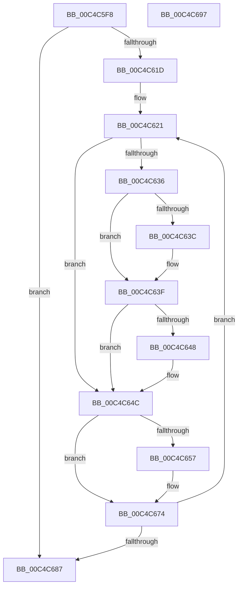

# ViThunkFindAllExportAddresses

- RVA: `0x00C4C5F8`–`0x00C4C698` (길이 `160` bytes)
- VA: `0x0000000140C4C5F8`
- 실행 섹션: `INIT`
- PDB 이름 있음: `예`; PDB Function 태그: `아니요`
- unwind 정보 RVA: `0x000D25E0`
- 디코드: `51`개 명령, `160/160` bytes 표시
- 미해석 바이트: `0` (있으면 어셈블리에 `.byte`로 보존)

> 이 문서는 커널 이미지의 기계어와 PDB 기호를 분석해 생성했습니다. 4번과 5번은 함수 원형과 자료형을 바이너리 사용 방식에서 추정한 C 해석이며 원본 소스 복구 결과는 아닙니다.

## 1. Dependencies

- 직접 호출 지점: **1**; 고유 호출 대상: **1**
- 직접 호출자로 확인된 함수: **1**
- RIP 상대 이미지 참조: **0**

### Outgoing calls
- `0x00C4C629` → [ViThunkFindExportAddress](ViThunkFindExportAddress_function_00C4C6A0.md) (function, `0x00C4C6A0`)

### Direct callers
- [VfInitBootDriversLoaded](VfInitBootDriversLoaded_function_00C4BD0C.md) at `0x00C4BE66`
- [VfInitBootDriversLoaded](VfInitBootDriversLoaded_function_00C4BD0C.md) at `0x00C4BE79`
- [VfInitBootDriversLoaded](VfInitBootDriversLoaded_function_00C4BD0C.md) at `0x00C4BE8C`

### Static image references
- 디코드된 RIP-relative 메모리 참조가 없습니다.

## 2. Other-region calls and transfers

- 다른 실행 섹션으로 향하는 call: **0**
- 별도 외부 분기/꼬리 이동을 확인하지 못했습니다.

## 3. Assembly (complete function range)

```asm
00C4C5F8  48 8B C4                        mov rax, rsp
00C4C5FB  48 89 58 08                     mov qword ptr [rax + 8], rbx
00C4C5FF  48 89 70 18                     mov qword ptr [rax + 0x18], rsi
00C4C603  48 89 50 10                     mov qword ptr [rax + 0x10], rdx
00C4C607  57                              push rdi
00C4C608  48 83 EC 20                     sub rsp, 0x20
00C4C60C  83 60 10 00                     and dword ptr [rax + 0x10], 0
00C4C610  33 FF                           xor edi, edi
00C4C612  48 8B 01                        mov rax, qword ptr [rcx]
00C4C615  49 8B F0                        mov rsi, r8
00C4C618  48 85 C0                        test rax, rax
00C4C61B  74 6A                           je 0x140c4c687
00C4C61D  48 8D 59 28                     lea rbx, [rcx + 0x28]
00C4C621  48 8D 54 24 38                  lea rdx, [rsp + 0x38]
00C4C626  48 8B C8                        mov rcx, rax
00C4C629  E8 72 00 00 00                  call 0x140c4c6a0
00C4C62E  48 8B 0B                        mov rcx, qword ptr [rbx]
00C4C631  48 85 C9                        test rcx, rcx
00C4C634  74 16                           je 0x140c4c64c
00C4C636  48 83 39 00                     cmp qword ptr [rcx], 0
00C4C63A  75 03                           jne 0x140c4c63f
00C4C63C  48 89 01                        mov qword ptr [rcx], rax
00C4C63F  48 8B 0B                        mov rcx, qword ptr [rbx]
00C4C642  48 83 39 01                     cmp qword ptr [rcx], 1
00C4C646  75 04                           jne 0x140c4c64c
00C4C648  48 83 21 00                     and qword ptr [rcx], 0
00C4C64C  83 7C 24 38 00                  cmp dword ptr [rsp + 0x38], 0
00C4C651  48 89 43 F0                     mov qword ptr [rbx - 0x10], rax
00C4C655  74 1D                           je 0x140c4c674
00C4C657  8B C7                           mov eax, edi
00C4C659  8B D7                           mov edx, edi
00C4C65B  48 C1 EA 03                     shr rdx, 3
00C4C65F  83 E0 07                        and eax, 7
00C4C662  48 03 56 08                     add rdx, qword ptr [rsi + 8]
00C4C666  0F BE 0A                        movsx ecx, byte ptr [rdx]
00C4C669  0F B3 C1                        btr ecx, eax
00C4C66C  88 0A                           mov byte ptr [rdx], cl
00C4C66E  83 4B F8 02                     or dword ptr [rbx - 8], 2
00C4C672  33 C0                           xor eax, eax
00C4C674  48 89 43 E8                     mov qword ptr [rbx - 0x18], rax
00C4C678  FF C7                           inc edi
00C4C67A  48 8B 43 10                     mov rax, qword ptr [rbx + 0x10]
00C4C67E  48 83 C3 38                     add rbx, 0x38
00C4C682  48 85 C0                        test rax, rax
00C4C685  75 9A                           jne 0x140c4c621
00C4C687  48 8B 5C 24 30                  mov rbx, qword ptr [rsp + 0x30]
00C4C68C  48 8B 74 24 40                  mov rsi, qword ptr [rsp + 0x40]
00C4C691  48 83 C4 20                     add rsp, 0x20
00C4C695  5F                              pop rdi
00C4C696  C3                              ret
00C4C697  CC                              int3
```

## 4. C-style interpretation (structured pseudocode)

```c
__int64 __fastcall ViThunkFindAllExportAddresses(__int64 a1, __int64 a2, __int64 a3)
{
    __int64 result;
    __int64 v_rbx;
    __int64 v_rdi;
    __int64 v_rsp;
    unsigned __int64 v_stack_p10;
    unsigned __int64 v_stack_p18;
    unsigned __int64 v_stack_p8;

    *(unsigned __int64 *)(v_rsp + 8) = v_rbx;
    *(unsigned __int64 *)(v_rsp + 24) = v_rsi;
    *(unsigned __int64 *)(v_rsp + 16) = a2;
    v_rsp = (v_rsp) - (32);
    v_rdi = 0;
    if (*(unsigned __int64 *)(a1) == 0) goto loc_00C4C687;
loc_00C4C621:
    result = ViThunkFindExportAddress(*(unsigned __int64 *)(a1), v_stack_p10, a3, a4);
    if (*(unsigned __int64 *)(a1 + 40) == 0) goto loc_00C4C64C;
    if ((*(unsigned __int64 *)(*(unsigned __int64 *)(a1 + 40))) == 0) {
        *(unsigned __int64 *)(*(unsigned __int64 *)(a1 + 40)) = result;
    }
    if ((*(unsigned __int64 *)(*(unsigned __int64 *)(a1 + 40))) == 1) {
    }
    *(unsigned __int64 *)(a1 + 40 - 16) = result;
    if (v_stack_p10 != 0) {
        result = 0;
        a2 = 0;
        a2 = (a2) >> (3);
        result = (unsigned int)((result) & (7));
        a2 = (a2) + (*(unsigned __int64 *)(a3 + 8));
        a1 = (__int8)(*(unsigned __int8 *)(a2));
        *(unsigned __int8 *)(a2) = (unsigned __int8)(a1);
        result = 0;
    }
    *(unsigned __int64 *)(a1 + 40 - 24) = 0;
    v_rdi = (unsigned int)((v_rdi) + 1);
    v_rbx = (a1 + 40) + (56);
    if (*(unsigned __int64 *)(a1 + 40 + 16) != 0) goto loc_00C4C621;
loc_00C4C687:
    v_rsp = (v_rsp) + (32);
    return *(unsigned __int64 *)(a1 + 40 + 16);
}
```

## 5. (Beta) C Style

```c
int64_t ViThunkFindAllExportAddresses(void *Arg1, int64_t Arg2, void *Arg3)
{
    uint8_t *arg1 = (uint8_t *)Arg1;
    uint8_t *arg3 = (uint8_t *)Arg3;

    int64_t result;
    int64_t local_rbx;
    int64_t local_rdi;
    int64_t local_rsp;
    uint64_t v_stack_p10;
    uint64_t v_stack_p18;
    uint64_t v_stack_p8;

    *(uint64_t *)(local_rsp + 0x8) = local_rbx;
    *(uint64_t *)(local_rsp + 0x18) = local_rsi;
    *(uint64_t *)(local_rsp + 0x10) = Arg2;
    local_rsp = (local_rsp) - (32);
    local_rdi = 0;
    if (*(uint64_t *)(arg1) == 0) goto loc_00C4C687;
loc_00C4C621:
    result = ViThunkFindExportAddress(*(uint64_t *)(arg1), v_stack_p10, Arg3, a4);
    if (*(uint64_t *)(arg1 + 0x28) == 0) goto loc_00C4C64C;
    if ((*(uint64_t *)(*(uint64_t *)(arg1 + 0x28))) == 0) {
        *(uint64_t *)(*(uint64_t *)(arg1 + 0x28)) = result;
    }
    if ((*(uint64_t *)(*(uint64_t *)(arg1 + 0x28))) == 1) {
    }
    *(uint64_t *)(arg1 + 0x28 - 0x10) = result;
    if (v_stack_p10 != 0) {
        result = 0;
        Arg2 = 0;
        Arg2 = (Arg2) >> (3);
        result = (uint32_t)((result) & (7));
        Arg2 = (Arg2) + (*(uint64_t *)(arg3 + 0x8));
        Arg1 = (int8_t)(*(uint8_t *)(Arg2));
        *(uint8_t *)(Arg2) = (uint8_t)(Arg1);
        result = 0;
    }
    *(uint64_t *)(arg1 + 0x28 - 0x18) = 0;
    local_rdi = (uint32_t)((local_rdi) + 1);
    local_rbx = (Arg1 + 40) + (56);
    if (*(uint64_t *)(arg1 + 0x28 + 0x10) != 0) goto loc_00C4C621;
loc_00C4C687:
    local_rsp = (local_rsp) + (32);
    return *(uint64_t *)(arg1 + 0x28 + 0x10);
}
```

### 관측된 메모리 오프셋

구조체 형식이 확인되지 않은 접근은 인자 기준의 오프셋으로만 기록했습니다.

| 기준 인자 | 오프셋 표현 | 폭 (bit) | 접근 |
|---|---:|---:|---|
| `Arg1` | `- 0x18` | `64` | `W` |
| `Arg1` | `- 0x10` | `64` | `W` |
| `Arg1` | `- 0x8` | `32` | `R/W` |
| `Arg1` | `+ 0x0` | `64` | `R` |
| `Arg1` | `+ 0x10` | `64` | `R` |
| `Arg1` | `+ 0x28` | `64` | `R` |
| `Arg3` | `+ 0x8` | `64` | `R` |

## 6. Execution-region graph

[열기: 2D/3D 그래프와 함수 탐색 컨트롤 패널](../../../control-panel.html?section=init&rva=0x00C4C5F8&view=graph)

- 2D 그래프는 위에서 아래로 흐르고, 3D 그래프는 빈 공간을 드래그해 회전합니다. Shift+드래그는 이동, 휠은 확대·축소, 함수 노드 선택은 대상 보고서 이동입니다.

### Static fallback


