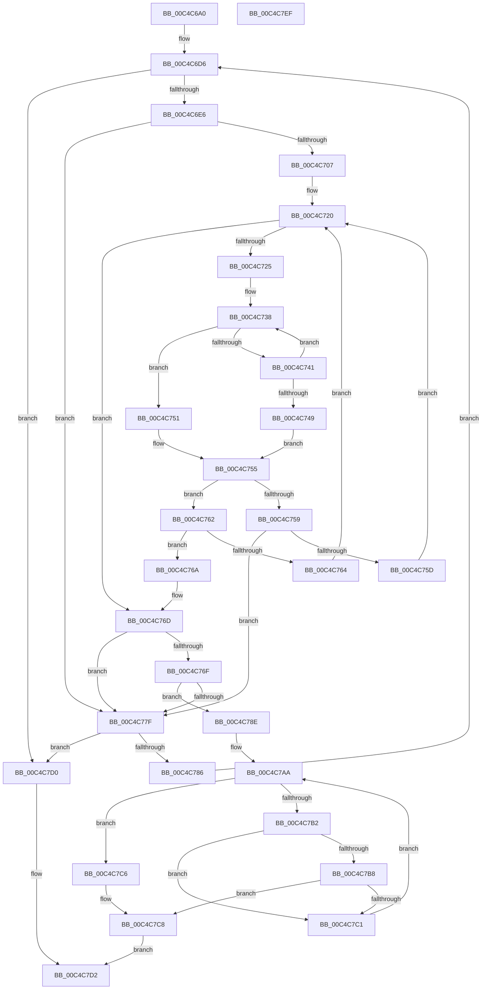

# ViThunkFindExportAddress

- RVA: `0x00C4C6A0`–`0x00C4C7F0` (길이 `336` bytes)
- VA: `0x0000000140C4C6A0`
- 실행 섹션: `INIT`
- PDB 이름 있음: `예`; PDB Function 태그: `아니요`
- unwind 정보 RVA: `0x000B0E24`
- 디코드: `111`개 명령, `336/336` bytes 표시
- 미해석 바이트: `0` (있으면 어셈블리에 `.byte`로 보존)

> 이 문서는 커널 이미지의 기계어와 PDB 기호를 분석해 생성했습니다. 4번과 5번은 함수 원형과 자료형을 바이너리 사용 방식에서 추정한 C 해석이며 원본 소스 복구 결과는 아닙니다.

## 1. Dependencies

- 직접 호출 지점: **1**; 고유 호출 대상: **1**
- 직접 호출자로 확인된 함수: **1**
- RIP 상대 이미지 참조: **1**

### Outgoing calls
- `0x00C4C6F7` → [RtlImageDirectoryEntryToData](../../text/43/RtlImageDirectoryEntryToData_function_004328D0.md) (function, `0x004328D0`)

### Direct callers
- [ViThunkFindAllExportAddresses](ViThunkFindAllExportAddresses_function_00C4C5F8.md) at `0x00C4C629`

### Static image references
- `0x00C4C6BC` → RVA `0x00EF54C0` (`.data`; read)

## 2. Other-region calls and transfers

- 다른 실행 섹션으로 향하는 call: **1**
  - `0x00C4C6F7` → [RtlImageDirectoryEntryToData](../../text/43/RtlImageDirectoryEntryToData_function_004328D0.md) (`INIT` → `.text`)
- 별도 외부 분기/꼬리 이동을 확인하지 못했습니다.

## 3. Assembly (complete function range)

```asm
00C4C6A0  48 89 5C 24 08                  mov qword ptr [rsp + 8], rbx
00C4C6A5  48 89 6C 24 18                  mov qword ptr [rsp + 0x18], rbp
00C4C6AA  48 89 74 24 20                  mov qword ptr [rsp + 0x20], rsi
00C4C6AF  57                              push rdi
00C4C6B0  41 54                           push r12
00C4C6B2  41 55                           push r13
00C4C6B4  41 56                           push r14
00C4C6B6  41 57                           push r15
00C4C6B8  48 83 EC 20                     sub rsp, 0x20
00C4C6BC  48 8B 3D FD 8D 2A 00            mov rdi, qword ptr [rip + 0x2a8dfd]
00C4C6C3  45 33 DB                        xor r11d, r11d
00C4C6C6  4C 8B F2                        mov r14, rdx
00C4C6C9  44 89 1A                        mov dword ptr [rdx], r11d
00C4C6CC  4C 8B E9                        mov r13, rcx
00C4C6CF  41 8B F3                        mov esi, r11d
00C4C6D2  41 8D 5B 01                     lea ebx, [r11 + 1]
00C4C6D6  48 8D 05 E3 8D 2A 00            lea rax, [rip + 0x2a8de3]
00C4C6DD  48 3B F8                        cmp rdi, rax
00C4C6E0  0F 84 EA 00 00 00               je 0x140c4c7d0
00C4C6E6  48 8B 6F 30                     mov rbp, qword ptr [rdi + 0x30]
00C4C6EA  4C 8D 4C 24 58                  lea r9, [rsp + 0x58]
00C4C6EF  48 8B CD                        mov rcx, rbp
00C4C6F2  45 33 C0                        xor r8d, r8d
00C4C6F5  8A D3                           mov dl, bl
00C4C6F7  E8 D4 61 7E FF                  call 0x1404328d0
00C4C6FC  45 33 DB                        xor r11d, r11d
00C4C6FF  4C 8B C8                        mov r9, rax
00C4C702  48 85 C0                        test rax, rax
00C4C705  74 78                           je 0x140c4c77f
00C4C707  44 8B 60 20                     mov r12d, dword ptr [rax + 0x20]
00C4C70B  45 8B D3                        mov r10d, r11d
00C4C70E  44 8B 78 24                     mov r15d, dword ptr [rax + 0x24]
00C4C712  4C 03 E5                        add r12, rbp
00C4C715  8B 50 18                        mov edx, dword ptr [rax + 0x18]
00C4C718  4C 03 FD                        add r15, rbp
00C4C71B  2B D3                           sub edx, ebx
00C4C71D  41 8B CB                        mov ecx, r11d
00C4C720  41 3B D2                        cmp edx, r10d
00C4C723  72 48                           jb 0x140c4c76d
00C4C725  42 8D 0C 12                     lea ecx, [rdx + r10]
00C4C729  49 8B C5                        mov rax, r13
00C4C72C  D1 E9                           shr ecx, 1
00C4C72E  45 8B 1C 8C                     mov r11d, dword ptr [r12 + rcx*4]
00C4C732  4C 03 DD                        add r11, rbp
00C4C735  4D 2B DD                        sub r11, r13
00C4C738  44 8A 00                        mov r8b, byte ptr [rax]
00C4C73B  46 3A 04 18                     cmp r8b, byte ptr [rax + r11]
00C4C73F  75 10                           jne 0x140c4c751
00C4C741  48 03 C3                        add rax, rbx
00C4C744  45 84 C0                        test r8b, r8b
00C4C747  75 EF                           jne 0x140c4c738
00C4C749  45 33 DB                        xor r11d, r11d
00C4C74C  41 8B C3                        mov eax, r11d
00C4C74F  EB 04                           jmp 0x140c4c755
00C4C751  1B C0                           sbb eax, eax
00C4C753  0B C3                           or eax, ebx
00C4C755  85 C0                           test eax, eax
00C4C757  79 09                           jns 0x140c4c762
00C4C759  85 C9                           test ecx, ecx
00C4C75B  74 22                           je 0x140c4c77f
00C4C75D  8D 51 FF                        lea edx, [rcx - 1]
00C4C760  EB BE                           jmp 0x140c4c720
00C4C762  7E 06                           jle 0x140c4c76a
00C4C764  44 8D 51 01                     lea r10d, [rcx + 1]
00C4C768  EB B6                           jmp 0x140c4c720
00C4C76A  41 3B D2                        cmp edx, r10d
00C4C76D  7C 10                           jl 0x140c4c77f
00C4C76F  45 8B 51 14                     mov r10d, dword ptr [r9 + 0x14]
00C4C773  8B C1                           mov eax, ecx
00C4C775  45 0F B7 04 47                  movzx r8d, word ptr [r15 + rax*2]
00C4C77A  45 3B C2                        cmp r8d, r10d
00C4C77D  72 0F                           jb 0x140c4c78e
00C4C77F  03 F3                           add esi, ebx
00C4C781  83 FE 02                        cmp esi, 2
00C4C784  74 4A                           je 0x140c4c7d0
00C4C786  48 8B 3F                        mov rdi, qword ptr [rdi]
00C4C789  E9 48 FF FF FF                  jmp 0x140c4c6d6
00C4C78E  41 8B 49 1C                     mov ecx, dword ptr [r9 + 0x1c]
00C4C792  4A 8D 04 81                     lea rax, [rcx + r8*4]
00C4C796  44 8B 0C 28                     mov r9d, dword ptr [rax + rbp]
00C4C79A  4C 8D 1C 29                     lea r11, [rcx + rbp]
00C4C79E  43 8B 14 83                     mov edx, dword ptr [r11 + r8*4]
00C4C7A2  4C 03 CD                        add r9, rbp
00C4C7A5  33 FF                           xor edi, edi
00C4C7A7  0F B7 CF                        movzx ecx, di
00C4C7AA  0F B7 C1                        movzx eax, cx
00C4C7AD  41 3B C2                        cmp eax, r10d
00C4C7B0  73 14                           jae 0x140c4c7c6
00C4C7B2  66 41 3B C8                     cmp cx, r8w
00C4C7B6  74 09                           je 0x140c4c7c1
00C4C7B8  0F B7 C1                        movzx eax, cx
00C4C7BB  41 39 14 83                     cmp dword ptr [r11 + rax*4], edx
00C4C7BF  74 07                           je 0x140c4c7c8
00C4C7C1  66 03 CB                        add cx, bx
00C4C7C4  EB E4                           jmp 0x140c4c7aa
00C4C7C6  8B DF                           mov ebx, edi
00C4C7C8  41 89 1E                        mov dword ptr [r14], ebx
00C4C7CB  49 8B C1                        mov rax, r9
00C4C7CE  EB 02                           jmp 0x140c4c7d2
00C4C7D0  33 C0                           xor eax, eax
00C4C7D2  48 8B 5C 24 50                  mov rbx, qword ptr [rsp + 0x50]
00C4C7D7  48 8B 6C 24 60                  mov rbp, qword ptr [rsp + 0x60]
00C4C7DC  48 8B 74 24 68                  mov rsi, qword ptr [rsp + 0x68]
00C4C7E1  48 83 C4 20                     add rsp, 0x20
00C4C7E5  41 5F                           pop r15
00C4C7E7  41 5E                           pop r14
00C4C7E9  41 5D                           pop r13
00C4C7EB  41 5C                           pop r12
00C4C7ED  5F                              pop rdi
00C4C7EE  C3                              ret
00C4C7EF  CC                              int3
```

## 4. C-style interpretation (structured pseudocode)

```c
__int64 __fastcall ViThunkFindExportAddress(__int64 a1, __int64 a2, int a3)
{
    __int64 result;
    __int64 v_r11;
    __int64 v_r12;
    __int64 v_r15;
    __int64 v_rdi;
    __int64 v_rsi;
    __int64 v_rsp;
    unsigned __int64 v_stack_p10;
    unsigned __int64 v_stack_p18;
    unsigned __int64 v_stack_p20;
    unsigned __int64 v_stack_p8;

    v_stack_p8 = v_rbx;
    v_stack_p18 = v_rbp;
    v_stack_p20 = v_rsi;
    v_rsp = (v_rsp) - (32);
    v_r11 = 0;
    *(unsigned int *)(a2) = 0;
loc_00C4C6D6:
    if ((*(unsigned __int64 *)(v_rip + 2788861)) == (v_rip + 2788835)) goto loc_00C4C7D0;
    a3 = 0;
    result = RtlImageDirectoryEntryToData(*(unsigned __int64 *)(*(unsigned __int64 *)(v_rip + 2788861) + 48), (unsigned __int8)(v_r11 + 1), a3, v_stack_p10);
    v_r11 = 0;
    if (result == 0) goto loc_00C4C77F;
    v_r12 = ((unsigned int)(*(unsigned int *)(result + 32))) + (*(unsigned __int64 *)(*(unsigned __int64 *)(v_rip + 2788861) + 48));
    v_r15 = ((unsigned int)(*(unsigned int *)(result + 36))) + (*(unsigned __int64 *)(*(unsigned __int64 *)(v_rip + 2788861) + 48));
    a2 = (unsigned int)(((unsigned int)(*(unsigned int *)(result + 24))) - ((unsigned int)(v_r11 + 1)));
loc_00C4C720:
    if (((unsigned int)(a2)) < 0) goto loc_00C4C76D;
    a1 = (unsigned int)((a2 + 0 * 1) >> (1));
    v_r11 = ((unsigned int)(*(unsigned int *)(v_r12 + a1 * 4))) + (*(unsigned __int64 *)(*(unsigned __int64 *)(v_rip + 2788861) + 48));
    v_r11 = (v_r11) - (a1);
loc_00C4C738:
    if (((unsigned __int8)(*(unsigned __int8 *)(a1))) != (*(unsigned __int8 *)(a1 + v_r11 * 1))) goto loc_00C4C751;
    result = (a1) + (v_r11 + 1);
    if ((unsigned __int8)(*(unsigned __int8 *)(a1)) != 0) goto loc_00C4C738;
    v_r11 = 0;
    goto loc_00C4C755;
loc_00C4C751:
    result = (unsigned int)((0) | ((unsigned int)(v_r11 + 1)));
loc_00C4C755:
    if (!sign_flag) goto loc_00C4C762;
    if ((unsigned int)(a1) == 0) goto loc_00C4C77F;
    goto loc_00C4C720;
loc_00C4C762:
    if (condition_is_less_or_equal) goto loc_00C4C76A;
    goto loc_00C4C720;
loc_00C4C76A:
loc_00C4C76D:
    if (((unsigned int)(a1 - 1)) < ((unsigned int)(a1 + 1))) goto loc_00C4C77F;
    if (((unsigned int)(*(unsigned __int16 *)(v_r15 + (unsigned int)((unsigned int)(a1)) * 2))) < ((unsigned int)((unsigned int)(*(unsigned int *)(result + 20))))) goto loc_00C4C78E;
loc_00C4C77F:
    v_rsi = (unsigned int)((0) + ((unsigned int)(v_r11 + 1)));
    if (((unsigned int)(v_rsi)) == 2) goto loc_00C4C7D0;
    goto loc_00C4C6D6;
loc_00C4C78E:
    a4 = ((unsigned int)(*(unsigned int *)((unsigned int)(*(unsigned int *)(result + 28)) + *(unsigned __int16 *)(v_r15 + (unsigned int)((unsigned int)(a1)) * 2) * 4 + *(unsigned __int64 *)(*(unsigned __int64 *)(v_rip + 2788861) + 48) * 1))) + (*(unsigned __int64 *)(*(unsigned __int64 *)(v_rip + 2788861) + 48));
    v_rdi = 0;
loc_00C4C7AA:
    if (0 >= ((unsigned int)((unsigned int)(*(unsigned int *)(result + 20))))) goto loc_00C4C7C6;
    if (0 == ((unsigned __int16)(*(unsigned __int16 *)(v_r15 + (unsigned int)((unsigned int)(a1)) * 2)))) goto loc_00C4C7C1;
    if ((*(unsigned int *)((unsigned int)(*(unsigned int *)(result + 28)) + *(unsigned __int64 *)(*(unsigned __int64 *)(v_rip + 2788861) + 48) * 1 + 0 * 4)) == ((unsigned int)((unsigned int)(*(unsigned int *)((unsigned int)(*(unsigned int *)(result + 28)) + *(unsigned __int64 *)(*(unsigned __int64 *)(v_rip + 2788861) + 48) * 1 + *(unsigned __int16 *)(v_r15 + (unsigned int)((unsigned int)(a1)) * 2) * 4))))) goto loc_00C4C7C8;
loc_00C4C7C1:
    a1 = (unsigned __int16)((0) + ((unsigned __int16)(v_r11 + 1)));
    goto loc_00C4C7AA;
loc_00C4C7C6:
loc_00C4C7C8:
    *(unsigned int *)(a2) = 0;
    goto loc_00C4C7D2;
loc_00C4C7D0:
    result = 0;
loc_00C4C7D2:
    v_rsp = (v_rsp) + (32);
    return result;
}
```

## 5. (Beta) C Style

```c
int64_t ViThunkFindExportAddress(void *Arg1, void *Arg2, int32_t Arg3)
{
    uint8_t *arg1 = (uint8_t *)Arg1;
    uint8_t *arg2 = (uint8_t *)Arg2;

    int64_t result;
    int64_t local_r11;
    int64_t local_r12;
    int64_t local_r15;
    int64_t local_rdi;
    int64_t local_rsi;
    int64_t local_rsp;
    uint64_t v_stack_p10;
    uint64_t v_stack_p18;
    uint64_t v_stack_p20;
    uint64_t v_stack_p8;

    v_stack_p8 = local_rbx;
    v_stack_p18 = local_rbp;
    v_stack_p20 = local_rsi;
    local_rsp = (local_rsp) - (32);
    local_r11 = 0;
    *(uint32_t *)(arg2) = 0;
loc_00C4C6D6:
    if ((*(uint64_t *)(v_rip + 0x2A8DFD)) == (v_rip + 2788835)) goto loc_00C4C7D0;
    Arg3 = 0;
    result = RtlImageDirectoryEntryToData(*(uint64_t *)(*(uint64_t *)(v_rip + 0x2A8DFD) + 0x30), (uint8_t)(local_r11 + 1), Arg3, v_stack_p10);
    local_r11 = 0;
    if (result == 0) goto loc_00C4C77F;
    local_r12 = ((uint32_t)(*(uint32_t *)(result + 0x20))) + (*(uint64_t *)(*(uint64_t *)(v_rip + 0x2A8DFD) + 0x30));
    local_r15 = ((uint32_t)(*(uint32_t *)(result + 0x24))) + (*(uint64_t *)(*(uint64_t *)(v_rip + 0x2A8DFD) + 0x30));
    Arg2 = (uint32_t)(((uint32_t)(*(uint32_t *)(result + 0x18))) - ((uint32_t)(local_r11 + 1)));
loc_00C4C720:
    if (((uint32_t)(Arg2)) < 0) goto loc_00C4C76D;
    Arg1 = (uint32_t)((Arg2 + 0 * 1) >> (1));
    local_r11 = ((uint32_t)(*(uint32_t *)(local_r12 + arg1 * 4))) + (*(uint64_t *)(*(uint64_t *)(v_rip + 0x2A8DFD) + 0x30));
    local_r11 = (local_r11) - (Arg1);
loc_00C4C738:
    if (((uint8_t)(*(uint8_t *)(arg1))) != (*(uint8_t *)(arg1 + local_r11 * 1))) goto loc_00C4C751;
    result = (Arg1) + (local_r11 + 1);
    if ((uint8_t)(*(uint8_t *)(arg1)) != 0) goto loc_00C4C738;
    local_r11 = 0;
    goto loc_00C4C755;
loc_00C4C751:
    result = (uint32_t)((0) | ((uint32_t)(local_r11 + 1)));
loc_00C4C755:
    if (!sign_flag) goto loc_00C4C762;
    if ((uint32_t)(Arg1) == 0) goto loc_00C4C77F;
    goto loc_00C4C720;
loc_00C4C762:
    if (condition_is_less_or_equal) goto loc_00C4C76A;
    goto loc_00C4C720;
loc_00C4C76A:
loc_00C4C76D:
    if (((uint32_t)(Arg1 - 1)) < ((uint32_t)(Arg1 + 1))) goto loc_00C4C77F;
    if (((uint32_t)(*(uint16_t *)(local_r15 + (uint32_t)((uint32_t)(arg1)) * 2))) < ((uint32_t)((uint32_t)(*(uint32_t *)(result + 0x14))))) goto loc_00C4C78E;
loc_00C4C77F:
    local_rsi = (uint32_t)((0) + ((uint32_t)(local_r11 + 1)));
    if (((uint32_t)(local_rsi)) == 2) goto loc_00C4C7D0;
    goto loc_00C4C6D6;
loc_00C4C78E:
    a4 = ((uint32_t)(*(uint32_t *)((uint32_t)(*(uint32_t *)(result + 0x1C)) + *(uint16_t *)(local_r15 + (uint32_t)((uint32_t)(arg1)) * 2) * 4 + *(uint64_t *)(*(uint64_t *)(v_rip + 0x2A8DFD) + 0x30) * 1))) + (*(uint64_t *)(*(uint64_t *)(v_rip + 0x2A8DFD) + 0x30));
    local_rdi = 0;
loc_00C4C7AA:
    if (0 >= ((uint32_t)((uint32_t)(*(uint32_t *)(result + 0x14))))) goto loc_00C4C7C6;
    if (0 == ((uint16_t)(*(uint16_t *)(local_r15 + (uint32_t)((uint32_t)(arg1)) * 2)))) goto loc_00C4C7C1;
    if ((*(uint32_t *)((uint32_t)(*(uint32_t *)(result + 0x1C)) + *(uint64_t *)(*(uint64_t *)(v_rip + 0x2A8DFD) + 0x30) * 1 + 0x0 * 4)) == ((uint32_t)((uint32_t)(*(uint32_t *)((uint32_t)(*(uint32_t *)(result + 0x1C)) + *(uint64_t *)(*(uint64_t *)(v_rip + 0x2A8DFD) + 0x30) * 1 + *(uint16_t *)(local_r15 + (uint32_t)((uint32_t)(arg1)) * 2) * 4))))) goto loc_00C4C7C8;
loc_00C4C7C1:
    Arg1 = (uint16_t)((0) + ((uint16_t)(local_r11 + 1)));
    goto loc_00C4C7AA;
loc_00C4C7C6:
loc_00C4C7C8:
    *(uint32_t *)(arg2) = 0;
    goto loc_00C4C7D2;
loc_00C4C7D0:
    result = 0;
loc_00C4C7D2:
    local_rsp = (local_rsp) + (32);
    return result;
}
```

### 관측된 메모리 오프셋

구조체 형식이 확인되지 않은 접근은 인자 기준의 오프셋으로만 기록했습니다.

| 기준 인자 | 오프셋 표현 | 폭 (bit) | 접근 |
|---|---:|---:|---|
| `Arg1` | `+ 0x0` | `8` | `R` |
| `Arg1` | `+ 0x0 + r11*1` | `8` | `R` |
| `Arg2` | `+ 0x0` | `32` | `W` |

## 6. Execution-region graph

[열기: 2D/3D 그래프와 함수 탐색 컨트롤 패널](../../../control-panel.html?section=init&rva=0x00C4C6A0&view=graph)

- 2D 그래프는 위에서 아래로 흐르고, 3D 그래프는 빈 공간을 드래그해 회전합니다. Shift+드래그는 이동, 휠은 확대·축소, 함수 노드 선택은 대상 보고서 이동입니다.

### Static fallback


