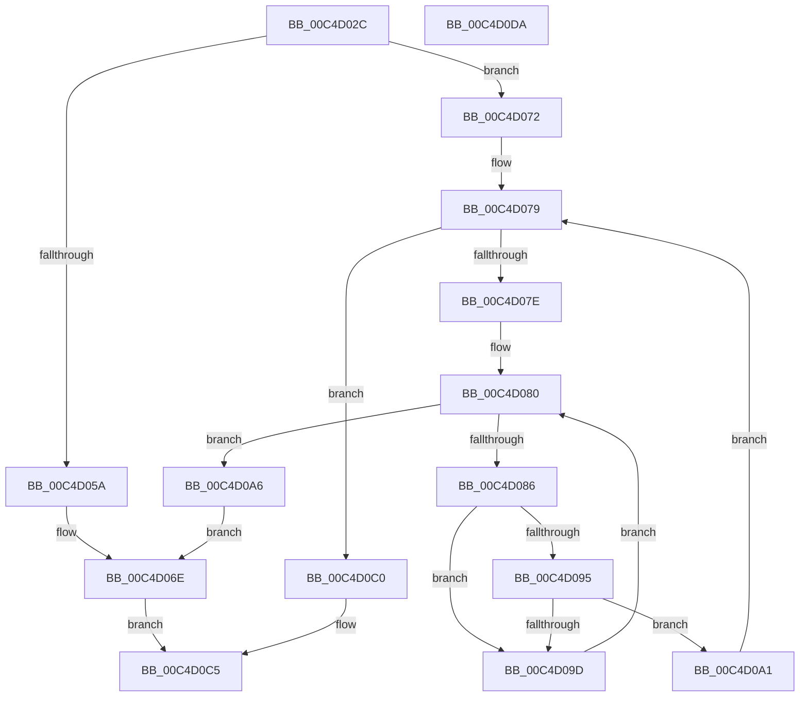

# ViTriageSameDriversFromDump

- RVA: `0x00C4D02C`–`0x00C4D0DB` (길이 `175` bytes)
- VA: `0x0000000140C4D02C`
- 실행 섹션: `INIT`
- PDB 이름 있음: `예`; PDB Function 태그: `아니요`
- unwind 정보 RVA: `0x000AEEA8`
- 디코드: `53`개 명령, `175/175` bytes 표시
- 미해석 바이트: `0` (있으면 어셈블리에 `.byte`로 보존)

> 이 문서는 커널 이미지의 기계어와 PDB 기호를 분석해 생성했습니다. 4번과 5번은 함수 원형과 자료형을 바이너리 사용 방식에서 추정한 C 해석이며 원본 소스 복구 결과는 아닙니다.

## 1. Dependencies

- 직접 호출 지점: **4**; 고유 호출 대상: **3**
- 직접 호출자로 확인된 함수: **1**
- RIP 상대 이미지 참조: **2**

### Outgoing calls
- `0x00C4D051` → [TriageGetDriverCount](../C6/TriageGetDriverCount_function_00C6FA08.md) (function, `0x00C6FA08`)
- `0x00C4D069` → [DbgPrintEx](../../text/35/DbgPrintEx_function_00359290.md) (function, `0x00359290`)
- `0x00C4D08B` → [TriageGetLoaderEntry](../../text/6A/TriageGetLoaderEntry_function_006A8528.md) (function, `0x006A8528`)
- `0x00C4D0B9` → [DbgPrintEx](../../text/35/DbgPrintEx_function_00359290.md) (function, `0x00359290`)

### Direct callers
- [VfTriageSystem](VfTriageSystem_function_00C4CB34.md) at `0x00C4CD06`

### Static image references
- `0x00C4D05F` → RVA `0x00C7D420` (` ?? ::PBOPGDP::`string'`; read)
- `0x00C4D0AF` → RVA `0x00C7D390` (` ?? ::PBOPGDP::`string'`; read)

## 2. Other-region calls and transfers

- 다른 실행 섹션으로 향하는 call: **3**
  - `0x00C4D069` → [DbgPrintEx](../../text/35/DbgPrintEx_function_00359290.md) (`INIT` → `.text`)
  - `0x00C4D08B` → [TriageGetLoaderEntry](../../text/6A/TriageGetLoaderEntry_function_006A8528.md) (`INIT` → `.text`)
  - `0x00C4D0B9` → [DbgPrintEx](../../text/35/DbgPrintEx_function_00359290.md) (`INIT` → `.text`)
- 별도 외부 분기/꼬리 이동을 확인하지 못했습니다.

## 3. Assembly (complete function range)

```asm
00C4D02C  48 8B C4                        mov rax, rsp
00C4D02F  48 89 58 08                     mov qword ptr [rax + 8], rbx
00C4D033  48 89 68 10                     mov qword ptr [rax + 0x10], rbp
00C4D037  48 89 70 20                     mov qword ptr [rax + 0x20], rsi
00C4D03B  57                              push rdi
00C4D03C  48 83 EC 20                     sub rsp, 0x20
00C4D040  83 60 18 00                     and dword ptr [rax + 0x18], 0
00C4D044  48 8B EA                        mov rbp, rdx
00C4D047  48 8B F1                        mov rsi, rcx
00C4D04A  48 8D 50 18                     lea rdx, [rax + 0x18]
00C4D04E  48 8B CD                        mov rcx, rbp
00C4D051  E8 B2 29 02 00                  call 0x140c6fa08
00C4D056  85 C0                           test eax, eax
00C4D058  79 18                           jns 0x140c4d072
00C4D05A  BA 03 00 00 00                  mov edx, 3
00C4D05F  4C 8D 05 BA 03 03 00            lea r8, [rip + 0x303ba]
00C4D066  8D 4A 5A                        lea ecx, [rdx + 0x5a]
00C4D069  E8 22 C2 70 FF                  call 0x140359290
00C4D06E  33 C0                           xor eax, eax
00C4D070  EB 53                           jmp 0x140c4d0c5
00C4D072  48 83 C6 10                     add rsi, 0x10
00C4D076  48 8B 1E                        mov rbx, qword ptr [rsi]
00C4D079  48 3B DE                        cmp rbx, rsi
00C4D07C  74 42                           je 0x140c4d0c0
00C4D07E  33 FF                           xor edi, edi
00C4D080  3B 7C 24 40                     cmp edi, dword ptr [rsp + 0x40]
00C4D084  73 20                           jae 0x140c4d0a6
00C4D086  8B D7                           mov edx, edi
00C4D088  48 8B CD                        mov rcx, rbp
00C4D08B  E8 98 B4 A5 FF                  call 0x1406a8528
00C4D090  48 85 C0                        test rax, rax
00C4D093  74 08                           je 0x140c4d09d
00C4D095  8B 40 78                        mov eax, dword ptr [rax + 0x78]
00C4D098  39 43 78                        cmp dword ptr [rbx + 0x78], eax
00C4D09B  74 04                           je 0x140c4d0a1
00C4D09D  FF C7                           inc edi
00C4D09F  EB DF                           jmp 0x140c4d080
00C4D0A1  48 8B 1B                        mov rbx, qword ptr [rbx]
00C4D0A4  EB D3                           jmp 0x140c4d079
00C4D0A6  BA 03 00 00 00                  mov edx, 3
00C4D0AB  4C 8D 4B 58                     lea r9, [rbx + 0x58]
00C4D0AF  4C 8D 05 DA 02 03 00            lea r8, [rip + 0x302da]
00C4D0B6  8D 4A 5A                        lea ecx, [rdx + 0x5a]
00C4D0B9  E8 D2 C1 70 FF                  call 0x140359290
00C4D0BE  EB AE                           jmp 0x140c4d06e
00C4D0C0  B8 01 00 00 00                  mov eax, 1
00C4D0C5  48 8B 5C 24 30                  mov rbx, qword ptr [rsp + 0x30]
00C4D0CA  48 8B 6C 24 38                  mov rbp, qword ptr [rsp + 0x38]
00C4D0CF  48 8B 74 24 48                  mov rsi, qword ptr [rsp + 0x48]
00C4D0D4  48 83 C4 20                     add rsp, 0x20
00C4D0D8  5F                              pop rdi
00C4D0D9  C3                              ret
00C4D0DA  CC                              int3
```

## 4. C-style interpretation (structured pseudocode)

```c
__int64 __fastcall ViTriageSameDriversFromDump(__int64 a1, __int64 a2)
{
    __int64 result;
    __int64 v_rdi;
    __int64 v_rsi;
    __int64 v_rsp;
    unsigned __int64 v_stack_p10;
    unsigned int v_stack_p18;
    unsigned __int64 v_stack_p20;
    unsigned __int64 v_stack_p8;

    *(unsigned __int64 *)(v_rsp + 8) = v_rbx;
    *(unsigned __int64 *)(v_rsp + 16) = v_rbp;
    *(unsigned __int64 *)(v_rsp + 32) = v_rsi;
    v_rsp = (v_rsp) - (32);
    result = TriageGetDriverCount(a2, v_rsp + 24, a3, a4);
    if (!sign_flag) goto loc_00C4D072;
    result = DbgPrintEx(3 + 90, 3, v_rip + 197562, a4);
loc_00C4D06E:
    result = 0;
    goto loc_00C4D0C5;
loc_00C4D072:
    v_rsi = (a1) + (16);
loc_00C4D079:
    if ((*(unsigned __int64 *)(v_rsi)) == v_rsi) goto loc_00C4D0C0;
    v_rdi = 0;
loc_00C4D080:
    if (0 >= v_stack_p18) goto loc_00C4D0A6;
    result = TriageGetLoaderEntry(a2, 0, v_rip + 197562, a4);
    if (result == 0) goto loc_00C4D09D;
    if ((*(unsigned int *)(*(unsigned __int64 *)(v_rsi) + 120)) == ((unsigned int)((unsigned int)(*(unsigned int *)(result + 120))))) goto loc_00C4D0A1;
loc_00C4D09D:
    v_rdi = (unsigned int)((v_rdi) + 1);
    goto loc_00C4D080;
loc_00C4D0A1:
    goto loc_00C4D079;
loc_00C4D0A6:
    result = DbgPrintEx(3 + 90, 3, v_rip + 197338, *(unsigned __int64 *)(*(unsigned __int64 *)(v_rsi)) + 88);
    goto loc_00C4D06E;
loc_00C4D0C0:
loc_00C4D0C5:
    v_rsp = (v_rsp) + (32);
    return 1;
}
```

## 5. (Beta) C Style

```c
int64_t ViTriageSameDriversFromDump(void *Arg1, int64_t Arg2)
{
    uint8_t *arg1 = (uint8_t *)Arg1;

    int64_t result;
    int64_t local_rdi;
    int64_t local_rsi;
    int64_t local_rsp;
    uint64_t v_stack_p10;
    uint32_t v_stack_p18;
    uint64_t v_stack_p20;
    uint64_t v_stack_p8;

    *(uint64_t *)(local_rsp + 0x8) = local_rbx;
    *(uint64_t *)(local_rsp + 0x10) = local_rbp;
    *(uint64_t *)(local_rsp + 0x20) = local_rsi;
    local_rsp = (local_rsp) - (32);
    result = TriageGetDriverCount(Arg2, local_rsp + 24, a3, a4);
    if (!sign_flag) goto loc_00C4D072;
    result = DbgPrintEx(3 + 90, 3, v_rip + 197562, a4);
loc_00C4D06E:
    result = 0;
    goto loc_00C4D0C5;
loc_00C4D072:
    local_rsi = (Arg1) + (16);
loc_00C4D079:
    if ((*(uint64_t *)(local_rsi)) == local_rsi) goto loc_00C4D0C0;
    local_rdi = 0;
loc_00C4D080:
    if (0 >= v_stack_p18) goto loc_00C4D0A6;
    result = TriageGetLoaderEntry(Arg2, 0, v_rip + 197562, a4);
    if (result == 0) goto loc_00C4D09D;
    if ((*(uint32_t *)(*(uint64_t *)(local_rsi) + 0x78)) == ((uint32_t)((uint32_t)(*(uint32_t *)(result + 0x78))))) goto loc_00C4D0A1;
loc_00C4D09D:
    local_rdi = (uint32_t)((local_rdi) + 1);
    goto loc_00C4D080;
loc_00C4D0A1:
    goto loc_00C4D079;
loc_00C4D0A6:
    result = DbgPrintEx(3 + 90, 3, v_rip + 197338, *(uint64_t *)(*(uint64_t *)(local_rsi)) + 88);
    goto loc_00C4D06E;
loc_00C4D0C0:
loc_00C4D0C5:
    local_rsp = (local_rsp) + (32);
    return 1;
}
```

### 관측된 메모리 오프셋

구조체 형식이 확인되지 않은 접근은 인자 기준의 오프셋으로만 기록했습니다.

| 기준 인자 | 오프셋 표현 | 폭 (bit) | 접근 |
|---|---:|---:|---|
| `Arg1` | `+ 0x0` | `64` | `R` |

## 6. Execution-region graph

[열기: 2D/3D 그래프와 함수 탐색 컨트롤 패널](../../../control-panel.html?section=init&rva=0x00C4D02C&view=graph)

- 2D 그래프는 위에서 아래로 흐르고, 3D 그래프는 빈 공간을 드래그해 회전합니다. Shift+드래그는 이동, 휠은 확대·축소, 함수 노드 선택은 대상 보고서 이동입니다.

### Static fallback


