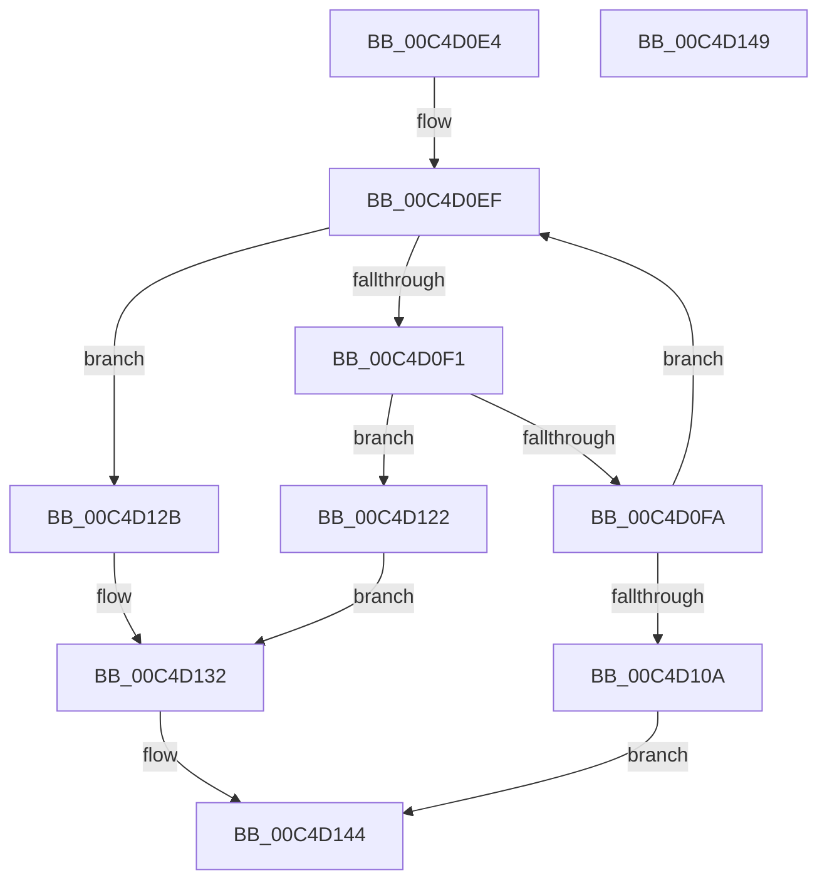

# ViValidateTriageRules

- RVA: `0x00C4D0E4`–`0x00C4D14A` (길이 `102` bytes)
- VA: `0x0000000140C4D0E4`
- 실행 섹션: `INIT`
- PDB 이름 있음: `예`; PDB Function 태그: `아니요`
- unwind 정보 RVA: `0x0005C788`
- 디코드: `28`개 명령, `102/102` bytes 표시
- 미해석 바이트: `0` (있으면 어셈블리에 `.byte`로 보존)

> 이 문서는 커널 이미지의 기계어와 PDB 기호를 분석해 생성했습니다. 4번과 5번은 함수 원형과 자료형을 바이너리 사용 방식에서 추정한 C 해석이며 원본 소스 복구 결과는 아닙니다.

## 1. Dependencies

- 직접 호출 지점: **2**; 고유 호출 대상: **1**
- 직접 호출자로 확인된 함수: **1**
- RIP 상대 이미지 참조: **3**

### Outgoing calls
- `0x00C4D119` → [DbgPrintEx](../../text/35/DbgPrintEx_function_00359290.md) (function, `0x00359290`)
- `0x00C4D13A` → [DbgPrintEx](../../text/35/DbgPrintEx_function_00359290.md) (function, `0x00359290`)

### Direct callers
- [VfTriageSystem](VfTriageSystem_function_00C4CB34.md) at `0x00C4CD2B`
- [VfTriageSystem](VfTriageSystem_function_00C4CB34.md) at `0x00C4CD50`

### Static image references
- `0x00C4D10F` → RVA `0x00C7D610` (` ?? ::PBOPGDP::`string'`; read)
- `0x00C4D122` → RVA `0x00C7D640` (` ?? ::PBOPGDP::`string'`; read)
- `0x00C4D12B` → RVA `0x00C7D6B0` (` ?? ::PBOPGDP::`string'`; read)

## 2. Other-region calls and transfers

- 다른 실행 섹션으로 향하는 call: **2**
  - `0x00C4D119` → [DbgPrintEx](../../text/35/DbgPrintEx_function_00359290.md) (`INIT` → `.text`)
  - `0x00C4D13A` → [DbgPrintEx](../../text/35/DbgPrintEx_function_00359290.md) (`INIT` → `.text`)
- 별도 외부 분기/꼬리 이동을 확인하지 못했습니다.

## 3. Assembly (complete function range)

```asm
00C4D0E4  48 83 EC 28                     sub rsp, 0x28
00C4D0E8  4C 8D 04 11                     lea r8, [rcx + rdx]
00C4D0EC  49 3B C8                        cmp rcx, r8
00C4D0EF  73 3A                           jae 0x140c4d12b
00C4D0F1  8B 01                           mov eax, dword ptr [rcx]
00C4D0F3  A9 00 00 07 00                  test eax, 0x70000
00C4D0F8  74 28                           je 0x140c4d122
00C4D0FA  48 C1 E8 13                     shr rax, 0x13
00C4D0FE  48 83 C1 08                     add rcx, 8
00C4D102  48 03 C8                        add rcx, rax
00C4D105  49 3B C8                        cmp rcx, r8
00C4D108  76 E5                           jbe 0x140c4d0ef
00C4D10A  BA 03 00 00 00                  mov edx, 3
00C4D10F  4C 8D 05 FA 04 03 00            lea r8, [rip + 0x304fa]
00C4D116  8D 4A 5A                        lea ecx, [rdx + 0x5a]
00C4D119  E8 72 C1 70 FF                  call 0x140359290
00C4D11E  33 C0                           xor eax, eax
00C4D120  EB 22                           jmp 0x140c4d144
00C4D122  4C 8D 05 17 05 03 00            lea r8, [rip + 0x30517]
00C4D129  EB 07                           jmp 0x140c4d132
00C4D12B  4C 8D 05 7E 05 03 00            lea r8, [rip + 0x3057e]
00C4D132  BA 03 00 00 00                  mov edx, 3
00C4D137  8D 4A 5A                        lea ecx, [rdx + 0x5a]
00C4D13A  E8 51 C1 70 FF                  call 0x140359290
00C4D13F  B8 01 00 00 00                  mov eax, 1
00C4D144  48 83 C4 28                     add rsp, 0x28
00C4D148  C3                              ret
00C4D149  CC                              int3
```

## 4. C-style interpretation (structured pseudocode)

```c
__int64 __fastcall ViValidateTriageRules(__int64 a1, __int64 a2)
{
    __int64 result;
    __int64 v_rsp;

    v_rsp = (v_rsp) - (40);
loc_00C4D0EF:
    if (a1 >= (a1 + a2 * 1)) goto loc_00C4D12B;
    if ((((unsigned int)((unsigned int)(*(unsigned int *)(a1)))) & (0x70000ULL)) == 0) goto loc_00C4D122;
    result = ((unsigned int)(*(unsigned int *)(a1))) >> (19);
    a1 = (a1) + (8);
    a1 = (a1) + (result);
    if (a1 <= (a1 + a2 * 1)) goto loc_00C4D0EF;
    result = DbgPrintEx(3 + 90, 3, v_rip + 197882, a4);
    result = 0;
    goto loc_00C4D144;
loc_00C4D122:
    goto loc_00C4D132;
loc_00C4D12B:
loc_00C4D132:
    result = DbgPrintEx(3 + 90, 3, v_rip + 198014, a4);
loc_00C4D144:
    v_rsp = (v_rsp) + (40);
    return 1;
}
```

## 5. (Beta) C Style

```c
int64_t ViValidateTriageRules(void *Arg1, int64_t Arg2)
{
    uint8_t *arg1 = (uint8_t *)Arg1;

    int64_t result;
    int64_t local_rsp;

    local_rsp = (local_rsp) - (40);
loc_00C4D0EF:
    if (Arg1 >= (Arg1 + Arg2 * 1)) goto loc_00C4D12B;
    if ((((uint32_t)((uint32_t)(*(uint32_t *)(arg1)))) & (0x70000ULL)) == 0) goto loc_00C4D122;
    result = ((uint32_t)(*(uint32_t *)(arg1))) >> (19);
    Arg1 = (Arg1) + (8);
    Arg1 = (Arg1) + (result);
    if (Arg1 <= (Arg1 + Arg2 * 1)) goto loc_00C4D0EF;
    result = DbgPrintEx(3 + 90, 3, v_rip + 197882, a4);
    result = 0;
    goto loc_00C4D144;
loc_00C4D122:
    goto loc_00C4D132;
loc_00C4D12B:
loc_00C4D132:
    result = DbgPrintEx(3 + 90, 3, v_rip + 198014, a4);
loc_00C4D144:
    local_rsp = (local_rsp) + (40);
    return 1;
}
```

### 관측된 메모리 오프셋

구조체 형식이 확인되지 않은 접근은 인자 기준의 오프셋으로만 기록했습니다.

| 기준 인자 | 오프셋 표현 | 폭 (bit) | 접근 |
|---|---:|---:|---|
| `Arg1` | `+ 0x0 + rdx*1` | `64` | `R` |

## 6. Execution-region graph

[열기: 2D/3D 그래프와 함수 탐색 컨트롤 패널](../../../control-panel.html?section=init&rva=0x00C4D0E4&view=graph)

- 2D 그래프는 위에서 아래로 흐르고, 3D 그래프는 빈 공간을 드래그해 회전합니다. Shift+드래그는 이동, 휠은 확대·축소, 함수 노드 선택은 대상 보고서 이동입니다.

### Static fallback


